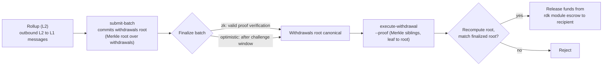

# ZK / STARK et retraits

Cette page couvre deux sujets connexes : les **systèmes de preuve ZK** (`snark` et `stark`) utilisés par les rollups réglés en ZK, et le **flux de retrait L2 → L1** qui ramène des fonds d'un rollup vers QoreChain une fois qu'un lot est finalisé.

:::caution Capacité à un stade précoce
Aucun rollup n'a encore été créé sur l'un ou l'autre réseau (vérifié le 23 octobre 2026), donc ni la vérification des preuves ni le flux de retrait décrits ici n'ont été exercés sur un rollup en production. Les retraits ne peuvent aboutir sur le mainnet qu'à partir de la v3.2.3 (hauteur 3,662,051, 20 octobre 2026), lorsque le registre d'escrow par rollup est entré en service (voir [D'où viennent les fonds](#where-the-funds-come-from)) ; auparavant, chaque retrait échouait. La vérification SNARK existe, mais un rollup créé via `create-rollup` ne peut pas encore finaliser un lot ZK, et la vérification STARK est expérimentale. Validez sur le testnet **`qorechain-diana`** et ne présumez pas de garanties durcies pour la production sur le mainnet.
:::

---

## Systèmes de preuve ZK

Un rollup réglé en ZK (mode de règlement `zk`) attache une preuve de validité à chaque lot de règlement, prouvant que la transition d'état est correcte sans réexécuter les transactions du rollup. Le règlement ZK prend en charge deux systèmes de preuve :

| Système de preuve | Caractéristiques |
| ------------ | --------------- |
| **`snark`** | Preuves succinctes (Groth16 sur BLS12-381), vérifiées on-chain par rapport à la clé de vérification du rollup |
| **`stark`** | Preuves transparentes, sans configuration de confiance — expérimental ; opt-in et lié à un circuit de démonstration |

Le mode de règlement `zk` requiert l'un de `snark` ou `stark` ; l'appariement est imposé on-chain lors de la création du rollup. À l'inverse, le règlement `optimistic` utilise le système de preuve `fraud`, et les règlements `based` et `sovereign` utilisent `none`. Consultez la **[Vue d'ensemble des rollups](/rollups/overview)** pour la matrice de compatibilité complète.

### Finalité

Contrairement aux rollups optimistes — qui attendent la fin d'une fenêtre de contestation par preuve de fraude — un lot ZK peut être finalisé sur **vérification d'une preuve valide**, sans fenêtre de litige. C'est le compromis fondamental du règlement ZK : une finalité plus forte et plus rapide en échange du coût et de la complexité de la génération des preuves.

### Maturité

Les lots SNARK sont vérifiés on-chain (Groth16 sur BLS12-381) par rapport à une clé de vérification stockée avec le rollup. Un rollup créé via `create-rollup` ne porte actuellement pas de clé de vérification, donc les lots ZK ne peuvent pas encore être finalisés de bout en bout. La vérification STARK est expérimentale : elle est opt-in et vérifie un circuit de démonstration, et non la transition d'état propre à votre rollup. Considérez le règlement ZK comme non prêt pour la production, et suivez les notes de version du RDK avant de vous y fier pour des rollups mainnet porteurs de valeur.

---

## Comment les lots transportent les retraits

Lorsqu'un rollup règle un lot, ce lot peut aussi valider les messages inter-couches sortants du rollup — ses **retraits L2 → L1**. Conceptuellement :

* Un lot finalisé peut transporter un engagement (commitment) sur son ensemble de retraits (une racine de Merkle sur les messages de retrait du lot).
* Chaque retrait individuel est une feuille sous cette racine, identifiée par son index de lot et un index de retrait.
* Une fois le lot finalisé, n'importe quelle partie peut prouver qu'une feuille de retrait spécifique est incluse sous la racine engagée, et déclencher le paiement.

C'est pourquoi les retraits dépendent du règlement : un retrait ne peut être exécuté que sur un lot **finalisé**, car c'est la finalisation qui rend canonique la racine des retraits engagée.

Pour savoir comment les lots sont soumis et finalisés — y compris `submit-batch` et le chemin de litige `challenge-batch` pour les rollups optimistes — consultez **[Déployer un rollup](/rollups/deploying-a-rollup)**.

---

## Exécuter un retrait : `execute-withdrawal`

La commande `execute-withdrawal` finalise un retrait L2 → L1 sur la racine des retraits d'un lot finalisé. Elle prouve qu'une feuille de retrait est engagée dans cette racine et paie le destinataire depuis l'escrow du module rdk. L'action est **sans permission** — quiconque peut soumettre une preuve valide. Comme toute transaction de la voie native, elle nécessite la co-signature post-quantique hybride : construisez-la donc avec `--generate-only` et co-signez-la (voir [Déployer un rollup](/rollups/deploying-a-rollup)). Les retraits n'ont pas encore été exercés sur un rollup en production ; considérez ce flux comme non testé. Vérifiez ces points avant de payer des frais, car la chaîne refuse sinon la transaction : la dénomination doit être exactement `uqor`, le montant doit être positif, la preuve comporte au plus 64 niveaux et chaque frère fait exactement 32 octets, l'émetteur et le destinataire sont des adresses `qor1…` valides, le lot est finalisé et a engagé une `withdrawals_root`, le rollup n'est pas arrêté, et cette feuille de retrait n'a pas déjà été payée. Le `@qorechain/rdk` TypeScript 0.6.0 exécute pour vous le premier groupe de ces contrôles (`withdrawalErrors` : adresses, dénomination, montant, profondeur de la preuve et longueur des frères), et `executeWithdrawal` lève une erreur avant de diffuser si l'un d'eux échoue ; les conditions relatives au lot, au rollup et au registre dépendent de l'état de la chaîne, que ce contrôle ne lit pas.

```bash
qorechaind tx rdk execute-withdrawal \
  [rollup-id] [batch-index] [withdrawal-index] [recipient] [denom] [amount] \
  --proof <sibling-hash-1>,<sibling-hash-2>,... \
  --from mykey \
  --chain-id qorechain-diana \
  --gas 400000 --fees 40000uqor \
  --generate-only > withdrawal.json
qorechaind tx pqc cosign withdrawal.json --from mykey --pqc-key mypqckey --chain-id qorechain-diana
```

**Arguments positionnels :**

| Argument | Description |
| -------- | ----------- |
| `rollup-id` | Le rollup auquel appartient le retrait |
| `batch-index` | Le lot finalisé dont la racine des retraits engage ce retrait |
| `withdrawal-index` | L'index de la feuille de retrait au sein de ce lot |
| `recipient` | L'adresse à laquelle payer |
| `denom` | La dénomination à payer |
| `amount` | Le montant à payer |

**Drapeau :**

| Drapeau | Description |
| ---- | ----------- |
| `--proof` | Hachages frères (siblings) de Merkle hexadécimaux séparés par des virgules, ordonnés de la feuille à la racine, qui prouvent que la feuille de retrait est engagée dans la racine des retraits du lot |

La valeur `--proof` est la preuve d'inclusion : les hachages frères le long du chemin allant de la feuille de retrait jusqu'à la racine des retraits engagée du lot. Le module recalcule la racine à partir de la feuille et des frères fournis, et la compare à la racine engagée du lot finalisé avant de payer.

### Encodage des feuilles et des nœuds {#leaf-and-node-encoding}

* **Feuille** = SHAKE-256 (32 octets) de `rollup_id`, un octet `0x00`, l'index de retrait (8 octets, big-endian), la chaîne `recipient`, `0x00`, la chaîne `denom`, `0x00`, et le `amount` (8 octets, big-endian).
* **Parent** = SHAKE-256 de `left || right`. À chaque niveau, le bit correspondant de l'index de retrait détermine le côté : `0` signifie que la feuille (ou le hachage courant) est le nœud gauche.
* Chaque hachage frère doit faire exactement 32 octets.

:::caution Les utilitaires Merkle génériques ne correspondent pas
Les utilitaires génériques `binaryMerkleRoot` / `binaryMerkleProof` du RDK utilisent par défaut SHA-256 avec duplication des nœuds impairs. Remplacez la fonction de hachage et l'encodage des feuilles par les règles ci-dessus, faute de quoi la preuve ne sera pas vérifiée on-chain.
:::

### D'où viennent les fonds {#where-the-funds-come-from}

Un retrait est payé depuis le **stake placé sous escrow par le rollup lui-même** (le stake moins la destruction de 1 % à la création). L'escrow de tous les rollups se trouve dans un solde de module unique et mutualisé, et depuis la **v3.2.3**, un **registre d'escrow** par rollup tient la comptabilité de ce que détient chaque rollup : `create-rollup` le crédite de l'escrow que le rollup conserve, un retrait ou une récompense de preuve de fraude est payé à partir de ce registre et y est débité, et un retrait supérieur à ce que le rollup détient encore est refusé avec une erreur d'escrow insuffisant. `stop-rollup` ne rembourse que ce qui reste et remet le registre à zéro, et un rollup arrêté ne paie plus aucun retrait. Un retrait prouvé pour un rollup ne peut donc pas être payé sur le stake d'un autre rollup. Les requêtes de rollup portent `escrow_balance` (les uqor encore détenus pour ce rollup). Le module ne comporte aucun message de dépôt L1 → L2 ; il ne s'agit donc pas d'un pont de fonds d'utilisateurs.

---

## Flux de retrait de bout en bout

*Le chemin L2 vers L1 : un lot de règlement engage une racine de retraits, le lot est finalisé, puis une preuve d'inclusion sans permission libère les fonds sous escrow sur QoreChain.*



1. **Régler un lot.** L'opérateur du rollup soumet un lot de règlement avec `submit-batch`. Le lot peut engager une racine de retraits sur ses messages sortants L2 → L1.
2. **Finaliser.** Le lot est finalisé selon le mode de règlement du rollup — sur vérification d'une preuve valide pour `zk`, ou après la fenêtre de contestation pour `optimistic` (durant laquelle `challenge-batch` peut le contester). La fenêtre optimiste est par défaut de 100,800 blocs pour un lot soumis avant la mise à niveau v3.2.4 ; à partir de la v3.2.4, elle se mesure en secondes de temps de bloc pour les lots soumis à partir de la hauteur de mise à niveau (testnet depuis la hauteur 8,337,253 le 19 octobre 2026, mainnet depuis la hauteur 3,742,566 le 23 octobre 2026).
3. **Prouver et exécuter.** Une fois finalisé, n'importe qui soumet `execute-withdrawal` avec la preuve d'inclusion de Merkle (`--proof`) pour la feuille de retrait spécifique. Le module vérifie l'inclusion par rapport à la racine des retraits du lot finalisé et paie le destinataire depuis l'escrow.

Comme l'étape 3 est sans permission et basée sur une preuve, un retrait ne dépend pas de la coopération de l'opérateur du rollup une fois que le lot qui le transporte est finalisé.

---

## Connexe

* **[Vue d'ensemble des rollups](/rollups/overview)** — paradigmes de règlement et matrice de compatibilité des systèmes de preuve.
* **[Déployer un rollup](/rollups/deploying-a-rollup)** — commandes opérateur `submit-batch` et `challenge-batch`.
* **[Kit de développement de rollups](/architecture/rollup-development-kit)** — la référence du module de plus bas niveau.
