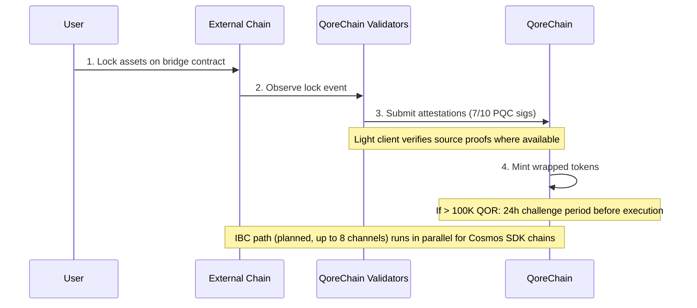

# Architettura del Bridge

Il modulo `x/bridge` è progettato per connettere QoreChain all'ecosistema blockchain più ampio attraverso **37 configurazioni di catena (36 catene esterne più Injective, raggiunta tramite IBC) e fino a 8 controparti IBC (Inter-Blockchain Communication)**. Ogni operazione del bridge è progettata per essere protetta dalla crittografia post-quantistica.

:::caution Non attivo su nessuna delle due reti
Il modulo bridge è distribuito su mainnet e testnet, ma **nessuna rotta del bridge è attiva**: tutte le 37 configurazioni di catena sono in stato `pending` senza alcun contratto bridge impostato, non è registrato alcun validatore del bridge, non è mai stata creata alcuna operazione del bridge e non esiste alcun canale IBC sulla mainnet (la testnet ha un solo canale di test ICS-20 verso una catena con ID `provider`, nessuno verso le controparti elencate di seguito). Tutto quanto segue descrive il design previsto. Non inviate asset aspettandovi che vengano trasferiti tramite il bridge.
:::

## Stato attuale {#current-status}

| | Mainnet | Testnet |
|---|---|---|
| Modulo bridge | abilitato | abilitato |
| Configurazioni di catena | 37, tutte `pending` | 37, tutte `pending` |
| Validatori del bridge registrati | 0 | 0 |
| Operazioni del bridge | 0 | 0 |
| Canali / client IBC | 0 / 0 | 1 / 1 (un canale di test verso la testnet del Cosmos Hub) |

(Verificato il 27 ottobre 2026 su mainnet (v3.2.4; v3.2.5 dal 29 ottobre 2026) e testnet (v3.2.6). Leggete i valori live con `qorechaind query bridge chains` e `qorechaind query bridge validators`, oppure tramite REST su `/qorechain/bridge/v1/chains` e `/qorechain/bridge/v1/validators`.) La configurazione del modulo è la stessa su entrambe le reti: `min_validators` 10, `attestation_threshold` 7, `challenge_period_secs` 86,400 e `large_transfer_threshold` 100.000 QOR (`100000000000` uqor). Lo stack IBC che il modulo utilizzerebbe è ibc-go v10.7 (dalla v3.2.2), ma non è stato creato alcun client né canale sulla mainnet (la testnet ha un client e un canale di test, vedi sopra).

## Panoramica delle Connessioni

QoreChain è progettata per supportare due protocolli di bridge operanti in parallelo:

| Protocollo | Connessioni          | Modello di Sicurezza                 | Caso d'Uso                              |
| ---------- | -------------------- | ------------------------------------ | --------------------------------------- |
| **IBC**    | fino a 8 canali (nessuno aperto) | IBC standard (ICS-20) | Catene compatibili con Cosmos SDK     |
| **QCB**    | 37 config di catena (tutte in attesa) | multisig Dilithium-5 7-su-10         | Catene non-IBC (EVM, Solana, TON, ecc.) |

Le **37 configurazioni di catena** sono le **36 catene esterne** elencate di seguito più **Injective**, configurata come catena di tipo IBC. Non esiste alcuna configurazione di loopback di QoreChain. I canali IBC pianificati si connettono a catene compatibili con Cosmos SDK.

## Canali IBC

QoreChain è progettata per mantenere connessioni IBC verso le seguenti 8 catene, relayate da un relayer IBC. **Nessuna di queste controparti è ancora connessa** (la mainnet non ha alcun canale o client IBC; la testnet ha un solo canale di test ICS-20 verso una catena con ID `provider`, verificato il 27 ottobre 2026), quindi questa tabella elenca solo le controparti pianificate:

| Catena     | Descrizione                    |
| ---------- | ------------------------------ |
| Cosmos Hub | Connessione hub primaria       |
| Osmosis    | Routing della liquidità DEX    |
| Noble      | Emissione nativa di USDC       |
| Celestia   | Livello di disponibilità dati  |
| Stride     | Liquid staking                 |
| Akash      | Calcolo decentralizzato        |
| Babylon    | Protocollo di restaking BTC    |
| Injective  | Interoperabilità DeFi / orderbook |

### Relayer IBC {#ibc-relayer}

I pacchetti IBC e gli aggiornamenti dei client vengono trasportati tra le catene da un relayer, un programma separato che osserva entrambe le catene e invia i pacchetti, le prove e gli aggiornamenti dei client. Il relayer non fa parte della catena, e questo manuale non promette un servizio di relayer gestito da QoreChain. QoreChain mantiene un relayer open source chiamato QORel (un fork di Hermes che aggiunge la firma ibrida ML-DSA-87 richiesta da QoreChain su ogni transazione); la versione 0.1.0 è rilasciata come pre-release. Vedi [QORel](/qorel/overview) per installarlo ed eseguirlo.

* **Aggiornamenti dei client, monitoraggio dei comportamenti scorretti e clearing dei pacchetti** sono impostazioni del relayer che un operatore esegue, non parametri della catena. Ad esempio, un relayer può aggiornare automaticamente i light client, monitorare l'equivocazione e ripulire periodicamente i pacchetti in sospeso.
* **Firme post-quantistiche.** Le transazioni che QoreChain accetta sulla sua lane nativa portano una firma ibrida secp256k1 + ML-DSA-87 (FIPS 204), comprese le transazioni che un relayer le invia; vedi [Sicurezza Post-Quantistica](/architecture/post-quantum-security). Il formato del pacchetto IBC in sé è quello standard, e questo manuale non afferma che i pacchetti portino una firma aggiuntiva verificata da altre catene.

## Protocollo QCB (QoreChain Bridge)

Il protocollo QCB utilizza un'architettura hub-and-spoke protetta dalla crittografia post-quantistica. QoreChain funge da hub, con una configurazione spoke per ciascuna catena esterna.

### Configurazioni di Catene Esterne (36)

Il protocollo QCB è progettato per indirizzarsi alle seguenti 36 catene esterne. Insieme a Injective (una configurazione di tipo IBC), ciò dà **37 configurazioni di catena in totale**, tutte attualmente in stato `pending`.

**Catene di base (10)**

Ethereum, Solana, TON, BSC, Avalanche, Polygon, Arbitrum, Optimism, Base, Sui.

**Catene della famiglia EVM (14)**

zkSync Era, Linea, Scroll, Blast, Mantle, Hyperliquid, Berachain, Sonic, Sei, Monad, Plasma, Filecoin FVM, Cronos, Kaia.

**Catene non-EVM (5)**

Starknet, XRP Ledger, Stellar, Hedera, Algorand.

**Altre catene (7)**

NEAR, Bitcoin, Cardano, Polkadot, Tezos, Tron, Aptos.

:::note
Verifica del conteggio: 10 di base + 14 famiglia EVM + 5 non-EVM + 7 altre = **36 catene esterne**. Aggiungendo Injective (IBC) si ottengono **37 configurazioni di catena**.
:::

### Formati degli Indirizzi

Il protocollo QCB classifica le catene per tipo al fine di validare gli indirizzi di destinazione:

| Tipo di Catena | Catene di Esempio                                                       | Formato dell'Indirizzo                             |
| ------------ | ----------------------------------------------------------------------- | -------------------------------------------------- |
| `evm`        | Ethereum, BSC, Avalanche, Polygon, Arbitrum, Optimism, Base             | `0x` + 40 caratteri esadecimali                    |
| `solana`     | Solana                                                                  | Base58, 32-44 caratteri                            |
| `ton`        | TON                                                                     | `EQ` + codifica base64                             |
| `sui_move`   | Sui                                                                     | `0x` + 64 caratteri esadecimali                    |
| `aptos_move` | Aptos                                                                   | `0x` + 64 caratteri esadecimali                    |
| `bitcoin`    | Bitcoin                                                                 | Bech32 (`bc1`), P2SH (`3...`), o legacy (`1...`)   |
| `near`       | NEAR Protocol                                                           | suffisso `.near` o implicito                       |
| `cardano`    | Cardano                                                                 | `addr1` (pagamento) o `stake1` (staking)           |
| `polkadot`   | Polkadot                                                                | codifica SS58                                      |
| `tezos`      | Tezos                                                                   | `tz1`/`tz2`/`tz3` (implicito) o `KT1` (originato)  |
| `tron`       | TRON                                                                    | `T` + base58, 34 caratteri                         |

## Light Client

Per verificare gli eventi delle catene esterne in modo trustless, il bridge è progettato per eseguire light client on-chain adattati al sistema di consenso e di prova di ciascuna catena di origine. Questi light client consentono a QoreChain di validare depositi e prelievi senza affidarsi esclusivamente alle attestazioni dei validatori.

| Light Client            | Catena di Origine   | Primitive di Verifica                                                |
| ----------------------- | ------------------- | ------------------------------------------------------------------- |
| **Ethereum light client** | Ethereum / EVM L1 | Verifica delle firme BLS12-381, serializzazione SSZ, prove di stato MPT |
| **Bitcoin SPV**         | Bitcoin             | Simplified Payment Verification contro gli header dei blocchi        |
| **Starknet STARK**      | Starknet            | Verifica delle prove STARK delle transizioni di stato di Starknet   |
| **Sui BLS**             | Sui                 | Verifica delle firme aggregate BLS dei checkpoint di Sui            |
| **Wormhole / Solana VAA** | Solana (tramite Wormhole) | Verifica delle firme dei guardian Verified Action Approval (VAA) |

## Flusso di Deposito (da Esterno a QoreChain)

La sequenza seguente mostra il deposito QCB come progettato: gli asset vengono bloccati su una catena esterna, i validatori di QoreChain inviano attestazioni firmate con PQC (7-su-10 Dilithium-5) e i token wrapped vengono coniati. Le catene compatibili con Cosmos SDK utilizzerebbero invece il percorso IBC parallelo (fino a 8 canali, trasportati da un relayer IBC). Nessuno dei due percorsi è attivo; non è mai stato effettuato alcun deposito.



```
External Chain          QoreChain Validators           QoreChain
     |                         |                          |
     | 1. Lock assets on       |                          |
     |    bridge contract      |                          |
     |------------------------>|                          |
     |                         | 2. Observe & attest      |
     |                         |    (7/10 PQC sigs)       |
     |                         |------------------------->|
     |                         |                          | 3. Mint wrapped
     |                         |                          |    tokens
     |                         |                          |
     |                         |    [If > 100K QOR]       |
     |                         |    24h challenge period   |
     |                         |    before execution       |
```

1. **Lock** — L'utente blocca gli asset nel contratto del bridge sulla catena esterna.
2. **Attest** — I validatori del bridge osservano la transazione di lock e inviano attestazioni firmate con Dilithium-5. È richiesto un minimo di **7 su 10** attestazioni dei validatori. Laddove sia disponibile un light client per la catena di origine, l'evento di lock viene inoltre verificato contro le prove proprie della catena.
3. **Mint** — Una volta raggiunta la soglia di attestazione, i token wrapped vengono coniati su QoreChain.
4. **Periodo di sfida** — Per i trasferimenti che superano l'equivalente di 100.000 QOR, si applica un **periodo di sfida di 24 ore** prima dell'esecuzione. Durante questa finestra, i validatori possono segnalare attività sospette.

## Flusso di Prelievo (da QoreChain a Esterno)

```
QoreChain               QoreChain Validators           External Chain
     |                         |                          |
     | 1. Burn wrapped tokens  |                          |
     |------------------------>|                          |
     |                         | 2. Attest burn           |
     |                         |    (7/10 PQC sigs)       |
     |                         |------------------------->|
     |                         |                          | 3. Unlock original
     |                         |                          |    assets
```

1. **Burn** — L'utente brucia i token wrapped su QoreChain.
2. **Attest** — I validatori attestano l'evento di burn con firme Dilithium-5 (soglia 7/10).
3. **Unlock** — Una volta raggiunta la soglia, gli asset originali vengono sbloccati sulla catena esterna.

Tutte le commissioni del bridge raccolte durante i prelievi vengono instradate al modulo `x/burn` tramite il canale di burn `bridge_fee` (il 100% delle commissioni del bridge viene bruciato).

### Prelievi L2 → L1 (rollup)

I prelievi dei rollup non utilizzano il bridge. Vengono pagati dal modulo `x/rdk` con `execute-withdrawal` rispetto alla radice dei prelievi di un batch finalizzato — vedi [ZK / STARK e Prelievi](/rollups/zk-stark-withdrawals).

## Architettura di Sicurezza

### Multisig PQC

Tutte le operazioni del bridge QCB richiedono una **soglia 7-su-10** di firme post-quantistiche Dilithium-5 dai validatori del bridge registrati. Ogni validatore del bridge si registra con:

* Un indirizzo di validatore QoreChain
* Una chiave pubblica Dilithium-5 (2.592 byte)
* Un elenco di catene supportate
* Un punteggio di reputazione (mantenuto da `x/reputation`)

Dalla v3.2.2 il modulo convalida in modo coerente su ogni percorso gli importi pari a zero e la propria configurazione. **Dalla v3.2.4 (mainnet dal 23 ottobre 2026, testnet dal 19 ottobre 2026):** la registrazione di un validatore del bridge richiede inoltre una prova di possesso della chiave Dilithium-5 (lo stesso formato `proof_of_possession` della registrazione delle chiavi PQC, vedi [Sicurezza Post-Quantistica](/architecture/post-quantum-security#proof-of-possession)) e rifiuta una chiave già utilizzata da un altro validatore del bridge. Le release precedenti non hanno un controllo di questo tipo, e su nessuna delle due reti è registrato alcun validatore del bridge.

### Circuit Breaker

Ogni catena connessa dispone di protezioni circuit breaker indipendenti:

| Protezione                | Descrizione                                                                          |
| ------------------------- | ------------------------------------------------------------------------------------ |
| **Limite singolo trasferimento** | Importo massimo per qualsiasi operazione di bridge individuale per catena     |
| **Limite aggregato giornaliero** | Tetto di volume totale per catena per finestra di 24 ore                       |
| **Pausa manuale**         | Arresto di emergenza per catena attivato da governance o validatore                  |
| **Rilevamento anomalie**  | Pausa automatica se >50 operazioni in una finestra breve o se il volume supera di 5x il limite giornaliero |

Lo stato del circuit breaker viene tracciato per catena e include: trasferimento singolo massimo, limite giornaliero, utilizzo giornaliero corrente, altezza dell'ultimo reset e stato di pausa con motivazione.

### Periodo di Sfida

Per i trasferimenti di grande entità (>100.000 QOR equivalenti, configurabile tramite `large_transfer_threshold`):

* Si applica un **periodo di sfida di 24 ore** (86.400 secondi) dopo il raggiungimento della soglia di attestazione.
* Durante questa finestra, i validatori sono progettati per poter segnalare l'operazione.
* Se non viene contestata, l'operazione viene eseguita automaticamente alla scadenza del periodo.
* Le operazioni contestate vengono congelate per la revisione da parte della governance.

### Ottimizzazione del Percorso tramite AI

Il modulo del bridge si integra con il sottosistema AI per l'ottimizzazione dei percorsi (non esposta tramite REST). Per i trasferimenti che possono attraversare percorsi multipli (ad es. dalla catena A alla catena B tramite un intermediario), l'ottimizzatore di percorso valuta:

* Le commissioni stimate tra i percorsi
* Il tempo stimato di completamento
* Il punteggio di sicurezza per percorso
* Il livello di confidenza della stima

## Amministrazione del Bridge

### Attivazione della catena post-deploy (senza governance)

A partire dalla versione di catena **v3.1.78**, una catena del bridge può essere attivata e riconfigurata dopo il deployment con una singola transazione firmata — senza proposta di governance e senza upgrade della catena. Una chiave `bridge_admin` (impostata in `BridgeConfig.BridgeAdmin` al genesis) o un titolare della licenza `qcb_bridge` può:

* **`tx bridge update-chain-config`** — impostare l'indirizzo del contratto di una catena, il numero di conferme, l'architettura e lo stato (`MsgUpdateChainConfig`).
* **`tx bridge set-verifier-bootstrap`** — selezionare il verifier attivo per una catena e installarne la trust root (`MsgSetVerifierBootstrap`).

Questo consente a un operatore di portare online il bridge di una catena connessa — o di ruotarne il verifier — direttamente, con l'autorizzazione verificata rispetto alla chiave di amministrazione del bridge. A partire dalla versione di catena **v3.2.0** il modulo bridge dispone anche di un proprio account di modulo (le versioni precedenti non ne avevano, per cui il primo deposito su una rotta attivata sarebbe fallito).

Le licenze come `qcb_bridge` vengono concesse dall'account dell'autorità delle licenze. Dalla v3.2.3 (mainnet) la governance può sostituire tale account con una proposta `MsgUpdateAuthority`; il modulo stesso è descritto in [Licenze della Catena](/architecture/chain-licensing).

### Validazione delle reti connesse

A partire dalla versione di catena **v3.1.79**, un validatore che detiene la licenza `validator_<chain>` (o `qcb_bridge`) corrispondente può eseguire il client della rete esterna sullo stesso nodo, provisionato automaticamente sotto l'orchestrazione di QoreChain una volta attivata la licenza. I driver vengono forniti per tutte le 37 reti del bridge, classificate per modello di partecipazione (validatore permissionless, capped/elected/admission, full-node L2 e non-staking/trust-list). Lo stake e le chiavi di firma della rete esterna sono forniti dall'operatore per ciascuna rete. Vedi [Eseguire un Validatore](/developer-guide/running-a-validator#connected-networks) per i passaggi dell'operatore. Poiché ogni configurazione di catena è `pending`, oggi nessuna rete connessa viene validata tramite il bridge.

## Endpoint REST API {#rest-api-endpoints}

Lo stato del bridge è interrogabile **in sola lettura tramite REST** via grpc-gateway sotto il prefisso `/qorechain/bridge/v1/...`. Questi forniscono JSON on-chain reali su HTTP per explorer e telemetria di light node. Vedi [Endpoint REST / gRPC](/api-reference/rest-grpc-endpoints#bridge-module) per l'elenco completo.

| Metodo | Endpoint                                  | Descrizione                                                                                                         |
| ------ | ----------------------------------------- | ------------------------------------------------------------------------------------------------------------------- |
| GET    | `/qorechain/bridge/v1/config`             | Configurazione del modulo bridge (`min_validators`, `attestation_threshold`, `challenge_period_secs`, `large_transfer_threshold`, `enabled`) |
| GET    | `/qorechain/bridge/v1/chains`             | Tutte le configurazioni di catena e il loro stato                                                                   |
| GET    | `/qorechain/bridge/v1/chains/{chain_id}`  | Una configurazione di catena                                                                                        |
| GET    | `/qorechain/bridge/v1/validators`         | Validatori del bridge registrati                                                                                    |
| GET    | `/qorechain/bridge/v1/validators/{address}` | Un validatore del bridge                                                                                          |
| GET    | `/qorechain/bridge/v1/operations`         | Operazioni del bridge                                                                                               |
| GET    | `/qorechain/bridge/v1/operations/{id}`    | Un'operazione del bridge                                                                                            |

Gli importi bloccati, lo stato dei circuit breaker e le stime dei percorsi non hanno oggi alcuna rotta di query.

## Eventi del Bridge

Il modulo del bridge emette i seguenti eventi on-chain:

| Tipo di Evento                | Descrizione                                     |
| ----------------------------- | ----------------------------------------------- |
| `bridge_deposit`              | Nuova operazione di deposito creata             |
| `bridge_withdraw`             | Nuova operazione di prelievo creata             |
| `bridge_attestation`          | Attestazione del validatore inviata             |
| `bridge_operation_executed`   | Operazione finalizzata ed eseguita              |
| `bridge_circuit_breaker_trip` | Circuit breaker attivato o disattivato          |
| `bridge_validator_registered` | Nuovo validatore del bridge registrato          |
| `bridge_pqc_verification`     | Risultato della verifica della firma PQC (pacchetti IBC) |

## Correlati

* [Trasferimento di Asset](/user-guide/bridging-assets) — sposta gli asset tra le catene passo dopo passo.
* [Restaking BTC tramite Babylon](/architecture/btc-restaking-babylon) — sicurezza supportata da Bitcoin.
* [Sicurezza Post-Quantistica](/architecture/post-quantum-security) — verifica PQC sui pacchetti IBC.
