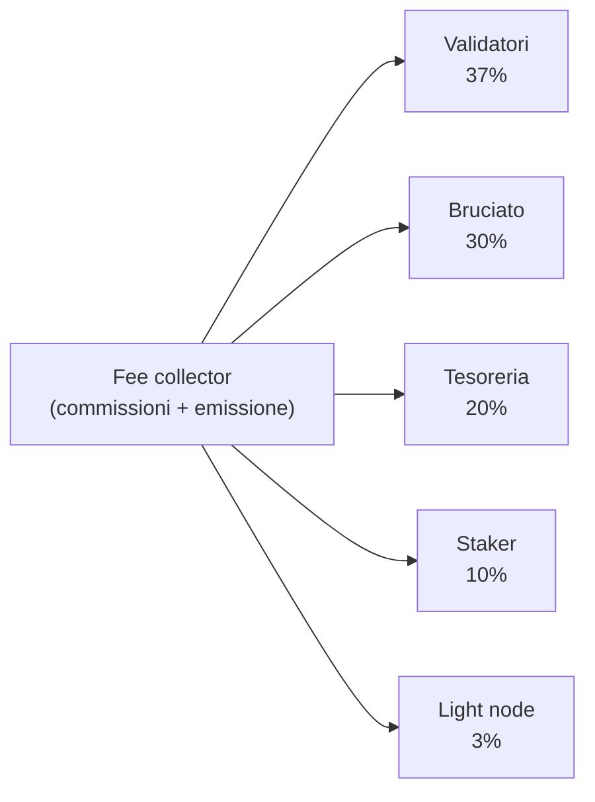

# Tokenomics

Il modello economico di QoreChain è incentrato sul token nativo **QOR** e segue un **percorso di offerta finito e con tetto massimo**: un'offerta di genesi fissa, un'emissione di ricompense di staking coniata sotto un tetto cumulativo rigido e un motore di burn multi-canale che rimuove definitivamente i token. Questa pagina descrive come funzionano offerta, emissione, burn e ripartizione delle commissioni, usando cifre lette dalla chain live.

---

## Nozioni di base sul token

| Proprietà              | Valore                                                    |
| --------------------- | -------------------------------------------------------- |
| **Token visualizzato**     | QOR                                                      |
| **Denominazione base** | uqor                                                     |
| **Precisione decimale** | 10^6 (1 QOR = 1.000.000 uqor)                            |
| **Offerta**      | Genesi 4.420.000.000 QOR; vedi [Modello di offerta ed emissione](#supply-and-emission) |
| **Chain ID**          | `qorechain-vladi` (mainnet, EVM chain ID 9801)          |
| **Prefisso Bech32**     | `qor` (account: `qor1...`, validatori: `qorvaloper...`) |

:::note
Le cifre riportate in questa pagina descrivono la **mainnet** (`qorechain-vladi`, EVM chain ID **9801**), live dal 7 giugno 2026 sulla release **v3.2.4** (applicata all'altezza 3.742.566 il 23 ottobre 2026). La testnet **`qorechain-diana`** (EVM chain ID **9800**, release **v3.2.6** dal 27 ottobre 2026) ha una propria storia di emissione e di offerta (l'offerta della testnet è molto superiore a quella della mainnet e la sua emissione ha già superato il tetto), quindi usa le cifre della mainnet. Gli importi che cambiano a ogni blocco sono contrassegnati con la data in cui sono stati letti (23 ottobre 2026).
:::

---

## Modello di offerta ed emissione {#supply-and-emission}

QoreChain ha un **percorso di offerta finito e con tetto massimo**. L'offerta di genesi era di **4.420.000.000 QOR** (4.500.000.000 QOR previsti; 80.000.000 QOR, l'1,78%, sono stati bruciati al Token Generation Event prima della genesi). Dopo la genesi il protocollo modifica l'offerta attraverso due meccanismi:

* **Emissione** — il modulo `x/inflation` conia un importo fisso a ogni epoca, sotto un **tetto cumulativo rigido di 590.000.000 QOR**. I token coniati entrano nel fee collector e attraversano la stessa ripartizione delle commissioni di transazione (vedi [Distribuzione delle commissioni](#fee-distribution)).
* **Burn** — il modulo `x/burn` rimuove definitivamente la quota di burn di tutto ciò che si trova nel fee collector.

### Emissione {#staking-reward-schedule}

| Parametro | Valore |
| --- | --- |
| Modalità di emissione | `fixed` (dalla v3.1.94, altezza 2.122.074 — 26 agosto 2026) |
| Emissione per epoca | **86.000 QOR** (16.239 QOR fino alla proposta di governance 10; la prima epoca da 86.000 QOR inizia al blocco 3.672.000) |
| Lunghezza dell'epoca | 43.200 blocchi (circa 38,6 ore con l'attuale tempo di blocco di ≈3,2 s) |
| Tetto cumulativo (`max_total_emission`) | **590.000.000 QOR** (114.285.714 QOR fino alla proposta 10) |
| Coniati finora (23 ottobre 2026, epoca 86) | 105.420.896,21 QOR (17,87% del tetto) |
| Rimanenti sotto il tetto | 484.579.103,79 QOR (circa 5.635 epoche a 86.000 QOR per epoca; l'ultima è parziale) |

Una volta raggiunto il tetto, il modulo smette definitivamente di coniare; da quel momento le ricompense provengono unicamente dalle commissioni di transazione. I valori di emissione sono stati fissati dalla governance: la proposta n. 4 (26 agosto 2026) ha sostituito il programma decrescente originale con un importo fisso sotto un tetto rigido, e la proposta n. 10 (approvata il 19 ottobre 2026 con tutto lo stake bonded a favore) ha portato tale importo da 16.239 QOR a 86.000 QOR per epoca e ha alzato il tetto da 114.285.714 QOR a 590.000.000 QOR. La lunghezza dell'epoca non è cambiata. I valori del programma (17,5%, 11%, 7%, 7%, 2% per gli anni 1–5) restano memorizzati nei parametri del modulo ma non sono usati in modalità `fixed`.

Il totale coniato, l'importo rimanente e l'altezza della prossima epoca sono disponibili in tempo reale a `GET /qorechain/inflation/v1/epoch_info` (il suo campo `current_inflation_rate` riporta il tasso legacy basato sugli anni, che la modalità `fixed` non usa).

QoreChain non espone una cifra di rendimento dello staking in tempo reale; considera non verificata qualsiasi percentuale citata. Le cifre attuali possono essere lette dallo stato della chain: l'offerta si trova a `GET /cosmos/bank/v1beta1/supply/by_denom?denom=uqor` (4.493.785.581,46 QOR il 23 ottobre 2026) e i totali dei burn a `GET /qorechain/burn/v1/stats`.

---

## x/burn — Motore di burn multi-canale

Il modulo `x/burn` definisce **12 sorgenti di burn** sulla mainnet oggi. Ogni token bruciato viene rimosso definitivamente dall'offerta. Sulla mainnet solo `gas_fee` (31.626.314,61 QOR al 23 ottobre 2026) e, dalla v3.2.2, `failed_tx` (0,1355 QOR) hanno registrato burn; gli altri sono definiti ma non ne hanno registrati. Dalla v3.2.4 c'è una tredicesima sorgente, `staking_tier_penalty`, che registra la penale bruciata quando una delega con blocco temporale viene sbloccata in anticipo (attiva sulla testnet dal 19 ottobre 2026 e sulla mainnet dal 23 ottobre 2026; sulla mainnet non è stato ancora registrato alcuno sblocco anticipato; vedi [Staking e delega](/user-guide/staking-and-delegation#time-locked-staking)).

### Canali di burn

| #  | Canale            | Sorgente                     | Descrizione                                   |
| -- | ------------------ | -------------------------- | --------------------------------------------- |
| 1  | `gas_fee`          | Commissioni di transazione           | Il 30% di tutte le commissioni di gas viene bruciato                |
| 2  | `contract_create`  | Distribuzione di smart contract  | Commissione fissa di 100 QOR bruciata per ogni creazione di contratto |
| 3  | `ai_service`       | Commissioni di utilizzo del modulo AI       | Il 50% delle commissioni del servizio AI viene bruciato                 |
| 4  | `bridge_fee`       | Commissioni del bridge cross-chain    | Il 100% delle commissioni del bridge viene bruciato                    |
| 5  | `treasury_buyback` | Operazioni di tesoreria        | Buyback-and-burn periodico dalla tesoreria       |
| 6  | `failed_tx`        | Gas delle transazioni fallite     | Il 10% del gas delle transazioni fallite viene bruciato (applicato dalla chain dalla v3.2.2)    |
| 7  | `xqore_penalty`    | Penali di uscita anticipata xQORE | Importi delle penali instradati al burn           |
| 8  | `auto_buyback`     | Programma di buyback automatizzato  | Burn automatizzati a livello di protocollo |
| 9  | `tge`              | Token generation event     | Il burn TGE di 80.000.000 QOR è avvenuto prima della genesi (l'offerta di genesi è 4.420.000.000 QOR); questo canale è riservato e registra 0       |
| 10 | `rollup_create`    | Distribuzione di rollup          | Il 1% dello stake di creazione del rollup viene bruciato            |
| 11 | `milestone`        | Traguardi del numero di transazioni | Burn programmati a numeri cumulativi di transazioni prefissati (nessuno ancora attivato) |
| 12 | `amm`              | AMM                        | Riservato alle commissioni di protocollo dell'AMM (nessuna registrata) |

I canali `contract_create`, `ai_service`, `bridge_fee` e `auto_buyback` sono oggi inattivi: il caricamento di QoreChain Native è chiuso, e le commissioni del servizio AI e il bridge non sono attivi.

### Distribuzione delle commissioni {#fee-distribution}

Tutto ciò che si trova nel fee collector viene suddiviso tra cinque destinazioni, come mostrato di seguito. Il fee collector contiene sia le commissioni di transazione sia l'emissione di epoca coniata da `x/inflation`. Le quote sono applicate on-chain e sommano sempre esattamente al 100%.

Le quote sono:

| Destinatario       | Quota | Descrizione                                                          |
| --------------- | ----- | -------------------------------------------------------------------- |
| **Validatori**  | 37%   | Distribuite al set di validatori attivi in proporzione allo stake        |
| **Bruciato**      | 30%   | Rimosso definitivamente dall'offerta tramite il canale di burn `gas_fee`       |
| **Tesoreria**    | 20%   | Allocato alla tesoreria della community per spese decise dalla governance |
| **Staker**     | 10%   | Distribuite a tutti gli staker di QOR in proporzione alla delega            |
| **Light node** | 3%    | Distribuite ai light node per la fornitura dei dati di rete                  |

Le quote sono applicate on-chain e devono sempre sommare esattamente al 100%.

:::note Cosa passa effettivamente attraverso la ripartizione
La ripartizione si applica a tutto ciò che si trova nel fee collector, che contiene sia le commissioni di transazione sia l'emissione di epoca coniata da `x/inflation`. In pratica, oggi quasi tutto è emissione: dei 105.420.896 QOR coniati, 31.626.315 QOR (30,0%) sono stati bruciati attraverso il canale delle commissioni di gas. Fino all'aggiornamento v3.2.0 (25 settembre 2026, altezza 2.981.742) la quota del 10% degli staker veniva spostata nel saldo del modulo di distribuzione senza coprire alcun diritto, quindi staker e validatori insieme ricevevano il 37%, non il 47%; da quell'altezza la quota degli staker viene pagata come normale ricompensa di staking. L'importo già bloccato era stato registrato on-chain ed è stato da allora rilasciato da voti di governance — vedi [Quota degli staker bloccata e riserva dei light node](#stranded-and-reserve).
:::

### Parametri di burn

| Parametro              | Predefinito                    | Descrizione                              |
| ---------------------- | -------------------------- | ---------------------------------------- |
| `gas_burn_rate`        | 0.30                       | Frazione delle commissioni di gas bruciata (30%)        |
| `contract_create_fee`  | 100.000.000 uqor (100 QOR) | Commissione fissa di burn per la creazione di contratti      |
| `ai_service_burn_rate` | 0.50                       | Frazione delle commissioni del servizio AI bruciata (50%) |
| `bridge_burn_rate`     | 1.00                       | Frazione delle commissioni del bridge bruciata (100%)    |
| `failed_tx_burn_rate`  | 0.10                       | Frazione del gas delle TX fallite bruciata (10%)   |
| `validator_share`      | 0.37                       | Quota del fee collector ai validatori |
| `treasury_share`       | 0.20                       | Quota alla tesoreria                    |
| `staker_share`         | 0.10                       | Quota agli staker                         |
| `light_node_share`     | 0.03                       | Quota ai light node                    |
| `enabled`              | true                       | Flag di attivazione del modulo                 |

Ogni evento di burn viene registrato on-chain con la sua sorgente, l'importo, l'altezza del blocco e l'hash della transazione associata. Statistiche aggregate sono interrogabili per canale e in totale.

---

## Quota degli staker bloccata e riserva dei light node {#stranded-and-reserve}

Due importi si sono accumulati sulla mainnet prima dell'aggiornamento v3.2.0 (25 settembre 2026, altezza 2.981.742). L'aggiornamento li ha registrati **on-chain, al di fuori di qualsiasi distribuzione**, e li ha resi spostabili solo tramite un voto di governance. Da allora la governance ha rilasciato entrambi alla fondazione, a ottobre 2026:

| Registro | Rilascio | Importo | Messaggio di governance |
| --- | --- | --- | --- |
| **Quota degli staker bloccata** — la quota del 10% degli staker che era stata depositata dove non copriva alcun diritto a ricompense di staking | Proposta 9 (approvata il 19 ottobre 2026) | 6.693.045,921330 QOR rilasciati | `MsgReleaseStrandedRewards` (autorità di governance; destinazione indicata; non può superare il registro) |
| **Riserva dei light node** — la quota del 3% dei light node accumulata mentre nessun light node era idoneo | Proposta 8 (approvata il 19 ottobre 2026) | 3.156.983,796395 QOR rilasciati | `MsgReleaseLightNodeReserve` (autorità di governance) |

**Resto corretto della quota bloccata.** All'aggiornamento v3.2.3 (altezza 3.662.051, 20 ottobre 2026) la chain ha ricalcolato il registro della quota bloccata, che si attestava allora a 3.807.496,785528 QOR (`reserved` in `GET /qorechain/burn/v1/stranded_rewards`, accanto a `released`, 6.693.045,921330 QOR). La proposta di governance 12 ha rilasciato tale resto, 3.807.496,785528 QOR, alla fondazione: è stata approvata (la votazione si è chiusa il 21 ottobre 2026 alle 20:01 UTC) con tutto lo stake vincolato votante a favore. Il registro si può controllare a `GET /qorechain/burn/v1/stranded_rewards` e la proposta a `GET /cosmos/gov/v1/proposals/12`.

**Il pool dei light node oggi.** Dall'aggiornamento v3.2.0, le ricompense dei light node vengono pagate solo da quanto maturato dall'esecuzione di distribuzione precedente, con un limite per nodo. Dalla v3.2.3 il limite è di **2.000 QOR per nodo ogni 30 giorni** (`max_reward_per_month_per_node`), in proporzione al tempo di blocco e all'uptime del nodo; il valore per blocco (`max_reward_per_block_per_node`, 1.713 uqor) è ancora riportato ma non è più la regola. Ciò che non viene guadagnato resta nella riserva del pool, che solo un voto di governance può rilasciare. Dopo la proposta 8 la riserva si accumula di nuovo: il 20 ottobre 2026 conteneva 487,2318 QOR (`reserved` in `GET /qorechain/lightnode/v1/reward_pool`), senza nulla in sospeso né pagabile, perché nessun light node si è ancora registrato. La registrazione è aperta e vincolata a una licenza (vedi [Light Node](/light-node/overview#reward-program-status)). Un rilascio precedente allo snapshot dell'aggiornamento, superiore all'importo registrato o verso una destinazione non valida viene rifiutato.

## x/xqore — Staking bloccato e amplificazione della governance {#x-xqore}

:::warning Non ancora attivo
La contabilità del modulo xQORE esiste ed è abilitata nella genesi, ma **non è ancora utilizzabile** sulla mainnet (`qorechain-vladi`) né sulla testnet (`qorechain-diana`). Il nodo non ha alcun punto di ingresso di transazione, query, CLI o RPC per esso, quindi `tx xqore lock` / `unlock`, `query xqore ...`, le route REST di xQORE e `qor_getXQOREPosition` non funzionano, e nessuno detiene xQORE. È previsto per una futura release della chain, che cambierà anche il modo in cui le penali di uscita vengono ridistribuite, in modo che lo sblocco resti economico indipendentemente dal numero di detentori. La release sarà indicata qui quando verrà pubblicata.
:::

Il modulo `x/xqore` introduce **xQORE**, un derivato di staking bloccato e non trasferibile. Gli utenti bloccano QOR per coniare xQORE con rapporto 1:1. I detentori di xQORE ricevono un potere di governance amplificato e una quota delle penali di uscita ridistribuite.

### Meccanismo di blocco

* **Blocco**: invia QOR al modulo xQORE per coniare xQORE con rapporto 1:1.
* **Peso di governance**: i detentori di xQORE ricevono un **potere di voto di governance 2x** rispetto agli staker QOR standard.
* **Non trasferibile**: xQORE non può essere inviato tra account. È legato all'indirizzo che ha effettuato il blocco.

### Programma delle penali di uscita

Il prelievo anticipato da xQORE comporta una penale che diminuisce con la durata del blocco:

| Durata del blocco  | Aliquota della penale | Descrizione                                |
| -------------- | ------------ | ------------------------------------------ |
| &lt; 30 giorni   | **50%**      | Metà dei QOR bloccati viene confiscata            |
| 30 -- 90 giorni  | **35%**      | Penale significativa per i blocchi a breve termine   |
| 90 -- 180 giorni | **15%**      | Penale ridotta per un impegno a medio termine |
| > 180 giorni     | **0%**       | Prelievo completo senza penale            |

### Ridistribuzione con rebase PvP

Le penali raccolte dalle uscite anticipate non vengono semplicemente distrutte. Seguono invece un modello di rebase PvP (player-versus-player):

1. Nella configurazione di genesi lo **0%** degli importi delle penali viene bruciato (`penalty_burn_rate = 0`; il canale di burn `xqore_penalty` esiste nel caso la governance lo modifichi).
2. Il **100%** viene ridistribuito pro-rata a tutti i detentori di xQORE rimanenti.

Questo crea una dinamica a somma positiva per i detentori di lungo termine: ogni uscita anticipata aumenta il valore effettivo delle posizioni xQORE rimanenti. I rebase avvengono ogni **100 blocchi**.

### Parametri di xQORE

| Parametro               | Predefinito                | Descrizione                               |
| ----------------------- | ---------------------- | ----------------------------------------- |
| `governance_multiplier` | 2.0                    | Moltiplicatore del potere di voto per i detentori di xQORE |
| `min_lock_amount`       | 1.000.000 uqor (1 QOR) | QOR minimo richiesto per il blocco              |
| `penalty_burn_rate`     | 0.00                   | Frazione delle penali di uscita bruciata (predefinito di genesi: tutte le penali vengono ridistribuite) |
| `rebase_interval`       | 100 blocchi             | Blocchi tra gli eventi di rebase PvP          |
| `enabled`               | true                   | Flag di attivazione del modulo                    |

---

## x/inflation — Emissione con tetto massimo

Il modulo `x/inflation` conia l'emissione per epoca (86.000 QOR dalla proposta 10, `emission_mode = fixed`) e la invia al fee collector, finché non viene raggiunto il tetto cumulativo di 590.000.000 QOR. Le modifiche ai parametri passano attraverso una normale proposta di governance sui parametri (`MsgUpdateParams`, aggiunto nella v3.1.94).

### Meccanica delle epoche

* **Lunghezza dell'epoca**: 43.200 blocchi (circa 38,6 ore a ≈3,2 s per blocco).
* A ogni confine di epoca il modulo conia l'emissione dell'epoca (o il residuo fino al tetto), aggiorna il record dell'epoca e smette di coniare una volta che `total_minted` raggiunge il tetto.
* Dalla v3.2.3 l'anno di emissione è derivato dalla lunghezza dell'epoca anziché da un numero fisso di blocchi.

### Parametri

Letti dal vivo il 23 ottobre 2026 da `GET /qorechain/inflation/v1/params`:

| Parametro | Valore (mainnet) | Descrizione |
| --- | --- | --- |
| `emission_mode` | `fixed` | `schedule` (legacy, tassi per anno) oppure `fixed`; la v3.2.4 aggiunge una terza modalità, `target_apy` |
| `fixed_epoch_emission` | 86.000.000.000 uqor (86.000 QOR) | Coniati per epoca in modalità fixed |
| `max_total_emission` | 590.000.000.000.000 uqor (590.000.000 QOR) | Limite cumulativo rigido |
| `epoch_length` | 43.200 blocchi | Blocchi per epoca di emissione |
| `schedule` | 17,5%, 11%, 7%, 7%, 2% (anni 1–5) | Programma legacy, inutilizzato in modalità fixed |
| `enabled` | `true` | Flag di attivazione del modulo |

I parametri e il record di epoca del modulo sono esposti via REST sulla mainnet dalla v3.2.3 (`/qorechain/inflation/v1/params` e `/qorechain/inflation/v1/epoch_info`); possono anche essere letti dallo stato della chain con l'interfaccia di store grezzo RPC `abci_query` (store `inflation`, chiavi `inflation/params` e `inflation/epoch`).

:::note v3.2.4 e l'emissione della testnet
La testnet `qorechain-diana` è configurata per i test e differisce dalla mainnet (letta il 27 ottobre 2026): è in modalità `target_apy` con `target_apy_bps` `1667`, `fixed_epoch_emission` è ancora 16.239 QOR e `max_total_emission` è 3.950.390.341.362.112.750 uqor, pari all'importo già coniato lì (`remaining_emission` è `0` su `/qorechain/inflation/v1/epoch_info`), quindi la testnet non conia altro. La mainnet usa i valori qui sopra. La release v3.2.4 aggiunge la terza modalità di emissione, `target_apy`, con un parametro `target_apy_bps`: sulla testnet dal 19 ottobre 2026 e sulla mainnet dal 23 ottobre 2026 (proposta di governance 13). Sulla mainnet il parametro è `0` e non guida l'emissione. Portare la mainnet su quella modalità è un voto di governance separato e non è stato proposto; finché uno non passa, la mainnet resta in modalità `fixed` a 86.000 QOR per epoca.
:::

---

## Burn rispetto all'emissione

L'emissione ha un tetto (590.000.000 QOR in totale) e la quota di burn si applica a tutto ciò che entra nel fee collector, emissione inclusa. Finora (23 ottobre 2026) sono stati bruciati 31.626.315 QOR a fronte di 105.420.896 QOR coniati, quindi l'offerta (4.493.785.581 QOR) è attualmente superiore al suo livello di genesi. Dopo il raggiungimento del tetto l'offerta può solo diminuire, della quantità bruciata.

---

## Correlati

* [Parametri della chain](/appendix/chain-parameters) — valori predefiniti economici e di consenso canonici.
* [Staking e delega](/user-guide/staking-and-delegation) — delega QOR e ricevi ricompense di staking.
* [Staking xQORE](/user-guide/xqore-staking) — il meccanismo di staking con rebase PvP.
* [Ricompense dei light node](/light-node/rewards-and-monitoring) — la quota di ricompensa dei light node.
