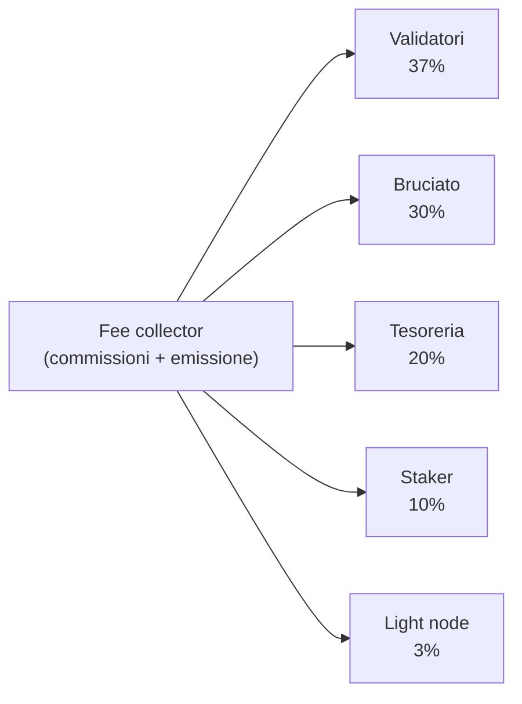

# Tokenomics

Il modello economico di QoreChain è incentrato sul token nativo **QOR** e segue un **percorso di offerta finito e con tetto massimo**: un'offerta di genesi fissa, un'emissione di ricompense di staking coniata sotto un tetto cumulativo rigido e un motore di burn multi-canale che rimuove definitivamente i token. Questa pagina descrive come funzionano offerta, emissione, burn e ripartizione delle commissioni, usando cifre lette dalla chain live.

---

## Nozioni di base sul token

| Proprietà              | Valore                                                    |
| --------------------- | -------------------------------------------------------- |
| **Token visualizzato**     | QOR                                                      |
| **Denominazione base** | uqor                                                     |
| **Precisione decimale** | 10^6 (1 QOR = 1.000.000 uqor)                            |
| **Offerta**      | Genesi 4.420.000.000 QOR; vedi [Modello di offerta ed emissione](#supply-and-emission) |
| **Chain ID**          | `qorechain-vladi` (mainnet, EVM chain ID 9801)          |
| **Prefisso Bech32**     | `qor` (account: `qor1...`, validatori: `qorvaloper...`) |

:::note
Le cifre riportate in questa pagina descrivono la **mainnet** (`qorechain-vladi`, EVM chain ID **9801**), live dal 29 giugno 2026 sulla release **v3.2.1**. La testnet **`qorechain-diana`** (EVM chain ID **9800**) condivide gli stessi parametri dei moduli; la sua storia di offerta ed emissione è diversa (l'offerta della testnet è molto superiore a quella della mainnet e la sua emissione ha già superato il tetto), quindi usa le cifre della mainnet.
:::

---

## Modello di offerta ed emissione {#supply-and-emission}

QoreChain ha un **percorso di offerta finito e con tetto massimo**. L'offerta di genesi era di **4.420.000.000 QOR** (4.500.000.000 QOR previsti; 80.000.000 QOR, l'1,78%, sono stati bruciati al Token Generation Event prima della genesi). Dopo la genesi, solo due cose modificano l'offerta:

* **Emissione** — il modulo `x/inflation` conia un importo fisso a ogni epoca, sotto un **tetto cumulativo rigido di 114.285.714 QOR**. I token coniati entrano nel fee collector e attraversano la stessa ripartizione delle commissioni di transazione (vedi [Distribuzione delle commissioni](#fee-distribution)).
* **Burn** — il modulo `x/burn` rimuove definitivamente la quota di burn di tutto ciò che si trova nel fee collector.

### Emissione {#staking-reward-schedule}

| Parametro | Valore |
| --- | --- |
| Modalità di emissione | `fixed` (dalla v3.1.94, altezza 2.122.074 — 26 agosto 2026) |
| Emissione per epoca | 16.239 QOR |
| Lunghezza dell'epoca | 43.200 blocchi (circa 38,6 ore con l'attuale tempo di blocco di ≈3,2 s) |
| Tetto cumulativo (`max_total_emission`) | 114.285.714 QOR |
| Coniati finora (14 ottobre 2026, epoca 81) | 105.200.179 QOR (92,05% del tetto) |
| Rimanenti sotto il tetto | 9.085.535 QOR (circa 559 epoche a 16.239 QOR per epoca) |

Una volta raggiunto il tetto, il modulo smette definitivamente di coniare; da quel momento le ricompense provengono unicamente dalle commissioni di transazione. Il tetto è stato fissato dalla proposta di governance n. 4 (approvata con tutto lo stake bonded a favore), che ha sostituito il programma decrescente originale, calibrato per una rete matura e completamente bonded e che distribuiva molto più rapidamente del previsto rispetto allo stake effettivamente bonded. I valori del programma (17,5%, 11%, 7%, 7%, 2% per gli anni 1–5) restano memorizzati nei parametri del modulo ma non sono usati in modalità `fixed`.

QoreChain non espone una cifra di rendimento dello staking in tempo reale; considera non verificata qualsiasi percentuale citata. Le cifre attuali possono essere lette dallo stato della chain: l'offerta si trova a `GET /cosmos/bank/v1beta1/supply/by_denom?denom=uqor` e i totali dei burn a `GET /qorechain/burn/v1/stats`.

---

## x/burn — Motore di burn multi-canale

Il modulo `x/burn` definisce **12 sorgenti di burn**. Ogni token bruciato viene rimosso definitivamente dall'offerta. Sulla mainnet finora solo `gas_fee` ha registrato burn (31.560.093 QOR al 14 ottobre 2026); gli altri sono definiti ma non ne hanno registrati.

### Canali di burn

| #  | Canale            | Sorgente                     | Descrizione                                   |
| -- | ------------------ | -------------------------- | --------------------------------------------- |
| 1  | `gas_fee`          | Commissioni di transazione           | Il 30% di tutte le commissioni di gas viene bruciato                |
| 2  | `contract_create`  | Distribuzione di smart contract  | Commissione fissa di 100 QOR bruciata per ogni creazione di contratto |
| 3  | `ai_service`       | Commissioni di utilizzo del modulo AI       | Il 50% delle commissioni del servizio AI viene bruciato                 |
| 4  | `bridge_fee`       | Commissioni del bridge cross-chain    | Il 100% delle commissioni del bridge viene bruciato                    |
| 5  | `treasury_buyback` | Operazioni di tesoreria        | Buyback-and-burn periodico dalla tesoreria       |
| 6  | `failed_tx`        | Gas delle transazioni fallite     | Il 10% del gas delle transazioni fallite viene bruciato (applicato dalla chain dalla v3.2.2; finora solo sulla testnet)    |
| 7  | `xqore_penalty`    | Penali di uscita anticipata xQORE | Importi delle penali instradati al burn           |
| 8  | `auto_buyback`     | Programma di buyback automatizzato  | Burn automatizzati a livello di protocollo |
| 9  | `tge`              | Token generation event     | Il burn TGE di 80.000.000 QOR è avvenuto prima della genesi (l'offerta di genesi è 4.420.000.000 QOR); questo canale è riservato e registra 0       |
| 10 | `rollup_create`    | Distribuzione di rollup          | Il 1% dello stake di creazione del rollup viene bruciato            |
| 11 | `milestone`        | Traguardi del numero di transazioni | Burn programmati a numeri cumulativi di transazioni prefissati (nessuno ancora attivato) |
| 12 | `amm`              | AMM                        | Riservato alle commissioni di protocollo dell'AMM (nessuna registrata) |

I canali `contract_create`, `ai_service`, `bridge_fee` e `auto_buyback` sono oggi inattivi: il caricamento di CosmWasm è chiuso, e le commissioni del servizio AI e il bridge non sono attivi.

### Distribuzione delle commissioni {#fee-distribution}

Tutto ciò che si trova nel fee collector viene suddiviso tra cinque destinazioni, come mostrato di seguito. Il fee collector contiene sia le commissioni di transazione sia l'emissione di epoca coniata da `x/inflation`. Le quote sono applicate on-chain e sommano sempre esattamente al 100%.

Le quote sono:

| Destinatario       | Quota | Descrizione                                                          |
| --------------- | ----- | -------------------------------------------------------------------- |
| **Validatori**  | 37%   | Distribuite al set di validatori attivi in proporzione allo stake        |
| **Bruciato**      | 30%   | Rimosso definitivamente dall'offerta tramite il canale di burn `gas_fee`       |
| **Tesoreria**    | 20%   | Allocato alla tesoreria della community per spese decise dalla governance |
| **Staker**     | 10%   | Distribuite a tutti gli staker di QOR in proporzione alla delega            |
| **Light node** | 3%    | Distribuite ai light node per la fornitura dei dati di rete                  |

Le quote sono applicate on-chain e devono sempre sommare esattamente al 100%.

:::note Cosa passa effettivamente attraverso la ripartizione
La ripartizione si applica a tutto ciò che si trova nel fee collector, che contiene sia le commissioni di transazione sia l'emissione di epoca coniata da `x/inflation`. In pratica, oggi quasi tutto è emissione: dei 105.200.179 QOR coniati, 31.560.093 QOR (30,0%) sono stati bruciati e 3.156.009 QOR (3,0%) si trovano nella riserva dei light node. Fino all'aggiornamento v3.2.0 (25 settembre 2026, altezza 2.981.742) la quota del 10% degli staker veniva spostata nel saldo del modulo di distribuzione senza coprire alcun diritto, quindi staker e validatori insieme ricevevano il 37%, non il 47%; da quell'altezza la quota degli staker viene pagata come normale ricompensa di staking, e l'importo già bloccato (6.693.045,92 QOR) è stato registrato e può muoversi solo con un voto di governance — vedi [Quota degli staker bloccata e riserva dei light node](#stranded-and-reserve).
:::

### Parametri di burn

| Parametro              | Predefinito                    | Descrizione                              |
| ---------------------- | -------------------------- | ---------------------------------------- |
| `gas_burn_rate`        | 0.30                       | Frazione delle commissioni di gas bruciata (30%)        |
| `contract_create_fee`  | 100.000.000 uqor (100 QOR) | Commissione fissa di burn per la creazione di contratti      |
| `ai_service_burn_rate` | 0.50                       | Frazione delle commissioni del servizio AI bruciata (50%) |
| `bridge_burn_rate`     | 1.00                       | Frazione delle commissioni del bridge bruciata (100%)    |
| `failed_tx_burn_rate`  | 0.10                       | Frazione del gas delle TX fallite bruciata (10%)   |
| `validator_share`      | 0.37                       | Quota del fee collector ai validatori |
| `treasury_share`       | 0.20                       | Quota alla tesoreria                    |
| `staker_share`         | 0.10                       | Quota agli staker                         |
| `light_node_share`     | 0.03                       | Quota ai light node                    |
| `enabled`              | true                       | Flag di attivazione del modulo                 |

Ogni evento di burn viene registrato on-chain con la sua sorgente, l'importo, l'altezza del blocco e l'hash della transazione associata. Statistiche aggregate sono interrogabili per canale e in totale.

---

## Quota degli staker bloccata e riserva dei light node {#stranded-and-reserve}

Due importi si sono accumulati sulla mainnet prima dell'aggiornamento v3.2.0 (25 settembre 2026, altezza 2.981.742) e ora sono detenuti **a registro, al di fuori di qualsiasi distribuzione**. Entrambi possono muoversi solo tramite un voto di governance.

| Registro | Importo sulla mainnet | Query | Messaggio di governance |
| --- | --- | --- | --- |
| **Quota degli staker bloccata** — la quota del 10% degli staker che era stata depositata dove non copriva alcun diritto a ricompense di staking | 6.693.045,921330 QOR registrati, 0 rilasciati | `GET /qorechain/burn/v1/stranded_rewards` | `MsgReleaseStrandedRewards` (autorità di governance; destinazione indicata; non può superare il registro) |
| **Riserva dei light node** — la quota del 3% dei light node accumulata mentre nessun light node era idoneo | 3.156.009,326407 QOR riservati, 0 in sospeso | `GET /qorechain/lightnode/v1/reward_pool` | `MsgReleaseLightNodeReserve` (autorità di governance) |

Dall'altezza dell'aggiornamento la quota degli staker viene pagata come normale ricompensa di staking e le ricompense dei light node vengono pagate solo da quanto maturato dall'esecuzione di distribuzione precedente, con un limite per nodo e per blocco (`max_reward_per_block_per_node`, 1.713 uqor come letto il 14 ottobre 2026). La registrazione dei light node è attualmente chiusa, quindi nessun nodo è idoneo e la quota del 3% continua ad accumularsi nella riserva. Un rilascio precedente allo snapshot dell'aggiornamento, superiore all'importo registrato o verso una destinazione non valida viene rifiutato.

---

## x/xqore — Staking bloccato e amplificazione della governance {#x-xqore}

:::warning Non ancora attivo
La contabilità del modulo xQORE esiste ed è abilitata nella genesi, ma **non è ancora utilizzabile** sulla mainnet (`qorechain-vladi`) né sulla testnet (`qorechain-diana`). Il nodo non ha alcun punto di ingresso di transazione, query, CLI o RPC per esso, quindi `tx xqore lock` / `unlock`, `query xqore ...`, le route REST di xQORE e `qor_getXQOREPosition` non funzionano, e nessuno detiene xQORE. È previsto per una futura release della chain, che cambierà anche il modo in cui le penali di uscita vengono ridistribuite, in modo che lo sblocco resti economico indipendentemente dal numero di detentori. La release sarà indicata qui quando verrà pubblicata.
:::

Il modulo `x/xqore` introduce **xQORE**, un derivato di staking bloccato e non trasferibile. Gli utenti bloccano QOR per coniare xQORE con rapporto 1:1. I detentori di xQORE ricevono un potere di governance amplificato e una quota delle penali di uscita ridistribuite.

### Meccanismo di blocco

* **Blocco**: invia QOR al modulo xQORE per coniare xQORE con rapporto 1:1.
* **Peso di governance**: i detentori di xQORE ricevono un **potere di voto di governance 2x** rispetto agli staker QOR standard.
* **Non trasferibile**: xQORE non può essere inviato tra account. È legato all'indirizzo che ha effettuato il blocco.

### Programma delle penali di uscita

Il prelievo anticipato da xQORE comporta una penale che diminuisce con la durata del blocco:

| Durata del blocco  | Aliquota della penale | Descrizione                                |
| -------------- | ------------ | ------------------------------------------ |
| &lt; 30 giorni   | **50%**      | Metà dei QOR bloccati viene confiscata            |
| 30 -- 90 giorni  | **35%**      | Penale significativa per i blocchi a breve termine   |
| 90 -- 180 giorni | **15%**      | Penale ridotta per un impegno a medio termine |
| > 180 giorni     | **0%**       | Prelievo completo senza penale            |

### Ridistribuzione con rebase PvP

Le penali raccolte dalle uscite anticipate non vengono semplicemente distrutte. Seguono invece un modello di rebase PvP (player-versus-player):

1. Nella configurazione di genesi lo **0%** degli importi delle penali viene bruciato (`penalty_burn_rate = 0`; il canale di burn `xqore_penalty` esiste nel caso la governance lo modifichi).
2. Il **100%** viene ridistribuito pro-rata a tutti i detentori di xQORE rimanenti.

Questo crea una dinamica a somma positiva per i detentori di lungo termine: ogni uscita anticipata aumenta il valore effettivo delle posizioni xQORE rimanenti. I rebase avvengono ogni **100 blocchi**.

### Parametri di xQORE

| Parametro               | Predefinito                | Descrizione                               |
| ----------------------- | ---------------------- | ----------------------------------------- |
| `governance_multiplier` | 2.0                    | Moltiplicatore del potere di voto per i detentori di xQORE |
| `min_lock_amount`       | 1.000.000 uqor (1 QOR) | QOR minimo richiesto per il blocco              |
| `penalty_burn_rate`     | 0.00                   | Frazione delle penali di uscita bruciata (predefinito di genesi: tutte le penali vengono ridistribuite) |
| `rebase_interval`       | 100 blocchi             | Blocchi tra gli eventi di rebase PvP          |
| `enabled`               | true                   | Flag di attivazione del modulo                    |

---

## x/inflation — Emissione con tetto massimo

Il modulo `x/inflation` conia l'emissione per epoca (16.239 QOR, `emission_mode = fixed`) e la invia al fee collector, finché non viene raggiunto il tetto cumulativo di 114.285.714 QOR. Le modifiche ai parametri passano attraverso una normale proposta di governance sui parametri (`MsgUpdateParams`, aggiunto nella v3.1.94).

### Meccanica delle epoche

* **Lunghezza dell'epoca**: 43.200 blocchi (circa 38,6 ore a ≈3,2 s per blocco).
* A ogni confine di epoca il modulo conia l'emissione dell'epoca (o il residuo fino al tetto), aggiorna il record dell'epoca e smette di coniare una volta che `total_minted` raggiunge il tetto.

### Parametri

| Parametro | Valore (mainnet) | Descrizione |
| --- | --- | --- |
| `emission_mode` | `fixed` | `schedule` (legacy, tassi per anno) oppure `fixed` |
| `fixed_epoch_emission` | 16.239.000.000 uqor | Coniati per epoca in modalità fixed |
| `max_total_emission` | 114.285.714.000.000 uqor | Limite cumulativo rigido |
| `epoch_length` | 43.200 blocchi | Blocchi per epoca di emissione |
| `schedule` | 17,5%, 11%, 7%, 7%, 2% (anni 1–5) | Programma legacy, inutilizzato in modalità fixed |
| `enabled` | `true` | Flag di attivazione del modulo |

Sulla mainnet questi valori non sono esposti tramite una route REST; possono essere letti dallo stato della chain con l'interfaccia di store grezzo RPC `abci_query` (store `inflation`, chiavi `inflation/params` e `inflation/epoch`). Un servizio di query dedicato esiste solo sulla testnet (v3.2.2).

---

## Burn rispetto all'emissione

L'emissione ha un tetto (114.285.714 QOR) e la quota di burn si applica a tutto ciò che entra nel fee collector, emissione inclusa. Finora sono stati bruciati 31.560.093 QOR a fronte di 105.200.179 QOR coniati, quindi l'offerta è attualmente superiore al suo livello di genesi. Dopo il raggiungimento del tetto l'offerta può solo diminuire, della quantità bruciata.

---

## Correlati

* [Parametri della chain](/appendix/chain-parameters) — valori predefiniti economici e di consenso canonici.
* [Staking e delega](/user-guide/staking-and-delegation) — delega QOR e ricevi ricompense di staking.
* [Staking xQORE](/user-guide/xqore-staking) — il meccanismo di staking con rebase PvP.
* [Ricompense dei light node](/light-node/rewards-and-monitoring) — la quota di ricompensa dei light node.
