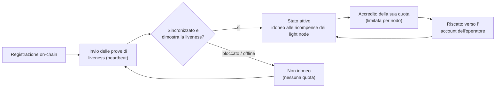

# Ricompense e Monitoraggio

Un light node registrato viene accreditato di una quota dell'allocazione dei light node e **deve restare in salute** per continuare a qualificarsi. Questa pagina descrive la quota del 3% di ricompensa riservata ai light node, come le ricompense vengono accreditate e riscattate, cosa fa e cosa non fa il nodo con le deleghe, e come monitorare il nodo.

:::note La registrazione al programma di ricompense non è ancora aperta
Nessun light node è ancora registrato su nessuna delle due reti, perché la registrazione richiede una licenza `lightnode_operator` e nessuna è stata concessa. La contabilità delle ricompense descritta qui è attiva on-chain, ma oggi non viene pagato nulla ai nodi e nulla in questa pagina è una promessa di guadagni. Vedi [Stato del programma di ricompense](/light-node/overview#reward-program-status).
:::

## La quota del 3% sulle ricompense di blocco

La distribuzione delle commissioni di QoreChain riserva una quota fissa del **3% ai light node** che servono dati di rete. Questa è una delle cinque destinazioni nella ripartizione delle ricompense del protocollo — validatori (37%), bruciato (30%), tesoreria (20%), staker (10%) e **light node (3%)** — applicata on-chain. Vedi [Tokenomics](/architecture/tokenomics) per la ripartizione completa.

Per partecipare a questa quota un nodo deve soddisfare le seguenti condizioni, verificate on-chain e non auto-dichiarate: una licenza `lightnode_operator` attiva (verificata al momento della registrazione), almeno **1.000 QOR in bonding** — conteggiati come totale su tutti i validatori a cui deleghi, non per singolo validatore, richiesti al momento della registrazione e riletti dallo staking ogni volta che vengono accreditate le ricompense — e una commissione di registrazione di **1 QOR**, pagata una sola volta al momento della registrazione. La partecipazione è limitata a livello di rete a **10.000 light node**. Vedi [Registrazione e Licenze](/light-node/registration-and-licensing) per come funziona la registrazione e [Stato del programma di ricompense](/light-node/overview#reward-program-status) per sapere se l'iscrizione è aperta.

Il 3% è ciò che affluisce nel modulo light-node, non un diritto per singolo nodo: a ogni nodo idoneo viene accreditata la sua quota, ponderata per lo stake, di quanto si è accumulato, limitata per nodo da `max_reward_per_block_per_node` (attualmente `1713` uqor per blocco, scalati in base all'uptime), e tutto ciò che non viene guadagnato va in una riserva che solo un voto di governance può sbloccare. Vedi [la quota del 3% di ricompensa dei light node](/light-node/overview#the-3-light-node-reward-share).

Una volta registrato e con la delega attiva, restare idonei è solo questione di restare attivi. Un nodo deve mantenere almeno l'**80% di uptime**, e deve continuare a inviare prove di liveness tramite heartbeat a un intervallo di **1.000 blocchi** (circa 54 minuti sulla mainnet con il tempo medio di blocco misurato di circa 3,2 s; circa 17 minuti sulla testnet, che produce un blocco circa ogni secondo).

**Le regole di temporizzazione.** La chain rifiuta un heartbeat inviato **meno di 1.000 blocchi dopo il precedente** (`heartbeat submitted too early`); il tuo primo heartbeat dopo la registrazione non ha un simile limite inferiore. Se non arriva alcun heartbeat entro **1.000 + 100 blocchi** (il `heartbeat_interval` più il `heartbeat_grace_period`; sulla mainnet circa 54 minuti più un periodo di grazia di circa 5 minuti) dall'ultimo — o dalla registrazione, se non ne hai inviato nessuno — il nodo viene marcato come inattivo e smette di essere accreditato. Un heartbeat inviato in seguito viene comunque accettato e lo riattiva. Il daemon invia il heartbeat successivo non appena sono trascorsi 1.000 blocchi dal `last_heartbeat` registrato dalla chain per il tuo nodo, controllando ogni 60 secondi.

**Mancare la finestra costa uptime, non la registrazione.** Un nodo che la manca viene marcato come inattivo e smette di guadagnare, ma il successivo heartbeat andato a buon fine lo riattiva — non c'è alcuna ri-registrazione da fare. Il tuo **uptime** è il rapporto corrente tra heartbeat ricevuti e heartbeat attesi (uno ogni 1.000 blocchi) dal blocco in cui ti sei registrato, limitato a 1. Sotto la soglia `min_uptime_for_rewards` (`0.80`) un nodo non guadagna nulla; a quella soglia o sopra, il limite per nodo viene scalato in base al tuo uptime. Un lungo periodo di inattività abbassa quindi il rapporto, che si recupera solo man mano che si accumulano heartbeat puntuali. Controlla `status` se un nodo risulta inattivo: riporta lo stato di signer, licenza e registrazione.

:::note Cosa dimostra davvero un heartbeat
Un heartbeat andato a buon fine dimostra che la chiave dell'operatore ha firmato in tempo — non dimostra che un nodo stia eseguendo ininterrottamente l'intero software. Trattalo come una firma di liveness, non come "verificato come nodo attivo".
:::

:::note `last_heartbeat` è un'altezza di blocco, non un timestamp
Se interroghi direttamente il record on-chain di un nodo, `last_heartbeat` è un'altezza di blocco, e un valore di `0` significa che non è stato ancora registrato alcun heartbeat — la chain misura quindi la scadenza di inattività a partire dall'altezza `registered_at` del nodo. Leggere `0` come un ingenuo calcolo di tempo trascorso fa sembrare un nodo appena registrato come se fosse in ritardo di milioni di blocchi.
:::

*Idoneità alla ricompensa: possedere una licenza on-chain attiva e lo stake minimo in bonding, registrarsi, e poi continuare a dimostrare la liveness tramite heartbeat per restare sopra le soglie di uptime e di intervallo heartbeat.*



## Come funzionano le ricompense {#how-rewards-work}

### Accredito

Ogni 100 blocchi la chain accredita a ciascun nodo idoneo (attivo, con almeno lo stake minimo in bonding e almeno l'uptime minimo) la sua quota di quanto si è accumulato, limitata per nodo come descritto in [la quota del 3% di ricompensa dei light node](/light-node/overview#the-3-light-node-reward-share). L'importo viene aggiunto agli `accumulated_rewards` del nodo. Leggilo con:

```bash
curl -s https://api.qore.host/qorechain/lightnode/v1/rewards/<operator-address>
# or: qorechaind query lightnode rewards <operator-address>
```

(Usa `https://api-testnet.qore.host` per la testnet.)

### Riscatto

Le ricompense accreditate restano sul record del nodo finché non le riscatti. Riscatta con la stessa coppia genera-poi-co-firma usata per la registrazione:

```bash
qorechaind tx lightnode claim-rewards --from operator --chain-id <chain-id> --gas 300000 --fees 30000uqor --generate-only > claim.json
qorechaind tx pqc cosign claim.json --from operator --pqc-key <node-key-name> --chain-id <chain-id>
```

In alternativa imposta `auto_claim = true` sotto `[delegation]`: il daemon riscatta allora le ricompense light-node maturate verso l'account dell'operatore tramite il signer non appena superano `min_reward_claim` (predefinito `1000000` uqor, 1 QOR), controllando ogni `compound_interval` (predefinito `1h`). Il riscatto automatico è **disattivato per impostazione predefinita**, e riscatta soltanto: il nodo non ridelega né sposta mai lo stake. `qorechaind tx lightnode deregister` rimuove la registrazione e paga quanto ancora accreditato; la commissione di registrazione non viene rimborsata.

### Tracciamento delle deleghe e avvisi di reputazione

Il nodo rispecchia le deleghe dell'account dell'operatore dalla chain ogni cinque minuti. Quando `rebalance_enabled` è attivo (il predefinito), controlla anche il punteggio di reputazione di ciascun validatore a cui deleghi e registra un avviso per ogni punteggio inferiore a `min_reputation` (predefinito `0.5`). Non sposta lo stake: modifica le deleghe dal tuo wallet. (Le opzioni `validators` e `split_weights` in `[delegation]` sono accettate ma al momento non vengono utilizzate.)

### Ispezionare ricompense e deleghe

```bash
lightnode-sx validators   # the bonded validator set
```

:::caution Limitazione nota nella v3.1.3 / v3.1.4
`lightnode-sx delegation`, `lightnode-sx rewards` e la vista **Delegation** dell'UX cercano l'indirizzo derivato dalla chiave del nodo. Una chiave di nodo post-quantistica non ha un indirizzo, quindi attualmente questi comandi non mostrano nulla (`rewards` riporta `chain REST endpoint not available`). Usa invece le query della chain:

```bash
curl -s https://api.qore.host/cosmos/staking/v1beta1/delegations/<operator-address>
curl -s https://api.qore.host/cosmos/distribution/v1beta1/delegators/<operator-address>/rewards
curl -s https://api.qore.host/qorechain/lightnode/v1/rewards/<operator-address>
```
:::

## Monitoraggio

Mantenere il nodo in salute è ciò che lo mantiene idoneo alle ricompense. Ci sono tre aspetti da tenere sotto controllo.

### Telemetria

La telemetria in tempo reale copre validatori, consenso/rete, il bridge e la tokenomics, ciascuna aggiornata secondo il proprio intervallo (configurato sotto `[telemetry]` in `config.toml`). Dalla CLI:

```bash
lightnode-sx status    # node and light-client sync status
lightnode-sx network   # recent synced headers and latest height
```

L'edizione UX mostra gli stessi dati in tempo reale nelle sue viste **Overview**, **Network**, **Bridge** e **Tokenomics** — vedi [Edizione UX](/light-node/ux-edition).

### Salute di sincronizzazione e heartbeat

Il comando `status` riporta l'ID della chain, l'altezza dell'ultimo blocco, se la chain è in fase di recupero (catching up), l'altezza sincronizzata e lo stato di sincronizzazione del light client e — una volta impostato `operator_address` — lo stato di `Signer`, `Licence` e `Registration` (inclusi lo stato del nodo e l'altezza dell'ultimo heartbeat). Un nodo che è registrato, sincronizzato e in esecuzione continua a inviare **prove di liveness tramite heartbeat** e quindi resta idoneo alle ricompense. Questi heartbeat vengono prodotti tramite una **pipeline di transazioni co-firmate PQC** (ibrida Dilithium-5 / ML-DSA-87), coerentemente con il requisito PQC predefinito della chain — vedi [Registrazione e Licenze](/light-node/registration-and-licensing#pqc-cosigned-heartbeat-pipeline) per il funzionamento della pipeline e come abilitare gli heartbeat on-chain. Se `status` mostra il nodo bloccato o non in sincronizzazione, potrebbe non riuscire a dimostrare la liveness — indaga prima che l'idoneità venga compromessa.

### Salute tramite self-test

Se sospetti un problema con lo stack crittografico, esegui in qualsiasi momento il self-test PQC:

```bash
lightnode-sx selftest
```

Esegue keygen → sign → verify → rilevamento manomissioni (cinque controlli) e termina con codice diverso da zero in caso di qualsiasi errore. Questo è il modo più rapido per escludere un problema nello stack di firma post-quantistica quando si diagnosticano problemi del nodo. Vedi [Edizione SX](/light-node/sx-edition) per la descrizione completa del self-test.

### Query della chain {#chain-queries}

URL di base: `https://api.qore.host` (mainnet) e `https://api-testnet.qore.host` (testnet).

| Query | Restituisce |
| --- | --- |
| `GET /qorechain/lightnode/v1/params` | Commissione di registrazione, intervallo di heartbeat e periodo di grazia, stake minimo delegato, quota di ricompensa, uptime minimo, limite di nodi. |
| `GET /qorechain/lightnode/v1/stats` | Numero di nodi registrati e attivi, totale delle ricompense accreditate. |
| `GET /qorechain/lightnode/v1/node/{address}` | Il record di un nodo (`status`, `last_heartbeat`, `total_heartbeats`, `expected_heartbeats`, `accumulated_rewards`). |
| `GET /qorechain/lightnode/v1/rewards/{address}` | Ricompense accreditate e non ancora riscattate. |
| `GET /qorechain/lightnode/v1/reward_pool` | Come il saldo del modulo si ripartisce tra riserva, ricompense accreditate e prossimo pagamento; include il limite per nodo. |
| `GET /qorechain/license/v1/check/{address}/lightnode_operator` | Se un indirizzo possiede una licenza attiva. |

## Prossimi passi

- [Registrazione e Licenze](/light-node/registration-and-licensing) — registrati e resta attivo.
- [Tokenomics](/architecture/tokenomics) — il modello completo di ricompense e burn.
