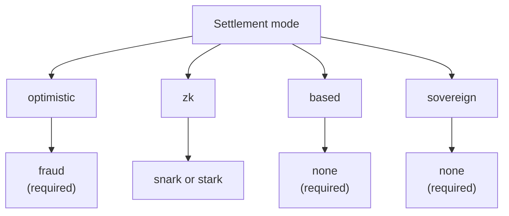

# Panoramica dei Rollup

Il **Rollup Development Kit (RDK)** di QoreChain — il modulo `x/rdk` — consente agli sviluppatori di lanciare rollup specifici per applicazione che si regolano (settle) su QoreChain. Ogni rollup è un ambiente di esecuzione indipendente con il proprio block time, la propria macchina virtuale, il proprio modello di commissioni e il proprio sequencing, pur ereditando le garanzie di sicurezza, crittografia post-quantistica e disponibilità dei dati di QoreChain.

:::caution Funzionalità in fase iniziale
L'RDK è distribuito su entrambe le reti, ma **su nessuna delle due è stato ancora creato alcun rollup** (verificato il 23 ottobre 2026), quindi i flussi descritti in questa sezione non sono stati messi alla prova da terze parti. La mainnet (**`qorechain-vladi`**, chain ID EVM **9801**, attiva dal 7 giugno 2026) esegue la versione di chain **v3.2.4** (applicata all'altezza 3.742.566 il 23 ottobre 2026, proposta di governance 13); la testnet (**`qorechain-diana`**, chain ID EVM **9800**) esegue la **v3.2.4** dal 19 ottobre 2026. Dove il comportamento è cambiato tra la v3.2.3 e la v3.2.4, questa sezione indica quale release si applica. Validate ogni deployment prima sulla testnet e leggete le note di stato di ciascuna pagina: diverse funzionalità (verifica ZK, disponibilità dei dati Celestia, QCAI Copilot, chiamate cross-VM, ricevute di settlement) oggi non sono utilizzabili end to end, e anche i client RDK rilasciati hanno limiti propri (consultate [RDK 0.6.0: modifiche e limiti](/rollups/deploying-a-rollup#rdk-050-limits)).
:::

## Cosa esiste oggi {#what-exists-today}

| | Stato |
|---|---|
| Rollup registrati (mainnet e testnet) | Nessuno |
| Modulo `x/rdk` e i suoi parametri | Distribuito su entrambe le reti; leggeteli con `qorechaind query rdk config` |
| Query RDK | Disponibili su entrambe le reti tramite CLI, gRPC e REST (`/qorechain/rdk/v1/…`), quindi le letture basate su REST, come `rdk.params()` in TypeScript, funzionano sulla mainnet |
| Ancore di settlement scritte dall'RDK | Nessuna. Dalla v3.2.2 un batch può portare un `anchor_signature` e viene allora ancorato in `x/multilayer` nella stessa transazione; senza di esso il batch si regola senza ancora. Non esistono ancora rollup, layer o ancore. L'RDK TypeScript 0.6.0 invia il campo quando il suo client firma in modalità ibrida ed è il creatore del rollup (non testato live); i client Python, Go, Rust e Java non lo inviano |
| Layer rollup registrati in `x/multilayer` | Nessuno |
| Prelievi | Pagati da un registro di escrow per singolo rollup dalla v3.2.3 (consultate [ZK / STARK & Withdrawals](/rollups/zk-stark-withdrawals)); nessuno è stato effettuato, perché non esiste alcun rollup |

Per il riferimento a livello di modulo più tecnico — parametri del modulo, dettagli interni del ciclo di vita, integrazione del burn e ancoraggio multilayer — consultate la pagina **[Rollup Development Kit](/architecture/rollup-development-kit)** nella sezione Architecture. Questa sezione Rollups è la guida pratica rivolta agli sviluppatori: cos'è l'RDK, quale paradigma scegliere, come eseguire il deployment, come funziona la disponibilità dei dati e come si regolano i prelievi da L2 a L1.

---

## Cosa offre l'RDK

Un rollup creato tramite l'RDK raggruppa quattro aspetti configurabili:

| Aspetto | Cosa controlla | Opzioni |
| ------- | ---------------- | ------- |
| **Modalità di settlement** | Come vengono verificate e finalizzate su QoreChain le transizioni di stato del rollup | `optimistic`, `zk`, `based`, `sovereign` |
| **Sistema di prova** | Il meccanismo crittografico o economico alla base del settlement | `fraud`, `snark`, `stark`, `none` |
| **Modalità sequencer** | Chi ordina le transazioni prima che vengano regolate | `dedicated`, `shared`, `based` |
| **Disponibilità dei dati** | Dove vengono pubblicati i dati delle transazioni affinché chiunque possa ricostruire lo stato | `native`, `celestia`, `both` |

Ogni rollup viene registrato con un `rollup-id` univoco, garantito da uno stake bond in QOR, e assegnato a uno stato del ciclo di vita (`pending`, `active`, `paused`, `stopped`). Consultate **[Deploying a Rollup](/rollups/deploying-a-rollup)** per il flusso completo di creazione e ciclo di vita.

---

## Cosa rende diverso l'RDK di QoreChain

Al di là delle funzionalità di base comuni a qualsiasi kit per rollup, l'RDK di QoreChain include tre capacità specifiche di QoreChain, costruite attorno al Layer 1 di QoreChain — oltre a un watchtower con auto-challenger. Il loro stato differisce; la tabella indica cosa funziona oggi. L'RDK viene distribuito in cinque linguaggi (TypeScript, Python, Go, Rust, Java). **La versione 0.6.0 è pubblicata su tutti e cinque i registry** (verificato il 21 ottobre 2026: npm `@qorechain/rdk`, `@qorechain/rdk-cli` e `create-qorechain-rollup`; PyPI `qorechain-rdk`; crates.io `qorechain-rdk`; Maven Central `io.github.qorechain:qorechain-rdk`; modulo Go `v0.6.0`, che conviene fissare esplicitamente perché `@latest` del proxy rispondeva ancora `v0.5.0`). Dei cinque, solo il client TypeScript firma transazioni ibride. I preset `mainnet` e `testnet` includono già gli endpoint pubblici `qore.host` incorporati, quindi `createRdkClient({ network })` non richiede alcuna configurazione manuale degli endpoint, e le sue letture REST funzionano su entrambe le reti.

| Differenziatore | Cosa fa |
| -------------- | ------------ |
| **[Ricevute di settlement quantum-safe](/rollups/settlement-receipts)** | Impacchettano un'ancora di settlement in una ricevuta portabile che porta una firma post-quantistica (ML-DSA-87 / Dilithium-5). Fase iniziale: non esistono ancora ancore, quindi nulla è stato verificato rispetto a un'ancora reale; una ricevuta è un'affermazione che deve essere verificata rispetto allo stato della chain, cosa che fa il verificatore della 0.6.0. |
| **[QCAI Rollup Copilot](/rollups/qcai-copilot)** | Un assistente consultivo di sola lettura per un singolo rollup (stima delle commissioni, raccomandazioni, indagini sulle frodi). I servizi consultivi che legge non sono ancora esposti sugli endpoint pubblici. |
| **[Chiamate cross-VM multi-VM](/rollups/multi-vm)** | Strumenti per codificare una chiamata EVM → QoreChain Native attraverso il precompile cross-VM (`0x…0901`). Il precompile non è attivato sulle reti live, quindi una chiamata non produce alcun effetto; l'encoder della 0.6.0 corrisponde al layout che la chain decodifica. |
| **[Watchtower](/rollups/watchtower)** | Un framework di auto-challenger per rollup optimistic che segnala nuovi batch e scadenze della finestra di contestazione, e contesta i batch non validi rispetto al vostro predicato di validità. Legge tramite REST, che entrambe le reti servono; dalla 0.6.0 giudica la finestra di ciascun batch come fa la chain. |

Consultate **[Why QoreChain RDK](/rollups/why)** per la motivazione completa e degli esempi di codice.

---

## I quattro paradigmi di settlement

L'RDK di QoreChain supporta quattro distinte modalità di settlement, ciascuna con assunzioni di fiducia, caratteristiche di finalità e requisiti di prova diversi. La combinazione di modalità di settlement e sistema di prova viene validata on-chain — un abbinamento incompatibile viene rifiutato al momento della creazione. Il diagramma seguente mappa ogni modalità di settlement al proprio sistema di prova valido.

### Optimistic

I rollup optimistic assumono per default che i batch inviati siano validi e si affidano alle **prove di frode (fraud proof)** per la risoluzione delle contestazioni.

* **Sistema di prova**: `fraud` — prove di frode interattive
* **Sequencer**: `dedicated` o `shared`
* **Finalità**: Ritardata fino alla scadenza di una finestra di contestazione configurabile senza contestazioni riuscite
* **Contestazioni**: Chiunque può contestare un batch inviato entro la finestra depositando una cauzione e una fraud proof. Una contestazione congela il batch; il creatore del rollup la risolve poi, e la chain verifica da sé la prova — una frode accertata respinge il batch e remunera chi ha contestato, una contestazione respinta riporta il batch allo stato `submitted`. Consultate [Deploying a Rollup](/rollups/deploying-a-rollup#challenge-a-batch-optimistic-rollups).
* **Durata della finestra**: la finestra predefinita è di 604.800 "secondi". **Prima della v3.2.4 (sulla mainnet, prima dell'altezza 3.742.566)** la chain la converte in blocchi a un valore fisso di 6 secondi per blocco — **100.800 blocchi** — quindi il tempo realmente trascorso segue il block time effettivo (circa 3,7 giorni con gli attuali blocchi della mainnet da ≈3,2 s); pianificate in blocchi, non in giorni. **Dalla v3.2.4**, un batch inviato dall'altezza dell'upgrade in poi ottiene una finestra misurata in secondi di block time (7 giorni pieni); i batch precedenti mantengono la regola del conteggio in blocchi. L'altezza dell'upgrade è 8.337.253 sulla testnet (dal 19 ottobre 2026) e 3.742.566 sulla mainnet (23 ottobre 2026), quindi la regola del conteggio in blocchi si applica a ogni batch inviato sotto quell'altezza e la regola del block time da quell'altezza in poi.

### ZK (Zero-Knowledge)

I rollup ZK allegano una prova di validità crittografica a ogni batch, dimostrando la correttezza della transizione di stato senza dover rieseguire le transazioni.

* **Sistema di prova**: `snark` (prove succinte) o `stark` (prove trasparenti, senza trusted setup)
* **Sequencer**: `dedicated` o `shared`
* **Finalità**: Al momento della verifica della prova valida — nessuna finestra di contestazione richiesta
* **Maturità**: I batch SNARK vengono verificati on-chain (Groth16 su BLS12-381) rispetto a una verifying key memorizzata insieme al rollup. Un rollup creato tramite `create-rollup` attualmente non porta con sé una verifying key, quindi i batch ZK non possono ancora essere finalizzati end to end. La verifica STARK è sperimentale: è opt-in e controlla un circuito dimostrativo, non la transizione di stato del vostro rollup. Considerate il settlement ZK come non pronto per la produzione. Consultate **[ZK / STARK & Withdrawals](/rollups/zk-stark-withdrawals)**.

### Based

I rollup based delegano il sequencing delle transazioni ai proposer di QoreChain (L1), ereditando la liveness e la resistenza alla censura della chain ospitante.

* **Sistema di prova**: `none` — i proposer L1 sono la fonte di verità per l'ordinamento
* **Sequencer**: `based` (obbligatorio — imposto dalla validazione on-chain)
* **Finalità**: Segue la conferma della chain ospitante
* **Compromesso**: Modello operativo più semplice, poiché i validatori di QoreChain gestiscono il sequencing, al costo del controllo di latenza di un sequencer dedicato
* **Stato oggi**: `based` è registrato nella configurazione del rollup, ma QoreChain non ammette ancora i proposer L1 come sottoscrittori dei batch — è il creatore del rollup a inviarli (consultate [Modalità sequencer](#sequencer-modes))

### Sovereign

I rollup sovereign eseguono il proprio consensus e si auto-sequenziano. Ancorano lo stato a QoreChain per la verificabilità, ma non dipendono dalla chain ospitante per la finalità.

* **Sistema di prova**: `none`
* **Sequencer**: gestito autonomamente dal rollup
* **Finalità**: Indipendente — determinata dal consensus proprio del rollup
* **Ancoraggio dello stato**: Le state root vengono pubblicate su QoreChain per trasparenza, ma la chain ospitante non le impone

---

## Compatibilità tra modalità di settlement e sistema di prova

La modalità di settlement vincola quali sistemi di prova sono validi. Questi abbinamenti sono imposti al momento della creazione di un rollup.

| Modalità di settlement | `fraud` | `snark` | `stark` | `none` |
| --------------- | :-----: | :-----: | :-----: | :----: |
| **optimistic**  | Obbligatorio | — | — | — |
| **zk**          | — | Supportato | Supportato | — |
| **based**       | — | — | — | Obbligatorio |
| **sovereign**   | — | — | — | Obbligatorio |

---

## Modalità sequencer {#sequencer-modes}

Il sequencer determina chi ordina le transazioni all'interno di un blocco del rollup prima del settlement.

| Modalità | Chi sequenzia | Note |
| ---- | ------------- | ----- |
| **`dedicated`** | Un singolo indirizzo operatore designato | Latenza minima; richiede fiducia nell'operatore per la liveness e l'ordinamento equo |
| **`shared`** | Un insieme condiviso di sequencer | Ordinamento distribuito tra l'insieme; overhead di coordinamento leggermente maggiore |
| **`based`** | I proposer L1 di QoreChain | Eredita la sicurezza dei validatori della chain ospitante e la resistenza alla censura; obbligatorio per il settlement `based` |

:::note Cosa viene imposto oggi
On-chain, un batch può essere inviato solo dall'indirizzo sequencer configurato del rollup oppure, quando non ne è impostato nessuno (è il caso di ogni preset), dal suo creatore. Le modalità `shared` e `based` sono registrate nella configurazione del rollup, ma QoreChain non ammette ancora un elenco di sequencer condivisi né i proposer L1 come sottoscrittori dei batch; queste modalità descrivono il design previsto.
:::

---

## Scegliere un paradigma

| Se volete... | Considerate |
| -------------- | -------- |
| La configurazione operativa più semplice, con i validatori di QoreChain che sequenziano | **based** |
| Finalità rapida con garanzie crittografiche (non ancora pronto per la produzione) | **zk** (`snark` / `stark`) |
| Un modello ben consolidato con risoluzione economica delle contestazioni | **optimistic** (`fraud`) |
| Piena indipendenza con un proprio consensus, ancorato per la verificabilità | **sovereign** |

Non sapete da dove iniziare? L'RDK offre **profili preset** che raggruppano queste scelte per le categorie di applicazioni più comuni — consultate **[Preset Profiles](/rollups/preset-profiles)** — e, quando l'RPC consultivo è disponibile, un helper `suggest-profile` (attualmente restituisce un fallback fisso `defi`, quindi scegliete dalla tabella dei profili).

Per gli sviluppatori, l'RDK è disponibile anche come SDK TypeScript pubblico **`@qorechain/rdk`** insieme allo scaffolder **`create-qorechain-rollup`**, che pilotano lo stesso modulo on-chain direttamente da codice — consultate **[Deploying a Rollup](/rollups/deploying-a-rollup#deploy-with-the-typescript-rdk-qorechainrdk)**.

## Correlati

* [Deploying a Rollup](/rollups/deploying-a-rollup) — lanciate un rollup dalla CLI o dall'RDK TypeScript.
* [Preset Profiles](/rollups/preset-profiles) — bundle a un clic per le categorie di applicazioni più comuni.
* [Data Availability](/rollups/data-availability) — il router DA nativo e l'archiviazione dei blob.
* [ZK / STARK Withdrawals](/rollups/zk-stark-withdrawals) — flussi di prelievo garantiti da prova.
