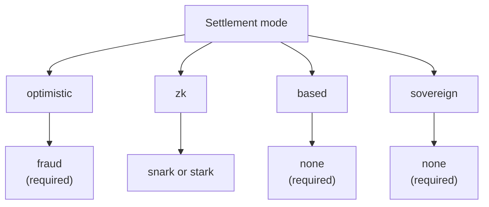

# Panoramica dei Rollup

Il **Rollup Development Kit (RDK)** di QoreChain è un insieme di librerie client (TypeScript, Python, Go, Rust e Java), uno strumento a riga di comando per gli operatori e template di partenza per costruire rollup specifici per applicazione che si regolano (settle) su QoreChain tramite il modulo on-chain `x/rdk`. Con esso configurate un rollup, costruite e firmate le sue transazioni, leggete il suo stato, seguite le sue finestre di contestazione, emettete e verificate ricevute di settlement e assemblate chiamate cross-VM e prove di prelievo. Ogni rollup è un ambiente di esecuzione indipendente con il proprio block time, la propria macchina virtuale, il proprio modello di commissioni e il proprio sequencing, pur ereditando la sicurezza, la crittografia post-quantistica e la disponibilità dei dati di QoreChain. Questa pagina è rivolta agli sviluppatori che vogliono lanciare o gestire un rollup e a chi deve decidere se l'RDK è adatto alla propria applicazione.

:::caution Funzionalità in fase iniziale
L'RDK è distribuito su entrambe le reti, ma **su nessuna delle due è stato ancora creato alcun rollup** (verificato il 27 ottobre 2026), quindi i flussi descritti in questa sezione non sono stati messi alla prova da terze parti. **Il settlement ZK (il profilo `defi`, il template `defi-rollup` e ogni rollup `zk`) non può ancora essere usato su nessuna delle due reti:** la chain non ha modo di registrare una verifying key, quindi ogni batch ZK viene rifiutato dopo che la commissione è stata pagata. La registrazione delle chiavi è prevista per la chain v3.2.7. Fino ad allora usate il settlement `optimistic`.

La mainnet (**`qorechain-vladi`**, chain ID EVM **9801**, attiva dal 7 giugno 2026) esegue la versione di chain **v3.2.4** (applicata all'altezza 3.742.566 il 23 ottobre 2026, proposta di governance 13); la testnet (**`qorechain-diana`**, chain ID EVM **9800**) esegue la **v3.2.6** (la v3.2.4 l'ha raggiunta il 19 ottobre 2026, la v3.2.5 il 26 ottobre e la v3.2.6 il 27 ottobre). La proposta di governance 14 della mainnet applicherebbe la v3.2.5 all'altezza 3.906.833 ed era nel periodo di voto al momento della stesura; ciò che la v3.2.5 cambia per i rollup è elencato in [comportamento della chain v3.2.5](#v325), indicato come testnet ora e mainnet dopo l'upgrade. Dove il comportamento è cambiato tra la v3.2.3 e la v3.2.4, questa sezione indica quale release si applica. Validate ogni deployment prima sulla testnet e leggete le note di stato di ciascuna pagina: diverse funzionalità (verifica ZK, disponibilità dei dati Celestia, QCAI Copilot, chiamate cross-VM, ricevute di settlement) oggi non sono utilizzabili end to end.
:::

## Innovazioni {#innovations}

* **Ricevute di settlement post-quantistiche.** L'ancora di stato di un batch è firmata con ML-DSA-87 dalla chiave registrata del creatore del rollup. `verifySettlementReceipt` rilegge dalla chain ogni campo della ricevuta (rollup, layer, batch root e l'ancora: state root, altezza del layer, altezza della Main Chain, ora dell'ancora, hash del validator set, numero di transazioni, prova, firma). La chiave di verifica proviene dalla chain e mai dalla ricevuta; la ricevuta deve nominare la rete che interrogate; una versione di ricevuta sconosciuta o un algoritmo diverso da ML-DSA-87 viene rifiutato prima di qualsiasi lettura; e un controllo della sola firma non viene mai riportato come valido. Il messaggio dell'ancora ha una prima forma sotto l'altezza della chain v3.2.2 e una seconda forma, che vincola anche il chain id, da essa in poi; la versione è scelta in base all'altezza dell'ancora. Consultate [Ricevute di settlement](/rollups/settlement-receipts).
* **Firma ibrida con due derivazioni di chiave.** Le transazioni sono firmate con secp256k1 più ML-DSA-87. La chiave post-quantistica viene derivata dalla mnemonica sia nel modo canonico (SHAKE-256 su `qorechain:pqc:v1|`, l'indirizzo e la mnemonica) sia nel modo legacy, e il client usa la chiave che la chain ha registrato per l'account. Oggi solo il client TypeScript firma in modalità ibrida.
* **Prove di prelievo costruite come le costruisce la chain.** `withdrawalsTree` (0.7.0, tutti e cinque i linguaggi) costruisce la root dei prelievi di un batch e ogni prova esattamente come fa la chain: la posizione della foglia è l'indice di prelievo, i nodi sono calcolati con SHAKE-256, e i batch dalla chain v3.2.5 usano foglie di seconda forma che nominano anche il chain id. È testata con vettori prodotti dal codice della chain stessa, e ogni prova in quei vettori è accettata dal verificatore della chain. `qorollup withdraw` rifiuta prima di pagare una commissione quando il suo risultato non è la `withdrawals_root` on-chain del batch.
* **Transition root canonica.** `batchTransitionRoot` calcola l'esatta state root con cui la chain giudica un batch optimistic (la forma che la mainnet applica oggi è un impegno SHAKE-256 della state root precedente, dell'hash dei dati e del numero di transazioni; `transitionRootVersionFor` seleziona la forma che la rete connessa applica), e `fraudProof` costruisce da essa la prova di 64 byte. Entrambe sono state testate con vettori generati dal codice della chain stessa.
* **Finestre di contestazione esatte come nella chain.** `batchChallengeWindow` calcola la finestra di un batch come fa la chain (basata sul tempo: aperta finché il block time è inferiore al momento dell'invio più la finestra; per i batch più vecchi, la finestra divisa per sei in blocchi dall'altezza di invio) e la giudica rispetto alla punta della chain letta dall'RPC `/status`, non dall'orologio locale. Il [Watchtower](/rollups/watchtower) e il health monitor la usano. Dalla 0.7.0, `getRollupHealth` riporta anche `heldBackBy` quando la finalità in ordine della chain (ora sulla testnet, vedi [comportamento della chain v3.2.5](#v325)) trattiene un batch, e `qorollup watchtower --canonical` riporta i batch che una contestazione vincerebbe.
* **Controlli prima di pagare qualsiasi commissione.** Il kit rifiuta un rollup id fuori da `^[a-z0-9][a-z0-9._-]{2,63}$`; un prelievo che non è in `uqor`, ha importo zero, porta una prova più profonda di 64 livelli da 32 byte o nomina un indirizzo bech32 non valido; una withdrawals root che non è vuota né di esattamente 32 byte; uno stop del rollup che la chain rifiuterà (ora sulla testnet); e, quando riesce a leggere il rollup, un batch che nomina un hash dei dati su un rollup con disponibilità dei dati `native` o `both`. Ciascuno di questi casi verrebbe altrimenti rifiutato dalla chain dopo che la commissione è stata spesa.
* **Calldata cross-VM e verifica live.** `encodeCrossVmCalldata` costruisce il calldata per `executeCrossVMCall(uint8,string,bytes)` (selettore `0x3c11078c`, precompile `0x...0901`), e `isCrossVmPrecompileActive` legge se il precompile è attivo sulla rete. Dalla 0.7.0, `getCrossVmParams`, `crossVmTargetReady`, `decodeCrossVmResult` e `decodeRevertReason` coprono l'allowlist e i formati di risposta della chain v3.2.5 (ora sulla testnet). Consultate [Multi-VM](/rollups/multi-vm).
* **Un unico insieme di vettori di test per cinque linguaggi.** I pacchetti TypeScript, Python, Go, Rust e Java sono verificati rispetto alla stessa fixture di riferimento (il pacchetto Go ha 100 unit test, Rust 77 e Java 75).

## Come usarlo {#how-to-use}

Le letture non richiedono alcuna chiave né fondi. Gli snippet seguenti leggono i parametri live del modulo `rdk` e l'elenco dei rollup sulla testnet pubblica (`qorechain-diana`) e sono stati eseguiti il 27 ottobre 2026 dai pacchetti pubblicati (la versione corrente è la 0.7.0; lo snippet TypeScript e la riga di comando sono stati rieseguiti con la 0.7.0 da npm, e il developer hub registra gli snippet Python, Rust, Go e Java come superati rispetto alla stessa release). Ciascuno ha stampato i parametri della testnet (massimo 200 rollup, stake minimo 10.000 QOR, aliquota di burn alla creazione 0,01, finestra di contestazione predefinita 3.600 secondi, dimensione massima del blob DA 2.097.152 byte, conservazione dei blob 432.000 blocchi, massimo 10 batch per blocco) e `0 rollups`.

### TypeScript (testato)

```bash
npm install @qorechain/rdk
```

```ts
import { createRdkClient } from "@qorechain/rdk";

// Public testnet (chain id qorechain-diana).
const rdk = createRdkClient({
  network: "testnet",
  endpoints: { rest: "https://api-testnet.qore.host" },
});

// Read the live rdk module parameters and the registered rollups.
const params = await rdk.params();
const rollups = await rdk.rest.listRollups();
console.log(rdk.network.chainId, params, `${rollups.length} rollups`);
```

I preset `mainnet` e `testnet` includono già gli endpoint pubblici `qore.host`, quindi `createRdkClient({ network: "testnet" })` funziona senza il campo `endpoints`; qui è mostrato perché lo snippet testato lo passava. Eseguite con Node 20 o successivo (il test ha usato Node 26).

### Python (testato)

```bash
pip install qorechain-rdk
```

```python
from qorrdk import create_rdk_client

# Public testnet (chain id qorechain-diana).
rdk = create_rdk_client(network="testnet", endpoints={"rest": "https://api-testnet.qore.host"})

# Read the live rdk module parameters and the registered rollups.
params = rdk.params()
rollups = rdk.rest.list_rollups()
print(rdk.network.chain_id, params, f"{len(rollups)} rollups")
```

Python 3.10 o successivo. `qorechain-rdk` dipende da `qorechain-pqc`, che richiama `liboqs-python` e necessita della libreria `liboqs`; su una macchina che ne è priva, la prima importazione la compila (servono git, CMake e un compilatore C). Testato in un ambiente virtuale nuovo con Python 3.12.

### Go (testato)

```bash
go get github.com/qorechain/qorechain-rdk/packages/go@v0.7.0
```

```go
package main

import (
	"context"
	"fmt"

	rdk "github.com/qorechain/qorechain-rdk/packages/go"
)

func main() {
	// Public testnet (chain id qorechain-diana).
	client := rdk.NewRdkClient(rdk.RdkClientOptions{
		Network:   "testnet",
		Endpoints: &rdk.Endpoints{Rest: "https://api-testnet.qore.host"},
	})
	ctx := context.Background()
	// Read the live rdk module parameters and the registered rollups.
	params, err := client.Params(ctx)
	if err != nil {
		panic(err)
	}
	rollups, _ := client.Rest.ListRollups(ctx)
	fmt.Printf("%s %+v %d rollups\n", client.Network.ChainID, params, len(rollups))
}
```

Testato con Go 1.26, con il modulo scaricato dal proxy Go.

### Rust (testato)

```bash
cargo add qorechain-rdk
```

```rust
use qorechain_rdk::client::{RdkClient, RdkClientOptions};

fn main() -> Result<(), Box<dyn std::error::Error>> {
    // Public testnet (chain id qorechain-diana).
    let rdk = RdkClient::new(RdkClientOptions {
        rest_url: Some("https://api-testnet.qore.host".into()),
        ..Default::default()
    });

    // Read the live rdk module parameters and the registered rollups.
    let params = rdk.params()?;
    let rollups = rdk.rest.list_rollups()?;
    println!("{} {:?} {} rollups", rdk.network.chain_id, params, rollups.len());
    Ok(())
}
```

La libreria è `qorechain_rdk`. Testato con Rust 1.95, compilato rispetto a crates.io.

### Java (testato)

```kotlin
// build.gradle.kts
implementation("io.github.qorechain:qorechain-rdk:0.7.0")
```

```java
import io.github.qorechain.rdk.client.RdkClient;
import io.github.qorechain.rdk.client.Views.ParamsView;
import io.github.qorechain.rdk.config.Networks;

public class RdkQuickstart {
    public static void main(String[] args) {
        // Public testnet (chain id qorechain-diana).
        RdkClient.Options options = new RdkClient.Options();
        options.network = "testnet";
        options.endpoints = new Networks.Endpoints();
        options.endpoints.rest = "https://api-testnet.qore.host";
        RdkClient rdk = new RdkClient(options);

        // Read the live rdk module parameters and the registered rollups.
        ParamsView params = rdk.params();
        int rollups = rdk.rest.listRollups().size();
        System.out.println(rdk.network.chainId + " maxRollups=" + params.maxRollups
                + " minStakeForRollup=" + params.minStakeForRollup + " " + rollups + " rollups");
    }
}
```

JDK 17 o successivo; testato con JDK 21 e Gradle 9.6 che risolve da Maven Central. Il file deve chiamarsi `RdkQuickstart.java`. Maven Central serve la 0.6.2 e la 0.7.0 (verificato il 27 ottobre 2026).

### Riga di comando (testata)

```bash
npm install -g @qorechain/rdk-cli
qorollup --version
qorollup params --network testnet
```

`qorollup --version` stampa `0.7.0` e `qorollup params --network testnet` stampa i parametri live del modulo. **Questo funziona dalla 0.6.2.** Le release 0.6.1 e precedenti terminavano con codice 0 e non stampavano nulla se installate da npm. Il test ha installato `@qorechain/rdk-cli@0.7.0` in un progetto vuoto e l'ha eseguito tramite `node_modules/.bin/qorollup`; un'installazione globale e `npx` usano lo stesso bin link. È richiesto Node 20 o successivo.

### Creare lo scheletro di un progetto (testato)

```bash
npx create-qorechain-rollup my-rollup --template nft-rollup --network testnet --yes
cd my-rollup && npm run doctor
```

I template sono `defi-rollup`, `gaming-rollup`, `nft-rollup`, `enterprise-rollup`, `custom-rollup` e `multivm-rollup`. Il progetto generato dipende da `@qorechain/rdk` `^0.7.0`. La generazione di `nft-rollup` con lo scaffolder 0.6.1 ha prodotto un progetto il cui `npm run doctor` è passato rispetto alla testnet (REST raggiungibile, parametri leggibili, rete `qorechain-diana`; segnala un avviso sulla disponibilità dei dati Celestia e sull'assenza di un signer); la generazione di `defi-rollup` e l'esecuzione di `npm run typecheck` sono passate di nuovo il 27 ottobre 2026 con la release corrente. **Non usate ancora `defi-rollup` per lanciare un rollup** (consultate [Limiti](#limits)). Per creare un rollup e inviare batch, seguite [Deploying a Rollup](/rollups/deploying-a-rollup); le transazioni richiedono una chiave post-quantistica registrata e, nell'RDK, il client TypeScript dotato di un `pqcKeypair`.

## Come accedere {#how-to-access}

**Reti ed endpoint.** L'RDK comunica con gli endpoint pubblici delle due reti; i preset `mainnet` e `testnet` li includono già.

| Rete | Chain id | Chain ID EVM | Endpoint REST | Versione della chain |
| ---- | -------- | ------------ | ------------- | -------------------- |
| Mainnet | `qorechain-vladi` | 9801 | `https://api.qore.host` | v3.2.4 |
| Testnet | `qorechain-diana` | 9800 | `https://api-testnet.qore.host` | v3.2.6 |

Entrambe le reti servono le query RDK (`/qorechain/rdk/v1/...`) tramite REST, gRPC e CLI, quindi letture come `rdk.params()` funzionano su entrambe. La testnet è una rete di staging con parametri propri: la finestra di contestazione predefinita è di 3.600 secondi sulla testnet e di 604.800 sulla mainnet, sulla testnet possono esistere al massimo 200 rollup e sulla mainnet 100, e il modulo multilayer consente 64 layer sidechain sulla testnet e 10 sulla mainnet (verificato il 27 ottobre 2026). Leggete `GET /qorechain/rdk/v1/params` sulla rete di destinazione.

**Prerequisiti per creare un rollup.**

| Requisito | Dettagli |
| --------- | -------- |
| **Account finanziato** | Un account con QOR sufficienti per lo stake, lo stake del layer e le commissioni. |
| **Stake in escrow** | La creazione di un rollup mette in escrow `min_stake_for_rollup`, **10.000 QOR** su entrambe le reti. **L'1 % dello stake (100 QOR) viene bruciato** alla creazione; il resto resta in escrow e viene restituito quando il rollup viene fermato. |
| **Stake del layer** | La creazione registra anche il layer del rollup nel modulo multilayer (stake minimo 1.000 QOR). Se il layer non può essere registrato, il rollup viene comunque creato ma non ha un layer reale, quindi i suoi batch non possono essere ancorati e non si possono emettere ricevute. |
| **Chiave post-quantistica registrata** | Una chiave ML-DSA-87 registrata per l'account. Le transazioni sul lane nativo firmate solo con la chiave classica vengono rifiutate. |
| **Commissioni** | Il minimo di commissione è 0,1 uqor per unità di gas; impostate insieme il limite di gas e la commissione. |
| **Strumenti** | Node 20 o successivo per la CLI e lo scaffolder; Python 3.10 o successivo (con `liboqs`, vedi sopra) per il client Python; JDK 17 o successivo per Java; il modulo Go `github.com/qorechain/qorechain-rdk/packages/go`. |

Leggere lo stato non richiede nulla di tutto ciò. Potete anche richiedere un rollup tramite la Dashboard (un modulo di richiesta, non una transazione on-chain) o crearne uno con la CLI della chain; consultate [Deploying a Rollup](/rollups/deploying-a-rollup) per il flusso completo, i comandi CLI e il percorso di firma TypeScript.

### Comportamento della chain v3.2.5: testnet ora, mainnet dopo l'upgrade {#v325}

La testnet esegue la chain v3.2.6, che include la v3.2.5. **La mainnet esegue la v3.2.4 finché la proposta di governance 14 non applica la v3.2.5** (prevista intorno al 29 ottobre 2026). L'RDK 0.7.0 supporta entrambe. Le differenze che incontra uno sviluppatore di rollup:

| Comportamento | Testnet (v3.2.6) | Mainnet (v3.2.4, fino all'upgrade) |
| --------- | ---------------- | ----------------------------------- |
| Chi può risolvere una contestazione | Qualsiasi account | Solo il creatore del rollup |
| Dopo una frode accertata | Il batch e ogni batch successivo non finalizzato vengono respinti; il sequencer reinvia dall'ultima root valida con gli stessi indici | Il batch contestato viene respinto (la regola v3.2.4) |
| Ordine di finalità | I batch si finalizzano in ordine di indice | Non è una regola v3.2.4 |
| Batch optimistic in attesa | Al massimo 4.096 per rollup | Non è una regola v3.2.4 |
| Fermare un rollup | Rifiutato finché l'ultimo batch è `submitted` o `challenged`; un rollup fermato libera il suo slot | Non è una regola v3.2.4 |
| `withdrawals_root` | Vuota o di esattamente 32 byte; le foglie di prelievo di seconda forma nominano il chain id | Non è una regola v3.2.4; foglie di prima forma |
| Bridge cross-VM | `GET /qorechain/crossvm/v1/params` serve l'allowlist (vuota); il precompile restituisce `abi.encode(bytes)` e rifiuta con `Error(string)` | La risposta grezza del target, come descritto nella pagina Multi-VM |
| Precompile cross-VM `0x...0901` | Ancora non attivo | Non attivo |

### Cosa esiste oggi {#what-exists-today}

| | Stato |
|---|---|
| Rollup registrati (mainnet e testnet) | Nessuno |
| Modulo `x/rdk` e i suoi parametri | Distribuito su entrambe le reti; leggeteli con `qorechaind query rdk config` |
| Query RDK | Disponibili su entrambe le reti tramite CLI, gRPC e REST (`/qorechain/rdk/v1/...`), quindi le letture basate su REST, come `rdk.params()` in TypeScript, funzionano sulla mainnet |
| Ancore di settlement scritte dall'RDK | Nessuna. Dalla v3.2.2 un batch può portare un `anchor_signature` e viene allora ancorato in `x/multilayer` nella stessa transazione; senza di esso il batch si regola senza ancora. Non esistono ancora rollup, layer o ancore. L'RDK TypeScript (da 0.6.0 a 0.7.0) invia il campo quando il suo client firma in modalità ibrida ed è il creatore del rollup (non testato live); i client Python, Go, Rust e Java non lo inviano |
| Layer rollup registrati in `x/multilayer` | Nessuno |
| Settlement ZK | Non può ancora essere usato su nessuna delle due reti (nessun modo di registrare una verifying key; previsto per la chain v3.2.7) |
| Prelievi | Pagati da un registro di escrow per singolo rollup dalla v3.2.3 (consultate [ZK / STARK & Withdrawals](/rollups/zk-stark-withdrawals)); nessuno è stato effettuato, perché non esiste alcun rollup |

Per il riferimento a livello di modulo più tecnico (parametri del modulo, dettagli interni del ciclo di vita, integrazione del burn e ancoraggio multilayer) consultate la pagina **[Rollup Development Kit](/architecture/rollup-development-kit)** nella sezione Architecture. Questa sezione Rollups è la guida pratica rivolta agli sviluppatori.

## Dove è pubblicato {#where-published}

Versioni verificate sui registry il 27 ottobre 2026. Tutti i pacchetti sono Apache-2.0.

| Registry | Pacchetto | Versione attuale | Link |
| -------- | --------- | ---------------- | ---- |
| npm | `@qorechain/rdk` (client TypeScript) | 0.7.0 | [npmjs.com](https://www.npmjs.com/package/@qorechain/rdk) |
| npm | `@qorechain/rdk-cli` (`qorollup`) | 0.7.0 | [npmjs.com](https://www.npmjs.com/package/@qorechain/rdk-cli) |
| npm | `create-qorechain-rollup` (scaffolder) | 0.7.0 | [npmjs.com](https://www.npmjs.com/package/create-qorechain-rollup) |
| PyPI | `qorechain-rdk` (import `qorrdk`) | 0.7.0 | [pypi.org](https://pypi.org/project/qorechain-rdk/) |
| crates.io | `qorechain-rdk` (libreria `qorechain_rdk`) | 0.7.0 | [crates.io](https://crates.io/crates/qorechain-rdk) |
| Proxy dei moduli Go | `github.com/qorechain/qorechain-rdk/packages/go` | v0.7.0 | [pkg.go.dev](https://pkg.go.dev/github.com/qorechain/qorechain-rdk/packages/go) |
| Maven Central | `io.github.qorechain:qorechain-rdk` | 0.7.0 | [central.sonatype.com](https://central.sonatype.com/artifact/io.github.qorechain/qorechain-rdk) |

Maven Central serve la 0.6.2 e la 0.7.0 oltre alle versioni precedenti, e `@latest` del proxy Go può restare indietro rispetto a un nuovo tag, quindi fissate la versione Go. Il sorgente è pubblico su [github.com/qorechain/qorechain-rdk](https://github.com/qorechain/qorechain-rdk), le note di rilascio sono su [v0.7.0](https://github.com/qorechain/qorechain-rdk/releases/tag/v0.7.0) e la documentazione propria del kit è su [qorechain.github.io/qorechain-rdk](https://qorechain.github.io/qorechain-rdk/). Il pacchetto TypeScript dipende da `@qorechain/sdk` `^0.10.0` (dalla 0.7.0; la 0.6.x usava `^0.9.0`) e `@qorechain/evm` `^0.8.0`, e il pacchetto Python da `qorechain-pqc` 0.2.x. La logica del modulo `x/rdk` della chain non fa parte del kit pubblico.

## Limiti e problemi noti {#limits}

* **Il settlement ZK non può ancora essere usato su nessuna delle due reti.** Ciò riguarda il profilo `defi`, il template `defi-rollup` e ogni rollup creato con settlement `zk`. La chain non ha modo di registrare una verifying key per un rollup, quindi ogni batch ZK viene rifiutato dopo che la commissione è stata pagata. La registrazione delle chiavi è prevista per la chain v3.2.7. Fino ad allora usate il settlement `optimistic` (consultate [ZK / STARK & Withdrawals](/rollups/zk-stark-withdrawals)).
* **Su nessuna delle due reti è stato creato alcun rollup.** I percorsi di creazione, batch, contestazione, ricevuta e prelievo sono coperti da unit test e vettori condivisi, ma non sono stati messi alla prova on-chain.
* **Solo il client TypeScript firma transazioni ibride.** I percorsi di transazione Python, Go, Rust e Java e i comandi di transazione di `qorollup` (`create`, `pause`, `resume`, `stop`, `withdraw`) firmano solo in modo classico, cosa che entrambe le reti rifiutano. Le loro letture funzionano. Per le transazioni da questi, costruite il messaggio e cofirmatelo con la CLI della chain, oppure usate il client TypeScript con un `pqcKeypair`.
* **(a) La CLI `qorollup` non stampava nulla se installata da npm nella 0.6.1 e precedenti.** Questo è **corretto nella 0.6.2**: dopo `npm i -g @qorechain/rdk-cli`, `qorollup ...` funziona e `qorollup --version` stampa 0.6.2.
* **(b) Gli helper Merkle per i prelievi usavano SHA-256 per default nella 0.6.2 e precedenti, mentre la chain usa SHAKE-256.** Una prova costruita con quei valori predefiniti non è mai stata verificata on-chain. **Corretto nella 0.7.0:** `withdrawalsTree` costruisce l'albero esatto della chain ed è stato verificato rispetto al verificatore della chain stessa (consultate [Codifica di foglie e nodi](/rollups/zk-stark-withdrawals#leaf-and-node-encoding)). Aggiornate; il codice che si affidava ai valori predefiniti SHA-256 ora deve passare `hash` esplicitamente.
* **(c) `buildDaBlob` calcolava l'hash con SHA-256 nella 0.6.2 e precedenti, mentre l'impegno sul blob della chain è SHAKE-256.** **Corretto nella 0.7.0**, dove il suo impegno è quello della chain. Non ha mai avuto alcun effetto pratico, perché nessuna transazione pubblica un blob; lasciate `dataHash` vuoto con disponibilità dei dati `native` e `both` (consultate [Data Availability](/rollups/data-availability)).
* **(d) Il circuito dimostrativo del template `defi` non può verificare.** È un moltiplicatore `snarkjs`, e la chain controlla Groth16 su BLS12-381 con la state root precedente, la state root e l'hash dei dati come input pubblici, che quel circuito non espone. Anche dopo la distribuzione della registrazione delle chiavi, serve un circuito proprio.
* **Sulla mainnet (v3.2.4) solo il creatore del rollup può risolvere una contestazione.** La chain verifica da sé la fraud proof, ma è il creatore a inviare la risoluzione. La testnet permette già a qualsiasi account di risolvere; la mainnet lo otterrà quando la proposta 14 applicherà la v3.2.5 (consultate [comportamento della chain v3.2.5](#v325) e [Optimistic](#optimistic)).
* **Non utilizzabili sulle reti live:** la disponibilità dei dati Celestia (non implementata), il [QCAI Rollup Copilot](/rollups/qcai-copilot) (i suoi servizi consultivi non sono sugli endpoint pubblici), le chiamate cross-VM (il precompile in `0x...0901` non è attivo), i sequencer condivisi e based (la chain ammette solo il sequencer configurato o, quando non ne è impostato nessuno, il creatore) e `suggest-profile` (restituisce `defi` come fallback fisso).
* **Note sulle versioni.** Usate la 0.7.0 per tutto: la 0.6.2 e precedenti costruiscono prove di prelievo che non vengono mai verificate on-chain, e la 0.6.1 e precedenti non stampano nulla da `qorollup` se installate da npm. La 0.5.0 e precedenti non vanno usate per ricevute, Watchtower o calldata cross-VM. L'elenco completo di ciò che ogni release ha modificato è in [RDK 0.7.0: modifiche e limiti](/rollups/deploying-a-rollup#rdk-050-limits).

---

## Riferimento: di cosa è fatto un rollup {#reference}

### Cosa offre l'RDK

Un rollup creato tramite l'RDK raggruppa quattro aspetti configurabili:

| Aspetto | Cosa controlla | Opzioni |
| ------- | -------------- | ------- |
| **Modalità di settlement** | Come vengono verificate e finalizzate su QoreChain le transizioni di stato del rollup | `optimistic`, `zk`, `based`, `sovereign` |
| **Sistema di prova** | Il meccanismo crittografico o economico alla base del settlement | `fraud`, `snark`, `stark`, `none` |
| **Modalità sequencer** | Chi ordina le transazioni prima che vengano regolate | `dedicated`, `shared`, `based` |
| **Disponibilità dei dati** | Dove vengono pubblicati i dati delle transazioni affinché chiunque possa ricostruire lo stato | `native`, `celestia`, `both` |

Ogni rollup viene registrato con un `rollup-id` univoco, garantito da uno stake bond in QOR, e assegnato a uno stato del ciclo di vita (`pending`, `active`, `paused`, `stopped`). Consultate **[Deploying a Rollup](/rollups/deploying-a-rollup)** per il flusso completo di creazione e ciclo di vita.

### Capacità specifiche di QoreChain e il loro stato

Al di là delle funzionalità di base comuni a qualsiasi kit per rollup, l'RDK include tre capacità costruite attorno al Layer 1 di QoreChain, oltre a un watchtower con auto-challenger. Il loro stato differisce; la tabella indica cosa funziona oggi.

| Capacità | Cosa fa |
| -------- | ------- |
| **[Ricevute di settlement](/rollups/settlement-receipts)** | Impacchettano un'ancora di settlement in una ricevuta portabile che porta una firma post-quantistica (ML-DSA-87 / Dilithium-5). Fase iniziale: non esistono ancora ancore, quindi nulla è stato verificato rispetto a un'ancora reale; una ricevuta è un'affermazione che deve essere verificata rispetto allo stato della chain, cosa che fa, campo per campo, il verificatore della 0.7.0. |
| **[QCAI Rollup Copilot](/rollups/qcai-copilot)** | Un assistente consultivo di sola lettura per un singolo rollup (stima delle commissioni, raccomandazioni, indagini sulle frodi). I servizi consultivi che legge non sono ancora esposti sugli endpoint pubblici. |
| **[Chiamate cross-VM multi-VM](/rollups/multi-vm)** | Strumenti per codificare una chiamata da EVM a QoreChain Native attraverso il precompile cross-VM (`0x...0901`). Il precompile non è attivato sulle reti live, quindi una chiamata non produce alcun effetto; l'encoder dalla 0.6.0 corrisponde al layout che la chain decodifica. |
| **[Watchtower](/rollups/watchtower)** | Un framework di auto-challenger per rollup optimistic che segnala nuovi batch e scadenze della finestra di contestazione, e contesta i batch non validi rispetto al vostro predicato di validità. Legge tramite REST, che entrambe le reti servono; dalla 0.6.0 giudica la finestra di ciascun batch come fa la chain (le release successive lo mantengono). |

Consultate **[Why QoreChain RDK](/rollups/why)** per la motivazione completa e degli esempi di codice.

### I quattro paradigmi di settlement {#settlement-paradigms}

L'RDK di QoreChain supporta quattro modalità di settlement, ciascuna con assunzioni di fiducia, caratteristiche di finalità e requisiti di prova diversi. La combinazione di modalità di settlement e sistema di prova viene validata on-chain, e un abbinamento incompatibile viene rifiutato al momento della creazione. Il diagramma mappa ogni modalità di settlement al proprio sistema di prova valido.



#### Optimistic {#optimistic}

I rollup optimistic assumono per default che i batch inviati siano validi e si affidano alle **prove di frode (fraud proof)** per la risoluzione delle contestazioni.

* **Sistema di prova**: `fraud` (prove di frode interattive).
* **Sequencer**: `dedicated` o `shared`.
* **Finalità**: ritardata fino alla scadenza di una finestra di contestazione configurabile senza contestazioni riuscite.
* **Contestazioni**: chiunque può contestare un batch inviato entro la finestra depositando una cauzione e una fraud proof. Una contestazione congela il batch; sulla mainnet (v3.2.4) il creatore del rollup la risolve poi, mentre sulla testnet (v3.2.5 e successive) può farlo qualsiasi account, e la mainnet segue quando la proposta 14 applica la v3.2.5. La chain verifica da sé la prova: una frode accertata respinge il batch e remunera chi ha contestato, una contestazione respinta riporta il batch allo stato `submitted`. Sulla testnet una frode accertata respinge anche ogni batch successivo non finalizzato, che il sequencer reinvia dall'ultima root valida con gli stessi indici (consultate [comportamento della chain v3.2.5](#v325)). Consultate [Deploying a Rollup](/rollups/deploying-a-rollup#challenge-a-batch-optimistic-rollups).
* **Durata della finestra**: la finestra predefinita è di 604.800 "secondi" sulla mainnet (il `default_challenge_window` del modulo; il valore predefinito della testnet è di 3.600 secondi, letto il 27 ottobre 2026, e un rollup può impostare il proprio). **Prima della v3.2.4 (sulla mainnet, prima dell'altezza 3.742.566)** la chain la converte in blocchi a un valore fisso di 6 secondi per blocco, ovvero **100.800 blocchi**, quindi il tempo realmente trascorso segue il block time effettivo (circa 3,7 giorni con gli attuali blocchi della mainnet da ≈3,1 s); pianificate in blocchi, non in giorni. **Dalla v3.2.4**, un batch inviato dall'altezza dell'upgrade in poi ottiene una finestra misurata in secondi di block time (7 giorni pieni); i batch precedenti mantengono la regola del conteggio in blocchi. L'altezza dell'upgrade è 8.337.253 sulla testnet (dal 19 ottobre 2026) e 3.742.566 sulla mainnet (23 ottobre 2026).

#### ZK (Zero-Knowledge) {#zk}

I rollup ZK allegano una prova di validità crittografica a ogni batch, dimostrando la correttezza della transizione di stato senza dover rieseguire le transazioni.

* **Sistema di prova**: `snark` (prove succinte) o `stark` (prove trasparenti, senza trusted setup).
* **Sequencer**: `dedicated` o `shared`.
* **Finalità**: al momento della verifica della prova valida, senza finestra di contestazione.
* **Maturità**: **il settlement ZK non può ancora essere usato su nessuna delle due reti.** I batch SNARK sono pensati per essere verificati on-chain (Groth16 su BLS12-381) rispetto a una verifying key memorizzata insieme al rollup, e la chain non ha ancora modo di registrarne una, quindi ogni batch ZK viene rifiutato dopo che la commissione è stata pagata. La registrazione delle chiavi è prevista per la chain v3.2.7. La verifica STARK è sperimentale: è opt-in e controlla un circuito dimostrativo, non la transizione di stato del vostro rollup. Consultate **[ZK / STARK & Withdrawals](/rollups/zk-stark-withdrawals)**.

#### Based {#based}

I rollup based delegano il sequencing delle transazioni ai proposer di QoreChain (L1), ereditando la liveness e la resistenza alla censura della chain ospitante.

* **Sistema di prova**: `none` (i proposer L1 sono la fonte di verità per l'ordinamento).
* **Sequencer**: `based` (obbligatorio, imposto dalla validazione on-chain).
* **Finalità**: segue la conferma della chain ospitante.
* **Compromesso**: modello operativo più semplice, poiché i validatori di QoreChain gestiscono il sequencing, al costo del controllo di latenza di un sequencer dedicato.
* **Stato oggi**: `based` è registrato nella configurazione del rollup, ma QoreChain non ammette ancora i proposer L1 come sottoscrittori dei batch; è il creatore del rollup a inviarli (consultate [Modalità sequencer](#sequencer-modes)).

#### Sovereign {#sovereign}

I rollup sovereign eseguono il proprio consensus e si auto-sequenziano. Ancorano lo stato a QoreChain per la verificabilità, ma non dipendono dalla chain ospitante per la finalità.

* **Sistema di prova**: `none`.
* **Sequencer**: gestito autonomamente dal rollup.
* **Finalità**: indipendente, determinata dal consensus proprio del rollup.
* **Ancoraggio dello stato**: le state root vengono pubblicate su QoreChain per trasparenza, ma la chain ospitante non le impone.

### Compatibilità tra sistemi di prova

La modalità di settlement vincola quali sistemi di prova sono validi. Questi abbinamenti sono imposti al momento della creazione di un rollup.

| Modalità di settlement | `fraud` | `snark` | `stark` | `none` |
| ---------------------- | :-----: | :-----: | :-----: | :----: |
| **optimistic**  | Obbligatorio | - | - | - |
| **zk**          | - | Supportato | Supportato | - |
| **based**       | - | - | - | Obbligatorio |
| **sovereign**   | - | - | - | Obbligatorio |

### Modalità sequencer {#sequencer-modes}

Il sequencer determina chi ordina le transazioni all'interno di un blocco del rollup prima del settlement.

| Modalità | Chi sequenzia | Note |
| -------- | ------------- | ---- |
| **`dedicated`** | Un singolo indirizzo operatore designato | Latenza minima; richiede fiducia nell'operatore per la liveness e l'ordinamento equo |
| **`shared`** | Un insieme condiviso di sequencer | Ordinamento distribuito tra l'insieme; overhead di coordinamento leggermente maggiore |
| **`based`** | I proposer L1 di QoreChain | Eredita la sicurezza dei validatori della chain ospitante e la resistenza alla censura; obbligatorio per il settlement `based` |

:::note Cosa viene imposto oggi
On-chain, un batch può essere inviato solo dall'indirizzo sequencer configurato del rollup oppure, quando non ne è impostato nessuno (è il caso di ogni preset), dal suo creatore. Le modalità `shared` e `based` sono registrate nella configurazione del rollup, ma QoreChain non ammette ancora un elenco di sequencer condivisi né i proposer L1 come sottoscrittori dei batch; queste modalità descrivono il design previsto.
:::

### Scegliere un paradigma

| Se volete... | Considerate |
| ------------ | ----------- |
| La configurazione operativa più semplice, con i validatori di QoreChain che sequenziano | **based** |
| Finalità rapida con garanzie crittografiche (non ancora utilizzabile) | **zk** (`snark` / `stark`) |
| Un modello ben consolidato con risoluzione economica delle contestazioni | **optimistic** (`fraud`) |
| Piena indipendenza con un proprio consensus, ancorato per la verificabilità | **sovereign** |

Non sapete da dove iniziare? L'RDK offre **profili preset** che raggruppano queste scelte per le categorie di applicazioni più comuni; consultate **[Preset Profiles](/rollups/preset-profiles)**. Esiste un helper `suggest-profile`, ma attualmente restituisce un fallback fisso `defi` (e `defi` non può ancora essere usato), quindi scegliete dalla tabella dei profili.

## Correlati

* [Deploying a Rollup](/rollups/deploying-a-rollup): lanciate un rollup dalla CLI o dall'RDK TypeScript.
* [Preset Profiles](/rollups/preset-profiles): bundle per le categorie di applicazioni più comuni.
* [Data Availability](/rollups/data-availability): il router DA nativo e l'archiviazione dei blob.
* [ZK / STARK Withdrawals](/rollups/zk-stark-withdrawals): flussi di prelievo garantiti da prova.
* [Ricevute di settlement](/rollups/settlement-receipts), [Watchtower](/rollups/watchtower), [Multi-VM](/rollups/multi-vm) e [Why QoreChain RDK](/rollups/why).
