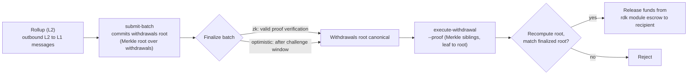

# ZK / STARK & Prelievi

Questa pagina copre due argomenti correlati: i **sistemi di proof ZK** (`snark` e `stark`) usati dai rollup con settlement ZK, e il **flusso di prelievo L2 → L1** che sposta i fondi da un rollup verso QoreChain una volta che un batch è finalizzato.

:::caution Funzionalità in fase iniziale
Nessun rollup è ancora stato creato su nessuna delle due reti (verificato il 27 ottobre 2026), quindi né la verifica delle proof né il flusso di prelievo qui descritti sono stati messi alla prova su un rollup live. Sulla mainnet i prelievi possono andare a buon fine solo dalla v3.2.3 (altezza 3,662,051, 20 ottobre 2026), quando è entrato in funzione il registro di escrow per rollup (vedi [Da dove provengono i fondi](#where-the-funds-come-from)); prima di allora ogni prelievo falliva. **Il settlement ZK non può ancora essere usato su nessuna delle due reti** (il profilo `defi` e ogni rollup `zk`): la chain non ha modo di registrare una verification key, quindi ogni batch ZK viene rifiutato dopo il pagamento della sua fee, e la registrazione delle chiavi è prevista per la chain v3.2.7. La verifica STARK è sperimentale. Valida sulla testnet **`qorechain-diana`** e non dare per scontate garanzie pronte per la produzione sulla mainnet.
:::

---

## Sistemi di proof ZK

Un rollup con settlement ZK (modalità di settlement `zk`) allega una validity proof a ogni batch di settlement, dimostrando che la transizione di stato è corretta senza ri-eseguire le transazioni del rollup. Il settlement ZK supporta due sistemi di proof:

| Sistema di proof | Caratteristiche |
| ------------ | --------------- |
| **`snark`** | Proof succinte (Groth16 su BLS12-381), verificate on-chain rispetto alla verifying key del rollup |
| **`stark`** | Proof trasparenti, nessun trusted setup — sperimentale; opt-in e legato a un circuito dimostrativo |

La modalità di settlement `zk` richiede uno tra `snark` o `stark`; l'abbinamento è imposto on-chain quando il rollup viene creato. Per contro, il settlement `optimistic` usa il sistema di proof `fraud`, mentre i settlement `based` e `sovereign` usano `none`. Vedi **[Panoramica dei Rollup](/rollups/overview)** per la matrice di compatibilità completa.

### Finalità

A differenza dei rollup ottimistici — che attendono lo scadere di una finestra di contestazione delle fraud proof — un batch ZK può finalizzarsi alla **verifica di una proof valida**, senza finestra di disputa. Questo è il compromesso fondamentale del settlement ZK: una finalità più forte e più rapida in cambio del costo e della complessità di generare le proof.

### Maturità

**Il settlement ZK non può ancora essere usato su nessuna delle due reti.** I batch SNARK sono pensati per essere verificati on-chain (Groth16 su BLS12-381, con tre input pubblici: la state root precedente, la nuova state root e il data hash) rispetto a una verification key memorizzata insieme al rollup. La chain non ha modo di registrare quella chiave, quindi un rollup creato con settlement `zk`, compreso ogni rollup del profilo `defi` o del template `defi-rollup`, non ne ha una, e ogni batch ZK che sottomette viene rifiutato dopo il pagamento della sua fee. La registrazione delle chiavi è prevista per la chain v3.2.7; finché non sarà disponibile, non creare un rollup ZK e non finanziarne uno. Quando lo sarà, il circuito demo del template `defi` (un moltiplicatore `snarkjs`) continuerà a non poter essere verificato, perché non ha gli input pubblici che la chain controlla; ti servirà un tuo circuito. Dall'RDK 0.7.0 il template `defi-rollup` si ferma prima di inviare un batch, quindi non spende più una fee per uno che la chain rifiuta sempre. La verifica STARK è sperimentale: è opt-in e controlla un circuito dimostrativo, non la transizione di stato del tuo rollup. Per un settlement utilizzabile oggi, scegli `optimistic` (i profili `nft` e `custom`).

---

## Come i batch trasportano i prelievi

Quando un rollup effettua il settlement di un batch, quel batch può anche fare il commit dei messaggi cross-layer in uscita del rollup — i suoi **prelievi L2 → L1**. Concettualmente:

* Un batch finalizzato può trasportare un commitment al suo insieme di prelievi (una Merkle root sui messaggi di prelievo del batch).
* Ogni singolo prelievo è una foglia sotto quella root, identificata dal suo indice di batch e da un indice di prelievo.
* Una volta che il batch è finalizzato, qualsiasi parte può dimostrare che una specifica foglia di prelievo è inclusa sotto la root sottoposta a commit, e attivare il payout.

Ecco perché i prelievi dipendono dal settlement: un prelievo può essere eseguito solo contro un batch **finalizzato**, perché è la finalizzazione a rendere canonica la root dei prelievi sottoposta a commit.

Per come i batch vengono sottomessi e finalizzati — incluso `submit-batch` e il percorso di disputa `challenge-batch` per i rollup ottimistici — vedi **[Distribuire un Rollup](/rollups/deploying-a-rollup)**.

---

## Eseguire un prelievo: `execute-withdrawal`

Il comando `execute-withdrawal` finalizza un prelievo L2 → L1 contro la root dei prelievi di un batch finalizzato. Dimostra che una foglia di prelievo è sottoposta a commit in quella root e paga il destinatario dall'escrow del modulo rdk. L'azione è **permissionless** — chiunque può sottomettere una proof valida. Come ogni transazione della lane nativa, richiede la co-firma post-quantistica ibrida, quindi costruiscila con `--generate-only` e co-firmala (vedi [Distribuire un Rollup](/rollups/deploying-a-rollup)). I prelievi non sono ancora stati messi alla prova su un rollup live; considera il flusso come non testato. Controlla questi punti prima di pagare una fee, perché altrimenti la chain rifiuta la transazione: la denom deve essere esattamente `uqor`, l'importo deve essere positivo, la proof ha al massimo 64 livelli e ogni sibling è esattamente di 32 byte, il submitter e il destinatario sono indirizzi `qor1…` validi, il batch è finalizzato e ha fatto il commit di un `withdrawals_root`, il rollup non è fermato, e quella foglia di prelievo non è già stata pagata in precedenza. Il pacchetto TypeScript `@qorechain/rdk` (dalla 0.6.0 in poi) esegue per te il primo gruppo di questi controlli (`withdrawalErrors`: indirizzi, denom, importo, profondità della proof e lunghezza dei sibling), e `executeWithdrawal` lancia un errore prima di trasmettere se uno qualsiasi fallisce; dalla 0.7.0 anche `qorollup withdraw --file withdrawal.json [--dry-run]` costruisce la proof a partire dai prelievi del batch e rifiuta prima di pagare una fee quando il risultato non è la `withdrawals_root` on-chain del batch; le condizioni su batch, rollup e ledger dipendono dallo stato della chain, che questo controllo non legge.

```bash
qorechaind tx rdk execute-withdrawal \
  [rollup-id] [batch-index] [withdrawal-index] [recipient] [denom] [amount] \
  --proof <sibling-hash-1>,<sibling-hash-2>,... \
  --from mykey \
  --chain-id qorechain-diana \
  --gas 400000 --fees 40000uqor \
  --generate-only > withdrawal.json
qorechaind tx pqc cosign withdrawal.json --from mykey --pqc-key mypqckey --chain-id qorechain-diana
```

**Argomenti posizionali:**

| Argomento | Descrizione |
| -------- | ----------- |
| `rollup-id` | Il rollup a cui appartiene il prelievo |
| `batch-index` | Il batch finalizzato la cui root dei prelievi fa il commit di questo prelievo |
| `withdrawal-index` | L'indice della foglia di prelievo all'interno di quel batch |
| `recipient` | L'indirizzo a cui effettuare il payout |
| `denom` | La denominazione da pagare |
| `amount` | L'importo da pagare |

**Flag:**

| Flag | Descrizione |
| ---- | ----------- |
| `--proof` | Sibling hash Merkle in formato hex separati da virgola, ordinati dalla foglia alla root, che dimostrano che la foglia di prelievo è sottoposta a commit nella root dei prelievi del batch |

Il valore di `--proof` è la inclusion proof: i sibling hash lungo il percorso dalla foglia di prelievo fino alla root dei prelievi sottoposta a commit dal batch. Il modulo ricalcola la root a partire dalla foglia e dai sibling forniti e la confronta con la root sottoposta a commit dal batch finalizzato prima di effettuare il pagamento.

### Codifica di foglie e nodi {#leaf-and-node-encoding}

* **Foglia (prima forma, per i batch precedenti alla chain v3.2.5)** = SHAKE-256 (32 byte) di `rollup_id`, un byte `0x00`, l'indice di prelievo (8 byte big-endian), la stringa `recipient`, `0x00`, la stringa `denom`, `0x00`, e l'`amount` (8 byte big-endian).
* **Foglia (seconda forma, dalla chain v3.2.5 su entrambe le reti)**: per i batch dalla chain v3.2.5 la foglia nomina anche il chain id. L'RDK costruisce entrambe le forme (`withdrawalLeafV1`, `withdrawalLeafV2`).
* **Genitore** = SHAKE-256 di `left || right`. A ogni livello il bit corrispondente dell'indice di prelievo decide il lato: `0` significa che la foglia (o l'hash corrente) è il nodo sinistro, quindi la posizione della foglia nell'albero è il suo indice di prelievo.
* Ogni sibling hash deve essere esattamente di 32 byte.
* **Withdrawals root (dalla chain v3.2.5, entrambe le reti):** la `withdrawals_root` di un batch è vuota oppure di esattamente 32 byte; prima della v3.2.5 quella regola di lunghezza non era imposta.

Non costruire questo albero a mano. `withdrawalsTree` in `@qorechain/rdk` 0.7.0 (e i suoi equivalenti in Python, Go, Rust e Java) costruisce la root dei prelievi di un batch e ogni proof esattamente come fa la chain, ed è stato verificato rispetto al verificatore della chain stessa; `assembleWithdrawalProof` costruisce per impostazione predefinita l'albero della chain, e gli helper Merkle generici ora usano per impostazione predefinita SHAKE-256.

:::caution Release precedenti alla 0.7.0
In `@qorechain/rdk` 0.6.2 e precedenti, gli helper generici `binaryMerkleRoot` / `binaryMerkleProof` (e i loro equivalenti in Python, Go, Rust e Java) usavano per impostazione predefinita SHA-256 con nodi dispari duplicati e ri-hashavano ogni foglia, mentre la chain usa SHAKE-256 e costruisce le sue foglie a partire dal prelievo, quindi una proof costruita con quei valori predefiniti non veniva mai verificata on-chain. Passa alla 0.7.0, oppure sostituisci l'hash e la codifica delle foglie con le regole qui sopra, altrimenti la proof non verrà verificata on-chain.
:::

### Da dove provengono i fondi {#where-the-funds-come-from}

Un prelievo viene pagato dallo **stake in escrow del rollup stesso** (lo stake meno il burn di creazione dell'1%). L'escrow di tutti i rollup si trova in un unico saldo aggregato del modulo e, dalla **v3.2.3**, un **registro di escrow** per rollup è la contabilità di ciò che ciascun rollup detiene: `create-rollup` lo accredita con l'escrow che il rollup conserva, un prelievo o una ricompensa per fraud proof viene pagato da esso e addebitato su di esso, e un prelievo superiore a quanto il rollup detiene ancora viene rifiutato con un errore di escrow insufficiente. `stop-rollup` rimborsa solo ciò che resta e azzera il registro, e un rollup fermato non paga più prelievi. Un prelievo dimostrato per un rollup non può quindi essere pagato dallo stake di un altro rollup. Le query dei rollup riportano `escrow_balance` (uqor ancora detenuti per quel rollup). Nel modulo non esiste alcun messaggio di deposito L1 → L2, quindi questo non è un bridge di fondi degli utenti.

---

## Flusso di prelievo end-to-end

*Il percorso da L2 a L1: un batch di settlement fa il commit di una root dei prelievi, il batch si finalizza, poi una inclusion proof permissionless rilascia i fondi in escrow su QoreChain.*



1. **Effettua il settlement di un batch.** L'operatore del rollup sottomette un batch di settlement con `submit-batch`. Il batch può fare il commit di una root dei prelievi sui suoi messaggi L2 → L1 in uscita.
2. **Finalizza.** Il batch si finalizza in base alla modalità di settlement del rollup — alla verifica di una proof valida per `zk`, oppure dopo la finestra di contestazione per `optimistic` (durante la quale `challenge-batch` può contestarlo). Dalla chain v3.2.5 (testnet dal 26 ottobre 2026, mainnet dal 29 ottobre 2026), i batch si finalizzano inoltre rigorosamente in ordine di indice, quindi un batch attende ogni batch precedente che sia ancora `submitted` o `challenged`. La finestra optimistic è per impostazione predefinita di 100.800 blocchi per un batch sottomesso prima dell'upgrade v3.2.4; dalla v3.2.4 è misurata in secondi di tempo di blocco per i batch sottomessi dall'altezza di upgrade in poi (testnet dall'altezza 8.337.253 il 19 ottobre 2026, mainnet dall'altezza 3.742.566 il 23 ottobre 2026).
3. **Dimostra ed esegui.** Una volta finalizzato, chiunque sottomette `execute-withdrawal` con la Merkle inclusion proof (`--proof`) per la specifica foglia di prelievo. Il modulo verifica l'inclusione rispetto alla root dei prelievi del batch finalizzato e paga il destinatario dall'escrow.

Poiché il passaggio 3 è permissionless e basato su proof, un prelievo non dipende dalla cooperazione dell'operatore del rollup una volta che il batch che lo trasporta è finalizzato.

---

## Correlati

* **[Panoramica dei Rollup](/rollups/overview)** — paradigmi di settlement e matrice di compatibilità dei sistemi di proof.
* **[Distribuire un Rollup](/rollups/deploying-a-rollup)** — comandi operatore `submit-batch` e `challenge-batch`.
* **[Rollup Development Kit](/architecture/rollup-development-kit)** — il riferimento del modulo di livello più basso.
