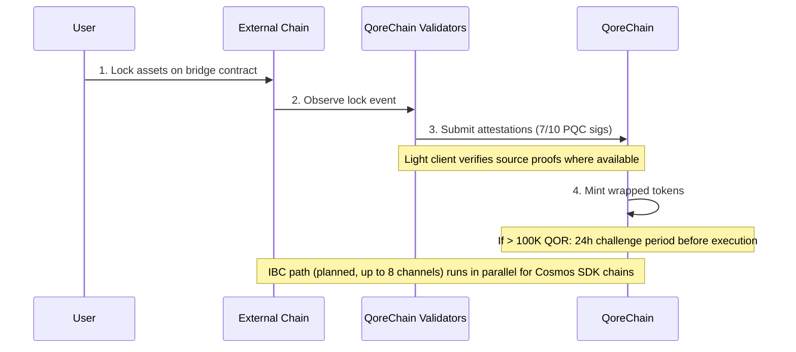

# ブリッジアーキテクチャ

`x/bridge` モジュールは、**37 個のチェーン構成（36 個の外部チェーンに加え、IBC 経由で接続する Injective）と最大 8 個の IBC（Inter-Blockchain Communication）カウンターパーティ**を通じて、QoreChain をより広範なブロックチェーンエコシステムに接続するように設計されています。すべてのブリッジ操作はポスト量子暗号によって保護されるように設計されています。

:::caution どちらのネットワークでも未稼働
ブリッジモジュールはメインネットとテストネットにデプロイされていますが、**稼働中のブリッジルートはありません**。37 個すべてのチェーン構成は `pending` ステータスで、ブリッジコントラクトは設定されておらず、ブリッジバリデーターは登録されておらず、ブリッジ操作は一度も作成されておらず、IBC チャネルもクライアントも存在しません。以下に記載する内容はすべて意図された設計の説明です。ブリッジされることを期待して資産を送信しないでください。
:::

## 現在のステータス {#current-status}

| | メインネット | テストネット |
|---|---|---|
| ブリッジモジュール | 有効 | 有効 |
| チェーン構成 | 37、すべて `pending` | 37、すべて `pending` |
| 登録済みブリッジバリデーター | 0 | 0 |
| ブリッジ操作 | 0 | 0 |
| IBC チャネル / クライアント | 0 / 0 | 0 / 0 |

（2026 年 10 月時点の確認。ライブの値は `qorechaind query bridge chains` と `qorechaind query bridge validators` で読み取ってください。）

## 接続の概要

QoreChain は、並行して動作する 2 つのブリッジプロトコルをサポートするように設計されています。

| プロトコル | 接続数               | セキュリティモデル                   | ユースケース                            |
| -------- | -------------------- | ------------------------------------ | --------------------------------------- |
| **IBC**  | 最大 8 チャネル（開通なし） | 標準 IBC + PQC パケット署名          | Cosmos SDK 互換チェーン                 |
| **QCB**  | 37 チェーン構成（すべて保留中） | 7-of-10 Dilithium-5 マルチシグ       | 非 IBC チェーン（EVM、Solana、TON など） |

**37 個のチェーン構成**は、以下に挙げる **36 個の外部チェーン**に加えて、IBC タイプのチェーンとして構成される **Injective** です。QoreChain 自身のループバック構成はありません。計画されている IBC チャネルは Cosmos SDK 互換チェーンに接続します。

## IBC チャネル

QoreChain は、Hermes v1.x を介してリレーされる以下の 8 チェーンへの IBC 接続を維持するように設計されています。**どちらのネットワークにも IBC チャネルやクライアントはまだ存在しない**ため、この表は計画されているカウンターパーティのみを示しています。

| チェーン   | 説明                           |
| ---------- | ------------------------------ |
| Cosmos Hub | 主要なハブ接続                 |
| Osmosis    | DEX 流動性ルーティング         |
| Noble      | USDC ネイティブ発行            |
| Celestia   | データ可用性レイヤー           |
| Stride     | リキッドステーキング           |
| Akash      | 分散型コンピューティング       |
| Babylon    | BTC リステーキングプロトコル   |
| Injective  | DeFi / オーダーブックの相互運用性 |

### IBC リレーヤー構成

* **リレーヤーソフトウェア**: Hermes v1.x
* **クライアント更新**: 自動ライトクライアントリフレッシュ
* **不正行為検出**: 有効 — リレーヤーは二重署名を監視します
* **パケットクリア**: 100 ブロックごとに、保留中の IBC パケットがクリアされます
* **PQC 拡張**: QoreChain を発信元とするすべての IBC パケットには、前方量子セキュリティのためのオプションの Dilithium-5 署名が含まれます。PQC 対応の受信チェーンは、標準の IBC 検証と並行してこの署名を検証できます。

## QCB（QoreChain Bridge）プロトコル

QCB プロトコルは、ポスト量子暗号によって保護されたハブアンドスポークアーキテクチャを使用します。QoreChain がハブとして機能し、各外部チェーンに対するスポーク構成があります。

### 外部チェーン構成（36）

QCB プロトコルは、以下の 36 個の外部チェーンをターゲットとするように設計されています。Injective（IBC タイプの構成）と合わせて、**合計 37 個のチェーン構成**となり、現在すべて `pending` ステータスです。

**ベースラインチェーン（10）**

Ethereum、Solana、TON、BSC、Avalanche、Polygon、Arbitrum、Optimism、Base、Sui。

**EVM ファミリーチェーン（14）**

zkSync Era、Linea、Scroll、Blast、Mantle、Hyperliquid、Berachain、Sonic、Sei、Monad、Plasma、Filecoin FVM、Cronos、Kaia。

**非 EVM チェーン（5）**

Starknet、XRP Ledger、Stellar、Hedera、Algorand。

**その他のチェーン（7）**

NEAR、Bitcoin、Cardano、Polkadot、Tezos、Tron、Aptos。

:::note
カウント確認: 10 ベースライン + 14 EVM ファミリー + 5 非 EVM + 7 その他 = **36 個の外部チェーン**。Injective（IBC）を加えると、**37 個のチェーン構成**となります。
:::

### アドレス形式

QCB プロトコルは、宛先アドレスを検証するためにチェーンをタイプ別に分類します。

| チェーンタイプ | 例となるチェーン                                                        | アドレス形式                                       |
| ------------ | ----------------------------------------------------------------------- | -------------------------------------------------- |
| `evm`        | Ethereum, BSC, Avalanche, Polygon, Arbitrum, Optimism, Base             | `0x` + 40 桁の 16 進数文字                          |
| `solana`     | Solana                                                                  | Base58、32〜44 文字                                |
| `ton`        | TON                                                                     | `EQ` + base64 エンコード                           |
| `sui_move`   | Sui                                                                     | `0x` + 64 桁の 16 進数文字                          |
| `aptos_move` | Aptos                                                                   | `0x` + 64 桁の 16 進数文字                          |
| `bitcoin`    | Bitcoin                                                                 | Bech32（`bc1`）、P2SH（`3...`）、またはレガシー（`1...`）|
| `near`       | NEAR Protocol                                                           | `.near` サフィックスまたは暗黙的アドレス           |
| `cardano`    | Cardano                                                                 | `addr1`（支払い）または `stake1`（ステーキング）   |
| `polkadot`   | Polkadot                                                                | SS58 エンコード                                    |
| `tezos`      | Tezos                                                                   | `tz1`/`tz2`/`tz3`（暗黙的）または `KT1`（オリジネート済み）|
| `tron`       | TRON                                                                    | `T` + base58、34 文字                              |

## ライトクライアント

外部チェーンのイベントをトラストレスに検証するため、ブリッジは各ソースチェーンのコンセンサスおよび証明システムに合わせたオンチェーンライトクライアントを実行するように設計されています。これらのライトクライアントにより、QoreChain はバリデーターの証言のみに依存することなく、デポジットおよび引き出しを検証できます。

| ライトクライアント         | ソースチェーン        | 検証プリミティブ                                                    |
| ----------------------- | ------------------- | ------------------------------------------------------------------- |
| **Ethereum ライトクライアント** | Ethereum / EVM L1 | BLS12-381 署名検証、SSZ シリアライゼーション、MPT 状態証明 |
| **Bitcoin SPV**         | Bitcoin             | ブロックヘッダーに対する簡易支払い検証（SPV）                       |
| **Starknet STARK**      | Starknet            | Starknet 状態遷移の STARK 証明検証                                  |
| **Sui BLS**             | Sui                 | Sui チェックポイントの BLS 集約署名検証                             |
| **Wormhole / Solana VAA** | Solana（Wormhole 経由） | Verified Action Approval（VAA）ガーディアン署名検証               |

## デポジットフロー（外部から QoreChain へ）

以下のシーケンスは、設計された QCB デポジットを示しています。資産が外部チェーン上でロックされ、QoreChain バリデーターが PQC 署名付きの証言（7-of-10 Dilithium-5）を提出し、ラップドトークンがミントされます。Cosmos SDK 互換チェーンは、代わりに並行する IBC パス（最大 8 チャネル、オプションの Dilithium-5 パケット署名付き）を使用することになります。どちらのパスも稼働しておらず、デポジットが行われたことは一度もありません。



```
External Chain          QoreChain Validators           QoreChain
     |                         |                          |
     | 1. Lock assets on       |                          |
     |    bridge contract      |                          |
     |------------------------>|                          |
     |                         | 2. Observe & attest      |
     |                         |    (7/10 PQC sigs)       |
     |                         |------------------------->|
     |                         |                          | 3. Mint wrapped
     |                         |                          |    tokens
     |                         |                          |
     |                         |    [If > 100K QOR]       |
     |                         |    24h challenge period   |
     |                         |    before execution       |
```

1. **ロック** — ユーザーが外部チェーン上のブリッジコントラクトに資産をロックします。
2. **証言** — ブリッジバリデーターがロックトランザクションを観測し、Dilithium-5 署名付きの証言を提出します。最低でも **10 個中 7 個**のバリデーター証言が必要です。ソースチェーンにライトクライアントが利用可能な場合、ロックイベントはそのチェーン自身の証明に対して追加で検証されます。
3. **ミント** — 証言のしきい値が満たされると、QoreChain 上でラップドトークンがミントされます。
4. **チャレンジ期間** — 100,000 QOR 相当を超える送金には、実行前に **24 時間のチャレンジ期間**が適用されます。このウィンドウ中に、バリデーターは不審な活動にフラグを立てることができます。

## 引き出しフロー（QoreChain から外部へ）

```
QoreChain               QoreChain Validators           External Chain
     |                         |                          |
     | 1. Burn wrapped tokens  |                          |
     |------------------------>|                          |
     |                         | 2. Attest burn           |
     |                         |    (7/10 PQC sigs)       |
     |                         |------------------------->|
     |                         |                          | 3. Unlock original
     |                         |                          |    assets
```

1. **バーン** — ユーザーが QoreChain 上でラップドトークンをバーンします。
2. **証言** — バリデーターが Dilithium-5 署名（7/10 のしきい値）でバーンイベントに証言します。
3. **アンロック** — しきい値に達すると、外部チェーン上で元の資産がアンロックされます。

引き出し中に徴収されたすべてのブリッジ手数料は、`bridge_fee` バーンチャネルを介して `x/burn` モジュールにルーティングされます（ブリッジ手数料の 100% がバーンされます）。

### L2 → L1 引き出し（ロールアップ）

ロールアップの引き出しはブリッジを使用しません。確定済みバッチの引き出しルートに対して、`x/rdk` モジュールが `execute-withdrawal` で支払います。詳しくは [ZK / STARK と引き出し](/rollups/zk-stark-withdrawals) を参照してください。

## セキュリティアーキテクチャ

### PQC マルチシグ

すべての QCB ブリッジ操作には、登録されたブリッジバリデーターからの Dilithium-5 ポスト量子署名の **7-of-10 しきい値**が必要です。各ブリッジバリデーターは以下を登録します。

* QoreChain バリデーターアドレス
* Dilithium-5 公開鍵（2,592 バイト）
* サポートされるチェーンのリスト
* レピュテーションスコア（`x/reputation` によって維持される）

### サーキットブレーカー

接続された各チェーンには、独立したサーキットブレーカー保護があります。

| 保護                      | 説明                                                                                 |
| ------------------------- | ------------------------------------------------------------------------------------ |
| **単一送金上限**          | チェーンごとの個別ブリッジ操作の最大金額                                              |
| **日次集計上限**          | チェーンごと、24 時間ウィンドウごとの総ボリューム上限                                 |
| **手動一時停止**          | チェーンごとのガバナンスまたはバリデーターによる緊急停止                              |
| **異常検出**              | 短いウィンドウ内で 50 件を超える操作、またはボリュームが日次上限の 5 倍を超えた場合の自動一時停止 |

サーキットブレーカーの状態はチェーンごとに追跡され、最大単一送金額、日次上限、現在の日次使用量、最終リセット高さ、および理由付きの一時停止ステータスを含みます。

### チャレンジ期間

大口送金（100,000 QOR 相当超、`large_transfer_threshold` で構成可能）の場合：

* 証言のしきい値が満たされた後、**24 時間のチャレンジ期間**（86,400 秒）が適用されます。
* このウィンドウ中に、バリデーターが操作にフラグを立てられるように設計されています。
* チャレンジされなかった場合、操作は期間満了後に自動的に実行されます。
* チャレンジされた操作は、ガバナンスレビューのために凍結されます。

### AI パス最適化

ブリッジモジュールは、ルート最適化のために AI サブシステムと統合されています（REST では公開されていません）。複数のパスを通過できる送金（例えば、中間チェーンを経由したチェーン A からチェーン B への送金）について、パスオプティマイザーは以下を評価します。

* ルート全体の推定手数料
* 推定完了時間
* パスごとのセキュリティスコア
* 推定の信頼度レベル

## ブリッジ管理

### デプロイ後のチェーンアクティベーション（ガバナンス不要）

チェーンバージョン **v3.1.78** より、ブリッジチェーンはデプロイ後に単一の署名付きトランザクションでアクティベートおよび再構成できるようになりました。ガバナンス提案もチェーンアップグレードも不要です。`bridge_admin` キー（ジェネシス時に `BridgeConfig.BridgeAdmin` に設定）または `qcb_bridge` ライセンスの保有者は、以下を実行できます。

* **`tx bridge update-chain-config`** — チェーンのコントラクトアドレス、確認数、アーキテクチャ、およびステータスを設定します（`MsgUpdateChainConfig`）。
* **`tx bridge set-verifier-bootstrap`** — チェーンのアクティブなベリファイアを選択し、その信頼ルートをインストールします（`MsgSetVerifierBootstrap`）。

これにより、オペレーターは接続されたチェーンのブリッジをオンラインにする、あるいはそのベリファイアをローテーションすることを直接行うことができ、認可はブリッジ管理キーに対して確認されます。チェーンバージョン **v3.2.0** より、ブリッジモジュールは独自のモジュールアカウントも持つようになりました（以前のリリースにはなく、そのためアクティベートされたルートでの最初のデポジットは失敗していたはずです）。

### 接続されたネットワークの検証

チェーンバージョン **v3.1.79** より、対応する `validator_<chain>`（または `qcb_bridge`）ライセンスを保有するバリデーターは、同じノード上で外部ネットワークのクライアントを実行できます。これは、ライセンスがアクティベートされると QoreChain のオーケストレーションの下で自動的にプロビジョニングされます。ドライバーは 37 個すべてのブリッジネットワーク向けに提供され、参加モデル（パーミッションレスバリデーター、上限付き/選出/承認制、L2 フルノード、非ステーキング/トラストリスト）別に分類されています。外部ネットワークのステークおよび署名キーは、ネットワークごとにオペレーターが供給します。オペレーターの手順については [バリデーターの実行](/developer-guide/running-a-validator#connected-networks) を参照してください。すべてのチェーン構成が `pending` であるため、現在ブリッジを通じて検証されている接続ネットワークはありません。

## REST API エンドポイント {#rest-api-endpoints}

ブリッジの状態は、`/qorechain/bridge/v1/...` プレフィックスの下で grpc-gateway を介して**読み取り専用で REST 経由**でクエリできます。これらは、エクスプローラーおよびライトノードのテレメトリのために、実際のオンチェーン JSON を HTTP 経由で提供します。完全なリストについては [REST / gRPC エンドポイント](/api-reference/rest-grpc-endpoints#bridge-module) を参照してください。

| メソッド | エンドポイント                            | 説明                                                                                                                |
| ------ | ----------------------------------------- | ------------------------------------------------------------------------------------------------------------------- |
| GET    | `/qorechain/bridge/v1/config`             | ブリッジモジュールの構成（`min_validators`、`attestation_threshold`、`challenge_period_secs`、`large_transfer_threshold`、`enabled`） |
| GET    | `/qorechain/bridge/v1/chains`             | すべてのチェーン構成とそのステータス                                                                                |
| GET    | `/qorechain/bridge/v1/chains/{chain_id}`  | 1 つのチェーン構成                                                                                                  |
| GET    | `/qorechain/bridge/v1/validators`         | 登録済みのブリッジバリデーター                                                                                      |
| GET    | `/qorechain/bridge/v1/validators/{address}` | 1 つのブリッジバリデーター                                                                                        |
| GET    | `/qorechain/bridge/v1/operations`         | ブリッジ操作                                                                                                        |
| GET    | `/qorechain/bridge/v1/operations/{id}`    | 1 つのブリッジ操作                                                                                                  |

ロック済み金額、サーキットブレーカーの状態、およびルート見積もりには、現在クエリルートがありません。

## ブリッジイベント

ブリッジモジュールは、以下のオンチェーンイベントを発行します。

| イベントタイプ                | 説明                                            |
| ----------------------------- | ----------------------------------------------- |
| `bridge_deposit`              | 新しいデポジット操作が作成された                |
| `bridge_withdraw`             | 新しい引き出し操作が作成された                  |
| `bridge_attestation`          | バリデーター証言が提出された                    |
| `bridge_operation_executed`   | 操作がファイナライズされ実行された              |
| `bridge_circuit_breaker_trip` | サーキットブレーカーが起動または解除された      |
| `bridge_validator_registered` | 新しいブリッジバリデーターが登録された          |
| `bridge_pqc_verification`     | PQC 署名検証結果（IBC パケット）                |

## 関連項目

* [資産のブリッジング](/user-guide/bridging-assets) — チェーン間で資産を段階的に移動します。
* [Babylon による BTC リステーキング](/architecture/btc-restaking-babylon) — Bitcoin 担保のセキュリティ。
* [ポスト量子セキュリティ](/architecture/post-quantum-security) — IBC パケットの PQC 検証。
