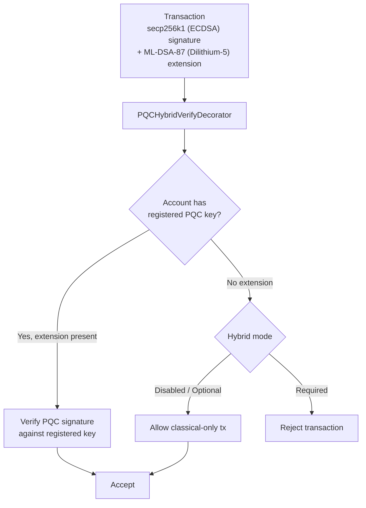

# ポスト量子セキュリティ

QoreChain は、**ジェネシス時点でポスト量子暗号（PQC）**を組み込んで構築されています — アップグレードとして後付けされたものではありません。`x/pqc` モジュールは、格子ベースのデジタル署名と鍵カプセル化を主要な暗号プリミティブとして提供し、長期的な耐性のためにガバナンス制御によるアルゴリズム俊敏性フレームワークを備えています。

完全な PQC ベースライン — **Dilithium-5（署名）+ ML-KEM-1024（KEM）+ SHAKE-256（ハッシュ）** — は現在完成し、ネットワークのデフォルトとなっています。稼働中のネットワーク（v3.2.x）では、ハイブリッド署名は cosmos トランザクションパスで**デフォルトで必須**です: `hybrid_signature_mode = required` および `allow_classical_fallback = false`。すべての cosmos パストランザクションは、従来の secp256k1 署名と併せて Dilithium-5 署名を保持しなければなりません。PQC アカウントからの従来署名のみのトランザクションは拒否され、従来署名へのダウングレードパスは閉じられています。メインネットは v3.2.3、テストネットは v3.2.4 を実行しています。v3.2.2 と v3.2.3 のリリースでポスト量子のルールに加わったもの（鍵の完全性、任意の所有証明、範囲を限定した EVM ウィンドウ、EIP-7702 の同意）については、[鍵の完全性ルール](#key-integrity)、[所有証明](#proof-of-possession)、[EIP-7702 デリゲーション](#eip-7702)で説明しています。

## 設計原則

* **デフォルトで PQC 必須**: ポスト量子署名は cosmos パスで必須です。従来の secp256k1 署名のみではもはや不十分です — `allow_classical_fallback = false`。
* **デフォルトでハイブリッド**: Cosmos トランザクションは、従来の secp256k1 署名と Dilithium-5 PQC 署名の両方を同時に保持します。従来署名のみのフォールバックは閉じられています。
* **アルゴリズム俊敏性**: 暗号アルゴリズムレジストリはガバナンス制御されており、ハードフォークなしにネットワークが新しいアルゴリズムを採用したり、危殆化したアルゴリズムを廃止したりできます。
* **決定論的検証**: すべての署名検証は決定論的であり、バリデーターノード間で再現可能です。

## サポートされるアルゴリズム

| アルゴリズム      | 標準                  | カテゴリ           | NIST レベル | 公開鍵       | 秘密鍵       | 署名 / 暗号文           | 共有秘密       |
| --------------- | -------------------- | ----------------- | ---------- | ----------- | ----------- | ---------------------- | ------------- |
| **Dilithium-5** | ML-DSA-87 (FIPS 204) | 署名              | 5          | 2,592 バイト | 4,896 バイト | 4,627 バイト            | --            |
| **ML-KEM-1024** | FIPS 203             | 鍵カプセル化       | 5          | 1,568 バイト | 3,168 バイト | 1,568 バイト            | 32 バイト      |

両アルゴリズムは、標準化された最高のセキュリティカテゴリである **NIST セキュリティレベル 5** で動作し、従来型と量子型の両方の敵対者に対して AES-256 と同等の保護を提供します。

## 暗号バックエンド

PQC 操作は、格子ベースの署名、検証、鍵カプセル化を QoreChain ランタイムに公開する、高性能でメモリセーフな暗号バックエンドに実装されています。バックエンドは以下を提供します。

アルゴリズム固有の操作:

* Dilithium-5 の鍵生成、署名、検証
* ML-KEM-1024 の鍵生成、カプセル化、デカプセル化
* 決定論的ランダムビーコン生成（`seed`、`epoch`）

アルゴリズム認識操作:

* `Keygen(algorithmID)` — 登録済みの任意のアルゴリズムの鍵ペアを生成
* `Sign(algorithmID, privkey, message)` — 署名を作成
* `Verify(algorithmID, pubkey, message, signature)` — 署名を検証
* `AlgorithmInfo(algorithmID)` — 鍵/出力サイズをクエリ
* `ListAlgorithms()` — サポートされているすべてのアルゴリズムを列挙

すべての署名および検証操作は決定論的であり、すべてのバリデーターノードおよびサポートされるプラットフォームにわたって同一の結果を生成します。

これらと同じプリミティブ — ML-DSA（FIPS-204）、ML-KEM（FIPS-203）、SHAKE-256（FIPS-202）— は、オープンソースの [**qorechain-pqc**](https://github.com/qorechain/qorechain-pqc) ライブラリを通じてウォレットやインテグレーターに提供されています。このライブラリは、6 言語（JavaScript/TypeScript、Rust、Go、C、Python、Java）にわたって、一貫性のあるバイト互換の単一 API を提供します。[ポスト量子署名](/developer-guide/post-quantum-signing) を参照してください。

## 鍵の登録 {#key-registration}

アカウントは `MsgRegisterPQCKey`（レガシー、デフォルトで Dilithium-5）または `MsgRegisterPQCKeyV2`（アルゴリズム認識）を介して PQC 鍵を明示的に登録します。チェーンが自ら鍵を登録することはなく、CLI のフローは `qorechaind tx pqc gen-key <name>` に続けて `qorechaind tx pqc register-key <public_key_hex> hybrid --from <key>` を実行するものです（[最初のトランザクション](/getting-started/first-transaction#register-pqc-key)を参照）。各メッセージには以下が含まれます。

* **Sender**: 鍵を登録するアカウントアドレス。
* **PublicKey**: PQC 公開鍵のバイト列。
* **AlgorithmID**: PQC アルゴリズム識別子（v2 のみ）。
* **ProofOfPossession**: 新しい鍵による任意の署名（v2 のみ、v3.2.3 以降）。[所有証明](#proof-of-possession)を参照してください。
* **KeyType**: `hybrid` または `pqc_only` のいずれか（3 つ目の値 `classical_only` はスキーマ上にまだ存在しますが、v3.2.3 以降は拒否されます）:

| 鍵タイプ          | 説明                                                                      |
| ---------------- | ------------------------------------------------------------------------ |
| `hybrid`         | 従来型（ECDSA）と PQC の両方の鍵。トランザクションは二重署名を保持します。      |
| `pqc_only`       | `hybrid` と同様に登録されます。従来の secp256k1 署名は標準の署名チェックで引き続き検証され、PQC 署名も必須です。 |
| `classical_only` | **v3.2.3 以降は拒否されます。** このキータイプでの登録は、使用可能なポスト量子鍵を記録せず、アカウントが署名できない状態になるため、チェーンはこれを拒否します。 |

### 鍵の完全性ルール（v3.2.3） {#key-integrity}

v3.2.3 アップグレード（メインネットの高さ 3,662,051、2026 年 10 月 20 日。テストネットの高さ 8,003,746）以降、チェーンはポスト量子鍵に対して次のルールを適用します。この高さより前は、いずれも強制されていませんでした。

| ルール | 動作 |
| --- | --- |
| 弱い鍵の禁止 | キータイプが `classical_only` の場合、鍵が空の場合、または鍵が縮退している場合（長さは正しいが、構造上ポスト量子の保護を与えない鍵）、登録は拒否されます。鍵は `tx pqc gen-key` または `qorechain-pqc` ライブラリで生成し、それらが出力するものを登録してください |
| 鍵の再利用の禁止 | 新しい鍵がそのアカウントが以前に使用したことのある鍵である場合、ローテーションまたは移行は拒否されます。チェーンは、アカウントがローテーションまたは移行して手放したすべての鍵のハッシュを記憶しています |
| 鍵を持つアカウントにはハイブリッド署名が必要 | すでに使用可能な鍵を保持しているアカウントは、登録または移行のトランザクションにもハイブリッド署名を付ける必要があります。従来署名のみの免除が適用されるのは、登録済みの鍵が**ない**アカウント、または保存されたレコードに使用可能な鍵がないアカウント（その場合は `MsgRegisterPQCKeyV2` で置き換えることができます）のみになりました |
| 鍵なしの拡張の禁止 | `required` モードでは、登録済みの鍵を持たないアカウントが、何も検証できないハイブリッド拡張を付けて通過することはできません。拡張なしで通過できるのは登録のみです |
| 拡張は 1 つ | トランザクションが保持できるハイブリッド署名拡張は最大 1 つです |
| authz による鍵メッセージの禁止 | `MsgRegisterPQCKey`、`MsgRegisterPQCKeyV2`、`MsgRotatePQCKey`、`MsgMigratePQCKey` は、`x/authz` を介してアカウントの代理として実行できません。アカウント自身の署名が必要です |
| アルゴリズムガバナンスのガード | アルゴリズムを廃止または無効化しても、チェーンにアクティブな署名アルゴリズムがなくなる状態にはできず、置き換えアルゴリズムは署名可能でなければなりません |

v3.2.2 では関連するチェックが追加されました。登録は、それが保持する従来の `ecdsa_pubkey` を検証して署名アカウントに結び付けるため、アカウントが自分のものではない従来鍵を記録することはできません。

ノードはメムプールでもこれらのケースを選別するため、失敗するしかないトランザクションは中継されず、手数料もかかりません。

### 所有証明（任意） {#proof-of-possession}

`MsgRegisterPQCKeyV2` には、任意の `proof_of_possession` フィールドがあります。存在する場合、チェーンはそれを検証します。存在しない場合、登録はこれまでどおり進行します（証明は**必須ではありません**）。証明は、登録される鍵による次のバイト列に対する署名です

```text
qorechain-pqc-pop-v1|<chain-id>|<algorithm-id>|<account-address>|<hex(public-key)>
```

そのため、あるアカウントやチェーン向けに作成された証明は、別のアカウントやチェーンでは何も証明しません。ローカルの鍵ファイルを指定すれば、CLI が自動で作成します。

```bash
qorechaind tx pqc register-key-v2 dilithium5 <pubkey-hex> hybrid \
  --pqc-key mypqc --from mykey --chain-id qorechain-vladi --gas 600000 --fees 60000uqor
```

登録がハイブリッド要件を免除されるのは鍵を持たないアカウントの場合のみであるため、このトランザクションはアカウントの従来鍵のみで署名されます。不正な形式の証明は `ErrInvalidProofOfPossession`（モジュール `pqc` のコード 231）で拒否されます。

**v3.2.4 から（テストネットは 2026 年 10 月 19 日から、メインネットは高さ 3,742,566 から）:** アカウントレコードにブール値の `possession_proven` が加わり、`GET /qorechain/pqc/v1/account/{address}` で返されます。現在の鍵が有効な証明付きで登録された場合、またはローテーションや移行（どちらもチェーン、アカウント、鍵を名指しするバイト列に対する新しい鍵の署名を検証します）によって到着した場合は `true` になります。証明なしの登録は `false` を記録し、証明なしで鍵が変更されるとフラグはクリアされます。メインネット v3.2.3 は、アップグレード高さより前はこのフィールドを報告しません。v3.2.4 でも、アカウント鍵の証明は任意のままです。

## ハイブリッド署名 {#hybrid-signatures}

ハイブリッド署名システムは、cosmos パストランザクションが従来の署名と PQC 署名の**両方**を同時に保持することを要求します。これにより多層防御が提供されます: 一方のスキームが破られても、もう一方がトランザクションを保護します。

ネットワークデフォルトの `hybrid_signature_mode = required` では、すべての cosmos パストランザクションは secp256k1 署名と併せて Dilithium-5 拡張を含める必要があります。唯一の例外（ブートストラップ用）は、**ジェネシス gentx（高さ 0）**、登録済みの鍵を持たない（または記録に使用可能な鍵がない）アカウントからの **PQC 鍵登録**（`MsgRegisterPQCKey`、`MsgRegisterPQCKeyV2`）、および登録済みの鍵を持たないオペレーターアカウントからの unjail であり、アカウントが最初の PQC 鍵を登録できるように、鍵登録は従来署名のみであることが許可されています。v3.2.3 以降、すでに使用可能な鍵を持つアカウントからの登録または移行には、他のトランザクションと同様にハイブリッド署名が必要です（[鍵の完全性ルール](#key-integrity)を参照）。

**EVM レーンは、代わりに認可ウィンドウによって保護されます。** EVM トランザクションは 2 つ目の（ML-DSA）署名を保持できません — 標準的なウォレットは Ethereum トランザクションに対して 1 つの secp256k1 署名を行うだけで、別の署名を添付する手段を提供しません。そのため、ポスト量子の認可はトランザクションの*前*に送られます。アカウントは、通常のハイブリッド署名を保持する Cosmos レーンのメッセージ（`MsgOpenEVMWindow`）で、範囲が限定された **EVM 認可ウィンドウ**を開き、EVM レーンは有効なウィンドウでカバーされるトランザクションのみを受け付けます。v3.2.0 以降、EVM トランザクションは、その送信者が (1) 登録済みのポスト量子鍵を持ち、かつ (2) ブロック数、トランザクション数、価値が残っている有効なウィンドウを持っていない限り、拒否されます。ウィンドウ内では、チェックがトランザクションではなくチェーンの状態を読み取るため、通常の MetaMask/ethers/Hardhat のトランザクションがそのまま動作します。[EVM 認可ウィンドウ](/getting-started/first-transaction#evm-window)を参照してください。

v3.2.3 以降、ウィンドウは開く際に**範囲を限定**することもできます。`--native-only` は、ネイティブ QOR の単純な送金（calldata なし、コントラクト作成なし、コードを持つ受取人なし、EIP-7702 の認可なし）に限定し、`--allowed-targets 0x…,0x…` は、列挙された受取人のみを許可し、コントラクト作成を拒否します。範囲を指定せずに開いたウィンドウは、従来どおりのものを許可します。範囲は `MsgOpenEVMWindow` の一部です（`native_only`、`allowed_targets`）。

### EIP-7702 デリゲーション {#eip-7702}

EIP-7702 の認可タプルは、署名したアカウントにコードをインストールします。その署名は従来の secp256k1 署名であり、誰でも type-4 トランザクションで運ぶことができます。そのため v3.2.2（メインネットの高さ 3,556,788）以降、EVM レーンは、**タプルが効力を持つすべての authority** が登録済みのポスト量子鍵を持ち、かつタプルがインストールするデリゲーションそのものに、ハイブリッド署名された Cosmos レーンのメッセージで**同意**している場合にのみ、type-4 トランザクションを受け付けます。

| 項目 | 詳細 |
| --- | --- |
| 同意を与える | `qorechaind tx pqc authorize-evm-delegation <delegate-0x-address> <blocks>`（`MsgAuthorizeEVMDelegation`）: タプルが保持すべきデリゲートアドレスと、同意が使用可能な期間を指定します（最大 17,280 ブロック。ウィンドウと同じ上限） |
| デリゲーションの解除 | デリゲートとしてゼロアドレスを指定すると、解除への同意になります。`tx pqc clear-evm-delegation`（`MsgClearEVMDelegation`）は、EVM トランザクションなしで既存のデリゲーションを解除します |
| 1 回限り | 同意は、デリゲーションをインストールするトランザクションによって使い切られ、そのアカウントの以前の同意を置き換え、`MsgCloseEVMWindow` によって取り消されます |
| 確認方法 | `qorechaind query pqc evm-delegation-consent <address>`、または `GET /qorechain/pqc/v1/evm_delegation_consent/{address}`（フィールド `live`、`delegate`、`granted_height`、`expiry_height`、`current_delegate`、`nonce`） |
| 制限 | type-4 トランザクションあたり最大 8 件の認可。デリゲートされたアカウントから出ていく価値は、そのアカウント自身のウィンドウに課金されます。失敗した type-4 トランザクションは、適用済みの認可を保持します |
| スポンサー付きデリゲーション | 引き続き動作します。スポンサーが自身のウィンドウから支払い、authority は事前に同意するだけです |

### コサインフロー

準拠する cosmos トランザクションを生成するには、従来の secp256k1 署名が標準のサインバイト（PQC 拡張を除く）に対して計算され、Dilithium-5 署名が v2 署名バイト（下記の[署名バイト（v2）](#sign-bytes-v2)を参照）に対して計算されて `PQCHybridSignature` 拡張として添付されます。標準の CosmJS / リレーヤーツールは、cosmos パスでトランザクションを行うためにこの拡張を生成する必要があります。現在、これは以下を介して行われます。

* `qorechaind tx pqc gen-key <name>` — Dilithium-5 鍵を生成します。
* `qorechaind tx pqc cosign <unsigned_tx_file> --from <key> --pqc-key <name>` — `--generate-only` で構築したトランザクションに Dilithium-5 コサインを添付します。
* QoreChain SDK のハイブリッド署名 — `buildHybridTx`。アカウントの鍵は事前に `MsgRegisterPQCKey` で登録されている必要があります。
* [QoreX](/qorex/overview) — 両方を自動的に行います。

*secp256k1（ECDSA）と ML-DSA-87（Dilithium-5）で署名され、チェーン全体の強制モードの下で ante ハンドラーによって検証されるトランザクション。*



### 署名バイト（v2） {#sign-bytes-v2}

ML-DSA 署名は、ドメインタグ付きでチェーンに束縛されたバイト列をカバーします。v3.2.0 以降、チェーンは**この形式のみ**を検証します。

```text
"qorechain-pqc-hybrid-v2" ‖ BE64(len(chainID)) ‖ chainID ‖
BE32(len(B0)) ‖ B0 ‖ BE32(len(authInfo)) ‖ authInfo
```

ここで `B0` は PQC 拡張を**含まない**形でシリアライズされたトランザクションボディ、`authInfo` は AuthInfo のバイト列そのものです（`‖` は連結、長さはビッグエンディアン）。ドメインタグにより、別のコンテキスト（ログインチャレンジやメッセージ署名リクエスト）で作成された署名がトランザクション署名として有効になることを防ぎ、チェーン ID を束縛することで、ポスト量子署名自体が他のネットワークでは無効になります。最初の形式（`BE32(len(B0)) ‖ B0 ‖ BE32(len(authInfo)) ‖ authInfo`）はアップグレード高さより前でのみ検証されており、両方を受け入れるブロックはありません。鍵移行とブリッジ証明のペイロードも、同じドメインタグ付きでチェーンに束縛されたスキームに移行しました。

**自分のネットワークはどの形式を検証するのか？** アップグレードが適用済みかどうかをノードに問い合わせます。

```bash
curl -s https://api.qore.host/cosmos/upgrade/v1beta1/applied_plan/v3.2.0         # height 2981742 on mainnet
curl -s https://api-testnet.qore.host/cosmos/upgrade/v1beta1/applied_plan/v3.2.0 # height 5920000 on testnet
```

（`"height":"0"` は未適用を意味します。）両ネットワークともこの変更はかなり前に適用済みであるため、現在のクライアントはどこでも v2 形式で署名します。このチェックが重要になるのは、古いブロックを再生または検証する場合です。CLI は `--sign-bytes auto` でこれを行い、現在の SDK と wallet-adapter のリリースも同様です。誤った形式のクライアントはチェーンが拒否するダイジェストを生成します — フェイルクローズ（安全側）で失敗します。

### TX 拡張形式

PQC 署名は、タイプ URL `/qorechain.pqc.v1.PQCHybridSignature` を持つ **TX 拡張**としてトランザクションに添付されます。

```text
{
  "algorithm_id": 1,
  "pqc_signature": "<4627 bytes for Dilithium-5>",
  "pqc_public_key": "<2592 bytes, optional>"
}
```

`pqc_public_key` フィールドはオプションで情報提供用です。鍵は明示的な登録メッセージによってのみ登録されます（[鍵の登録](#key-registration)を参照）。

### PQCHybridVerifyDecorator

`PQCHybridVerifyDecorator` ante ハンドラーは、3 方向の検証ロジックでハイブリッド署名を処理します。

| シナリオ | アカウントに PQC 鍵あり | 拡張あり          | 拡張内に公開鍵          | 結果                                                |
| -------- | ------------------- | ----------------- | ----------------------- | --------------------------------------------------- |
| Path 1   | あり                 | あり               | --                      | 登録済みの鍵に対して PQC 署名を検証                    |
| Path 3a  | なし                 | なし               | --                      | **Optional モード**: 従来署名のみのトランザクションを許可 |
| Path 3b  | なし                 | なし               | --                      | **Required モード**: トランザクションを拒否            |
| Path 4   | あり                 | なし               | --                      | 標準の PQCVerifyDecorator によって処理               |

アカウントがハイブリッド署名のトランザクションを送信する前に、鍵を `MsgRegisterPQCKey` / `MsgRegisterPQCKeyV2` で登録しておく必要があります。拡張の `pqc_public_key` フィールドは何も登録しません。

### ハイブリッド署名モード

チェーン全体のハイブリッド強制レベルはガバナンスで設定可能です。**現在のネットワークデフォルトは `required` です**。

| モード        | ID | デフォルト | 動作                                                                                                          |
| ------------ | -- | ------- | ----------------------------------------------------------------------------------------------------------------- |
| **Disabled** | 0  | いいえ   | 従来の署名のみ。PQC 拡張は無視されます。                                                            |
| **Optional** | 1  | いいえ   | PQC 拡張は存在する場合に検証されます。PQC 鍵を持たないアカウントは従来の署名のみでトランザクションできます。    |
| **Required** | 2  | **はい** | すべての cosmos パストランザクションは従来署名と PQC 署名の両方を保持する必要があります。PQC 拡張のないトランザクションは拒否されます。 |

ネットワークは移行を完了しました: **Optional**（ジェネシス）→ **Required**（v3.1.71 以降の現在のデフォルト、`allow_classical_fallback = false`）。3 つのモードは引き続きガバナンス制御され、提案によって調整できます。

## アルゴリズム俊敏性フレームワーク

アルゴリズム俊敏性フレームワークは、PQC アルゴリズムのためのガバナンス制御レジストリを提供し、ハードフォークなしに、ネットワークが新しいアルゴリズムを追加したり、脆弱なものを廃止したり、アカウントを移行したりできるようにします。

### アルゴリズムのライフサイクル

各登録済みアルゴリズムには、ライフサイクルステータスがあります。

```
active --> migrating --> deprecated --> disabled
```

| ステータス        | 説明                                                                                                                                         |
| -------------- | ------------------------------------------------------------------------------------------------------------------------------------------- |
| **Active**     | 完全に稼働中。新しい鍵の登録と検証が受け入れられます。                                                                    |
| **Migrating**  | 二重署名期間がアクティブです。アカウントは置き換えアルゴリズムへの移行が推奨されます。古い署名と新しい署名の両方が受け入れられます。 |
| **Deprecated** | 既存の署名は引き続き検証できますが、新しい鍵の登録は受け入れられません。                                                       |
| **Disabled**   | 緊急キルスイッチ。アルゴリズムはいかなる署名も検証できません。脆弱性が発見された場合に使用されます。                                 |

### 二重署名による移行

アルゴリズムが廃止されると、**移行期間**が始まります（デフォルト: 1,000,000 ブロック — メインネットの現在のブロック時間 ≈3.2 秒で約 37 日）。この期間中:

1. 廃止されたアルゴリズムを使用する鍵を持つアカウントは、置き換えアルゴリズムに移行する必要があります。
2. 移行には二重署名（`MsgMigratePQCKey`）が必要です: 古い鍵からの 1 つと新しい鍵からの 1 つで、両方の所有権を証明します。
3. 移行期間中、両方のアルゴリズムが検証のために受け入れられます。

### メッセージ

| メッセージ                | 説明                                                                                                                                                              |
| ----------------------- | ----------------------------------------------------------------------------------------------------------------------------------------------------------------- |
| `MsgRegisterPQCKey` / `MsgRegisterPQCKeyV2` | アカウントの PQC 鍵を登録します（[鍵の登録](#key-registration)を参照）。新しいアカウントがブートストラップできるよう、従来署名で署名できます。 |
| `MsgMigratePQCKey`      | 移行期間中に、あるアルゴリズムの鍵から別のアルゴリズムの鍵へ二重署名で移行します。アカウントが以前に使用した鍵は拒否されます（v3.2.3）。                                |
| `MsgRotatePQCKey`       | 同じアルゴリズム内でアカウントの ML-DSA-87 鍵をローテーションします（旧鍵と新鍵による二重署名。`tx pqc rotate-key`）。アカウントが以前に使用した鍵は拒否されます（v3.2.3）。 |
| `MsgOpenEVMWindow` / `MsgCloseEVMWindow` | EVM 認可ウィンドウを開く、または閉じます（v3.2.0。任意の範囲指定は v3.2.3 以降）。[EVM 認可ウィンドウ](/getting-started/first-transaction#evm-window)を参照してください。 |
| `MsgAuthorizeEVMDelegation` / `MsgClearEVMDelegation` | 送信者自身のアカウントの EIP-7702 デリゲーションに同意する、または解除します（v3.2.2）。[EIP-7702 デリゲーション](#eip-7702)を参照してください。 |
| `MsgDeprecateAlgorithm` | ガバナンスメッセージ: アルゴリズムの廃止プロセスを開始します。置き換えアルゴリズムとブロック単位の移行期間を指定します。                          |
| `MsgDisableAlgorithm`   | ガバナンスメッセージ: アルゴリズムを直ちに緊急無効化します。理由の文字列が必要です。暗号上の脆弱性が発見された場合に使用されます。                |

`MsgDeprecateAlgorithm` と `MsgDisableAlgorithm` は、現在メインネットでサーキットブレーカーによって無効化されています（[チェーンパラメータ](/appendix/chain-parameters#circuit-breaker)を参照）。テストネットでは無効化されていません。v3.2.3 以降、両ネットワークで、[鍵の完全性ルール](#key-integrity)にあるアルゴリズムガバナンスのガードが適用されます。

### 拡張性

アルゴリズムの追加には、統一された署名および検証インターフェースの背後でそれを実装するソフトウェアリリースが必要です。レジストリと、廃止/無効化のライフサイクルはガバナンス制御されます。

## SHAKE-256 ハッシュ

v3.1.73 時点で、**SHAKE-256**（SHA-3 の拡張可能出力関数）は、`qorehash` パッケージによって提供される、QoreChain 全体の**デフォルトアプリケーションハッシュ**です — Dilithium-5 署名と ML-KEM-1024 鍵カプセル化と並んで、量子耐性のある暗号ベースラインを完成させます。`x/pqc` モジュールは純粋な Go の SHAKE-256 ユーティリティを提供します。

| 関数                                | 説明                              | 出力             |
| ---------------------------------- | --------------------------------- | ---------------- |
| `SHAKE256Hash(data, outputLen)`    | 可変長 SHAKE-256 ダイジェスト       | 任意の長さ        |
| `SHAKE256Hash32(data)`             | 標準 256 ビット SHAKE-256 ダイジェスト | 32 バイト         |
| `SHAKE256ConcatHash(left, right)`  | 連結された入力のハッシュ             | 32 バイト         |
| `SHAKE256DomainHash(domain, data)` | ドメイン分離されたハッシュ           | 32 バイト         |

これらのユーティリティはデフォルトのアプリケーションハッシュを支えており、以下に使用されます。

* Merkle ツリーノードのハッシュ化
* クロスレイヤー証明におけるハッシュコミットメント
* 異なるハッシュコンテキストのためのドメイン分離（例: `"leaf:"` 対 `"node:"`）

## ブリッジ PQC

すべてのクロスチェーンブリッジ証明と状態コミットメントは **Dilithium-5** 署名を使用します。`x/multilayer` モジュールはすべての `MsgAnchorState` 送信で PQC 集約署名を要求し、ML-KEM コミットメントがブリッジリレーヤー間の鍵交換チャネルを保護します。

これにより、ブリッジインフラストラクチャにおける従来の暗号の使用によってクロスチェーンセキュリティが低下することがなく、プロトコルスタック全体で量子耐性が維持されます。稼働中のブリッジルートはありません（[ブリッジアーキテクチャ](/architecture/bridge-architecture#current-status)を参照）。v3.2.4 から（テストネットは現在、メインネットは高さ 3,742,566 から）、ブリッジバリデーターの登録にも、その PQC 鍵の所有証明が必要です。

## モジュールパラメータ

| パラメータ                  | 型                  | デフォルト         | 説明                                           |
| -------------------------- | ------------------- | ----------------- | ----------------------------------------------------- |
| `pqc_primary`              | bool                | `true`            | PQC が主要な署名スキームである                          |
| `allow_classical_fallback` | bool                | `false`           | 従来署名のみのフォールバックは閉鎖。cosmos トランザクションはハイブリッドでなければならない |
| `min_security_level`       | int32               | `5`               | 受け入れられるアルゴリズムの最小 NIST セキュリティレベル   |
| `default_migration_blocks` | int64               | `1,000,000`       | ブロック単位のデフォルト二重署名移行期間                  |
| `default_signature_algo`   | AlgorithmID         | `1` (Dilithium-5) | 新しい鍵登録のためのデフォルト署名アルゴリズム            |
| `hybrid_signature_mode`    | HybridSignatureMode | `2` (Required)    | チェーン全体のハイブリッド署名強制レベル                  |

## 関連項目

* [ポスト量子署名](/developer-guide/post-quantum-signing) — これらのプリミティブとハイブリッド署名のためのオープンソース `qorechain-pqc` ライブラリ（6 言語）。
* [ウォレットのセットアップ](/getting-started/wallet-setup) — PQC に裏付けられたアカウントの作成と管理。
* [SDK アカウントと PQC 署名](/sdk/concepts/accounts-pqc) — コードからの鍵とポスト量子署名。
* [チェーンパラメータ](/appendix/chain-parameters) — デフォルトのアルゴリズムと移行設定。
* [ブリッジアーキテクチャ](/architecture/bridge-architecture) — クロスチェーンパケットの PQC 検証。
