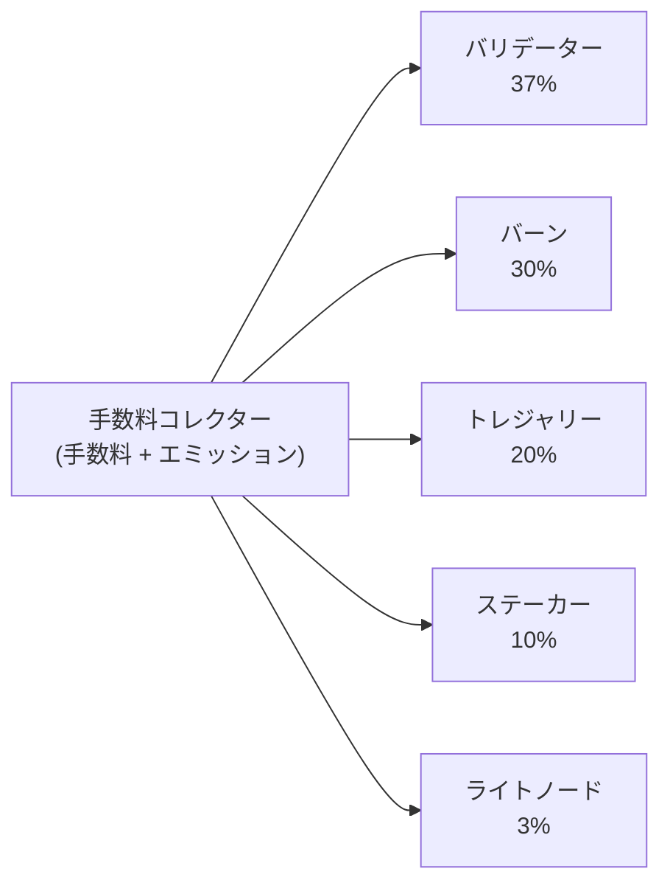

# トークノミクス

QoreChain の経済モデルは、ネイティブトークンである **QOR** を中心とし、**有限で上限付きの供給経路**を持ちます。固定のジェネシス供給量、厳格な累積上限のもとでミントされるステーキング報酬のエミッション、そしてトークンを永久に除去するマルチチャネルのバーンエンジンで構成されています。このページでは、稼働中のチェーンから読み取った数値を用いて、供給量、エミッション、バーン、手数料分配の仕組みを説明します。

---

## トークンの基本情報

| プロパティ              | 値                                                    |
| --------------------- | -------------------------------------------------------- |
| **表示トークン**     | QOR                                                      |
| **基本デノミネーション** | uqor                                                     |
| **小数精度** | 10^6（1 QOR = 1,000,000 uqor）                            |
| **供給量**      | ジェネシス 4,420,000,000 QOR。[供給とエミッションモデル](#supply-and-emission)を参照 |
| **チェーンID**          | `qorechain-vladi`（メインネット、EVM チェーンID 9801）          |
| **Bech32 プレフィックス**     | `qor`（アカウント：`qor1...`、バリデーター：`qorvaloper...`） |

:::note
このページに記載されている数値は、2026年6月7日からリリース **v3.2.3**（ブロック高 3,742,566 から v3.2.4）で稼働している**メインネット**（`qorechain-vladi`、EVM チェーンID **9801**）に関するものです。**`qorechain-diana`** テストネット（EVM チェーンID **9800**、2026年10月19日からリリース **v3.2.4**）は独自のエミッションと供給量の履歴を持ちます（テストネットの供給量はメインネットを大きく上回り、エミッションはすでに上限を超えています）。そのため、メインネットの数値を使用してください。ブロックごとに変動する金額には、読み取った日付（2026年10月20日）を付記しています。
:::

---

## 供給とエミッションモデル {#supply-and-emission}

QoreChain は**有限で上限付きの供給経路**を持ちます。ジェネシス時の供給量は **4,420,000,000 QOR** でした（計画上は 4,500,000,000 QOR。80,000,000 QOR、1.78% が、ジェネシス前のトークン生成イベントでバーンされました）。ジェネシス以降、プロトコルは次の2つの仕組みで供給量を変化させます。

* **エミッション** — `x/inflation` モジュールが、**590,000,000 QOR の厳格な累積上限**のもとで、エポックごとに固定量をミントします。ミントされたトークンは手数料コレクターに入り、取引手数料と同じ分配を通ります（[手数料分配](#fee-distribution)を参照）。
* **バーン** — `x/burn` モジュールが、手数料コレクター内のすべてのうちバーン分を永久に除去します。

### エミッション {#staking-reward-schedule}

| パラメーター | 値 |
| --- | --- |
| エミッションモード | `fixed`（v3.1.94、ブロック高 2,122,074 以降 — 2026年8月26日） |
| エポックあたりのエミッション | **86,000 QOR**（ガバナンス提案 10 までは 16,239 QOR。86,000 QOR の最初のエポックはブロック 3,672,000 から開始） |
| エポック長 | 43,200 ブロック（現在のブロックタイム約 3.2 秒で約 38.6 時間） |
| 累積上限（`max_total_emission`） | **590,000,000 QOR**（提案 10 までは 114,285,714 QOR） |
| これまでのミント量（2026年10月20日、エポック 84） | 105,248,896.21 QOR（上限の 17.84%） |
| 上限までの残り | 484,751,103.79 QOR（エポックあたり 86,000 QOR で約 5,637 エポック。最後のエポックは端数） |

上限に達すると、モジュールはミントを永久に停止します。それ以降、報酬は取引手数料のみから支払われます。エミッションの数値はガバナンスによって設定されました。提案 #4（2026年8月26日）が当初の逓減スケジュールを、厳格な上限付きの固定量に置き換え、提案 #10（2026年10月19日に、ボンドされたステークのすべてが賛成票を投じて可決）が、その量をエポックあたり 16,239 QOR から 86,000 QOR に変更し、上限を 114,285,714 QOR から 590,000,000 QOR に引き上げました。エポック長は変更されていません。スケジュール値（1〜5年目の 17.5%、11%、7%、7%、2%）はモジュールパラメーターに保存されたままですが、`fixed` モードでは使用されません。

ミント済みの合計、残り量、次のエポックのブロック高は `GET /qorechain/inflation/v1/epoch_info` でライブに確認できます（その `current_inflation_rate` フィールドは年ベースのレガシーレートを報告しますが、`fixed` モードでは使用されません）。

QoreChain はライブのステーキング利回りの数値を公開していません。引用されているパーセンテージはすべて未検証のものとして扱ってください。現在の数値はチェーン状態から読み取れます。供給量は `GET /cosmos/bank/v1beta1/supply/by_denom?denom=uqor`（2026年10月20日時点で 4,493,665,185.83 QOR）、バーンの合計は `GET /qorechain/burn/v1/stats` で取得できます。

---

## x/burn — マルチチャネルバーンエンジン

`x/burn` モジュールは、現在のメインネットでは **12 のバーンソース**を定義しています。バーンされたトークンはすべて供給から永久に除去されます。メインネットでは、これまでにバーンが記録されているのは `gas_fee`（2026年10月20日時点で 31,574,710.28 QOR）と、v3.2.2 以降の `failed_tx`（0.0855 QOR）のみです。その他は定義されていますが、記録はありません。v3.2.4 からは13番目のソース `staking_tier_penalty` があり、これはタイムロック型の委任を早期にアンロックしたときにバーンされるペナルティを記録します（テストネットでは2026年10月19日から、メインネットではブロック高 3,742,566 から。[ステーキングとデレゲーション](/user-guide/staking-and-delegation#time-locked-staking)を参照）。

### バーンチャネル

| # | チャネル            | ソース                     | 説明                                   |
| -- | ------------------ | -------------------------- | --------------------------------------------- |
| 1  | `gas_fee`          | 取引手数料           | すべてのガス手数料の30%がバーンされる                |
| 2  | `contract_create`  | スマートコントラクトのデプロイ  | コントラクト作成ごとに定額100 QORの手数料がバーンされる |
| 3  | `ai_service`       | AI モジュール利用手数料       | AI サービス手数料の50%がバーンされる                 |
| 4  | `bridge_fee`       | クロスチェーンブリッジ手数料    | ブリッジ手数料の100%がバーンされる                    |
| 5  | `treasury_buyback` | トレジャリー運用        | トレジャリーからの定期的なバイバック＆バーン       |
| 6  | `failed_tx`        | 失敗した取引のガス     | 失敗した取引のガスの10%がバーンされる（チェーンによる適用は v3.2.2 以降）    |
| 7  | `xqore_penalty`    | xQORE の早期解約ペナルティ | ペナルティ額はバーンを経由してルーティングされる |
| 8  | `auto_buyback`     | 自動バイバックプログラム  | プロトコルレベルの自動バーン              |
| 9  | `tge`              | トークン生成イベント     | 80,000,000 QOR の TGE バーンはジェネシス前に実施済み（ジェネシス供給量は 4,420,000,000 QOR）。このチャネルは予約されており、記録は 0       |
| 10 | `rollup_create`    | ロールアップのデプロイ          | ロールアップ作成ステークの1%がバーンされる             |
| 11 | `milestone`        | 取引数マイルストーン | 累積取引数が一定の値に達した時点で予定されたバーン（まだ発動していない） |
| 12 | `amm`              | AMM                        | AMM プロトコル手数料用に予約（記録なし） |

`contract_create`、`ai_service`、`bridge_fee`、`auto_buyback` の各チャネルは現在無効です。QoreChain Native のアップロードは閉鎖されており、AI サービス手数料とブリッジは稼働していません。

### 手数料分配 {#fee-distribution}

手数料コレクター内のすべてのものは、以下に示す5つの配分先に分割されます。手数料コレクターには、取引手数料と、`x/inflation` によってミントされたエポックのエミッションの両方が入ります。この配分比率はオンチェーンで強制され、常に合計が正確に100%になります。

配分比率は次のとおりです。

| 受取先       | 割合 | 説明                                                          |
| --------------- | ----- | ---------------------------------------------------------------------- |
| **バリデーター**  | 37%   | ステーク量に比例してアクティブなバリデーターセットに分配される        |
| **バーン**      | 30%   | `gas_fee` バーンチャネルを通じて供給から永久に除去される       |
| **トレジャリー**    | 20%   | ガバナンスが指示する支出のためコミュニティトレジャリーに割り当てられる |
| **ステーカー**     | 10%   | デレゲーション量に比例してすべての QOR ステーカーに分配される         |
| **ライトノード** | 3%    | ネットワークデータの提供に対してライトノードに分配される                  |

この配分比率はオンチェーンで強制され、常に合計が正確に100%になる必要があります。

:::note 分配を実際に通過するもの
この分配は、手数料コレクター内のすべてに適用されます。手数料コレクターには、取引手数料と、`x/inflation` によってミントされたエポックのエミッションの両方が入ります。現状では、そのほとんどがエミッションです。ミントされた 105,248,896 QOR のうち、31,574,710 QOR（30.0%）がガス手数料チャネルを通じてバーンされました。v3.2.0 アップグレード（2026年9月25日、ブロック高 2,981,742）までは、10% のステーカー分はいかなる請求権の裏付けもないままディストリビューションモジュールの残高に移されていたため、ステーカーとバリデーターを合わせて受け取っていたのは 47% ではなく 37% でした。そのブロック高以降、ステーカー分は通常のステーキング報酬として支払われています。すでに滞留していた金額はオンチェーンに記録され、その後ガバナンス投票によって解放されました — [滞留したステーカー分とライトノード準備金](#stranded-and-reserve)を参照してください。
:::

### バーンパラメーター

| パラメーター              | デフォルト値                    | 説明                              |
| ---------------------- | -------------------------- | ---------------------------------------- |
| `gas_burn_rate`        | 0.30                       | バーンされるガス手数料の割合（30%）        |
| `contract_create_fee`  | 100,000,000 uqor（100 QOR） | コントラクト作成に対する定額バーン手数料      |
| `ai_service_burn_rate` | 0.50                       | バーンされる AI サービス手数料の割合（50%） |
| `bridge_burn_rate`     | 1.00                       | バーンされるブリッジ手数料の割合（100%）    |
| `failed_tx_burn_rate`  | 0.10                       | バーンされる失敗取引ガスの割合（10%）   |
| `validator_share`      | 0.37                       | 手数料コレクターのうちバリデーターへの配分 |
| `treasury_share`       | 0.20                       | トレジャリーへの配分                    |
| `staker_share`         | 0.10                       | ステーカーへの配分                         |
| `light_node_share`     | 0.03                       | ライトノードへの配分                    |
| `enabled`              | true                       | モジュールの有効化フラグ                 |

各バーンイベントは、そのソース、金額、ブロック高、および関連する取引ハッシュとともにオンチェーンで記録されます。集計統計はチャネルごとおよび合計でクエリ可能です。

---

## 滞留したステーカー分とライトノード準備金 {#stranded-and-reserve}

2つの金額が、v3.2.0 アップグレード（2026年9月25日、ブロック高 2,981,742）の前にメインネットで蓄積されました。アップグレードはそれらを**オンチェーンの記録として、いかなる分配からも切り離した状態**で保持し、ガバナンス投票によってのみ移動できるようにしました。その後ガバナンスは、2026年10月にその両方をファウンデーションに放出しました。

| 記録 | 放出 | 金額 | ガバナンスメッセージ |
| --- | --- | --- | --- |
| **滞留したステーカー分** — ステーキング報酬の請求権の裏付けがない場所に預けられていた 10% のステーカー分 | 提案 9（2026年10月19日に可決） | 6,693,045.921330 QOR を放出 | `MsgReleaseStrandedRewards`（ガバナンス権限、指定された宛先、記録を超えることはできない） |
| **ライトノード準備金** — 対象となるライトノードが存在しない間に蓄積された 3% のライトノード分 | 提案 8（2026年10月19日に可決） | 3,156,983.796395 QOR を放出 | `MsgReleaseLightNodeReserve`（ガバナンス権限） |

**滞留したステーカー分の修正後の残額。** v3.2.3 アップグレード（ブロック高 3,662,051、2026年10月20日）で、チェーンは滞留ステーカー分の記録を再計算し、その時点の額は 3,807,496.785528 QOR でした（`GET /qorechain/burn/v1/stranded_rewards` の `reserved`。`released` は 6,693,045.921330 QOR）。ガバナンス提案 12 は、この残額をファウンデーションに放出することを提案しています。本稿執筆時点（2026年10月20日）では投票期間中で、2026年10月21日 20:01 UTC に終了します。結果は、記録と提案（`GET /cosmos/gov/v1/proposals/12`）で確認してください。

**ライトノードプールの現在。** v3.2.0 アップグレード以降、ライトノード報酬は、前回の分配実行以降に発生した分のみから、ノードごとの上限付きで支払われます。v3.2.3 以降、その上限は**ノードあたり 30 日で 2,000 QOR**（`max_reward_per_month_per_node`）で、ブロック時間とノードの稼働率に応じて按分されます。ブロックごとの値（`max_reward_per_block_per_node`、1,713 uqor）は引き続き報告されますが、もはやルールではありません。獲得されなかった分はプールの準備金に残り、ガバナンス投票でのみ放出できます。提案 8 の後、準備金は再び蓄積されています。2026年10月20日時点で 487.2318 QOR を保持しており（`GET /qorechain/lightnode/v1/reward_pool` の `reserved`）、未払い・支払可能額はありません。これはまだライトノードが登録されていないためです。登録は開放されており、ライセンスによる制限があります（[ライトノード](/light-node/overview#reward-program-status)を参照）。アップグレードのスナップショット以前の放出、記録額を超える放出、無効な宛先への放出は拒否されます。

## x/xqore — ロックステーキングとガバナンス増幅 {#x-xqore}

:::warning まだ稼働していません
xQORE モジュールの会計処理は存在し、ジェネシスで有効化されていますが、メインネット（`qorechain-vladi`）でもテストネット（`qorechain-diana`）でも**まだ使用できません**。ノードにはそのためのトランザクション、クエリ、CLI、RPC のエントリポイントがないため、`tx xqore lock` / `unlock`、`query xqore ...`、xQORE の REST ルート、`qor_getXQOREPosition` は動作せず、xQORE を保有している人はいません。将来のチェーンリリースで予定されており、そのリリースでは解約ペナルティの再分配方法も変更され、保有者の数にかかわらずアンロックのコストが低いままになります。リリースされ次第、ここにリリース名を記載します。
:::

`x/xqore` モジュールは、譲渡不可能なロックステーキング派生商品である **xQORE** を導入します。ユーザーは QOR をロックすることで、1:1 の比率で xQORE をミントします。xQORE 保有者は増幅されたガバナンス投票権と、再分配される解約ペナルティの分け前を受け取ります。

### ロックの仕組み

* **ロック**：QOR を xQORE モジュールに送ることで、1:1 の比率で xQORE をミントします。
* **ガバナンス重み**：xQORE 保有者は、標準的な QOR ステーカーと比較して **2倍のガバナンス投票権**を受け取ります。
* **譲渡不可**：xQORE はアカウント間で送金できません。ロックしたアドレスに紐付けられます。

### 解約ペナルティスケジュール

xQORE からの早期引き出しには、ロック期間が長いほど減少するペナルティが課されます。

| ロック期間  | ペナルティ率 | 説明                                |
| -------------- | ------------ | ------------------------------------------ |
| &lt; 30日   | **50%**      | ロックされた QOR の半分が没収される            |
| 30〜90日  | **35%**      | 短期ロックに対する高いペナルティ   |
| 90〜180日 | **15%**      | 中期コミットメントに対する軽減されたペナルティ |
| > 180日     | **0%**       | ペナルティなしの全額引き出し            |

### PvP リベース再分配

早期解約から徴収されたペナルティは、単純に消却されるわけではありません。代わりに、PvP（プレイヤー対プレイヤー）リベースモデルに従います。

1. ジェネシス設定では、ペナルティ額の **0%** がバーンされます（`penalty_burn_rate = 0`。ガバナンスが変更した場合に備えて `xqore_penalty` バーンチャネルが存在します）。
2. **100%** が、残存するすべての xQORE 保有者に按分で再分配されます。

これは長期保有者にとってポジティブサムの力学を生み出します。早期解約が発生するたびに、残存する xQORE ポジションの実効価値が増加するのです。リベースは **100ブロック**ごとに発生します。

### xQORE パラメーター

| パラメーター               | デフォルト値                | 説明                               |
| ----------------------- | ---------------------- | ------------------------------------------ |
| `governance_multiplier` | 2.0                    | xQORE 保有者の投票権乗数 |
| `min_lock_amount`       | 1,000,000 uqor（1 QOR） | ロックに必要な最低 QOR 量              |
| `penalty_burn_rate`     | 0.00                   | バーンされる解約ペナルティの割合（ジェネシスのデフォルト：すべてのペナルティが再分配される）   |
| `rebase_interval`       | 100 ブロック             | PvP リベースイベント間のブロック数       |
| `enabled`               | true                   | モジュールの有効化フラグ                    |

---

## x/inflation — 上限付きエミッション

`x/inflation` モジュールは、累積上限の 590,000,000 QOR に達するまで、エポックごとのエミッション（提案 10 以降は 86,000 QOR、`emission_mode = fixed`）をミントして手数料コレクターに送ります。パラメーターの変更は、通常のガバナンスパラメーター提案（`MsgUpdateParams`、v3.1.94 で追加）を通じて行われます。

### エポックの仕組み

* **エポック長**：43,200ブロック（1ブロックあたり約 3.2 秒で約 38.6 時間）。
* 各エポック境界で、モジュールはエポックのエミッション（または上限までの残り分）をミントし、エポック記録を更新し、`total_minted` が上限に達した時点でミントを停止します。
* v3.2.3 以降、エミッションの年は固定のブロック数ではなく、エポック長から導出されます。

### パラメーター

2026年10月20日に `GET /qorechain/inflation/v1/params` からライブで読み取った値です。

| パラメーター | 値（メインネット） | 説明 |
| --- | --- | --- |
| `emission_mode` | `fixed` | `schedule`（レガシー、年ごとのレート）または `fixed`。v3.2.4 で3つ目のモード `target_apy` が加わります |
| `fixed_epoch_emission` | 86,000,000,000 uqor（86,000 QOR） | fixed モードでエポックごとにミントされる量 |
| `max_total_emission` | 590,000,000,000,000 uqor（590,000,000 QOR） | 厳格な累積上限 |
| `epoch_length` | 43,200 ブロック | エミッションエポックあたりのブロック数 |
| `schedule` | 17.5%、11%、7%、7%、2%（1〜5年目） | レガシースケジュール。fixed モードでは未使用 |
| `enabled` | `true` | モジュールの有効化フラグ |

モジュールのパラメーターとエポック記録は、v3.2.3 以降、メインネットで REST 経由で公開されています（`/qorechain/inflation/v1/params` と `/qorechain/inflation/v1/epoch_info`）。また、RPC の `abci_query` の raw ストアインターフェース（ストア `inflation`、キー `inflation/params` と `inflation/epoch`）を使ってチェーン状態から読み取ることもできます。

:::note v3.2.4 とテストネットのエミッション
`qorechain-diana` テストネットは、以前のエミッション設定（上限 114,285,714 QOR のもとでエポックあたり 16,239 QOR。そこではすでに上限に達しています）を維持しており、メインネットは上記の値を使用します。v3.2.4 リリースでは、3つ目のエミッションモード `target_apy` と `target_apy_bps` パラメーターが加わります。テストネットでは2026年10月19日から、メインネットではブロック高 3,742,566 から（ガバナンス提案 13）です。このパラメーターはテストネットでは `0` で、そこではエミッションを動かしていません。ネットワークをそのモードに切り替えるのは別のガバナンス投票であり、メインネットではまだ提案されていません。可決されるまで、メインネットは `fixed` モードのまま、エポックあたり 86,000 QOR を維持します。
:::

---

## バーンとエミッションの比較

エミッションには上限（合計 590,000,000 QOR）があり、バーン分はエミッションを含め、手数料コレクターに入るすべてに適用されます。これまで（2026年10月20日）に 105,248,896 QOR がミントされたのに対し、31,574,710 QOR がバーンされたため、供給量（4,493,665,186 QOR）は現在ジェネシス時の水準を上回っています。上限に達した後は、供給量はバーンされた量だけ減少する一方になります。

---

## 関連項目

* [チェーンパラメーター](/appendix/chain-parameters) — 経済およびコンセンサスの標準的なデフォルト値。
* [ステーキングとデレゲーション](/user-guide/staking-and-delegation) — QOR をデレゲートして報酬を得る。
* [xQORE ステーキング](/user-guide/xqore-staking) — PvP リベースステーキングの仕組み。
* [ライトノード報酬](/light-node/rewards-and-monitoring) — ライトノードの報酬分配。
