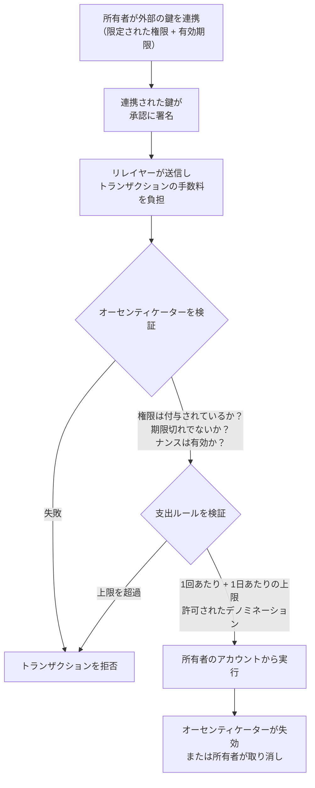

# アカウント抽象化

QoreChainは`x/abstractaccount`モジュールを通じて**プロトコルレベルのアカウント抽象化**を提供します。このモジュールは、支出ルールを持つアブストラクトアカウントを記録し、アカウントの所有者が外部の鍵（**オーセンティケーター**）を連携できるようにします。連携された鍵は、権限と支出上限の範囲内でアカウントから支出でき、外部のスマートコントラクトインフラは不要です。

:::danger メインネットでもテストネットでも有効化されていません
アブストラクトアカウントモジュールは現在、両ネットワークで**無効**になっています。`qorechaind query abstractaccount config`（および`GET /qorechain/abstractaccount/v1/config`）は、`qorechain-vladi`と`qorechain-diana`の両方で`enabled: false`を返します。チェーンv3.2.0以降、このフラグはすべての経路で強制されます。チェーンは、アカウント作成、オーセンティケーターの登録、および2つの実行レーン（`MsgExecuteEVM`、`MsgExecuteCosmos`）を、`abstract accounts are disabled on this chain`というエラーで拒否します。モジュールを有効化できるトランザクションは存在せず、アブストラクトアカウントのトランザクションがメインネットに含まれたことは一度もありません。以下の内容はすべて、参照用としてモジュールのインターフェースを説明するものです。モジュールが有効化されるまでは、稼働中のネットワーク上で連携鍵や委任支出のフローを構築しないでください。まずフラグを確認してください。
:::

:::note
以下のコマンドは、メインネット**`qorechain-vladi`**（2026年6月7日から稼働）を使用しています。このネットワークはノードリリース**v3.2.3**で動作しています。テストネットの場合は`--chain-id qorechain-diana`に置き換えてください。テストネットはv3.2.4（テストネット専用）で動作しています。
:::

:::caution Cosmosレーンのトランザクションにはすべて、ポスト量子ハイブリッドの副署名が必要です
このページの`qorechaind tx`のサンプルは、手数料フラグのみを示しています。稼働中のネットワークでは、Cosmosレーンのトランザクションはすべて、ML-DSA-87のハイブリッド副署名も含む必要があります。そのため、`--generate-only`でトランザクションを構築し、`qorechaind tx pqc cosign`で署名してください（それらを代行するQoreXまたはSDKを使うこともできます）。コミュニティビルドの`qorechaind`ではその署名を生成できません。[ダウンロードマニフェスト](/developer-guide/running-a-node#fetch-the-manifest)にあるリリースバイナリを使用してください。手数料の下限は**ガス1単位あたり0.1 uqor**であるため、`--gas 400000`には少なくとも`--fees 40000uqor`が必要です。[ポスト量子署名](/developer-guide/post-quantum-signing)を参照してください。
:::

## 概要

従来のブロックチェーンアカウントは単一の秘密鍵によって制御されます。アカウント抽象化は、「誰がトランザクションを承認できるか」という概念を単一の暗号鍵から切り離します。`x/abstractaccount`モジュールは以下を提供します。

* アカウントタイプと所有者が記録された**アブストラクトアカウント**
* 連携された鍵が支出できる範囲を制限する**支出ルール**（1トランザクションあたりおよび1日あたりの上限、許可されるデノミネーション）
* **オーセンティケーター**: 所有者が、限定された権限と有効期限を付けて連携する外部の鍵（Phantomのed25519鍵またはMetaMaskのsecp256k1アドレス）。所有者はいつでも失効させることができます

*連携鍵（オーセンティケーター）のフロー: 連携された鍵が承認に署名し、リレイヤーがそれを送信し、モジュールが権限、有効期限、支出ルールを検証したうえで、所有者のアカウントから実行する。*



## アカウントタイプ

`create`は3つのアカウントタイプのいずれかを記録します。タイプはアカウントに保存され、アドレスの導出方法の一部にもなります。このモジュール自体には、マルチシグ、セッションキー、リカバリーのトランザクションはありません（トランザクションサービスは`create`、`update-rules`、`register-authenticator`、`revoke-authenticator`、`execute-cosmos`、`execute-evm`です）。

| タイプ              | 想定される用途                    |
| ----------------- | ------------------------------- |
| `multisig`        | DAOトレジャリー、共有ウォレット  |
| `social_recovery` | コンシューマーウォレット、オンボーディング    |
| `session_based`   | dAppセッション、モバイルウォレット   |

## アブストラクトアカウントの作成

`create`はアカウントタイプを位置引数として受け取ります（`multisig`、`social_recovery`、または`session_based`）。

```bash
qorechaind tx abstractaccount create session_based \
  --from mykey \
  --gas 400000 --fees 40000uqor
```

このコマンドには、署名者、閾値、ガーディアン用のフラグはありません。

## オーセンティケーター（連携鍵）

モジュールの委任鍵の仕組みは**オーセンティケーター**であり、以下の[連携ウォレットオーセンティケーター](#authenticators)で説明します。所有者は外部の鍵（ed25519またはsecp256k1）を、権限のセットと有効期限を付けて連携し、いつでも失効させることができます。

```bash
qorechaind tx abstractaccount register-authenticator <account-address> <scheme> <pubkey-base64> <permissions-csv> <expiry-unix> <label> \
  --from mykey --gas 400000 --fees 40000uqor
qorechaind tx abstractaccount revoke-authenticator <account-address> <scheme> <pubkey-base64> \
  --from mykey --gas 400000 --fees 40000uqor
```

`scheme`は`ed25519`（例: Phantom）または`secp256k1`（例: MetaMask）です。`grant-session`、`revoke-session`、`query abstractaccount sessions`というコマンドはありません。

## 支出ルール

支出ルールは、アブストラクトアカウントに財務的なガードレールを追加します。

| ルール             | 説明                                           |
| ---------------- | ----------------------------------------------------- |
| `daily_limit`    | UTC暦日あたりの最大合計支出額              |
| `per_tx_limit`   | 承認された個々の実行あたりの最大支出額     |
| `allowed_denoms` | 使用可能なトークンデノミネーションの制限（ERC-20は`erc20/<contract>`として列挙します）       |
| `denom_limits`   | デノミネーションごとの上限を10進数文字列で指定（v3.2.2）: `{"denom","per_tx_limit","daily_limit"}`。指定したデノミネーションについては`per_tx_limit`と`daily_limit`の代わりに適用されるため、18桁のトークンにも上限を設けられます |
| `allowed_evm_calls` | ルールに縛られた鍵が**コールデータ付きで**行えるEVMコール（v3.2.2）。`0x<target>`（そのコントラクトの任意の関数）または`0x<target>/0x<selector>`（その関数のみ）の形式で指定します。エントリがない場合、ルールに縛られた鍵は、価値の送信、（`deploy`権限があれば）デプロイ、`allowed_denoms`に列挙されたERC-20トークンの移動しかできません。ターゲットを列挙すると、そのターゲットへのコールのすべての引数（受取人を含む）を信頼することになります |

### 支出ルールの設定

`update-rules`は、アカウントのルールを`SpendingRule`オブジェクトのJSON配列で置き換えます（ファイルでもフラグでもなく、インラインのJSONです）。

```bash
qorechaind tx abstractaccount update-rules <account-address> \
  '[{"id":"daily","enabled":true,"daily_limit":1000000000,"per_tx_limit":100000000,"allowed_denoms":["uqor"]}]' \
  --from mykey --gas 400000 --fees 40000uqor
```

上限は基本単位（`uqor`）で表され、承認された実行ごとにカウントされます。1日あたりの上限は、UTC暦日あたりの合計を制限します。ルールは保存済みのものを丸ごと置き換えるため、省略したフィールドは削除されます。v3.2.2以降、EVMレーンは`msg.value`だけでなく、コールが実際に動かすもの（ネイティブ価値、アカウントのネイティブ残高の減少、使用されたバンクコイン、列挙された各ERC-20の残高またはアローワンスの変化）を測定します。また、コントラクト作成には別の`deploy`権限が必要です。より詳しい例:

```bash
qorechaind tx abstractaccount update-rules <account-address> \
  '[{"id":"daily","enabled":true,"daily_limit":5000000,"allowed_denoms":["uqor","erc20/0xTOKEN"],"allowed_evm_calls":["0xROUTER/0x38ed1739"],"denom_limits":[{"denom":"erc20/0xTOKEN","per_tx_limit":"100000000000000000000","daily_limit":"500000000000000000000"}]}]' \
  --from mykey --gas 400000 --fees 40000uqor
```

### 現在のルールの照会

アカウントのレコードには、そのルールと連携された鍵の数が含まれます。

```bash
qorechaind query abstractaccount account <account-address>
```

:::caution ルールが鍵を制限するのは、ルールが存在する場合のみです
チェーンは次の順序で上限を解決します。オーセンティケーター自身のルールが設定されていて`enabled`であればそれ、そうでなければアカウント上の最初の`enabled`なルール、それもなければ**上限はありません**。`enabled: false`で保存されたルールは上限なしを意味し、ゼロの上限ではありません。`MsgRegisterAuthenticator`はルールを持たないため、このメッセージだけで連携された鍵は、アカウントレベルのルールによってのみ制限されます。`update-rules`で意図的にルールを設定し、鍵に必要な権限だけを登録してください。上限は連携された鍵が与えうる被害を抑えるものであり、鍵の失効の代わりにはなりません。
:::

## 連携ウォレットオーセンティケーター — 委任支出 {#authenticators}

オーセンティケーターの設計は、チェーンバージョン**v3.1.85**（v3.1.84の権限モデルを土台とする）で導入されました。モジュールが無効な間は、**稼働中のネットワークでは使用できません**（このページ冒頭のステータスボックスを参照）。**連携された外部ウォレットの鍵**——Phantom（ed25519）の鍵、またはMetaMask（secp256k1）のアカウント——が、最小権限・支出上限付き・失効可能な条件のもとで、**正規のポスト量子アカウントから支出**できます。外部鍵がML-DSA署名を生成することはなく、**リレイヤー**がトランザクションエンベロープを送信して手数料を負担します（リレイヤー自身のハイブリッドPQC署名がチェーンの署名要件を満たします）。一方、**ドメイン分離されたリプレイ耐性のある署名バイト**に対するオーセンティケーターの署名が、承認そのものとなります。

### オーセンティケーターの登録 {#register-authenticator}

アカウントの所有者は、`MsgRegisterAuthenticator`（通常のルートキーによるトランザクション）を使って外部鍵を登録し、スキーム、権限、有効期限、任意の支出上限を付与します。

```js
import { registerEthAuthenticatorMsg } from "@qorechain/wallet-adapter";

// Link a MetaMask account by its 20-byte address (EIP-191 verification):
const msg = registerEthAuthenticatorMsg({
  owner: "qor1owner...",              // the canonical account (signs this message)
  ethAddress: "0xAbC...123",          // the MetaMask address to link
  permissions: ["evm"],               // least privilege — see the taxonomy below
  expiryUnix: Math.floor(Date.now() / 1000) + 30 * 24 * 3600, // absolute Unix seconds, ≤ 30 days recommended
  label: "metamask",
});
// Limits are a separate message (MsgUpdateSpendingRules), see "Spending Rules" above.
// Sign & broadcast this msg with the OWNER's normal hybrid-PQC signer.
```

Phantomの鍵も同じ方法で、スキーム`ed25519`とPhantomの公開鍵を使って登録します（CLIでは`register-authenticator`）。失効は`MsgRevokeAuthenticator`により即座に行われます。

### 権限タクソノミー {#permission-taxonomy}

登録済みオーセンティケーターが実行できる操作は、11個の正規権限によって制御されます。このマッピングは**フェイルクローズ**であり、対応するマッピングのないメッセージタイプは拒否されます。

| 権限 | 付与される操作 |
| --- | --- |
| `send` | ネイティブレーンでの銀行送金 |
| `delegate` / `withdraw` / `vote` | ステーキング、報酬引き出し、ガバナンス |
| `evm` / `wasm` / `svm` | 各VMレーンでの実行 |
| `amm` / `ibc` / `deploy` | AMM操作、IBC送金、コントラクトデプロイ |
| `all` | *委任可能な*あらゆるメッセージ |

**鍵管理メッセージは決して委任できません**——`MsgRegisterAuthenticator`、`MsgRevokeAuthenticator`、PQC鍵の登録／移行、そして`MsgRotatePQCKey`は常にルートキーを必要とし、連携された鍵が自身の権限をエスカレーションすることはできません。スキーマ（`schema_version` 2）には`lane_rules`も列挙されています。アカウントのアドレスからのコントラクト作成、アカウントのEVMナンスを進めるコール、およびコードがEIP-7702委任であるアカウント自身へのコールには、いずれも`deploy`または`all`権限が必要です。v3.2.3以降、登録は未知の権限文字列と、検証できるはずのない65バイトのsecp256k1鍵を拒否します。

ハードコーディングするのではなく、（ドリフト検出用の`schema_version`付き）ライブのタクソノミーを参照してください。

```bash
curl -s https://api.qore.host/qorechain/abstractaccount/v1/permission_schema | jq
# or: qorechaind query abstractaccount permission-schema
```

### 連携された鍵での支出 {#execute-messages}

オーセンティケーターによって承認されたアクションは2つのメッセージで運ばれます。どちらの場合も、リレイヤーがトランザクションの署名者／手数料負担者であり、オーセンティケーターの署名はメッセージの内部に含まれます。

**`MsgExecuteEVM`** — **正規アカウントの`0x…`アドレスから**行われるEVMコールまたは送金。オーセンティケーターは`sha256("qorechain-evm-auth-v1" ‖ chainId ‖ account ‖ pubkey ‖ to ‖ value ‖ data ‖ nonce)`（すべてのフィールドは長さ接頭辞付き）に署名します。v3.2.3（`abstractaccount-hardening`機能）以降、チェーンは**v2ダイジェスト**`sha256("qorechain-evm-auth-v2" ‖ … ‖ nonce ‖ gasLimit)`を要求します。これはコールのガスリミット（8バイトのビッグエンディアン）も束縛するため、リレイヤーが異なるリミットで署名をリプレイすることはできません。どのブロックも両方の形式を受け付けることはありません。`qorechaind query abstractaccount auth-sign-evm`にはこのための`--gas-limit`があり、同じ値を`execute-evm`にも渡します。リプレイ対策はアカウント自身のEVMナンスです。

**`MsgExecuteCosmos`** — 正規アカウントからのネイティブレーンの銀行送金。オーセンティケーターは`sha256("qorechain-cosmos-auth-v1" ‖ chainId ‖ account ‖ pubkey ‖ to ‖ amount ‖ nonce)`に署名します。リプレイ対策は、モジュールが保持する**オーセンティケーターごとのシーケンス**です（銀行送金はアカウントのナンスを増やしません）。自分自身への送金は拒否されます。

:::caution ナンスに関するルール
* `MsgExecuteEVM.nonce`はアカウントの**現在の**EVMナンス（`eth_getTransactionCount(account0x, "latest")`）です。本番環境ではリレイヤーは*別の*アカウントであるため、+1を加算しては**いけません**。古いナンスで署名するとコード`11`が返されます。
* `MsgExecuteCosmos.nonce`は（アカウントのオーセンティケーター状態を照会して得られる）オーセンティケーターごとのシーケンスであり、アカウントのCosmosシーケンス**ではありません**。テストネットのみ（v3.2.4）、`GET /qorechain/abstractaccount/v1/auth_nonce/{address}/{pubkey_hex}`がそのシーケンスを直接返します（`nonce`、`linked`）。
:::

**Phantomの例**（ブラウザ: Phantomが署名し、バックエンドがリレーする）

```js
import { buildPhantomExecuteCosmos } from "@qorechain/wallet-adapter";

// In the dApp: Phantom signs the digest with ed25519 signMessage.
const msg = await buildPhantomExecuteCosmos({
  wallet: window.solana,              // Phantom: { publicKey, signMessage }
  relayer: "qor1relayer...",          // submits the tx and pays the fee (a different account)
  chainId: "qorechain-vladi",
  account: "qor1owner...",            // canonical account being spent from
  to: "qor1recipient...",
  amount: "900000uqor",               // single-coin string
  nonce: authSequence,                // per-authenticator sequence
});
// Send `msg` to your relayer; the relayer wraps it in a tx it signs
// (hybrid PQC) and broadcasts. The transfer moves the OWNER's funds.
```

**MetaMaskの例**（連携された20バイトアドレスからのEIP-191 `personal_sign`）

```js
import { buildMetaMaskExecuteEvm } from "@qorechain/wallet-adapter";

const msg = await buildMetaMaskExecuteEvm({
  provider: window.ethereum,          // MetaMask (EIP-1193)
  address: ethAddress,                // the linked 20-byte address
  relayer: "qor1relayer...",
  chainId: "qorechain-vladi",
  account: "qor1owner...",
  to: "0xRecipient...",
  value: (10n ** 16n).toString(),     // 0.01 QOR in wei (18-decimal EVM view), as a decimal string
  gasLimit: 100000,
  nonce: currentEvmNonce,             // eth_getTransactionCount(owner0x, "latest")
});
// Relay as above. The chain verifies the signature via EIP-191 + ecrecover
// against the registered 20-byte address.
```

同じビルダー関数は[QoreChain SDK](/sdk/guides/authenticators)にも5言語すべてで用意されており、CLIの相当コマンドも存在します。

```bash
# Generate an ed25519 authenticator key: the seed goes to a new 0600 file, only the public key is printed
qorechaind query abstractaccount auth-keygen --out authenticator.seed

# Sign the exact bytes the chain verifies (seed from --seed-file, "-" for stdin, QORE_AUTH_SEED, or a prompt)
qorechaind query abstractaccount auth-sign-cosmos <chain-id> <account> <to> <amount> <nonce> --seed-file authenticator.seed
qorechaind query abstractaccount auth-sign-evm <chain-id> <account> <to-0xhex> <value-wei> <data-hex> <nonce> --seed-file authenticator.seed

# Relay a pre-signed authorization (the relayer's --from key pays; cosign the envelope with `tx pqc cosign`)
qorechaind tx abstractaccount execute-cosmos <account> <to> <amount> <scheme> <pubkey-base64> <signature-base64> <nonce> --from relayer --generate-only > tx.json
qorechaind tx abstractaccount execute-evm <account> <to-0xhex> <value-wei> <data-hex> <gas-limit> <scheme> <pubkey-base64> <signature-base64> <nonce> --from relayer --generate-only > tx.json
```

これらのコマンドの鍵と署名はbase64です。`auth-sign-*`ヘルパーは、シードをコマンドライン引数ではなく、ファイル、標準入力、または環境変数から読み取るため（ノードリリースv3.2.1以降）、シェルの履歴に残りません。シードを扱うフラグ（`--out`、`--seed-file`）は、v3.2.1以降のバイナリにのみ存在します。

### エラーコード {#authenticator-errors}

実施に失敗した場合、ウォレットが適切なメッセージを表示できるように、（コードスペース`abstractaccount`の）異なるコードが返されます。

| コード | 意味 | ウォレットのUX |
| --- | --- | --- |
| `5` | 支出上限超過（1回あたり、または1日あたり） | 残りの利用可能額を表示 |
| `6` | オーセンティケーターの期限切れ | 「期限切れです — ウォレットを再連携してください」 |
| `9` | モジュールが無効（両ネットワークでの現在の状態） | 「連携ウォレットはまだ利用できません」 |
| `10` | 権限拒否（スコープ外、または委任不可のメッセージ） | 不足している権限を表示 |
| `11` | リプレイ拒否（古いナンス／シーケンス） | ナンスを再照会して再署名 |

（コードスペース`pqc`のコード`21` = ハイブリッド署名の検証失敗——これは承認の問題ではなく、リレイヤー側の署名の問題です。）

### RESTクエリ {#abstractaccount-rest}

このモジュールの読み取りクエリはRESTで提供されています（**v3.1.85**以降）。

```
GET /qorechain/abstractaccount/v1/config      # {"config":{"enabled":false,...}} on both networks today
GET /qorechain/abstractaccount/v1/accounts
GET /qorechain/abstractaccount/v1/accounts/{address}
GET /qorechain/abstractaccount/v1/permission_schema
```

## アブストラクトアカウントの照会

### CLI

```bash
# Module configuration (enabled flag and limits)
qorechaind query abstractaccount config

# Get full account configuration
qorechaind query abstractaccount account <address>

# List all abstract accounts (paginated)
qorechaind query abstractaccount accounts --page-limit 10
```

メインネットではアカウント一覧は空です。テストネットには、有効化フラグがすべての経路で強制される前に作成されたアカウントがいくつか一覧表示されます。

### JSON-RPC

> **まだ提供されていません:** リリース済みのどのノードビルドも`qor_`のJSON-RPC名前空間を提供していないため、現在のところ、すべてのパブリックエンドポイントで`qor_getAbstractAccount`は`-32601`（メソッドが見つかりません）を返します。上記のRESTルートまたはCLIを使用してください。[`qor_`名前空間](/api-reference/json-rpc-qor_-namespace)を参照してください。

### アカウントレスポンス例

アブストラクトアカウントのレコードの形（値は例示用）:

```json
{
  "address": "qor1myaccount...",
  "account_type": "session_based",
  "owner": "qor1owner...",
  "spending_rules": [
    {
      "id": "daily",
      "enabled": true,
      "daily_limit": "1000000000",
      "per_tx_limit": "100000000",
      "allowed_denoms": ["uqor"]
    }
  ]
}
```

## ソーシャルリカバリー

`social_recovery`はアカウントタイプの1つですが、このモジュールにはリカバリーのトランザクションがありません。`initiate-recovery`や`approve-recovery`というコマンドはなく、モジュールのトランザクションサービスにもリカバリーのメッセージはありません。QoreChainアカウントの鍵のリカバリーは、アカウントのポスト量子鍵をニーモニックから再導出し（`tx pqc recover-key`）、必要に応じてローテーションする（`tx pqc rotate-key`）ことで行います。[ポスト量子署名](/developer-guide/post-quantum-signing)を参照してください。

## dAppとの連携

モジュールが有効化された場合、連携鍵による承認は次のようなフローを想定しています。

* 生体認証プロンプトの繰り返しが邪魔になるモバイルウォレット
* 上限のある許容額の範囲内で迅速なトランザクション署名が必要なゲームdApp
* リレイヤー経由でQoreChainアカウントから支出するPhantomまたはMetaMaskのユーザー

dAppのバックエンドがリレイヤーとして機能します。連携された鍵の署名済み承認を受け取り、自身が署名するトランザクションにそれを包んでブロードキャストします。連携された鍵は、いつでも失効させることも、有効期限で失効させることもできます。対象のネットワークでモジュールが有効化されるまでは、[QoreXまたはSDK](/sdk/overview)による通常の署名を使用してください。

## 次のステップ

* [バリデータの運用](/developer-guide/running-a-validator) — バリデータノードのセットアップと運用
* [EVM開発](/developer-guide/evm-development) — EVMツール、アカウント、EVM承認ウィンドウ
* [クロスVM相互運用性](/developer-guide/cross-vm-interoperability) — クロスVMメッセージング
