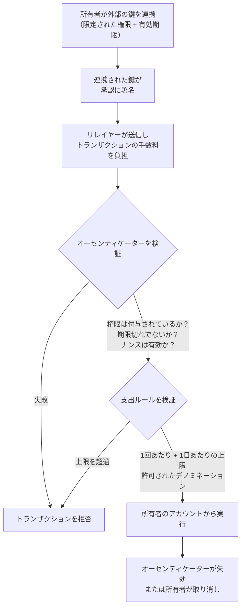

# アカウント抽象化

QoreChainは`x/abstractaccount`モジュールを通じて**プロトコルレベルのアカウント抽象化**を提供します。このモジュールは、支出ルールを持つアブストラクトアカウントを記録し、アカウントの所有者が外部の鍵（**オーセンティケーター**）を連携できるようにします。連携された鍵は、権限と支出上限の範囲内でアカウントから支出でき、外部のスマートコントラクトインフラは不要です。

:::danger メインネットでは有効化されていません。テストネットでは有効です
アブストラクトアカウントモジュールは、執筆時点（2026年10月27日に確認）で**`qorechain-vladi`メインネットでは無効**になっています。`qorechaind query abstractaccount config`（および`GET /qorechain/abstractaccount/v1/config`）は`enabled: false`を返します。**`qorechain-diana`テストネット**では、ガバナンスの決定（提案18、2026年10月27日に可決）により有効化されており、`enabled: true`を返します。チェーンv3.2.0以降、このフラグはすべての経路で強制されます。`false`の場合、チェーンは、アカウント作成、オーセンティケーターの登録、および2つの実行レーン（`MsgExecuteEVM`、`MsgExecuteCosmos`）を、`abstract accounts are disabled on this chain`というエラーで拒否します。通常のトランザクションでモジュールを有効化することはできず、この設定はガバナンスの決定によってのみ変わります。アブストラクトアカウントのトランザクションがメインネットに含まれたことは一度もありません。以下の内容はすべて、モジュールのインターフェースを説明するものです。テストネットで試してください。メインネットでモジュールが有効化されるまでは、メインネット向けの連携鍵や委任支出のフローを構築しないでください。必ず最初にフラグを確認してください。
:::

:::note
以下のコマンドは、メインネット**`qorechain-vladi`**（2026年6月7日から稼働）を使用しています。このネットワークはノードリリース**v3.2.6**で動作しています（2026年11月4日に高さ4,020,000で適用、ガバナンス提案15。v3.2.5は2026年10月29日に高さ3,906,833で、提案14により、v3.2.4は2026年10月23日に高さ3,742,566で適用）。テストネットの場合は`--chain-id qorechain-diana`に置き換えてください。テストネットはv3.2.8で動作しています（2026年11月12日から。2026年10月19日からv3.2.4）。
:::

:::caution Cosmosレーンのトランザクションにはすべて、ポスト量子ハイブリッドの副署名が必要です
このページの`qorechaind tx`のサンプルは、手数料フラグのみを示しています。稼働中のネットワークでは、Cosmosレーンのトランザクションはすべて、ML-DSA-87のハイブリッド副署名も含む必要があります。そのため、`--generate-only`でトランザクションを構築し、`qorechaind tx pqc cosign`で署名してください（それらを代行するQoreXまたはSDKを使うこともできます）。コミュニティビルドの`qorechaind`ではその署名を生成できません。[ダウンロードマニフェスト](/developer-guide/running-a-node#fetch-the-manifest)にあるリリースバイナリを使用してください。手数料の下限は**ガス1単位あたり0.1 uqor**であるため、`--gas 400000`には少なくとも`--fees 40000uqor`が必要です。[ポスト量子署名](/developer-guide/post-quantum-signing)を参照してください。
:::

## 概要

従来のブロックチェーンアカウントは単一の秘密鍵によって制御されます。アカウント抽象化は、「誰がトランザクションを承認できるか」という概念を単一の暗号鍵から切り離します。`x/abstractaccount`モジュールは以下を提供します。

* アカウントタイプと所有者が記録された**アブストラクトアカウント**
* 連携された鍵（オーセンティケーターとセッションキー）が支出できる範囲を制限する**支出ルール**（1トランザクションあたりおよび1日あたりの上限、許可されるデノミネーション）。所有者自身の鍵は制限しません
* **オーセンティケーター**: 所有者が、限定された権限と有効期限を付けて連携する外部の鍵（Phantomのed25519鍵またはMetaMaskのsecp256k1アドレス）。所有者はいつでも失効させることができます

*連携鍵（オーセンティケーター）のフロー: 連携された鍵が承認に署名し、リレイヤーがそれを送信し、モジュールが権限、有効期限、支出ルールを検証したうえで、所有者のアカウントから実行する。*



## アカウントタイプ

`create`は3つのアカウントタイプのいずれかを記録します。タイプはアカウントに保存され、アドレスの導出方法の一部にもなります。このモジュール自体には、マルチシグ、セッションキー、リカバリーのトランザクションはありません（トランザクションサービスは`create`、`update-rules`、`register-authenticator`、`revoke-authenticator`、`execute-cosmos`、`execute-evm`です）。

| タイプ              | 想定される用途                    |
| ----------------- | ------------------------------- |
| `multisig`        | DAOトレジャリー、共有ウォレット  |
| `social_recovery` | コンシューマーウォレット、オンボーディング    |
| `session_based`   | dAppセッション、モバイルウォレット   |

## アブストラクトアカウントの作成

`create`はアカウントタイプを位置引数として受け取ります（`multisig`、`social_recovery`、または`session_based`）。

```bash
qorechaind tx abstractaccount create session_based \
  --from mykey \
  --gas 400000 --fees 40000uqor
```

このコマンドには、署名者、閾値、ガーディアン用のフラグはありません。

## オーセンティケーター（連携鍵）

モジュールの委任鍵の仕組みは**オーセンティケーター**であり、以下の[連携ウォレットオーセンティケーター](#authenticators)で説明します。所有者は外部の鍵（ed25519またはsecp256k1）を、権限のセットと有効期限を付けて連携し、いつでも失効させることができます。

```bash
qorechaind tx abstractaccount register-authenticator <account-address> <scheme> <pubkey-base64> <permissions-csv> <expiry-unix> <label> \
  --from mykey --gas 400000 --fees 40000uqor
qorechaind tx abstractaccount revoke-authenticator <account-address> <scheme> <pubkey-base64> \
  --from mykey --gas 400000 --fees 40000uqor
```

`scheme`は`ed25519`（例: Phantom）または`secp256k1`（例: MetaMask）です。`grant-session`、`revoke-session`、`query abstractaccount sessions`というコマンドはありません。

## 支出ルール

支出ルールは、アブストラクトアカウントに連携されたオーセンティケーターとセッションキーに対して、財務的なガードレールを追加します。支出ルールが拘束するのはオーセンティケーターとセッションキーだけで、所有者自身の鍵は対象外です。所有者の鍵は、EVM レーンでは [EVM 承認ウィンドウ](/getting-started/first-transaction#evm-window)によって制限されます。

ルールのフィールド:

| ルール             | 説明                                           |
| ---------------- | ----------------------------------------------------- |
| `daily_limit`    | UTC暦日あたりの最大合計支出額              |
| `per_tx_limit`   | 承認された個々の実行あたりの最大支出額     |
| `allowed_denoms` | 使用可能なトークンデノミネーションの制限（ERC-20は`erc20/<EIP-55 0x address>`として列挙します。これは支出ルール独自のスラッシュ付き表記で、チェーンはアドレスをEIP-55形式で比較するため、入力した大文字小文字の違いが別のトークンになることはありません。これは登録済みトークンペアのバンクデノミネーションではありません。バンクデノミネーションはコロン付きの`erc20:<EIP-55 0x address>`と書き、大文字小文字が区別されます。[EVM開発](/developer-guide/evm-development#fest-tokens)を参照）       |
| `denom_limits`   | デノミネーションごとの上限を10進数文字列で指定（v3.2.2）: `{"denom","per_tx_limit","daily_limit"}`。指定したデノミネーションについては`per_tx_limit`と`daily_limit`の代わりに適用されるため、18桁のトークンにも上限を設けられます |
| `allowed_evm_calls` | ルールに縛られた鍵が**コールデータ付きで**行えるEVMコール（v3.2.2）。`0x<target>`（そのコントラクトの任意の関数）または`0x<target>/0x<selector>`（その関数のみ）の形式で指定します。エントリがない場合、ルールに縛られた鍵は、価値の送信、（`deploy`権限があれば）デプロイ、`allowed_denoms`に列挙されたERC-20トークンの移動しかできません。ターゲットを列挙すると、そのターゲットへのコールのすべての引数（受取人を含む）を信頼することになります |

### 支出ルールの設定

`update-rules`は、アカウントのルールを`SpendingRule`オブジェクトのJSON配列で置き換えます（ファイルでもフラグでもなく、インラインのJSONです）。

```bash
qorechaind tx abstractaccount update-rules <account-address> \
  '[{"id":"daily","enabled":true,"daily_limit":1000000000,"per_tx_limit":100000000,"allowed_denoms":["uqor"]}]' \
  --from mykey --gas 400000 --fees 40000uqor
```

上限は基本単位（`uqor`）で表され、承認された実行ごとにカウントされます。1日あたりの上限は、UTC暦日あたりの合計を制限します。ルールは保存済みのものを丸ごと置き換えるため、省略したフィールドは削除されます。v3.2.2以降、EVMレーンは`msg.value`だけでなく、コールが実際に動かすもの（ネイティブ価値、アカウントのネイティブ残高の減少、使用されたバンクコイン、列挙された各ERC-20の残高またはアローワンスの変化）を測定します。また、コントラクト作成には別の`deploy`権限が必要です。より詳しい例(示されているERC-20はテストネットのfUSDテストトークンです。ご自身のトークンのコントラクトアドレスを使用してください。また、ルール内の`erc20/<address>`のスラッシュと、バンクデノミネーション`erc20:<address>`のコロンの違いにご注意ください):

```bash
qorechaind tx abstractaccount update-rules <account-address> \
  '[{"id":"daily","enabled":true,"daily_limit":5000000,"allowed_denoms":["uqor","erc20/0x97143B771D34ddb9130b807b135Ae675A5a963CA"],"allowed_evm_calls":["0xROUTER/0x38ed1739"],"denom_limits":[{"denom":"erc20/0x97143B771D34ddb9130b807b135Ae675A5a963CA","per_tx_limit":"100000000000000000000","daily_limit":"500000000000000000000"}]}]' \
  --from mykey --gas 400000 --fees 40000uqor
```

### 現在のルールの照会

アカウントのレコードには、そのルールと連携された鍵の数が含まれます。

```bash
qorechaind query abstractaccount account <account-address>
```

v3.2.8 以降(後のメインネットアップグレードまではテストネットのみ)では、価値に関わる権限を持つ鍵は、ルールで制限されていない限り、登録時と実行時の両方で拒否されます。そのため、そのような鍵には「上限なし」は当てはまらなくなります。

:::caution ルールが鍵を制限するのは、ルールが存在する場合のみです
チェーンは次の順序で上限を解決します。オーセンティケーター自身のルールが設定されていて`enabled`であればそれ、そうでなければアカウント上の最初の`enabled`なルール、それもなければ**上限はありません**。`enabled: false`で保存されたルールは上限なしを意味し、ゼロの上限ではありません。`MsgRegisterAuthenticator`はルールを持たないため、このメッセージだけで連携された鍵は、アカウントレベルのルールによってのみ制限されます。`update-rules`で意図的にルールを設定し、鍵に必要な権限だけを登録してください。上限は連携された鍵が与えうる被害を抑えるものであり、鍵の失効の代わりにはなりません。
:::

## 連携ウォレットオーセンティケーター — 委任支出 {#authenticators}

オーセンティケーターの設計は、チェーンバージョン**v3.1.85**（v3.1.84の権限モデルを土台とする）で導入されました。メインネットでモジュールが無効な間は**メインネットでは使用できません**が、モジュールが有効なテストネットでは利用できます（このページ冒頭のステータスボックスを参照）。**連携された外部ウォレットの鍵**——Phantom（ed25519）の鍵、またはMetaMask（secp256k1）のアカウント——が、最小権限・支出上限付き・失効可能な条件のもとで、**正規のポスト量子アカウントから支出**できます。外部鍵がML-DSA署名を生成することはなく、**リレイヤー**がトランザクションエンベロープを送信して手数料を負担します（リレイヤー自身のハイブリッドPQC署名がチェーンの署名要件を満たします）。一方、**ドメイン分離されたリプレイ耐性のある署名バイト**に対するオーセンティケーターの署名が、承認そのものとなります。

### オーセンティケーターの登録 {#register-authenticator}

アカウントの所有者は、`MsgRegisterAuthenticator`（通常のルートキーによるトランザクション）を使って外部鍵を登録し、スキーム、権限、有効期限、任意の支出上限を付与します。

```js
import { registerEthAuthenticatorMsg } from "@qorechain/wallet-adapter";

// Link a MetaMask account by its 20-byte address (EIP-191 verification):
const msg = registerEthAuthenticatorMsg({
  owner: "qor1owner...",              // the canonical account (signs this message)
  ethAddress: "0xAbC...123",          // the MetaMask address to link
  permissions: ["evm"],               // least privilege — see the taxonomy below
  expiryUnix: Math.floor(Date.now() / 1000) + 30 * 24 * 3600, // absolute Unix seconds, ≤ 30 days recommended
  label: "metamask",
});
// Limits are a separate message (MsgUpdateSpendingRules), see "Spending Rules" above.
// Sign & broadcast this msg with the OWNER's normal hybrid-PQC signer.
```

**リリース v3.2.8 以降(後のメインネットアップグレードまではテストネットのみ)では、登録にさらに 2 つの要件があります。**

1. **所有の証明。** `MsgRegisterAuthenticator` には必須フィールド `possession_proof`(フィールド 8)があります。これは連携される鍵自身による署名で、その鍵が連携に同意していることを示します。鍵は自身のスキームで次のプレーンテキストに署名するため、ブラウザウォレットは署名内容をユーザーに表示します(Phantom の `signMessage`、MetaMask の `personal_sign`)。33 バイトの secp256k1 鍵は、テキストの SHA-256 に署名します。

   ```text
   QoreChain authenticator link v1
   chain: <chain-id>
   account: <bech32 account>
   scheme: <scheme>
   key: <lowercase hex of the public key, or of the 20-byte address>
   ```

   このテキストにはチェーン、アカウント、スキーム、鍵が含まれるため、証明を別のチェーン、アカウント、鍵に使い回すことはできません。有効な証明のない登録は拒否されます。
2. **価値を扱う鍵の支出ルール。** 価値を動かせる権限(`send`、`evm`、`svm`、`deploy`、`all`)を持つ鍵には、その鍵が支出できるすべてのデノミネーションを制限する支出ルールが必要です。連携の前、または連携と同時に `MsgUpdateSpendingRules` で設定します。アップグレード前に連携された鍵にも実行時に同じルールが適用されるため、それらの鍵にもルールを追加してください。

コードからは、SDK 0.14.0 に両方のヘルパーがあります(TypeScript: 証明には `signAuthenticatorLinkPhantom`、`signAuthenticatorLinkMetaMask`、`signAuthenticatorLinkEd25519`、`signAuthenticatorLinkSecp256k1`、`signAuthenticatorLinkEip191`。支出ルールとリンクをオーナーが署名する 1 つのトランザクションにまとめるには `linkAuthenticatorMsgs`)。また `@qorechain/wallet-adapter` 0.6.0 には `phantomPossessionProof`、`metaMaskPossessionProof`、`linkAuthenticatorMsgs` があります。[チェーン v3.2.8 からのリンク](/sdk/guides/authenticators#link-v328)を参照してください。実行が失敗した場合については、`assertAuthenticatorExecutionsSucceeded` が `success=false` で例外を発生させます。`linkAuthenticatorMsgs`、`metaMaskPossessionProof`、`revokeAuthenticatorMsg` はテストネットで実行しました（[確認した内容](#link-example-checks)を参照）。Phantom と ed25519 のヘルパーは実行していません。

Phantomの鍵も同じ方法で、スキーム`ed25519`とPhantomの公開鍵を使って登録します（CLIでは`register-authenticator`）。失効は`MsgRevokeAuthenticator`により即座に行われます。

**実行は、成功したトランザクションの中で失敗することがあります。** v3.2.8 以降(後のメインネットアップグレードまではテストネットのみ)では、失敗した `MsgExecuteEVM` または `MsgExecuteCosmos` は、トランザクションコード 0 のままレスポンスに `success=false` を返し、理由を添えたイベント `abstractaccount_execution_failed` を発行し、それでもオーセンティケーターのナンスを消費します。トランザクションコードだけを確認するクライアントは、そのような呼び出しを成功と報告してしまいます。レスポンスまたはイベントを読んでください。

### 権限タクソノミー {#permission-taxonomy}

登録済みオーセンティケーターが実行できる操作は、11個の正規権限によって制御されます。このマッピングは**フェイルクローズ**であり、対応するマッピングのないメッセージタイプは拒否されます。

| 権限 | 付与される操作 |
| --- | --- |
| `send` | ネイティブレーンでの銀行送金 |
| `delegate` / `withdraw` / `vote` | ステーキング、報酬引き出し、ガバナンス |
| `evm` / `wasm` / `svm` | 各VMレーンでの実行 |
| `amm` / `ibc` / `deploy` | AMM操作、IBC送金、コントラクトデプロイ |
| `all` | *委任可能な*あらゆるメッセージ |

**鍵管理メッセージは決して委任できません**——`MsgRegisterAuthenticator`、`MsgRevokeAuthenticator`、PQC鍵の登録／移行、そして`MsgRotatePQCKey`は常にルートキーを必要とし、連携された鍵が自身の権限をエスカレーションすることはできません。スキーマ（`schema_version` 2）には`lane_rules`も列挙されています。アカウントのアドレスからのコントラクト作成、アカウントのEVMナンスを進めるコール、およびコードがEIP-7702委任であるアカウント自身へのコールには、いずれも`deploy`または`all`権限が必要です。v3.2.3以降、登録は未知の権限文字列と、検証できるはずのない65バイトのsecp256k1鍵を拒否します。

ハードコーディングするのではなく、（ドリフト検出用の`schema_version`付き）ライブのタクソノミーを参照してください。

```bash
curl -s https://api.qore.host/qorechain/abstractaccount/v1/permission_schema | jq
# or: qorechaind query abstractaccount permission-schema
```

### 連携された鍵での支出 {#execute-messages}

オーセンティケーターによって承認されたアクションは2つのメッセージで運ばれます。どちらの場合も、リレイヤーがトランザクションの署名者／手数料負担者であり、オーセンティケーターの署名はメッセージの内部に含まれます。

**`MsgExecuteEVM`** — **正規アカウントの`0x…`アドレスから**行われるEVMコールまたは送金。オーセンティケーターは`sha256("qorechain-evm-auth-v1" ‖ chainId ‖ account ‖ pubkey ‖ to ‖ value ‖ data ‖ nonce)`（すべてのフィールドは長さ接頭辞付き）に署名します。v3.2.3（`abstractaccount-hardening`機能）以降、チェーンは**v2ダイジェスト**`sha256("qorechain-evm-auth-v2" ‖ … ‖ nonce ‖ gasLimit)`を要求します。これはコールのガスリミット（8バイトのビッグエンディアン）も束縛するため、リレイヤーが異なるリミットで署名をリプレイすることはできません。どのブロックも両方の形式を受け付けることはありません。`qorechaind query abstractaccount auth-sign-evm`にはこのための`--gas-limit`があり、同じ値を`execute-evm`にも渡します。リプレイ対策はアカウント自身のEVMナンスです。

**`MsgExecuteCosmos`** — 正規アカウントからのネイティブレーンの銀行送金。オーセンティケーターは`sha256("qorechain-cosmos-auth-v1" ‖ chainId ‖ account ‖ pubkey ‖ to ‖ amount ‖ nonce)`に署名します。リプレイ対策は、モジュールが保持する**オーセンティケーターごとのシーケンス**です（銀行送金はアカウントのナンスを増やしません）。自分自身への送金は拒否されます。

:::caution ナンスに関するルール
* `MsgExecuteEVM.nonce`はアカウントの**現在の**EVMナンス（`eth_getTransactionCount(account0x, "latest")`）です。本番環境ではリレイヤーは*別の*アカウントであるため、+1を加算しては**いけません**。古いナンスで署名するとコード`11`が返されます。
* `MsgExecuteCosmos.nonce`は（アカウントのオーセンティケーター状態を照会して得られる）オーセンティケーターごとのシーケンスであり、アカウントのCosmosシーケンス**ではありません**。v3.2.4以降（テストネットでは2026年10月19日から、メインネットでは2026年10月23日から）、`GET /qorechain/abstractaccount/v1/auth_nonce/{address}/{pubkey_hex}`がそのシーケンスを直接返します（`nonce`、`linked`）。
:::

**Phantomの例**（ブラウザ: Phantomが署名し、バックエンドがリレーする）

```js
import { buildPhantomExecuteCosmos } from "@qorechain/wallet-adapter";

// In the dApp: Phantom signs the digest with ed25519 signMessage.
const msg = await buildPhantomExecuteCosmos({
  wallet: window.solana,              // Phantom: { publicKey, signMessage }
  relayer: "qor1relayer...",          // submits the tx and pays the fee (a different account)
  chainId: "qorechain-vladi",
  account: "qor1owner...",            // canonical account being spent from
  to: "qor1recipient...",
  amount: "900000uqor",               // single-coin string
  nonce: authSequence,                // per-authenticator sequence
});
// Send `msg` to your relayer; the relayer wraps it in a tx it signs
// (hybrid PQC) and broadcasts. The transfer moves the OWNER's funds.
```

**MetaMaskの例**（連携された20バイトアドレスからのEIP-191 `personal_sign`）

```js
import { buildMetaMaskExecuteEvm } from "@qorechain/wallet-adapter";

const msg = await buildMetaMaskExecuteEvm({
  provider: window.ethereum,          // MetaMask (EIP-1193)
  address: ethAddress,                // the linked 20-byte address
  relayer: "qor1relayer...",
  chainId: "qorechain-vladi",
  account: "qor1owner...",
  to: "0xRecipient...",
  value: (10n ** 16n).toString(),     // 0.01 QOR in wei (18-decimal EVM view), as a decimal string
  gasLimit: 100000,
  nonce: currentEvmNonce,             // eth_getTransactionCount(owner0x, "latest")
});
// Relay as above. The chain verifies the signature via EIP-191 + ecrecover
// against the registered 20-byte address.
```

同じビルダー関数は[QoreChain SDK](/sdk/guides/authenticators)にも5言語すべてで用意されており、CLIの相当コマンドも存在します。

```bash
# Generate an ed25519 authenticator key: the seed goes to a new 0600 file, only the public key is printed
qorechaind query abstractaccount auth-keygen --out authenticator.seed

# Sign the exact bytes the chain verifies (seed from --seed-file, "-" for stdin, QORE_AUTH_SEED, or a prompt)
qorechaind query abstractaccount auth-sign-cosmos <chain-id> <account> <to> <amount> <nonce> --seed-file authenticator.seed
qorechaind query abstractaccount auth-sign-evm <chain-id> <account> <to-0xhex> <value-wei> <data-hex> <nonce> --seed-file authenticator.seed

# Relay a pre-signed authorization (the relayer's --from key pays; cosign the envelope with `tx pqc cosign`)
qorechaind tx abstractaccount execute-cosmos <account> <to> <amount> <scheme> <pubkey-base64> <signature-base64> <nonce> --from relayer --generate-only > tx.json
qorechaind tx abstractaccount execute-evm <account> <to-0xhex> <value-wei> <data-hex> <gas-limit> <scheme> <pubkey-base64> <signature-base64> <nonce> --from relayer --generate-only > tx.json
```

これらのコマンドの鍵と署名はbase64です。`auth-sign-*`ヘルパーは、シードをコマンドライン引数ではなく、ファイル、標準入力、または環境変数から読み取るため（ノードリリースv3.2.1以降）、シェルの履歴に残りません。シードを扱うフラグ（`--out`、`--seed-file`）は、v3.2.1以降のバイナリにのみ存在します。

### エラーコード {#authenticator-errors}

実施に失敗した場合、ウォレットが適切なメッセージを表示できるように、（コードスペース`abstractaccount`の）異なるコードが返されます。

| コード | 意味 | ウォレットのUX |
| --- | --- | --- |
| `5` | 支出上限超過（1回あたり、または1日あたり） | 残りの利用可能額を表示 |
| `6` | オーセンティケーターの期限切れ | 「期限切れです — ウォレットを再連携してください」 |
| `9` | モジュールが無効（メインネットでの現在の状態） | 「連携ウォレットはまだ利用できません」 |
| `10` | 権限拒否（スコープ外、または委任不可のメッセージ） | 不足している権限を表示 |
| `11` | リプレイ拒否（古いナンス／シーケンス） | ナンスを再照会して再署名 |

（コードスペース`pqc`のコード`21` = ハイブリッド署名の検証失敗——これは承認の問題ではなく、リレイヤー側の署名の問題です。）

### RESTクエリ {#abstractaccount-rest}

このモジュールの読み取りクエリはRESTで提供されています（**v3.1.85**以降）。

```
GET /qorechain/abstractaccount/v1/config      # {"config":{"enabled":false,...}} on mainnet today; enabled: true on the testnet
GET /qorechain/abstractaccount/v1/accounts
GET /qorechain/abstractaccount/v1/accounts/{address}
GET /qorechain/abstractaccount/v1/permission_schema
```

## v3.2.8 での鍵の連携: 実例 {#link-example-v328}

このセクションでは、2026 年 11 月 12 日から v3.2.8 で稼働している **`qorechain-diana` テストネット**で、連携を 1 回完了するまでを順に説明します。メインネットはまだ v3.2.8 で稼働しておらず、そのアブストラクトアカウントモジュールはオフになっているため、現時点ではメインネットにこの内容は当てはまりません。要点は次のとおりです。連携する鍵は、連携に同意していることを示すために短いテキストに署名する必要があります。価値を動かせる鍵には、アカウントに支出ルールが必要です。そして、連携された鍵が後で支出するとき、失敗した支出は、成功したトランザクションの中で報告されます。

なぜ重要か: v3.2.8 以降、鍵の保有者が連携に参加するため、鍵を実際に保有している人だけがその鍵を連携でき、価値を動かせる鍵は常にアカウント上の上限で制限されます。

:::note 現時点で実行できること
以下の連携テキストと 3 つの署名スキームは、示したとおり、プレーンな `node:crypto` と `@noble` で動作します。公開済みのパッケージ（SDK 0.13.0 と wallet-adapter 0.5.0）は、まだ証明を `MsgRegisterAuthenticator` に入れられません。それらの `registerAuthenticator` と `registerEthAuthenticatorMsg` は、証明フィールドなしでメッセージを構築し、v3.2.8 のテストネットはそれを拒否します。後の SDK と wallet-adapter のリリースで、連携テキストの構築、ウォレットへの署名依頼、証明の添付を行うヘルパーが追加されます。それまでは、コマンドライン（ステップ 3）または生のメッセージを使ってください。ここでの `qorechaind` は Linux のノード CLI を指します。パッケージ化された macOS 用バイナリはありません。
:::

### 1. 連携テキストと、各スキームでの署名方法 {#link-text}

テキストは 5 行で、1 つの改行で結合し、末尾の改行はありません。

```text
QoreChain authenticator link v1
chain: qorechain-diana
account: qor1youraccount...
scheme: secp256k1
key: b31c9bca95fa18bc6bf5cbf748f73925e0e05913
```

`chain` はチェーン ID、`account` は鍵が連携される bech32 アカウント、`scheme` は `register-authenticator` に渡すスキーム、`key` は公開鍵（ed25519 では 32 バイト、圧縮 secp256k1 鍵では 33 バイト）の小文字の 16 進数表記、または MetaMask アカウントの場合は 20 バイトの Ethereum アドレスの小文字の 16 進数表記です。チェーンが検証するバイト列は、まさにこれらの文字なので、チェーン ID、アカウント、鍵が異なると、検証されない証明になります。

| 連携する鍵 | `scheme` | `key` の内容 | 署名する対象 | 証明のサイズ |
| --- | --- | --- | --- | --- |
| Phantom（ed25519） | `ed25519` | 32 バイトの公開鍵 | テキストの UTF-8 バイト列（ウォレットの `signMessage`） | 64 バイト |
| 圧縮 secp256k1 鍵 | `secp256k1` | 33 バイトの公開鍵 | テキストの SHA-256、コンパクトな `r` に続けて `s` | 64 バイト |
| Ethereum アドレス（MetaMask） | `secp256k1` | 20 バイトのアドレス | テキストの EIP-191 `personal_sign` | 65 バイト（`r`、`s`、`v` = 27 または 28） |

次の TypeScript は、`node:crypto`、`@noble/curves` 2.x、`@noble/hashes` 1.8 を使って、テキストを構築し、使い捨ての 3 つの鍵で署名します（Node 20 以降で実行してください。これらの鍵を他の用途に使わないでください）。

```ts
import { generateKeyPairSync, sign } from "node:crypto";
import { secp256k1 } from "@noble/curves/secp256k1.js";
import { sha256 } from "@noble/hashes/sha2.js";
import { keccak_256 } from "@noble/hashes/sha3.js";
import { bytesToHex, utf8ToBytes, concatBytes } from "@noble/hashes/utils.js";

const chainId = "qorechain-diana";
const account = "qor1youraccount..."; // the account the key is linked to

function linkText(scheme: string, key: Uint8Array): string {
  return [
    "QoreChain authenticator link v1",
    `chain: ${chainId}`,
    `account: ${account}`,
    `scheme: ${scheme}`,
    `key: ${bytesToHex(key)}`, // lowercase hex
  ].join("\n");
}

// ed25519 (what Phantom signMessage does): sign the text bytes.
const ed = generateKeyPairSync("ed25519");
const edPub = ed.publicKey.export({ format: "der", type: "spki" }).subarray(-32);
const edProof = sign(null, utf8ToBytes(linkText("ed25519", edPub)), ed.privateKey);

// 33-byte secp256k1 key: sign sha256(text), 64-byte r||s.
const sk = secp256k1.utils.randomSecretKey();
const pub33 = secp256k1.getPublicKey(sk, true);
const cosmosProof = secp256k1.sign(sha256(utf8ToBytes(linkText("secp256k1", pub33))), sk, { prehash: false });

// Ethereum address: EIP-191 personal_sign, key = the 20-byte address.
const ethSk = secp256k1.utils.randomSecretKey();
const addr = keccak_256(secp256k1.getPublicKey(ethSk, false).subarray(1)).subarray(-20);
const text = utf8ToBytes(linkText("secp256k1", addr));
const digest = keccak_256(concatBytes(utf8ToBytes(`\x19Ethereum Signed Message:\n${text.length}`), text));
const rec = secp256k1.sign(digest, ethSk, { prehash: false, format: "recovered" }); // recovery byte first
const ethProof = concatBytes(rec.subarray(1), Uint8Array.of(rec[0] + 27));          // r || s || v

// The CLI takes the proof as base64:
console.log(Buffer.from(edProof).toString("base64"));
```

ブラウザの dApp では鍵を保有していません。同じテキストをウォレットに渡し（Phantom の `signMessage` には UTF-8 バイト列、MetaMask の `personal_sign` にはテキスト）、返ってきたものを base64 にします。ウォレットは 5 行をユーザーに表示します。これが、プレーンテキストを使う理由です。

### 2. 支出ルール {#link-spending-rule}

価値を動かせる権限（`send`、`evm`、`svm`、`deploy`、`all`）を持つ鍵は、その鍵が支出できるすべてのデノミネーションを制限する有効なルールがアカウントにすでにない限り、登録時に拒否されます。先にルールを設定するか、連携と同じトランザクションで設定してください。チェーンは、独自のルールを持たない鍵に、アカウントの**最初の有効なルール**を適用します。`update-rules` はすべてのルールを置き換えるため、アカウントに残したいルールはすべて含めてください。コマンドラインでは次のとおりです。

```bash
qorechaind tx abstractaccount update-rules <account-address> \
  '[{"id":"linked","enabled":true,"daily_limit":5000000,"per_tx_limit":1000000,"allowed_denoms":["uqor"]}]' \
  --chain-id qorechain-diana --from mykey --generate-only --gas 400000 --fees 40000uqor > rules.json
# cosign with `qorechaind tx pqc cosign`, then broadcast (see the caution at the top of this page)
```

公開済みの SDK 0.13.0 を使った TypeScript では、コンポーザーは `msg.abstractaccount.updateSpendingRules` で、ルールをローカルで検証し、何も制限しない有効なルールを拒否します。

```ts
import { msg } from "@qorechain/sdk";

const rules = msg.abstractaccount.updateSpendingRules({
  owner: "qor1owner...",
  accountAddress: "qor1youraccount...",
  rules: [
    { id: "linked", enabled: true, dailyLimit: "5000000", perTxLimit: "1000000", allowedDenoms: ["uqor"] },
  ],
});
// Sign with the owner's hybrid signer and broadcast (see the SDK guide on authenticators).
```

価値を扱わない権限（`vote`、`delegate`、`withdraw`、`amm`、`ibc`、`wasm`）のみを持つ鍵は、連携にルールを必要としません。アップグレード前に連携された、価値を扱う権限を持つ鍵にも、実行時に同じルールが適用されるため、それらの鍵にもルールを追加してください。

### 3. 連携してから失効させる {#link-revoke}

連携する鍵のテキストを出力し（チェーンからは何も読み取りません。チェーン ID は `--chain-id` から取得されます）、ステップ 1 のように署名してから、証明を付けて登録します。

```bash
# Print the exact text the key must sign. The key argument is base64 (for an Ethereum address: the 20 address bytes).
qorechaind tx abstractaccount link-message <account-address> ed25519 <pubkey-base64> --chain-id qorechain-diana

# Register the key with its proof (base64 of the signature):
qorechaind tx abstractaccount register-authenticator <account-address> ed25519 <pubkey-base64> send <expiry-unix> phantom \
  --possession-proof <proof-base64> \
  --chain-id qorechain-diana --from mykey --generate-only --gas 400000 --fees 40000uqor > link.json
# cosign with `qorechaind tx pqc cosign`, then broadcast

# Check the result:
curl -s https://api-testnet.qore.host/qorechain/abstractaccount/v1/accounts/<account-address>/authenticators

# Revoke the key (no proof is needed; only the owner can revoke):
qorechaind tx abstractaccount revoke-authenticator <account-address> ed25519 <pubkey-base64> \
  --chain-id qorechain-diana --from mykey --generate-only --gas 400000 --fees 40000uqor > revoke.json
```

証明は `register-authenticator` の `--possession-proof` フラグなので、位置引数は以前と同じです。登録と失効は、所有者自身の署名済みのトップレベルのメッセージでなければなりません。authz の付与でラップしたり、連携された鍵が送信したりすることはできません。失効が取り込まれると、authenticators ルートは、その鍵を `revoked: true` として一覧に示します。

### 4. 実行結果の読み取り {#link-execution-result}

連携された鍵が `MsgExecuteEVM` または `MsgExecuteCosmos` を通じて支出するとき、署名が受理された後の失敗（たとえば、上限の超過やリバートする呼び出し）は、トランザクション全体を失敗させなくなりました。トランザクションはコード `0` で取り込まれ、レスポンスは `success=false` を運び、鍵のナンスは消費され、トランザクションはイベントを発行します。

| イベント | 属性 | 意味 |
| --- | --- | --- |
| `abstractaccount_execution_failed` | `account` | 鍵が支出元としていたアカウント |
| | `lane` | 試みられたレーン（正確な値はノードのドキュメントに記載されていません） |
| | `nonce` | 消費されたナンス |
| | `reason` | 実行が失敗した理由 |

トランザクションハッシュを使って REST から読み取り、`tx_response` のイベントを確認します。

```bash
curl -s https://api-testnet.qore.host/cosmos/tx/v1beta1/txs/<txhash> \
  | jq '.tx_response | {code, events: [.events[] | select(.type=="abstractaccount_execution_failed")]}'
```

ハッシュなしで失敗した実行を探すには、イベントで検索します（このルートは `200` を返します。結果が空なら `"total":"0"` です）。

```bash
curl -s -g "https://api-testnet.qore.host/cosmos/tx/v1beta1/txs?query=abstractaccount_execution_failed.account%3D%27<account-address>%27&limit=10"
```

`code === 0` だけを確認するクライアントは、そのような呼び出しを成功と報告します。ユーザーに支出が通ったと伝える前に、イベントを確認してください（またはメッセージレスポンスの `success` をデコードしてください）。ナンスは消費されるため、再度署名する前に、`GET /qorechain/abstractaccount/v1/auth_nonce/{address}/{pubkey_hex}` から次の値を読み取ってください。

### 5. エラー {#link-errors}

| 場所 | 表示される内容 | 意味と対処 |
| --- | --- | --- |
| 登録 | 有効な所有の証明がないため拒否 | 証明がない、サイズが誤っている、またはこのチェーン、アカウント、スキーム、鍵に対して検証されません。正確な 5 行からテキストを再構築して、もう一度署名してください。2026 年 11 月 12 日にテストネットでテスト済み（SDK 0.13.0、ルール設定後に証明なしで鍵を連携。`metaMaskPossessionProof` の証明を使った SDK 0.14.0 では、鍵はコード 0 で連携されました）: codespace `abstractaccount`、コード 10、`possession_proof is required: a signature by the linked key over the link message` |
| 登録 | ルールなしで価値を扱う権限を指定したため拒否 | 先に、すべてのデノミネーションを制限するルールを設定してください（ステップ 2）。2026 年 11 月 12 日にテストネットでテスト済み: codespace `abstractaccount`、コード 8、`a linked key with the send, evm, deploy, svm or all permission needs a spending rule on the account that bounds every denom it admits (a per_tx_limit or daily_limit, or an allowed_denoms list whose every denom has a denom_limits amount)` |
| 失効（クライアント） | `revokeAuthenticatorMsg` が失敗する、または誤ったメッセージを構築する | 公開鍵をバイト列として受け取ります。Ethereum アドレスには、`0x` 文字列ではなく `Uint8Array.from(Buffer.from(pubkey_hex, "hex"))` を渡してください。2026 年 11 月 12 日にテストネットで実行: 失効は成功し、使用ガスは 194,244 でした |
| 登録 | 未知の権限文字列、または 65 バイトの secp256k1 鍵のため拒否 | [タクソノミー](#permission-taxonomy)にある 11 個の権限と、33 バイトの鍵または 20 バイトのアドレスのみを使用してください |
| 登録または更新 | codespace `abstractaccount` コード `8`、無効な支出ルール | 何も制限しない有効なルール、解析できないデノミネーション、またはエントリが多すぎます。ルールの JSON を修正して再送信してください |
| 登録、失効、実行 | コード `9`、モジュールが無効 | このネットワークではモジュールがオフです（メインネットでは現在オフです） |
| 実行 | コード `10`、権限が拒否された | 鍵にこのメッセージに対する権限がないか、連携された鍵が送信できない鍵管理メッセージです |
| 実行 | コード `6`、オーセンティケーターの期限切れ | より遅い有効期限で、鍵をもう一度連携してください |
| 実行 | コード `11`、リプレイが拒否された | 古いナンス: `auth_nonce`（EVM レーンではアカウントの EVM ナンス）を照会して、もう一度署名してください |
| 実行 | コード `5`、支出上限を超過 | 1 トランザクションあたりまたは 1 日の上限を超えています。次の UTC の日まで待つか、ルールを引き上げてください |
| 実行 | コード `0` で `success=false` と `abstractaccount_execution_failed` イベント | 署名が受理された後に失敗しました。ナンスは使用済みです。`reason` を読んでください（セクション 4） |
| リレイヤーエンベロープ | codespace `pqc` コード `21` | リレイヤー自身のハイブリッド署名が失敗しました。連携された鍵とは無関係です |

### 確認した内容 {#link-example-checks}

2026 年 11 月 12 日にテストネット（リリース v3.2.8、SDK 0.13.0、ハイブリッド署名）で確認しました。1 つのルール（1 日の上限 1,000,000 uqor、1 トランザクションあたりの上限 100,000 uqor、`uqor` のみ）を設定した `MsgUpdateSpendingRules` は、コード 0、使用ガス 186,319 で成功しました。ルールが存在する前に送信した `evm` 権限の `MsgRegisterAuthenticator` は、コード 8 で拒否され、ルールの後に所有の証明なしで送信した場合は、コード 10 で拒否されました。メッセージはエラーの表に示しています。SDK 0.13.0 の登録コンポーザーには所有の証明のフィールドがないため、連携の成功は、次に説明するとおり、より新しいパッケージで後から実行しました。

**ドキュメント作成者が 2026 年 11 月 12 日にテストネットで、SDK 0.14.0 と wallet-adapter 0.6.0 を使って実行（すべてコード 0）:**

* `linkAuthenticatorMsgs` は、支出ルール（`MsgUpdateSpendingRules`）と、Ethereum アドレス向けの `MsgRegisterAuthenticator` を構築し、所有の証明には `metaMaskPossessionProof` を使いました（ここでは、`personal_sign` に応答するプロバイダー経由で、使い捨ての鍵が署名しました）。両方のメッセージは、所有者が署名した 1 つのトランザクションに入りました。上限 600,000 に対して、使用ガスは 220,973 でした。
* その後、`GET /qorechain/abstractaccount/v1/accounts/{address}` は `authenticators_count` が 1 であることを示し、`GET .../authenticators` は鍵を一覧に示しました。スキームは `secp256k1`、`pubkey_hex` は 20 バイトのアドレス、権限は `evm`、`revoked` は false です。
* その後、`revokeAuthenticatorMsg` は使用ガス 194,244 で成功し、一覧では `revoked` が true になりました。`revokeAuthenticatorMsg` は公開鍵をバイト列として受け取るため、Ethereum アドレスには、`0x` 文字列ではなく `Uint8Array.from(Buffer.from(pubkey_hex, "hex"))` を渡してください。

Phantom と ed25519 のヘルパー、および Python、Go、Rust、Java のビルダーは実行していません。

ステップ 1 の署名コードは、使い捨ての鍵で実行しました。ed25519 と圧縮 secp256k1 の証明は、それぞれの公開鍵に対して検証され、EIP-191 の証明は、作成時に対象とした 20 バイトのアドレスを復元します。読み取りルート `config`、`params`、`accounts`、`accounts/{address}`、`accounts/{address}/spending_rules`、`accounts/{address}/authenticators`、`permission_schema`、`auth_nonce/{address}/{pubkey_hex}`、およびトランザクションのハッシュによる検索は、すべてテストネットで応答しました（未知のハッシュの検索は `404` を返します）。`link-message` と `--possession-proof` のコマンドの形式は、v3.2.8 のノードのソースから取ったもので、ここでは実行しておらず、実行されていません。署名コードは使い捨ての鍵で実行しました。実際の `abstractaccount_execution_failed` イベントは示していません。

関連項目: [ポスト量子署名](/developer-guide/post-quantum-signing)、[REST / gRPC エンドポイント](/api-reference/rest-grpc-endpoints)、[SDK のオーセンティケーター](/sdk/guides/authenticators)、[EVM 認可ウィンドウ](/developer-guide/evm-window-reference)。

## アブストラクトアカウントの照会

### CLI

```bash
# Module configuration (enabled flag and limits)
qorechaind query abstractaccount config

# Get full account configuration
qorechaind query abstractaccount account <address>

# List all abstract accounts (paginated)
qorechaind query abstractaccount accounts --page-limit 10
```

メインネットではアカウント一覧は空です。テストネットにはいくつかのアカウントが一覧表示されます（2026年10月27日時点で4件）。その一部は、有効化フラグがすべての経路で強制される前に作成されたものです。

### JSON-RPC

> **まだ提供されていません:** リリース済みのどのノードビルドも`qor_`のJSON-RPC名前空間を提供していないため、現在のところ、すべてのパブリックエンドポイントで`qor_getAbstractAccount`は`-32601`（メソッドが見つかりません）を返します。上記のRESTルートまたはCLIを使用してください。[`qor_`名前空間](/api-reference/json-rpc-qor_-namespace)を参照してください。

### アカウントレスポンス例

アブストラクトアカウントのレコードの形（値は例示用）:

```json
{
  "address": "qor1myaccount...",
  "account_type": "session_based",
  "owner": "qor1owner...",
  "spending_rules": [
    {
      "id": "daily",
      "enabled": true,
      "daily_limit": "1000000000",
      "per_tx_limit": "100000000",
      "allowed_denoms": ["uqor"]
    }
  ]
}
```

## ソーシャルリカバリー

`social_recovery`はアカウントタイプの1つですが、このモジュールにはリカバリーのトランザクションがありません。`initiate-recovery`や`approve-recovery`というコマンドはなく、モジュールのトランザクションサービスにもリカバリーのメッセージはありません。QoreChainアカウントの鍵のリカバリーは、アカウントのポスト量子鍵をニーモニックから再導出し（`tx pqc recover-key`）、必要に応じてローテーションする（`tx pqc rotate-key`）ことで行います。[ポスト量子署名](/developer-guide/post-quantum-signing)を参照してください。

## dAppとの連携

モジュールが有効化された場合、連携鍵による承認は次のようなフローを想定しています。

* 生体認証プロンプトの繰り返しが邪魔になるモバイルウォレット
* 上限のある許容額の範囲内で迅速なトランザクション署名が必要なゲームdApp
* リレイヤー経由でQoreChainアカウントから支出するPhantomまたはMetaMaskのユーザー

dAppのバックエンドがリレイヤーとして機能します。連携された鍵の署名済み承認を受け取り、自身が署名するトランザクションにそれを包んでブロードキャストします。連携された鍵は、いつでも失効させることも、有効期限で失効させることもできます。対象のネットワークでモジュールが有効化されるまでは、[QoreXまたはSDK](/sdk/overview)による通常の署名を使用してください。

## 次のステップ

* [バリデータの運用](/developer-guide/running-a-validator) — バリデータノードのセットアップと運用
* [EVM開発](/developer-guide/evm-development) — EVMツール、アカウント、EVM承認ウィンドウ
* [クロスVM相互運用性](/developer-guide/cross-vm-interoperability) — クロスVMメッセージング
