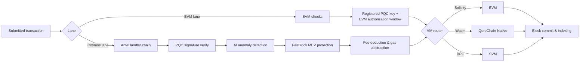

# アーキテクチャ概要

QoreChainは、チェーンノード、AIサイドカー、ブロックインデクサーという3つの主要プロセスで構成されたモジュール型ブロックチェーンノードであり、Postgresデータベースを裏側に持ち、PrometheusおよびGrafanaによって監視されています。メインネット（`qorechain-vladi`、EVMチェーンID **9801**）は2026年6月7日以降、リリース **v3.2.3** で高さ3,742,566まで、そのブロックからは **v3.2.4** で稼働しており、並行してテストネット（`qorechain-diana`、EVMチェーンID **9800**、2026年10月19日からv3.2.4を実行）も運用されています。チェーンはCosmos SDK v0.53上に構築されています。以下の図はコンポーネントの高レベルな配置を示しています。

以下のトランザクションライフサイクルは、送信されたトランザクションがAnteHandlerデコレータチェーン（セキュリティおよび手数料チェック）からVM実行、オンチェーンでの確定に至るまで、ノードをどのように流れていくかを要約したものです。



```
┌────────────────────────────────────────────────────────────────────────────┐
│                            QoreChain Node                                  │
│                                                                            │
│  ┌──────────────────── Virtual Machines ──────────────────────┐           │
│  │  ┌───────┐    ┌──────────┐    ┌───────┐                   │           │
│  │  │  EVM  │    │QoreChain │    │  SVM  │                   │           │
│  │  │(Sol.) │◄──►│ Native   │◄──►│ (BPF) │                   │           │
│  │  └───┬───┘    └────┬─────┘    └───┬───┘                   │           │
│  │      └─────────┬───┘──────────────┘                       │           │
│  │           x/crossvm (bridge)                               │           │
│  └────────────────────────────────────────────────────────────┘           │
│                                                                            │
│  ┌────────────────────── Tokenomics ─────────────────────────┐           │
│  │  ┌──────┐   ┌───────┐   ┌───────────┐                    │           │
│  │  │x/burn│   │x/xqore│   │x/inflation│                    │           │
│  │  │12 src│   │lock/  │   │capped     │                    │           │
│  │  │37/30/│   │unlock │   │emission   │                    │           │
│  │  │20/10/│   │PvP    │   │emission   │                    │           │
│  │  │3     │   │       │   │590M cap   │                    │           │
│  │  └──────┘   └───────┘   └───────────┘                    │           │
│  └────────────────────────────────────────────────────────────┘           │
│                                                                            │
│  ┌──────────── IBC / Bridges ────────────────────────────────┐           │
│  │  ┌──────────┐  ┌──────────┐  ┌───────────┐  ┌──────────┐ │           │
│  │  │x/bridge  │  │x/babylon │  │x/abstract │  │x/gas     │ │           │
│  │  │37 QCB    │  │BTC re-   │  │ account   │  │abstract. │ │           │
│  │  │configs   │  │staking   │  │session key│  │multi-tok │ │           │
│  │  └────┬─────┘  └────┬─────┘  └───────────┘  └──────────┘ │           │
│  │  QCB Bridge     Babylon IBC   ERC-4337-like   ibc/USDC    │           │
│  │  PQC-signed     BTC finality  social recov.   ibc/ATOM    │           │
│  │  36 ext chains  checkpoint    spending rules  fee convert  │           │
│  │  ┌──────────┐                                              │           │
│  │  │x/fair    │  Lane config (not enforced): PQC|MEV|AI|... │           │
│  │  │ block    │  tIBE encrypted mempool framework           │           │
│  │  └──────────┘                                              │           │
│  └────────────────────────────────────────────────────────────┘           │
│                                                                            │
│  ┌──── Rollup Development Kit ───────────────────────────────┐           │
│  │  ┌──────────┐  ┌──────────┐  ┌───────────┐  ┌──────────┐ │           │
│  │  │ x/rdk    │  │Settlement│  │ DA Router │  │ Profiles │ │           │
│  │  │ 4 modes: │  │Optimistic│  │ Native    │  │ defi     │ │           │
│  │  │ opt/zk/  │  │ZK/Based/ │  │ Celestia* │  │ gaming   │ │           │
│  │  │ based/   │  │Sovereign │  │ Both      │  │ nft      │ │           │
│  │  │ sovereign│  │          │  │           │  │ social/  │ │           │
│  │  │          │  │          │  │           │  │ general  │ │           │
│  │  └────┬─────┘  └────┬─────┘  └───────────┘  └──────────┘ │           │
│  │  Bank escrow    Auto-finalize  SHAKE-256 commit AI-assisted │           │
│  │  Burn on create EndBlocker     Blob pruning    PRISM sugg. │           │
│  │  → x/multilayer (RegisterSidechain + AnchorState)          │           │
│  └────────────────────────────────────────────────────────────┘           │
│                                                                            │
│  ┌──────────────┐ ┌──────┐ ┌────────────┐ ┌─────┐                       │
│  │x/rlconsensus │ │ x/ai │ │x/reputation│ │x/qca│                       │
│  │  PRISM (RL)  │ │      │ │            │ │     │                       │
│  └──────┬───────┘ └──┬───┘ └────┬──────┘ └──┬──┘                       │
│   PPO MLP         AI Engine   Scoring    CPoS Pools                      │
│   Obs/Action      Fraud Det.  Decay      Bonding                         │
│   Circuit Brk     Fee Opt.    Sigmoid    Slashing                        │
│   Rollup Adv.     TEE/FL                 QDRW Gov                        │
│                                                                            │
│  ┌──────┐ ┌──────────┐                                                   │
│  │x/pqc │ │ x/multi  │                                                   │
│  └──┬───┘ └────┬─────┘                                                   │
│  Dilithium    Layer Router                                                │
│  ML-KEM       Sidechains                                                  │
│  Hybrid Sig   + Rollups                                                   │
│  SHAKE-256                                                                │
│                                                                            │
│  ┌──────┐ ┌───────┐                                                      │
│  │x/svm │ │x/cross│                                                      │
│  └──┬───┘ └───┬───┘                                                      │
│  BPF Exec   CrossVM Msg                                                   │
└────────┬──────┬───────────────────────────────────────┬───────────────────┘
         │      │                                       │
   ┌─────┴─────┐│                              ┌───────┴──────┐
   │libqorepqc ││                              │  Indexer     │
   │(Rust PQC) ││                              │  (Postgres)  │
   └───────────┘│                              └──────────────┘
   ┌───────────┐│  ┌──────────┐
   │libqoresvm ││  │AI Sidecar│
   │(Rust BPF) │└──│ (gRPC)   │
   └───────────┘   └──────────┘
```

## ノードコンポーネント

QoreChainは、それぞれ独自のGoモジュールとバイナリを持つ、3つの協調動作するプロセスとして実行されます。

| コンポーネント          | 説明                                                                                                                                                                                                                                                                                                          | 場所                  |
| ------------------ | ---------------------------------------------------------------------------------------------------------------------------------------------------------------------------------------------------------------------------------------------------------------------------------------------------- | ------------------------- |
| **qorechain-node** | コアとなるブロックチェーンノード。QoreChain Consensus Engineを実行し、すべてのカスタムモジュールを実行し、3つすべてのVMランタイムを管理し、RPC、REST、gRPC、JSON-RPCの各エンドポイントを公開します。                                                                                                                      | `qorechain-core/`         |
| **ai-sidecar**     | QCAI Backendを背後に持つ、高度なAI推論機能を提供するgRPCサービス。このサイドカーは、オンチェーンのRLエージェントの守備範囲を超える推論リクエスト（自然言語解析や複雑なパターン認識など）を処理します。ノードとはポート50051上のgRPCで通信します。 | `qorechain-core/sidecar/` |
| **block-indexer**  | ノードのRPCエンドポイントから新しいブロックとトランザクションを購読するWebSocketリスナー。イベントを解析し、エクスプローラーやAPIによる高速なクエリのために構造化データをPostgresデータベースへ書き込みます。                                                                                                          | `qorechain-core/indexer/` |

## ポート

| ポート  | プロトコル       | サービス                                                                           |
| ----- | -------------- | --------------------------------------------------------------------------------- |
| 26657 | HTTP/WebSocket | QoreChain Consensus Engine RPC（ブロック、トランザクション、コンセンサス状態）            |
| 1317  | HTTP           | REST API（クエリエンドポイント、トランザクションのブロードキャスト）                                 |
| 9090  | gRPC           | gRPCクエリおよびトランザクションエンドポイント                                              |
| 8545  | HTTP           | EVM JSON-RPC（`eth_`、`web3_`、`net_`、`txpool_` の各名前空間）              |
| 8546  | WebSocket      | EVM JSON-RPC（WebSocketサブスクリプション）                                            |
| 8899  | HTTP           | SVM JSON-RPC（Solana互換：`getAccountInfo`、`getBalance`、`getSlot` など） |
| 50051 | gRPC           | AIサイドカー（ノードからの推論リクエスト）                                     |
| 5432  | TCP            | Postgres（ブロックインデクサーのストレージ）                                                |
| 26660 | HTTP           | ノードのPrometheusメトリクスエンドポイント                                                  |
| 9091  | HTTP           | Prometheusサーバー（Docker Composeスタックにおけるホストポート）                                                                |
| 3001  | HTTP           | Grafanaダッシュボード（Docker Composeスタックにおけるホストポート。コンテナポートは3000）                                                                |

## モジュールマップ

QoreChainは **48のジェネシスモジュール（うち20がQoreChain固有）** を機能別にグループ化して登録しています。

**セキュリティ**

* `x/pqc` — ポスト量子暗号：Dilithium-5、ML-KEM-1024、secp256k1（ECDSA）+ ML-DSA-87のハイブリッド、SHAKE-256、アルゴリズムアジリティ

**AIと機械学習**

* `x/ai` — トランザクションルーティング、異常検知、不正検知、手数料最適化、TEEアテステーション、連合学習
* `x/reputation` — 時間的減衰を伴う多要素バリデータレピュテーションスコアリング
* `x/rlconsensus` — オンチェーンRLエージェント（PPO MLP）、コンセンサスチューニングの設計、サーキットブレーカー、ロールアップアドバイザリ — PRISM最適化レイヤー（稼働中のネットワークでは観測のみ：ポリシーはロードされていません）

**コンセンサス**

* `x/qca` — トリプルプール複合PoS（RPoS/DPoS/PoS）の設計、カスタムボンディングカーブ、段階的スラッシング、QDRWガバナンス — 実装済みですが、ブロック生成、報酬、スラッシング、ガバナンスの集計にはまだ接続されていません

**仮想マシン**

* `x/vm` — VMルーティングとライフサイクル管理
* `x/svm` — SVMランタイム：BPFのデプロイ/実行、レント徴収、Solana互換RPC
* `x/crossvm` — クロスVM通信：EVM-QoreChain Nativeプリコンパイル + SVM非同期イベント

**トークノミクスと流動性**

* `x/burn` — 12のバーンソース(v3.2.4からは13)、EndBlockerでの手数料分配（37/30/20/10/3の配分）
* `x/xqore` — ガバナンスブーストステーキングの設計：ロック/アンロック、段階的な出口ペナルティ、PvPリベース（会計処理のみ。ロックおよびアンロックのトランザクションは、稼働中のネットワークではまだ接続されていません）
* `x/inflation` — 上限付き発行：厳格な累積上限（590,000,000 QOR）に達するまで、エポックごとに固定量をミントします
* `x/amm` — オンチェーン流動性 / 自動マーケットメーカー

**ブリッジと相互運用性**

* `x/bridge` — あらゆる主要チェーンタイプにまたがる37のチェーン設定（外部チェーン36 + IBC経由のInjective）、PQC署名付きアテステーション、サーキットブレーカー（すべての設定は `pending` であり、稼働していません）
* `x/babylon` — Babylon ProtocolによるBTCリステーキング、エポックチェックポイント（設計段階。有効なトランザクションはありません）
* `x/multilayer` — サイドチェーン/ペイチェーン/ロールアップのレイヤー管理、状態アンカリング

**ガバナンスとライセンス拡張**

* `x/abstractaccount` — スマートアカウント：マルチシグ、ソーシャルリカバリー、セッションキー、支出ルール（両ネットワークで無効：`enabled = false`）
* `x/fairblock` — MEV保護：しきい値IBE暗号化メンプールフレームワーク（両ネットワークで無効）
* `x/gasabstraction` — マルチトークンガス支払いの設計：ibc/USDC、ibc/ATOMの手数料変換（IBCチャネルはまだ開かれていないため、手数料はQORで支払われます）
* `x/license` — チェーンライセンス

**ロールアップ**

* `x/rdk` — Rollup Development Kit：4つの決済モード（optimistic、zk、based、sovereign）、プリセットプロファイル、ネイティブDA、銀行エスクロー

## AnteHandlerチェーン

すべてのトランザクションは、実行前にデコレータチェーンを通過します。いずれのデコレータもトランザクションを拒否できます。チェーンは2つあります。

**Cosmosレーン**（順序どおり）：`RejectMessages`（このレーンでは `MsgEthereumTx` を許可しない）→ `AuthzLimiter`（authz内でEVMメッセージやベスティング作成メッセージを許可せず、v3.2.3以降はポスト量子鍵管理メッセージも許可しない）→ `SetUpContext` → メンプールおよびマルチシグ深度のガード → QoreChain Nativeのシミュレーションガス、トランザクションカウンター、ガスレジスター、コントラクトの各デコレータ → `CircuitBreaker` → 拡張オプションのチェック → `ValidateBasic` → `TxTimeout` → `Memo` → バリデータライセンスのゲート（`MsgCreateValidator`）→ `PQCVerify` → `PQCHybridVerify` → `PQCReplayGuard` → `AIAnomaly`（送信者ごとのレート制限を含む）→ `FairBlock` → `SVMComputeBudget` → `SVMDeductFee` → `MinGasPrice` → `ConsumeTxSize` → `GasAbstraction` → `DeductFee` → `SetPubKey` → `ValidateSigCount` → `SigGasConsume` → `SigVerify` → `IncrementSequence` → バーントランザクションカウンター → IBC冗長リレーのチェック → 要求ガスの追跡。

**EVMレーン**（Ethereum拡張オプションを持つトランザクション）：`CircuitBreaker` → EVMモノデコレータ（署名、ノンス、手数料、残高のチェック）→ `EVMWindowDecorator`（登録済みのポスト量子鍵と有効な認可ウィンドウ。[EVM authorisation window](/getting-started/first-transaction#evm-window) を参照）。

Cosmosレーンの主要なデコレータ：

1. **PQCVerify** — モジュール `x/pqc`。PQCフラグ付きトランザクションのDilithium-5署名を検証します。
2. **PQCHybridVerify** — モジュール `x/pqc`。secp256k1（ECDSA）+ ML-DSA-87のデュアルハイブリッド署名を検証します。
3. **AIAnomaly** — モジュール `x/ai`。分離フォレストによる異常検知とリスクスコアリングを実行し、送信者ごとのトランザクション上限を適用します。
4. **FairBlock** — モジュール `x/fairblock`。MEV保護のためtIBE暗号化トランザクションを処理します（稼働中のネットワークでは無効）。
5. **SVMComputeBudget** — モジュール `x/svm`。SVMプログラム向けの計算ユニットを検証・割り当てます。
6. **SVMDeductFee** — モジュール `x/svm`。SVM固有の実行手数料を控除します。
7. **GasAbstraction** — モジュール `x/gasabstraction`。控除前に非ネイティブ手数料トークンを変換します（現在、手数料はQORで支払われます）。

## Docker Composeスタック

フル開発スタックは、共有ブリッジネットワーク（`qorechain-net`）上で6つのサービスからなるDocker Composeデプロイメントとして動作します。

| サービス          | イメージ                      | 用途                                             |
| ---------------- | -------------------------- | --------------------------------------------------- |
| `qorechain-node` | `qorechain-core:latest`（Dockerfileからローカルでビルド。公開されたノードイメージはありません） | すべてのモジュール、VM、RPCエンドポイントを備えたチェーンノード |
| `ai-sidecar`     | `ghcr.io/qorechain/ai-sidecar:latest` | AI推論サービス（gRPC + QCAI Backend）          |
| `block-indexer`  | `ghcr.io/qorechain/block-indexer:latest` | ブロック/トランザクションインデクサー（WebSocket + Postgres）    |
| `postgres`       | `postgres:16-alpine`       | ブロックインデクサー用データベース                      |
| `prometheus`     | `prom/prometheus:v3.10.0`  | メトリクスの収集と保存                                 |
| `grafana`        | `grafana/grafana:12.4.1`   | 監視ダッシュボードとアラート                            |

フルスタックを起動します。

```bash
docker compose up -d
```

初回起動の前に、`.env.example` を `.env` に、`.env.sidecar.example` を `.env.sidecar` にコピーし、`GRAFANA_PASSWORD` を設定してください（設定がないとComposeは起動を拒否します）。

すべての永続データは、名前付きDockerボリューム `node-data`、`postgres-data`、`prometheus-data`、`grafana-data` に保存されます。

## 関連ドキュメント

* [Multilayer Architecture](/architecture/multilayer-architecture) — サイドチェーンの登録と状態アンカリング
* [Consensus Mechanism](/architecture/consensus-mechanism) — ブロック生成、ファイナリティ、スラッシング
* [PRISM Consensus Engine](/architecture/prism-consensus-engine) — AI駆動のパラメータ最適化
* [Post-Quantum Security](/architecture/post-quantum-security) — スタック全体にわたるDilithium-5署名
