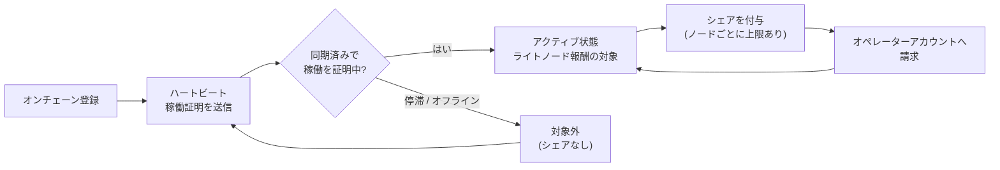

# 報酬とモニタリング

登録済みのライトノードには、ライトノード割り当ての一部が付与されますが、その対象資格を維持し続けるには**健全な状態を保つ**必要があります。このページでは、ライトノード報酬シェア3%、報酬の付与と請求の仕組み、ノードが委任に対して行うこと・行わないこと、そしてノードのモニタリング方法について説明します。

:::note 報酬プログラムへの登録はまだ開始されていません
登録には`lightnode_operator`ライセンスが必要ですが、まだ1件も付与されていないため、どちらのネットワークにも登録済みのライトノードはありません。ここで説明している報酬の計上はオンチェーンで稼働していますが、現時点でノードへの支払いは行われておらず、このページの内容はいかなる収益の約束でもありません。[報酬プログラムの状況](/light-node/overview#reward-program-status)を参照してください。
:::

## ブロック報酬シェア3%

QoreChainの手数料分配は、ネットワークデータを提供するライトノードのために固定の**3%シェア**を確保しています。これはプロトコルの報酬配分における5つの分配先の1つで — バリデータ(37%)、バーン(30%)、トレジャリー(20%)、ステーカー(10%)、そして**ライトノード(3%)** — オンチェーンで強制されています。全体の内訳については[Tokenomics](/architecture/tokenomics)を参照してください。

このシェアに参加するには、自己申告ではなくオンチェーンで確認される次の条件が必要です。有効な`lightnode_operator`ライセンス(登録時に確認されます)、最低**1,000 QORのボンド**(これは委任先の全バリデータにわたる合計であり、バリデータごとではありません。登録時に必須で、報酬が付与されるたびにステーキングから再度読み取られます)、そして登録時に一度だけ支払う**1 QOR**の登録手数料です。参加はネットワーク全体で**10,000ライトノード**が上限となっています。登録の仕組みについては[Registration and Licensing](/light-node/registration-and-licensing)を、登録受付が開始されているかどうかについては[報酬プログラムの状況](/light-node/overview#reward-program-status)を参照してください。

3%とは、ライトノードモジュールに流れ込む分を指すものであり、ノードごとの受給権ではありません。対象となる各ノードには、蓄積された分のうちステーク加重のシェアが付与され、ノードごとに`max_reward_per_block_per_node`(現在は1ブロックあたり`1713` uqor、稼働率に応じてスケール)で上限が設けられます。獲得されなかった分は、ガバナンス投票でのみ解放できるリザーブに入ります。[ライトノード報酬シェア3%](/light-node/overview#the-3-light-node-reward-share)を参照してください。

登録と委任が済んだら、対象資格を維持するにはノードを稼働させ続けるだけです。ノードは最低**80%の稼働率**を維持し、**1,000ブロック間隔**(平均ブロック時間を約3.2秒と実測した場合、メインネットで約54分。ほぼ1秒に1ブロックを生成するテストネットでは約17分)でハートビート稼働証明を送信し続ける必要があります。

**タイミングのルール。** チェーンは、**前回のハートビートから1,000ブロック未満**で送信されたハートビートを拒否します(`heartbeat submitted too early`)。登録後の最初のハートビートには、このような下限はありません。前回のハートビート(まだ送信していない場合は登録)から**1,000 + 100ブロック**(`heartbeat_interval`と`heartbeat_grace_period`の合計。メインネットでは約54分に、約5分の猶予を加えた時間)以内にハートビートが届かない場合、ノードは非アクティブとマークされ、報酬の付与が停止します。それ以降に送信されたハートビートも受理され、ノードは再アクティブ化されます。デーモンは、チェーン自身が記録しているノードの`last_heartbeat`から1,000ブロックが経過した時点で次のハートビートを送信し、60秒ごとに確認します。

**ウィンドウを逃しても失うのは稼働率であって、登録ではありません。** ウィンドウを逃したノードは非アクティブとマークされ、報酬の獲得を停止しますが、次に成功したハートビートで即座に再アクティブ化されます — 再登録は不要です。**稼働率**は、登録したブロック以降の、受信したハートビート数と期待されるハートビート数(1,000ブロックにつき1回)の累積比率であり、上限は1です。`min_uptime_for_rewards`のしきい値(`0.80`)を下回るノードは何も獲得できません。しきい値以上では、ノードごとの上限が稼働率に応じてスケールします。したがって長時間の停止は比率を下げ、その比率は期限内のハートビートが積み重なることでのみ回復します。ノードが非アクティブと表示される場合は`status`を確認してください。署名者、ライセンス、登録の状態が報告されます。

:::note ハートビートが実際に証明していること
成功したハートビートが証明するのは、オペレーターのキーが時間内に署名したという事実だけであり、ノードがソフトウェア全体を継続的に実行していることを証明するものではありません。これは稼働の署名であり、「アクティブなノードとして検証済み」という意味ではないと捉えてください。
:::

:::note `last_heartbeat`はタイムスタンプではなくブロック高です
ノードのオンチェーン記録を直接クエリすると、`last_heartbeat`はブロック高であり、値が`0`の場合はまだハートビートが記録されていないことを意味します — この場合チェーンは、ノードの`registered_at`の高さから非アクティブの期限を計測します。`0`を単純な経過時間の計算として読み取ると、登録したばかりのノードが数百万ブロックも遅延しているように見えてしまいます。
:::

*報酬対象資格: 有効なオンチェーンライセンスと最低ボンドステーク量を保持し、登録した上で、稼働率とハートビート間隔のしきい値を上回るよう、ハートビートによる稼働証明を継続してください。*



## 報酬の仕組み {#how-rewards-work}

### 付与

100ブロックごとに、チェーンは対象となる各ノード(アクティブで、最低ボンドステーク量と最低稼働率を満たすもの)に、蓄積された分のシェアを付与します。上限はノードごとに[ライトノード報酬シェア3%](/light-node/overview#the-3-light-node-reward-share)で説明されているとおりです。この額はノードの`accumulated_rewards`に加算されます。次のコマンドで確認できます。

```bash
curl -s https://api.qore.host/qorechain/lightnode/v1/rewards/<operator-address>
# or: qorechaind query lightnode rewards <operator-address>
```

(テストネットには`https://api-testnet.qore.host`を使用してください。)

### 請求

付与された報酬は、請求するまでノードの記録上に残ります。請求には、登録時と同じ「生成してから共同署名」の組み合わせを使用します。

```bash
qorechaind tx lightnode claim-rewards --from operator --chain-id <chain-id> --gas 300000 --fees 30000uqor --generate-only > claim.json
qorechaind tx pqc cosign claim.json --from operator --pqc-key <node-key-name> --chain-id <chain-id>
```

あるいは、`[delegation]`の下で`auto_claim = true`を設定します。するとデーモンは、蓄積されたライトノード報酬が`min_reward_claim`(デフォルトは`1000000` uqor、つまり1 QOR)を超えた時点で、署名者を通じてオペレーターアカウントへ請求します。確認は`compound_interval`(デフォルトは`1h`)ごとに行われます。自動請求は**デフォルトでオフ**であり、請求のみを行います。ノードが再委任したりステークを移動したりすることはありません。`qorechaind tx lightnode deregister`は登録を解除し、まだ付与されたままの分を支払います。登録手数料は返金されません。

### 委任の追跡とレピュテーションアラート

ノードは5分ごとに、オペレーターアカウントの委任をチェーンから反映します。`rebalance_enabled`が有効(デフォルト)の場合、委任先の各バリデータのレピュテーションスコアも確認し、`min_reputation`(デフォルトは`0.5`)を下回るものについて警告をログに記録します。ステークは移動しません。委任の変更はご自身のウォレットから行ってください。(`[delegation]`の`validators`と`split_weights`オプションは受け付けられますが、現在は動作に反映されません。)

### 報酬と委任の確認

```bash
lightnode-sx validators   # the bonded validator set
```

:::caution v3.1.3 / v3.1.4 の既知の制限
`lightnode-sx delegation`、`lightnode-sx rewards`、およびUXの**Delegation**ビューは、ノードキーから導出されるアドレスを参照します。耐量子ノードキーにはアドレスがないため、現時点ではこれらは何も表示しません(`rewards`は`chain REST endpoint not available`を報告します)。代わりにチェーンのクエリを使用してください。

```bash
curl -s https://api.qore.host/cosmos/staking/v1beta1/delegations/<operator-address>
curl -s https://api.qore.host/cosmos/distribution/v1beta1/delegators/<operator-address>/rewards
curl -s https://api.qore.host/qorechain/lightnode/v1/rewards/<operator-address>
```
:::

## モニタリング

ノードを健全な状態に保つことが、報酬の対象資格を維持することにつながります。監視すべきものは3つあります。

### テレメトリ

リアルタイムテレメトリは、バリデータ、コンセンサス/ネットワーク、ブリッジ、トークノミクスをカバーし、それぞれが独自の間隔(`config.toml`の`[telemetry]`配下で設定)で更新されます。CLIからは次のように確認できます。

```bash
lightnode-sx status    # node and light-client sync status
lightnode-sx network   # recent synced headers and latest height
```

UXエディションは、**Overview**、**Network**、**Bridge**、**Tokenomics**の各ビューで同じデータをライブで表示します — [UX Edition](/light-node/ux-edition)を参照してください。

### 同期とハートビートの健全性

`status`コマンドは、チェーンID、最新のブロック高、チェーンがキャッチアップ中かどうか、ライトクライアントの同期済み高さと同期状態、そして — `operator_address`が設定されている場合は — `Signer`、`Licence`、`Registration`の状態(ノードのステータスと最後のハートビートの高さを含む)を報告します。登録済みで、同期しており、稼働しているノードは**ハートビート稼働証明**の送信を継続し、報酬の対象資格を維持します。これらのハートビートは**PQC共同署名トランザクションパイプライン**(ハイブリッドDilithium-5 / ML-DSA-87)を通じて生成され、チェーンのPQC必須のデフォルト方針と整合しています — パイプラインの仕組みとオンチェーンハートビートの有効化方法については[Registration and Licensing](/light-node/registration-and-licensing#pqc-cosigned-heartbeat-pipeline)を参照してください。`status`がノードの停滞や未同期を示している場合、稼働証明に失敗している可能性があります — 対象資格に影響が及ぶ前に調査してください。

### セルフテストの健全性

暗号スタックに問題があると疑われる場合は、いつでもPQCセルフテストを実行できます。

```bash
lightnode-sx selftest
```

これはkeygen → sign → verify → 改ざん検出(5つのチェック)を実行し、いずれかが失敗すると非ゼロで終了します。ノードの問題を診断する際、耐量子署名スタックの問題を除外する最も速い方法です。セルフテストの詳細な内訳については[SX Edition](/light-node/sx-edition)を参照してください。

### チェーンクエリ {#chain-queries}

ベースURL: `https://api.qore.host`(メインネット)および `https://api-testnet.qore.host`(テストネット)。

| クエリ | 返される内容 |
| --- | --- |
| `GET /qorechain/lightnode/v1/params` | 登録手数料、ハートビート間隔と猶予、最低委任ステーク量、報酬シェア、最低稼働率、ノード数の上限。 |
| `GET /qorechain/lightnode/v1/stats` | 登録済みおよびアクティブなノード数、付与された報酬の合計。 |
| `GET /qorechain/lightnode/v1/node/{address}` | 1つのノードの記録(`status`、`last_heartbeat`、`total_heartbeats`、`expected_heartbeats`、`accumulated_rewards`)。 |
| `GET /qorechain/lightnode/v1/rewards/{address}` | 付与済みで未請求の報酬。 |
| `GET /qorechain/lightnode/v1/reward_pool` | モジュール残高が、リザーブ、付与済み報酬、次回の支払いにどう分割されているか。ノードごとの上限も含みます。 |
| `GET /qorechain/license/v1/check/{address}/lightnode_operator` | アドレスが有効なライセンスを保有しているかどうか。 |

## 次に読むべきページ

- [Registration and Licensing](/light-node/registration-and-licensing) — 登録を済ませ、稼働し続ける方法。
- [Tokenomics](/architecture/tokenomics) — 報酬とバーンの全体モデル。
