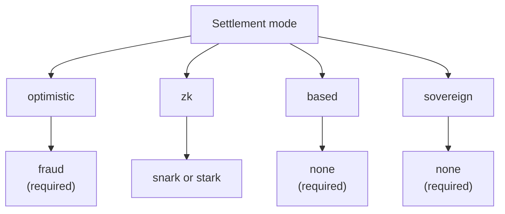

# ロールアップ概要

QoreChain の **Rollup Development Kit (RDK)** は、クライアントライブラリ（TypeScript、Python、Go、Rust、Java）、オペレーター向けコマンドラインツール、スターターテンプレートからなるセットで、オンチェーンの `x/rdk` モジュールを通じて QoreChain 上で決済されるアプリケーション固有のロールアップを構築するためのものです。これを使うと、ロールアップの設定、トランザクションの構築と署名、状態の読み取り、チャレンジウィンドウの追跡、決済レシートの発行と検証、クロス VM 呼び出しと出金証明の組み立てができます。各ロールアップは独自のブロックタイム、仮想マシン、手数料モデル、シーケンシングを持つ独立した実行環境でありながら、QoreChain のセキュリティ、ポスト量子暗号、データ可用性を継承します。このページは、ロールアップを起動または運用したい開発者、そして RDK が自分のアプリケーションに合うかどうかを検討している方向けです。

:::caution 初期段階の機能
RDK は両方のネットワークにデプロイされていますが、**どちらのネットワークでもまだロールアップは作成されていない**ため（2026年10月27日に確認）、このセクションで説明するフローは第三者によってまだ検証されていません。**ZK 決済（`defi` プロファイル、`defi-rollup` テンプレート、すべての `zk` ロールアップ）は、どちらのネットワークでもまだ使用できません。** チェーンには検証鍵を登録する手段がないため、すべての ZK バッチは手数料が支払われた後に拒否されます。鍵の登録はチェーン v3.2.7 で予定されています。それまでは `optimistic` 決済を使用してください。

メインネット（**`qorechain-vladi`**、EVM チェーン ID **9801**、2026年6月7日から稼働）は、チェーンバージョン **v3.2.4**（2026年10月23日に高さ 3,742,566 で適用、ガバナンス提案 13）で稼働しています。テストネット（**`qorechain-diana`**、EVM チェーン ID **9800**）は **v3.2.6** で稼働しています（v3.2.4 は 2026年10月19日、v3.2.5 は 10月26日、v3.2.6 は 10月27日に到達）。メインネットのガバナンス提案 14 は高さ 3,906,833 で v3.2.5 を適用するもので、本稿執筆時点では投票期間中でした。v3.2.5 がロールアップに与える変更は、テストネットは現在、メインネットはアップグレード後と明記して、[チェーン v3.2.5 の挙動](#v325)にまとめています。v3.2.3 と v3.2.4 の間で挙動が変わった箇所では、このセクションでどちらのリリースが適用されるかを示します。すべてのデプロイはまずテストネットで検証し、各ページのステータスに関する注記を読んでください。いくつかの機能（ZK 検証、Celestia データ可用性、QCAI Copilot、クロス VM 呼び出し、決済レシート）は、現時点ではエンドツーエンドで利用できません。
:::

## 革新点 {#innovations}

* **ポスト量子決済レシート。** バッチの状態アンカーは、ロールアップ作成者の登録済み鍵によって ML-DSA-87 で署名されます。`verifySettlementReceipt` は、レシートのすべてのフィールド（ロールアップ、レイヤー、バッチルート、そしてアンカー: 状態ルート、レイヤーの高さ、メインチェーンの高さ、アンカー時刻、バリデータセットのハッシュ、トランザクション数、証明、署名）をチェーンから読み直します。検証鍵はチェーンから取得され、レシートからは決して取得されません。レシートは、クエリするネットワークを指定していなければなりません。未知のレシートバージョンや ML-DSA-87 以外のアルゴリズムは、読み取りの前に拒否されます。署名のみのチェックが有効と報告されることはありません。アンカーのメッセージには、チェーン v3.2.2 の高さより下で使われる第一の形式と、それ以降で使われる（チェーン ID も束縛する）第二の形式があり、どちらを使うかはアンカーの高さによって決まります。[決済レシート](/rollups/settlement-receipts)を参照してください。
* **2 種類の鍵導出によるハイブリッド署名。** トランザクションは secp256k1 と ML-DSA-87 で署名されます。ポスト量子鍵は、ニーモニックから正規の方法（`qorechain:pqc:v1|`、アドレス、ニーモニックに対する SHAKE-256）とレガシーな方法の両方で導出され、クライアントはチェーンがそのアカウントに登録している鍵を使用します。現時点でハイブリッド署名を行うのは TypeScript クライアントだけです。
* **正規のトランジションルート。** `batchTransitionRoot` は、チェーンがオプティミスティックバッチを判定する際の正確な状態ルートを計算します（メインネットが現在適用している形式は、前の状態ルート、データハッシュ、トランザクション数に対する SHAKE-256 コミットメントです。`transitionRootVersionFor` は接続先ネットワークが適用する形式を選択します）。`fraudProof` はそこから 64 バイトの証明を構築します。どちらも、チェーン自身のコードが生成したベクターに対してテストされています。
* **チェーンが構築するとおりに構築される出金証明。** `withdrawalsTree`（0.7.0、5 言語すべて）は、バッチの出金ルートとすべての証明をチェーンとまったく同じように構築します。リーフの位置は出金インデックスで、ノードは SHAKE-256 でハッシュされ、チェーン v3.2.5 のバッチはチェーン ID も含む第二の形式のリーフを使います。チェーン自身のコードが生成したベクターに対してテストされており、そのベクターのすべての証明がチェーンの検証器に受理されています。`qorollup withdraw` は、その結果がバッチのオンチェーンの `withdrawals_root` と一致しない場合、手数料を支払う前に拒否します。
* **チェーンと同一のチャレンジウィンドウ。** `batchChallengeWindow` は、チェーンと同じ方法でバッチのウィンドウを計算し（時間ベース: ブロックタイムが提出時刻にウィンドウを加えた値を下回る間は開いています。古いバッチでは、提出高さからのブロック数でウィンドウを 6 で割った値）、ローカルの時計ではなく RPC `/status` から読み取ったチェーンの先頭に対して判定します。[ウォッチタワー](/rollups/watchtower)とヘルスモニターがこれを使用します。0.7.0 以降、`getRollupHealth` は、チェーンの順序どおりのファイナリティ（現在テストネット、[チェーン v3.2.5 の挙動](#v325)を参照）がバッチを保留している場合に `heldBackBy` も報告し、`qorollup watchtower --canonical` は、チャレンジが成功するバッチを報告します。
* **手数料を支払う前のチェック。** キットは、`^[a-z0-9][a-z0-9._-]{2,63}$` に合致しないロールアップ ID、`uqor` 以外の出金、金額がゼロの出金、32 バイトの 64 階層を超える証明を持つ出金、無効な bech32 アドレスを指定する出金、空でも正確に 32 バイトでもない出金ルート、チェーンが拒否するロールアップの停止（現在テストネット）を拒否します。また、ロールアップを読み取れる場合は、データ可用性が `native` または `both` のロールアップでデータハッシュを指定するバッチも拒否します。これらはいずれも、そのままでは手数料が消費された後にチェーンによって拒否されます。
* **クロス VM のコールデータとライブチェック。** `encodeCrossVmCalldata` は `executeCrossVMCall(uint8,string,bytes)`（セレクタ `0x3c11078c`、プリコンパイル `0x...0901`）のコールデータを構築し、`isCrossVmPrecompileActive` はそのプリコンパイルがネットワーク上で有効かどうかを読み取ります。0.7.0 以降、`getCrossVmParams`、`crossVmTargetReady`、`decodeCrossVmResult`、`decodeRevertReason` が、チェーン v3.2.5 の許可リストと応答形式（現在テストネット）に対応します。[マルチ VM](/rollups/multi-vm)を参照してください。
* **5 つの言語に共通する 1 組のテストベクター。** TypeScript、Python、Go、Rust、Java のパッケージは、同じゴールデンフィクスチャに対してチェックされています（Go パッケージには 100 件、Rust には 77 件、Java には 75 件のユニットテストがあります）。

## 使い方 {#how-to-use}

読み取りには鍵も資金も不要です。以下のスニペットは、公開テストネット（`qorechain-diana`）の稼働中の `rdk` モジュールパラメータとロールアップ一覧を読み取るもので、2026年10月27日に公開済みパッケージから実行しました（現在のバージョンは 0.7.0 です。TypeScript のスニペットとコマンドラインは npm から 0.7.0 で再実行し、Python、Rust、Go、Java のスニペットは、開発者ハブに同じリリースで成功したと記録されています）。いずれもテストネットのパラメータ（ロールアップ最大数 200、最小ステーク 10,000 QOR、作成時バーン率 0.01、デフォルトのチャレンジウィンドウ 3,600 秒、DA ブロブの最大サイズ 2,097,152 バイト、ブロブ保持期間 432,000 ブロック、1 ブロックあたり最大 10 バッチ）と `0 rollups` を出力しました。

### TypeScript（検証済み）

```bash
npm install @qorechain/rdk
```

```ts
import { createRdkClient } from "@qorechain/rdk";

// Public testnet (chain id qorechain-diana).
const rdk = createRdkClient({
  network: "testnet",
  endpoints: { rest: "https://api-testnet.qore.host" },
});

// Read the live rdk module parameters and the registered rollups.
const params = await rdk.params();
const rollups = await rdk.rest.listRollups();
console.log(rdk.network.chainId, params, `${rollups.length} rollups`);
```

`mainnet` と `testnet` のプリセットには公開の `qore.host` エンドポイントがすでに組み込まれているため、`createRdkClient({ network: "testnet" })` は `endpoints` フィールドなしでも動作します。上記では、検証したスニペットがそれを渡していたため記載しています。Node 20 以降で実行してください（検証には Node 26 を使用しました）。

### Python（検証済み）

```bash
pip install qorechain-rdk
```

```python
from qorrdk import create_rdk_client

# Public testnet (chain id qorechain-diana).
rdk = create_rdk_client(network="testnet", endpoints={"rest": "https://api-testnet.qore.host"})

# Read the live rdk module parameters and the registered rollups.
params = rdk.params()
rollups = rdk.rest.list_rollups()
print(rdk.network.chain_id, params, f"{len(rollups)} rollups")
```

Python 3.10 以降。`qorechain-rdk` は `qorechain-pqc` に依存し、これが `liboqs-python` を取り込むため `liboqs` ライブラリが必要です。インストールされていないマシンでは、最初のインポート時にビルドされます（git、CMake、C コンパイラが必要です）。新規の仮想環境で Python 3.12 を使って検証しました。

### Go（検証済み）

```bash
go get github.com/qorechain/qorechain-rdk/packages/go@v0.7.0
```

```go
package main

import (
	"context"
	"fmt"

	rdk "github.com/qorechain/qorechain-rdk/packages/go"
)

func main() {
	// Public testnet (chain id qorechain-diana).
	client := rdk.NewRdkClient(rdk.RdkClientOptions{
		Network:   "testnet",
		Endpoints: &rdk.Endpoints{Rest: "https://api-testnet.qore.host"},
	})
	ctx := context.Background()
	// Read the live rdk module parameters and the registered rollups.
	params, err := client.Params(ctx)
	if err != nil {
		panic(err)
	}
	rollups, _ := client.Rest.ListRollups(ctx)
	fmt.Printf("%s %+v %d rollups\n", client.Network.ChainID, params, len(rollups))
}
```

Go 1.26 で検証し、モジュールは Go プロキシから取得しました。

### Rust（検証済み）

```bash
cargo add qorechain-rdk
```

```rust
use qorechain_rdk::client::{RdkClient, RdkClientOptions};

fn main() -> Result<(), Box<dyn std::error::Error>> {
    // Public testnet (chain id qorechain-diana).
    let rdk = RdkClient::new(RdkClientOptions {
        rest_url: Some("https://api-testnet.qore.host".into()),
        ..Default::default()
    });

    // Read the live rdk module parameters and the registered rollups.
    let params = rdk.params()?;
    let rollups = rdk.rest.list_rollups()?;
    println!("{} {:?} {} rollups", rdk.network.chain_id, params, rollups.len());
    Ok(())
}
```

ライブラリ名は `qorechain_rdk` です。Rust 1.95 で検証し、crates.io に対してビルドしました。

### Java（検証済み）

```kotlin
// build.gradle.kts
implementation("io.github.qorechain:qorechain-rdk:0.7.0")
```

```java
import io.github.qorechain.rdk.client.RdkClient;
import io.github.qorechain.rdk.client.Views.ParamsView;
import io.github.qorechain.rdk.config.Networks;

public class RdkQuickstart {
    public static void main(String[] args) {
        // Public testnet (chain id qorechain-diana).
        RdkClient.Options options = new RdkClient.Options();
        options.network = "testnet";
        options.endpoints = new Networks.Endpoints();
        options.endpoints.rest = "https://api-testnet.qore.host";
        RdkClient rdk = new RdkClient(options);

        // Read the live rdk module parameters and the registered rollups.
        ParamsView params = rdk.params();
        int rollups = rdk.rest.listRollups().size();
        System.out.println(rdk.network.chainId + " maxRollups=" + params.maxRollups
                + " minStakeForRollup=" + params.minStakeForRollup + " " + rollups + " rollups");
    }
}
```

JDK 17 以降。JDK 21 と、Maven Central から解決する Gradle 9.6 で検証しました。ファイル名は `RdkQuickstart.java` にする必要があります。Maven Central は 0.6.2 と 0.7.0 を提供しています（2026年10月27日に確認）。

### コマンドライン（検証済み）

```bash
npm install -g @qorechain/rdk-cli
qorollup --version
qorollup params --network testnet
```

`qorollup --version` は `0.7.0` を出力し、`qorollup params --network testnet` は稼働中のモジュールパラメータを出力します。**これは 0.6.2 から動作します。** 0.6.1 以前のリリースは、npm からインストールすると終了コード 0 で何も出力しませんでした。検証では、空のプロジェクトに `@qorechain/rdk-cli@0.7.0` をインストールし、`node_modules/.bin/qorollup` 経由で実行しました。グローバルインストールと `npx` も同じ bin リンクを使用します。Node 20 以降が必要です。

### プロジェクトのスキャフォールド（検証済み）

```bash
npx create-qorechain-rollup my-rollup --template nft-rollup --network testnet --yes
cd my-rollup && npm run doctor
```

テンプレートは `defi-rollup`、`gaming-rollup`、`nft-rollup`、`enterprise-rollup`、`custom-rollup`、`multivm-rollup` です。スキャフォールドされたプロジェクトは `@qorechain/rdk` `^0.7.0` に依存します。0.6.1 のスキャフォルダーで `nft-rollup` をスキャフォールドして生成されたプロジェクトの `npm run doctor` は、テストネットに対して成功しました（REST に到達可能、パラメータを読み取り可能、ネットワークは `qorechain-diana`。Celestia データ可用性と署名者の欠如について警告が出ます）。`defi-rollup` をスキャフォールドして `npm run typecheck` を実行した場合も、2026年10月27日に現行リリースで再び成功しました。**まだ `defi-rollup` を使ってロールアップを起動しないでください**（[制限](#limits)を参照）。ロールアップを作成してバッチを提出するには、[ロールアップのデプロイ](/rollups/deploying-a-rollup)に従ってください。トランザクションには登録済みのポスト量子鍵が必要で、RDK では TypeScript クライアントに `pqcKeypair` を渡す必要があります。

## アクセス方法 {#how-to-access}

**ネットワークとエンドポイント。** RDK は 2 つのネットワークの公開エンドポイントと通信します。`mainnet` と `testnet` のプリセットにはそれらがすでに組み込まれています。

| ネットワーク | チェーン ID | EVM チェーン ID | REST エンドポイント | チェーンバージョン |
| ------- | -------- | ------------ | ------------- | ------------- |
| メインネット | `qorechain-vladi` | 9801 | `https://api.qore.host` | v3.2.4 |
| テストネット | `qorechain-diana` | 9800 | `https://api-testnet.qore.host` | v3.2.6 |

どちらのネットワークも RDK クエリ（`/qorechain/rdk/v1/...`）を REST、gRPC、CLI で提供しているため、`rdk.params()` のような読み取りはどちらに対しても機能します。テストネットは独自のパラメータを持つステージングネットワークです。デフォルトのチャレンジウィンドウはテストネットで 3,600 秒、メインネットで 604,800 秒、存在できるロールアップはテストネットで最大 200、メインネットで 100、マルチレイヤーモジュールが許可するサイドチェーンレイヤーはテストネットで 64、メインネットで 10 です（2026年10月27日に確認）。対象とするネットワークの `GET /qorechain/rdk/v1/params` を読み取ってください。

**ロールアップを作成するための前提条件。**

| 要件 | 詳細 |
| ----------- | ------- |
| **資金のあるアカウント** | ステーク、レイヤーステーク、手数料に十分な QOR を持つアカウント。 |
| **エスクローされるステーク** | ロールアップの作成により、`min_stake_for_rollup`、つまり両ネットワークで **10,000 QOR** がエスクローされます。作成時に**ステークの 1 %（100 QOR）がバーンされ**、残りはエスクローに留まり、ロールアップが停止されたときに返還されます。 |
| **レイヤーステーク** | 作成時には、ロールアップのレイヤーもマルチレイヤーモジュールに登録されます（最小ステーク 1,000 QOR）。レイヤーを登録できない場合でもロールアップは作成されますが、実際のレイヤーを持たないため、そのバッチはアンカーできず、レシートも発行できません。 |
| **登録済みのポスト量子鍵** | アカウントに登録された ML-DSA-87 鍵。従来型の鍵のみで署名されたネイティブレーンのトランザクションは拒否されます。 |
| **手数料** | 手数料の下限はガス 1 単位あたり 0.1 uqor です。ガスリミットと手数料は一緒に設定してください。 |
| **ツール** | CLI とスキャフォールダーには Node 20 以降。Python クライアントには Python 3.10 以降（`liboqs` 付き、上記参照）。Java には JDK 17 以降。Go モジュールは `github.com/qorechain/qorechain-rdk/packages/go`。 |

状態の読み取りには、これらは一切不要です。ダッシュボードからロールアップをリクエストする（リクエストフォームであり、オンチェーントランザクションではありません）か、チェーン CLI で作成することもできます。完全なフロー、CLI コマンド、TypeScript の署名パスについては[ロールアップのデプロイ](/rollups/deploying-a-rollup)を参照してください。

### チェーン v3.2.5 の挙動: テストネットは現在、メインネットはアップグレード後 {#v325}

テストネットはチェーン v3.2.6 で稼働しており、これには v3.2.5 が含まれます。**メインネットは、ガバナンス提案 14 が v3.2.5 を適用するまで v3.2.4 で稼働します**（2026年10月29日前後の見込み）。RDK 0.7.0 は両方に対応しています。ロールアップ開発者が遭遇する違いは次のとおりです。

| 挙動 | テストネット（v3.2.6） | メインネット（v3.2.4、アップグレードまで） |
| --------- | ---------------- | ----------------------------------- |
| チャレンジを解決できる主体 | 任意のアカウント | ロールアップの作成者のみ |
| 不正が認められた後 | そのバッチと、それ以降の未確定のバッチはすべて拒否される。シーケンサーは、最後の正常なルートから同じインデックスで再提出する | チャレンジされたバッチが拒否される（v3.2.4 のルール） |
| ファイナリティの順序 | バッチはインデックス順に確定する | v3.2.4 のルールではない |
| 保留中のオプティミスティックバッチ | ロールアップあたり最大 4,096 | v3.2.4 のルールではない |
| ロールアップの停止 | 最新のバッチが `submitted` または `challenged` の間は拒否される。停止したロールアップはスロットを解放する | v3.2.4 のルールではない |
| `withdrawals_root` | 空か、ちょうど 32 バイト。第二の形式の出金リーフはチェーン ID を含む | v3.2.4 のルールではない。第一の形式のリーフ |
| クロス VM ブリッジ | `GET /qorechain/crossvm/v1/params` が許可リスト（空）を返す。プリコンパイルは `abi.encode(bytes)` を返し、`Error(string)` で拒否する | ターゲットの生の応答（マルチ VM のページに記載のとおり） |
| クロス VM プリコンパイル `0x...0901` | 依然として有効ではない | 有効ではない |

### 現在存在するもの {#what-exists-today}

| | ステータス |
|---|---|
| 登録済みのロールアップ（メインネットおよびテストネット） | なし |
| `x/rdk` モジュールとそのパラメータ | 両方のネットワークにデプロイ済み。`qorechaind query rdk config` で確認できます |
| RDK クエリ | 両方のネットワークで CLI、gRPC、REST（`/qorechain/rdk/v1/...`）経由で提供されているため、TypeScript の `rdk.params()` のような REST ベースの読み取りはメインネットに対しても機能します |
| RDK が書き込む決済アンカー | なし。v3.2.2 以降、バッチは `anchor_signature` を持つことができ、その場合は同じトランザクション内で `x/multilayer` にアンカーされます。持たない場合、バッチはアンカーされないまま決済されます。ロールアップ、レイヤー、アンカーはまだ存在しません。TypeScript の RDK（0.6.0 から 0.7.0）は、クライアントがハイブリッド署名を行い、かつロールアップの作成者である場合にこのフィールドを送信します（ライブでは未検証）。Python、Go、Rust、Java のクライアントは送信しません |
| `x/multilayer` に登録されたロールアップレイヤー | なし |
| ZK 決済 | どちらのネットワークでもまだ使用できません（検証鍵を登録する手段がなく、チェーン v3.2.7 で予定） |
| 出金 | v3.2.3 以降、ロールアップごとのエスクロー台帳から支払われます（[ZK / STARK と出金](/rollups/zk-stark-withdrawals)を参照）。ロールアップが存在しないため、まだ行われていません |

より低レベルなモジュールリファレンス（モジュールパラメータ、ライフサイクルの内部仕様、バーン統合、マルチレイヤーアンカリング）については、アーキテクチャセクションの **[Rollup Development Kit](/architecture/rollup-development-kit)** ページを参照してください。本ロールアップセクションは開発者向けのハウツーです。

## 公開場所 {#where-published}

レジストリのバージョンは 2026年10月27日に確認しました。すべてのパッケージは Apache-2.0 です。

| レジストリ | パッケージ | 現在のバージョン | リンク |
| -------- | ------- | --------------- | ---- |
| npm | `@qorechain/rdk`（TypeScript クライアント） | 0.7.0 | [npmjs.com](https://www.npmjs.com/package/@qorechain/rdk) |
| npm | `@qorechain/rdk-cli`（`qorollup`） | 0.7.0 | [npmjs.com](https://www.npmjs.com/package/@qorechain/rdk-cli) |
| npm | `create-qorechain-rollup`（スキャフォールダー） | 0.7.0 | [npmjs.com](https://www.npmjs.com/package/create-qorechain-rollup) |
| PyPI | `qorechain-rdk`（インポート名 `qorrdk`） | 0.7.0 | [pypi.org](https://pypi.org/project/qorechain-rdk/) |
| crates.io | `qorechain-rdk`（ライブラリ `qorechain_rdk`） | 0.7.0 | [crates.io](https://crates.io/crates/qorechain-rdk) |
| Go モジュールプロキシ | `github.com/qorechain/qorechain-rdk/packages/go` | v0.7.0 | [pkg.go.dev](https://pkg.go.dev/github.com/qorechain/qorechain-rdk/packages/go) |
| Maven Central | `io.github.qorechain:qorechain-rdk` | 0.7.0 | [central.sonatype.com](https://central.sonatype.com/artifact/io.github.qorechain/qorechain-rdk) |

Maven Central は、以前のバージョンに加えて 0.6.2 と 0.7.0 を提供しています。Go プロキシの `@latest` は新しいタグに遅れることがあるため、Go のバージョンは固定してください。ソースは [github.com/qorechain/qorechain-rdk](https://github.com/qorechain/qorechain-rdk) で公開されており、リリースノートは [v0.7.0](https://github.com/qorechain/qorechain-rdk/releases/tag/v0.7.0)、キット自身のドキュメントは [qorechain.github.io/qorechain-rdk](https://qorechain.github.io/qorechain-rdk/) にあります。TypeScript パッケージは `@qorechain/sdk` `^0.10.0`（0.7.0 から。0.6.x は `^0.9.0` を使用）と `@qorechain/evm` `^0.8.0` に依存し、Python パッケージは `qorechain-pqc` 0.2.x に依存します。チェーンの `x/rdk` モジュールのロジック自体は、公開キットには含まれません。

## 制限と既知の問題 {#limits}

* **ZK 決済は、どちらのネットワークでもまだ使用できません。** これには `defi` プロファイル、`defi-rollup` テンプレート、`zk` 決済で作成されたすべてのロールアップが含まれます。チェーンにはロールアップの検証鍵を登録する手段がないため、すべての ZK バッチは手数料が支払われた後に拒否されます。鍵の登録はチェーン v3.2.7 で予定されています。それまでは `optimistic` 決済を使用してください（[ZK / STARK と出金](/rollups/zk-stark-withdrawals)を参照）。
* **どちらのネットワークでもロールアップはまだ作成されていません。** 作成、バッチ、チャレンジ、レシート、出金の各パスはユニットテストと共有ベクターでカバーされていますが、オンチェーンではまだ検証されていません。
* **ハイブリッドトランザクションに署名するのは TypeScript クライアントだけです。** Python、Go、Rust、Java のトランザクションパスと、`qorollup` のトランザクションコマンド（`create`、`pause`、`resume`、`stop`、`withdraw`）は従来型のみで署名するため、どちらのネットワークも拒否します。読み取りは機能します。これらからトランザクションを送るには、メッセージを構築してチェーン CLI で共同署名するか、`pqcKeypair` を指定した TypeScript クライアントを使用してください。
* **(a) `qorollup` CLI は、0.6.1 以前では npm からインストールすると何も出力しませんでした。** これは **0.6.2 で修正されています**。`npm i -g @qorechain/rdk-cli` の後、`qorollup ...` は動作し、`qorollup --version` は 0.6.2 を出力します。
* **(b) 出金の Merkle ヘルパーは、0.6.2 以前ではデフォルトで SHA-256 を使用していましたが、チェーンは SHAKE-256 を使用します。** それらのデフォルトで構築した証明は、オンチェーンで一度も検証に通りませんでした。**0.7.0 で修正されています。** `withdrawalsTree` はチェーンとまったく同じツリーを構築し、チェーン自身の検証器と照合して確認されています（[リーフとノードのエンコーディング](/rollups/zk-stark-withdrawals#leaf-and-node-encoding)を参照）。アップグレードしてください。SHA-256 のデフォルトに依存していたコードは、今後は `hash` を明示的に渡す必要があります。
* **(c) `buildDaBlob` は、0.6.2 以前では SHA-256 でハッシュしていましたが、チェーンのブロブコミットメントは SHAKE-256 です。** **0.7.0 で修正され**、そのコミットメントはチェーンのものになりました。ブロブを投稿するトランザクションがないため、実用上の影響は一度もありませんでした。`native` と `both` のデータ可用性では `dataHash` を空のままにしてください（[データ可用性](/rollups/data-availability)を参照）。
* **(d) `defi` テンプレートのデモ回路は検証できません。** これは `snarkjs` の乗算器であり、チェーンは前の状態ルート、状態ルート、データハッシュを公開入力とする BLS12-381 上の Groth16 を検査しますが、その回路はそれらを公開していません。鍵の登録が提供された後でも、独自の回路が必要です。
* **メインネット（v3.2.4）では、チャレンジを解決できるのはロールアップの作成者だけです。** チェーンは不正証明自体を検証しますが、解決を提出するのは作成者です。テストネットでは、すでに任意のアカウントが解決できます。メインネットは、提案 14 が v3.2.5 を適用した時点でそれに追いつきます（[チェーン v3.2.5 の挙動](#v325)と [Optimistic](#optimistic)を参照）。
* **ライブネットワークでは使用できないもの:** Celestia データ可用性（未実装）、[QCAI ロールアップ・コパイロット](/rollups/qcai-copilot)（そのアドバイザリサービスは公開エンドポイントにありません）、クロス VM 呼び出し（`0x...0901` のプリコンパイルは有効ではありません）、共有シーケンサーとベースドシーケンサー（チェーンが認めるのは設定されたシーケンサー、設定がない場合は作成者のみです）、`suggest-profile`（固定のフォールバックとして `defi` を返します）。
* **バージョンに関する注記。** すべてに 0.7.0 を使用してください。0.6.2 以前は、オンチェーンで一度も検証に通らない出金証明を構築し、0.6.1 以前は npm からインストールすると `qorollup` が何も出力しません。0.5.0 以前は、レシート、ウォッチタワー、クロス VM コールデータに使用すべきではありません。各リリースの変更点の全一覧は [RDK 0.7.0：変更点と制限](/rollups/deploying-a-rollup#rdk-050-limits)にあります。

---

## リファレンス: ロールアップの構成要素 {#reference}

### RDK が提供するもの

RDK を通じて作成されたロールアップは、4 つの設定可能な要素をまとめています。

| 要素 | 制御する内容 | 選択肢 |
| ------- | ---------------- | ------- |
| **決済モード** | ロールアップの状態遷移が QoreChain 上でどのように検証・確定されるか | `optimistic`、`zk`、`based`、`sovereign` |
| **証明システム** | 決済を裏付ける暗号学的または経済的メカニズム | `fraud`、`snark`、`stark`、`none` |
| **シーケンサーモード** | 決済前にトランザクションを並べる主体 | `dedicated`、`shared`、`based` |
| **データ可用性** | 誰もが状態を再構築できるようトランザクションデータを公開する場所 | `native`、`celestia`、`both` |

各ロールアップは一意の `rollup-id` で登録され、QOR によるステークボンドに裏付けられ、ライフサイクルステータス（`pending`、`active`、`paused`、`stopped`）が割り当てられます。作成とライフサイクルの完全なフローについては **[ロールアップのデプロイ](/rollups/deploying-a-rollup)** を参照してください。

### QoreChain 固有の機能とそのステータス

どのロールアップキットにも共通する基本機能に加えて、RDK は QoreChain のレイヤー1を軸に構築された 3 つの機能と、ウォッチタワーの自動チャレンジャーを備えています。ステータスはそれぞれ異なり、現在動作するものは表に記載しています。

| 機能 | 内容 |
| ---------- | ------------ |
| **[決済レシート](/rollups/settlement-receipts)** | 決済アンカーを、ポスト量子（ML-DSA-87 / Dilithium-5）署名を持つ持ち運び可能なレシートにまとめます。初期段階: アンカーはまだ存在しないため、実際のアンカーに対する検証はまだ行われていません。レシートはチェーンの状態と照合して確認する必要がある主張であり、0.7.0 の検証機能は、フィールドごとにその確認を行います。 |
| **[QCAI ロールアップ・コパイロット](/rollups/qcai-copilot)** | 単一ロールアップ向けの読み取り専用アドバイザリヘルパー（手数料見積もり、レコメンデーション、不正調査）。参照するアドバイザリサービスは、まだ公開エンドポイントでは提供されていません。 |
| **[マルチ VM のクロス VM 呼び出し](/rollups/multi-vm)** | クロス VM プリコンパイル（`0x...0901`）を通じて EVM から QoreChain Native への呼び出しをエンコードするためのツール。このプリコンパイルは、ライブネットワークではまだ有効化されていないため、呼び出しは何も行いません。0.6.0 以降のエンコーダーは、チェーンがデコードするレイアウトと一致します。 |
| **[ウォッチタワー](/rollups/watchtower)** | オプティミスティックロールアップ向けの自動チャレンジャーフレームワークで、新しいバッチとチャレンジウィンドウの締め切りを検出し、あなたの正当性述語に反する無効なバッチにチャレンジします。両方のネットワークが提供する REST 経由で読み取ります。0.6.0 以降は、各バッチのウィンドウをチェーンと同じ方法で判定します（以降のリリースでもそれは維持されます）。 |

詳細な根拠とコードサンプルについては **[Why QoreChain RDK](/rollups/why)** を参照してください。

### 4 つの決済パラダイム {#settlement-paradigms}

QoreChain RDK は、信頼の前提、ファイナリティの特性、証明要件がそれぞれ異なる 4 つの決済モードをサポートします。決済モードと証明システムの組み合わせはオンチェーンで検証され、互換性のない組み合わせは作成時に拒否されます。以下の図は各決済モードとその有効な証明システムの対応を示しています。



#### Optimistic（オプティミスティック） {#optimistic}

オプティミスティックロールアップは、提出されたバッチをデフォルトで有効とみなし、紛争解決には**不正証明（fraud proof）**を利用します。

* **証明システム**: `fraud`（インタラクティブな不正証明）。
* **シーケンサー**: `dedicated` または `shared`。
* **ファイナリティ**: 設定可能なチャレンジウィンドウが成功したチャレンジなしに終了するまで遅延します。
* **紛争**: 誰でもウィンドウ内に、ボンドと不正証明を提出して、提出されたバッチにチャレンジできます。チャレンジによりバッチは凍結され、メインネット（v3.2.4）ではその後ロールアップの作成者が解決しますが、テストネット（v3.2.5 以降）では任意のアカウントが解決でき、メインネットも提案 14 が v3.2.5 を適用すれば同様になります。チェーン自体が証明を検証します。不正が認められるとバッチは拒否されてチャレンジャーに報酬が支払われ、チャレンジが却下されるとバッチは `submitted` に戻ります。テストネットでは、不正が認められると、それ以降の未確定のバッチもすべて拒否され、シーケンサーは最後の正常なルートから同じインデックスで再提出します（[チェーン v3.2.5 の挙動](#v325)を参照）。[ロールアップのデプロイ](/rollups/deploying-a-rollup#challenge-a-batch-optimistic-rollups)を参照してください。
* **ウィンドウの長さ**: デフォルトのウィンドウはメインネットで 604,800「秒」です（モジュールの `default_challenge_window`。テストネットのデフォルトは 3,600 秒で、2026年10月27日に読み取ったものです。ロールアップは独自の値を設定できます）。**v3.2.4 より前（メインネットでは高さ 3,742,566 より前）** では、チェーンはこれを 1 ブロックあたり固定 6 秒でブロック数に換算します。つまり **100,800 ブロック**です。実際の経過時間は実際のブロックタイムに従います（メインネットの現在の約 3.1 秒のブロックでは約 3.7 日）。したがって、日数ではなくブロック数で計画してください。**v3.2.4 以降**では、アップグレード高さ以降に提出されたバッチは、ブロックタイムの秒数で測定されるウィンドウ（丸 7 日）になります。それ以前のバッチはブロック数のルールのままです。アップグレード高さは、テストネットでは 8,337,253（2026年10月19日以降）、メインネットでは 3,742,566（2026年10月23日）です。

#### ZK（ゼロ知識） {#zk}

ZK ロールアップは各バッチに暗号学的な正当性証明を付与し、再実行なしに状態遷移の正しさを証明します。

* **証明システム**: `snark`（簡潔な証明）または `stark`（トラステッドセットアップ不要の透明な証明）。
* **シーケンサー**: `dedicated` または `shared`。
* **ファイナリティ**: 有効な証明の検証時。チャレンジウィンドウは不要です。
* **成熟度**: **ZK 決済は、どちらのネットワークでもまだ使用できません。** SNARK バッチは、ロールアップとともに保存された検証鍵に対してオンチェーンで検証される（BLS12-381 上の Groth16）ことになっていますが、チェーンにはまだ鍵を登録する手段がないため、すべての ZK バッチは手数料が支払われた後に拒否されます。鍵の登録はチェーン v3.2.7 で予定されています。STARK 検証は実験的です。オプトインであり、あなたのロールアップ自身の状態遷移ではなくデモンストレーション用の回路を検証します。**[ZK / STARK と出金](/rollups/zk-stark-withdrawals)** を参照してください。

#### Based（ベースド） {#based}

ベースドロールアップはトランザクションのシーケンシングを QoreChain（L1）のプロポーザーに委任し、ホストチェーンのライブネスと検閲耐性を継承します。

* **証明システム**: `none`（L1 プロポーザーが順序の真実の源）。
* **シーケンサー**: `based`（必須、オンチェーン検証によって強制される）。
* **ファイナリティ**: ホストチェーンの確定に追従します。
* **トレードオフ**: QoreChain のバリデータがシーケンシングを担うため運用モデルは最もシンプルですが、専用シーケンサーによるレイテンシ制御は失われます。
* **現在のステータス**: `based` はロールアップ設定に記録されますが、QoreChain はまだ L1 プロポーザーをバッチ提出者として認めていません。提出するのはロールアップの作成者です（[シーケンサーモード](#sequencer-modes)を参照）。

#### Sovereign（ソブリン） {#sovereign}

ソブリンロールアップは独自のコンセンサスを運用し、自己シーケンシングを行います。検証可能性のために状態を QoreChain にアンカーしますが、ファイナリティについてはホストチェーンに依存しません。

* **証明システム**: `none`。
* **シーケンサー**: ロールアップによる自己管理。
* **ファイナリティ**: 独立。ロールアップ自身のコンセンサスによって決定されます。
* **状態アンカリング**: 状態ルートは透明性のために QoreChain に投稿されますが、ホストチェーンはそれを強制しません。

### 証明システムの互換性

決済モードは、どの証明システムが有効かを制約します。これらの組み合わせはロールアップ作成時に強制されます。

| 決済モード | `fraud` | `snark` | `stark` | `none` |
| --------------- | :-----: | :-----: | :-----: | :----: |
| **optimistic**  | 必須 | - | - | - |
| **zk**          | - | 対応 | 対応 | - |
| **based**       | - | - | - | 必須 |
| **sovereign**   | - | - | - | 必須 |

### シーケンサーモード {#sequencer-modes}

シーケンサーは、決済前にロールアップブロック内でトランザクションを並べる主体を決定します。

| モード | 誰がシーケンシングするか | 備考 |
| ---- | ------------- | ----- |
| **`dedicated`** | 単一の指定されたオペレーターアドレス | レイテンシが最も低いが、ライブネスと公正な順序付けについてオペレーターへの信頼が必要 |
| **`shared`** | 共有シーケンサーセット | 順序付けがセット全体に分散し、調整オーバーヘッドがやや高い |
| **`based`** | QoreChain L1 プロポーザー | ホストチェーンのバリデータのセキュリティと検閲耐性を継承する。`based` 決済には必須 |

:::note 現在強制されているもの
オンチェーンでは、バッチを提出できるのはロールアップに設定されたシーケンサーアドレスのみで、設定されていない場合（すべてのプリセットが該当）はその作成者のみです。`shared` と `based` のモードはロールアップ設定に記録されますが、QoreChain はまだ共有シーケンサーの名簿や L1 プロポーザーをバッチ提出者として認めていません。これらのモードは意図された設計を示すものです。
:::

### パラダイムの選び方

| こんな場合には... | 検討すべきもの |
| -------------- | -------- |
| QoreChain バリデータがシーケンシングを行う、最もシンプルな運用構成を望む | **based** |
| 暗号学的な保証による高速なファイナリティを望む（まだ使用不可） | **zk**（`snark` / `stark`） |
| 経済的な紛争解決を伴う、実績のあるモデルを望む | **optimistic**（`fraud`） |
| 独自のコンセンサスによる完全な独立性を望みつつ、検証可能性のためにアンカーしたい | **sovereign** |

どこから始めればよいか分からない場合は、RDK が一般的なアプリケーションカテゴリ向けにこれらの選択をまとめた**プリセットプロファイル**を提供しています。**[プリセットプロファイル](/rollups/preset-profiles)** を参照してください。`suggest-profile` ヘルパーもありますが、現在は固定の `defi` フォールバックを返します（そして `defi` はまだ使用できません）ので、プロファイルの表から選んでください。

## 関連ページ

* [ロールアップのデプロイ](/rollups/deploying-a-rollup): CLI または TypeScript RDK からロールアップを起動する。
* [プリセットプロファイル](/rollups/preset-profiles): 一般的なアプリケーションカテゴリ向けのバンドル。
* [データ可用性](/rollups/data-availability): ネイティブ DA ルーターとブロブストレージ。
* [ZK / STARK 出金](/rollups/zk-stark-withdrawals): 証明に裏付けられた出金フロー。
* [決済レシート](/rollups/settlement-receipts)、[ウォッチタワー](/rollups/watchtower)、[マルチ VM](/rollups/multi-vm)、[Why QoreChain RDK](/rollups/why)。
