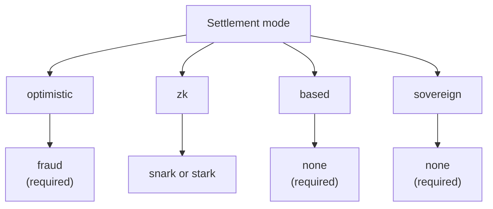

# ロールアップ概要

QoreChain の **Rollup Development Kit (RDK)** ―― `x/rdk` モジュール ―― を使うと、開発者は QoreChain 上で決済されるアプリケーション固有のロールアップを起動できます。各ロールアップは独自のブロックタイム、仮想マシン、手数料モデル、シーケンシングを持つ独立した実行環境でありながら、QoreChain のセキュリティ、耐量子暗号、データ可用性の保証を継承します。

:::caution 初期段階の機能
RDK は両方のネットワークにデプロイされていますが、**どちらのネットワークでもまだロールアップは作成されていない**ため（2026年10月23日に確認）、このセクションで説明するフローは第三者によってまだ検証されていません。メインネット（**`qorechain-vladi`**、EVM チェーン ID **9801**、2026年6月7日から稼働）は、チェーンバージョン **v3.2.4**（2026年10月23日に高さ 3,742,566 で適用、ガバナンス提案 13）で稼働しています。テストネット（**`qorechain-diana`**、EVM チェーン ID **9800**）は 2026年10月19日以降 **v3.2.4** で稼働しています。v3.2.3 と v3.2.4 の間で挙動が変わった箇所では、このセクションでどちらのリリースが適用されるかを示します。すべてのデプロイはまずテストネットで検証し、各ページのステータスに関する注記を読んでください。いくつかの機能（ZK 検証、Celestia データ可用性、QCAI Copilot、クロス VM 呼び出し、決済レシート）は、現時点ではエンドツーエンドで利用できません。また、リリース済みの RDK クライアント自体にも制限があります（[RDK 0.6.0：変更点と制限](/rollups/deploying-a-rollup#rdk-050-limits)を参照）。
:::

## 現在存在するもの {#what-exists-today}

| | ステータス |
|---|---|
| 登録済みのロールアップ（メインネットおよびテストネット） | なし |
| `x/rdk` モジュールとそのパラメータ | 両方のネットワークにデプロイ済み。`qorechaind query rdk config` で確認できます |
| RDK クエリ | 両方のネットワークで CLI、gRPC、REST（`/qorechain/rdk/v1/…`）経由で提供されているため、TypeScript の `rdk.params()` のような REST ベースの読み取りはメインネットに対しても機能します |
| RDK が書き込む決済アンカー | なし。v3.2.2 以降、バッチは `anchor_signature` を持つことができ、その場合は同じトランザクション内で `x/multilayer` にアンカーされます。持たない場合、バッチはアンカーされないまま決済されます。ロールアップ、レイヤー、アンカーはまだ存在しません。TypeScript の RDK 0.6.0 は、クライアントがハイブリッド署名を行い、かつロールアップの作成者である場合にこのフィールドを送信します（ライブでは未検証）。Python、Go、Rust、Java のクライアントは送信しません |
| `x/multilayer` に登録されたロールアップレイヤー | なし |
| 出金 | v3.2.3 以降、ロールアップごとのエスクロー台帳から支払われます（[ZK / STARK と出金](/rollups/zk-stark-withdrawals)を参照）。ロールアップが存在しないため、まだ行われていません |

より低レベルなモジュールリファレンス ―― モジュールパラメータ、ライフサイクルの内部仕様、バーン統合、マルチレイヤーアンカリング ―― については、アーキテクチャセクションの **[Rollup Development Kit](/architecture/rollup-development-kit)** ページを参照してください。本ロールアップセクションは開発者向けのハウツーです。RDK とは何か、どのパラダイムを選ぶべきか、どのようにデプロイするか、データ可用性の仕組み、L2 から L1 への出金の決済方法を扱います。

---

## RDK が提供するもの

RDK を通じて作成されたロールアップは、4 つの設定可能な要素をまとめています。

| 要素 | 制御する内容 | 選択肢 |
| ------- | ---------------- | ------- |
| **決済モード** | ロールアップの状態遷移が QoreChain 上でどのように検証・確定されるか | `optimistic`、`zk`、`based`、`sovereign` |
| **証明システム** | 決済を裏付ける暗号学的または経済的メカニズム | `fraud`、`snark`、`stark`、`none` |
| **シーケンサーモード** | 決済前にトランザクションを並べる主体 | `dedicated`、`shared`、`based` |
| **データ可用性** | 誰もが状態を再構築できるようトランザクションデータを公開する場所 | `native`、`celestia`、`both` |

各ロールアップは一意の `rollup-id` で登録され、QOR によるステークボンドに裏付けられ、ライフサイクルステータス（`pending`、`active`、`paused`、`stopped`）が割り当てられます。作成とライフサイクルの完全なフローについては **[ロールアップのデプロイ](/rollups/deploying-a-rollup)** を参照してください。

---

## QoreChain RDK が他と異なる点

どのロールアップキットにも共通する基本機能に加えて、QoreChain RDK は QoreChain のレイヤー1を軸に構築された QoreChain 固有の 3 つの機能と、ウォッチタワーの自動チャレンジャーを備えています。それぞれステータスが異なり、現在動作するものは表に記載しています。RDK は 5 つの言語（TypeScript、Python、Go、Rust、Java）で提供されています。**バージョン 0.6.0 は 5 つすべてのレジストリで公開されています**（2026年10月21日に確認：npm の `@qorechain/rdk`、`@qorechain/rdk-cli`、`create-qorechain-rollup`、PyPI の `qorechain-rdk`、crates.io の `qorechain-rdk`、Maven Central の `io.github.qorechain:qorechain-rdk`、Go モジュール `v0.6.0`。プロキシの `@latest` がまだ `v0.5.0` を返していたため、バージョンを固定してください）。5 つのうち、ハイブリッドトランザクションに署名するのは TypeScript クライアントだけです。`mainnet` と `testnet` のプリセットには公開の `qore.host` エンドポイントが組み込まれているため、`createRdkClient({ network })` は手動のエンドポイント設定を必要とせず、その REST 読み取りは両方のネットワークに対して機能します。

| 差別化要素 | 機能 |
| -------------- | ------------ |
| **[耐量子決済レシート](/rollups/settlement-receipts)** | 決済アンカーを、耐量子（ML-DSA-87 / Dilithium-5）署名を持つ持ち運び可能なレシートにまとめます。初期段階: アンカーはまだ存在しないため、実際のアンカーに対する検証はまだ行われていません。レシートはチェーンの状態と照合して確認する必要がある主張であり、0.6.0 の検証機能はその確認を行います。 |
| **[QCAI ロールアップ・コパイロット](/rollups/qcai-copilot)** | 単一ロールアップ向けの読み取り専用アドバイザリヘルパー（手数料見積もり、レコメンデーション、不正調査）。参照するアドバイザリサービスは、まだ公開エンドポイントでは提供されていません。 |
| **[マルチ VM のクロス VM 呼び出し](/rollups/multi-vm)** | クロス VM プリコンパイル（`0x…0901`）を通じて EVM → QoreChain Native 呼び出しをエンコードするためのツール。このプリコンパイルは、ライブネットワークではまだ有効化されていないため、呼び出しは何も行いません。0.6.0 のエンコーダーは、チェーンがデコードするレイアウトと一致します。 |
| **[ウォッチタワー](/rollups/watchtower)** | オプティミスティックロールアップ向けの自動チャレンジャーフレームワークで、新しいバッチとチャレンジウィンドウの締め切りを検出し、あなたの正当性述語に反する無効なバッチにチャレンジします。両方のネットワークが提供する REST 経由で読み取ります。0.6.0 以降は、各バッチのウィンドウをチェーンと同じ方法で判定します。 |

詳細な根拠とコードサンプルについては **[Why QoreChain RDK](/rollups/why)** を参照してください。

---

## 4 つの決済パラダイム

QoreChain RDK は、信頼の前提、ファイナリティの特性、証明要件がそれぞれ異なる 4 つの決済モードをサポートします。決済モードと証明システムの組み合わせはオンチェーンで検証され、互換性のない組み合わせは作成時に拒否されます。以下の図は各決済モードとその有効な証明システムの対応を示しています。

### Optimistic（オプティミスティック）

オプティミスティックロールアップは、提出されたバッチをデフォルトで有効とみなし、紛争解決には**不正証明（fraud proof）**を利用します。

* **証明システム**: `fraud` ―― インタラクティブな不正証明
* **シーケンサー**: `dedicated` または `shared`
* **ファイナリティ**: 設定可能なチャレンジウィンドウが成功したチャレンジなしに終了するまで遅延
* **紛争**: 誰でもウィンドウ内に、ボンドと不正証明を提出して、提出されたバッチにチャレンジできます。チャレンジによりバッチは凍結され、その後ロールアップの作成者が解決し、チェーン自体が証明を検証します。不正が認められるとバッチは拒否されてチャレンジャーに報酬が支払われ、チャレンジが却下されるとバッチは `submitted` に戻ります。[ロールアップのデプロイ](/rollups/deploying-a-rollup#challenge-a-batch-optimistic-rollups)を参照してください。
* **ウィンドウの長さ**: デフォルトのウィンドウは 604,800「秒」です。**v3.2.4 より前（メインネットでは高さ 3,742,566 より前）** では、チェーンはこれを 1 ブロックあたり固定 6 秒でブロック数に換算します ―― つまり **100,800 ブロック**です。実際の経過時間は実際のブロックタイムに従います（メインネットの現在の約 3.2 秒のブロックでは約 3.7 日）。したがって、日数ではなくブロック数で計画してください。**v3.2.4 以降**では、アップグレード高さ以降に提出されたバッチは、ブロックタイムの秒数で測定されるウィンドウ（丸 7 日）になります。それ以前のバッチはブロック数のルールのままです。アップグレード高さは、テストネットでは 8,337,253（2026年10月19日以降）、メインネットでは 3,742,566（2026年10月23日）です。したがって、その高さより下で提出されたすべてのバッチにブロック数のルールが、その高さ以降にはブロックタイムのルールが適用されます。

### ZK（ゼロ知識）

ZK ロールアップは各バッチに暗号学的な正当性証明を付与し、再実行なしに状態遷移の正しさを証明します。

* **証明システム**: `snark`（簡潔な証明）または `stark`（トラステッドセットアップ不要の透明な証明）
* **シーケンサー**: `dedicated` または `shared`
* **ファイナリティ**: 有効な証明の検証時 ―― チャレンジウィンドウは不要
* **成熟度**: SNARK バッチは、ロールアップとともに保存された検証鍵に対してオンチェーンで検証されます（BLS12-381 上の Groth16）。`create-rollup` で作成されたロールアップは現在検証鍵を持たないため、ZK バッチはまだエンドツーエンドで確定できません。STARK 検証は実験的です。オプトインであり、あなたのロールアップ自身の状態遷移ではなくデモンストレーション用の回路を検証します。ZK 決済は本番運用の準備ができていないものとして扱ってください。**[ZK / STARK と出金](/rollups/zk-stark-withdrawals)** を参照してください。

### Based（ベースド）

ベースドロールアップはトランザクションのシーケンシングを QoreChain（L1）のプロポーザーに委任し、ホストチェーンのライブネスと検閲耐性を継承します。

* **証明システム**: `none` ―― L1 プロポーザーが順序の真実の源
* **シーケンサー**: `based`（必須 ―― オンチェーン検証によって強制される）
* **ファイナリティ**: ホストチェーンの確定に追従
* **トレードオフ**: QoreChain のバリデータがシーケンシングを担うため運用モデルは最もシンプルだが、専用シーケンサーによるレイテンシ制御は失われる
* **現在のステータス**: `based` はロールアップ設定に記録されますが、QoreChain はまだ L1 プロポーザーをバッチ提出者として認めていません ―― 提出するのはロールアップの作成者です（[シーケンサーモード](#sequencer-modes)を参照）

### Sovereign（ソブリン）

ソブリンロールアップは独自のコンセンサスを運用し、自己シーケンシングを行います。検証可能性のために状態を QoreChain にアンカーしますが、ファイナリティについてはホストチェーンに依存しません。

* **証明システム**: `none`
* **シーケンサー**: ロールアップによる自己管理
* **ファイナリティ**: 独立 ―― ロールアップ自身のコンセンサスによって決定される
* **状態アンカリング**: 状態ルートは透明性のために QoreChain に投稿されるが、ホストチェーンはそれを強制しない

---

## 証明システムの互換性

決済モードは、どの証明システムが有効かを制約します。これらの組み合わせはロールアップ作成時に強制されます。

| 決済モード | `fraud` | `snark` | `stark` | `none` |
| --------------- | :-----: | :-----: | :-----: | :----: |
| **optimistic**  | 必須 | — | — | — |
| **zk**          | — | 対応 | 対応 | — |
| **based**       | — | — | — | 必須 |
| **sovereign**   | — | — | — | 必須 |

---

## シーケンサーモード {#sequencer-modes}

シーケンサーは、決済前にロールアップブロック内でトランザクションを並べる主体を決定します。

| モード | 誰がシーケンシングするか | 備考 |
| ---- | ------------- | ----- |
| **`dedicated`** | 単一の指定されたオペレーターアドレス | レイテンシが最も低いが、ライブネスと公正な順序付けについてオペレーターへの信頼が必要 |
| **`shared`** | 共有シーケンサーセット | 順序付けがセット全体に分散し、調整オーバーヘッドがやや高い |
| **`based`** | QoreChain L1 プロポーザー | ホストチェーンのバリデータのセキュリティと検閲耐性を継承する。`based` 決済には必須 |

:::note 現在強制されているもの
オンチェーンでは、バッチを提出できるのはロールアップに設定されたシーケンサーアドレスのみで、設定されていない場合（すべてのプリセットが該当）はその作成者のみです。`shared` と `based` のモードはロールアップ設定に記録されますが、QoreChain はまだ共有シーケンサーの名簿や L1 プロポーザーをバッチ提出者として認めていません。これらのモードは意図された設計を示すものです。
:::

---

## パラダイムの選び方

| こんな場合には… | 検討すべきもの |
| -------------- | -------- |
| QoreChain バリデータがシーケンシングを行う、最もシンプルな運用構成を望む | **based** |
| 暗号学的な保証による高速なファイナリティを望む（まだ本番運用には未対応） | **zk**（`snark` / `stark`） |
| 経済的な紛争解決を伴う、実績のあるモデルを望む | **optimistic**（`fraud`） |
| 独自のコンセンサスによる完全な独立性を望みつつ、検証可能性のためにアンカーしたい | **sovereign** |

どこから始めればよいか分からない場合は、RDK が一般的なアプリケーションカテゴリ向けにこれらの選択をまとめた**プリセットプロファイル**を提供しています ―― **[プリセットプロファイル](/rollups/preset-profiles)** を参照してください ―― また、アドバイザリ RPC が利用可能な場合は `suggest-profile` ヘルパーもあります（現在は固定の `defi` フォールバックを返すため、プロファイルの表から選んでください）。

開発者向けには、RDK は公開の TypeScript SDK である **`@qorechain/rdk`** と **`create-qorechain-rollup`** スキャフォールダーとしても提供されており、同じオンチェーンモジュールをコードから駆動します ―― **[ロールアップのデプロイ](/rollups/deploying-a-rollup#deploy-with-the-typescript-rdk-qorechainrdk)** を参照してください。

## 関連ページ

* [ロールアップのデプロイ](/rollups/deploying-a-rollup) ―― CLI または TypeScript RDK からロールアップを起動する。
* [プリセットプロファイル](/rollups/preset-profiles) ―― 一般的なアプリケーションカテゴリ向けのワンクリックバンドル。
* [データ可用性](/rollups/data-availability) ―― ネイティブ DA ルーターとブロブストレージ。
* [ZK / STARK 出金](/rollups/zk-stark-withdrawals) ―― 証明に裏付けられた出金フロー。
