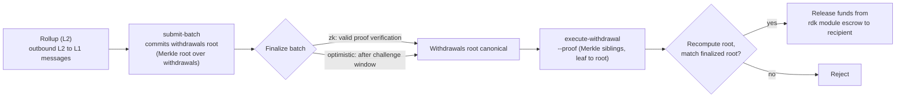

# ZK / STARK と出金

このページでは、関連する 2 つのトピックを取り上げます。ZK 決済ロールアップが使用する **ZK 証明システム**（`snark` と `stark`）と、バッチが確定した後にロールアップから QoreChain へ資金を戻す **L2 → L1 出金フロー** です。

:::caution 初期段階の機能
どちらのネットワークにも、まだロールアップは作成されていません（2026年10月23日時点で確認）。そのため、ここで説明する証明検証も出金フローも、稼働中のロールアップでは一度も実行されていません。メインネットで出金が成功し得るのは v3.2.3（高さ 3,662,051、2026年10月20日）以降のみで、この時点でロールアップごとのエスクロー台帳が稼働を開始しました（[資金の出どころ](#where-the-funds-come-from)を参照）。それ以前は、すべての出金が失敗していました。SNARK の検証は存在しますが、`create-rollup` で作成したロールアップはまだ ZK バッチを確定できず、STARK の検証は実験的です。**`qorechain-diana`** テストネットで検証してください。また、メインネットでの本番強化された保証は前提にしないでください。
:::

---

## ZK 証明システム

ZK 決済ロールアップ（`zk` 決済モード）は、各決済バッチに有効性証明を添付し、ロールアップのトランザクションを再実行することなく、ステート遷移が正しいことを証明します。ZK 決済は 2 つの証明システムをサポートします。

| 証明システム | 特性 |
| ------------ | --------------- |
| **`snark`** | 簡潔な証明（BLS12-381 上の Groth16）。ロールアップの検証鍵に対してオンチェーンで検証されます |
| **`stark`** | 透明な証明、トラステッドセットアップ不要 — 実験的。オプトインで、デモンストレーション用回路に紐づきます |

`zk` 決済モードは `snark` または `stark` のいずれかを必要とします。このペアリングは、ロールアップ作成時にオンチェーンで強制されます。対照的に、`optimistic` 決済は `fraud` 証明システムを使用し、`based` と `sovereign` 決済は `none` を使用します。完全な互換性マトリックスについては **[ロールアップ概要](/rollups/overview)** を参照してください。

### ファイナリティ

不正証明のチャレンジウィンドウを待つオプティミスティックロールアップとは異なり、ZK バッチは **有効な証明検証** によって確定でき、紛争ウィンドウを必要としません。これが ZK 決済の核心的なトレードオフです。証明生成のコストと複雑さと引き換えに、より強力で高速なファイナリティが得られます。

### 成熟度

SNARK バッチは、ロールアップとともに保存された検証鍵に対してオンチェーンで検証されます（BLS12-381 上の Groth16）。`create-rollup` で作成したロールアップは現在、検証鍵を持っていないため、ZK バッチをエンドツーエンドで確定することはまだできません。STARK の検証は実験的です。オプトインであり、ロールアップ自身のステート遷移ではなく、デモンストレーション用回路を検証します。ZK 決済は本番利用の準備ができていないものとして扱い、価値を伴うメインネットロールアップで依存する前に、RDK のリリースノートを追跡してください。

---

## バッチが出金をどのように運ぶか

ロールアップがバッチを決済するとき、そのバッチはロールアップのアウトバウンドなクロスレイヤーメッセージ — その **L2 → L1 出金** — もコミットできます。概念的には次のとおりです。

* 確定したバッチは、その出金の集合へのコミットメント（バッチの出金メッセージに対する Merkle ルート）を運ぶことができます。
* 個々の出金は、そのルートの下にあるリーフであり、バッチインデックスと出金インデックスによって識別されます。
* バッチが確定すると、任意の当事者が、特定の出金リーフがコミットされたルートの下に含まれていることを証明し、支払いをトリガーできます。

これが、出金が決済に依存する理由です。出金は **確定した** バッチに対してのみ実行できます。なぜなら、コミットされた出金ルートを正規のものにするのは確定だからです。

バッチがどのように提出され確定されるか — オプティミスティックロールアップ向けの `submit-batch` と `challenge-batch` 紛争パスを含む — については、**[ロールアップのデプロイ](/rollups/deploying-a-rollup)** を参照してください。

---

## 出金の実行: `execute-withdrawal`

`execute-withdrawal` コマンドは、確定したバッチの出金ルートに対して L2 → L1 出金を確定します。出金リーフがそのルートにコミットされていることを証明し、rdk モジュールのエスクローから受取人に支払います。このアクションは **パーミッションレス** です — 誰でも有効な証明を提出できます。ネイティブレーンのすべてのトランザクションと同様に、ハイブリッドのポスト量子共同署名が必要です。そのため `--generate-only` で作成し、cosign してください（[ロールアップのデプロイ](/rollups/deploying-a-rollup) を参照）。出金はまだ稼働中のロールアップで実行されたことがないため、このフローは未検証として扱ってください。手数料を支払う前に次の点を確認してください。そうでない場合、チェーンはトランザクションを拒否します。通貨単位はちょうど `uqor` であること、金額が正であること、証明は最大 64 レベルで、すべての兄弟がちょうど 32 バイトであること、提出者と受取人が有効な `qor1…` アドレスであること、バッチが確定済みで `withdrawals_root` をコミットしていること、ロールアップが停止していないこと、そしてその出金リーフがまだ支払われていないことです。TypeScript の `@qorechain/rdk` 0.6.0 は、これらのうち最初のグループのチェックを代わりに実行し（`withdrawalErrors`: アドレス、通貨単位、金額、証明の深さ、兄弟の長さ）、いずれかが失敗すると `executeWithdrawal` はブロードキャストの前にスローします。バッチ、ロールアップ、台帳に関する条件はチェーンの状態に依存しますが、このチェックはそれを読み取りません。

```bash
qorechaind tx rdk execute-withdrawal \
  [rollup-id] [batch-index] [withdrawal-index] [recipient] [denom] [amount] \
  --proof <sibling-hash-1>,<sibling-hash-2>,... \
  --from mykey \
  --chain-id qorechain-diana \
  --gas 400000 --fees 40000uqor \
  --generate-only > withdrawal.json
qorechaind tx pqc cosign withdrawal.json --from mykey --pqc-key mypqckey --chain-id qorechain-diana
```

**位置引数:**

| 引数 | 説明 |
| -------- | ----------- |
| `rollup-id` | 出金が属するロールアップ |
| `batch-index` | この出金を出金ルートにコミットしている確定済みバッチ |
| `withdrawal-index` | そのバッチ内の出金リーフのインデックス |
| `recipient` | 支払先のアドレス |
| `denom` | 支払う通貨単位 |
| `amount` | 支払う金額 |

**フラグ:**

| フラグ | 説明 |
| ---- | ----------- |
| `--proof` | リーフからルートへ順に並べた、カンマ区切りの 16 進 Merkle 兄弟ハッシュ。出金リーフがバッチの出金ルートにコミットされていることを証明します |

`--proof` の値は包含証明です。すなわち、出金リーフからバッチのコミットされた出金ルートまでのパスに沿った兄弟ハッシュです。モジュールはリーフと提供された兄弟からルートを再計算し、支払いを行う前に、確定済みバッチのコミットされたルートと照合します。

### リーフとノードのエンコーディング {#leaf-and-node-encoding}

* **リーフ** = `rollup_id`、`0x00` バイト、出金インデックス（8 バイト・ビッグエンディアン）、`recipient` 文字列、`0x00`、`denom` 文字列、`0x00`、`amount`（8 バイト・ビッグエンディアン）の SHAKE-256（32 バイト）。
* **親** = `left || right` の SHAKE-256。各レベルで、出金インデックスの対応するビットが側を決定します。`0` は、リーフ（または途中のハッシュ）が左ノードであることを意味します。
* すべての兄弟ハッシュは、ちょうど 32 バイトでなければなりません。

:::caution 汎用の Merkle ヘルパーは一致しません
RDK の汎用 `binaryMerkleRoot` / `binaryMerkleProof` ヘルパーは、デフォルトで SHA-256 を使い、奇数ノードを複製します。ハッシュとリーフのエンコーディングを上記のルールに合わせて上書きしてください。そうしないと、証明はオンチェーンで検証されません。
:::

### 資金の出どころ {#where-the-funds-come-from}

出金は、**ロールアップ自身のエスクローされたステーク**（ステークから作成時の 1% のバーンを差し引いたもの）から支払われます。すべてのロールアップのエスクローは 1 つのプールされたモジュール残高にありますが、**v3.2.3** 以降は、ロールアップごとの **エスクロー台帳** が、各ロールアップが保有する額の帳簿となります。`create-rollup` はロールアップが保持するエスクローをそこに計上し、出金や不正証明の報酬はそこから支払われて差し引かれ、ロールアップがまだ保有している額を超える出金は、エスクロー不足のエラーで拒否されます。`stop-rollup` は残りだけを返金して台帳をゼロにし、停止したロールアップはそれ以降の出金を支払いません。したがって、あるロールアップについて証明された出金が、別のロールアップのステークから支払われることはありません。ロールアップのクエリには `escrow_balance`（そのロールアップのためにまだ保持されている uqor）が含まれます。モジュールには L1 → L2 のデポジットメッセージがないため、これはユーザー資金のブリッジではありません。

---

## エンドツーエンドの出金フロー

*L2 から L1 へのパス: 決済バッチが出金ルートをコミットし、バッチが確定し、その後パーミッションレスな包含証明が QoreChain 上でエスクローされた資金を解放します。*



1. **バッチを決済する。** ロールアップオペレーターは `submit-batch` で決済バッチを提出します。バッチは、そのアウトバウンドな L2 → L1 メッセージに対する出金ルートをコミットできます。
2. **確定する。** バッチは、ロールアップの決済モードに従って確定します。`zk` の場合は有効な証明検証時に、`optimistic` の場合はチャレンジウィンドウ後に（その間、`challenge-batch` がそれを争うことがあります）。オプティミスティックのウィンドウは、v3.2.4 アップグレード前に提出されたバッチではデフォルトで 100,800 ブロックです。v3.2.4 以降は、アップグレード高以降に提出されたバッチについて、ブロック時間の秒数で計測されます（テストネットでは 2026年10月19日の高さ 8,337,253 から、メインネットでは 2026年10月23日の高さ 3,742,566 から）。
3. **証明して実行する。** 確定後、誰でも特定の出金リーフに対する Merkle 包含証明（`--proof`）を添えて `execute-withdrawal` を提出します。モジュールは確定済みバッチの出金ルートに対して包含を検証し、エスクローから受取人に支払います。

ステップ 3 はパーミッションレスかつ証明ベースであるため、出金を運ぶバッチが確定した後は、出金はロールアップオペレーターの協力に依存しません。

---

## 関連

* **[ロールアップ概要](/rollups/overview)** — 決済パラダイムと証明システムの互換性マトリックス。
* **[ロールアップのデプロイ](/rollups/deploying-a-rollup)** — `submit-batch` および `challenge-batch` オペレーターコマンド。
* **[ロールアップ開発キット](/architecture/rollup-development-kit)** — 低レベルのモジュールリファレンス。
