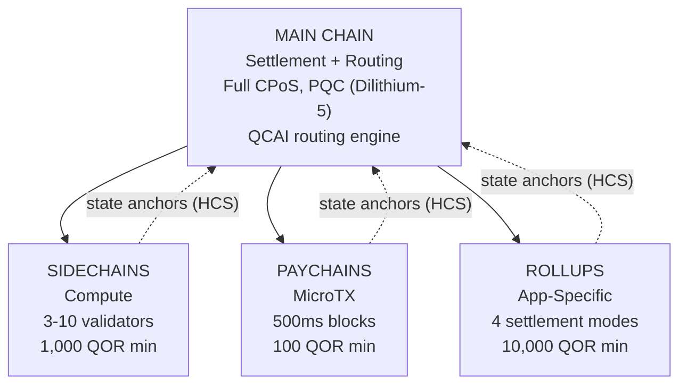

# 멀티레이어 아키텍처

QoreChain은 `x/multilayer` 모듈을 통해 **4계층 계층형 체인 아키텍처**를 구현합니다. 메인 체인은 정산 및 신뢰 루트 역할을 하며, 하위 레이어(사이드체인, 페이체인, 롤업)는 서로 다른 성능 및 보안 트레이드오프를 가지고 특화된 워크로드를 처리합니다.

:::caution 초기 단계 기능
이 모듈은 메인넷(체인 버전 2026년 10월 23일부터 **v3.2.4**)과 테스트넷(**v3.2.4**)에 배포되어 있지만, **두 네트워크 모두에 아직 레이어와 앵커가 존재하지 않습니다**(2026년 10월 23일 확인: 두 네트워크 모두에서 `GET /qorechain/multilayer/v1/layers`가 빈 목록을 반환합니다). 아래 내용은 구현된 모듈을 설명하며, 매개변수는 실제 운영 값입니다. 메인넷에서는 `MsgUpdateLayerStatus` 메시지가 현재 서킷 브레이커에 의해 꺼져 있으며([체인 매개변수](/appendix/chain-parameters#circuit-breaker) 참조), 테스트넷에서는 꺼져 있지 않습니다.
:::

---

## 시스템 개요

아래 4계층 구조는 메인 체인을 정산 및 신뢰 루트로 보여주며, 세 가지 하위 레이어 유형이 계층적 커밋먼트 스킴(HCS)을 통해 자신의 상태 루트를 메인 체인에 앵커링하는 모습을 나타냅니다.



```
                    +---------------------------+
                    |       MAIN CHAIN          |
                    |  (Settlement + Routing)   |
                    |  Full CPoS consensus      |
                    |  PQC-secured (Dilithium-5)|
                    |  QCAI routing engine       |
                    +------+------+------+------+
                           |      |      |
              +------------+      |      +------------+
              |                   |                    |
    +---------v--------+ +-------v--------+ +---------v---------+
    |   SIDECHAINS     | |   PAYCHAINS    | |     ROLLUPS       |
    |  (Compute)       | |  (MicroTX)     | |  (App-Specific)   |
    |  3-10 validators | |  500ms blocks  | |  4 settlement     |
    |  1,000 QOR min   | |  100 QOR min   | |    modes          |
    |  Max: 10         | |  Max: 50       | |  10,000 QOR min   |
    +------------------+ +----------------+ |  Max: 100 (x/rdk) |
                                            +-------------------+
```

---

## 레이어 유형

### 메인 체인

메인 체인은 전체 QoreChain 생태계의 신뢰 루트입니다.

| 속성       | 값                                                                             |
| ---------- | ------------------------------------------------------------------------------ |
| 합의       | QoreChain 합의 (현재 연결된 내용은 [합의 메커니즘](/architecture/consensus-mechanism) 참조) |
| 보안       | Dilithium-5 서명으로 PQC 보안 적용                                             |
| 역할       | 정산 레이어, 상태 앵커 저장, QCAI 라우팅 엔진, 신뢰 루트                       |
| 블록 시간  | 네트워크에 따라 다름: 메인넷 약 3.2초, 테스트넷 약 1.0초 (2026년 10월 23일 측정) |

모든 하위 레이어는 계층적 커밋먼트 스킴(HCS)을 통해 주기적으로 자신의 상태 루트를 메인 체인에 앵커링합니다.

### 사이드체인

사이드체인은 DeFi 프로토콜, 게이밍 엔진, IoT 데이터 처리와 같은 **연산 집약적 작업**을 처리합니다.

| 매개변수                  | 값                |
| ------------------------- | ----------------- |
| 최소 검증자 수            | 3                 |
| 최대 검증자 수            | 10                |
| 최소 생성자 스테이크      | 1,000 QOR         |
| 최대 활성 사이드체인 수   | 10                |
| 대상 도메인               | DeFi, Gaming, IoT |

### 페이체인

페이체인은 최소한의 지연 시간으로 **고빈도 마이크로트랜잭션**에 최적화되어 있습니다.

| 매개변수                 | 값                                      |
| ------------------------ | --------------------------------------- |
| 목표 블록 시간           | 500 ms                                  |
| 최대 활성 페이체인 수    | 50                                      |
| 최소 생성자 스테이크     | 100 QOR                                 |
| 대상 도메인              | Payments, streaming, micro-transactions |

### 롤업

롤업은 Rollup Development Kit(`x/rdk`)을 통해 배포되는 **애플리케이션 특화 체인**입니다. 롤업이 생성되면 RDK는 멀티레이어 모듈에 해당 롤업을 위한 레이어를 등록합니다(아래에서 설명하듯 `sidechain` 유형의 레이어로 등록됩니다).

| 매개변수               | 값                                          |
| ---------------------- | ------------------------------------------- |
| 정산 모드              | 4 (optimistic, zk, based, sovereign)        |
| 최대 등록 롤업 수      | 100 (`max_rollups`). 다만 동시에 존재할 수 있는 사이드체인 유형 레이어는 10개(`max_sidechains`)뿐이므로, 앵커링 가능한 레이어를 가질 수 있는 롤업은 최대 10개입니다 |
| 최소 생성자 스테이크   | 롤업에 10,000 QOR, 그리고 레이어 등록 스테이크 1,000 QOR(`min_sidechain_stake`) |
| 레이어 유형            | RDK를 통해 등록된 롤업은 `sidechain` 레이어 유형을 사용합니다(`rollup` 레이어 유형은 정의되어 있지만 `x/rdk`에서는 아직 사용되지 않습니다) |
| 대상 도메인            | DeFi, Gaming, NFT, Enterprise               |

롤업 배포 및 구성은 [Rollup Development Kit](/architecture/rollup-development-kit)에서 자세히 다룹니다.

---

## QCAI 트랜잭션 라우팅

QCAI 라우터는 들어오는 각 트랜잭션에 대해 모든 활성 레이어를 평가하고, 4요소 가중 점수 모델을 사용하여 최적의 대상을 선택합니다.

### 점수 산정 공식

각 후보 레이어는 종합 점수를 받습니다(높을수록 좋음):

```
Score = w_congestion * (1 - Congestion) + w_capability * Capability + w_cost * (1 - Cost) + w_latency * (1 - Latency)
```

| 요소       | 가중치 | 설명                                                                        |
| ---------- | ------ | --------------------------------------------------------------------------- |
| Congestion | 0.30   | 현재 부하 수준(역산: 혼잡도가 낮을수록 점수가 높음)                          |
| Capability | 0.40   | 레이어가 트랜잭션 요구사항에 얼마나 잘 부합하는지                            |
| Cost       | 0.20   | 메인 체인 대비 수수료 배수(역산: 비용이 낮을수록 점수가 높음)               |
| Latency    | 0.10   | 최종성까지의 예상 시간(역산: 지연이 낮을수록 점수가 높음)                    |

### 신뢰도 임계값

라우터는 트랜잭션을 하위 레이어로 라우팅하기 전에 최소 신뢰도 점수 **0.6**을 요구합니다. 이 임계값을 충족하는 레이어가 없으면 트랜잭션은 기본적으로 메인 체인으로 처리됩니다.

트랜잭션 발신자는 선호 레이어 힌트를 제공할 수 있습니다. 선호 레이어가 신뢰도 임계값의 최소 80%(즉, 0.48) 이상의 점수를 받으면 라우팅 대상으로 수락됩니다.

### 페이로드 휴리스틱

상세한 트랜잭션 메타데이터를 사용할 수 없는 경우, 라우터는 페이로드 크기를 분류 신호로 사용합니다:

| 페이로드 크기     | 선호 레이어     | 근거                                         |
| ----------------- | --------------- | -------------------------------------------- |
| &lt; 256 bytes    | Paychain        | 단순 전송 또는 마이크로트랜잭션일 가능성     |
| 256 - 1,024 bytes | Main Chain      | 표준 트랜잭션 복잡도                          |
| > 1,024 bytes     | Sidechain       | 복잡한 컨트랙트 상호작용일 가능성            |

---

## 계층적 커밋먼트 스킴(HCS)

하위 레이어는 **상태 앵커**를 통해 주기적으로 자신의 상태를 메인 체인에 커밋합니다. 각 앵커는 주어진 높이에서 하위 체인 상태의 암호학적 증명을 포함합니다.

### 앵커 내용

| 필드                      | 설명                                                 |
| ------------------------- | ---------------------------------------------------- |
| `layer_id`                | 하위 레이어의 식별자                                 |
| `layer_height`            | 하위 체인의 블록 높이                                |
| `state_root`              | 하위 체인 상태 트리의 머클 루트                      |
| `validator_set_hash`      | 커밋먼트에 서명한 검증자 세트의 해시                 |
| `pqc_aggregate_signature` | 앵커 데이터에 대한 Dilithium-5 집계 서명             |
| `transaction_count`       | 마지막 앵커 이후의 트랜잭션 수                       |
| `compressed_state_proof`  | 압축된 상태 전이 증명                                |

### 레이어 및 롤업 ID {#id-grammar}

v3.2.2부터 **새** 레이어 ID(그리고 레이어와 공유되는 롤업 ID)는 `^[a-z0-9][a-z0-9._-]{2,63}$`와 일치해야 합니다. 즉 3자에서 64자, 소문자, 숫자, `.`, `_`, `-`로 구성되며 문자 또는 숫자로 시작해야 합니다. 키퍼는 레이어가 생성될 때 이를 확인하며, 이를 통과하지 못한 트랜잭션도 수수료는 지불하므로 클라이언트에서 먼저 ID를 검증하세요. v3.2.2 이전에 생성된 ID는 영향을 받지 않습니다.

### 앵커 제출 {#anchor-submission}

앵커는 `MsgAnchorState`를 통해 메인 체인에 제출됩니다. 키퍼는 다음 단계에 따라 앵커를 검증합니다:

1. **레이어 존재 및 활성 여부** — 키퍼는 레이어가 상태에 존재하며 현재 `active` 상태인지 확인합니다.
2. **최소 앵커 간격 경과** — 키퍼는 이 레이어의 마지막 앵커 이후 최소 `min_anchor_interval` 블록(기본값: 100)이 경과했는지 확인합니다.
3. **PQC 집계 서명** — 키퍼는 PQC 집계 서명이 존재하며 앵커 데이터에 대해 유효한지 확인합니다. 서명은 **레이어 생성자**가 등록한 ML-DSA-87 키로 검증되며, 생성자에게 등록된 키가 없으면 앵커는 거부됩니다.

`x/rdk`를 통해 기록되는 **정산 앵커**(v3.2.2부터 `anchor_signature`와 함께 제출되는 배치)는 특별한 경우입니다. 배치가 순서대로 도착하므로 최소 간격 확인을 건너뛰고, 아직 `proposed` 상태인 레이어도 앵커링할 수 있으며(RDK 롤업이 등록한 레이어를 승격시키는 것은 체인상에 없습니다), 제출자가 해당 레이어의 생성자 본인일 때만 수락됩니다. 서명 확인은 동일합니다.

### 챌린지 기간

각 앵커는 **24시간**(86,400초, 레이어별 구성 가능)의 **챌린지 기간**에 들어갑니다. 이 기간 동안 누구든지 `MsgChallengeAnchor`를 통해 사기 증명을 제출하여 앵커에 이의를 제기할 수 있습니다. 사기 증명이 유효하면 앵커는 무효화되고 하위 체인의 상태는 이전 앵커로 롤백됩니다.

챌린지 기간이 성공적인 이의 제기 없이 만료되면 앵커는 최종 확정된 것으로 간주됩니다.

### 앵커 읽기 {#reading-anchors}

앵커는 멀티레이어 쿼리 서비스를 통해 **읽을 수** 있습니다. 두 가지 쿼리가 gRPC와 REST 모두에서 앵커 상태를 노출합니다:

* **`Anchor`** (`/qorechain/multilayer/v1/anchor/{layer_id}`) — 레이어의 가장 최근 상태 앵커를 반환합니다.
* **`Anchors`** (`/qorechain/multilayer/v1/anchors/{layer_id}`) — 레이어의 앵커 이력을 반환합니다.

각 앵커는 레이어 생성자의 Dilithium-5(ML-DSA-87) 서명을 포함합니다. 서명 대상 메시지는 앵커가 제출된 높이에 따라 달라집니다:

* **v3.2.2부터(메인넷 높이 3,556,788, 테스트넷 높이 6,905,034): v2.** 모든 가변 길이 필드에는 8바이트 빅엔디언 길이가 붙고, 체인 ID가 메시지의 일부이며, 트랜잭션 수와 압축된 상태 증명이 포함됩니다:

```text
"qorechain-multilayer-anchor-v2"
‖ BE64(len(chain_id))            ‖ chain_id
‖ BE64(len(layer_id))            ‖ layer_id
‖ BE64(layer_height)
‖ BE64(len(state_root))          ‖ state_root
‖ BE64(len(validator_set_hash))  ‖ validator_set_hash
‖ BE64(transaction_count)
‖ BE64(len(compressed_state_proof)) ‖ compressed_state_proof
```

* **v3.2.2 미만: v1** (`layer_id ‖ layer_height (8-byte big-endian) ‖ state_root ‖ validator_set_hash`, 길이 접두사와 체인 ID가 없으므로 v1 서명은 모든 체인에서 유효합니다). 체인은 v3.2.2 높이부터 v1 앵커를 수락하지 않습니다.

메시지는 릴리스 간에 변경될 수 있으므로, 클라이언트는 형식을 하드코딩하는 대신 적용된 플랜의 높이(`GET /cosmos/upgrade/v1beta1/applied_plan/v3.2.2`; `"height":"0"`은 적용되지 않았다는 뜻)로 형식을 선택해야 합니다. RDK 배치의 매핑은 다음과 같습니다. `layer_id` = 롤업의 레이어 ID, `layer_height` = 배치 인덱스, `state_root` = 배치 상태 루트, `transaction_count` = 배치의 트랜잭션 수, 그리고 비어 있는 `compressed_state_proof`. `qorechaind query rdk anchor-sign-bytes <layer-id> <batch-index> <state-root-hex> --chain-id <id>`는 이 바이트를 오프라인으로 출력합니다. 서명은 등록된 생성자 키가 해당 바이트에 서명했음을 증명할 뿐이며, 앵커가 실제로 존재하는지는 체인에 물어야 할 문제이므로 검증자는 신뢰하는 노드에서 앵커를 읽어야 합니다. 현재 두 네트워크 어디에도 레이어나 앵커가 존재하지 않습니다. 이것은 Rollup Development Kit의 [정산 영수증](/rollups/settlement-receipts) 뒤에 있는 온체인 프리미티브입니다.

---

## 크로스 레이어 수수료 번들링(CLFB)

CLFB는 소스 레이어에서의 단일 수수료 결제로 크로스 레이어 트랜잭션 경로의 여러 레이어에 걸친 실행 비용을 충당할 수 있게 합니다.

### 수수료 계산

```
avgMultiplier = sum(layer_multiplier_i) / num_layers
bundledFee = (totalGas / 1000) * avgMultiplier
```

여기서:

* `layer_multiplier_i`는 트랜잭션 경로의 각 레이어에 대한 기본 수수료 배수입니다(메인 체인 = 1.0).
* `totalGas`는 모든 레이어에 걸친 예상 총 가스 소비량입니다.
* 결과는 **uqor** 단위로 표시되며 최소 수수료는 1 uqor입니다.

### 예시

크로스 레이어 트랜잭션이 세 개의 레이어에 걸칩니다: 메인 체인(배수 1.0), 사이드체인(배수 0.5), 페이체인(배수 0.1).

```
avgMultiplier = (1.0 + 0.5 + 0.1) / 3 = 0.533
bundledFee = (150,000 / 1000) * 0.533 = 80 uqor
```

CLFB는 `cross_layer_fee_bundling` 매개변수를 통해 전역적으로 활성화 또는 비활성화할 수 있으며, 개별 레이어는 자신의 `cross_layer_fee_bundling_enabled` 구성 플래그를 통해 옵트아웃할 수 있습니다.

---

## 레이어 라이프사이클

각 하위 레이어는 명확하게 정의된 라이프사이클을 거칩니다:

```
Proposed --> Active --> Suspended --> Decommissioned
                  \                /
                   +-- Active <--+
```

| 상태               | 설명                                                                            | 허용된 전환               |
| ------------------ | ------------------------------------------------------------------------------- | ------------------------- |
| **Proposed**       | 레이어가 등록되었으나 아직 활성화되지 않음                                       | Active, Decommissioned    |
| **Active**         | 레이어가 작동 중이며 트랜잭션을 수락 중                                          | Suspended, Decommissioned |
| **Suspended**      | 레이어가 일시적으로 중단됨(예: 유지보수 또는 보안 문제로 인해)                   | Active, Decommissioned    |
| **Decommissioned** | 레이어가 영구적으로 종료됨(종료 상태)                                            | None                      |

상태 전환은 키퍼에 의해 강제됩니다. 유효하지 않은 전환(예: Decommissioned에서 Active로)은 거부됩니다.

---

## 매개변수

| 매개변수                       | 타입   | 기본값          | 설명                                                    |
| ------------------------------ | ------ | --------------- | ------------------------------------------------------- |
| `max_sidechains`               | uint64 | `10`            | 최대 활성 사이드체인 수                                 |
| `max_paychains`                | uint64 | `50`            | 최대 활성 페이체인 수                                   |
| `min_anchor_interval`          | uint64 | `100`           | 상태 앵커 간 최소 블록 수                               |
| `max_anchor_interval`          | uint64 | `1,000`         | 상태 앵커 간 최대 블록 수(강제 앵커)                    |
| `default_challenge_period`     | uint64 | `86,400`        | 기본 챌린지 기간(초 단위, 24시간)                       |
| `min_sidechain_stake`          | string | `1,000,000,000` | 사이드체인 생성 최소 스테이크(uqor 단위 1,000 QOR)     |
| `min_paychain_stake`           | string | `100,000,000`   | 페이체인 생성 최소 스테이크(uqor 단위 100 QOR)         |
| `routing_enabled`              | bool   | `true`          | QCAI 기반 트랜잭션 라우팅 활성화                        |
| `routing_confidence_threshold` | string | `0.6`           | QCAI 라우팅 결정을 위한 최소 신뢰도                     |
| `cross_layer_fee_bundling`     | bool   | `true`          | 전역 크로스 레이어 수수료 번들링 활성화                 |

이 값들은 2026년 10월 23일 메인넷과 테스트넷에서 `qorechaind query multilayer params`(REST: `/qorechain/multilayer/v1/params`)가 반환한 값입니다. v3.2.2부터 이 모듈의 `MsgUpdateParams`를 라우팅할 수 있으므로 거버넌스 제안으로 이 값들을 변경할 수 있습니다.
