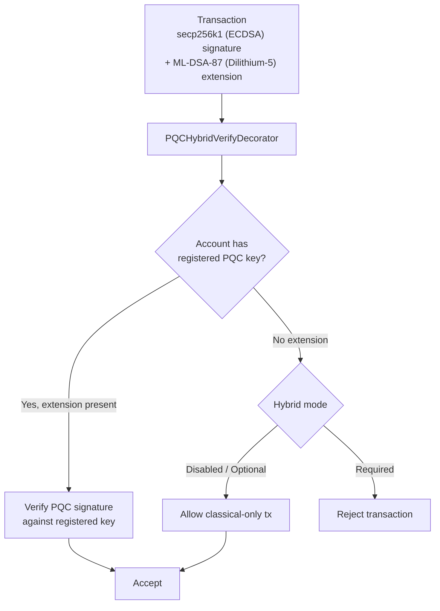

# 포스트 양자 보안

QoreChain은 **제네시스 단계부터 포스트 양자 암호화(PQC)**를 기반으로 구축되었으며 — 업그레이드로 사후 적용된 것이 아닙니다. `x/pqc` 모듈은 격자 기반 디지털 서명과 키 캡슐화를 기본 암호화 프리미티브로 제공하며, 장기적 회복력을 위한 거버넌스 제어 알고리즘 민첩성 프레임워크를 갖추고 있습니다.

전체 PQC 베이스라인 — **Dilithium-5 (서명) + ML-KEM-1024 (KEM) + SHAKE-256 (해시)** — 은 이제 완성되었으며 네트워크 기본값입니다. 라이브 네트워크(v3.2.x)에서는 cosmos 트랜잭션 경로에서 하이브리드 서명이 **기본적으로 필수**입니다: `hybrid_signature_mode = required` 및 `allow_classical_fallback = false`. 모든 cosmos 경로 트랜잭션은 고전적인 secp256k1 서명과 함께 Dilithium-5 서명을 포함해야 합니다; PQC 계정에서 발생한 고전적 전용 트랜잭션은 거부되며, 고전적 다운그레이드 경로는 닫혀 있습니다. 메인넷은 v3.2.4, 테스트넷은 v3.2.6을 실행합니다(2026년 10월 27일 확인). v3.2.2와 v3.2.3 릴리스가 포스트 양자 규칙에 추가한 내용(키 무결성, 선택적 소유 증명, 범위가 지정된 EVM 윈도우, EIP-7702 동의)은 [키 무결성 규칙](#key-integrity), [소유 증명](#proof-of-possession), [EIP-7702 위임](#eip-7702)에 설명되어 있습니다.

## 설계 원칙

* **PQC 기본 필수**: 포스트 양자 서명은 cosmos 경로에서 필수입니다. 고전적 secp256k1 서명만으로는 더 이상 충분하지 않습니다 — `allow_classical_fallback = false`.
* **기본 하이브리드**: cosmos 트랜잭션은 고전적 secp256k1 서명과 Dilithium-5 PQC 서명을 동시에 포함합니다. 고전적 전용 폴백은 닫혀 있습니다.
* **알고리즘 민첩성**: 암호화 알고리즘 레지스트리는 거버넌스 제어되어, 네트워크가 하드포크 없이 새로운 알고리즘을 채택하거나 손상된 알고리즘을 폐기할 수 있습니다.
* **결정론적 검증**: 모든 서명 검증은 결정론적이며 검증자 노드 전반에서 재현 가능합니다.

## 지원 알고리즘

| 알고리즘         | 표준                 | 카테고리          | NIST 레벨   | 공개 키      | 개인 키      | 서명 / 암호문            | 공유 비밀     |
| --------------- | -------------------- | ----------------- | ---------- | ----------- | ----------- | ---------------------- | ------------- |
| **Dilithium-5** | ML-DSA-87 (FIPS 204) | Signature         | 5          | 2,592 bytes | 4,896 bytes | 4,627 bytes            | --            |
| **ML-KEM-1024** | FIPS 203             | Key Encapsulation | 5          | 1,568 bytes | 3,168 bytes | 1,568 bytes            | 32 bytes      |

두 알고리즘 모두 표준화된 최고 보안 카테고리인 **NIST 보안 레벨 5**에서 동작하며, 고전적 및 양자 공격자 모두에 대해 AES-256과 동등한 보호를 제공합니다.

## 암호화 백엔드

PQC 작업은 격자 기반 서명, 검증, 키 캡슐화를 QoreChain 런타임에 노출하는 고성능 메모리 안전 암호화 백엔드에서 구현됩니다. 백엔드는 다음을 제공합니다:

알고리즘별 작업:

* Dilithium-5 키 생성, 서명, 검증
* ML-KEM-1024 키 생성, 캡슐화, 역캡슐화
* 결정론적 랜덤 비콘 생성 (`seed`, `epoch`)

알고리즘 인식 작업:

* `Keygen(algorithmID)` — 등록된 모든 알고리즘에 대한 키페어 생성
* `Sign(algorithmID, privkey, message)` — 서명 생성
* `Verify(algorithmID, pubkey, message, signature)` — 서명 검증
* `AlgorithmInfo(algorithmID)` — 키/출력 크기 조회
* `ListAlgorithms()` — 지원되는 모든 알고리즘 열거

모든 서명 및 검증 작업은 결정론적이며 모든 검증자 노드와 지원 플랫폼에서 동일한 결과를 생성합니다.

이와 동일한 프리미티브 — ML-DSA (FIPS-204), ML-KEM (FIPS-203), SHAKE-256 (FIPS-202) — 은 오픈소스 [**qorechain-pqc**](https://github.com/qorechain/qorechain-pqc) 라이브러리를 통해 지갑 및 통합자에게 제공되며, 이 라이브러리는 6개 언어(JavaScript/TypeScript, Rust, Go, C, Python, Java)에 걸쳐 일관되고 바이트 호환되는 단일 API를 제공합니다. [Post-Quantum Signing](/developer-guide/post-quantum-signing)을 참조하세요.

## 키 등록 {#key-registration}

계정은 `MsgRegisterPQCKey`(레거시, 기본값 Dilithium-5) 또는 `MsgRegisterPQCKeyV2`(알고리즘 인식)를 통해 PQC 키를 명시적으로 등록합니다. 체인이 스스로 키를 등록하는 일은 없으며, CLI 흐름은 `qorechaind tx pqc gen-key <name>` 다음에 `qorechaind tx pqc register-key <public_key_hex> hybrid --from <key>`입니다([First Transaction](/getting-started/first-transaction#register-pqc-key) 참조). 각 메시지는 다음을 포함합니다:

* **Sender**: 키를 등록하는 계정 주소.
* **PublicKey**: PQC 공개 키 바이트.
* **AlgorithmID**: PQC 알고리즘 식별자(v2 전용).
* **ProofOfPossession**: 새 키에 의한 선택적 서명(v2 전용, v3.2.3부터). [소유 증명](#proof-of-possession)을 참조하세요.
* **KeyType**: `hybrid` 또는 `pqc_only` 중 하나(세 번째 값인 `classical_only`는 스키마에 여전히 존재하지만 v3.2.3부터 거부됩니다):

| 키 유형           | 설명                                                                      |
| ---------------- | ------------------------------------------------------------------------ |
| `hybrid`         | 고전적(ECDSA) 및 PQC 키 모두. 트랜잭션은 이중 서명을 포함합니다.            |
| `pqc_only`       | `hybrid`와 동일하게 등록됩니다: 고전적 secp256k1 서명은 여전히 표준 서명 검사로 검증되며, PQC 서명도 추가로 필요합니다. |
| `classical_only` | **v3.2.3부터 거부됨.** 이 키 유형의 등록은 사용 가능한 포스트 양자 키를 기록하지 않으며 계정이 서명할 수 없게 만들 것이므로 체인이 이를 거부합니다. |

### 키 무결성 규칙 (v3.2.3) {#key-integrity}

v3.2.3 업그레이드(메인넷 높이 3,662,051, 2026년 10월 20일; 테스트넷 높이 8,003,746) 이후 체인은 포스트 양자 키에 다음 규칙을 적용합니다. 해당 높이 이전에는 이 중 어느 것도 강제되지 않았습니다.

| 규칙 | 동작 |
| --- | --- |
| 취약한 키 불가 | 키 유형이 `classical_only`이거나, 키가 비어 있거나, 키가 퇴화된 경우(길이는 맞지만 구조상 포스트 양자 보호를 제공하지 못하는 키) 등록이 거부됩니다. `tx pqc gen-key` 또는 `qorechain-pqc` 라이브러리로 키를 생성하고 그 출력값을 등록하세요 |
| 키 재사용 불가 | 새 키가 계정이 이전에 사용한 적이 있는 키이면 교체 또는 마이그레이션이 거부됩니다. 체인은 계정이 교체하거나 마이그레이션하여 떠난 모든 키의 해시를 기억합니다 |
| 키가 있는 계정은 하이브리드 서명이 필요 | 이미 사용 가능한 키를 보유한 계정은 등록 또는 마이그레이션 트랜잭션에도 하이브리드 서명을 포함해야 합니다. 고전적 전용 면제는 이제 등록된 키가 **없는** 계정, 또는 저장된 기록에 사용 가능한 키가 없는 계정(이 경우 `MsgRegisterPQCKeyV2`가 이를 대체할 수 있음)에만 적용됩니다 |
| 키 없는 확장 불가 | `required` 모드에서 등록된 키가 없는 계정은 아무것도 검증할 수 없는 하이브리드 확장을 첨부하는 것으로 통과할 수 없습니다. 등록만 확장 없이 통과할 수 있습니다 |
| 확장은 하나 | 트랜잭션은 최대 하나의 하이브리드 서명 확장을 포함합니다 |
| authz를 통한 키 메시지 불가 | `MsgRegisterPQCKey`, `MsgRegisterPQCKeyV2`, `MsgRotatePQCKey`, `MsgMigratePQCKey`는 `x/authz`를 통해 계정을 대신하여 실행할 수 없으며, 계정 자체의 서명이 필요합니다 |
| 알고리즘 거버넌스 보호 장치 | 알고리즘을 폐기하거나 비활성화해도 체인에 활성 서명 알고리즘이 없는 상태가 될 수 없으며, 대체 알고리즘은 서명할 수 있어야 합니다 |

v3.2.2는 관련 검사를 추가했습니다. 등록은 포함된 고전적 `ecdsa_pubkey`를 검증하고 이를 서명 계정에 바인딩하므로, 계정이 자신의 것이 아닌 고전적 키를 기록할 수 없습니다.

노드는 멤풀에서도 이러한 경우를 걸러내므로, 실패할 수밖에 없는 트랜잭션은 중계되지 않으며 수수료도 들지 않습니다.

### 소유 증명 (선택 사항) {#proof-of-possession}

`MsgRegisterPQCKeyV2`에는 선택적 `proof_of_possession` 필드가 있습니다. 존재하면 체인이 이를 검증하고, 없으면 등록은 이전과 같이 진행됩니다(증명은 **필수가 아닙니다**). 증명은 등록되는 키가 다음 데이터에 대해 만든 서명입니다:

```text
qorechain-pqc-pop-v1|<chain-id>|<algorithm-id>|<account-address>|<hex(public-key)>
```

따라서 한 계정이나 체인을 위해 만든 증명은 다른 곳에서는 아무것도 증명하지 않습니다. 로컬 키 파일을 지정하면 CLI가 이를 대신 만들어 줍니다:

```bash
qorechaind tx pqc register-key-v2 dilithium5 <pubkey-hex> hybrid \
  --pqc-key mypqc --from mykey --chain-id qorechain-vladi --gas 600000 --fees 60000uqor
```

등록은 키가 없는 계정에 대해서만 하이브리드 요구 사항에서 면제되므로, 이 트랜잭션은 계정의 고전적 키만으로 서명됩니다. 형식이 잘못된 증명은 `ErrInvalidProofOfPossession`(모듈 `pqc`의 코드 231)으로 거부됩니다.

**v3.2.4부터(메인넷은 2026년 10월 23일부터, 테스트넷은 2026년 10월 19일부터):** 계정 기록에 불리언 `possession_proven`이 추가되며, `GET /qorechain/pqc/v1/account/{address}`가 이를 반환합니다. 현재 키가 유효한 증명과 함께 등록되었거나 교체 또는 마이그레이션을 통해 들어온 경우(둘 다 체인, 계정, 키를 명시하는 바이트에 대한 새 키의 서명을 검증함) `true`이며, 증명 없는 등록은 `false`를 기록하고, 증명 없이 키가 변경되면 이 플래그가 지워집니다. v3.2.4에서도 계정 키에 대한 증명은 여전히 선택 사항입니다.

## 하이브리드 서명 {#hybrid-signatures}

하이브리드 서명 시스템은 cosmos 경로 트랜잭션이 고전적 서명과 PQC 서명을 **둘 다** 동시에 포함하도록 요구합니다. 이는 심층 방어를 제공합니다: 한 기법이 깨지더라도 다른 기법이 트랜잭션을 보호합니다.

`hybrid_signature_mode = required`라는 네트워크 기본값에서, 모든 cosmos 경로 트랜잭션은 secp256k1 서명과 함께 Dilithium-5 확장을 포함해야 합니다. 유일한 예외(부트스트랩용)는 **제네시스 gentxs(높이 0)**, 등록된 키가 없는(또는 기록에 사용 가능한 키가 없는) 계정의 **PQC 키 등록**(`MsgRegisterPQCKey`, `MsgRegisterPQCKeyV2`)으로, 계정이 첫 PQC 키를 등록할 수 있도록 고전적 전용이 허용되며, 등록된 키가 없는 운영자 계정의 unjail도 마찬가지입니다. v3.2.3부터는 이미 사용 가능한 키를 보유한 계정의 등록 또는 마이그레이션도 다른 트랜잭션과 마찬가지로 하이브리드 서명이 필요합니다([키 무결성 규칙](#key-integrity) 참조).

**EVM 레인은 대신 인가 윈도우로 보호됩니다.** EVM 트랜잭션은 두 번째(ML-DSA) 서명을 담을 수 없습니다 — 표준 지갑은 이더리움 트랜잭션에 secp256k1 서명 하나만 하며, 다른 서명을 첨부할 방법을 제공하지 않습니다. 그래서 포스트 양자 인가는 트랜잭션보다 *앞서* 전달됩니다: 계정이 일반적인 하이브리드 서명을 담은 Cosmos 레인 메시지(`MsgOpenEVMWindow`)로 제한된 **EVM 인가 윈도우**를 열고, 이후 EVM 레인은 유효한 윈도우가 적용되는 트랜잭션만 허용합니다. v3.2.0부터 EVM 트랜잭션은 발신자가 (1) 등록된 포스트 양자 키를 가지고 있고 (2) 블록, 트랜잭션, 금액이 남아 있는 유효한 윈도우를 가지고 있지 않으면 거부됩니다. 윈도우 내에서는 검사가 트랜잭션이 아니라 체인 상태를 읽기 때문에 일반적인 MetaMask/ethers/Hardhat 트랜잭션이 수정 없이 동작합니다. [EVM 인가 윈도우](/getting-started/first-transaction#evm-window)를 참조하세요.

v3.2.3부터 윈도우는 열 때 **범위를 지정**할 수도 있습니다. `--native-only`는 네이티브 QOR의 단순 전송(calldata 없음, 컨트랙트 생성 없음, 코드를 가진 수신자 없음, EIP-7702 인가 없음)으로 좁히고, `--allowed-targets 0x…,0x…`는 나열된 수신자만 허용하며 컨트랙트 생성을 거부합니다. 범위 없이 열린 윈도우는 기존과 같은 것을 허용합니다. 범위는 `MsgOpenEVMWindow`의 일부입니다(`native_only`, `allowed_targets`).

### EIP-7702 위임 {#eip-7702}

EIP-7702 인가 튜플은 이에 서명한 계정에 코드를 설치하며, 그 서명은 누구나 타입 4 트랜잭션에 실어 나를 수 있는 고전적 secp256k1 서명입니다. 따라서 v3.2.2(메인넷 높이 3,556,788)부터 EVM 레인은 **튜플이 효력을 가지게 되는 모든 권한자**가 등록된 포스트 양자 키를 보유하고, 튜플이 설치하는 위임 그대로에 대해 하이브리드 서명된 Cosmos 레인 메시지로 **동의**한 경우에만 타입 4 트랜잭션을 허용합니다.

| 항목 | 상세 |
| --- | --- |
| 동의하기 | `qorechaind tx pqc authorize-evm-delegation <delegate-0x-address> <blocks>` (`MsgAuthorizeEVMDelegation`): 튜플이 담아야 하는 위임 대상 주소와 동의가 사용 가능한 기간을 지정합니다(최대 17,280 블록, 윈도우와 같은 한도) |
| 위임 해제 | 위임 대상으로 제로 주소를 지정하면 해제에 동의하는 것입니다. `tx pqc clear-evm-delegation` (`MsgClearEVMDelegation`)은 EVM 트랜잭션 없이 기존 위임을 해제합니다 |
| 일회성 | 동의는 위임을 설치하는 트랜잭션에서 소진되고, 해당 계정의 이전 동의를 대체하며, `MsgCloseEVMWindow`로 취소됩니다 |
| 조회 | `qorechaind query pqc evm-delegation-consent <address>` 또는 `GET /qorechain/pqc/v1/evm_delegation_consent/{address}` (필드 `live`, `delegate`, `granted_height`, `expiry_height`, `current_delegate`, `nonce`) |
| 제한 | 타입 4 트랜잭션당 최대 8개의 인가. 위임된 계정에서 나가는 금액은 해당 계정 자체의 윈도우에 부과됩니다. 실패한 타입 4 트랜잭션은 이미 적용한 인가를 유지합니다 |
| 후원된 위임 | 여전히 동작합니다. 후원자가 자신의 윈도우에서 비용을 지불하고, 권한자는 사전에 동의만 합니다 |

### 공동 서명 흐름

규정에 맞는 cosmos 트랜잭션을 생성하려면, 고전적 secp256k1 서명은 표준 서명 바이트(PQC 확장을 제외함)에 대해 계산되고, Dilithium-5 서명은 v2 서명 바이트(아래 [서명 바이트 (v2)](#sign-bytes-v2) 참조)에 대해 계산되어 `PQCHybridSignature` 확장으로 첨부됩니다. 표준 CosmJS / 릴레이어 도구는 cosmos 경로에서 트랜잭션을 처리하기 위해 이 확장을 생성해야 합니다. 현재 이것은 다음을 통해 수행됩니다:

* `qorechaind tx pqc gen-key <name>` — Dilithium-5 키를 생성합니다.
* `qorechaind tx pqc cosign <unsigned_tx_file> --from <key> --pqc-key <name>` — `--generate-only`로 만든 트랜잭션에 Dilithium-5 공동 서명을 첨부합니다.
* QoreChain SDK의 하이브리드 서명 — `buildHybridTx`. 계정의 키는 이미 `MsgRegisterPQCKey`로 등록되어 있어야 합니다.
* [QoreX](/qorex/overview) — 두 가지를 모두 대신 처리해 줍니다.

*secp256k1(ECDSA)과 ML-DSA-87(Dilithium-5)로 서명된 트랜잭션은 체인 전체 강제 모드 하에서 ante 핸들러에 의해 검증됩니다.*



### 서명 바이트 (v2) {#sign-bytes-v2}

ML-DSA 서명은 도메인 태그가 붙고 체인에 바인딩된 바이트를 대상으로 합니다. v3.2.0부터 체인은 **오직** 이 형식만 검증합니다:

```text
"qorechain-pqc-hybrid-v2" ‖ BE64(len(chainID)) ‖ chainID ‖
BE32(len(B0)) ‖ B0 ‖ BE32(len(authInfo)) ‖ authInfo
```

여기서 `B0`는 PQC 확장 **없이** 직렬화된 트랜잭션 본문이고 `authInfo`는 AuthInfo 바이트 그대로입니다(`‖`는 연결, 길이는 빅엔디언). 도메인 태그는 다른 맥락(로그인 챌린지, 메시지 서명 요청)에서 만들어진 서명이 트랜잭션 서명으로 유효해지는 것을 막으며, 체인 ID를 바인딩하면 포스트 양자 서명 자체가 다른 네트워크에서는 무효가 됩니다. 첫 번째 형식(`BE32(len(B0)) ‖ B0 ‖ BE32(len(authInfo)) ‖ authInfo`)은 업그레이드 높이 이전에만 검증되었으며, 두 형식을 모두 수락하는 블록은 없습니다. 키 마이그레이션과 브리지 어테스테이션 페이로드도 동일한 도메인 태그, 체인 바인딩 방식으로 옮겨졌습니다.

**내 네트워크는 어느 형식을 검증하나요?** 업그레이드가 적용되었는지 노드에 물어보세요:

```bash
curl -s https://api.qore.host/cosmos/upgrade/v1beta1/applied_plan/v3.2.0         # height 2981742 on mainnet
curl -s https://api-testnet.qore.host/cosmos/upgrade/v1beta1/applied_plan/v3.2.0 # height 5920000 on testnet
```

(`"height":"0"`은 적용되지 않았다는 뜻입니다.) 두 네트워크 모두 이 변경을 오래전에 적용했으므로 현재 클라이언트는 어디서나 v2 형식으로 서명합니다. 이 확인은 오래된 블록을 재생하거나 검증할 때 중요합니다. CLI는 `--sign-bytes auto`로 이를 수행하며, 현재 SDK와 wallet-adapter 릴리스도 동일하게 동작합니다. 잘못된 형식을 사용하는 클라이언트는 체인이 거부하는 다이제스트를 생성하며 — 안전하게 실패합니다(fails closed).

### TX 확장 형식

PQC 서명은 타입 URL `/qorechain.pqc.v1.PQCHybridSignature`를 가진 **TX 확장**으로 트랜잭션에 첨부됩니다:

```text
{
  "algorithm_id": 1,
  "pqc_signature": "<4627 bytes for Dilithium-5>",
  "pqc_public_key": "<2592 bytes, optional>"
}
```

`pqc_public_key` 필드는 선택 사항이며 참고용입니다. 키는 명시적인 등록 메시지로만 등록됩니다([키 등록](#key-registration) 참조).

### PQCHybridVerifyDecorator

`PQCHybridVerifyDecorator` ante 핸들러는 3방향 검증 로직으로 하이브리드 서명을 처리합니다:

| 시나리오  | 계정에 PQC 키 있음 | 확장 존재 | 확장 내 공개 키       | 결과                                                |
| -------- | ------------------- | ----------------- | ----------------------- | --------------------------------------------------- |
| Path 1   | 예                  | 예                | --                      | 등록된 키에 대해 PQC 서명 검증                        |
| Path 3a  | 아니오              | 아니오            | --                      | **Optional 모드**: 고전적 전용 트랜잭션 허용         |
| Path 3b  | 아니오              | 아니오            | --                      | **Required 모드**: 트랜잭션 거부                     |
| Path 4   | 예                  | 아니오            | --                      | 표준 PQCVerifyDecorator에 의해 처리됨                |

계정이 하이브리드 서명 트랜잭션을 보내기 전에 `MsgRegisterPQCKey` / `MsgRegisterPQCKeyV2`로 키가 등록되어 있어야 하며, 확장의 `pqc_public_key` 필드는 아무것도 등록하지 않습니다.

### 하이브리드 서명 모드

체인 전체 하이브리드 강제 수준은 거버넌스로 구성 가능합니다. **현재 네트워크 기본값은 `required`**입니다:

| 모드         | ID | 기본값  | 동작                                                                                                              |
| ------------ | -- | ------- | ----------------------------------------------------------------------------------------------------------------- |
| **Disabled** | 0  | 아니오  | 고전적 서명만. PQC 확장은 무시됩니다.                                                                              |
| **Optional** | 1  | 아니오  | PQC 확장은 존재하면 검증됩니다. PQC 키가 없는 계정은 고전적 서명만으로 트랜잭션을 처리할 수 있습니다.                |
| **Required** | 2  | **예**  | 모든 cosmos 경로 트랜잭션은 고전적 서명과 PQC 서명을 모두 포함해야 합니다. PQC 확장이 없는 트랜잭션은 거부됩니다.    |

네트워크는 마이그레이션을 완료했습니다: **Optional**(제네시스) → **Required**(v3.1.71 이후 현재 기본값, `allow_classical_fallback = false`). 세 가지 모드는 거버넌스 제어 상태로 유지되며 제안을 통해 조정할 수 있습니다.

## 알고리즘 민첩성 프레임워크

알고리즘 민첩성 프레임워크는 PQC 알고리즘을 위한 거버넌스 제어 레지스트리를 제공하여, 네트워크가 새로운 알고리즘을 추가하고, 취약한 알고리즘을 폐기하고, 계정을 마이그레이션할 수 있게 합니다 — 모두 하드포크 없이.

### 알고리즘 수명 주기

각 등록된 알고리즘은 수명 주기 상태를 가집니다:

```
active --> migrating --> deprecated --> disabled
```

| 상태           | 설명                                                                                                                                         |
| -------------- | ------------------------------------------------------------------------------------------------------------------------------------------- |
| **Active**     | 완전히 작동. 새로운 키 등록 및 검증이 수락됩니다.                                                                                            |
| **Migrating**  | 이중 서명 기간이 활성 상태. 계정은 대체 알고리즘으로 마이그레이션하도록 권장됩니다. 이전 및 새 서명이 모두 수락됩니다.                          |
| **Deprecated** | 기존 서명은 여전히 검증될 수 있지만, 새로운 키 등록은 수락되지 않습니다.                                                                      |
| **Disabled**   | 긴급 킬 스위치. 알고리즘은 어떤 서명도 검증할 수 없습니다. 취약점이 발견되었을 때 사용됩니다.                                                 |

### 이중 서명 마이그레이션

알고리즘이 폐기되면, **마이그레이션 기간**이 시작됩니다(기본값: 1,000,000 블록 — 메인넷의 현재 블록 시간 약 3.1초 기준 약 36일). 이 기간 동안:

1. 폐기된 알고리즘을 사용하는 키를 가진 계정은 대체 알고리즘으로 마이그레이션해야 합니다.
2. 마이그레이션에는 이중 서명(`MsgMigratePQCKey`)이 필요합니다: 이전 키에서 하나, 새 키에서 하나로, 둘 다의 소유권을 증명합니다.
3. 마이그레이션 기간 내내 두 알고리즘 모두 검증을 위해 수락됩니다.

### 메시지

| 메시지                  | 설명                                                                                                                                                              |
| ----------------------- | ----------------------------------------------------------------------------------------------------------------------------------------------------------------- |
| `MsgRegisterPQCKey` / `MsgRegisterPQCKeyV2` | 계정의 PQC 키를 등록합니다([키 등록](#key-registration) 참조). 새 계정이 부트스트랩할 수 있도록 고전적 서명이 허용될 수 있습니다.                  |
| `MsgMigratePQCKey`      | 마이그레이션 기간 중 한 알고리즘의 키에서 다른 알고리즘의 키로의 이중 서명 마이그레이션. 계정이 이전에 사용한 키는 거부합니다(v3.2.3).                                                                              |
| `MsgRotatePQCKey`       | 계정의 ML-DSA-87 키를 동일한 알고리즘 내에서 교체합니다(이전 키와 새 키의 이중 서명; `tx pqc rotate-key`). 계정이 이전에 사용한 키는 거부합니다(v3.2.3). |
| `MsgOpenEVMWindow` / `MsgCloseEVMWindow` | EVM 인가 윈도우를 열거나 닫습니다(v3.2.0; v3.2.3부터 선택적 범위 지정); [EVM 인가 윈도우](/getting-started/first-transaction#evm-window)를 참조하세요.                  |
| `MsgAuthorizeEVMDelegation` / `MsgClearEVMDelegation` | 발신자 본인 계정의 EIP-7702 위임에 동의하거나 이를 해제합니다(v3.2.2); [EIP-7702 위임](#eip-7702)을 참조하세요. |
| `MsgDeprecateAlgorithm` | 거버넌스 메시지: 알고리즘에 대한 폐기 프로세스를 시작합니다. 대체 알고리즘과 블록 단위 마이그레이션 기간을 지정합니다.                          |
| `MsgDisableAlgorithm`   | 거버넌스 메시지: 알고리즘을 즉시 긴급 비활성화합니다. 이유 문자열이 필요합니다. 암호화 취약점이 발견되었을 때 사용됩니다.                |

`MsgDeprecateAlgorithm`과 `MsgDisableAlgorithm`은 현재 메인넷에서 서킷 브레이커에 의해 꺼져 있습니다([Chain Parameters](/appendix/chain-parameters#circuit-breaker) 참조). 테스트넷에서는 꺼져 있지 않습니다. 두 네트워크 모두에서 v3.2.3부터 [키 무결성 규칙](#key-integrity)의 알고리즘 거버넌스 보호 장치가 적용됩니다.

### 확장성

알고리즘을 추가하려면 통합된 서명 및 검증 인터페이스 뒤에서 이를 구현하는 소프트웨어 릴리스가 필요하며, 레지스트리와 폐기/비활성화 수명 주기는 거버넌스로 제어됩니다.

## SHAKE-256 해시

v3.1.73 기준으로, **SHAKE-256**(SHA-3 확장 출력 함수)은 QoreChain 전반의 **기본 애플리케이션 해시**입니다 — `qorehash` 패키지가 제공하며 — Dilithium-5 서명 및 ML-KEM-1024 키 캡슐화와 함께 암호화 베이스라인을 완성합니다. `x/pqc` 모듈은 순수 Go SHAKE-256 유틸리티를 제공합니다:

| 함수                                | 설명                              | 출력             |
| ---------------------------------- | --------------------------------- | ---------------- |
| `SHAKE256Hash(data, outputLen)`    | 가변 길이 SHAKE-256 다이제스트     | 임의 길이        |
| `SHAKE256Hash32(data)`             | 표준 256비트 SHAKE-256 다이제스트  | 32 bytes         |
| `SHAKE256ConcatHash(left, right)`  | 연결된 입력의 해시                 | 32 bytes         |
| `SHAKE256DomainHash(domain, data)` | 도메인 분리 해시                   | 32 bytes         |

이러한 유틸리티는 기본 애플리케이션 해시를 뒷받침하며 다음에 사용됩니다:

* 머클 트리 노드 해싱
* 교차 계층 어테스테이션의 해시 커밋먼트
* 서로 다른 해시 컨텍스트를 위한 도메인 분리(예: `"leaf:"` 대 `"node:"`)

## 브리지 PQC

브리지 어테스테이션은 브리지 인프라에서 고전적 암호화를 사용함으로써 교차 체인 보안이 저하되지 않도록 **Dilithium-5**(ML-DSA-87) 서명을 사용하도록 설계되었습니다. 이는 설계 의도이며, 브리지 검증자가 어떻게 어테스테이션하도록 되어 있는지를 설명할 뿐 오늘날 라이브 네트워크에서 직접 사용해 볼 수 있는 동작이 아닙니다. 라이브 브리지 경로는 없습니다([Bridge Architecture](/architecture/bridge-architecture#current-status) 참조). v3.2.4부터(메인넷은 2026년 10월 23일부터, 테스트넷은 2026년 10월 19일부터) 브리지 검증자를 등록할 때 PQC 키의 소유 증명도 필요합니다.

## 모듈 파라미터

| 파라미터                    | 타입                 | 기본값            | 설명                                                  |
| -------------------------- | ------------------- | ----------------- | ----------------------------------------------------- |
| `pqc_primary`              | bool                | `true`            | PQC가 기본 서명 기법                                    |
| `allow_classical_fallback` | bool                | `false`           | 고전적 전용 폴백이 닫힘; cosmos 트랜잭션은 하이브리드여야 함 |
| `min_security_level`       | int32               | `5`               | 수락되는 알고리즘의 최소 NIST 보안 레벨                  |
| `default_migration_blocks` | int64               | `1,000,000`       | 기본 이중 서명 마이그레이션 기간(블록)                   |
| `default_signature_algo`   | AlgorithmID         | `1` (Dilithium-5) | 새 키 등록을 위한 기본 서명 알고리즘                     |
| `hybrid_signature_mode`    | HybridSignatureMode | `2` (Required)    | 체인 전체 하이브리드 서명 강제 수준                      |

테스트넷도 동일한 값을 반환합니다(2026년 10월 27일 확인). v3.2.6부터 테스트넷은 이를 REST의 `GET /qorechain/pqc/v1/params`로도 제공합니다. 메인넷에서는 이 경로가 501(미구현)로 응답하며, 파라미터는 `qorechaind query pqc params`로 읽습니다.

## 관련 문서

* [Post-Quantum Signing](/developer-guide/post-quantum-signing) — 이러한 프리미티브와 하이브리드 서명을 위한 오픈소스 `qorechain-pqc` 라이브러리(6개 언어).
* [Wallet Setup](/getting-started/wallet-setup) — PQC 기반 계정 생성 및 관리.
* [SDK Accounts & PQC signing](/sdk/concepts/accounts-pqc) — 코드에서의 키 및 포스트 양자 서명.
* [Chain Parameters](/appendix/chain-parameters) — 기본 알고리즘 및 마이그레이션 설정.
* [Bridge Architecture](/architecture/bridge-architecture) — 교차 체인 패킷에서의 PQC 검증.
