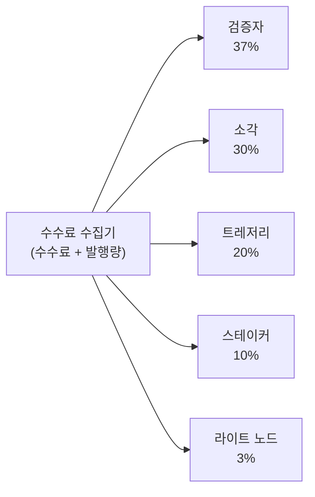

# 토크노믹스

QoreChain의 경제 모델은 네이티브 **QOR** 토큰을 중심으로 하며, **유한하고 상한이 있는 공급 경로**를 가집니다. 고정된 제네시스 공급량, 하드 누적 상한 아래에서 발행되는 스테이킹 보상 발행량, 그리고 토큰을 영구적으로 제거하는 다중 채널 소각 엔진으로 구성됩니다. 이 페이지는 라이브 체인에서 읽은 수치를 사용하여 공급량, 발행, 소각, 수수료 분배가 어떻게 작동하는지 설명합니다.

---

## 토큰 기본 사항

| 속성                  | 값                                                       |
| --------------------- | -------------------------------------------------------- |
| **표시 토큰**         | QOR                                                      |
| **기본 단위**         | uqor                                                     |
| **소수 정밀도**       | 10^6 (1 QOR = 1,000,000 uqor)                            |
| **공급량**            | 제네시스 4,420,000,000 QOR; [공급 및 발행 모델](#supply-and-emission) 참조 |
| **체인 ID**           | `qorechain-vladi` (메인넷, EVM 체인 ID 9801)             |
| **Bech32 접두사**     | `qor` (계정: `qor1...`, 검증자: `qorvaloper...`)         |

:::note
이 페이지의 수치는 **메인넷**(`qorechain-vladi`, EVM 체인 ID **9801**)을 설명하며, 2026년 6월 7일부터 릴리스 **v3.2.3**에서 라이브 상태입니다(높이 3,742,566부터는 v3.2.4). **`qorechain-diana`** 테스트넷(EVM 체인 ID **9800**, 2026년 10월 19일부터 릴리스 **v3.2.4**)은 자체적인 발행 및 공급량 이력을 가지고 있으므로(테스트넷 공급량은 메인넷보다 훨씬 많고 발행량은 이미 상한을 넘었습니다) 메인넷 수치를 사용하세요. 블록마다 변하는 금액에는 읽은 날짜(2026년 10월 20일)를 표시했습니다.
:::

---

## 공급 및 발행 모델 {#supply-and-emission}

QoreChain은 **유한하고 상한이 있는 공급 경로**를 가지고 있습니다. 제네시스 공급량은 **4,420,000,000 QOR**였습니다(4,500,000,000 QOR 계획; 80,000,000 QOR, 1.78 %는 제네시스 이전 토큰 생성 이벤트에서 소각됨). 제네시스 이후에는 두 가지만 공급량을 변화시킵니다.

* **발행** — `x/inflation` 모듈은 **590,000,000 QOR의 하드 누적 상한** 아래에서 에포크마다 고정된 양을 발행합니다. 발행된 토큰은 수수료 수집기로 들어가 트랜잭션 수수료와 동일한 수수료 분배를 거칩니다([수수료 분배](#fee-distribution) 참조).
* **소각** — `x/burn` 모듈은 수수료 수집기에 있는 모든 것 중 소각 비율만큼을 영구적으로 제거합니다.

### 발행 {#staking-reward-schedule}

| 매개변수 | 값 |
| --- | --- |
| 발행 모드 | `fixed` (v3.1.94부터, 높이 2,122,074 — 2026년 8월 26일) |
| 에포크당 발행량 | **86,000 QOR** (거버넌스 제안 10 이전까지는 16,239 QOR; 첫 86,000 QOR 에포크는 블록 3,672,000에서 시작) |
| 에포크 길이 | 43,200 블록 (현재 ≈3.2초 블록 시간 기준 약 38.6시간) |
| 누적 상한 (`max_total_emission`) | **590,000,000 QOR** (제안 10 이전까지는 114,285,714 QOR) |
| 지금까지 발행량 (2026년 10월 20일, 에포크 84) | 105,248,896.21 QOR (상한의 17.84 %) |
| 상한까지 남은 양 | 484,751,103.79 QOR (에포크당 86,000 QOR 기준 약 5,637 에포크; 마지막 에포크는 일부만 발행) |

상한에 도달하면 모듈은 영구적으로 발행을 중단하며, 그 이후 보상은 트랜잭션 수수료만으로 지급됩니다. 발행 수치는 거버넌스가 설정했습니다. 제안 #4(2026년 8월 26일)는 기존의 감소 스케줄을 하드 상한 아래의 고정 금액으로 대체했고, 제안 #10(2026년 10월 19일, 본딩된 모든 스테이크가 찬성 투표하여 통과)은 그 금액을 에포크당 16,239 QOR에서 86,000 QOR로 변경하고 상한을 114,285,714 QOR에서 590,000,000 QOR로 높였습니다. 에포크 길이는 변하지 않았습니다. 스케줄 값(1~5년 차 17.5 %, 11 %, 7 %, 7 %, 2 %)은 모듈 매개변수에 계속 저장되어 있지만 `fixed` 모드에서는 사용되지 않습니다.

발행된 총량, 남은 양, 다음 에포크 높이는 `GET /qorechain/inflation/v1/epoch_info`에서 실시간으로 확인할 수 있습니다(`current_inflation_rate` 필드는 `fixed` 모드에서 사용되지 않는 레거시 연도 기반 비율을 보고합니다).

QoreChain은 실시간 스테이킹 수익률 수치를 제공하지 않습니다. 인용되는 모든 비율은 검증되지 않은 것으로 취급하세요. 현재 수치는 체인 상태에서 읽을 수 있습니다. 공급량은 `GET /cosmos/bank/v1beta1/supply/by_denom?denom=uqor`(2026년 10월 20일 기준 4,493,665,185.83 QOR)에서, 소각 합계는 `GET /qorechain/burn/v1/stats`에서 확인할 수 있습니다.

---

## x/burn — 다중 채널 소각 엔진

`x/burn` 모듈은 현재 메인넷에서 **12개의 소각 소스**를 정의합니다. 소각된 모든 토큰은 공급량에서 영구적으로 제거됩니다. 메인넷에서는 `gas_fee`(2026년 10월 20일 기준 31,574,710.28 QOR)와 v3.2.2부터 `failed_tx`(0.0855 QOR)에서만 소각이 기록되었으며, 나머지는 정의되어 있지만 기록된 소각이 없습니다. v3.2.4부터는 열세 번째 소스 `staking_tier_penalty`가 있으며, 시간 잠금 위임을 조기에 해제할 때 소각되는 페널티를 기록합니다(테스트넷은 2026년 10월 19일부터, 메인넷은 높이 3,742,566부터; [스테이킹과 위임](/user-guide/staking-and-delegation#time-locked-staking) 참조).

### 소각 채널

| #  | 채널               | 소스                       | 설명                                          |
| -- | ------------------ | -------------------------- | --------------------------------------------- |
| 1  | `gas_fee`          | 트랜잭션 수수료            | 모든 가스 수수료의 30%가 소각됨               |
| 2  | `contract_create`  | 스마트 컨트랙트 배포       | 컨트랙트 생성당 정액 100 QOR 수수료 소각      |
| 3  | `ai_service`       | AI 모듈 사용 수수료        | AI 서비스 수수료의 50% 소각                   |
| 4  | `bridge_fee`       | 크로스체인 브리지 수수료   | 브리지 수수료의 100% 소각                     |
| 5  | `treasury_buyback` | 트레저리 운영              | 트레저리로부터의 주기적 바이백 후 소각        |
| 6  | `failed_tx`        | 실패한 트랜잭션 가스       | 실패한 트랜잭션 가스의 10% 소각 (v3.2.2부터 체인에서 적용) |
| 7  | `xqore_penalty`    | xQORE 조기 인출 페널티     | 페널티 금액이 소각 경로로 라우팅됨            |
| 8  | `auto_buyback`     | 자동 바이백 프로그램       | 프로토콜 수준의 자동 소각                     |
| 9  | `tge`              | 토큰 생성 이벤트           | 80,000,000 QOR의 TGE 소각은 제네시스 이전에 이루어졌습니다(제네시스 공급량은 4,420,000,000 QOR). 이 채널은 예약되어 있으며 0을 기록합니다 |
| 10 | `rollup_create`    | 롤업 배포                  | 롤업 생성 스테이크의 1% 소각                  |
| 11 | `milestone`        | 트랜잭션 수 마일스톤       | 고정된 누적 트랜잭션 수에서 예정된 소각 (아직 발생하지 않음) |
| 12 | `amm`              | AMM                        | AMM 프로토콜 수수료용으로 예약됨 (기록 없음)  |

`contract_create`, `ai_service`, `bridge_fee`, `auto_buyback` 채널은 현재 비활성 상태입니다. QoreChain Native 업로드는 닫혀 있고, AI 서비스 수수료와 브리지는 라이브가 아닙니다.

### 수수료 분배 {#fee-distribution}

수수료 수집기에 있는 모든 것은 아래와 같이 다섯 개의 대상으로 분할됩니다. 수수료 수집기에는 트랜잭션 수수료와 `x/inflation`이 발행한 에포크 발행량이 모두 들어 있습니다. 각 비율은 온체인에서 강제되며 합계는 항상 정확히 100%입니다.

비율은 다음과 같습니다.

| 수령자          | 비율  | 설명                                                                 |
| --------------- | ----- | -------------------------------------------------------------------- |
| **검증자**      | 37%   | 스테이크에 비례하여 활성 검증자 세트에 분배됨                        |
| **소각**        | 30%   | `gas_fee` 소각 채널을 통해 공급량에서 영구적으로 제거됨              |
| **트레저리**    | 20%   | 거버넌스가 지정하는 지출을 위해 커뮤니티 트레저리에 배정됨           |
| **스테이커**    | 10%   | 위임 비율에 비례하여 모든 QOR 스테이커에게 분배됨                    |
| **라이트 노드** | 3%    | 네트워크 데이터를 제공하는 라이트 노드에 분배됨                      |

각 비율은 온체인에서 강제되며 합계는 항상 정확히 100%여야 합니다.

:::note 분배를 실제로 거치는 것
이 분배는 수수료 수집기에 있는 모든 것에 적용되며, 수집기에는 트랜잭션 수수료와 `x/inflation`이 발행한 에포크 발행량이 모두 들어 있습니다. 현재는 사실상 거의 전부가 발행량입니다. 발행된 105,248,896 QOR 중 31,574,710 QOR(30.0 %)가 `gas_fee` 채널을 통해 소각되었습니다. v3.2.0 업그레이드(2026년 9월 25일, 높이 2,981,742) 이전에는 10 % 스테이커 몫이 어떤 청구권도 뒷받침하지 않은 채 분배 모듈의 잔액으로 이동했기 때문에, 스테이커와 검증자는 합쳐서 47 %가 아니라 37 %를 받았습니다. 해당 높이부터는 스테이커 몫이 일반 스테이킹 보상으로 지급됩니다. 이미 묶여 있던 금액은 온체인에 기록되었으며 이후 거버넌스 투표로 해제되었습니다 — [묶인 스테이커 몫과 라이트 노드 준비금](#stranded-and-reserve)을 참조하세요.
:::

### 소각 매개변수

| 매개변수               | 기본값                     | 설명                                     |
| ---------------------- | -------------------------- | ---------------------------------------- |
| `gas_burn_rate`        | 0.30                       | 소각되는 가스 수수료 비율 (30%)          |
| `contract_create_fee`  | 100,000,000 uqor (100 QOR) | 컨트랙트 생성에 대한 정액 소각 수수료    |
| `ai_service_burn_rate` | 0.50                       | 소각되는 AI 서비스 수수료 비율 (50%)     |
| `bridge_burn_rate`     | 1.00                       | 소각되는 브리지 수수료 비율 (100%)       |
| `failed_tx_burn_rate`  | 0.10                       | 소각되는 실패 트랜잭션 가스 비율 (10%)   |
| `validator_share`      | 0.37                       | 검증자에게 가는 수수료 수집기 비율       |
| `treasury_share`       | 0.20                       | 트레저리로 가는 비율                     |
| `staker_share`         | 0.10                       | 스테이커에게 가는 비율                   |
| `light_node_share`     | 0.03                       | 라이트 노드로 가는 비율                  |
| `enabled`              | true                       | 모듈 활성화 플래그                       |

각 소각 이벤트는 출처, 금액, 블록 높이, 관련 트랜잭션 해시와 함께 온체인에 기록됩니다. 집계 통계는 채널별로도, 전체로도 조회할 수 있습니다.

---

## 묶인 스테이커 몫과 라이트 노드 준비금 {#stranded-and-reserve}

v3.2.0 업그레이드(2026년 9월 25일, 높이 2,981,742) 이전에 메인넷에 두 가지 금액이 누적되었습니다. 이 업그레이드는 이를 **어떤 분배에도 포함되지 않는 온체인 기록**으로 남기고 거버넌스 투표를 통해서만 이동할 수 있게 했습니다. 이후 거버넌스는 2026년 10월에 두 금액을 모두 재단으로 해제했습니다.

| 기록 | 해제 | 금액 | 거버넌스 메시지 |
| --- | --- | --- | --- |
| **묶인 스테이커 몫** — 스테이킹 보상 청구권을 뒷받침하지 않는 곳에 예치되었던 10 % 스테이커 몫 | 제안 9 (2026년 10월 19일 통과) | 6,693,045.921330 QOR 해제됨 | `MsgReleaseStrandedRewards` (거버넌스 권한; 지정된 목적지; 기록 금액을 초과할 수 없음) |
| **라이트 노드 준비금** — 자격을 갖춘 라이트 노드가 없는 동안 누적된 3 % 라이트 노드 몫 | 제안 8 (2026년 10월 19일 통과) | 3,156,983.796395 QOR 해제됨 | `MsgReleaseLightNodeReserve` (거버넌스 권한) |

**묶인 몫의 수정된 잔액.** v3.2.3 업그레이드(높이 3,662,051, 2026년 10월 20일)에서 체인은 묶인 몫 기록을 다시 계산했으며, 그 값은 3,807,496.785528 QOR가 되었습니다(`GET /qorechain/burn/v1/stranded_rewards`의 `reserved`, 옆의 `released`는 6,693,045.921330 QOR). 거버넌스 제안 12는 이 잔액을 재단으로 해제하자고 제안하며, 이 글을 작성하는 시점(2026년 10월 20일)에는 투표 기간 중이고 2026년 10월 21일 20:01 UTC에 종료됩니다. 결과는 기록과 제안(`GET /cosmos/gov/v1/proposals/12`)에서 확인하세요.

**현재의 라이트 노드 풀.** v3.2.0 업그레이드부터 라이트 노드 보상은 이전 분배 실행 이후 누적된 금액에서만 지급되며 노드별로 상한이 적용됩니다. v3.2.3부터 이 상한은 **노드당 30일에 2,000 QOR**(`max_reward_per_month_per_node`)이며, 블록 시간과 노드의 가동시간에 비례하여 안분됩니다. 블록당 값(`max_reward_per_block_per_node`, 1,713 uqor)은 여전히 보고되지만 더 이상 규칙은 아닙니다. 획득되지 않은 금액은 풀의 준비금에 남으며, 이는 거버넌스 투표로만 해제할 수 있습니다. 제안 8 이후 준비금은 다시 누적됩니다. 2026년 10월 20일에는 487.2318 QOR가 있었으며(`GET /qorechain/lightnode/v1/reward_pool`의 `reserved`) 미지급 또는 지급 가능 금액은 없었습니다. 아직 등록한 라이트 노드가 없기 때문입니다. 등록은 열려 있으며 라이선스로 제한됩니다([라이트 노드](/light-node/overview#reward-program-status) 참조). 업그레이드 스냅샷 이전의 해제, 기록 금액을 초과하는 해제, 또는 유효하지 않은 목적지로의 해제는 거부됩니다.

## x/xqore — 잠금 스테이킹 및 거버넌스 증폭 {#x-xqore}

:::warning 아직 라이브가 아닙니다
xQORE 모듈의 회계 로직은 존재하며 제네시스에서 활성화되어 있지만, 메인넷(`qorechain-vladi`)과 테스트넷(`qorechain-diana`) 모두에서 **아직 사용할 수 없습니다**. 노드에는 이를 위한 트랜잭션, 쿼리, CLI, RPC 진입점이 없으므로 `tx xqore lock` / `unlock`, `query xqore ...`, xQORE REST 경로, `qor_getXQOREPosition`은 작동하지 않으며 xQORE를 보유한 사람도 없습니다. 향후 체인 릴리스에서 제공될 예정이며, 해당 릴리스에서는 보유자 수와 관계없이 잠금 해제 비용이 낮게 유지되도록 조기 인출 페널티의 재분배 방식도 변경됩니다. 릴리스가 제공되면 여기에 명시합니다.
:::

`x/xqore` 모듈은 양도 불가능한 잠금 스테이킹 파생 자산인 **xQORE**를 도입합니다. 사용자는 QOR를 잠가 1:1 비율로 xQORE를 발행할 수 있습니다. xQORE 보유자는 증폭된 거버넌스 권한과 재분배된 조기 인출 페널티의 몫을 받습니다.

### 잠금 메커니즘

* **잠금**: QOR를 xQORE 모듈로 보내 1:1 비율로 xQORE를 발행합니다.
* **거버넌스 가중치**: xQORE 보유자는 일반 QOR 스테이커에 비해 **2배의 거버넌스 투표권**을 받습니다.
* **양도 불가**: xQORE는 계정 간에 전송할 수 없습니다. 잠근 주소에 귀속됩니다.

### 조기 인출 페널티 스케줄

xQORE에서의 조기 인출은 잠금 기간이 길수록 낮아지는 페널티를 발생시킵니다.

| 잠금 기간      | 페널티 비율  | 설명                                       |
| -------------- | ------------ | ------------------------------------------ |
| &lt; 30 days   | **50%**      | 잠긴 QOR의 절반이 몰수됨                   |
| 30 -- 90 days  | **35%**      | 단기 잠금에 대한 상당한 페널티             |
| 90 -- 180 days | **15%**      | 중기 약정에 대한 완화된 페널티             |
| > 180 days     | **0%**       | 페널티 없이 전액 인출                      |

### PvP 리베이스 재분배

조기 인출로 걷힌 페널티는 그냥 소멸되지 않습니다. 대신 PvP(플레이어 대 플레이어) 리베이스 모델을 따릅니다.

1. 제네시스 설정에서 페널티 금액의 **0%**가 소각됩니다(`penalty_burn_rate = 0`; 거버넌스가 변경하면 `xqore_penalty` 소각 채널이 사용됩니다).
2. **100%**는 남아 있는 모든 xQORE 보유자에게 지분 비례로 재분배됩니다.

이는 장기 보유자에게 포지티브섬(positive-sum) 역학을 만들어 냅니다. 즉, 조기 인출이 일어날 때마다 남아 있는 xQORE 포지션의 실질 가치가 올라갑니다. 리베이스는 **100블록**마다 발생합니다.

### xQORE 매개변수

| 매개변수                | 기본값                 | 설명                                      |
| ----------------------- | ---------------------- | ----------------------------------------- |
| `governance_multiplier` | 2.0                    | xQORE 보유자에 대한 투표권 배수           |
| `min_lock_amount`       | 1,000,000 uqor (1 QOR) | 잠금에 필요한 최소 QOR                    |
| `penalty_burn_rate`     | 0.00                   | 소각되는 조기 인출 페널티 비율 (제네시스 기본값: 모든 페널티가 재분배됨) |
| `rebase_interval`       | 100 blocks             | PvP 리베이스 이벤트 사이의 블록 수        |
| `enabled`               | true                   | 모듈 활성화 플래그                        |

---

## x/inflation — 상한이 있는 발행

`x/inflation` 모듈은 누적 상한 590,000,000 QOR에 도달할 때까지 에포크별 발행량(제안 10 이후 86,000 QOR, `emission_mode = fixed`)을 발행하여 수수료 수집기로 보냅니다. 매개변수 변경은 일반 거버넌스 매개변수 제안(`MsgUpdateParams`, v3.1.94에서 추가)을 통해 이루어집니다.

### 에포크 메커니즘

* **에포크 길이**: 43,200 블록 (≈3.2초 블록 시간 기준 약 38.6시간).
* 각 에포크 경계에서 모듈은 에포크 발행량(또는 상한까지 남은 양)을 발행하고, 에포크 레코드를 갱신하며, `total_minted`가 상한에 도달하면 발행을 중단합니다.
* v3.2.3부터 발행 연도는 고정된 블록 수가 아니라 에포크 길이로부터 도출됩니다.

### 매개변수

2026년 10월 20일 `GET /qorechain/inflation/v1/params`에서 읽은 실시간 값:

| 매개변수 | 값 (메인넷) | 설명 |
| --- | --- | --- |
| `emission_mode` | `fixed` | `schedule`(레거시, 연도 기반 비율) 또는 `fixed`. v3.2.4는 세 번째 모드 `target_apy`를 추가합니다 |
| `fixed_epoch_emission` | 86,000,000,000 uqor (86,000 QOR) | fixed 모드에서 에포크마다 발행되는 양 |
| `max_total_emission` | 590,000,000,000,000 uqor (590,000,000 QOR) | 하드 누적 상한 |
| `epoch_length` | 43,200 블록 | 발행 에포크당 블록 수 |
| `schedule` | 17.5 %, 11 %, 7 %, 7 %, 2 % (1~5년 차) | 레거시 스케줄, fixed 모드에서는 사용되지 않음 |
| `enabled` | `true` | 모듈 활성화 플래그 |

메인넷에서는 v3.2.3부터 모듈의 매개변수와 에포크 레코드가 REST로 노출되며(`/qorechain/inflation/v1/params` 및 `/qorechain/inflation/v1/epoch_info`), RPC `abci_query` 원시 스토어 인터페이스(스토어 `inflation`, 키 `inflation/params` 및 `inflation/epoch`)로 체인 상태에서 읽을 수도 있습니다.

:::note v3.2.4와 테스트넷의 발행
`qorechain-diana` 테스트넷은 이전의 발행 설정(114,285,714 QOR 상한 아래 에포크당 16,239 QOR, 이미 상한에 도달함)을 유지하며, 메인넷은 위의 값을 사용합니다. v3.2.4 릴리스는 세 번째 발행 모드인 `target_apy`와 `target_apy_bps` 매개변수를 추가합니다. 테스트넷에서는 2026년 10월 19일부터, 메인넷에서는 높이 3,742,566부터입니다(거버넌스 제안 13). 테스트넷에서 이 매개변수는 `0`이며 발행을 좌우하지 않습니다. 네트워크를 이 모드로 전환하는 것은 별도의 거버넌스 투표이며 메인넷에서는 제안된 적이 없습니다. 투표가 통과될 때까지 메인넷은 에포크당 86,000 QOR의 `fixed` 모드를 유지합니다.
:::

---

## 소각 대 발행

발행량에는 상한(총 590,000,000 QOR)이 있으며, 소각 비율은 발행량을 포함해 수수료 수집기로 들어오는 모든 것에 적용됩니다. 현재(2026년 10월 20일)까지 발행된 105,248,896 QOR에 대해 31,574,710 QOR가 소각되었으므로, 공급량(4,493,665,186 QOR)은 현재 제네시스 수준보다 높습니다. 상한에 도달한 이후에는 공급량이 소각된 양만큼만 감소할 수 있습니다.

---

## 관련 문서

* [체인 매개변수](/appendix/chain-parameters) — 표준 경제 및 합의 기본값.
* [스테이킹과 위임](/user-guide/staking-and-delegation) — QOR를 위임하고 스테이킹 보상을 받는 방법.
* [xQORE 스테이킹](/user-guide/xqore-staking) — PvP 리베이스 스테이킹 메커니즘.
* [라이트 노드 보상](/light-node/rewards-and-monitoring) — 라이트 노드 보상 몫.
