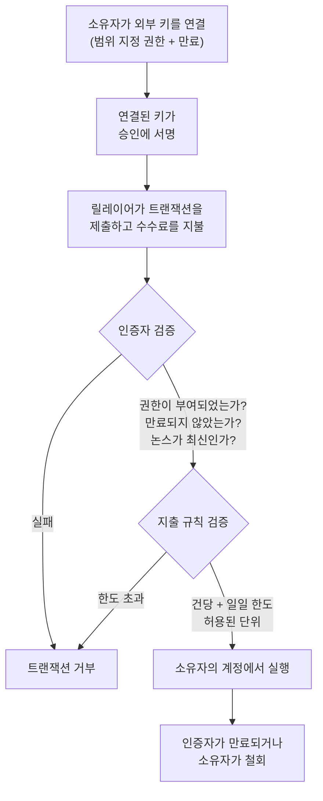

# 계정 추상화

QoreChain은 `x/abstractaccount` 모듈을 통해 **프로토콜 수준의 계정 추상화**를 제공합니다. 이 모듈은 지출 규칙이 설정된 추상 계정을 기록하고, 계정 소유자가 외부 키(**인증자**)를 연결하여 권한 및 지출 한도 범위 안에서 해당 계정으로부터 지출할 수 있도록 합니다. 외부 스마트 컨트랙트 인프라는 필요하지 않습니다.

:::danger 메인넷에서는 활성화되어 있지 않음; 테스트넷에서는 활성화됨
추상 계정 모듈은 이 글을 쓰는 시점에 **`qorechain-vladi` 메인넷에서 꺼져 있습니다**(2026년 10월 27일 확인). `qorechaind query abstractaccount config`(및 `GET /qorechain/abstractaccount/v1/config`)는 `enabled: false`를 보고합니다. **`qorechain-diana` 테스트넷**에서는 거버넌스 결정(제안 18, 2026년 10월 27일 통과)으로 켜졌으며 `enabled: true`를 보고합니다. 체인 v3.2.0부터 이 플래그는 모든 경로에서 강제됩니다. `false`인 곳에서는 체인이 계정 생성, 인증자 등록, 두 실행 레인(`MsgExecuteEVM`, `MsgExecuteCosmos`)을 모두 `abstract accounts are disabled on this chain` 오류와 함께 거부합니다. 어떤 일반 트랜잭션으로도 모듈을 켤 수 없으며, 이 설정은 거버넌스 결정으로만 바뀝니다. 메인넷에는 추상 계정 트랜잭션이 포함된 적이 한 번도 없습니다. 아래 내용은 모듈의 인터페이스를 설명한 것입니다. 테스트넷에서 사용해 보되, 모듈이 메인넷에서 활성화되기 전까지는 메인넷용 연결 키 또는 위임 지출 흐름을 구축하지 마십시오. 항상 먼저 플래그를 확인하십시오.
:::

:::note
아래 명령어는 2026년 6월 7일부터 운영 중이며 노드 릴리스 **v3.2.6**(2026년 11월 4일 높이 4,020,000에서 적용됨, 거버넌스 제안 15. v3.2.5는 2026년 10월 29일 높이 3,906,833에서 제안 14로, v3.2.4는 2026년 10월 23일 높이 3,742,566에서 적용됨)을 실행하는 **`qorechain-vladi`** 메인넷을 기준으로 작성되었습니다. v3.2.8을 실행하는 테스트넷(2026년 11월 12일부터. v3.2.4는 2026년 10월 19일부터)에서는 `--chain-id qorechain-diana`로 대체하십시오.
:::

:::caution 모든 Cosmos 레인 트랜잭션에는 하이브리드 양자내성 공동 서명이 필요합니다
이 페이지의 `qorechaind tx` 예제는 수수료 플래그만 보여줍니다. 실제 네트워크에서는 모든 Cosmos 레인 트랜잭션에 ML-DSA-87 하이브리드 공동 서명도 포함되어야 하므로, `--generate-only`로 트랜잭션을 만든 다음 `qorechaind tx pqc cosign`으로 서명하십시오(또는 이를 대신 처리해 주는 QoreX나 SDK를 사용하십시오). 커뮤니티 빌드 `qorechaind`는 해당 서명을 생성할 수 없으므로 [다운로드 매니페스트](/developer-guide/running-a-node#fetch-the-manifest)의 릴리스 바이너리를 사용하십시오. 수수료 하한은 **가스 단위당 0.1 uqor**이므로 `--gas 400000`에는 최소 `--fees 40000uqor`가 필요합니다. [양자내성 서명](/developer-guide/post-quantum-signing)을 참조하십시오.
:::

## 개요

전통적인 블록체인 계정은 단일 개인 키로 제어됩니다. 계정 추상화는 "누가 트랜잭션을 승인할 수 있는가"라는 개념을 단일 암호화 키로부터 분리합니다. `x/abstractaccount` 모듈은 다음을 제공합니다.

* 계정 유형과 소유자가 기록되는 **추상 계정**
* 연결된 키(인증자와 세션 키)가 지출할 수 있는 금액을 제한하는 **지출 규칙**(건당 한도 및 일일 한도, 허용 단위). 소유자 본인의 키는 제한하지 않습니다
* **인증자**: 소유자가 범위가 지정된 권한과 만료 시점을 설정해 연결하고 언제든지 철회할 수 있는 외부 키(Phantom ed25519 키 또는 MetaMask secp256k1 주소)

*연결된 키(인증자) 흐름: 연결된 키가 승인에 서명하고, 릴레이어가 이를 제출하면, 모듈이 권한, 만료, 지출 규칙을 확인한 뒤 소유자의 계정에서 실행합니다.*



## 계정 유형

`create`는 세 가지 계정 유형 중 하나를 기록합니다. 유형은 계정에 저장되며 주소가 도출되는 방식의 일부입니다. 이 모듈에는 자체적인 멀티시그, 세션 키, 복구 트랜잭션이 없습니다(트랜잭션 서비스는 `create`, `update-rules`, `register-authenticator`, `revoke-authenticator`, `execute-cosmos`, `execute-evm`입니다).

| 유형              | 사용 목적                       |
| ----------------- | ------------------------------- |
| `multisig`        | DAO 자금, 공유 지갑             |
| `social_recovery` | 소비자 지갑, 온보딩             |
| `session_based`   | dApp 세션, 모바일 지갑          |

## 추상 계정 생성

`create`는 계정 유형을 위치 인자(`multisig`, `social_recovery` 또는 `session_based`)로 받습니다.

```bash
qorechaind tx abstractaccount create session_based \
  --from mykey \
  --gas 400000 --fees 40000uqor
```

이 명령에는 서명자, 임계값, 보증인을 위한 플래그가 없습니다.

## 인증자(연결된 키)

모듈의 위임 키 메커니즘은 아래 [연결된 지갑 인증자](#authenticators)에 설명된 **인증자**입니다. 소유자는 외부 키(ed25519 또는 secp256k1)를 일련의 권한 및 만료 시점과 함께 연결하고, 언제든지 철회할 수 있습니다.

```bash
qorechaind tx abstractaccount register-authenticator <account-address> <scheme> <pubkey-base64> <permissions-csv> <expiry-unix> <label> \
  --from mykey --gas 400000 --fees 40000uqor
qorechaind tx abstractaccount revoke-authenticator <account-address> <scheme> <pubkey-base64> \
  --from mykey --gas 400000 --fees 40000uqor
```

`scheme`은 `ed25519`(예: Phantom) 또는 `secp256k1`(예: MetaMask)입니다. `grant-session`, `revoke-session`, `query abstractaccount sessions` 명령은 없습니다.

## 지출 규칙

지출 규칙은 추상 계정에 연결된 인증자와 세션 키에 재정적 안전장치를 추가합니다. 지출 규칙은 인증자와 세션 키만 제한하며 소유자 본인의 키는 제한하지 않습니다. 소유자의 키는 EVM 레인에서 [EVM 인가 윈도우](/getting-started/first-transaction#evm-window)로 제한됩니다.

규칙 필드는 다음과 같습니다.

| 규칙             | 설명                                                  |
| ---------------- | ----------------------------------------------------- |
| `daily_limit`    | UTC 달력 기준 하루당 최대 총 지출 금액                |
| `per_tx_limit`   | 승인된 개별 실행당 최대 지출 금액                     |
| `allowed_denoms` | 지출 가능한 토큰 단위(denom) 제한 (ERC-20은 `erc20/<EIP-55 0x address>`로 표기하며, 이는 슬래시를 쓰는 지출 규칙 고유의 표기입니다. 체인은 주소를 EIP-55 형식으로 비교하므로, 입력한 대소문자가 다른 토큰을 만들어 내지는 않습니다. 이것은 등록된 토큰 쌍의 뱅크 denom이 아니며, 뱅크 denom은 콜론을 쓰는 `erc20:<EIP-55 0x address>`로 쓰고 대소문자를 구분합니다. [EVM 개발](/developer-guide/evm-development#fest-tokens) 참조) |
| `denom_limits`   | 단위별 한도를 10진수 문자열로 지정(v3.2.2): `{"denom","per_tx_limit","daily_limit"}`. 이름을 지정한 단위에 대해서는 `per_tx_limit`와 `daily_limit`를 대체하므로, 소수점 18자리 토큰에도 상한을 둘 수 있습니다 |
| `allowed_evm_calls` | 규칙에 묶인 키가 **호출 데이터와 함께** 수행할 수 있는 EVM 호출(v3.2.2). `0x<target>`(해당 컨트랙트의 모든 함수) 또는 `0x<target>/0x<selector>`(해당 함수만) 형식입니다. 항목이 없으면 규칙에 묶인 키는 값 전송, (`deploy` 권한이 있는 경우) 배포, `allowed_denoms`에 나열된 ERC-20 토큰 이동만 할 수 있습니다. 대상을 나열하면 그 대상에 대한 호출의 수신자를 포함한 모든 인자를 신뢰하게 됩니다 |

### 지출 규칙 설정

`update-rules`는 계정의 규칙을 `SpendingRule` 객체의 JSON 배열로 교체합니다(파일이나 플래그가 아닌 인라인 JSON).

```bash
qorechaind tx abstractaccount update-rules <account-address> \
  '[{"id":"daily","enabled":true,"daily_limit":1000000000,"per_tx_limit":100000000,"allowed_denoms":["uqor"]}]' \
  --from mykey --gas 400000 --fees 40000uqor
```

한도는 기본 단위(`uqor`)로 지정하며 승인된 실행마다 집계됩니다. 일일 한도는 UTC 달력 기준 하루의 총액을 제한합니다. 규칙은 저장된 규칙 전체를 교체하므로 생략한 필드는 제거됩니다. v3.2.2부터 EVM 레인은 `msg.value`만 보는 대신 호출이 실제로 이동시키는 것(네이티브 값, 계정의 네이티브 잔액 감소, 사용된 뱅크 코인, 나열된 모든 ERC-20의 잔액 또는 허용량 변화)을 측정하며, 컨트랙트 생성에는 별도의 `deploy` 권한이 필요합니다. 더 풍부한 예시(여기에 표시된 ERC-20은 테스트넷 fUSD 테스트 토큰입니다. 본인 토큰의 컨트랙트 주소를 사용하고, 규칙에서는 `erc20/<address>`처럼 슬래시를 쓰고 뱅크 denom `erc20:<address>`에서는 콜론을 쓴다는 점에 유의하세요):

```bash
qorechaind tx abstractaccount update-rules <account-address> \
  '[{"id":"daily","enabled":true,"daily_limit":5000000,"allowed_denoms":["uqor","erc20/0x97143B771D34ddb9130b807b135Ae675A5a963CA"],"allowed_evm_calls":["0xROUTER/0x38ed1739"],"denom_limits":[{"denom":"erc20/0x97143B771D34ddb9130b807b135Ae675A5a963CA","per_tx_limit":"100000000000000000000","daily_limit":"500000000000000000000"}]}]' \
  --from mykey --gas 400000 --fees 40000uqor
```

### 현재 규칙 조회

계정 레코드에는 규칙과 연결된 키의 수가 포함됩니다.

```bash
qorechaind query abstractaccount account <account-address>
```

v3.2.8부터(이후 메인넷 업그레이드 전까지는 테스트넷 전용) 가치 권한을 가진 키는 규칙이 이를 제한하지 않으면 등록 시와 실행 시 모두 거부되므로, 이러한 키에는 더 이상 "한도 없음"이 적용되지 않습니다.

:::caution 규칙은 키가 존재할 때만 해당 키를 제한합니다
체인은 다음 순서로 한도를 결정합니다. 인증자 자체의 규칙이 설정되어 있고 `enabled`이면 그것을, 아니면 계정의 첫 번째 `enabled` 규칙을, 그것도 없으면 **한도가 없습니다**. `enabled: false`로 저장된 규칙은 한도 0이 아니라 한도 없음입니다. `MsgRegisterAuthenticator`에는 규칙이 포함되어 있지 않으므로, 해당 메시지만으로 연결된 키는 계정 수준 규칙에 의해서만 제한됩니다. `update-rules`로 규칙을 의도적으로 설정하고, 키에 필요한 권한만 등록하십시오. 한도는 연결된 키가 입힐 수 있는 피해를 제한할 뿐, 키를 철회하는 것을 대신하지 않습니다.
:::

## 연결된 지갑 인증자 — 위임된 지출 {#authenticators}

인증자 설계는 체인 버전 **v3.1.85**(v3.1.84의 권한 모델을 기반으로 함)에서 도입되었습니다. 모듈이 꺼져 있는 동안에는 **메인넷에서 사용할 수 없으며**, 모듈이 활성화된 테스트넷에서는 사용할 수 있습니다(이 페이지 상단의 상태 안내 참조). **연결된 외부 지갑 키** — Phantom(ed25519) 키 또는 MetaMask(secp256k1) 계정 — 는 최소 권한, 지출 한도 제한, 철회 가능한 조건 하에 **표준 양자내성 계정에서 지출**할 수 있습니다. 외부 키는 ML-DSA 서명을 생성하지 않습니다. **릴레이어**가 트랜잭션 봉투를 제출하고 수수료를 지불하며(릴레이어 자신의 하이브리드 PQC 서명이 체인의 서명 요구사항을 충족합니다), 인증자가 **도메인 분리되고 재전송 방지가 적용된 서명 바이트**에 대해 남긴 서명이 승인의 근거가 됩니다.

### 인증자 등록 {#register-authenticator}

계정 소유자는 `MsgRegisterAuthenticator`(일반적인 루트 키 트랜잭션)를 사용해 외부 키를 등록하며, 이때 방식(scheme), 권한, 만료 시점, 선택적 지출 한도를 지정합니다.

```js
import { registerEthAuthenticatorMsg } from "@qorechain/wallet-adapter";

// Link a MetaMask account by its 20-byte address (EIP-191 verification):
const msg = registerEthAuthenticatorMsg({
  owner: "qor1owner...",              // the canonical account (signs this message)
  ethAddress: "0xAbC...123",          // the MetaMask address to link
  permissions: ["evm"],               // least privilege — see the taxonomy below
  expiryUnix: Math.floor(Date.now() / 1000) + 30 * 24 * 3600, // absolute Unix seconds, ≤ 30 days recommended
  label: "metamask",
});
// Limits are a separate message (MsgUpdateSpendingRules), see "Spending Rules" above.
// Sign & broadcast this msg with the OWNER's normal hybrid-PQC signer.
```

**릴리스 v3.2.8부터(이후 메인넷 업그레이드 전까지는 테스트넷 전용) 등록에는 두 가지가 더 필요합니다.**

1. **소유 증명.** `MsgRegisterAuthenticator`에는 필수 필드 `possession_proof`(필드 8)가 있습니다. 연결되는 키가 직접 서명하여 연결에 동의함을 증명하는 서명입니다. 키는 자신의 방식으로 다음 일반 텍스트에 서명하므로 브라우저 지갑이 사용자에게 서명 내용을 보여줍니다(Phantom `signMessage`, MetaMask `personal_sign`). 33바이트 secp256k1 키는 텍스트의 SHA-256에 서명합니다.

   ```text
   QoreChain authenticator link v1
   chain: <chain-id>
   account: <bech32 account>
   scheme: <scheme>
   key: <lowercase hex of the public key, or of the 20-byte address>
   ```

   텍스트에 체인, 계정, 방식, 키가 명시되므로 증명을 다른 체인, 계정, 키에 재사용할 수 없습니다. 유효한 증명이 없는 등록은 거부됩니다.
2. **가치 키를 위한 지출 규칙.** 가치를 이동할 수 있는 권한(`send`, `evm`, `svm`, `deploy`, `all`)을 가진 키에는 해당 키가 지출할 수 있는 모든 단위를 제한하는 지출 규칙이 필요하며, 연결 전이나 연결과 함께 `MsgUpdateSpendingRules`로 설정합니다. 업그레이드 이전에 연결된 키에도 같은 규칙이 실행 시 적용되므로 이들 키에도 규칙을 추가하십시오.

코드에서는 SDK 0.14.0에 두 가지를 위한 헬퍼가 있습니다(TypeScript: 증명용 `signAuthenticatorLinkPhantom`, `signAuthenticatorLinkMetaMask`, `signAuthenticatorLinkEd25519`, `signAuthenticatorLinkSecp256k1`, `signAuthenticatorLinkEip191`, 지출 규칙과 연결을 소유자가 서명하는 한 트랜잭션으로 묶는 `linkAuthenticatorMsgs`). `@qorechain/wallet-adapter` 0.6.0에는 `phantomPossessionProof`, `metaMaskPossessionProof`, `linkAuthenticatorMsgs`가 있습니다. [체인 v3.2.8부터의 연결](/sdk/guides/authenticators#link-v328)을 참조하세요. 실행 실패 사례에는 `assertAuthenticatorExecutionsSucceeded`가 `success=false`에서 오류를 발생시킵니다. `linkAuthenticatorMsgs`, `metaMaskPossessionProof`, `revokeAuthenticatorMsg`는 테스트넷에서 실행했습니다([확인한 내용](#link-example-checks) 참조). Phantom과 ed25519 헬퍼는 실행하지 않았습니다.

Phantom 키도 동일한 방식으로 `ed25519` 방식과 Phantom 공개 키를 사용해 등록합니다(CLI에서는 `register-authenticator`). 철회는 `MsgRevokeAuthenticator`를 통해 즉시 이루어집니다.

**성공한 트랜잭션 안에서 실행이 실패할 수 있습니다.** v3.2.8부터(이후 메인넷 업그레이드 전까지는 테스트넷 전용) 실패한 `MsgExecuteEVM` 또는 `MsgExecuteCosmos`는 트랜잭션 코드 0과 함께 응답에 `success=false`를 반환하고, 사유를 담은 이벤트 `abstractaccount_execution_failed`를 발생시키며, 인증자 논스는 그대로 소비합니다. 트랜잭션 코드만 확인하는 클라이언트는 이러한 호출을 성공으로 보고하므로 응답이나 이벤트를 읽으십시오.

### 권한 분류 체계 {#permission-taxonomy}

등록된 인증자가 수행할 수 있는 작업은 11가지 표준 권한으로 제어됩니다. 이 매핑은 **기본적으로 차단(fail-closed)** 방식이며, 매핑이 없는 메시지 유형은 거부됩니다.

| 권한 | 부여되는 작업 |
| --- | --- |
| `send` | 네이티브 레인 뱅크 전송 |
| `delegate` / `withdraw` / `vote` | 스테이킹, 보상 인출, 거버넌스 |
| `evm` / `wasm` / `svm` | 해당 VM 레인에서의 실행 |
| `amm` / `ibc` / `deploy` | AMM 작업, IBC 전송, 컨트랙트 배포 |
| `all` | *위임 가능한* 모든 메시지 |

**키 관리 메시지는 절대 위임할 수 없습니다** — `MsgRegisterAuthenticator`, `MsgRevokeAuthenticator`, PQC 키 등록/마이그레이션, `MsgRotatePQCKey`는 항상 루트 키를 필요로 하므로, 연결된 키가 스스로 권한을 상승시킬 수 없습니다. 스키마(`schema_version` 2)에는 `lane_rules`도 나열되어 있습니다. 계정 주소에서의 컨트랙트 생성, 계정의 EVM 논스를 증가시키는 호출, 코드가 EIP-7702 위임인 경우 계정 자신에 대한 호출에는 각각 `deploy` 또는 `all` 권한이 필요합니다. v3.2.3부터 등록은 알 수 없는 권한 문자열과 절대 검증될 수 없는 65바이트 secp256k1 키를 거부합니다.

하드코딩하지 말고 실시간 분류 체계(드리프트 감지를 위한 `schema_version` 포함)를 조회하십시오.

```bash
curl -s https://api.qore.host/qorechain/abstractaccount/v1/permission_schema | jq
# or: qorechaind query abstractaccount permission-schema
```

### 연결된 키로 지출하기 {#execute-messages}

인증자가 승인한 작업은 두 가지 메시지로 전달됩니다. 두 경우 모두 릴레이어가 트랜잭션의 서명자/수수료 지불자이며, 인증자의 서명은 메시지 내부에 담겨 전달됩니다.

**`MsgExecuteEVM`** — 표준 계정의 `0x…` 주소에서 이루어지는 EVM 호출 또는 전송입니다. 인증자는 `sha256("qorechain-evm-auth-v1" ‖ chainId ‖ account ‖ pubkey ‖ to ‖ value ‖ data ‖ nonce)`(모든 필드는 길이 접두사 포함)에 서명합니다. v3.2.3(`abstractaccount-hardening` 기능)부터 체인은 **v2 다이제스트**, 즉 `sha256("qorechain-evm-auth-v2" ‖ … ‖ nonce ‖ gasLimit)`를 요구하며, 이는 호출의 가스 한도(8바이트 빅엔디언)도 바인딩하므로 릴레이어가 다른 한도로 서명을 재전송할 수 없습니다. 어떤 블록도 두 형식을 모두 수락하지 않습니다. `qorechaind query abstractaccount auth-sign-evm`은 이를 위해 `--gas-limit`을 받으며, 같은 값을 `execute-evm`에도 전달합니다. 재전송 방지는 계정 자체의 EVM 논스를 통해 이루어집니다.

**`MsgExecuteCosmos`** — 표준 계정에서 이루어지는 네이티브 레인 뱅크 전송입니다. 인증자는 `sha256("qorechain-cosmos-auth-v1" ‖ chainId ‖ account ‖ pubkey ‖ to ‖ amount ‖ nonce)`에 서명합니다. 재전송 방지는 모듈이 관리하는 **인증자별 시퀀스**를 통해 이루어집니다(뱅크 전송은 계정 논스를 증가시키지 않습니다). 자기 자신에게 보내는 전송은 거부됩니다.

:::caution 논스 규칙
* `MsgExecuteEVM.nonce`는 계정의 **현재** EVM 논스(`eth_getTransactionCount(account0x, "latest")`)여야 합니다. 실제 운영 환경에서 릴레이어는 *다른* 계정이므로 +1을 더하지 **마십시오**. 오래된 논스로 서명하면 코드 `11`이 반환됩니다.
* `MsgExecuteCosmos.nonce`는 인증자별 시퀀스입니다(계정의 인증자 상태를 조회하십시오). 계정의 Cosmos 시퀀스가 **아닙니다**. v3.2.4부터(테스트넷은 2026년 10월 19일부터, 메인넷은 2026년 10월 23일부터) `GET /qorechain/abstractaccount/v1/auth_nonce/{address}/{pubkey_hex}`가 해당 시퀀스(`nonce`, `linked`)를 직접 반환합니다.
:::

**Phantom 예시**(브라우저: Phantom이 서명하고, 백엔드가 릴레이합니다):

```js
import { buildPhantomExecuteCosmos } from "@qorechain/wallet-adapter";

// In the dApp: Phantom signs the digest with ed25519 signMessage.
const msg = await buildPhantomExecuteCosmos({
  wallet: window.solana,              // Phantom: { publicKey, signMessage }
  relayer: "qor1relayer...",          // submits the tx and pays the fee (a different account)
  chainId: "qorechain-vladi",
  account: "qor1owner...",            // canonical account being spent from
  to: "qor1recipient...",
  amount: "900000uqor",               // single-coin string
  nonce: authSequence,                // per-authenticator sequence
});
// Send `msg` to your relayer; the relayer wraps it in a tx it signs
// (hybrid PQC) and broadcasts. The transfer moves the OWNER's funds.
```

**MetaMask 예시**(연결된 20바이트 주소로부터의 EIP-191 `personal_sign`):

```js
import { buildMetaMaskExecuteEvm } from "@qorechain/wallet-adapter";

const msg = await buildMetaMaskExecuteEvm({
  provider: window.ethereum,          // MetaMask (EIP-1193)
  address: ethAddress,                // the linked 20-byte address
  relayer: "qor1relayer...",
  chainId: "qorechain-vladi",
  account: "qor1owner...",
  to: "0xRecipient...",
  value: (10n ** 16n).toString(),     // 0.01 QOR in wei (18-decimal EVM view), as a decimal string
  gasLimit: 100000,
  nonce: currentEvmNonce,             // eth_getTransactionCount(owner0x, "latest")
});
// Relay as above. The chain verifies the signature via EIP-191 + ecrecover
// against the registered 20-byte address.
```

동일한 빌더 함수가 5개 언어 모두를 위한 [QoreChain SDK](/sdk/guides/authenticators)에도 제공되며, CLI에서도 동등한 기능을 사용할 수 있습니다.

```bash
# Generate an ed25519 authenticator key: the seed goes to a new 0600 file, only the public key is printed
qorechaind query abstractaccount auth-keygen --out authenticator.seed

# Sign the exact bytes the chain verifies (seed from --seed-file, "-" for stdin, QORE_AUTH_SEED, or a prompt)
qorechaind query abstractaccount auth-sign-cosmos <chain-id> <account> <to> <amount> <nonce> --seed-file authenticator.seed
qorechaind query abstractaccount auth-sign-evm <chain-id> <account> <to-0xhex> <value-wei> <data-hex> <nonce> --seed-file authenticator.seed

# Relay a pre-signed authorization (the relayer's --from key pays; cosign the envelope with `tx pqc cosign`)
qorechaind tx abstractaccount execute-cosmos <account> <to> <amount> <scheme> <pubkey-base64> <signature-base64> <nonce> --from relayer --generate-only > tx.json
qorechaind tx abstractaccount execute-evm <account> <to-0xhex> <value-wei> <data-hex> <gas-limit> <scheme> <pubkey-base64> <signature-base64> <nonce> --from relayer --generate-only > tx.json
```

이 명령어의 키와 서명은 base64입니다. `auth-sign-*` 도우미는 시드를 명령줄 인자가 아니라 파일, 표준 입력 또는 환경 변수에서 읽으므로(노드 릴리스 v3.2.1 이상) 셸 히스토리에 남지 않습니다. 시드 처리 플래그(`--out`, `--seed-file`)는 v3.2.1 이상 바이너리에만 있습니다.

### 오류 코드 {#authenticator-errors}

시행 실패는 지갑이 올바른 메시지를 표시할 수 있도록 구분된 코드(코드스페이스 `abstractaccount`)로 반환됩니다.

| 코드 | 의미 | 지갑 UX |
| --- | --- | --- |
| `5` | 지출 한도 초과(건당 또는 일일) | 남은 허용 한도를 표시 |
| `6` | 인증자 만료 | "만료됨 — 지갑을 다시 연결하십시오" |
| `9` | 모듈 비활성화(메인넷의 현재 상태) | "연결된 지갑은 아직 사용할 수 없습니다" |
| `10` | 권한 거부(범위 밖이거나 위임 불가능한 메시지) | 부족한 권한을 표시 |
| `11` | 재전송 거부(오래된 논스/시퀀스) | 논스를 다시 조회하고 재서명 |

(코드스페이스 `pqc` 코드 `21` = 하이브리드 서명 검증 실패 — 승인 문제가 아니라 릴레이어 측 서명 문제입니다.)

### REST 조회 {#abstractaccount-rest}

모듈의 읽기 조회 기능은 REST를 통해 제공됩니다(**v3.1.85**부터).

```
GET /qorechain/abstractaccount/v1/config      # {"config":{"enabled":false,...}} on mainnet today; enabled: true on the testnet
GET /qorechain/abstractaccount/v1/accounts
GET /qorechain/abstractaccount/v1/accounts/{address}
GET /qorechain/abstractaccount/v1/permission_schema
```

## v3.2.8에서 키 연결하기: 실행 예시 {#link-example-v328}

이 절은 2026년 11월 12일부터 v3.2.8을 실행하고 있는 **`qorechain-diana` 테스트넷**에서의 연결 과정 전체를 따라갑니다. 메인넷은 아직 v3.2.8을 실행하지 않으며 추상 계정 모듈이 꺼져 있으므로, 이 내용은 현재 메인넷에는 적용되지 않습니다. 요약하면 다음과 같습니다. 연결할 키는 연결에 동의함을 보여 주는 짧은 텍스트에 서명해야 하고, 가치를 이동할 수 있는 키에는 계정에 지출 규칙이 필요하며, 연결된 키가 나중에 지출할 때 실패한 지출은 성공한 트랜잭션 안에서 보고됩니다.

중요한 이유: v3.2.8부터 키의 보유자가 연결에 참여하므로, 키는 실제로 그 키를 가진 사람만 연결할 수 있고, 가치를 이동할 수 있는 키는 항상 계정의 한도로 제한됩니다.

:::note 오늘 실행할 수 있는 것
아래의 연결 텍스트와 세 가지 서명 방식은 표시된 대로 일반 `node:crypto`와 `@noble`로 동작합니다. 게시된 패키지(SDK 0.13.0과 wallet-adapter 0.5.0)는 아직 증명을 `MsgRegisterAuthenticator`에 넣을 수 없습니다. 이들의 `registerAuthenticator`와 `registerEthAuthenticatorMsg`는 증명 필드 없이 메시지를 만들며, v3.2.8 테스트넷은 이를 거부합니다. 이후 SDK와 wallet-adapter 릴리스에서 연결 텍스트를 만들고, 지갑에 서명을 요청하고, 증명을 첨부하는 헬퍼가 추가됩니다. 그때까지는 명령줄(3단계)이나 원시 메시지를 사용하세요. 여기서 `qorechaind`는 Linux 노드 CLI를 뜻하며, 패키지된 macOS 바이너리는 없습니다.
:::

### 1. 연결 텍스트와 각 방식의 서명 방법 {#link-text}

텍스트는 다섯 줄이며 줄바꿈 한 번으로 이어 붙이고 끝에 줄바꿈이 없습니다.

```text
QoreChain authenticator link v1
chain: qorechain-diana
account: qor1youraccount...
scheme: secp256k1
key: b31c9bca95fa18bc6bf5cbf748f73925e0e05913
```

`chain`은 체인 id, `account`는 키가 연결되는 bech32 계정, `scheme`는 `register-authenticator`에 전달하는 방식, `key`는 공개 키(ed25519는 32바이트, 압축 secp256k1 키는 33바이트)의 소문자 16진수 표기이며, MetaMask 계정에서는 20바이트 이더리움 주소의 소문자 16진수 표기입니다. 체인이 검사하는 바이트는 정확히 이 문자들이므로, 체인 id, 계정, 키가 다르면 검증되지 않는 증명이 됩니다.

| 연결되는 키 | `scheme` | `key`에 들어가는 값 | 서명 대상 | 증명 크기 |
| --- | --- | --- | --- | --- |
| Phantom(ed25519) | `ed25519` | 32바이트 공개 키 | 텍스트의 UTF-8 바이트(지갑 `signMessage`) | 64바이트 |
| 압축 secp256k1 키 | `secp256k1` | 33바이트 공개 키 | 텍스트의 SHA-256, 압축 형식 `r` 다음 `s` | 64바이트 |
| 이더리움 주소(MetaMask) | `secp256k1` | 20바이트 주소 | 텍스트에 대한 EIP-191 `personal_sign` | 65바이트(`r`, `s`, `v` = 27 또는 28) |

다음 TypeScript는 `node:crypto`, `@noble/curves` 2.x, `@noble/hashes` 1.8을 사용해(Node 20 이상에서 실행하며, 이 키들은 다른 용도로 절대 사용하지 마세요) 텍스트를 만들고 임시 키 세 개로 서명합니다.

```ts
import { generateKeyPairSync, sign } from "node:crypto";
import { secp256k1 } from "@noble/curves/secp256k1.js";
import { sha256 } from "@noble/hashes/sha2.js";
import { keccak_256 } from "@noble/hashes/sha3.js";
import { bytesToHex, utf8ToBytes, concatBytes } from "@noble/hashes/utils.js";

const chainId = "qorechain-diana";
const account = "qor1youraccount..."; // the account the key is linked to

function linkText(scheme: string, key: Uint8Array): string {
  return [
    "QoreChain authenticator link v1",
    `chain: ${chainId}`,
    `account: ${account}`,
    `scheme: ${scheme}`,
    `key: ${bytesToHex(key)}`, // lowercase hex
  ].join("\n");
}

// ed25519 (what Phantom signMessage does): sign the text bytes.
const ed = generateKeyPairSync("ed25519");
const edPub = ed.publicKey.export({ format: "der", type: "spki" }).subarray(-32);
const edProof = sign(null, utf8ToBytes(linkText("ed25519", edPub)), ed.privateKey);

// 33-byte secp256k1 key: sign sha256(text), 64-byte r||s.
const sk = secp256k1.utils.randomSecretKey();
const pub33 = secp256k1.getPublicKey(sk, true);
const cosmosProof = secp256k1.sign(sha256(utf8ToBytes(linkText("secp256k1", pub33))), sk, { prehash: false });

// Ethereum address: EIP-191 personal_sign, key = the 20-byte address.
const ethSk = secp256k1.utils.randomSecretKey();
const addr = keccak_256(secp256k1.getPublicKey(ethSk, false).subarray(1)).subarray(-20);
const text = utf8ToBytes(linkText("secp256k1", addr));
const digest = keccak_256(concatBytes(utf8ToBytes(`\x19Ethereum Signed Message:\n${text.length}`), text));
const rec = secp256k1.sign(digest, ethSk, { prehash: false, format: "recovered" }); // recovery byte first
const ethProof = concatBytes(rec.subarray(1), Uint8Array.of(rec[0] + 27));          // r || s || v

// The CLI takes the proof as base64:
console.log(Buffer.from(edProof).toString("base64"));
```

브라우저 dApp에서는 키를 직접 가지고 있지 않습니다. 같은 텍스트를 지갑에 전달하고(Phantom `signMessage`에는 UTF-8 바이트, MetaMask `personal_sign`에는 텍스트), 돌려받은 값을 base64로 변환하세요. 지갑은 사용자에게 다섯 줄을 보여 주며, 일반 텍스트를 쓰는 이유가 바로 이것입니다.

### 2. 지출 규칙 {#link-spending-rule}

가치를 이동할 수 있는 권한(`send`, `evm`, `svm`, `deploy`, `all`)을 가진 키는, 계정에 해당 키가 지출할 수 있는 모든 단위를 제한하는 활성화된 규칙이 이미 있지 않으면 등록 시 거부됩니다. 규칙을 먼저 설정하거나 연결과 같은 트랜잭션에서 설정하세요. 체인은 자체 규칙이 없는 키에 계정의 **첫 번째 활성화된 규칙**을 적용합니다. `update-rules`는 모든 규칙을 교체하므로 계정이 유지해야 하는 모든 규칙을 포함하세요. 명령줄에서는 다음과 같습니다.

```bash
qorechaind tx abstractaccount update-rules <account-address> \
  '[{"id":"linked","enabled":true,"daily_limit":5000000,"per_tx_limit":1000000,"allowed_denoms":["uqor"]}]' \
  --chain-id qorechain-diana --from mykey --generate-only --gas 400000 --fees 40000uqor > rules.json
# cosign with `qorechaind tx pqc cosign`, then broadcast (see the caution at the top of this page)
```

게시된 SDK 0.13.0의 TypeScript에서 컴포저는 `msg.abstractaccount.updateSpendingRules`이며, 로컬에서 규칙도 검사하여 아무것도 제한하지 않는 활성화된 규칙을 거부합니다.

```ts
import { msg } from "@qorechain/sdk";

const rules = msg.abstractaccount.updateSpendingRules({
  owner: "qor1owner...",
  accountAddress: "qor1youraccount...",
  rules: [
    { id: "linked", enabled: true, dailyLimit: "5000000", perTxLimit: "1000000", allowedDenoms: ["uqor"] },
  ],
});
// Sign with the owner's hybrid signer and broadcast (see the SDK guide on authenticators).
```

가치 이동이 아닌 권한(`vote`, `delegate`, `withdraw`, `amm`, `ibc`, `wasm`)만 가진 키는 연결에 규칙이 필요하지 않습니다. 업그레이드 이전에 연결된 가치 권한 키도 실행 시 같은 규칙의 적용을 받으므로 이들에게도 규칙을 추가하세요.

### 3. 연결 후 철회 {#link-revoke}

연결할 키의 텍스트를 출력하고(체인에서 아무것도 읽지 않으며, 체인 id는 `--chain-id`에서 가져옵니다), 1단계처럼 서명한 다음, 증명과 함께 등록합니다.

```bash
# Print the exact text the key must sign. The key argument is base64 (for an Ethereum address: the 20 address bytes).
qorechaind tx abstractaccount link-message <account-address> ed25519 <pubkey-base64> --chain-id qorechain-diana

# Register the key with its proof (base64 of the signature):
qorechaind tx abstractaccount register-authenticator <account-address> ed25519 <pubkey-base64> send <expiry-unix> phantom \
  --possession-proof <proof-base64> \
  --chain-id qorechain-diana --from mykey --generate-only --gas 400000 --fees 40000uqor > link.json
# cosign with `qorechaind tx pqc cosign`, then broadcast

# Check the result:
curl -s https://api-testnet.qore.host/qorechain/abstractaccount/v1/accounts/<account-address>/authenticators

# Revoke the key (no proof is needed; only the owner can revoke):
qorechaind tx abstractaccount revoke-authenticator <account-address> ed25519 <pubkey-base64> \
  --chain-id qorechain-diana --from mykey --generate-only --gas 400000 --fees 40000uqor > revoke.json
```

증명은 `register-authenticator`의 `--possession-proof` 플래그이므로 위치 인자는 이전과 같습니다. 등록과 철회는 소유자 자신의 최상위 서명 메시지여야 하며, authz 부여로 감싸거나 연결된 키가 보낼 수 없습니다. 철회가 포함되면 인증자 경로는 해당 키를 `revoked: true`로 나열합니다.

### 4. 실행 결과 읽기 {#link-execution-result}

연결된 키가 `MsgExecuteEVM` 또는 `MsgExecuteCosmos`로 지출할 때, 서명이 받아들여진 후의 실패(예를 들어 한도 초과나 되돌려지는 호출)는 더 이상 트랜잭션 전체를 실패시키지 않습니다. 트랜잭션은 코드 `0`으로 포함되고, 응답에는 `success=false`가 담기며, 키의 논스는 소비되고, 트랜잭션은 이벤트를 발생시킵니다.

| 이벤트 | 속성 | 의미 |
| --- | --- | --- |
| `abstractaccount_execution_failed` | `account` | 키가 지출하던 계정 |
| | `lane` | 시도된 레인(정확한 값은 노드 문서에 나열되어 있지 않음) |
| | `nonce` | 소비된 논스 |
| | `reason` | 실행이 실패한 이유 |

트랜잭션 해시로 REST에서 읽고 `tx_response`의 이벤트를 확인하세요.

```bash
curl -s https://api-testnet.qore.host/cosmos/tx/v1beta1/txs/<txhash> \
  | jq '.tx_response | {code, events: [.events[] | select(.type=="abstractaccount_execution_failed")]}'
```

해시 없이 실패한 실행을 찾으려면 이벤트로 검색하세요(경로는 `200`으로 응답하며, 빈 결과는 `"total":"0"`입니다).

```bash
curl -s -g "https://api-testnet.qore.host/cosmos/tx/v1beta1/txs?query=abstractaccount_execution_failed.account%3D%27<account-address>%27&limit=10"
```

`code === 0`만 확인하는 클라이언트는 이런 호출을 성공으로 보고합니다. 사용자에게 지출이 성공했다고 알리기 전에 이벤트를 확인하세요(또는 메시지 응답의 `success`를 디코딩하세요). 논스가 소비되므로, 다시 서명하기 전에 `GET /qorechain/abstractaccount/v1/auth_nonce/{address}/{pubkey_hex}`에서 다음 값을 읽으세요.

### 5. 오류 {#link-errors}

| 위치 | 표시되는 내용 | 의미와 해야 할 일 |
| --- | --- | --- |
| 등록 | 유효한 소유 증명 없이 거부됨 | 증명이 없거나, 크기가 잘못되었거나, 이 체인, 계정, 방식, 키에 대해 검증되지 않습니다. 정확한 다섯 줄로 텍스트를 다시 만들어 다시 서명하세요. 2026년 11월 12일 테스트넷에서 확인함(SDK 0.13.0, 규칙을 설정한 뒤 증명 없이 키를 연결함. `metaMaskPossessionProof`의 증명을 사용한 SDK 0.14.0은 코드 0으로 키를 연결함): 코드스페이스 `abstractaccount`, 코드 10, `possession_proof is required: a signature by the linked key over the link message` |
| 등록 | 규칙 없이 가치 권한을 요청하여 거부됨 | 먼저 모든 단위를 제한하는 규칙을 설정하세요(2단계). 2026년 11월 12일 테스트넷에서 확인함: 코드스페이스 `abstractaccount`, 코드 8, `a linked key with the send, evm, deploy, svm or all permission needs a spending rule on the account that bounds every denom it admits (a per_tx_limit or daily_limit, or an allowed_denoms list whose every denom has a denom_limits amount)` |
| 철회(클라이언트) | `revokeAuthenticatorMsg`가 실패하거나 잘못된 메시지를 만듦 | 공개 키를 바이트로 받습니다. 이더리움 주소에는 `0x` 문자열이 아니라 `Uint8Array.from(Buffer.from(pubkey_hex, "hex"))`를 전달하세요. 2026년 11월 12일 테스트넷에서 실행함: 철회가 194,244 가스를 사용하며 성공함 |
| 등록 | 알 수 없는 권한 문자열 또는 65바이트 secp256k1 키로 거부됨 | [분류 체계](#permission-taxonomy)의 열한 가지 권한과 33바이트 키 또는 20바이트 주소만 사용하세요 |
| 등록 또는 업데이트 | 코드스페이스 `abstractaccount` 코드 `8`, 유효하지 않은 지출 규칙 | 아무것도 제한하지 않는 활성화된 규칙, 파싱할 수 없는 단위, 또는 너무 많은 항목입니다. 규칙 JSON을 바로잡아 다시 보내세요 |
| 등록, 철회, 실행 | 코드 `9`, 모듈 비활성화 | 이 네트워크에서 모듈이 꺼져 있습니다(현재 메인넷에서는 꺼져 있습니다) |
| 실행 | 코드 `10`, 권한 거부 | 키에 이 메시지에 대한 권한이 없거나, 연결된 키가 절대 보낼 수 없는 키 관리 메시지입니다 |
| 실행 | 코드 `6`, 인증자 만료 | 더 늦은 만료 시각으로 키를 다시 연결하세요 |
| 실행 | 코드 `11`, 재전송 거부 | 오래된 논스입니다. `auth_nonce`(EVM 레인에서는 계정의 EVM 논스)를 조회하고 다시 서명하세요 |
| 실행 | 코드 `5`, 지출 한도 초과 | 건당 또는 일일 한도를 넘었습니다. 다음 UTC 날짜까지 기다리거나 규칙을 올리세요 |
| 실행 | 코드 `0`과 `success=false` 및 `abstractaccount_execution_failed` 이벤트 | 서명이 받아들여진 후 실패했으며 논스는 소비되었습니다. `reason`을 읽으세요(4단계) |
| 릴레이어 봉투 | 코드스페이스 `pqc` 코드 `21` | 릴레이어 자신의 하이브리드 서명이 실패했습니다. 연결된 키와는 무관합니다 |

### 확인한 내용 {#link-example-checks}

2026년 11월 12일 테스트넷(릴리스 v3.2.8, SDK 0.13.0, 하이브리드 서명)에서 규칙 하나(일일 한도 1,000,000 uqor, 건당 한도 100,000 uqor, `uqor`만)를 설정하는 `MsgUpdateSpendingRules`가 코드 0과 186,319 가스 사용으로 성공했습니다. 규칙이 생기기 전에 보낸 `evm` 권한의 `MsgRegisterAuthenticator`는 코드 8로 거부되었고, 규칙을 설정한 뒤 소유 증명 없이 보내면 코드 10으로 거부되었으며, 메시지는 오류 표에 있습니다. SDK 0.13.0의 등록 컴포저에는 소유 증명 필드가 없으므로, 성공한 연결은 다음에 설명하는 대로 더 새로운 패키지로 이후에 실행했습니다.

**2026년 11월 12일 문서 작성자가 SDK 0.14.0과 wallet-adapter 0.6.0으로 테스트넷에서 실행함(모두 코드 0):**

* `linkAuthenticatorMsgs`가 지출 규칙(`MsgUpdateSpendingRules`)과 이더리움 주소를 위한 `MsgRegisterAuthenticator`를 `metaMaskPossessionProof`의 소유 증명과 함께 만들었습니다(`personal_sign`에 응답하는 프로바이더를 통해 임시 키로 서명함). 두 메시지는 소유자가 서명한 하나의 트랜잭션에 들어갔으며, 한도 600,000에서 220,973 가스를 사용했습니다.
* 이후 `GET /qorechain/abstractaccount/v1/accounts/{address}`는 `authenticators_count` 1을 보여 주었고, `GET .../authenticators`는 키를 방식 `secp256k1`, `pubkey_hex`가 20바이트 주소, 권한 `evm`, `revoked` false로 나열했습니다.
* 이어서 `revokeAuthenticatorMsg`가 194,244 가스를 사용하며 성공했고, 목록에는 `revoked` true가 표시되었습니다. `revokeAuthenticatorMsg`는 공개 키를 바이트로 받으므로, 이더리움 주소에는 `0x` 문자열이 아니라 `Uint8Array.from(Buffer.from(pubkey_hex, "hex"))`를 전달하세요.

Phantom과 ed25519 헬퍼, 그리고 Python, Go, Rust, Java 빌더는 실행하지 않았습니다.

1단계의 서명 코드는 임시 키로 실행했습니다. ed25519 및 압축 secp256k1 증명은 해당 공개 키에 대해 검증되고, EIP-191 증명은 만들어진 대상인 20바이트 주소를 복원합니다. 읽기 경로 `config`, `params`, `accounts`, `accounts/{address}`, `accounts/{address}/spending_rules`, `accounts/{address}/authenticators`, `permission_schema`, `auth_nonce/{address}/{pubkey_hex}`, 그리고 트랜잭션 해시 조회가 모두 테스트넷에서 응답했습니다(알 수 없는 해시의 조회는 `404`로 응답합니다). `link-message`와 `--possession-proof` 명령 형태는 v3.2.8 노드 소스에서 가져왔으며 여기서는 실행하지 않았습니다. 서명 코드는 임시 키로 실행했습니다. 실제 `abstractaccount_execution_failed` 이벤트는 보여 주지 않습니다.

함께 보기: [양자내성 서명](/developer-guide/post-quantum-signing), [REST 및 gRPC 엔드포인트](/api-reference/rest-grpc-endpoints), [SDK의 인증자](/sdk/guides/authenticators), [EVM 인가 윈도우](/developer-guide/evm-window-reference).

## 추상 계정 조회

### CLI

```bash
# Module configuration (enabled flag and limits)
qorechaind query abstractaccount config

# Get full account configuration
qorechaind query abstractaccount account <address>

# List all abstract accounts (paginated)
qorechaind query abstractaccount accounts --page-limit 10
```

메인넷에서는 계정 목록이 비어 있습니다. 테스트넷에는 계정이 몇 개(2026년 10월 27일 기준 네 개) 나열되며, 그중 일부는 활성화 플래그가 모든 경로에서 강제되기 전에 생성되었습니다.

### JSON-RPC

> **아직 제공되지 않음:** 릴리스된 어떤 노드 빌드도 `qor_` JSON-RPC 네임스페이스를 제공하지 않으므로, `qor_getAbstractAccount`는 현재 모든 공개 엔드포인트에서 `-32601`(메서드를 찾을 수 없음)을 반환합니다. 위의 REST 경로나 CLI를 사용하십시오. [`qor_` 네임스페이스](/api-reference/json-rpc-qor_-namespace)를 참조하십시오.

### 계정 응답 예시

추상 계정 레코드의 형태입니다(예시 값).

```json
{
  "address": "qor1myaccount...",
  "account_type": "session_based",
  "owner": "qor1owner...",
  "spending_rules": [
    {
      "id": "daily",
      "enabled": true,
      "daily_limit": "1000000000",
      "per_tx_limit": "100000000",
      "allowed_denoms": ["uqor"]
    }
  ]
}
```

## 소셜 복구

`social_recovery`는 계정 유형이지만, 모듈에는 복구 트랜잭션이 없습니다. `initiate-recovery`나 `approve-recovery` 명령도 없고, 모듈의 트랜잭션 서비스에 복구 메시지도 없습니다. QoreChain 계정의 키 복구는 니모닉에서 계정의 양자내성 키를 다시 도출하고(`tx pqc recover-key`), 필요하면 교체(`tx pqc rotate-key`)하는 방식으로 이루어집니다. [양자내성 서명](/developer-guide/post-quantum-signing)을 참조하십시오.

## dApp과의 통합

모듈이 활성화되면 연결된 키 승인은 다음과 같은 흐름을 위한 것입니다.

* 반복적인 생체 인증 요청이 사용성을 해치는 모바일 지갑
* 제한된 허용 한도 내에서 빠른 트랜잭션 서명이 필요한 게임 dApp
* Phantom 또는 MetaMask 사용자가 릴레이어를 통해 자신의 QoreChain 계정에서 지출하는 경우

dApp 백엔드가 릴레이어 역할을 합니다. 연결된 키의 서명된 승인을 받아 자신이 서명하는 트랜잭션으로 감싼 뒤 브로드캐스트합니다. 연결된 키는 언제든지 철회되거나 만료될 수 있습니다. 대상 네트워크에서 모듈이 활성화되기 전까지는 [QoreX 또는 SDK](/sdk/overview)를 통한 일반 서명을 사용하십시오.

## 다음 단계

* [검증자 운영](/developer-guide/running-a-validator) — 검증자 노드 설정 및 운영
* [EVM 개발](/developer-guide/evm-development) — EVM 도구, 계정 및 EVM 승인 창
* [크로스-VM 상호운용성](/developer-guide/cross-vm-interoperability) — 크로스-VM 메시징
