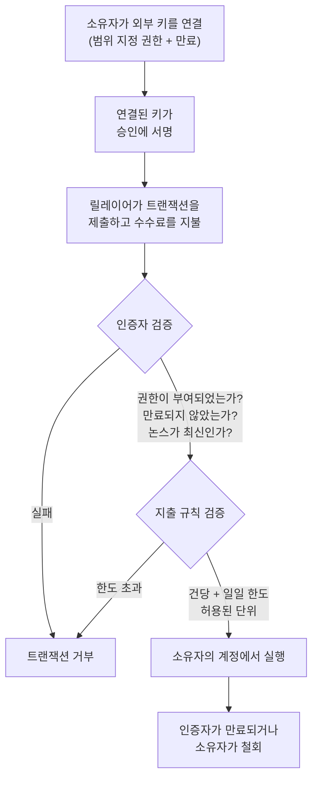

# 계정 추상화

QoreChain은 `x/abstractaccount` 모듈을 통해 **프로토콜 수준의 계정 추상화**를 제공합니다. 이 모듈은 지출 규칙이 설정된 추상 계정을 기록하고, 계정 소유자가 외부 키(**인증자**)를 연결하여 권한 및 지출 한도 범위 안에서 해당 계정으로부터 지출할 수 있도록 합니다. 외부 스마트 컨트랙트 인프라는 필요하지 않습니다.

:::danger 메인넷에서는 활성화되어 있지 않음; 테스트넷에서는 활성화됨
추상 계정 모듈은 이 글을 쓰는 시점에 **`qorechain-vladi` 메인넷에서 꺼져 있습니다**(2026년 10월 27일 확인). `qorechaind query abstractaccount config`(및 `GET /qorechain/abstractaccount/v1/config`)는 `enabled: false`를 보고합니다. **`qorechain-diana` 테스트넷**에서는 거버넌스 결정(제안 18, 2026년 10월 27일 통과)으로 켜졌으며 `enabled: true`를 보고합니다. 체인 v3.2.0부터 이 플래그는 모든 경로에서 강제됩니다. `false`인 곳에서는 체인이 계정 생성, 인증자 등록, 두 실행 레인(`MsgExecuteEVM`, `MsgExecuteCosmos`)을 모두 `abstract accounts are disabled on this chain` 오류와 함께 거부합니다. 어떤 일반 트랜잭션으로도 모듈을 켤 수 없으며, 이 설정은 거버넌스 결정으로만 바뀝니다. 메인넷에는 추상 계정 트랜잭션이 포함된 적이 한 번도 없습니다. 아래 내용은 모듈의 인터페이스를 설명한 것입니다. 테스트넷에서 사용해 보되, 모듈이 메인넷에서 활성화되기 전까지는 메인넷용 연결 키 또는 위임 지출 흐름을 구축하지 마십시오. 항상 먼저 플래그를 확인하십시오.
:::

:::note
아래 명령어는 2026년 6월 7일부터 운영 중이며 노드 릴리스 **v3.2.4**(2026년 10월 23일 높이 3,742,566에서 적용됨, 거버넌스 제안 13)를 실행하는 **`qorechain-vladi`** 메인넷을 기준으로 작성되었습니다. v3.2.6을 실행하는 테스트넷(v3.2.4는 2026년 10월 19일부터)에서는 `--chain-id qorechain-diana`로 대체하십시오.
:::

:::caution 모든 Cosmos 레인 트랜잭션에는 하이브리드 양자내성 공동 서명이 필요합니다
이 페이지의 `qorechaind tx` 예제는 수수료 플래그만 보여줍니다. 실제 네트워크에서는 모든 Cosmos 레인 트랜잭션에 ML-DSA-87 하이브리드 공동 서명도 포함되어야 하므로, `--generate-only`로 트랜잭션을 만든 다음 `qorechaind tx pqc cosign`으로 서명하십시오(또는 이를 대신 처리해 주는 QoreX나 SDK를 사용하십시오). 커뮤니티 빌드 `qorechaind`는 해당 서명을 생성할 수 없으므로 [다운로드 매니페스트](/developer-guide/running-a-node#fetch-the-manifest)의 릴리스 바이너리를 사용하십시오. 수수료 하한은 **가스 단위당 0.1 uqor**이므로 `--gas 400000`에는 최소 `--fees 40000uqor`가 필요합니다. [양자내성 서명](/developer-guide/post-quantum-signing)을 참조하십시오.
:::

## 개요

전통적인 블록체인 계정은 단일 개인 키로 제어됩니다. 계정 추상화는 "누가 트랜잭션을 승인할 수 있는가"라는 개념을 단일 암호화 키로부터 분리합니다. `x/abstractaccount` 모듈은 다음을 제공합니다.

* 계정 유형과 소유자가 기록되는 **추상 계정**
* 연결된 키가 지출할 수 있는 금액을 제한하는 **지출 규칙**(건당 한도 및 일일 한도, 허용 단위)
* **인증자**: 소유자가 범위가 지정된 권한과 만료 시점을 설정해 연결하고 언제든지 철회할 수 있는 외부 키(Phantom ed25519 키 또는 MetaMask secp256k1 주소)

*연결된 키(인증자) 흐름: 연결된 키가 승인에 서명하고, 릴레이어가 이를 제출하면, 모듈이 권한, 만료, 지출 규칙을 확인한 뒤 소유자의 계정에서 실행합니다.*



## 계정 유형

`create`는 세 가지 계정 유형 중 하나를 기록합니다. 유형은 계정에 저장되며 주소가 도출되는 방식의 일부입니다. 이 모듈에는 자체적인 멀티시그, 세션 키, 복구 트랜잭션이 없습니다(트랜잭션 서비스는 `create`, `update-rules`, `register-authenticator`, `revoke-authenticator`, `execute-cosmos`, `execute-evm`입니다).

| 유형              | 사용 목적                       |
| ----------------- | ------------------------------- |
| `multisig`        | DAO 자금, 공유 지갑             |
| `social_recovery` | 소비자 지갑, 온보딩             |
| `session_based`   | dApp 세션, 모바일 지갑          |

## 추상 계정 생성

`create`는 계정 유형을 위치 인자(`multisig`, `social_recovery` 또는 `session_based`)로 받습니다.

```bash
qorechaind tx abstractaccount create session_based \
  --from mykey \
  --gas 400000 --fees 40000uqor
```

이 명령에는 서명자, 임계값, 보증인을 위한 플래그가 없습니다.

## 인증자(연결된 키)

모듈의 위임 키 메커니즘은 아래 [연결된 지갑 인증자](#authenticators)에 설명된 **인증자**입니다. 소유자는 외부 키(ed25519 또는 secp256k1)를 일련의 권한 및 만료 시점과 함께 연결하고, 언제든지 철회할 수 있습니다.

```bash
qorechaind tx abstractaccount register-authenticator <account-address> <scheme> <pubkey-base64> <permissions-csv> <expiry-unix> <label> \
  --from mykey --gas 400000 --fees 40000uqor
qorechaind tx abstractaccount revoke-authenticator <account-address> <scheme> <pubkey-base64> \
  --from mykey --gas 400000 --fees 40000uqor
```

`scheme`은 `ed25519`(예: Phantom) 또는 `secp256k1`(예: MetaMask)입니다. `grant-session`, `revoke-session`, `query abstractaccount sessions` 명령은 없습니다.

## 지출 규칙

지출 규칙은 추상 계정에 재정적 안전장치를 추가합니다.

| 규칙             | 설명                                                  |
| ---------------- | ----------------------------------------------------- |
| `daily_limit`    | UTC 달력 기준 하루당 최대 총 지출 금액                |
| `per_tx_limit`   | 승인된 개별 실행당 최대 지출 금액                     |
| `allowed_denoms` | 지출 가능한 토큰 단위(denom) 제한 (ERC-20은 `erc20/<EIP-55 0x address>`로 표기하며, 이는 슬래시를 쓰는 지출 규칙 고유의 표기입니다. 체인은 주소를 EIP-55 형식으로 비교하므로, 입력한 대소문자가 다른 토큰을 만들어 내지는 않습니다. 이것은 등록된 토큰 쌍의 뱅크 denom이 아니며, 뱅크 denom은 콜론을 쓰는 `erc20:<EIP-55 0x address>`로 쓰고 대소문자를 구분합니다. [EVM 개발](/developer-guide/evm-development#fest-tokens) 참조) |
| `denom_limits`   | 단위별 한도를 10진수 문자열로 지정(v3.2.2): `{"denom","per_tx_limit","daily_limit"}`. 이름을 지정한 단위에 대해서는 `per_tx_limit`와 `daily_limit`를 대체하므로, 소수점 18자리 토큰에도 상한을 둘 수 있습니다 |
| `allowed_evm_calls` | 규칙에 묶인 키가 **호출 데이터와 함께** 수행할 수 있는 EVM 호출(v3.2.2). `0x<target>`(해당 컨트랙트의 모든 함수) 또는 `0x<target>/0x<selector>`(해당 함수만) 형식입니다. 항목이 없으면 규칙에 묶인 키는 값 전송, (`deploy` 권한이 있는 경우) 배포, `allowed_denoms`에 나열된 ERC-20 토큰 이동만 할 수 있습니다. 대상을 나열하면 그 대상에 대한 호출의 수신자를 포함한 모든 인자를 신뢰하게 됩니다 |

### 지출 규칙 설정

`update-rules`는 계정의 규칙을 `SpendingRule` 객체의 JSON 배열로 교체합니다(파일이나 플래그가 아닌 인라인 JSON).

```bash
qorechaind tx abstractaccount update-rules <account-address> \
  '[{"id":"daily","enabled":true,"daily_limit":1000000000,"per_tx_limit":100000000,"allowed_denoms":["uqor"]}]' \
  --from mykey --gas 400000 --fees 40000uqor
```

한도는 기본 단위(`uqor`)로 지정하며 승인된 실행마다 집계됩니다. 일일 한도는 UTC 달력 기준 하루의 총액을 제한합니다. 규칙은 저장된 규칙 전체를 교체하므로 생략한 필드는 제거됩니다. v3.2.2부터 EVM 레인은 `msg.value`만 보는 대신 호출이 실제로 이동시키는 것(네이티브 값, 계정의 네이티브 잔액 감소, 사용된 뱅크 코인, 나열된 모든 ERC-20의 잔액 또는 허용량 변화)을 측정하며, 컨트랙트 생성에는 별도의 `deploy` 권한이 필요합니다. 더 풍부한 예시(여기에 표시된 ERC-20은 테스트넷 fUSD 테스트 토큰입니다. 본인 토큰의 컨트랙트 주소를 사용하고, 규칙에서는 `erc20/<address>`처럼 슬래시를 쓰고 뱅크 denom `erc20:<address>`에서는 콜론을 쓴다는 점에 유의하세요):

```bash
qorechaind tx abstractaccount update-rules <account-address> \
  '[{"id":"daily","enabled":true,"daily_limit":5000000,"allowed_denoms":["uqor","erc20/0x97143B771D34ddb9130b807b135Ae675A5a963CA"],"allowed_evm_calls":["0xROUTER/0x38ed1739"],"denom_limits":[{"denom":"erc20/0x97143B771D34ddb9130b807b135Ae675A5a963CA","per_tx_limit":"100000000000000000000","daily_limit":"500000000000000000000"}]}]' \
  --from mykey --gas 400000 --fees 40000uqor
```

### 현재 규칙 조회

계정 레코드에는 규칙과 연결된 키의 수가 포함됩니다.

```bash
qorechaind query abstractaccount account <account-address>
```

:::caution 규칙은 키가 존재할 때만 해당 키를 제한합니다
체인은 다음 순서로 한도를 결정합니다. 인증자 자체의 규칙이 설정되어 있고 `enabled`이면 그것을, 아니면 계정의 첫 번째 `enabled` 규칙을, 그것도 없으면 **한도가 없습니다**. `enabled: false`로 저장된 규칙은 한도 0이 아니라 한도 없음입니다. `MsgRegisterAuthenticator`에는 규칙이 포함되어 있지 않으므로, 해당 메시지만으로 연결된 키는 계정 수준 규칙에 의해서만 제한됩니다. `update-rules`로 규칙을 의도적으로 설정하고, 키에 필요한 권한만 등록하십시오. 한도는 연결된 키가 입힐 수 있는 피해를 제한할 뿐, 키를 철회하는 것을 대신하지 않습니다.
:::

## 연결된 지갑 인증자 — 위임된 지출 {#authenticators}

인증자 설계는 체인 버전 **v3.1.85**(v3.1.84의 권한 모델을 기반으로 함)에서 도입되었습니다. 모듈이 꺼져 있는 동안에는 **메인넷에서 사용할 수 없으며**, 모듈이 활성화된 테스트넷에서는 사용할 수 있습니다(이 페이지 상단의 상태 안내 참조). **연결된 외부 지갑 키** — Phantom(ed25519) 키 또는 MetaMask(secp256k1) 계정 — 는 최소 권한, 지출 한도 제한, 철회 가능한 조건 하에 **표준 양자내성 계정에서 지출**할 수 있습니다. 외부 키는 ML-DSA 서명을 생성하지 않습니다. **릴레이어**가 트랜잭션 봉투를 제출하고 수수료를 지불하며(릴레이어 자신의 하이브리드 PQC 서명이 체인의 서명 요구사항을 충족합니다), 인증자가 **도메인 분리되고 재전송 방지가 적용된 서명 바이트**에 대해 남긴 서명이 승인의 근거가 됩니다.

### 인증자 등록 {#register-authenticator}

계정 소유자는 `MsgRegisterAuthenticator`(일반적인 루트 키 트랜잭션)를 사용해 외부 키를 등록하며, 이때 방식(scheme), 권한, 만료 시점, 선택적 지출 한도를 지정합니다.

```js
import { registerEthAuthenticatorMsg } from "@qorechain/wallet-adapter";

// Link a MetaMask account by its 20-byte address (EIP-191 verification):
const msg = registerEthAuthenticatorMsg({
  owner: "qor1owner...",              // the canonical account (signs this message)
  ethAddress: "0xAbC...123",          // the MetaMask address to link
  permissions: ["evm"],               // least privilege — see the taxonomy below
  expiryUnix: Math.floor(Date.now() / 1000) + 30 * 24 * 3600, // absolute Unix seconds, ≤ 30 days recommended
  label: "metamask",
});
// Limits are a separate message (MsgUpdateSpendingRules), see "Spending Rules" above.
// Sign & broadcast this msg with the OWNER's normal hybrid-PQC signer.
```

Phantom 키도 동일한 방식으로 `ed25519` 방식과 Phantom 공개 키를 사용해 등록합니다(CLI에서는 `register-authenticator`). 철회는 `MsgRevokeAuthenticator`를 통해 즉시 이루어집니다.

### 권한 분류 체계 {#permission-taxonomy}

등록된 인증자가 수행할 수 있는 작업은 11가지 표준 권한으로 제어됩니다. 이 매핑은 **기본적으로 차단(fail-closed)** 방식이며, 매핑이 없는 메시지 유형은 거부됩니다.

| 권한 | 부여되는 작업 |
| --- | --- |
| `send` | 네이티브 레인 뱅크 전송 |
| `delegate` / `withdraw` / `vote` | 스테이킹, 보상 인출, 거버넌스 |
| `evm` / `wasm` / `svm` | 해당 VM 레인에서의 실행 |
| `amm` / `ibc` / `deploy` | AMM 작업, IBC 전송, 컨트랙트 배포 |
| `all` | *위임 가능한* 모든 메시지 |

**키 관리 메시지는 절대 위임할 수 없습니다** — `MsgRegisterAuthenticator`, `MsgRevokeAuthenticator`, PQC 키 등록/마이그레이션, `MsgRotatePQCKey`는 항상 루트 키를 필요로 하므로, 연결된 키가 스스로 권한을 상승시킬 수 없습니다. 스키마(`schema_version` 2)에는 `lane_rules`도 나열되어 있습니다. 계정 주소에서의 컨트랙트 생성, 계정의 EVM 논스를 증가시키는 호출, 코드가 EIP-7702 위임인 경우 계정 자신에 대한 호출에는 각각 `deploy` 또는 `all` 권한이 필요합니다. v3.2.3부터 등록은 알 수 없는 권한 문자열과 절대 검증될 수 없는 65바이트 secp256k1 키를 거부합니다.

하드코딩하지 말고 실시간 분류 체계(드리프트 감지를 위한 `schema_version` 포함)를 조회하십시오.

```bash
curl -s https://api.qore.host/qorechain/abstractaccount/v1/permission_schema | jq
# or: qorechaind query abstractaccount permission-schema
```

### 연결된 키로 지출하기 {#execute-messages}

인증자가 승인한 작업은 두 가지 메시지로 전달됩니다. 두 경우 모두 릴레이어가 트랜잭션의 서명자/수수료 지불자이며, 인증자의 서명은 메시지 내부에 담겨 전달됩니다.

**`MsgExecuteEVM`** — 표준 계정의 `0x…` 주소에서 이루어지는 EVM 호출 또는 전송입니다. 인증자는 `sha256("qorechain-evm-auth-v1" ‖ chainId ‖ account ‖ pubkey ‖ to ‖ value ‖ data ‖ nonce)`(모든 필드는 길이 접두사 포함)에 서명합니다. v3.2.3(`abstractaccount-hardening` 기능)부터 체인은 **v2 다이제스트**, 즉 `sha256("qorechain-evm-auth-v2" ‖ … ‖ nonce ‖ gasLimit)`를 요구하며, 이는 호출의 가스 한도(8바이트 빅엔디언)도 바인딩하므로 릴레이어가 다른 한도로 서명을 재전송할 수 없습니다. 어떤 블록도 두 형식을 모두 수락하지 않습니다. `qorechaind query abstractaccount auth-sign-evm`은 이를 위해 `--gas-limit`을 받으며, 같은 값을 `execute-evm`에도 전달합니다. 재전송 방지는 계정 자체의 EVM 논스를 통해 이루어집니다.

**`MsgExecuteCosmos`** — 표준 계정에서 이루어지는 네이티브 레인 뱅크 전송입니다. 인증자는 `sha256("qorechain-cosmos-auth-v1" ‖ chainId ‖ account ‖ pubkey ‖ to ‖ amount ‖ nonce)`에 서명합니다. 재전송 방지는 모듈이 관리하는 **인증자별 시퀀스**를 통해 이루어집니다(뱅크 전송은 계정 논스를 증가시키지 않습니다). 자기 자신에게 보내는 전송은 거부됩니다.

:::caution 논스 규칙
* `MsgExecuteEVM.nonce`는 계정의 **현재** EVM 논스(`eth_getTransactionCount(account0x, "latest")`)여야 합니다. 실제 운영 환경에서 릴레이어는 *다른* 계정이므로 +1을 더하지 **마십시오**. 오래된 논스로 서명하면 코드 `11`이 반환됩니다.
* `MsgExecuteCosmos.nonce`는 인증자별 시퀀스입니다(계정의 인증자 상태를 조회하십시오). 계정의 Cosmos 시퀀스가 **아닙니다**. v3.2.4부터(테스트넷은 2026년 10월 19일부터, 메인넷은 2026년 10월 23일부터) `GET /qorechain/abstractaccount/v1/auth_nonce/{address}/{pubkey_hex}`가 해당 시퀀스(`nonce`, `linked`)를 직접 반환합니다.
:::

**Phantom 예시**(브라우저: Phantom이 서명하고, 백엔드가 릴레이합니다):

```js
import { buildPhantomExecuteCosmos } from "@qorechain/wallet-adapter";

// In the dApp: Phantom signs the digest with ed25519 signMessage.
const msg = await buildPhantomExecuteCosmos({
  wallet: window.solana,              // Phantom: { publicKey, signMessage }
  relayer: "qor1relayer...",          // submits the tx and pays the fee (a different account)
  chainId: "qorechain-vladi",
  account: "qor1owner...",            // canonical account being spent from
  to: "qor1recipient...",
  amount: "900000uqor",               // single-coin string
  nonce: authSequence,                // per-authenticator sequence
});
// Send `msg` to your relayer; the relayer wraps it in a tx it signs
// (hybrid PQC) and broadcasts. The transfer moves the OWNER's funds.
```

**MetaMask 예시**(연결된 20바이트 주소로부터의 EIP-191 `personal_sign`):

```js
import { buildMetaMaskExecuteEvm } from "@qorechain/wallet-adapter";

const msg = await buildMetaMaskExecuteEvm({
  provider: window.ethereum,          // MetaMask (EIP-1193)
  address: ethAddress,                // the linked 20-byte address
  relayer: "qor1relayer...",
  chainId: "qorechain-vladi",
  account: "qor1owner...",
  to: "0xRecipient...",
  value: (10n ** 16n).toString(),     // 0.01 QOR in wei (18-decimal EVM view), as a decimal string
  gasLimit: 100000,
  nonce: currentEvmNonce,             // eth_getTransactionCount(owner0x, "latest")
});
// Relay as above. The chain verifies the signature via EIP-191 + ecrecover
// against the registered 20-byte address.
```

동일한 빌더 함수가 5개 언어 모두를 위한 [QoreChain SDK](/sdk/guides/authenticators)에도 제공되며, CLI에서도 동등한 기능을 사용할 수 있습니다.

```bash
# Generate an ed25519 authenticator key: the seed goes to a new 0600 file, only the public key is printed
qorechaind query abstractaccount auth-keygen --out authenticator.seed

# Sign the exact bytes the chain verifies (seed from --seed-file, "-" for stdin, QORE_AUTH_SEED, or a prompt)
qorechaind query abstractaccount auth-sign-cosmos <chain-id> <account> <to> <amount> <nonce> --seed-file authenticator.seed
qorechaind query abstractaccount auth-sign-evm <chain-id> <account> <to-0xhex> <value-wei> <data-hex> <nonce> --seed-file authenticator.seed

# Relay a pre-signed authorization (the relayer's --from key pays; cosign the envelope with `tx pqc cosign`)
qorechaind tx abstractaccount execute-cosmos <account> <to> <amount> <scheme> <pubkey-base64> <signature-base64> <nonce> --from relayer --generate-only > tx.json
qorechaind tx abstractaccount execute-evm <account> <to-0xhex> <value-wei> <data-hex> <gas-limit> <scheme> <pubkey-base64> <signature-base64> <nonce> --from relayer --generate-only > tx.json
```

이 명령어의 키와 서명은 base64입니다. `auth-sign-*` 도우미는 시드를 명령줄 인자가 아니라 파일, 표준 입력 또는 환경 변수에서 읽으므로(노드 릴리스 v3.2.1 이상) 셸 히스토리에 남지 않습니다. 시드 처리 플래그(`--out`, `--seed-file`)는 v3.2.1 이상 바이너리에만 있습니다.

### 오류 코드 {#authenticator-errors}

시행 실패는 지갑이 올바른 메시지를 표시할 수 있도록 구분된 코드(코드스페이스 `abstractaccount`)로 반환됩니다.

| 코드 | 의미 | 지갑 UX |
| --- | --- | --- |
| `5` | 지출 한도 초과(건당 또는 일일) | 남은 허용 한도를 표시 |
| `6` | 인증자 만료 | "만료됨 — 지갑을 다시 연결하십시오" |
| `9` | 모듈 비활성화(메인넷의 현재 상태) | "연결된 지갑은 아직 사용할 수 없습니다" |
| `10` | 권한 거부(범위 밖이거나 위임 불가능한 메시지) | 부족한 권한을 표시 |
| `11` | 재전송 거부(오래된 논스/시퀀스) | 논스를 다시 조회하고 재서명 |

(코드스페이스 `pqc` 코드 `21` = 하이브리드 서명 검증 실패 — 승인 문제가 아니라 릴레이어 측 서명 문제입니다.)

### REST 조회 {#abstractaccount-rest}

모듈의 읽기 조회 기능은 REST를 통해 제공됩니다(**v3.1.85**부터).

```
GET /qorechain/abstractaccount/v1/config      # {"config":{"enabled":false,...}} on mainnet today; enabled: true on the testnet
GET /qorechain/abstractaccount/v1/accounts
GET /qorechain/abstractaccount/v1/accounts/{address}
GET /qorechain/abstractaccount/v1/permission_schema
```

## 추상 계정 조회

### CLI

```bash
# Module configuration (enabled flag and limits)
qorechaind query abstractaccount config

# Get full account configuration
qorechaind query abstractaccount account <address>

# List all abstract accounts (paginated)
qorechaind query abstractaccount accounts --page-limit 10
```

메인넷에서는 계정 목록이 비어 있습니다. 테스트넷에는 계정이 몇 개(2026년 10월 27일 기준 네 개) 나열되며, 그중 일부는 활성화 플래그가 모든 경로에서 강제되기 전에 생성되었습니다.

### JSON-RPC

> **아직 제공되지 않음:** 릴리스된 어떤 노드 빌드도 `qor_` JSON-RPC 네임스페이스를 제공하지 않으므로, `qor_getAbstractAccount`는 현재 모든 공개 엔드포인트에서 `-32601`(메서드를 찾을 수 없음)을 반환합니다. 위의 REST 경로나 CLI를 사용하십시오. [`qor_` 네임스페이스](/api-reference/json-rpc-qor_-namespace)를 참조하십시오.

### 계정 응답 예시

추상 계정 레코드의 형태입니다(예시 값).

```json
{
  "address": "qor1myaccount...",
  "account_type": "session_based",
  "owner": "qor1owner...",
  "spending_rules": [
    {
      "id": "daily",
      "enabled": true,
      "daily_limit": "1000000000",
      "per_tx_limit": "100000000",
      "allowed_denoms": ["uqor"]
    }
  ]
}
```

## 소셜 복구

`social_recovery`는 계정 유형이지만, 모듈에는 복구 트랜잭션이 없습니다. `initiate-recovery`나 `approve-recovery` 명령도 없고, 모듈의 트랜잭션 서비스에 복구 메시지도 없습니다. QoreChain 계정의 키 복구는 니모닉에서 계정의 양자내성 키를 다시 도출하고(`tx pqc recover-key`), 필요하면 교체(`tx pqc rotate-key`)하는 방식으로 이루어집니다. [양자내성 서명](/developer-guide/post-quantum-signing)을 참조하십시오.

## dApp과의 통합

모듈이 활성화되면 연결된 키 승인은 다음과 같은 흐름을 위한 것입니다.

* 반복적인 생체 인증 요청이 사용성을 해치는 모바일 지갑
* 제한된 허용 한도 내에서 빠른 트랜잭션 서명이 필요한 게임 dApp
* Phantom 또는 MetaMask 사용자가 릴레이어를 통해 자신의 QoreChain 계정에서 지출하는 경우

dApp 백엔드가 릴레이어 역할을 합니다. 연결된 키의 서명된 승인을 받아 자신이 서명하는 트랜잭션으로 감싼 뒤 브로드캐스트합니다. 연결된 키는 언제든지 철회되거나 만료될 수 있습니다. 대상 네트워크에서 모듈이 활성화되기 전까지는 [QoreX 또는 SDK](/sdk/overview)를 통한 일반 서명을 사용하십시오.

## 다음 단계

* [검증자 운영](/developer-guide/running-a-validator) — 검증자 노드 설정 및 운영
* [EVM 개발](/developer-guide/evm-development) — EVM 도구, 계정 및 EVM 승인 창
* [크로스-VM 상호운용성](/developer-guide/cross-vm-interoperability) — 크로스-VM 메시징
