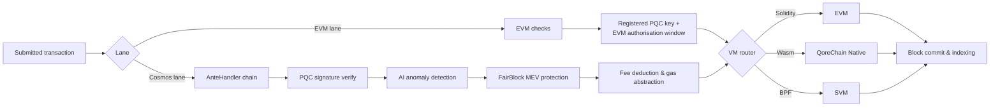

# 아키텍처 개요

QoreChain은 체인 노드, AI 사이드카, 블록 인덱서라는 세 가지 주요 프로세스로 구성된 모듈형 블록체인 노드이며, Postgres 데이터베이스를 기반으로 하고 Prometheus와 Grafana를 통해 모니터링됩니다. 메인넷(`qorechain-vladi`, EVM 체인 ID **9801**)은 2026년 6월 7일부터 가동 중이며 릴리스 **v3.2.5**(2026년 10월 29일 높이 3,906,833에서 적용. v3.2.4는 10월 23일 높이 3,742,566에서 적용됨)를 실행하고, 병행하는 테스트넷(`qorechain-diana`, EVM 체인 ID **9800**, 2026년 10월 27일부터 v3.2.6 실행)도 운영되고 있습니다. 이 체인은 Cosmos SDK v0.53 위에 구축되었습니다. 아래 다이어그램은 상위 수준의 컴포넌트 구성을 보여줍니다.

아래의 트랜잭션 라이프사이클은 제출된 트랜잭션이 노드를 통과하는 흐름을 요약합니다 — AnteHandler 데코레이터 체인(보안 및 수수료 검사)에서 VM 실행 및 온체인 정산에 이르기까지:



```
┌────────────────────────────────────────────────────────────────────────────┐
│                            QoreChain Node                                  │
│                                                                            │
│  ┌──────────────────── Virtual Machines ──────────────────────┐           │
│  │  ┌───────┐    ┌──────────┐    ┌───────┐                   │           │
│  │  │  EVM  │    │QoreChain │    │  SVM  │                   │           │
│  │  │(Sol.) │◄──►│ Native   │◄──►│ (BPF) │                   │           │
│  │  └───┬───┘    └────┬─────┘    └───┬───┘                   │           │
│  │      └─────────┬───┘──────────────┘                       │           │
│  │           x/crossvm (bridge)                               │           │
│  └────────────────────────────────────────────────────────────┘           │
│                                                                            │
│  ┌────────────────────── Tokenomics ─────────────────────────┐           │
│  │  ┌──────┐   ┌───────┐   ┌───────────┐                    │           │
│  │  │x/burn│   │x/xqore│   │x/inflation│                    │           │
│  │  │12 src│   │lock/  │   │capped     │                    │           │
│  │  │37/30/│   │unlock │   │emission   │                    │           │
│  │  │20/10/│   │PvP    │   │emission   │                    │           │
│  │  │3     │   │       │   │590M cap   │                    │           │
│  │  └──────┘   └───────┘   └───────────┘                    │           │
│  └────────────────────────────────────────────────────────────┘           │
│                                                                            │
│  ┌──────────── IBC / Bridges ────────────────────────────────┐           │
│  │  ┌──────────┐  ┌──────────┐  ┌───────────┐  ┌──────────┐ │           │
│  │  │x/bridge  │  │x/babylon │  │x/abstract │  │x/gas     │ │           │
│  │  │37 QCB    │  │BTC re-   │  │ account   │  │abstract. │ │           │
│  │  │configs   │  │staking   │  │session key│  │multi-tok │ │           │
│  │  └────┬─────┘  └────┬─────┘  └───────────┘  └──────────┘ │           │
│  │  QCB Bridge     Babylon IBC   ERC-4337-like   ibc/USDC    │           │
│  │  PQC-signed     BTC finality  social recov.   ibc/ATOM    │           │
│  │  36 ext chains  checkpoint    spending rules  fee convert  │           │
│  │  ┌──────────┐                                              │           │
│  │  │x/fair    │  Lane config (not enforced): PQC|MEV|AI|... │           │
│  │  │ block    │  tIBE encrypted mempool framework           │           │
│  │  └──────────┘                                              │           │
│  └────────────────────────────────────────────────────────────┘           │
│                                                                            │
│  ┌──── Rollup Development Kit ───────────────────────────────┐           │
│  │  ┌──────────┐  ┌──────────┐  ┌───────────┐  ┌──────────┐ │           │
│  │  │ x/rdk    │  │Settlement│  │ DA Router │  │ Profiles │ │           │
│  │  │ 4 modes: │  │Optimistic│  │ Native    │  │ defi     │ │           │
│  │  │ opt/zk/  │  │ZK/Based/ │  │ Celestia* │  │ gaming   │ │           │
│  │  │ based/   │  │Sovereign │  │ Both      │  │ nft      │ │           │
│  │  │ sovereign│  │          │  │           │  │ social/  │ │           │
│  │  │          │  │          │  │           │  │ general  │ │           │
│  │  └────┬─────┘  └────┬─────┘  └───────────┘  └──────────┘ │           │
│  │  Bank escrow    Auto-finalize  SHAKE-256 commit AI-assisted │           │
│  │  Burn on create EndBlocker     Blob pruning    PRISM sugg. │           │
│  │  → x/multilayer (RegisterSidechain + AnchorState)          │           │
│  └────────────────────────────────────────────────────────────┘           │
│                                                                            │
│  ┌──────────────┐ ┌──────┐ ┌────────────┐ ┌─────┐                       │
│  │x/rlconsensus │ │ x/ai │ │x/reputation│ │x/qca│                       │
│  │  PRISM (RL)  │ │      │ │            │ │     │                       │
│  └──────┬───────┘ └──┬───┘ └────┬──────┘ └──┬──┘                       │
│   PPO MLP         AI Engine   Scoring    CPoS Pools                      │
│   Obs/Action      Fraud Det.  Decay      Bonding                         │
│   Circuit Brk     Fee Opt.    Sigmoid    Slashing                        │
│   Rollup Adv.     TEE/FL                 QDRW Gov                        │
│                                                                            │
│  ┌──────┐ ┌──────────┐                                                   │
│  │x/pqc │ │ x/multi  │                                                   │
│  └──┬───┘ └────┬─────┘                                                   │
│  Dilithium    Layer Router                                                │
│  ML-KEM       Sidechains                                                  │
│  Hybrid Sig   + Rollups                                                   │
│  SHAKE-256                                                                │
│                                                                            │
│  ┌──────┐ ┌───────┐                                                      │
│  │x/svm │ │x/cross│                                                      │
│  └──┬───┘ └───┬───┘                                                      │
│  BPF Exec   CrossVM Msg                                                   │
└────────┬──────┬───────────────────────────────────────┬───────────────────┘
         │      │                                       │
   ┌─────┴─────┐│                              ┌───────┴──────┐
   │libqorepqc ││                              │  Indexer     │
   │(Rust PQC) ││                              │  (Postgres)  │
   └───────────┘│                              └──────────────┘
   ┌───────────┐│  ┌──────────┐
   │libqoresvm ││  │AI Sidecar│
   │(Rust BPF) │└──│ (gRPC)   │
   └───────────┘   └──────────┘
```

## 노드 구성 요소

QoreChain은 각각 고유한 Go 모듈과 바이너리를 가진 세 가지 협력 프로세스로 실행됩니다:

| 구성 요소          | 설명                                                                                                                                                                                                                                                                                          | 위치                  |
| ------------------ | ---------------------------------------------------------------------------------------------------------------------------------------------------------------------------------------------------------------------------------------------------------------------------------------------------- | ------------------------- |
| **qorechain-node** | 핵심 블록체인 노드입니다. QoreChain 컨센서스 엔진을 실행하고, 모든 커스텀 모듈을 실행하며, 세 가지 VM 런타임을 모두 관리하고, RPC, REST, gRPC, JSON-RPC 엔드포인트를 노출합니다.                                                                                                                      | `qorechain-core/`         |
| **ai-sidecar**     | QCAI 백엔드를 기반으로 고급 AI 추론 기능을 제공하는 gRPC 서비스입니다. 이 사이드카는 자연어 분석이나 복잡한 패턴 인식처럼 온체인 RL 에이전트의 범위를 벗어나는 추론 요청을 처리합니다. 포트 50051에서 gRPC를 통해 노드와 통신합니다. | `qorechain-core/sidecar/` |
| **block-indexer**  | 노드의 RPC 엔드포인트에서 새로운 블록과 트랜잭션을 구독하는 WebSocket 리스너로, 이벤트를 파싱하여 구조화된 데이터를 Postgres 데이터베이스에 기록함으로써 익스플로러와 API가 빠르게 조회할 수 있도록 합니다.                                                                                                          | `qorechain-core/indexer/` |

## 포트

| 포트  | 프로토콜       | 서비스                                                                           |
| ----- | -------------- | --------------------------------------------------------------------------------- |
| 26657 | HTTP/WebSocket | QoreChain 컨센서스 엔진 RPC(블록, 트랜잭션, 컨센서스 상태)            |
| 1317  | HTTP           | REST API(조회 엔드포인트, 트랜잭션 브로드캐스트)                                 |
| 9090  | gRPC           | gRPC 조회 및 트랜잭션 엔드포인트                                              |
| 8545  | HTTP           | EVM JSON-RPC(`eth_`, `web3_`, `net_`, `txpool_` 네임스페이스)              |
| 8546  | WebSocket      | EVM JSON-RPC(WebSocket 구독)                                            |
| 8899  | HTTP           | SVM JSON-RPC(Solana 호환: `getAccountInfo`, `getBalance`, `getSlot` 등) |
| 50051 | gRPC           | AI 사이드카(노드로부터의 추론 요청)                                     |
| 5432  | TCP            | Postgres(블록 인덱서 저장소)                                                |
| 26660 | HTTP           | 노드 Prometheus 메트릭 엔드포인트                                                 |
| 9091  | HTTP           | Prometheus 서버(Docker Compose 스택의 호스트 포트)                                  |
| 3001  | HTTP           | Grafana 대시보드(Docker Compose 스택의 호스트 포트; 컨테이너 포트 3000)            |

## 모듈 맵

QoreChain은 기능별로 그룹화된 **48개의 제네시스 모듈(그중 20개가 QoreChain 전용)**을 등록합니다:

**보안**

* `x/pqc` — 양자내성암호: Dilithium-5, ML-KEM-1024, 하이브리드 secp256k1(ECDSA) + ML-DSA-87, SHAKE-256, 알고리즘 애자일리티

**AI 및 머신러닝**

* `x/ai` — 트랜잭션 라우팅, 이상 탐지, 사기 탐지, 수수료 최적화, TEE 증명, 연합 학습
* `x/reputation` — 시간에 따라 감쇠하는 다요소 검증인 평판 점수 산정
* `x/rlconsensus` — 온체인 RL 에이전트(PPO MLP), 컨센서스 튜닝 설계, 서킷 브레이커, 롤업 어드바이저리 — PRISM 최적화 레이어(실제 가동 네트워크에서는 관찰 전용: 로드된 정책 없음)

**컨센서스**

* `x/qca` — 트리플 풀 복합 PoS(RPoS/DPoS/PoS) 설계, 커스텀 본딩 커브, 누진 슬래싱, QDRW 거버넌스 — 구현되어 있으나 아직 블록 생성, 보상, 슬래싱 또는 거버넌스 집계에는 연결되지 않음

**가상 머신**

* `x/vm` — VM 라우팅 및 라이프사이클 관리
* `x/svm` — SVM 런타임: BPF 배포/실행, 렌트 징수, Solana 호환 RPC
* `x/crossvm` — 크로스 VM 통신: EVM-QoreChain Native 프리컴파일 + SVM 비동기 이벤트

**토크노믹스 및 유동성**

* `x/burn` — 12개의 소각 소스(v3.2.4부터 13개), EndBlocker 수수료 분배(37/30/20/10/3 분할)
* `x/xqore` — 거버넌스로 강화된 스테이킹 설계: 잠금/해제, 단계적 탈퇴 페널티, PvP 리베이스(회계 처리만 해당; 잠금 및 해제 트랜잭션은 아직 실제 가동 네트워크에 연결되지 않음)
* `x/inflation` — 제한된 방출: 하드 누적 상한(590,000,000 QOR)에 도달할 때까지 에포크마다 고정된 양을 발행
* `x/amm` — 온체인 유동성 / 자동화 마켓 메이커

**브리지 및 상호운용성**

* `x/bridge` — 모든 주요 체인 유형을 아우르는 37개의 체인 구성(36개 외부 체인 + IBC를 통한 Injective), PQC 서명 증명, 서킷 브레이커(모든 구성이 `pending` 상태이며 가동 전)
* `x/babylon` — Babylon Protocol을 통한 BTC 리스테이킹, 에포크 체크포인트(설계 단계; 활성화된 트랜잭션 없음)
* `x/multilayer` — 사이드체인/페이체인/롤업 레이어 관리, 상태 앵커링

**거버넌스 및 라이선싱 확장**

* `x/abstractaccount` — 스마트 계정: 다중서명, 소셜 복구, 세션 키, 지출 규칙(메인넷에서는 꺼져 있음, `enabled = false`. 테스트넷에서는 켜져 있음)
* `x/fairblock` — MEV 방지: 임계값 IBE로 암호화된 멤풀 프레임워크(두 네트워크 모두에서 비활성화됨)
* `x/gasabstraction` — 멀티토큰 가스 결제 설계: ibc/USDC, ibc/ATOM 수수료 변환(아직 수락되는 IBC 수수료 토큰이 없으므로 수수료는 QOR로 지불됨)
* `x/license` — 체인 라이선싱

**롤업**

* `x/rdk` — 롤업 개발 키트: 4가지 정산 모드(옵티미스틱, zk, based, 소버린), 프리셋 프로필, 네이티브 DA, 뱅크 에스크로

## AnteHandler 체인

모든 트랜잭션은 실행되기 전에 데코레이터 체인을 통과하며, 어떤 데코레이터든 트랜잭션을 거부할 수 있습니다. 체인은 두 가지입니다.

**Cosmos 레인**(순서대로): `RejectMessages`(이 레인에서는 `MsgEthereumTx` 불가) → `AuthzLimiter`(authz 내부에서 EVM 또는 베스팅 생성 메시지 불가, v3.2.3부터는 양자내성 키 관리 메시지도 불가) → `SetUpContext` → 멤풀 및 멀티시그 깊이 가드 → QoreChain Native 시뮬레이션 가스, 트랜잭션 카운터, 가스 레지스터 및 컨트랙트 데코레이터 → `CircuitBreaker` → 확장 옵션 검사 → `ValidateBasic` → `TxTimeout` → `Memo` → 검증인 라이선스 게이트(`MsgCreateValidator`) → `PQCVerify` → `PQCHybridVerify` → `PQCReplayGuard` → `AIAnomaly`(발신자별 속도 제한 포함) → `FairBlock` → `SVMComputeBudget` → `SVMDeductFee` → `MinGasPrice` → `ConsumeTxSize` → `GasAbstraction` → `DeductFee` → `SetPubKey` → `ValidateSigCount` → `SigGasConsume` → `SigVerify` → `IncrementSequence` → 소각 트랜잭션 카운터 → IBC 중복 릴레이 검사 → 요청 가스 추적.

**EVM 레인**(Ethereum 확장 옵션을 포함한 트랜잭션): `CircuitBreaker` → EVM 모노 데코레이터(서명, 논스, 수수료 및 잔액 검사) → `EVMWindowDecorator`(등록된 양자내성 키와 유효한 승인 윈도우; [EVM 승인 윈도우](/getting-started/first-transaction#evm-window) 참조).

Cosmos 레인의 핵심 데코레이터:

1. **PQCVerify** — 모듈 `x/pqc`. PQC 플래그가 지정된 트랜잭션에 대해 Dilithium-5 서명을 검증합니다.
2. **PQCHybridVerify** — 모듈 `x/pqc`. secp256k1(ECDSA) + ML-DSA-87 이중 하이브리드 서명을 검증합니다.
3. **AIAnomaly** — 모듈 `x/ai`. 아이솔레이션 포레스트 이상 탐지와 위험도 산정을 실행하고 발신자별 트랜잭션 한도를 적용합니다.
4. **FairBlock** — 모듈 `x/fairblock`. MEV 방지를 위해 tIBE로 암호화된 트랜잭션을 처리합니다(실제 가동 네트워크에서는 비활성화됨).
5. **SVMComputeBudget** — 모듈 `x/svm`. SVM 프로그램의 컴퓨트 유닛을 검증하고 할당합니다.
6. **SVMDeductFee** — 모듈 `x/svm`. SVM 전용 실행 수수료를 차감합니다.
7. **GasAbstraction** — 모듈 `x/gasabstraction`. 차감 전에 네이티브가 아닌 수수료 토큰을 변환합니다(현재 수수료는 QOR로 지불됨).

## Docker Compose 스택

전체 개발 스택은 공유 브리지 네트워크(`qorechain-net`) 위에서 6개 서비스로 구성된 Docker Compose 배포로 실행됩니다:

| 서비스          | 이미지                      | 용도                                             |
| ---------------- | -------------------------- | --------------------------------------------------- |
| `qorechain-node` | `qorechain-core:latest` (Dockerfile에서 로컬로 빌드됨; 게시된 노드 이미지 없음) | 모든 모듈, VM, RPC 엔드포인트를 갖춘 체인 노드 |
| `ai-sidecar`     | `ghcr.io/qorechain/ai-sidecar:latest` | AI 추론 서비스(gRPC + QCAI 백엔드)          |
| `block-indexer`  | `ghcr.io/qorechain/block-indexer:latest` | 블록/트랜잭션 인덱서(WebSocket + Postgres)    |
| `postgres`       | `postgres:16-alpine`       | 블록 인덱서용 데이터베이스                      |
| `prometheus`     | `prom/prometheus:v3.10.0`  | 메트릭 수집 및 저장                        |
| `grafana`        | `grafana/grafana:12.4.1`   | 모니터링 대시보드 및 알림                 |

전체 스택 시작:

```bash
docker compose up -d
```

처음 시작하기 전에 `.env.example`을 `.env`로, `.env.sidecar.example`을 `.env.sidecar`로 복사하고 `GRAFANA_PASSWORD`를 설정하세요(설정하지 않으면 Compose가 시작되지 않습니다).

모든 영구 데이터는 `node-data`, `postgres-data`, `prometheus-data`, `grafana-data`라는 이름의 Docker 볼륨에 저장됩니다.

## 관련 문서

* [멀티레이어 아키텍처](/architecture/multilayer-architecture) — 사이드체인 등록과 상태 앵커링.
* [합의 메커니즘](/architecture/consensus-mechanism) — 블록 생성, 파이널리티, 슬래싱.
* [PRISM Consensus Engine](/architecture/prism-consensus-engine) — AI 기반 파라미터 최적화.
* [포스트 양자 보안](/architecture/post-quantum-security) — 스택 전반의 Dilithium-5 서명.
