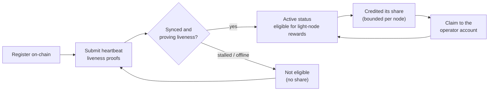

# 보상 및 모니터링

등록된 라이트 노드는 라이트 노드 할당분의 일부를 지급받으며, 그 자격을 계속 유지하려면 **건강한 상태를 유지해야** 합니다. 이 페이지에서는 3% 라이트 노드 보상 분배분, 보상이 지급되고 청구되는 방식, 노드가 위임에 대해 하는 일과 하지 않는 일, 그리고 노드를 모니터링하는 방법을 다룹니다.

:::note 보상 프로그램 등록은 아직 열리지 않았습니다
등록에는 `lightnode_operator` 라이선스가 필요하고 아직 부여된 라이선스가 없으므로, 아직 어느 네트워크에도 등록된 라이트 노드가 없습니다. 여기에 설명된 보상 회계는 온체인에서 라이브 상태이지만, 현재 노드에 지급되는 것은 없으며 이 페이지의 어떤 내용도 수익을 약속하는 것이 아닙니다. [보상 프로그램의 상태](/light-node/overview#reward-program-status)를 참고하세요.
:::

## 3% 블록 보상 분배분

QoreChain의 수수료 분배는 네트워크 데이터를 제공하는 **라이트 노드에 고정 3% 분배분**을 예약합니다. 이는 프로토콜 보상 분할의 다섯 가지 목적지 중 하나이며 — 검증자(37%), 소각(30%), 트레저리(20%), 스테이커(10%), 그리고 **라이트 노드(3%)** — 온체인에서 강제됩니다. 전체 내역은 [토크노믹스](/architecture/tokenomics)를 참고하세요.

이 분배분에 참여하려면, 노드는 자체 신고가 아니라 온체인에서 확인되는 다음 조건을 충족해야 합니다: 활성화된 `lightnode_operator` 라이선스(등록 시 확인됨), 최소 **1,000 QOR 본딩** — 위임하는 모든 검증자에 걸친 총합으로 계산되며 검증자별이 아니고, 등록 시 필요하며 보상이 지급될 때마다 스테이킹에서 다시 읽어 확인됨 — 그리고 등록 시 한 번 지불하는 **1 QOR**의 등록 수수료입니다. 참여는 네트워크 전체적으로 **10,000개 라이트 노드**로 제한됩니다. 등록이 어떻게 동작하는지는 [등록 및 라이선싱](/light-node/registration-and-licensing)을, 등록이 열려 있는지 여부는 [보상 프로그램의 상태](/light-node/overview#reward-program-status)를 참고하세요.

3%는 라이트 노드 모듈로 흘러 들어가는 금액이지 노드별 수급권이 아닙니다. 자격을 갖춘 각 노드는 누적된 금액 중 스테이크 가중치에 따른 몫을 지급받으며, 노드별로 `max_reward_per_block_per_node`(현재 블록당 `1713` uqor, 가동률에 따라 조정됨)로 상한이 제한되고, 얻지 못한 금액은 거버넌스 투표로만 해제할 수 있는 준비금으로 갑니다. [3% 라이트 노드 보상 분배분](/light-node/overview#the-3-light-node-reward-share)을 참고하세요.

등록과 위임을 마친 뒤에는, 자격을 유지하는 것은 곧 라이브 상태를 유지하는 문제가 됩니다. 노드는 최소 **80% 가동률**을 유지해야 하며, **1,000블록 간격**(측정된 평균 블록 시간 약 3.2초 기준 메인넷에서 약 54분, 블록을 대략 초당 한 번 생성하는 테스트넷에서는 약 17분)으로 하트비트 라이브니스 증명을 계속 제출해야 합니다.

**타이밍 규칙.** 체인은 **이전 하트비트로부터 1,000블록 미만**에 전송된 하트비트를 거부합니다(`heartbeat submitted too early`). 등록 후 첫 하트비트에는 이러한 하한이 없습니다. 마지막 하트비트로부터(아직 보내지 않았다면 등록 시점으로부터) **1,000 + 100블록**(`heartbeat_interval`에 `heartbeat_grace_period`를 더한 값, 메인넷에서 약 54분에 유예 약 5분) 이내에 하트비트가 도착하지 않으면, 노드는 비활성으로 표시되고 더 이상 보상이 지급되지 않습니다. 이후에 전송된 하트비트도 여전히 승인되며 노드를 다시 활성화합니다. 데몬은 체인의 자체 `last_heartbeat` 기준으로 1,000블록이 지나는 즉시 다음 하트비트를 전송하며, 60초마다 확인합니다.

**창을 놓치면 가동률만 잃을 뿐, 등록 자체는 잃지 않습니다.** 창을 놓친 노드는 비활성으로 표시되어 보상을 받지 못하게 되지만, 바로 다음에 성공하는 하트비트가 노드를 다시 활성화합니다 — 재등록할 필요는 없습니다. **가동률**은 등록한 블록 이후 받은 하트비트 수를 예상된 하트비트 수(1,000블록당 하나)로 나눈 누적 비율이며 1을 상한으로 합니다. `min_uptime_for_rewards` 임계값(`0.80`) 미만이면 노드는 아무것도 얻지 못하고, 그 이상이면 노드별 상한이 가동률에 따라 조정됩니다. 따라서 긴 장애는 이 비율을 낮추며, 제때의 하트비트가 쌓여야만 회복됩니다. 노드가 비활성으로 표시되면 `status`를 확인하세요. 서명자, 라이선스, 등록 상태를 보고합니다.

:::note 하트비트가 실제로 증명하는 것
성공한 하트비트는 운영자의 키가 제때 서명했다는 것을 증명할 뿐, 노드가 전체 소프트웨어를 계속해서 실행하고 있다는 것을 증명하지는 않습니다. 이를 "활성 노드로 검증됨"이 아니라 라이브니스 서명으로 취급하세요.
:::

:::note `last_heartbeat`는 타임스탬프가 아니라 블록 높이입니다
노드의 온체인 기록을 직접 조회하는 경우, `last_heartbeat`는 블록 높이이며, 값이 `0`이라는 것은 아직 하트비트가 기록되지 않았다는 뜻입니다 — 이 경우 체인은 노드의 `registered_at` 높이부터 비활성 기한을 측정합니다. `0`을 단순한 경과 시간 계산으로 읽으면 갓 등록한 노드가 수백만 블록이나 밀린 것처럼 보이게 됩니다.
:::

*보상 자격: 활성화된 온체인 라이선스와 최소 본딩 스테이크를 보유하고 등록한 뒤, 가동률 및 하트비트 간격 임계값을 넘는 상태를 유지하기 위해 하트비트로 라이브니스를 계속 증명하세요.*



## 보상이 동작하는 방식 {#how-rewards-work}

### 지급

100블록마다 체인은 자격을 갖춘 각 노드(활성 상태이고, 최소 본딩 스테이크와 최소 가동률을 충족하는 노드)에게 [3% 라이트 노드 보상 분배분](/light-node/overview#the-3-light-node-reward-share)에 설명된 대로 노드별로 상한이 제한된 가운데 누적된 금액 중 자신의 몫을 지급합니다. 이 금액은 노드의 `accumulated_rewards`에 추가됩니다. 다음으로 조회하세요:

```bash
curl -s https://api.qore.host/qorechain/lightnode/v1/rewards/<operator-address>
# or: qorechaind query lightnode rewards <operator-address>
```

(테스트넷에는 `https://api-testnet.qore.host`를 사용하세요.)

### 청구

지급된 보상은 청구할 때까지 노드 기록에 남아 있습니다. 등록에 사용한 것과 동일한 generate-then-cosign 쌍으로 청구하세요:

```bash
qorechaind tx lightnode claim-rewards --from operator --chain-id <chain-id> --gas 300000 --fees 30000uqor --generate-only > claim.json
qorechaind tx pqc cosign claim.json --from operator --pqc-key <node-key-name> --chain-id <chain-id>
```

또는 `[delegation]` 아래에 `auto_claim = true`를 설정하세요. 그러면 데몬이 누적된 라이트 노드 보상이 `min_reward_claim`(기본값 `1000000` uqor, 1 QOR)을 넘으면 서명자를 통해 운영자 계정으로 청구하며, `compound_interval`(기본값 `1h`)마다 확인합니다. 자동 청구는 **기본적으로 꺼져 있으며**, 청구만 수행합니다. 노드는 재위임하거나 스테이크를 이동하지 않습니다. `qorechaind tx lightnode deregister`는 등록을 제거하고 아직 지급된 상태로 남아 있는 금액을 지급합니다. 등록 수수료는 환불되지 않습니다.

### 위임 추적 및 평판 경고

노드는 5분마다 체인에서 운영자 계정의 위임을 미러링합니다. `rebalance_enabled`가 켜져 있으면(기본값) 위임하는 각 검증자의 평판 점수도 확인하고 `min_reputation`(기본값 `0.5`) 미만인 검증자에 대해 경고를 기록합니다. 스테이크를 이동하지는 않습니다. 위임은 직접 사용하는 지갑에서 변경하세요. (`[delegation]`의 `validators` 및 `split_weights` 옵션은 허용되지만 현재는 사용되지 않습니다.)

### 보상 및 위임 검사

```bash
lightnode-sx validators   # the bonded validator set
```

:::caution v3.1.3 / v3.1.4의 알려진 제한 사항
`lightnode-sx delegation`, `lightnode-sx rewards`, 그리고 UX **Delegation** 뷰는 노드 키에서 파생된 주소를 조회합니다. 포스트 양자 노드 키에는 주소가 없으므로 현재 이들은 아무것도 표시하지 않습니다(`rewards`는 `chain REST endpoint not available`을 보고합니다). 대신 체인 쿼리를 사용하세요:

```bash
curl -s https://api.qore.host/cosmos/staking/v1beta1/delegations/<operator-address>
curl -s https://api.qore.host/cosmos/distribution/v1beta1/delegators/<operator-address>/rewards
curl -s https://api.qore.host/qorechain/lightnode/v1/rewards/<operator-address>
```
:::

## 모니터링

노드를 건강하게 유지하는 것이 보상 자격을 유지하는 방법입니다. 주시할 가치가 있는 세 가지가 있습니다.

### 텔레메트리

실시간 텔레메트리는 검증자, 컨센서스/네트워크, 브리지, 토크노믹스를 다루며, 각각 자체 간격으로 새로 고쳐집니다(`config.toml`의 `[telemetry]` 아래에서 구성). CLI에서:

```bash
lightnode-sx status    # node and light-client sync status
lightnode-sx network   # recent synced headers and latest height
```

UX 에디션은 **Overview**, **Network**, **Bridge**, **Tokenomics** 뷰 전반에서 동일한 데이터를 실시간으로 표시합니다 — [UX 에디션](/light-node/ux-edition)을 참고하세요.

### 동기화 및 하트비트 상태

`status` 명령은 체인 ID, 최신 블록 높이, 체인이 따라잡는 중인지 여부, 라이트 클라이언트의 동기화된 높이와 동기화 상태를 보고하며, `operator_address`가 설정되면 `Signer`, `Licence`, `Registration` 상태(노드의 상태와 마지막 하트비트 높이 포함)도 보고합니다. 등록되어 동기화되고 실행 중인 노드는 계속해서 **하트비트 라이브니스 증명**을 제출하여 보상 자격을 유지합니다. 이러한 하트비트는 체인의 PQC 필수 기본값과 일관되게 **PQC 공동 서명 트랜잭션 파이프라인**(하이브리드 Dilithium-5 / ML-DSA-87)을 통해 생성됩니다 — 파이프라인이 어떻게 동작하는지와 온체인 하트비트를 활성화하는 방법은 [등록 및 라이선싱](/light-node/registration-and-licensing#pqc-cosigned-heartbeat-pipeline)을 참고하세요. `status`가 노드가 멈췄거나 동기화되지 않음을 표시하면, 라이브니스 증명에 실패하고 있을 수 있으므로 자격에 영향을 미치기 전에 조사하세요.

### 셀프 테스트 상태

암호화 스택에 문제가 있다고 의심되면 언제든지 PQC 셀프 테스트를 실행하세요:

```bash
lightnode-sx selftest
```

이는 keygen → sign → verify → 변조 탐지(다섯 가지 검사)를 실행하며, 어느 하나라도 실패하면 0이 아닌 값으로 종료합니다. 노드 문제를 진단할 때 포스트 양자 서명 스택의 문제를 배제하는 가장 빠른 방법입니다. 전체 셀프 테스트 분석은 [SX 에디션](/light-node/sx-edition)을 참고하세요.

### 체인 쿼리 {#chain-queries}

기본 URL: `https://api.qore.host`(메인넷)와 `https://api-testnet.qore.host`(테스트넷).

| 쿼리 | 반환 값 |
| --- | --- |
| `GET /qorechain/lightnode/v1/params` | 등록 수수료, 하트비트 간격과 유예, 최소 위임 스테이크, 보상 분배분, 최소 가동률, 노드 상한. |
| `GET /qorechain/lightnode/v1/stats` | 등록된 노드 수와 활성 노드 수, 지급된 총 보상. |
| `GET /qorechain/lightnode/v1/node/{address}` | 한 노드의 기록(`status`, `last_heartbeat`, `total_heartbeats`, `expected_heartbeats`, `accumulated_rewards`). |
| `GET /qorechain/lightnode/v1/rewards/{address}` | 지급되었으나 아직 청구되지 않은 보상. |
| `GET /qorechain/lightnode/v1/reward_pool` | 모듈 잔액이 준비금, 지급된 보상, 다음 지급분으로 어떻게 나뉘는지. 노드별 상한 포함. |
| `GET /qorechain/license/v1/check/{address}/lightnode_operator` | 주소가 활성 라이선스를 보유하고 있는지 여부. |

## 다음으로 갈 곳

- [등록 및 라이선싱](/light-node/registration-and-licensing) — 등록하고 라이브 상태를 유지하기.
- [토크노믹스](/architecture/tokenomics) — 전체 보상 및 소각 모델.
