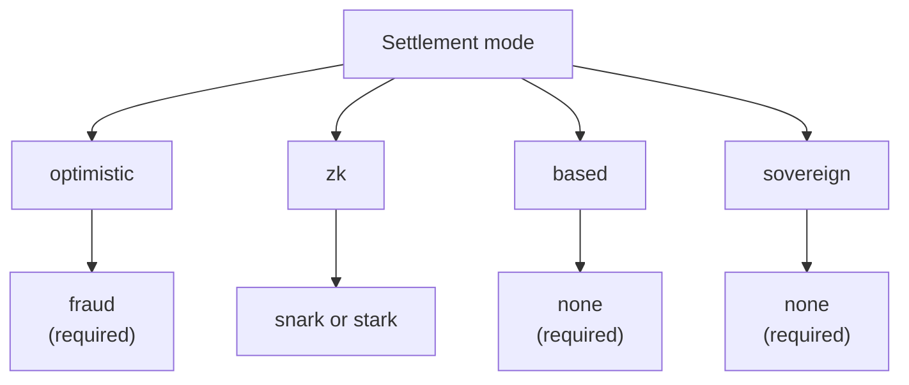

# 롤업 개요

QoreChain **롤업 개발 키트(Rollup Development Kit, RDK)**는 클라이언트 라이브러리(TypeScript, Python, Go, Rust, Java), 운영자용 명령줄 도구, 스타터 템플릿으로 이루어진 모음으로, 온체인 `x/rdk` 모듈을 통해 QoreChain에 정산되는 애플리케이션 전용 롤업을 구축하는 데 사용합니다. 이를 사용하면 롤업을 설정하고, 트랜잭션을 구성하고 서명하고, 상태를 읽고, 챌린지 윈도우를 추적하고, 정산 영수증을 발급하고 검증하고, 크로스 VM 호출과 출금 증명을 조립할 수 있습니다. 각 롤업은 자체 블록 타임, 가상 머신, 수수료 모델, 시퀀싱을 갖춘 독립적인 실행 환경이면서, QoreChain의 보안, 포스트 퀀텀 암호화, 데이터 가용성을 상속받습니다. 이 페이지는 롤업을 시작하거나 운영하려는 개발자와, RDK가 자신의 애플리케이션에 맞는지 판단하려는 모든 분을 위한 것입니다.

:::caution 초기 단계의 기능
RDK는 두 네트워크 모두에 배포되어 있지만, **아직 어느 쪽에도 생성된 롤업은 없습니다**(2026년 10월 27일 확인). 따라서 이 섹션에서 설명하는 흐름은 제3자에 의해 실제로 사용된 적이 없습니다. **ZK 정산(`defi` 프로필, `defi-rollup` 템플릿, 모든 `zk` 롤업)은 아직 어느 네트워크에서도 사용할 수 없습니다.** 체인에 검증 키를 등록할 방법이 없어서, 모든 ZK 배치는 수수료가 지불된 뒤에 거부됩니다. 키 등록은 체인 v3.2.7에서 제공될 예정입니다. 그때까지는 `optimistic` 정산을 사용하세요.

메인넷(**`qorechain-vladi`**, EVM 체인 ID **9801**, 2026년 6월 7일부터 라이브)은 체인 버전 **v3.2.4**를 실행하며(2026년 10월 23일 높이 3,742,566에서 적용, 거버넌스 제안 13), 테스트넷(**`qorechain-diana`**, EVM 체인 ID **9800**)은 **v3.2.6**을 실행합니다(v3.2.4는 2026년 10월 19일, v3.2.5는 10월 26일, v3.2.6은 10월 27일에 적용). 메인넷 거버넌스 제안 14는 높이 3,906,833에서 v3.2.5를 적용할 예정이며 작성 시점에 투표 기간 중이었습니다. v3.2.5가 롤업에 바꾸는 내용은 메인넷이 이를 적용하는 날 문서화됩니다. v3.2.3과 v3.2.4 사이에 동작이 바뀐 곳에서는 이 섹션이 어느 릴리스가 적용되는지를 밝힙니다. 모든 배포는 먼저 테스트넷에서 검증하고, 각 페이지의 상태 안내를 읽어 보세요. 여러 기능(ZK 검증, Celestia 데이터 가용성, QCAI 코파일럿, 크로스 VM 호출, 정산 영수증)은 현재 엔드 투 엔드로 사용할 수 없습니다.
:::

## 혁신 {#innovations}

* **포스트 퀀텀 정산 영수증.** 배치의 상태 앵커는 롤업 생성자가 등록한 키로 ML-DSA-87 서명됩니다. `verifySettlementReceipt`는 영수증의 모든 필드(롤업, 레이어, 배치 루트, 그리고 앵커: 상태 루트, 레이어 높이, 메인 체인 높이, 앵커 시각, 밸리데이터 세트 해시, 트랜잭션 수, 증명, 서명)를 체인에서 다시 읽어 확인합니다. 검증 키는 영수증이 아니라 체인에서 가져오고, 영수증은 조회하는 네트워크를 명시해야 하며, 알 수 없는 영수증 버전이나 ML-DSA-87이 아닌 알고리즘은 어떤 조회도 하기 전에 거부되고, 서명만 확인한 결과는 절대 유효하다고 보고되지 않습니다. 앵커 메시지는 체인 v3.2.2의 높이 미만에서는 첫 번째 형식이고, 그 높이부터는 체인 ID도 함께 묶는 두 번째 형식이며, 형식은 앵커의 높이로 결정됩니다. [정산 영수증](/rollups/settlement-receipts)을 참고하세요.
* **두 가지 키 파생 방식을 지원하는 하이브리드 서명.** 트랜잭션은 secp256k1과 ML-DSA-87로 서명됩니다. 포스트 퀀텀 키는 니모닉에서 표준 방식(`qorechain:pqc:v1|`, 주소, 니모닉에 대한 SHAKE-256)과 레거시 방식 두 가지로 파생되며, 클라이언트는 체인이 해당 계정에 등록해 둔 키를 사용합니다. 현재 하이브리드로 서명하는 것은 TypeScript 클라이언트뿐입니다.
* **표준 전이 루트.** `batchTransitionRoot`는 체인이 옵티미스틱 배치를 판단하는 정확한 상태 루트를 계산하며(현재 메인넷이 적용하는 형식은 이전 상태 루트, 데이터 해시, 트랜잭션 수에 대한 SHAKE-256 커밋먼트이고, `transitionRootVersionFor`는 연결된 네트워크가 적용하는 형식을 선택합니다), `fraudProof`는 이 루트로부터 64바이트 증명을 만듭니다. 둘 다 체인 자체 코드가 생성한 벡터로 테스트되었습니다.
* **체인과 정확히 일치하는 챌린지 윈도우.** `batchChallengeWindow`는 배치의 윈도우를 체인과 같은 방식으로 계산하며(시간 기반: 블록 시간이 제출 시각에 윈도우를 더한 값보다 작은 동안 열려 있음. 이전 배치는 제출 높이부터 윈도우를 6으로 나눈 블록 수), 로컬 시계가 아니라 RPC `/status`에서 읽은 체인 팁을 기준으로 판단합니다. [워치타워](/rollups/watchtower)와 헬스 모니터가 이를 사용합니다.
* **수수료를 내기 전의 검사.** 키트는 `^[a-z0-9][a-z0-9._-]{2,63}$` 범위를 벗어난 롤업 ID, `uqor`가 아니거나 금액이 0이거나 32바이트 64단계보다 깊은 증명을 담았거나 유효하지 않은 bech32 주소를 지정한 출금, 그리고 롤업을 읽을 수 있을 때 `native` 또는 `both` 데이터 가용성 롤업에서 데이터 해시를 지정한 배치를 거부합니다. 이들은 모두 수수료를 쓴 뒤에 체인이 거부했을 것들입니다.
* **크로스 VM 콜데이터와 실시간 확인.** `encodeCrossVmCalldata`는 `executeCrossVMCall(uint8,string,bytes)`(셀렉터 `0x3c11078c`, 프리컴파일 `0x...0901`)용 콜데이터를 만들고, `isCrossVmPrecompileActive`는 해당 프리컴파일이 네트워크에서 활성화되어 있는지 읽습니다. [멀티 VM](/rollups/multi-vm)을 참고하세요.
* **다섯 개 언어를 위한 하나의 테스트 벡터 세트.** TypeScript, Python, Go, Rust, Java 패키지는 모두 같은 골든 픽스처로 검증됩니다(Go 패키지는 단위 테스트 100개, Rust는 77개, Java는 75개).

## 사용 방법 {#how-to-use}

조회에는 키도 자금도 필요하지 않습니다. 아래 스니펫은 공개 테스트넷(`qorechain-diana`)의 실시간 `rdk` 모듈 파라미터와 롤업 목록을 읽으며, 2026년 10월 27일에 게시된 패키지로 실행했습니다(라이브러리 스니펫은 0.6.1, 즉 0.6.2에도 포함된 라이브러리 코드의 버전이고, CLI는 0.6.2). 각각 테스트넷 파라미터(최대 롤업 200, 최소 스테이크 10,000 QOR, 생성 소각률 0.01, 기본 챌린지 윈도우 3,600초, 최대 DA 블롭 크기 2,097,152바이트, 블롭 보존 432,000블록, 블록당 최대 10개 배치)와 `0 rollups`를 출력했습니다.

### TypeScript (테스트됨)

```bash
npm install @qorechain/rdk
```

```ts
import { createRdkClient } from "@qorechain/rdk";

// Public testnet (chain id qorechain-diana).
const rdk = createRdkClient({
  network: "testnet",
  endpoints: { rest: "https://api-testnet.qore.host" },
});

// Read the live rdk module parameters and the registered rollups.
const params = await rdk.params();
const rollups = await rdk.rest.listRollups();
console.log(rdk.network.chainId, params, `${rollups.length} rollups`);
```

`mainnet` 및 `testnet` 프리셋에는 공개 `qore.host` 엔드포인트가 이미 들어 있으므로 `createRdkClient({ network: "testnet" })`는 `endpoints` 필드 없이도 작동합니다. 위에서는 테스트한 스니펫이 이를 전달했기 때문에 표시했습니다. Node 20 이상에서 실행하세요(테스트에는 Node 26을 사용했습니다).

### Python (테스트됨)

```bash
pip install qorechain-rdk
```

```python
from qorrdk import create_rdk_client

# Public testnet (chain id qorechain-diana).
rdk = create_rdk_client(network="testnet", endpoints={"rest": "https://api-testnet.qore.host"})

# Read the live rdk module parameters and the registered rollups.
params = rdk.params()
rollups = rdk.rest.list_rollups()
print(rdk.network.chain_id, params, f"{len(rollups)} rollups")
```

Python 3.10 이상이 필요합니다. `qorechain-rdk`는 `qorechain-pqc`에 의존하며, 이는 `liboqs-python`을 가져오고 `liboqs` 라이브러리를 필요로 합니다. 해당 라이브러리가 없는 머신에서는 처음 import할 때 이를 빌드합니다(git, CMake, C 컴파일러가 필요합니다). Python 3.12의 새 가상 환경에서 테스트했습니다.

### Go (테스트됨)

```bash
go get github.com/qorechain/qorechain-rdk/packages/go@v0.6.2
```

```go
package main

import (
	"context"
	"fmt"

	rdk "github.com/qorechain/qorechain-rdk/packages/go"
)

func main() {
	// Public testnet (chain id qorechain-diana).
	client := rdk.NewRdkClient(rdk.RdkClientOptions{
		Network:   "testnet",
		Endpoints: &rdk.Endpoints{Rest: "https://api-testnet.qore.host"},
	})
	ctx := context.Background()
	// Read the live rdk module parameters and the registered rollups.
	params, err := client.Params(ctx)
	if err != nil {
		panic(err)
	}
	rollups, _ := client.Rest.ListRollups(ctx)
	fmt.Printf("%s %+v %d rollups\n", client.Network.ChainID, params, len(rollups))
}
```

Go 1.26으로 테스트했으며, 모듈은 Go 프록시에서 가져왔습니다.

### Rust (테스트됨)

```bash
cargo add qorechain-rdk
```

```rust
use qorechain_rdk::client::{RdkClient, RdkClientOptions};

fn main() -> Result<(), Box<dyn std::error::Error>> {
    // Public testnet (chain id qorechain-diana).
    let rdk = RdkClient::new(RdkClientOptions {
        rest_url: Some("https://api-testnet.qore.host".into()),
        ..Default::default()
    });

    // Read the live rdk module parameters and the registered rollups.
    let params = rdk.params()?;
    let rollups = rdk.rest.list_rollups()?;
    println!("{} {:?} {} rollups", rdk.network.chain_id, params, rollups.len());
    Ok(())
}
```

라이브러리 이름은 `qorechain_rdk`입니다. Rust 1.95로 테스트했으며, crates.io를 대상으로 빌드했습니다.

### Java (테스트됨)

```kotlin
// build.gradle.kts - Maven Central serves 0.6.1 until 0.6.2 is live there
implementation("io.github.qorechain:qorechain-rdk:0.6.1")
```

```java
import io.github.qorechain.rdk.client.RdkClient;
import io.github.qorechain.rdk.client.Views.ParamsView;
import io.github.qorechain.rdk.config.Networks;

public class RdkQuickstart {
    public static void main(String[] args) {
        // Public testnet (chain id qorechain-diana).
        RdkClient.Options options = new RdkClient.Options();
        options.network = "testnet";
        options.endpoints = new Networks.Endpoints();
        options.endpoints.rest = "https://api-testnet.qore.host";
        RdkClient rdk = new RdkClient(options);

        // Read the live rdk module parameters and the registered rollups.
        ParamsView params = rdk.params();
        int rollups = rdk.rest.listRollups().size();
        System.out.println(rdk.network.chainId + " maxRollups=" + params.maxRollups
                + " minStakeForRollup=" + params.minStakeForRollup + " " + rollups + " rollups");
    }
}
```

JDK 17 이상이 필요하며, JDK 21과 Maven Central에서 의존성을 받아오는 Gradle 9.6으로 테스트했습니다. 파일 이름은 `RdkQuickstart.java`여야 합니다. 0.6.2에는 Java 변경이 없으므로 0.6.1 아티팩트가 같은 라이브러리입니다.

### 명령줄 (테스트됨)

```bash
npm install -g @qorechain/rdk-cli
qorollup --version
qorollup params --network testnet
```

`qorollup --version`은 `0.6.2`를 출력하고, `qorollup params --network testnet`은 실시간 모듈 파라미터를 출력합니다. **0.6.2부터 이렇게 작동합니다.** 0.6.1 이하 릴리스는 npm에서 설치하면 종료 코드 0으로 끝나면서 아무것도 출력하지 않았습니다. 테스트에서는 빈 프로젝트에 `@qorechain/rdk-cli@0.6.2`를 설치하고 `node_modules/.bin/qorollup`을 통해 실행했으며, 전역 설치와 `npx`도 같은 bin 링크를 사용합니다. Node 20 이상이 필요합니다.

### 프로젝트 스캐폴딩 (테스트됨)

```bash
npx create-qorechain-rollup my-rollup --template nft-rollup --network testnet --yes
cd my-rollup && npm run doctor
```

템플릿은 `defi-rollup`, `gaming-rollup`, `nft-rollup`, `enterprise-rollup`, `custom-rollup`, `multivm-rollup`입니다. 스캐폴딩된 프로젝트는 `@qorechain/rdk` `^0.6.1`에 의존하며, 새로 설치하면 0.6.2로 해석됩니다. `nft-rollup`을 스캐폴딩하면 `@qorechain/rdk` 0.6.1을 사용하는 프로젝트가 만들어졌고, `npm run doctor`는 테스트넷을 대상으로 통과했습니다(REST 접근 가능, 파라미터 읽기 가능, 네트워크 `qorechain-diana`. Celestia 데이터 가용성과 서명자 누락에 대해서는 경고를 표시합니다). `defi-rollup`을 스캐폴딩하고 `npm run typecheck`를 실행한 결과도 통과했습니다. **아직 `defi-rollup`으로 롤업을 시작하지 마세요**([한계](#limits) 참고). 롤업을 생성하고 배치를 제출하려면 [롤업 배포하기](/rollups/deploying-a-rollup)를 따르세요. 트랜잭션에는 등록된 포스트 퀀텀 키가 필요하며, RDK에서는 `pqcKeypair`가 주어진 TypeScript 클라이언트가 필요합니다.

## 접근 방법 {#how-to-access}

**네트워크와 엔드포인트.** RDK는 두 네트워크의 공개 엔드포인트와 통신하며, `mainnet` 및 `testnet` 프리셋에 이미 들어 있습니다.

| 네트워크 | 체인 ID | EVM 체인 ID | REST 엔드포인트 | 체인 버전 |
| ------- | -------- | ------------ | ------------- | ------------- |
| 메인넷 | `qorechain-vladi` | 9801 | `https://api.qore.host` | v3.2.4 |
| 테스트넷 | `qorechain-diana` | 9800 | `https://api-testnet.qore.host` | v3.2.6 |

두 네트워크 모두 RDK 쿼리(`/qorechain/rdk/v1/...`)를 REST, gRPC, CLI로 제공하므로, `rdk.params()` 같은 조회는 어느 쪽에서든 작동합니다. 테스트넷은 자체 파라미터를 가진 스테이징 네트워크입니다. 기본 챌린지 윈도우는 테스트넷에서 3,600초, 메인넷에서 604,800초이고, 존재할 수 있는 롤업은 테스트넷에서 최대 200개, 메인넷에서 100개이며, 멀티레이어 모듈은 테스트넷에서 사이드체인 레이어 64개, 메인넷에서 10개를 허용합니다(2026년 10월 27일 확인). 대상 네트워크의 `GET /qorechain/rdk/v1/params`를 읽어 보세요.

**롤업 생성을 위한 사전 요건.**

| 요건 | 세부 내용 |
| ----------- | ------- |
| **자금이 있는 계정** | 스테이크, 레이어 스테이크, 수수료를 감당할 만큼의 QOR이 있는 계정. |
| **에스크로 스테이크** | 롤업을 생성하면 `min_stake_for_rollup`, 즉 두 네트워크 모두 **10,000 QOR**가 에스크로됩니다. 생성 시 **스테이크의 1%(100 QOR)가 소각**되며, 나머지는 에스크로에 남아 롤업이 중지될 때 반환됩니다. |
| **레이어 스테이크** | 생성 시 롤업의 레이어도 멀티레이어 모듈에 등록됩니다(최소 스테이크 1,000 QOR). 레이어를 등록할 수 없으면 롤업은 생성되지만 실제 레이어가 없으므로 배치를 앵커링할 수 없고 영수증도 발급할 수 없습니다. |
| **등록된 포스트 퀀텀 키** | 계정에 등록된 ML-DSA-87 키. 기존 방식의 키만으로 서명한 Native 레인 트랜잭션은 거부됩니다. |
| **수수료** | 수수료 하한은 가스 단위당 0.1 uqor입니다. 가스 한도와 수수료를 함께 설정하세요. |
| **도구** | CLI와 스캐폴더에는 Node 20 이상, Python 클라이언트에는 Python 3.10 이상(`liboqs` 포함, 위 참고), Java에는 JDK 17 이상, Go 모듈 `github.com/qorechain/qorechain-rdk/packages/go`. |

상태 조회에는 이 중 어느 것도 필요하지 않습니다. 대시보드를 통해 롤업을 요청하거나(요청 양식이며 온체인 트랜잭션이 아닙니다) 체인 CLI로 생성할 수도 있습니다. 전체 흐름, CLI 명령어, TypeScript 서명 경로는 [롤업 배포하기](/rollups/deploying-a-rollup)를 참고하세요.

### 현재 존재하는 것 {#what-exists-today}

| | 상태 |
|---|---|
| 등록된 롤업(메인넷 및 테스트넷) | 없음 |
| `x/rdk` 모듈과 그 파라미터 | 두 네트워크 모두에 배포됨. `qorechaind query rdk config`로 조회 |
| RDK 쿼리 | 두 네트워크 모두에서 CLI, gRPC, REST(`/qorechain/rdk/v1/...`)로 제공되므로, TypeScript `rdk.params()` 같은 REST 기반 조회가 메인넷에서도 작동함 |
| RDK가 기록한 정산 앵커 | 없음. v3.2.2부터 배치는 `anchor_signature`를 담을 수 있으며, 담은 경우 같은 트랜잭션에서 `x/multilayer`에 앵커링되고, 없으면 앵커링 없이 정산됨. 아직 롤업, 레이어, 앵커가 존재하지 않음. TypeScript RDK(0.6.0~0.6.2)는 클라이언트가 하이브리드로 서명하고 해당 롤업의 생성자인 경우 이 필드를 보냄(라이브 테스트는 하지 않음). Python, Go, Rust, Java 클라이언트는 보내지 않음 |
| `x/multilayer`에 등록된 롤업 레이어 | 없음 |
| ZK 정산 | 아직 어느 네트워크에서도 사용할 수 없음(검증 키를 등록할 방법이 없음. 체인 v3.2.7에서 제공 예정) |
| 출금 | v3.2.3부터 롤업별 에스크로 원장에서 지급됨([ZK / STARK & 출금](/rollups/zk-stark-withdrawals) 참조). 롤업이 존재하지 않으므로 아직 출금이 이루어진 적 없음 |

모듈 파라미터, 라이프사이클 내부 동작, 소각 통합, 멀티레이어 앵커링 등 더 낮은 수준의 모듈 레퍼런스는 아키텍처 섹션의 **[롤업 개발 키트](/architecture/rollup-development-kit)** 페이지를 참고하세요. 이 롤업 섹션은 개발자를 위한 실전 가이드입니다.

## 게시 위치 {#where-published}

2026년 10월 27일에 레지스트리에서 버전을 확인했습니다. 모든 패키지는 Apache-2.0입니다.

| 레지스트리 | 패키지 | 현재 버전 | 링크 |
| -------- | ------- | --------------- | ---- |
| npm | `@qorechain/rdk` (TypeScript 클라이언트) | 0.6.2 | [npmjs.com](https://www.npmjs.com/package/@qorechain/rdk) |
| npm | `@qorechain/rdk-cli` (`qorollup`) | 0.6.2 | [npmjs.com](https://www.npmjs.com/package/@qorechain/rdk-cli) |
| npm | `create-qorechain-rollup` (스캐폴더) | 0.6.2 | [npmjs.com](https://www.npmjs.com/package/create-qorechain-rollup) |
| PyPI | `qorechain-rdk` (import `qorrdk`) | 0.6.2 | [pypi.org](https://pypi.org/project/qorechain-rdk/) |
| crates.io | `qorechain-rdk` (라이브러리 `qorechain_rdk`) | 0.6.2 | [crates.io](https://crates.io/crates/qorechain-rdk) |
| Go 모듈 프록시 | `github.com/qorechain/qorechain-rdk/packages/go` | v0.6.2 | [pkg.go.dev](https://pkg.go.dev/github.com/qorechain/qorechain-rdk/packages/go) |
| Maven Central | `io.github.qorechain:qorechain-rdk` | **0.6.1** (0.6.2는 아직 그곳에 올라오지 않음) | [central.sonatype.com](https://central.sonatype.com/artifact/io.github.qorechain/qorechain-rdk) |

Maven Central은 0.6.2가 올라올 때까지 0.6.1을 제공하며, 0.6.2에는 Java 변경이 없습니다. 소스는 [github.com/qorechain/qorechain-rdk](https://github.com/qorechain/qorechain-rdk)에 공개되어 있고, 릴리스 노트는 [v0.6.2](https://github.com/qorechain/qorechain-rdk/releases/tag/v0.6.2)에 있으며, 키트 자체 문서는 [qorechain.github.io/qorechain-rdk](https://qorechain.github.io/qorechain-rdk/)에 있습니다. TypeScript 패키지는 `@qorechain/sdk` `^0.9.0`과 `@qorechain/evm` `^0.8.0`에 의존하며(따라서 SDK 0.10.0을 사용하는 애플리케이션은 키트와 함께 중첩된 두 번째 SDK 0.9.x 사본을 받게 됩니다), Python 패키지는 `qorechain-pqc` 0.2.x에 의존합니다. 체인의 `x/rdk` 모듈 로직 자체는 공개 키트에 포함되지 않습니다.

## 한계와 알려진 문제 {#limits}

* **ZK 정산은 아직 어느 네트워크에서도 사용할 수 없습니다.** 여기에는 `defi` 프로필, `defi-rollup` 템플릿, `zk` 정산으로 생성된 모든 롤업이 포함됩니다. 체인에 롤업의 검증 키를 등록할 방법이 없어서, 모든 ZK 배치는 수수료가 지불된 뒤에 거부됩니다. 키 등록은 체인 v3.2.7에서 제공될 예정입니다. 그때까지는 `optimistic` 정산을 사용하세요([ZK / STARK & 출금](/rollups/zk-stark-withdrawals) 참조).
* **어느 네트워크에서도 생성된 롤업이 없습니다.** 생성, 배치, 챌린지, 영수증, 출금 경로는 단위 테스트와 공유 벡터로 다루지만, 체인에서 실제로 실행된 적은 없습니다.
* **하이브리드 트랜잭션에 서명하는 것은 TypeScript 클라이언트뿐입니다.** Python, Go, Rust, Java의 트랜잭션 경로와 `qorollup` 트랜잭션 명령(`create`, `pause`, `resume`, `stop`, `withdraw`)은 기존 방식으로만 서명하며, 두 네트워크 모두 이를 거부합니다. 조회는 작동합니다. 이들에서 트랜잭션을 보내려면 메시지를 만들어 체인 CLI로 공동 서명하거나, `pqcKeypair`를 지정한 TypeScript 클라이언트를 사용하세요.
* **(a) 0.6.1 이하에서는 `qorollup` CLI를 npm에서 설치하면 아무것도 출력하지 않았습니다.** 이는 **0.6.2에서 수정되었습니다**: `npm i -g @qorechain/rdk-cli` 후 `qorollup ...`이 작동하고 `qorollup --version`은 0.6.2를 출력합니다.
* **(b) 출금 머클 헬퍼는 기본값으로 SHA-256을 사용하지만, 체인은 SHAKE-256을 사용합니다.** 기본값으로 만든 증명은 검증되지 않습니다. 해시와 리프 인코딩을 재정의하세요([리프 및 노드 인코딩](/rollups/zk-stark-withdrawals#leaf-and-node-encoding) 참조).
* **(c) `buildDaBlob`은 SHA-256으로 해시하지만, 체인의 블롭 커밋먼트는 SHAKE-256입니다.** 블롭을 게시하는 트랜잭션이 없으므로 현재는 실질적인 영향이 없습니다. `native` 및 `both` 데이터 가용성에서는 `dataHash`를 비워 두세요([데이터 가용성](/rollups/data-availability) 참조).
* **(d) `defi` 템플릿의 데모 회로는 검증할 수 없습니다.** 이는 `snarkjs` 곱셈기이며, 체인은 이전 상태 루트, 상태 루트, 데이터 해시를 공개 입력으로 하는 BLS12-381 위의 Groth16을 검사하는데, 이 회로는 그것들을 노출하지 않습니다. 키 등록이 제공된 뒤에도 자체 회로가 필요합니다.
* **메인넷에서는 롤업의 생성자만 챌린지를 해결할 수 있습니다.** 체인이 사기 증명 자체는 확인하지만, 해결은 생성자가 제출합니다([옵티미스틱](#optimistic) 참조).
* **라이브 네트워크에서 사용할 수 없는 것:** Celestia 데이터 가용성(미구현), [QCAI 롤업 코파일럿](/rollups/qcai-copilot)(어드바이저리 서비스가 공개 엔드포인트에 없음), 크로스 VM 호출(`0x...0901`의 프리컴파일이 활성화되지 않음), 공유 및 based 시퀀서(체인은 설정된 시퀀서만, 설정이 없으면 생성자만 허용), 그리고 `suggest-profile`(고정된 폴백으로 `defi`를 반환).
* **버전 참고.** Maven Central은 0.6.2가 올라올 때까지 0.6.1을 제공합니다. 영수증, 워치타워, 크로스 VM 콜데이터에는 0.6.2 이상을 사용하세요. 0.5.0 이하는 이들에 사용하지 마세요. 각 릴리스가 바꾼 내용의 전체 목록은 [RDK 0.6.2: 변경 사항과 한계](/rollups/deploying-a-rollup#rdk-050-limits)에 있습니다.

---

## 레퍼런스: 롤업의 구성 요소 {#reference}

### RDK가 제공하는 것

RDK를 통해 생성된 롤업은 네 가지 설정 가능한 요소를 하나로 묶습니다.

| 요소 | 제어하는 것 | 옵션 |
| ------- | ---------------- | ------- |
| **정산 모드** | 롤업의 상태 전이가 QoreChain에서 어떻게 검증되고 확정되는지 | `optimistic`, `zk`, `based`, `sovereign` |
| **증명 시스템** | 정산을 뒷받침하는 암호학적 또는 경제적 메커니즘 | `fraud`, `snark`, `stark`, `none` |
| **시퀀서 모드** | 정산 전에 누가 트랜잭션 순서를 정하는지 | `dedicated`, `shared`, `based` |
| **데이터 가용성** | 누구나 상태를 재구성할 수 있도록 트랜잭션 데이터가 게시되는 위치 | `native`, `celestia`, `both` |

각 롤업은 고유한 `rollup-id`로 등록되며, QOR로 된 스테이크 본드로 담보되고, 라이프사이클 상태(`pending`, `active`, `paused`, `stopped`)가 부여됩니다. 생성 및 라이프사이클 전체 흐름은 **[롤업 배포하기](/rollups/deploying-a-rollup)**를 참고하세요.

### QoreChain 고유의 기능과 상태

모든 롤업 키트가 갖춘 기본 기능을 넘어, RDK는 QoreChain의 레이어 1을 중심으로 구축된 세 가지 기능과 워치타워 자동 챌린저를 포함합니다. 각 기능의 상태는 서로 다르며, 표에 현재 작동하는 내용이 나와 있습니다.

| 기능 | 하는 일 |
| ---------- | ------------ |
| **[정산 영수증](/rollups/settlement-receipts)** | 정산 앵커를 포스트 퀀텀(ML-DSA-87 / Dilithium-5) 서명을 담은 이동 가능형 영수증으로 패키징합니다. 초기 단계: 아직 앵커가 존재하지 않으므로 실제 앵커를 상대로 검증된 것은 없으며, 영수증은 체인 상태와 대조하여 확인해야 하는 주장이고, 0.6.2 검증기는 필드별로 그 확인을 수행합니다. |
| **[QCAI 롤업 코파일럿](/rollups/qcai-copilot)** | 하나의 롤업에 대한 읽기 전용 어드바이저리 도우미입니다(수수료 추정, 추천, 사기 조사). 이 도우미가 읽는 어드바이저리 서비스는 아직 공개 엔드포인트에 노출되어 있지 않습니다. |
| **[멀티 VM 크로스 VM 호출](/rollups/multi-vm)** | 크로스 VM 프리컴파일(`0x...0901`)을 통해 EVM에서 QoreChain Native로의 호출을 인코딩하는 도구입니다. 이 프리컴파일은 라이브 네트워크에서 활성화되지 않았으므로 호출은 아무 일도 하지 않으며, 0.6.0 이후의 인코더는 체인이 디코딩하는 레이아웃과 일치합니다. |
| **[워치타워](/rollups/watchtower)** | 옵티미스틱 롤업을 위한 자동 챌린저 프레임워크로, 새로운 배치와 챌린지 윈도우 마감을 표시하고 여러분의 유효성 술어(validity predicate)에 어긋나는 잘못된 배치에 챌린지를 겁니다. 두 네트워크가 제공하는 REST로 읽으며, 0.6.0부터는 각 배치의 윈도우를 체인과 같은 방식으로 판단합니다(0.6.2도 이를 유지). |

전체 근거와 코드 예제는 **[왜 QoreChain RDK인가](/rollups/why)**를 참고하세요.

### 네 가지 정산 패러다임 {#settlement-paradigms}

QoreChain RDK는 신뢰 가정, 확정성 특성, 증명 요구 사항이 각기 다른 네 가지 정산 모드를 지원합니다. 정산 모드와 증명 시스템의 조합은 온체인에서 검증되며, 호환되지 않는 조합은 생성 시점에 거부됩니다. 아래 다이어그램은 각 정산 모드를 유효한 증명 시스템에 매핑합니다.



#### Optimistic {#optimistic}

옵티미스틱 롤업은 제출된 배치가 기본적으로 유효하다고 가정하며, 분쟁 해결을 **사기 증명(fraud proofs)**에 의존합니다.

* **증명 시스템**: `fraud`(인터랙티브 사기 증명).
* **시퀀서**: `dedicated` 또는 `shared`.
* **확정성**: 설정 가능한 챌린지 윈도우가 성공적인 챌린지 없이 만료될 때까지 지연됩니다.
* **분쟁**: 누구나 윈도우 내에서 본드와 사기 증명을 게시하여 제출된 배치에 챌린지를 제기할 수 있습니다. 챌린지는 배치를 동결하고, 메인넷에서는 이후 롤업 생성자가 이를 해결하며, 체인이 증명을 직접 확인합니다. 사기가 인정되면 배치가 거부되고 챌린저에게 보상이 지급되며, 챌린지가 기각되면 배치는 `submitted` 상태로 돌아갑니다. [롤업 배포하기](/rollups/deploying-a-rollup#challenge-a-batch-optimistic-rollups)를 참고하세요.
* **윈도우 길이**: 기본 윈도우는 메인넷에서 604,800 "초"입니다(모듈의 `default_challenge_window`. 테스트넷의 기본값은 3,600초이며 2026년 10월 27일에 확인했고, 롤업은 자체 값을 설정할 수 있습니다). **v3.2.4 이전(메인넷에서는 높이 3,742,566 이전)에** 체인은 이를 블록당 6초로 고정하여 블록 수로 변환하며, 이는 **100,800 블록**입니다. 실제 경과 시간은 실제 블록 타임을 따르므로(메인넷의 현재 ≈3.1초 블록 기준 약 3.7일), 일 단위가 아닌 블록 단위로 계획하세요. **v3.2.4부터**, 업그레이드 높이부터 제출된 배치는 블록 타임의 초 단위로 측정되는 윈도우(정확히 7일)를 갖고, 그 이전 배치는 블록 수 규칙을 유지합니다. 업그레이드 높이는 테스트넷에서 8,337,253(2026년 10월 19일부터), 메인넷에서 3,742,566(2026년 10월 23일)입니다.

#### ZK (Zero-Knowledge) {#zk}

ZK 롤업은 각 배치에 암호학적 유효성 증명을 첨부하여, 재실행 없이 상태 전이의 정확성을 증명합니다.

* **증명 시스템**: `snark`(축약 증명) 또는 `stark`(신뢰된 설정이 필요 없는 투명 증명).
* **시퀀서**: `dedicated` 또는 `shared`.
* **확정성**: 유효한 증명 검증 시점이며, 챌린지 윈도우는 없습니다.
* **성숙도**: **ZK 정산은 아직 어느 네트워크에서도 사용할 수 없습니다.** SNARK 배치는 롤업과 함께 저장된 검증 키에 대해 온체인에서 검증되도록 되어 있지만(BLS12-381 위의 Groth16), 체인에 아직 이를 등록할 방법이 없어서 모든 ZK 배치는 수수료가 지불된 뒤에 거부됩니다. 키 등록은 체인 v3.2.7에서 제공될 예정입니다. STARK 검증은 실험적입니다. 선택적으로 켜야 하며, 여러분 롤업 자체의 상태 전이가 아니라 시연용 회로를 검사합니다. **[ZK / STARK & 출금](/rollups/zk-stark-withdrawals)**을 참고하세요.

#### Based {#based}

Based 롤업은 트랜잭션 시퀀싱을 QoreChain(L1) 프로포저에게 위임하여, 호스트 체인의 라이브니스와 검열 저항성을 상속받습니다.

* **증명 시스템**: `none`(L1 프로포저가 순서의 원천 진실(source of ordering truth)임).
* **시퀀서**: `based`(필수, 온체인 검증으로 강제됨).
* **확정성**: 호스트 체인의 확정을 따릅니다.
* **트레이드오프**: QoreChain 밸리데이터가 시퀀싱을 처리하므로 운영 모델이 가장 단순하지만, 그 대가로 전용 시퀀서 수준의 지연 시간 제어권은 없습니다.
* **현재 상태**: `based`는 롤업 설정에 기록되지만, QoreChain은 아직 L1 프로포저를 배치 제출자로 허용하지 않습니다. 롤업 생성자가 제출합니다([시퀀서 모드](#sequencer-modes) 참고).

#### Sovereign {#sovereign}

소버린 롤업은 자체 합의를 운영하며 스스로 시퀀싱합니다. 검증 가능성을 위해 QoreChain에 상태를 앵커링하지만, 확정성을 위해 호스트 체인에 의존하지는 않습니다.

* **증명 시스템**: `none`.
* **시퀀서**: 롤업이 자체 관리합니다.
* **확정성**: 독립적이며, 롤업 자체 합의로 결정됩니다.
* **상태 앵커링**: 상태 루트는 투명성을 위해 QoreChain에 게시되지만, 호스트 체인은 이를 강제하지 않습니다.

### 증명 시스템 호환성

정산 모드는 어떤 증명 시스템이 유효한지를 제약합니다. 다음 조합은 롤업 생성 시 강제됩니다.

| 정산 모드 | `fraud` | `snark` | `stark` | `none` |
| --------------- | :-----: | :-----: | :-----: | :----: |
| **optimistic**  | 필수 | - | - | - |
| **zk**          | - | 지원 | 지원 | - |
| **based**       | - | - | - | 필수 |
| **sovereign**   | - | - | - | 필수 |

### 시퀀서 모드 {#sequencer-modes}

시퀀서는 정산 전에 롤업 블록 내 트랜잭션 순서를 누가 정할지를 결정합니다.

| 모드 | 누가 시퀀싱하는지 | 참고 |
| ---- | ------------- | ----- |
| **`dedicated`** | 지정된 단일 운영자 주소 | 지연 시간이 가장 낮음. 라이브니스와 공정한 순서를 위해 운영자에 대한 신뢰가 필요함 |
| **`shared`** | 공유 시퀀서 집합 | 순서 지정이 집합 전체에 분산되며, 조율 오버헤드가 약간 더 높음 |
| **`based`** | QoreChain L1 프로포저 | 호스트 체인 밸리데이터 보안과 검열 저항성을 상속받음. `based` 정산에는 필수임 |

:::note 현재 강제되는 것
온체인에서 배치는 롤업에 설정된 시퀀서 주소만 제출할 수 있으며, 설정된 주소가 없는 경우(모든 프리셋이 해당) 그 생성자가 제출할 수 있습니다. `shared` 및 `based` 모드는 롤업 설정에 기록되지만, QoreChain은 아직 공유 시퀀서 명단이나 L1 프로포저를 배치 제출자로 허용하지 않습니다. 이 모드들은 의도된 설계를 설명합니다.
:::

### 패러다임 선택하기

| 원하는 것이... | 고려할 것 |
| -------------- | -------- |
| QoreChain 밸리데이터가 시퀀싱하는 가장 단순한 운영 구성 | **based** |
| 암호학적 보증을 갖춘 빠른 확정성(아직 사용 불가) | **zk** (`snark` / `stark`) |
| 경제적 분쟁 해결 방식을 갖춘 잘 알려진 모델 | **optimistic** (`fraud`) |
| 자체 합의를 통한 완전한 독립성, 검증 가능성을 위한 앵커링 | **sovereign** |

어디서부터 시작해야 할지 모르시나요? RDK는 일반적인 애플리케이션 카테고리에 대해 이러한 선택을 하나로 묶은 **프리셋 프로필**을 제공합니다. **[프리셋 프로필](/rollups/preset-profiles)**을 참고하세요. `suggest-profile` 도우미도 있지만 현재는 고정된 `defi` 폴백을 반환하므로(그리고 `defi`는 아직 사용할 수 없으므로), 프로필 표에서 직접 선택하세요.

## 관련 문서

* [롤업 배포하기](/rollups/deploying-a-rollup): CLI 또는 TypeScript RDK로 롤업을 시작합니다.
* [프리셋 프로필](/rollups/preset-profiles): 일반적인 애플리케이션 카테고리를 위한 번들.
* [데이터 가용성](/rollups/data-availability): 네이티브 DA 라우터와 블롭 스토리지.
* [ZK / STARK 출금](/rollups/zk-stark-withdrawals): 증명 기반 출금 흐름.
* [정산 영수증](/rollups/settlement-receipts), [워치타워](/rollups/watchtower), [멀티 VM](/rollups/multi-vm), [왜 QoreChain RDK인가](/rollups/why).
