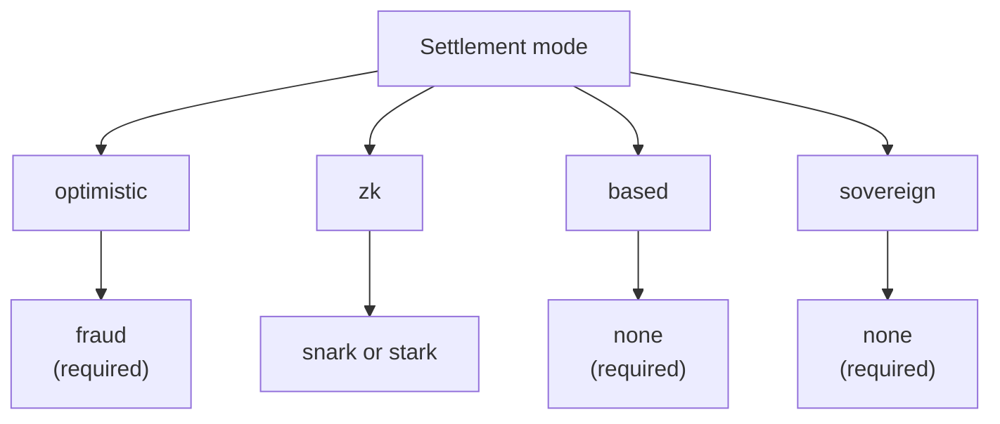

# 롤업 개요

QoreChain **롤업 개발 키트(Rollup Development Kit, RDK)** — `x/rdk` 모듈 — 를 사용하면 개발자는 QoreChain에 정산되는 애플리케이션 전용 롤업을 배포할 수 있습니다. 각 롤업은 자체 블록 타임, 가상 머신, 수수료 모델, 시퀀싱을 갖춘 독립적인 실행 환경이면서, QoreChain의 보안, 포스트 퀀텀 암호화, 데이터 가용성 보증을 상속받습니다.

:::caution 초기 단계의 기능
RDK는 두 네트워크 모두에 배포되어 있지만, **아직 어느 쪽에도 생성된 롤업은 없습니다**(2026년 10월 27일 확인). 따라서 이 섹션에서 설명하는 흐름은 제3자에 의해 실제로 사용된 적이 없습니다. 메인넷(**`qorechain-vladi`**, EVM 체인 ID **9801**, 2026년 6월 7일부터 라이브)은 체인 버전 **v3.2.4**를 실행하며(2026년 10월 23일 높이 3,742,566에서 적용, 거버넌스 제안 13), 테스트넷(**`qorechain-diana`**, EVM 체인 ID **9800**)은 **v3.2.6**을 실행합니다(v3.2.4는 2026년 10월 19일, v3.2.5는 10월 26일, v3.2.6은 10월 27일에 적용). 메인넷 거버넌스 제안 14는 높이 3,906,833에서 v3.2.5를 적용할 예정이며 작성 시점에 투표 기간 중이었습니다. v3.2.5가 롤업에 바꾸는 내용은 메인넷이 이를 적용하는 날 문서화됩니다. v3.2.3과 v3.2.4 사이에 동작이 바뀐 곳에서는 이 섹션이 어느 릴리스가 적용되는지를 밝힙니다. 모든 배포는 먼저 테스트넷에서 검증하고, 각 페이지의 상태 안내를 읽어 보세요. 여러 기능(ZK 검증, Celestia 데이터 가용성, QCAI 코파일럿, 크로스 VM 호출, 정산 영수증)은 현재 엔드 투 엔드로 사용할 수 없으며, 배포된 RDK 클라이언트에도 자체적인 한계가 있습니다([RDK 0.6.1: 변경 사항과 한계](/rollups/deploying-a-rollup#rdk-050-limits) 참조).
:::

## 현재 존재하는 것 {#what-exists-today}

| | 상태 |
|---|---|
| 등록된 롤업(메인넷 및 테스트넷) | 없음 |
| `x/rdk` 모듈과 그 파라미터 | 두 네트워크 모두에 배포됨. `qorechaind query rdk config`로 조회 |
| RDK 쿼리 | 두 네트워크 모두에서 CLI, gRPC, REST(`/qorechain/rdk/v1/…`)로 제공되므로, TypeScript `rdk.params()` 같은 REST 기반 조회가 메인넷에서도 작동함 |
| RDK가 기록한 정산 앵커 | 없음. v3.2.2부터 배치는 `anchor_signature`를 담을 수 있으며, 담은 경우 같은 트랜잭션에서 `x/multilayer`에 앵커링되고, 없으면 앵커링 없이 정산됨. 아직 롤업, 레이어, 앵커가 존재하지 않음. TypeScript RDK(0.6.0 및 0.6.1)는 클라이언트가 하이브리드로 서명하고 해당 롤업의 생성자인 경우 이 필드를 보냄(라이브 테스트는 하지 않음). Python, Go, Rust, Java 클라이언트는 보내지 않음 |
| `x/multilayer`에 등록된 롤업 레이어 | 없음 |
| 출금 | v3.2.3부터 롤업별 에스크로 원장에서 지급됨([ZK / STARK & 출금](/rollups/zk-stark-withdrawals) 참조). 롤업이 존재하지 않으므로 아직 출금이 이루어진 적 없음 |

모듈 파라미터, 라이프사이클 내부 동작, 소각 통합, 다계층 앵커링 등 더 낮은 수준의 모듈 레퍼런스는 아키텍처 섹션의 **[롤업 개발 키트](/architecture/rollup-development-kit)** 페이지를 참고하세요. 이 롤업 섹션은 개발자용 실전 가이드로, RDK가 무엇인지, 어떤 패러다임을 선택해야 하는지, 어떻게 배포하는지, 데이터 가용성이 어떻게 동작하는지, L2에서 L1로의 출금이 어떻게 정산되는지를 다룹니다.

---

## RDK가 제공하는 것

RDK를 통해 생성된 롤업은 네 가지 설정 가능한 요소를 하나로 묶습니다.

| 요소 | 제어하는 것 | 옵션 |
| ------- | ---------------- | ------- |
| **정산 모드** | 롤업의 상태 전이가 QoreChain에서 어떻게 검증되고 확정되는지 | `optimistic`, `zk`, `based`, `sovereign` |
| **증명 시스템** | 정산을 뒷받침하는 암호학적 또는 경제적 메커니즘 | `fraud`, `snark`, `stark`, `none` |
| **시퀀서 모드** | 정산 전에 누가 트랜잭션 순서를 정하는지 | `dedicated`, `shared`, `based` |
| **데이터 가용성** | 누구나 상태를 재구성할 수 있도록 트랜잭션 데이터가 게시되는 위치 | `native`, `celestia`, `both` |

각 롤업은 고유한 `rollup-id`로 등록되며, QOR로 된 스테이크 본드로 담보되고, 라이프사이클 상태(`pending`, `active`, `paused`, `stopped`)가 부여됩니다. 생성 및 라이프사이클 전체 흐름은 **[롤업 배포하기](/rollups/deploying-a-rollup)**를 참고하세요.

---

## QoreChain RDK를 다르게 만드는 것

모든 롤업 키트가 갖춘 기본 기능을 넘어, QoreChain RDK는 QoreChain의 레이어 1을 중심으로 구축된 QoreChain 고유의 세 가지 기능, 그리고 워치타워 자동 챌린저를 포함합니다. 각 기능의 상태는 서로 다르며, 표에 현재 작동하는 내용이 나와 있습니다. RDK는 5개 언어(TypeScript, Python, Go, Rust, Java)로 제공됩니다. **버전 0.6.1은 다섯 개 레지스트리 모두에 게시되어 있습니다**(2026년 10월 27일 확인: npm `@qorechain/rdk`, `@qorechain/rdk-cli`, `create-qorechain-rollup`, PyPI `qorechain-rdk`, crates.io `qorechain-rdk`, Maven Central `io.github.qorechain:qorechain-rdk`, Go 모듈 `v0.6.1`이며, 이는 현재 프록시의 `@latest`가 제공하는 버전이기도 합니다. 버전을 명시적으로 고정하세요). 다섯 가지 중 하이브리드 트랜잭션에 서명하는 것은 TypeScript 클라이언트뿐입니다. `mainnet` 및 `testnet` 프리셋에는 공개 `qore.host` 엔드포인트가 기본 내장되어 있어, `createRdkClient({ network })`만으로 별도의 엔드포인트 설정이 필요 없으며, REST 조회도 두 네트워크 모두에서 작동합니다.

| 차별점 | 기능 |
| -------------- | ------------ |
| **[퀀텀 세이프 정산 영수증](/rollups/settlement-receipts)** | 정산 앵커를 포스트 퀀텀(ML-DSA-87 / Dilithium-5) 서명을 담은 이동 가능형 영수증으로 패키징합니다. 초기 단계: 아직 앵커가 존재하지 않으므로 실제 앵커를 상대로 검증된 것은 없으며, 영수증은 체인 상태와 대조하여 확인해야 하는 주장이고, 0.6.1 검증기는 필드별로 그 확인을 수행합니다. |
| **[QCAI 롤업 코파일럿](/rollups/qcai-copilot)** | 하나의 롤업에 대한 읽기 전용 어드바이저리 도우미입니다(수수료 추정, 추천, 사기 조사). 이 도우미가 읽는 어드바이저리 서비스는 아직 공개 엔드포인트에 노출되어 있지 않습니다. |
| **[멀티 VM 크로스 VM 호출](/rollups/multi-vm)** | 크로스 VM 프리컴파일(`0x…0901`)을 통해 EVM → QoreChain Native 호출을 인코딩하는 도구입니다. 이 프리컴파일은 아직 라이브 네트워크에서 활성화되지 않았으므로 호출은 아무 일도 하지 않으며, 0.6.0 이후의 인코더는 체인이 디코딩하는 레이아웃과 일치합니다. |
| **[워치타워](/rollups/watchtower)** | 옵티미스틱 롤업을 위한 자동 챌린저 프레임워크로, 새로운 배치와 챌린지 윈도우 마감을 표시하고 여러분의 유효성 술어(validity predicate)에 어긋나는 잘못된 배치에 챌린지를 겁니다. 두 네트워크가 제공하는 REST로 읽으며, 0.6.0부터는 각 배치의 윈도우를 체인과 같은 방식으로 판단합니다(0.6.1도 이를 유지). |

전체 근거와 코드 예제는 **[왜 QoreChain RDK인가](/rollups/why)**를 참고하세요.

---

## 네 가지 정산 패러다임

QoreChain RDK는 신뢰 가정, 확정성 특성, 증명 요구 사항이 각기 다른 네 가지 정산 모드를 지원합니다. 정산 모드와 증명 시스템의 조합은 온체인에서 검증되며, 호환되지 않는 조합은 생성 시점에 거부됩니다. 아래 다이어그램은 각 정산 모드를 유효한 증명 시스템에 매핑합니다.

### Optimistic

옵티미스틱 롤업은 제출된 배치가 기본적으로 유효하다고 가정하며, 분쟁 해결을 **사기 증명(fraud proofs)**에 의존합니다.

* **증명 시스템**: `fraud` — 인터랙티브 사기 증명
* **시퀀서**: `dedicated` 또는 `shared`
* **확정성**: 설정 가능한 챌린지 윈도우가 성공적인 챌린지 없이 만료될 때까지 지연됨
* **분쟁**: 누구나 윈도우 내에서 본드와 사기 증명을 게시하여 제출된 배치에 챌린지를 제기할 수 있습니다. 챌린지는 배치를 동결하고, 이후 롤업 생성자가 이를 해결하며, 체인이 증명을 직접 확인합니다. 사기가 인정되면 배치가 거부되고 챌린저에게 보상이 지급되며, 챌린지가 기각되면 배치는 `submitted` 상태로 돌아갑니다. [롤업 배포하기](/rollups/deploying-a-rollup#challenge-a-batch-optimistic-rollups)를 참고하세요.
* **윈도우 길이**: 기본 윈도우는 메인넷에서 604,800 "초"입니다(모듈의 `default_challenge_window`. 테스트넷의 기본값은 3,600초이며 2026년 10월 27일에 확인했고, 롤업은 자체 값을 설정할 수 있습니다). **v3.2.4 이전(메인넷에서는 높이 3,742,566 이전)에** 체인은 이를 블록당 6초로 고정하여 블록 수로 변환합니다 — **100,800 블록**. 실제 경과 시간은 실제 블록 타임을 따르므로(메인넷의 현재 ≈3.2초 블록 기준 약 3.7일), 일 단위가 아닌 블록 단위로 계획하세요. **v3.2.4부터**, 업그레이드 높이부터 제출된 배치는 블록 타임의 초 단위로 측정되는 윈도우(정확히 7일)를 갖고, 그 이전 배치는 블록 수 규칙을 유지합니다. 업그레이드 높이는 테스트넷에서 8,337,253(2026년 10월 19일부터), 메인넷에서 3,742,566(2026년 10월 23일)이므로, 그 높이 미만에서 제출된 모든 배치에 블록 수 규칙이, 그 높이부터는 블록 타임 규칙이 적용됩니다.

### ZK (Zero-Knowledge)

ZK 롤업은 각 배치에 암호학적 유효성 증명을 첨부하여, 재실행 없이 상태 전이의 정확성을 증명합니다.

* **증명 시스템**: `snark`(축약 증명) 또는 `stark`(신뢰된 설정이 필요 없는 투명 증명)
* **시퀀서**: `dedicated` 또는 `shared`
* **확정성**: 유효한 증명 검증 시점 — 챌린지 윈도우 불필요
* **성숙도**: SNARK 배치는 롤업과 함께 저장된 검증 키에 대해 온체인에서 검증됩니다(BLS12-381 위의 Groth16). `create-rollup`으로 생성된 롤업은 현재 검증 키를 포함하지 않으므로, ZK 배치는 아직 엔드 투 엔드로 확정될 수 없습니다. STARK 검증은 실험적입니다. 선택적으로 켜야 하며, 여러분 롤업 자체의 상태 전이가 아니라 시연용 회로를 검사합니다. ZK 정산은 프로덕션 준비가 되지 않은 것으로 간주하세요. **[ZK / STARK & 출금](/rollups/zk-stark-withdrawals)**을 참고하세요.

### Based

Based 롤업은 트랜잭션 시퀀싱을 QoreChain(L1) 프로포저에게 위임하여, 호스트 체인의 라이브니스와 검열 저항성을 상속받습니다.

* **증명 시스템**: `none` — L1 프로포저가 순서의 원천 진실(source of ordering truth)임
* **시퀀서**: `based`(필수 — 온체인 검증으로 강제됨)
* **확정성**: 호스트 체인의 확정을 따름
* **트레이드오프**: QoreChain 검증인이 시퀀싱을 처리하므로 운영 모델이 가장 단순하지만, 그 대가로 전용 시퀀서 수준의 지연 시간 제어권은 없음
* **현재 상태**: `based`는 롤업 설정에 기록되지만, QoreChain은 아직 L1 프로포저를 배치 제출자로 허용하지 않습니다 — 롤업 생성자가 제출합니다([시퀀서 모드](#sequencer-modes) 참고)

### Sovereign

소버린 롤업은 자체 합의를 운영하며 스스로 시퀀싱합니다. 검증 가능성을 위해 QoreChain에 상태를 앵커링하지만, 확정성을 위해 호스트 체인에 의존하지는 않습니다.

* **증명 시스템**: `none`
* **시퀀서**: 롤업이 자체 관리
* **확정성**: 독립적 — 롤업 자체 합의로 결정됨
* **상태 앵커링**: 상태 루트는 투명성을 위해 QoreChain에 게시되지만, 호스트 체인은 이를 강제하지 않음

---

## 증명 시스템 호환성

정산 모드는 어떤 증명 시스템이 유효한지를 제약합니다. 다음 조합은 롤업 생성 시 강제됩니다.

| 정산 모드 | `fraud` | `snark` | `stark` | `none` |
| --------------- | :-----: | :-----: | :-----: | :----: |
| **optimistic**  | 필수 | — | — | — |
| **zk**          | — | 지원 | 지원 | — |
| **based**       | — | — | — | 필수 |
| **sovereign**   | — | — | — | 필수 |

---

## 시퀀서 모드 {#sequencer-modes}

시퀀서는 정산 전에 롤업 블록 내 트랜잭션 순서를 누가 정할지를 결정합니다.

| 모드 | 누가 시퀀싱하는지 | 참고 |
| ---- | ------------- | ----- |
| **`dedicated`** | 지정된 단일 운영자 주소 | 지연 시간이 가장 낮음. 라이브니스와 공정한 순서를 위해 운영자에 대한 신뢰가 필요함 |
| **`shared`** | 공유 시퀀서 집합 | 순서 지정이 집합 전체에 분산되며, 조율 오버헤드가 약간 더 높음 |
| **`based`** | QoreChain L1 프로포저 | 호스트 체인 검증인 보안과 검열 저항성을 상속받음. `based` 정산에는 필수임 |

:::note 현재 강제되는 것
온체인에서 배치는 롤업에 설정된 시퀀서 주소만 제출할 수 있으며, 설정된 주소가 없는 경우(모든 프리셋이 해당) 그 생성자가 제출할 수 있습니다. `shared` 및 `based` 모드는 롤업 설정에 기록되지만, QoreChain은 아직 공유 시퀀서 명단이나 L1 프로포저를 배치 제출자로 허용하지 않습니다. 이 모드들은 의도된 설계를 설명합니다.
:::

---

## 패러다임 선택하기

| 원하는 것이... | 고려할 것 |
| -------------- | -------- |
| QoreChain 검증인이 시퀀싱하는 가장 단순한 운영 구성 | **based** |
| 암호학적 보증을 갖춘 빠른 확정성(아직 프로덕션 준비 안 됨) | **zk** (`snark` / `stark`) |
| 경제적 분쟁 해결 방식을 갖춘 잘 알려진 모델 | **optimistic** (`fraud`) |
| 자체 합의를 통한 완전한 독립성, 검증 가능성을 위한 앵커링 | **sovereign** |

어디서부터 시작해야 할지 모르시나요? RDK는 일반적인 애플리케이션 카테고리에 대해 이러한 선택을 하나로 묶은 **프리셋 프로필**을 제공합니다 — **[프리셋 프로필](/rollups/preset-profiles)**을 참고하세요 — 그리고 어드바이저리 RPC를 사용할 수 있을 때는 `suggest-profile` 도우미도 제공합니다(현재는 고정된 `defi` 폴백을 반환하므로, 프로필 표에서 직접 선택하세요).

개발자를 위해 RDK는 공개 TypeScript SDK **`@qorechain/rdk`**와 **`create-qorechain-rollup`** 스캐폴더로도 제공되며, 둘 다 코드에서 동일한 온체인 모듈을 구동합니다 — **[롤업 배포하기](/rollups/deploying-a-rollup#deploy-with-the-typescript-rdk-qorechainrdk)**를 참고하세요.

## 관련 문서

* [롤업 배포하기](/rollups/deploying-a-rollup) — CLI 또는 TypeScript RDK로 롤업을 배포합니다.
* [프리셋 프로필](/rollups/preset-profiles) — 일반적인 애플리케이션 카테고리를 위한 원클릭 번들.
* [데이터 가용성](/rollups/data-availability) — 네이티브 DA 라우터와 블롭 스토리지.
* [ZK / STARK 출금](/rollups/zk-stark-withdrawals) — 증명 기반 출금 흐름.
