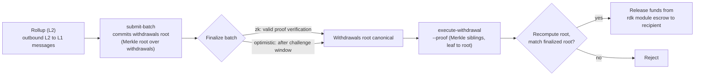

# ZK / STARK 및 출금

이 페이지는 서로 관련된 두 가지 주제를 다룹니다: ZK 정산 롤업이 사용하는 **ZK 증명 시스템**(`snark` 및 `stark`)과, 배치가 최종 확정되면 자금을 롤업에서 QoreChain으로 다시 옮기는 **L2 → L1 출금 흐름**입니다.

:::caution 초기 단계 기능
아직 어느 네트워크에서도 롤업이 생성된 적이 없으므로(2026년 10월 21일 확인), 여기에 설명된 증명 검증과 출금 흐름 모두 라이브 롤업에서 실행된 적이 없습니다. 메인넷에서 출금이 성공할 수 있는 것은 롤업별 에스크로 원장이 라이브된 v3.2.3(높이 3,662,051, 2026년 10월 20일)부터뿐이며([자금의 출처](#where-the-funds-come-from) 참조), 그 이전에는 모든 출금이 실패했습니다. SNARK 검증은 존재하지만 `create-rollup`으로 생성된 롤업은 아직 ZK 배치를 최종 확정할 수 없으며, STARK 검증은 실험적입니다. **`qorechain-diana`** 테스트넷에서 검증하고, 메인넷에서 프로덕션 수준으로 강화된 보장을 가정하지 마세요.
:::

---

## ZK 증명 시스템

ZK 정산 롤업(`zk` 정산 모드)은 각 정산 배치에 유효성 증명을 첨부하여, 롤업의 트랜잭션을 재실행하지 않고도 상태 전이가 올바름을 증명합니다. ZK 정산은 두 가지 증명 시스템을 지원합니다:

| 증명 시스템 | 특성 |
| ------------ | --------------- |
| **`snark`** | 간결한 증명(BLS12-381 위의 Groth16)으로, 롤업의 검증 키(verifying key)에 대해 온체인에서 검증됨 |
| **`stark`** | 투명한 증명, 신뢰된 설정 불필요 — 실험적이며, 옵트인 방식이고 시연용 회로에 한정됨 |

`zk` 정산 모드는 `snark` 또는 `stark` 중 하나를 요구합니다. 이 페어링은 롤업이 생성될 때 온체인에서 강제됩니다. 이와 대조적으로 `optimistic` 정산은 `fraud` 증명 시스템을 사용하고, `based` 및 `sovereign` 정산은 `none`을 사용합니다. 전체 호환성 매트릭스는 **[롤업 개요](/rollups/overview)**를 참조하세요.

### 최종성

옵티미스틱 롤업은 부정 증명 챌린지 윈도우가 끝날 때까지 기다리지만, ZK 배치는 분쟁 윈도우 없이 **유효한 증명 검증**으로 최종 확정될 수 있습니다. 이것이 ZK 정산의 핵심 트레이드오프입니다: 증명 생성의 비용과 복잡성을 대가로 더 강력하고 빠른 최종성을 얻습니다.

### 성숙도

SNARK 배치는 롤업과 함께 저장된 검증 키에 대해 온체인에서 검증됩니다(BLS12-381 위의 Groth16). `create-rollup`으로 생성된 롤업은 현재 검증 키를 가지고 있지 않으므로, ZK 배치는 아직 처음부터 끝까지 최종 확정될 수 없습니다. STARK 검증은 실험적입니다: 옵트인 방식이며, 롤업 자체의 상태 전이가 아니라 시연용 회로를 검사합니다. ZK 정산을 프로덕션 준비가 되지 않은 것으로 간주하고, 가치를 지닌 메인넷 롤업에 의존하기 전에 RDK의 릴리스 노트를 추적하세요.

---

## 배치가 출금을 운반하는 방식

롤업이 배치를 정산할 때, 그 배치는 롤업의 아웃바운드 크로스 레이어 메시지 — 즉 **L2 → L1 출금** — 도 커밋할 수 있습니다. 개념적으로:

* 최종 확정된 배치는 자신의 출금 집합에 대한 커밋(배치의 출금 메시지에 대한 머클 루트)을 운반할 수 있습니다.
* 각 개별 출금은 그 루트 아래의 리프이며, 배치 인덱스와 출금 인덱스로 식별됩니다.
* 배치가 최종 확정되면, 누구든지 특정 출금 리프가 커밋된 루트 아래에 포함되어 있음을 증명하고 지급을 트리거할 수 있습니다.

이것이 출금이 정산에 의존하는 이유입니다: 출금은 **최종 확정된** 배치에 대해서만 실행될 수 있는데, 커밋된 출금 루트를 정규(canonical)로 만드는 것이 바로 최종 확정이기 때문입니다.

배치가 제출되고 최종 확정되는 방식 — `submit-batch`와 옵티미스틱 롤업을 위한 `challenge-batch` 분쟁 경로 포함 — 은 **[롤업 배포하기](/rollups/deploying-a-rollup)**를 참조하세요.

---

## 출금 실행하기: `execute-withdrawal`

`execute-withdrawal` 명령은 최종 확정된 배치의 출금 루트에 대해 L2 → L1 출금을 마무리합니다. 출금 리프가 그 루트에 커밋되어 있음을 증명하고 rdk 모듈 에스크로에서 수신자에게 지급합니다. 이 작업은 **권한 불필요(permissionless)** 입니다 — 누구든지 유효한 증명을 제출할 수 있습니다. 모든 네이티브 레인 트랜잭션과 마찬가지로 하이브리드 포스트 양자 공동 서명이 필요하므로, `--generate-only`로 생성한 다음 cosign하세요([롤업 배포하기](/rollups/deploying-a-rollup) 참조). 출금은 아직 라이브 롤업에서 실행된 적이 없으므로, 이 흐름은 테스트되지 않은 것으로 간주하세요. 수수료를 내기 전에 다음을 확인하세요. 그렇지 않으면 체인이 트랜잭션을 거부합니다: 디노미네이션은 정확히 `uqor`이어야 하고, 금액은 양수여야 하며, 증명은 최대 64레벨이고 모든 형제는 정확히 32바이트여야 하고, 제출자와 수신자는 유효한 `qor1…` 주소여야 하며, 배치는 최종 확정되어 `withdrawals_root`를 커밋했어야 하고, 롤업은 중지되지 않았어야 하며, 해당 출금 리프가 이전에 지급된 적이 없어야 합니다. TypeScript `@qorechain/rdk` 0.6.0은 이 중 첫 번째 그룹의 검사를 대신 실행하며(`withdrawalErrors`: 주소, 디노미네이션, 금액, 증명 깊이, 형제 길이), 이 중 하나라도 실패하면 `executeWithdrawal`은 브로드캐스트하기 전에 예외를 던집니다. 배치, 롤업, 원장 조건은 체인 상태에 따라 달라지며 이 검사는 체인 상태를 읽지 않습니다.

```bash
qorechaind tx rdk execute-withdrawal \
  [rollup-id] [batch-index] [withdrawal-index] [recipient] [denom] [amount] \
  --proof <sibling-hash-1>,<sibling-hash-2>,... \
  --from mykey \
  --chain-id qorechain-diana \
  --gas 400000 --fees 40000uqor \
  --generate-only > withdrawal.json
qorechaind tx pqc cosign withdrawal.json --from mykey --pqc-key mypqckey --chain-id qorechain-diana
```

**위치 인자:**

| 인자 | 설명 |
| -------- | ----------- |
| `rollup-id` | 출금이 속한 롤업 |
| `batch-index` | 이 출금을 커밋하는 출금 루트를 가진, 최종 확정된 배치 |
| `withdrawal-index` | 그 배치 내 출금 리프의 인덱스 |
| `recipient` | 지급 대상 주소 |
| `denom` | 지급할 디노미네이션 |
| `amount` | 지급할 금액 |

**플래그:**

| 플래그 | 설명 |
| ---- | ----------- |
| `--proof` | 출금 리프가 배치의 출금 루트에 커밋되어 있음을 증명하는, 리프에서 루트 순서로 정렬된 쉼표 구분 16진수 머클 형제(sibling) 해시 |

`--proof` 값은 포함 증명입니다: 출금 리프에서 배치의 커밋된 출금 루트까지의 경로를 따라 있는 형제 해시들입니다. 모듈은 리프와 제공된 형제들로부터 루트를 재계산하고, 지급하기 전에 최종 확정된 배치의 커밋된 루트와 대조하여 확인합니다.

### 리프 및 노드 인코딩 {#leaf-and-node-encoding}

* **리프** = `rollup_id`, `0x00` 바이트, 출금 인덱스(8바이트 빅 엔디언), `recipient` 문자열, `0x00`, `denom` 문자열, `0x00`, 그리고 `amount`(8바이트 빅 엔디언)의 SHAKE-256(32바이트).
* **부모** = `left || right`의 SHAKE-256. 각 레벨에서 출금 인덱스의 해당 비트가 방향을 결정합니다: `0`은 리프(또는 누적 해시)가 왼쪽 노드임을 의미합니다.
* 모든 형제 해시는 정확히 32바이트여야 합니다.

:::caution 일반 머클 헬퍼는 일치하지 않습니다
RDK의 일반 `binaryMerkleRoot` / `binaryMerkleProof` 헬퍼는 기본적으로 홀수 노드를 복제하는 SHA-256을 사용합니다. 해시와 리프 인코딩을 위 규칙에 맞게 재정의하세요. 그렇지 않으면 증명이 온체인에서 검증되지 않습니다.
:::

### 자금의 출처 {#where-the-funds-come-from}

출금은 **롤업 자체의 에스크로된 스테이크**(스테이크에서 생성 시 1% 소각분을 뺀 금액)에서 지급됩니다. 모든 롤업의 에스크로는 하나의 통합 모듈 잔액에 있으며, **v3.2.3**부터는 롤업별 **에스크로 원장**이 각 롤업이 보유한 금액의 계정 역할을 합니다: `create-rollup`은 롤업이 유지하는 에스크로를 여기에 적립하고, 출금이나 부정 증명 보상은 여기에서 지급되며 여기에서 차감되고, 롤업이 여전히 보유한 금액보다 큰 출금은 에스크로 부족 오류와 함께 거부됩니다. `stop-rollup`은 남은 금액만 환불하고 원장을 0으로 만들며, 중지된 롤업은 더 이상 출금을 지급하지 않습니다. 따라서 한 롤업에 대해 증명된 출금이 다른 롤업의 스테이크에서 지급될 수 없습니다. 롤업 쿼리에는 `escrow_balance`(해당 롤업을 위해 여전히 보유 중인 uqor)가 포함됩니다. 모듈에는 L1 → L2 입금 메시지가 없으므로, 이것은 사용자 자금의 브리지가 아닙니다.

---

## 엔드 투 엔드 출금 흐름

*L2에서 L1으로의 경로: 정산 배치가 출금 루트를 커밋하고, 배치가 최종 확정된 다음, 권한 불필요 포함 증명이 QoreChain에서 에스크로된 자금을 해제합니다.*



1. **배치 정산.** 롤업 운영자가 `submit-batch`로 정산 배치를 제출합니다. 배치는 자신의 아웃바운드 L2 → L1 메시지에 대한 출금 루트를 커밋할 수 있습니다.
2. **최종 확정.** 배치는 롤업의 정산 모드에 따라 최종 확정됩니다 — `zk`의 경우 유효한 증명 검증으로, `optimistic`의 경우 챌린지 윈도우 이후(이 기간 동안 `challenge-batch`가 이를 분쟁할 수 있음). 옵티미스틱 윈도우는 높이 3,742,566 이전에 메인넷에 제출된 배치의 경우 기본적으로 100,800 블록이며, v3.2.4부터는 업그레이드 높이부터 제출된 배치에 대해 블록 시간의 초 단위로 측정됩니다(테스트넷은 높이 8,337,253부터, 메인넷은 높이 3,742,566부터).
3. **증명 및 실행.** 최종 확정되면, 누구든지 특정 출금 리프에 대한 머클 포함 증명(`--proof`)과 함께 `execute-withdrawal`을 제출합니다. 모듈은 최종 확정된 배치의 출금 루트에 대해 포함을 검증하고 에스크로에서 수신자에게 지급합니다.

3단계가 권한 불필요이며 증명 기반이기 때문에, 출금을 운반하는 배치가 최종 확정되고 나면 출금은 롤업 운영자의 협력에 의존하지 않습니다.

---

## 관련 문서

* **[롤업 개요](/rollups/overview)** — 정산 패러다임과 증명 시스템 호환성 매트릭스.
* **[롤업 배포하기](/rollups/deploying-a-rollup)** — `submit-batch` 및 `challenge-batch` 운영자 명령.
* **[Rollup Development Kit](/architecture/rollup-development-kit)** — 하위 수준 모듈 레퍼런스.
