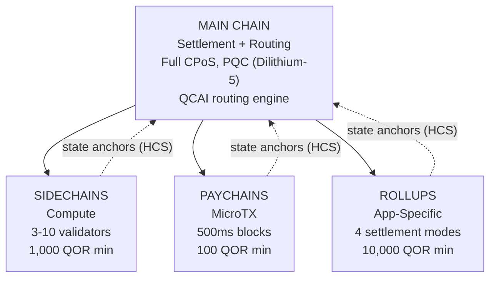

# Arhitectură multistrat

QoreChain implementează o **arhitectură ierarhică de lanțuri pe 4 niveluri** prin modulul `x/multilayer`. Lanțul principal servește drept rădăcină de decontare și de încredere, în timp ce straturile subsidiare (sidechain-uri, paychain-uri și rollup-uri) gestionează sarcini de lucru specializate, cu compromisuri diferite de performanță și securitate.

:::caution Capabilitate în stadiu incipient
Modulul este implementat pe mainnet (versiunea de lanț **v3.2.3**) și pe testnet (**v3.2.4**), dar **încă nu există niciun strat și nicio ancoră în niciuna dintre rețele** (verificat la 20 octombrie 2026: `GET /qorechain/multilayer/v1/layers` returnează o listă goală pe ambele). Tot ce urmează descrie modulul așa cum a fost construit; parametrii sunt valorile live. Pe mainnet, mesajul `MsgUpdateLayerStatus` este în prezent oprit de circuit breaker (vezi [Parametrii lanțului](/appendix/chain-parameters#circuit-breaker)); pe testnet nu este.
:::

---

## Prezentare generală a sistemului

Ierarhia pe 4 niveluri de mai jos prezintă lanțul principal ca rădăcină de decontare și de încredere, cu trei tipuri de straturi subsidiare care își ancorează rădăcinile de stare înapoi la acesta prin Scheme de Angajament Ierarhic (HCS).



```
                    +---------------------------+
                    |       MAIN CHAIN          |
                    |  (Settlement + Routing)   |
                    |  Full CPoS consensus      |
                    |  PQC-secured (Dilithium-5)|
                    |  QCAI routing engine       |
                    +------+------+------+------+
                           |      |      |
              +------------+      |      +------------+
              |                   |                    |
    +---------v--------+ +-------v--------+ +---------v---------+
    |   SIDECHAINS     | |   PAYCHAINS    | |     ROLLUPS       |
    |  (Compute)       | |  (MicroTX)     | |  (App-Specific)   |
    |  3-10 validators | |  500ms blocks  | |  4 settlement     |
    |  1,000 QOR min   | |  100 QOR min   | |    modes          |
    |  Max: 10         | |  Max: 50       | |  10,000 QOR min   |
    +------------------+ +----------------+ |  Max: 100 (x/rdk) |
                                            +-------------------+
```

---

## Tipuri de straturi

### Lanțul principal

Lanțul principal este rădăcina de încredere pentru întregul ecosistem QoreChain.

| Proprietate | Valoare                                                                          |
| ----------- | ------------------------------------------------------------------------------- |
| Consens     | Consens QoreChain (vezi [Mecanismul de consens](/architecture/consensus-mechanism) pentru ce este conectat astăzi) |
| Securitate  | Securizat cu PQC, prin semnături Dilithium-5                                     |
| Rol         | Strat de decontare, stocarea ancorelor de stare, motorul de rutare QCAI, rădăcina de încredere |
| Timp de bloc | Depinde de rețea: aproximativ 3,2 secunde pe mainnet, aproximativ 1,0 secundă pe testnet (măsurat la 20 octombrie 2026) |

Toate straturile subsidiare își ancorează periodic rădăcinile de stare la lanțul principal prin Scheme de Angajament Ierarhic (HCS).

### Sidechain-uri

Sidechain-urile gestionează **operațiuni intensive din punct de vedere computațional**, precum protocoale DeFi, motoare de jocuri și procesarea datelor IoT.

| Parametru                  | Valoare           |
| -------------------------- | ----------------- |
| Validatori minimi          | 3                 |
| Validatori maximi          | 10                |
| Miză minimă a creatorului  | 1,000 QOR         |
| Sidechain-uri active maxime | 10               |
| Domenii vizate             | DeFi, Gaming, IoT |

### Paychain-uri

Paychain-urile sunt optimizate pentru **microtranzacții de frecvență ridicată** cu latență minimă.

| Parametru                 | Valoare                                 |
| ------------------------- | --------------------------------------- |
| Timp de bloc țintă        | 500 ms                                  |
| Paychain-uri active maxime | 50                                     |
| Miză minimă a creatorului | 100 QOR                                 |
| Domenii vizate            | Plăți, streaming, microtranzacții       |

### Rollup-uri

Rollup-urile sunt **lanțuri specifice aplicațiilor** implementate prin Rollup Development Kit (`x/rdk`). Când este creat un rollup, RDK înregistrează pentru el un strat în modulul multilayer (ca strat de tip `sidechain`, vezi mai jos).

| Parametru               | Valoare                                     |
| ----------------------- | ------------------------------------------- |
| Moduri de decontare     | 4 (optimistic, zk, based, sovereign)        |
| Rollup-uri înregistrate maxime | 100 (`max_rollups`); dar pot exista simultan doar 10 straturi de tip sidechain (`max_sidechains`), deci cel mult 10 rollup-uri pot avea un strat ancorabil |
| Miză minimă a creatorului | 10,000 QOR pentru rollup, plus 1,000 QOR miză de înregistrare a stratului (`min_sidechain_stake`) |
| Tip de strat            | Rollup-urile înregistrate prin RDK folosesc tipul de strat `sidechain` (tipul de strat `rollup` este definit, dar încă nefolosit de `x/rdk`) |
| Domenii vizate          | DeFi, Gaming, NFT, Enterprise               |

Implementarea și configurarea rollup-urilor sunt tratate în detaliu în [Rollup Development Kit](/architecture/rollup-development-kit).

---

## Rutarea tranzacțiilor QCAI

Routerul QCAI evaluează toate straturile active pentru fiecare tranzacție primită și selectează destinația optimă folosind un model de punctare ponderată cu 4 factori.

### Formula de punctare

Fiecare strat candidat primește un scor compozit (mai mare este mai bine):

```
Score = w_congestion * (1 - Congestion) + w_capability * Capability + w_cost * (1 - Cost) + w_latency * (1 - Latency)
```

| Factor     | Pondere | Descriere                                                                    |
| ---------- | ------- | --------------------------------------------------------------------------- |
| Congestie  | 0.30    | Nivelul de încărcare curent (inversat: congestie mai mică = scor mai mare)  |
| Capabilitate | 0.40  | Cât de bine se potrivește stratul cu cerințele tranzacției                   |
| Cost       | 0.20    | Multiplicatorul de comision raportat la lanțul principal (inversat: cost mai mic = scor mai mare) |
| Latență    | 0.10    | Timpul estimat până la finalitate (inversat: latență mai mică = scor mai mare) |

### Pragul de încredere

Routerul necesită un scor minim de încredere de **0.6** înainte de a ruta o tranzacție către un strat subsidiar. Dacă niciun strat nu atinge acest prag, tranzacția revine implicit la lanțul principal.

Expeditorul tranzacției poate furniza o sugestie de strat preferat. Dacă stratul preferat obține cel puțin 80% din pragul de încredere (adică 0.48), acesta este acceptat ca țintă de rutare.

### Euristici de payload

Atunci când metadatele detaliate ale tranzacției nu sunt disponibile, routerul folosește dimensiunea payload-ului ca semnal de clasificare:

| Dimensiune payload | Strat preferat  | Motivație                                    |
| ------------------ | --------------- | -------------------------------------------- |
| &lt; 256 octeți    | Paychain        | Probabil un transfer simplu sau o microtranzacție |
| 256 - 1,024 octeți | Lanț principal  | Complexitate standard a tranzacției          |
| > 1,024 octeți     | Sidechain       | Probabil o interacțiune complexă cu un contract |

---

## Scheme de Angajament Ierarhic (HCS)

Straturile subsidiare își angajează periodic starea către lanțul principal prin **ancore de stare**. Fiecare ancoră conține o dovadă criptografică a stării lanțului subsidiar la o anumită înălțime.

### Conținutul ancorei

| Câmp                      | Descriere                                            |
| ------------------------- | ---------------------------------------------------- |
| `layer_id`                | Identificatorul stratului subsidiar                  |
| `layer_height`            | Înălțimea blocului pe lanțul subsidiar               |
| `state_root`              | Rădăcina Merkle a arborelui de stare al lanțului subsidiar |
| `validator_set_hash`      | Hash-ul setului de validatori care a semnat angajamentul |
| `pqc_aggregate_signature` | Semnătura agregată Dilithium-5 peste datele ancorei  |
| `transaction_count`       | Numărul de tranzacții de la ultima ancoră            |
| `compressed_state_proof`  | Dovada comprimată a tranziției de stare              |

### Id-urile straturilor și ale rollup-urilor {#id-grammar}

Începând cu v3.2.2, un id **nou** de strat (și un id de rollup, pe care un rollup îl împarte cu stratul său) trebuie să respecte `^[a-z0-9][a-z0-9._-]{2,63}$`: de la 3 la 64 de caractere, litere mici, cifre, `.`, `_` și `-`, începând cu o literă sau o cifră. Keeper-ul verifică acest lucru la crearea stratului, iar o tranzacție care îl încalcă își plătește totuși taxa, așa că validați id-urile mai întâi în client. Id-urile create înainte de v3.2.2 nu sunt afectate.

### Trimiterea ancorei {#anchor-submission}

Ancorele sunt trimise către lanțul principal prin `MsgAnchorState`. Keeper-ul validează ancora conform pașilor următori:

1. **Stratul există și este activ** — Keeper-ul verifică dacă stratul există în stare și are în prezent statusul `active`.
2. **Intervalul minim de ancorare a trecut** — Keeper-ul verifică dacă au trecut cel puțin `min_anchor_interval` blocuri (implicit: 100) de la ultima ancoră pentru acest strat.
3. **Semnătura agregată PQC** — Keeper-ul se asigură că semnătura agregată PQC este prezentă și validă pentru datele ancorei. Semnătura este verificată față de cheia ML-DSA-87 înregistrată a **creatorului stratului**; o ancoră este refuzată atunci când creatorul nu are nicio cheie înregistrată.

O **ancoră de decontare** scrisă prin `x/rdk` (un lot trimis cu un `anchor_signature`, începând cu v3.2.2) este un caz special: sare peste verificarea intervalului minim, deoarece loturile sosesc în ordine, poate ancora un strat care este încă `proposed` (nimic on-chain nu promovează un strat înregistrat de un rollup RDK) și este acceptată numai când expeditorul este chiar creatorul stratului. Verificarea semnăturii este aceeași.

### Perioada de contestare

Fiecare ancoră intră într-o **perioadă de contestare** de **24 de ore** (86,400 secunde, configurabilă pe strat). În această perioadă, orice parte poate contesta ancora prin trimiterea unei dovezi de fraudă via `MsgChallengeAnchor`. Dacă dovada de fraudă este validă, ancora este invalidată, iar starea lanțului subsidiar este readusă la ancora anterioară.

După expirarea perioadei de contestare fără o contestație reușită, ancora este considerată finalizată.

### Citirea ancorelor {#reading-anchors}

Ancorele sunt **lizibile** prin serviciul de interogare multilayer. Două interogări expun starea ancorei atât prin gRPC, cât și prin REST:

* **`Anchor`** (`/qorechain/multilayer/v1/anchor/{layer_id}`) — returnează cea mai recentă ancoră de stare pentru un strat.
* **`Anchors`** (`/qorechain/multilayer/v1/anchors/{layer_id}`) — returnează istoricul ancorelor pentru un strat.

Fiecare ancoră poartă o semnătură Dilithium-5 (ML-DSA-87) a creatorului stratului. Mesajul semnat depinde de înălțimea la care este trimisă ancora:

* **Începând cu v3.2.2 (înălțimea mainnet 3,556,788, înălțimea testnet 6,905,034): v2.** Fiecare câmp de lungime variabilă poartă o lungime de 8 octeți big-endian, id-ul lanțului face parte din mesaj, iar numărul de tranzacții și dovada de stare comprimată sunt acoperite:

```text
"qorechain-multilayer-anchor-v2"
‖ BE64(len(chain_id))            ‖ chain_id
‖ BE64(len(layer_id))            ‖ layer_id
‖ BE64(layer_height)
‖ BE64(len(state_root))          ‖ state_root
‖ BE64(len(validator_set_hash))  ‖ validator_set_hash
‖ BE64(transaction_count)
‖ BE64(len(compressed_state_proof)) ‖ compressed_state_proof
```

* **Sub v3.2.2: v1** (`layer_id ‖ layer_height (8-byte big-endian) ‖ state_root ‖ validator_set_hash`, fără prefixe de lungime și fără id de lanț, deci o semnătură v1 este valabilă pe orice lanț). Lanțul nu acceptă o ancoră v1 începând cu înălțimea v3.2.2.

Deoarece mesajul se poate schimba între versiuni, un client ar trebui să aleagă forma pe baza înălțimii planului aplicat (`GET /cosmos/upgrade/v1beta1/applied_plan/v3.2.2`; `"height":"0"` înseamnă neaplicat), în loc să o codifice fix în cod. Pentru un lot RDK corespondența este: `layer_id` = id-ul stratului rollup-ului, `layer_height` = indexul lotului, `state_root` = rădăcina de stare a lotului, `transaction_count` = numărul de tranzacții al lotului și un `compressed_state_proof` gol. `qorechaind query rdk anchor-sign-bytes <layer-id> <batch-index> <state-root-hex> --chain-id <id>` afișează acești octeți offline. O semnătură dovedește că cheia înregistrată a creatorului a semnat acei octeți; dacă ancora există este o întrebare pentru lanț, așa că un verificator ar trebui să citească ancora de la un nod în care are încredere. În prezent nu există niciun strat și nicio ancoră în niciuna dintre rețele. Aceasta este primitiva on-chain din spatele [chitanțelor de decontare](/rollups/settlement-receipts) ale Rollup Development Kit.

---

## Cross-Layer Fee Bundling (CLFB)

CLFB permite ca o singură plată de comision pe stratul sursă să acopere execuția pe mai multe straturi într-o cale de tranzacție cross-strat.

### Calcularea comisionului

```
avgMultiplier = sum(layer_multiplier_i) / num_layers
bundledFee = (totalGas / 1000) * avgMultiplier
```

Unde:

* `layer_multiplier_i` este multiplicatorul de comision de bază pentru fiecare strat din calea tranzacției (lanțul principal = 1.0).
* `totalGas` este consumul total estimat de gas pe toate straturile.
* Rezultatul este denominat în **uqor**, cu un comision minim de 1 uqor.

### Exemplu

O tranzacție cross-strat atinge trei straturi: lanțul principal (multiplicator 1.0), un sidechain (multiplicator 0.5) și un paychain (multiplicator 0.1).

```
avgMultiplier = (1.0 + 0.5 + 0.1) / 3 = 0.533
bundledFee = (150,000 / 1000) * 0.533 = 80 uqor
```

CLFB poate fi activat sau dezactivat la nivel global prin parametrul `cross_layer_fee_bundling`, iar straturile individuale pot renunța prin indicatorul lor de configurare `cross_layer_fee_bundling_enabled`.

---

## Ciclul de viață al stratului

Fiecare strat subsidiar parcurge un ciclu de viață bine definit:

```
Proposed --> Active --> Suspended --> Decommissioned
                  \                /
                   +-- Active <--+
```

| Status             | Descriere                                                                        | Tranziții permise         |
| ------------------ | ------------------------------------------------------------------------------- | ------------------------- |
| **Proposed**       | Stratul a fost înregistrat, dar nu a fost încă activat                           | Active, Decommissioned    |
| **Active**         | Stratul este operațional și acceptă tranzacții                                   | Suspended, Decommissioned |
| **Suspended**      | Stratul este pus temporar în pauză (de ex., pentru întreținere sau din motive de securitate) | Active, Decommissioned |
| **Decommissioned** | Stratul este oprit permanent (stare terminală)                                   | Niciuna                   |

Tranzițiile de status sunt impuse de keeper. Tranzițiile invalide (de ex., de la Decommissioned la Active) sunt respinse.

---

## Parametri

| Parametru                      | Tip    | Implicit        | Descriere                                              |
| ------------------------------ | ------ | --------------- | ------------------------------------------------------- |
| `max_sidechains`               | uint64 | `10`            | Numărul maxim de sidechain-uri active                  |
| `max_paychains`                | uint64 | `50`            | Numărul maxim de paychain-uri active                   |
| `min_anchor_interval`          | uint64 | `100`           | Numărul minim de blocuri între ancorele de stare       |
| `max_anchor_interval`          | uint64 | `1,000`         | Numărul maxim de blocuri între ancorele de stare (ancoră forțată) |
| `default_challenge_period`     | uint64 | `86,400`        | Perioada de contestare implicită în secunde (24 de ore) |
| `min_sidechain_stake`          | string | `1,000,000,000` | Miza minimă pentru a crea un sidechain (1,000 QOR în uqor) |
| `min_paychain_stake`           | string | `100,000,000`   | Miza minimă pentru a crea un paychain (100 QOR în uqor) |
| `routing_enabled`              | bool   | `true`          | Activează rutarea tranzacțiilor bazată pe QCAI         |
| `routing_confidence_threshold` | string | `0.6`           | Încrederea minimă pentru deciziile de rutare QCAI      |
| `cross_layer_fee_bundling`     | bool   | `true`          | Activează la nivel global Cross-Layer Fee Bundling     |

Acestea sunt valorile returnate de `qorechaind query multilayer params` (REST: `/qorechain/multilayer/v1/params`) pe mainnet și testnet la 20 octombrie 2026. Începând cu v3.2.2, `MsgUpdateParams` al modulului poate fi rutat, deci o propunere de guvernanță le poate schimba.
