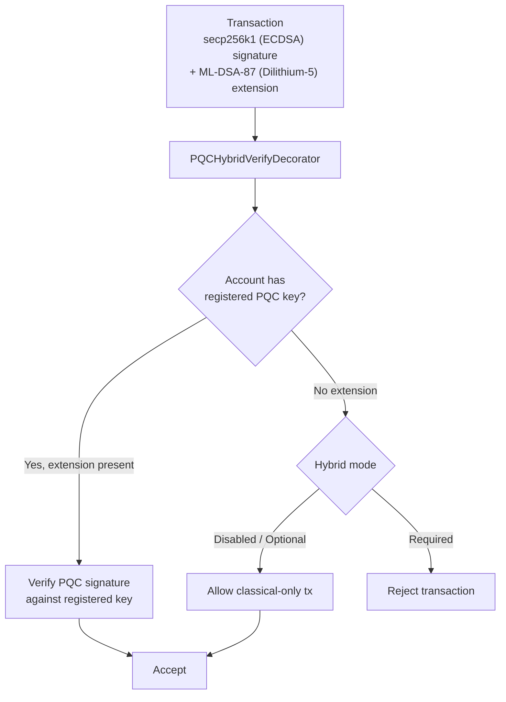

# Securitate post-cuantică

QoreChain este construit cu **criptografie post-cuantică (PQC) de la genesis** — nu adăugată ulterior ca actualizare. Modulul `x/pqc` oferă semnături digitale bazate pe rețele (lattice) și încapsulare de chei drept primitive criptografice principale, cu un cadru de agilitate a algoritmilor controlat prin guvernanță pentru reziliență pe termen lung.

Baza completă PQC — **Dilithium-5 (semnături) + ML-KEM-1024 (KEM) + SHAKE-256 (hash)** — este acum finalizată și reprezintă valoarea implicită a rețelei. Pe rețelele live (v3.2.x), semnăturile hibride sunt **obligatorii implicit** pe calea de tranzacții cosmos: `hybrid_signature_mode = required` și `allow_classical_fallback = false`. Fiecare tranzacție de pe calea cosmos trebuie să poarte o semnătură Dilithium-5 alături de semnătura sa clasică secp256k1; tranzacțiile exclusiv clasice de la un cont PQC sunt respinse, iar calea de retrogradare clasică este închisă. Mainnet rulează v3.2.3, iar testnet v3.2.4; ce au adăugat versiunile v3.2.2 și v3.2.3 la regulile post-cuantice (integritatea cheilor, dovada deținerii opțională, ferestre EVM cu domeniu limitat, consimțământul EIP-7702) este descris în [Reguli de integritate a cheilor](#key-integrity), [Dovada deținerii](#proof-of-possession) și [Delegările EIP-7702](#eip-7702).

## Principii de proiectare

* **PQC obligatoriu implicit**: Semnăturile post-cuantice sunt obligatorii pe calea cosmos. Semnăturile clasice secp256k1 singure nu mai sunt suficiente — `allow_classical_fallback = false`.
* **Hibrid implicit**: Tranzacțiile cosmos poartă simultan atât o semnătură clasică secp256k1, cât și o semnătură PQC Dilithium-5. Calea de rezervă exclusiv clasică este închisă.
* **Agilitate a algoritmilor**: Registrul de algoritmi criptografici este controlat prin guvernanță, permițând rețelei să adopte algoritmi noi sau să retragă pe cei compromiși fără hard fork-uri.
* **Verificare deterministă**: Toate verificările de semnături sunt deterministe și reproductibile pe toate nodurile de validare.

## Algoritmi suportați

| Algoritm       | Standard             | Categorie          | Nivel NIST | Cheie publică  | Cheie privată | Semnătură / Text cifrat | Secret partajat |
| --------------- | -------------------- | ----------------- | ---------- | ----------- | ----------- | ---------------------- | ------------- |
| **Dilithium-5** | ML-DSA-87 (FIPS 204) | Semnătură         | 5          | 2,592 octeți | 4,896 octeți | 4,627 octeți            | --            |
| **ML-KEM-1024** | FIPS 203             | Încapsulare de chei | 5          | 1,568 octeți | 3,168 octeți | 1,568 octeți            | 32 octeți      |

Ambii algoritmi operează la **NIST Security Level 5**, cea mai înaltă categorie de securitate standardizată, oferind o protecție echivalentă cu AES-256 împotriva adversarilor atât clasici, cât și cuantici.

## Backend criptografic

Operațiunile PQC sunt implementate într-un backend criptografic de înaltă performanță și sigur la nivel de memorie, care expune semnarea, verificarea și încapsularea de chei bazate pe rețele către runtime-ul QoreChain. Backend-ul oferă:

Operațiuni specifice algoritmilor:

* Generarea de chei, semnarea și verificarea Dilithium-5
* Generarea de chei, încapsularea și decapsularea ML-KEM-1024
* Generarea deterministă a balizei aleatorii (`seed`, `epoch`)

Operațiuni conștiente de algoritm:

* `Keygen(algorithmID)` — Generează o pereche de chei pentru orice algoritm înregistrat
* `Sign(algorithmID, privkey, message)` — Creează o semnătură
* `Verify(algorithmID, pubkey, message, signature)` — Verifică o semnătură
* `AlgorithmInfo(algorithmID)` — Interoghează dimensiunile cheilor/ieșirilor
* `ListAlgorithms()` — Enumeră toți algoritmii suportați

Toate operațiunile de semnare și verificare sunt deterministe și produc rezultate identice pe fiecare nod de validare și platformă suportată.

Aceleași primitive — ML-DSA (FIPS-204), ML-KEM (FIPS-203) și SHAKE-256 (FIPS-202) — sunt disponibile pentru portofele și integratori prin biblioteca open-source [**qorechain-pqc**](https://github.com/qorechain/qorechain-pqc), care oferă un API consecvent și compatibil la nivel de octet în șase limbaje (JavaScript/TypeScript, Rust, Go, C, Python, Java). Consultați [Post-Quantum Signing](/developer-guide/post-quantum-signing).

## Înregistrarea cheilor {#key-registration}

Conturile înregistrează chei PQC în mod explicit prin `MsgRegisterPQCKey` (legacy, implicit Dilithium-5) sau `MsgRegisterPQCKeyV2` (conștient de algoritm); lanțul nu înregistrează niciodată o cheie de unul singur, iar fluxul CLI este `qorechaind tx pqc gen-key <name>` urmat de `qorechaind tx pqc register-key <public_key_hex> hybrid --from <key>` (vezi [First Transaction](/getting-started/first-transaction#register-pqc-key)). Fiecare mesaj include:

* **Sender**: Adresa contului care înregistrează cheia.
* **PublicKey**: Octeții cheii publice PQC.
* **AlgorithmID**: Identificatorul algoritmului PQC (doar v2).
* **ProofOfPossession**: Semnătură opțională făcută de noua cheie (doar v2, începând cu v3.2.3); vezi [Dovada deținerii](#proof-of-possession).
* **KeyType**: Unul dintre `hybrid` sau `pqc_only` (o a treia valoare, `classical_only`, există încă în schemă, dar este refuzată începând cu v3.2.3):

| Tip de cheie         | Descriere                                                              |
| ---------------- | ------------------------------------------------------------------------ |
| `hybrid`         | Atât chei clasice (ECDSA), cât și PQC. Tranzacțiile poartă semnături duble. |
| `pqc_only`       | Înregistrat ca `hybrid`: semnătura clasică secp256k1 este în continuare verificată de verificările standard de semnătură, iar semnătura PQC este necesară și ea. |
| `classical_only` | **Refuzat începând cu v3.2.3.** O înregistrare cu acest tip de cheie nu înregistrează nicio cheie post-cuantică utilizabilă și ar lăsa contul incapabil să semneze, așa că lanțul o respinge. |

### Reguli de integritate a cheilor (v3.2.3) {#key-integrity}

Începând cu upgrade-ul v3.2.3 (înălțimea mainnet 3,662,051, 20 octombrie 2026; înălțimea testnet 8,003,746), lanțul aplică aceste reguli cheilor post-cuantice. Sub acea înălțime, niciuna dintre ele nu era aplicată.

| Regulă | Comportament |
| --- | --- |
| Fără chei slabe | O înregistrare este refuzată dacă tipul de cheie este `classical_only`, cheia este goală sau cheia este degenerată: o cheie de lungime corectă a cărei structură nu oferă nicio protecție post-cuantică. Generați chei cu `tx pqc gen-key` sau cu biblioteca `qorechain-pqc` și înregistrați ce afișează acestea |
| Fără reutilizarea cheilor | O rotație sau o migrare este refuzată dacă noua cheie este una pe care contul a mai folosit-o. Lanțul reține un hash al fiecărei chei de la care un cont a făcut rotația sau migrarea |
| Conturile cu cheie au nevoie de semnătura hibridă | Un cont care deține deja o cheie utilizabilă trebuie să poarte semnătura sa hibridă și pe o tranzacție de înregistrare sau de migrare. Excepția exclusiv clasică acoperă acum doar un cont **fără** nicio cheie înregistrată sau unul a cărui înregistrare stocată nu conține nicio cheie utilizabilă (pe care `MsgRegisterPQCKeyV2` o poate atunci înlocui) |
| Fără extensie fără cheie | În modul `required`, un cont fără cheie înregistrată nu poate trece atașând o extensie hibridă pe care nimic nu o poate verifica; doar o înregistrare poate trece fără una |
| O singură extensie | O tranzacție poartă cel mult o extensie de semnătură hibridă |
| Fără mesaje de chei prin authz | `MsgRegisterPQCKey`, `MsgRegisterPQCKeyV2`, `MsgRotatePQCKey` și `MsgMigratePQCKey` nu pot fi executate în numele unui cont prin `x/authz`; este necesară semnătura proprie a contului |
| Garduri de guvernanță pentru algoritmi | Retragerea sau dezactivarea unui algoritm nu poate lăsa lanțul fără un algoritm de semnătură activ, iar algoritmul de înlocuire trebuie să poată semna |

v3.2.2 a adăugat o verificare conexă: o înregistrare validează cheia clasică `ecdsa_pubkey` pe care o poartă și o leagă de contul semnatar, astfel încât un cont nu poate înregistra o cheie clasică care nu este a sa.

Nodurile filtrează aceste cazuri și în mempool, astfel încât o tranzacție care nu poate decât să eșueze nu este retransmisă și nu costă o taxă.

### Dovada deținerii (opțională) {#proof-of-possession}

`MsgRegisterPQCKeyV2` are un câmp opțional `proof_of_possession`. Când este prezent, lanțul îl verifică; când lipsește, înregistrarea continuă ca înainte (dovada **nu este obligatorie**). Dovada este o semnătură făcută de cheia care se înregistrează peste

```text
qorechain-pqc-pop-v1|<chain-id>|<algorithm-id>|<account-address>|<hex(public-key)>
```

astfel încât o dovadă făcută pentru un cont sau un lanț nu dovedește nimic pe altul. CLI o construiește pentru dvs. atunci când indicați fișierul cheii locale:

```bash
qorechaind tx pqc register-key-v2 dilithium5 <pubkey-hex> hybrid \
  --pqc-key mypqc --from mykey --chain-id qorechain-vladi --gas 600000 --fees 60000uqor
```

Înregistrarea este scutită de cerința hibridă doar pentru un cont fără cheie, așa că această tranzacție este semnată doar cu cheia clasică a contului. O dovadă malformată este refuzată cu `ErrInvalidProofOfPossession` (codul 231 în modulul `pqc`).

**De la v3.2.4 (mainnet din 23 octombrie 2026, testnet din 19 octombrie 2026):** înregistrarea contului primește un câmp boolean `possession_proven`, returnat de `GET /qorechain/pqc/v1/account/{address}`. Este `true` când cheia curentă a fost înregistrată cu o dovadă validă sau a ajuns printr-o rotație ori migrare (ambele verifică o semnătură a noii chei peste octeți care numesc lanțul, contul și cheia); o înregistrare fără dovadă înregistrează `false`, iar o cheie care se schimbă fără una șterge indicatorul. Dovada rămâne opțională pentru cheile de cont în v3.2.4.

## Semnături hibride {#hybrid-signatures}

Sistemul de semnături hibride necesită ca tranzacțiile de pe calea cosmos să poarte **atât** o semnătură clasică, **cât și** o semnătură PQC simultan. Aceasta oferă apărare în profunzime: chiar dacă o schemă este spartă, cealaltă protejează tranzacția.

Cu valoarea implicită a rețelei `hybrid_signature_mode = required`, fiecare tranzacție de pe calea cosmos trebuie să includă extensia Dilithium-5 alături de semnătura secp256k1. Singurele excepții (pentru bootstrap) sunt **gentx-urile de genesis (înălțimea 0)**, **înregistrarea cheii PQC** (`MsgRegisterPQCKey`, `MsgRegisterPQCKeyV2`) de la un cont care nu are nicio cheie înregistrată (sau a cărui înregistrare nu conține nicio cheie utilizabilă), căreia i se permite să fie exclusiv clasică pentru ca contul să își poată înregistra prima cheie PQC, precum și o deblocare (unjail) de la un cont de operator care nu are nicio cheie înregistrată. Începând cu v3.2.3, o înregistrare sau o migrare de la un cont care deține deja o cheie utilizabilă are nevoie de semnătura hibridă ca orice altă tranzacție (vezi [Reguli de integritate a cheilor](#key-integrity)).

**Calea EVM este protejată în schimb de o fereastră de autorizare.** O tranzacție EVM nu poate purta o a doua semnătură (ML-DSA) — portofelele standard semnează o singură semnătură secp256k1 peste o tranzacție Ethereum și nu oferă nicio posibilitate de a atașa alta. Astfel, autorizarea post-cuantică circulă *înaintea* tranzacției: contul deschide o **fereastră de autorizare EVM** limitată printr-un mesaj de pe calea Cosmos (`MsgOpenEVMWindow`), care poartă semnătura hibridă obișnuită, iar calea EVM admite apoi doar tranzacțiile acoperite de o fereastră activă. Începând cu v3.2.0, o tranzacție EVM este refuzată dacă expeditorul ei nu (1) are o cheie post-cuantică înregistrată și (2) are o fereastră activă cu blocuri, tranzacții și valoare rămase. În interiorul unei ferestre, o tranzacție obișnuită MetaMask/ethers/Hardhat funcționează nemodificată, deoarece verificarea citește starea lanțului, nu tranzacția. Vezi [Fereastra de autorizare EVM](/getting-started/first-transaction#evm-window).

Începând cu v3.2.3, o fereastră poate fi și **cu domeniu limitat** (scoped) atunci când este deschisă: `--native-only` o restrânge la transferuri simple de QOR nativ (fără calldata, fără creare de contract, fără destinatar care poartă cod, fără autorizare EIP-7702), iar `--allowed-targets 0x…,0x…` admite doar destinatarii listați și refuză crearea de contracte. O fereastră deschisă fără domeniu admite ce a admis întotdeauna. Domeniul face parte din `MsgOpenEVMWindow` (`native_only`, `allowed_targets`).

### Delegările EIP-7702 {#eip-7702}

Un tuplu de autorizare EIP-7702 instalează cod pe contul care l-a semnat, iar acea semnătură este o semnătură clasică secp256k1 pe care oricine o poate purta într-o tranzacție de tip 4. Începând cu v3.2.2 (înălțimea mainnet 3,556,788), calea EVM admite așadar o tranzacție de tip 4 doar dacă **fiecare autoritate al cărei tuplu ar avea efect** deține o cheie post-cuantică înregistrată și a **consimțit**, printr-un mesaj de pe calea Cosmos semnat hibrid, exact la delegarea pe care o instalează tuplul.

| Element | Detaliu |
| --- | --- |
| Acordați consimțământul | `qorechaind tx pqc authorize-evm-delegation <delegate-0x-address> <blocks>` (`MsgAuthorizeEVMDelegation`): numește adresa delegatului pe care trebuie să o poarte tuplul și cât timp rămâne utilizabil consimțământul (cel mult 17,280 de blocuri, aceeași limită ca pentru o fereastră) |
| Ștergeți o delegare | Adresa zero ca delegat consimte la ștergere. `tx pqc clear-evm-delegation` (`MsgClearEVMDelegation`) șterge o delegare existentă fără nicio tranzacție EVM |
| Utilizare unică | Un consimțământ este consumat de tranzacția care instalează delegarea, înlocuiește orice consimțământ anterior al contului și este revocat de `MsgCloseEVMWindow` |
| Citiți-l | `qorechaind query pqc evm-delegation-consent <address>` sau `GET /qorechain/pqc/v1/evm_delegation_consent/{address}` (câmpurile `live`, `delegate`, `granted_height`, `expiry_height`, `current_delegate`, `nonce`) |
| Limite | Cel mult 8 autorizări per tranzacție de tip 4. Valoarea care părăsește un cont delegat este imputată propriei sale ferestre. O tranzacție de tip 4 eșuată păstrează autorizările pe care le-a aplicat |
| Delegare sponsorizată | Funcționează în continuare: sponsorul plătește din propria fereastră, iar autoritatea doar consimte în prealabil |

### Fluxul de cosemnare

Pentru a produce o tranzacție cosmos conformă, semnătura clasică secp256k1 este calculată peste octeții de semnare standard (care exclud extensia PQC), iar o semnătură Dilithium-5 este calculată peste octeții semnați v2 (vezi [Octeți semnați (v2)](#sign-bytes-v2) mai jos) și atașată ca extensie `PQCHybridSignature`. Instrumentele standard CosmJS / relayer trebuie să producă această extensie pentru a tranzacționa pe calea cosmos. Astăzi acest lucru se face prin:

* `qorechaind tx pqc gen-key <name>` — generează o cheie Dilithium-5.
* `qorechaind tx pqc cosign <unsigned_tx_file> --from <key> --pqc-key <name>` — atașează cosemnătura Dilithium-5 la o tranzacție construită cu `--generate-only`.
* Semnarea hibridă a QoreChain SDK — `buildHybridTx`. Cheia contului trebuie să fie deja înregistrată cu `MsgRegisterPQCKey`.
* [QoreX](/qorex/overview), care le face pe amândouă pentru tine.

*O tranzacție semnată cu secp256k1 (ECDSA) plus ML-DSA-87 (Dilithium-5), verificată de gestionarul ante în modul de impunere la nivel de lanț.*



### Octeți semnați (v2) {#sign-bytes-v2}

Semnătura ML-DSA acoperă octeți etichetați cu domeniu și legați de lanț. Începând cu v3.2.0, lanțul verifică **doar** această formă:

```text
"qorechain-pqc-hybrid-v2" ‖ BE64(len(chainID)) ‖ chainID ‖
BE32(len(B0)) ‖ B0 ‖ BE32(len(authInfo)) ‖ authInfo
```

unde `B0` este corpul tranzacției serializat **fără** extensia PQC, iar `authInfo` sunt octeții AuthInfo exact așa cum sunt (`‖` este concatenare, lungimile sunt big-endian). Eticheta de domeniu împiedică o semnătură făcută într-un alt context (o provocare de autentificare, o cerere de semnare a unui mesaj) să fie validă ca semnătură de tranzacție, iar legarea de chain ID face ca semnătura post-cuantică în sine să fie invalidă pe orice altă rețea. Prima formă (`BE32(len(B0)) ‖ B0 ‖ BE32(len(authInfo)) ‖ authInfo`) a fost verificată doar sub înălțimea de upgrade; niciun bloc nu le acceptă pe amândouă. Payload-urile de migrare a cheilor și de atestare a bridge-ului au trecut la aceeași schemă etichetată cu domeniu și legată de lanț.

**Ce formă verifică rețeaua mea?** Întreabă nodul dacă upgrade-ul a fost aplicat:

```bash
curl -s https://api.qore.host/cosmos/upgrade/v1beta1/applied_plan/v3.2.0         # height 2981742 on mainnet
curl -s https://api-testnet.qore.host/cosmos/upgrade/v1beta1/applied_plan/v3.2.0 # height 5920000 on testnet
```

(`"height":"0"` înseamnă neaplicat.) Ambele rețele au aplicat schimbarea de mult timp, așa că un client actual semnează forma v2 peste tot; verificarea contează atunci când reluați sau verificați blocuri vechi. CLI face acest lucru cu `--sign-bytes auto`, iar versiunile actuale de SDK și wallet-adapter fac la fel. Un client pe forma greșită produce un digest pe care lanțul îl respinge — eșuează în siguranță (fail closed).

### Formatul extensiei TX

Semnăturile PQC sunt atașate tranzacțiilor ca **extensie TX** cu URL-ul de tip `/qorechain.pqc.v1.PQCHybridSignature`:

```text
{
  "algorithm_id": 1,
  "pqc_signature": "<4627 bytes for Dilithium-5>",
  "pqc_public_key": "<2592 bytes, optional>"
}
```

Câmpul `pqc_public_key` este opțional și cu caracter informativ; cheile sunt înregistrate doar printr-un mesaj explicit de înregistrare (vezi [Înregistrarea cheilor](#key-registration)).

### PQCHybridVerifyDecorator

Gestionarul ante `PQCHybridVerifyDecorator` procesează semnăturile hibride cu o logică de verificare în trei direcții:

| Scenariu | Contul are cheie PQC | Extensie prezentă | Cheie publică în extensie | Rezultat                                              |
| -------- | ------------------- | ----------------- | ----------------------- | --------------------------------------------------- |
| Path 1   | Da                 | Da               | --                      | Verifică semnătura PQC în raport cu cheia înregistrată         |
| Path 3a  | Nu                  | Nu                | --                      | **Modul Optional**: Permite tranzacția exclusiv clasică |
| Path 3b  | Nu                  | Nu                | --                      | **Modul Required**: Respinge tranzacția               |
| Path 4   | Da                 | Nu                | --                      | Gestionat de PQCVerifyDecorator standard          |

O cheie trebuie să fie înregistrată cu `MsgRegisterPQCKey` / `MsgRegisterPQCKeyV2` înainte ca contul să trimită tranzacții semnate hibrid; câmpul `pqc_public_key` al extensiei nu înregistrează nimic.

### Moduri de semnătură hibridă

Nivelul de impunere a hibridului la nivel de lanț este configurabil prin guvernanță. **Valoarea implicită curentă a rețelei este `required`**:

| Mod         | ID | Implicit | Comportament                                                                                                          |
| ------------ | -- | ------- | ----------------------------------------------------------------------------------------------------------------- |
| **Disabled** | 0  | Nu      | Doar semnături clasice. Extensiile PQC sunt ignorate.                                                            |
| **Optional** | 1  | Nu      | Extensiile PQC sunt verificate dacă sunt prezente. Conturile fără chei PQC pot tranzacționa doar cu semnături clasice.    |
| **Required** | 2  | **Da** | Toate tranzacțiile de pe calea cosmos trebuie să poarte atât semnături clasice, cât și PQC. Tranzacțiile fără o extensie PQC sunt respinse. |

Rețeaua și-a finalizat migrarea: **Optional** (genesis) → **Required** (valoarea implicită curentă de la v3.1.71, cu `allow_classical_fallback = false`). Cele trei moduri rămân controlate prin guvernanță și pot fi ajustate prin propunere.

## Cadrul de agilitate a algoritmilor

Cadrul de agilitate a algoritmilor oferă un registru controlat prin guvernanță pentru algoritmii PQC, permițând rețelei să adauge algoritmi noi, să-i retragă pe cei vulnerabili și să migreze conturile — toate fără hard fork-uri.

### Ciclul de viață al algoritmului

Fiecare algoritm înregistrat are un status de ciclu de viață:

```
active --> migrating --> deprecated --> disabled
```

| Status         | Descriere                                                                                                                                 |
| -------------- | ------------------------------------------------------------------------------------------------------------------------------------------- |
| **Active**     | Complet operațional. Noile înregistrări de chei și verificări sunt acceptate.                                                                    |
| **Migrating**  | Perioada de semnătură dublă este activă. Conturile sunt încurajate să migreze la algoritmul de înlocuire. Atât semnăturile vechi, cât și cele noi sunt acceptate. |
| **Deprecated** | Semnăturile existente pot fi în continuare verificate, dar nu se acceptă noi înregistrări de chei.                                                       |
| **Disabled**   | Comutator de oprire de urgență. Algoritmul nu poate verifica nicio semnătură. Folosit când se descoperă o vulnerabilitate.                                 |

### Migrare cu semnătură dublă

Când un algoritm este retras, începe o **perioadă de migrare** (implicit: 1,000,000 de blocuri — aproximativ 37 de zile la timpul actual de bloc al mainnet-ului, ≈3.2 s). În această perioadă:

1. Conturile cu chei care folosesc algoritmul retras trebuie să migreze la cel de înlocuire.
2. Migrarea necesită semnături duble (`MsgMigratePQCKey`): una de la cheia veche și una de la cheia nouă, dovedind deținerea ambelor.
3. Ambii algoritmi sunt acceptați pentru verificare pe toată durata perioadei de migrare.

### Mesaje

| Mesaj                 | Descriere                                                                                                                                                       |
| ----------------------- | ----------------------------------------------------------------------------------------------------------------------------------------------------------------- |
| `MsgRegisterPQCKey` / `MsgRegisterPQCKeyV2` | Înregistrează cheia PQC a unui cont (vezi [Înregistrarea cheilor](#key-registration)). Poate fi semnat clasic, astfel încât un cont nou să poată face bootstrap. |
| `MsgMigratePQCKey`      | Migrare cu semnătură dublă de la cheia unui algoritm la cea a altuia în timpul unei perioade de migrare. Refuză o cheie pe care contul a mai folosit-o (v3.2.3).                                                         |
| `MsgRotatePQCKey`       | Rotește cheia ML-DSA-87 a contului în cadrul aceluiași algoritm (semnat dublu de cheia veche și cea nouă; `tx pqc rotate-key`). Refuză o cheie pe care contul a mai folosit-o (v3.2.3). |
| `MsgOpenEVMWindow` / `MsgCloseEVMWindow` | Deschide sau închide fereastra de autorizare EVM (v3.2.0; domeniu opțional începând cu v3.2.3); vezi [Fereastra de autorizare EVM](/getting-started/first-transaction#evm-window).                  |
| `MsgAuthorizeEVMDelegation` / `MsgClearEVMDelegation` | Consimte la sau șterge o delegare EIP-7702 a propriului cont al expeditorului (v3.2.2); vezi [Delegările EIP-7702](#eip-7702). |
| `MsgDeprecateAlgorithm` | Mesaj de guvernanță: începe procesul de retragere a unui algoritm. Specifică algoritmul de înlocuire și perioada de migrare în blocuri.                          |
| `MsgDisableAlgorithm`   | Mesaj de guvernanță: dezactivează de urgență un algoritm imediat. Necesită un șir de motiv. Folosit când se descoperă o vulnerabilitate criptografică.           |

`MsgDeprecateAlgorithm` și `MsgDisableAlgorithm` sunt în prezent dezactivate pe mainnet de întrerupătorul de circuit (circuit breaker) (vezi [Chain Parameters](/appendix/chain-parameters#circuit-breaker)); pe testnet nu sunt dezactivate. Pe ambele rețele, începând cu v3.2.3, se aplică gardurile de guvernanță pentru algoritmi din [Reguli de integritate a cheilor](#key-integrity).

### Extensibilitate

Adăugarea unui algoritm necesită o versiune de software care îl implementează în spatele interfeței unificate de semnare și verificare; registrul și ciclul de viață de retragere/dezactivare sunt controlate prin guvernanță.

## Hash SHAKE-256

Începând cu v3.1.73, **SHAKE-256** (funcția SHA-3 cu ieșire extensibilă) este **hash-ul implicit al aplicației** în întreaga QoreChain — oferit de pachetul `qorehash` — completând baza criptografică rezistentă cuantic alături de semnăturile Dilithium-5 și încapsularea de chei ML-KEM-1024. Modulul `x/pqc` oferă utilitare SHAKE-256 pure-Go:

| Funcție                           | Descriere                       | Ieșire           |
| ---------------------------------- | --------------------------------- | ---------------- |
| `SHAKE256Hash(data, outputLen)`    | Rezumat SHAKE-256 de lungime variabilă  | Lungime arbitrară |
| `SHAKE256Hash32(data)`             | Rezumat SHAKE-256 standard pe 256 de biți | 32 octeți         |
| `SHAKE256ConcatHash(left, right)`  | Hash-ul intrărilor concatenate       | 32 octeți         |
| `SHAKE256DomainHash(domain, data)` | Hash separat pe domeniu             | 32 octeți         |

Aceste utilitare stau la baza hash-ului implicit al aplicației și sunt folosite pentru:

* Hash-uirea nodurilor arborelui Merkle
* Angajamente de tip hash în atestările inter-strat
* Separarea pe domenii pentru contexte de hash diferite (de ex., `"leaf:"` vs `"node:"`)

## PQC pentru bridge

Toate atestările de bridge inter-lanț și angajamentele de stare folosesc semnături **Dilithium-5**. Modulul `x/multilayer` necesită semnături agregate PQC la fiecare trimitere `MsgAnchorState`, iar angajamentele ML-KEM securizează canalele de schimb de chei dintre relayer-ele de bridge.

Aceasta asigură că securitatea inter-lanț nu este degradată de utilizarea criptografiei clasice în infrastructura de bridge, menținând rezistența cuantică pe întreaga stivă de protocol. Nicio rută de bridge nu este activă (vezi [Bridge Architecture](/architecture/bridge-architecture#current-status)); de la v3.2.4 (mainnet din 23 octombrie 2026, testnet din 19 octombrie 2026), înregistrarea unui validator de bridge necesită și o dovadă a deținerii cheii sale PQC.

## Parametrii modulului

| Parametru                  | Tip                | Implicit           | Descriere                                           |
| -------------------------- | ------------------- | ----------------- | ----------------------------------------------------- |
| `pqc_primary`              | bool                | `true`            | PQC este schema principală de semnături                   |
| `allow_classical_fallback` | bool                | `false`           | Rezerva exclusiv clasică este închisă; tranzacțiile cosmos trebuie să fie hibride |
| `min_security_level`       | int32               | `5`               | Nivelul minim de securitate NIST pentru algoritmii acceptați   |
| `default_migration_blocks` | int64               | `1,000,000`       | Perioada implicită de migrare cu semnătură dublă în blocuri     |
| `default_signature_algo`   | AlgorithmID         | `1` (Dilithium-5) | Algoritmul de semnătură implicit pentru noile înregistrări de chei |
| `hybrid_signature_mode`    | HybridSignatureMode | `2` (Required)    | Nivelul de impunere a semnăturii hibride la nivel de lanț         |

## Resurse conexe

* [Post-Quantum Signing](/developer-guide/post-quantum-signing) — biblioteca open-source `qorechain-pqc` (șase limbaje) pentru aceste primitive și semnare hibridă.
* [Wallet Setup](/getting-started/wallet-setup) — creați și gestionați conturi susținute de PQC.
* [SDK Accounts & PQC signing](/sdk/concepts/accounts-pqc) — chei și semnare post-cuantică din cod.
* [Chain Parameters](/appendix/chain-parameters) — algoritmii impliciți și setările de migrare.
* [Bridge Architecture](/architecture/bridge-architecture) — verificarea PQC pe pachetele inter-lanț.
