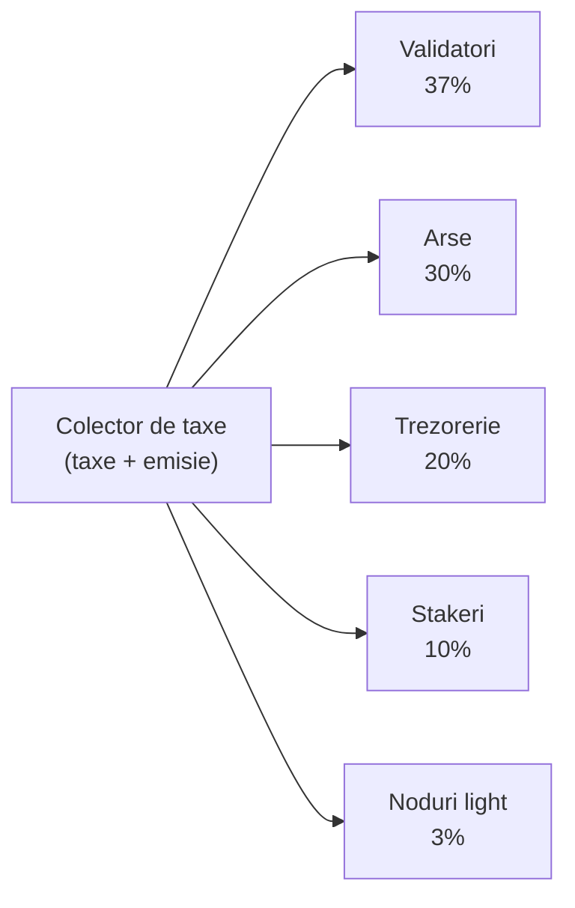

# Tokenomică

Modelul economic al QoreChain este centrat pe tokenul nativ **QOR** și are o **cale de ofertă finită, plafonată**: o ofertă fixă la genesis, o emisie de recompense de staking bătută sub un plafon cumulativ dur și un motor de ardere pe mai multe canale care elimină permanent tokenuri. Această pagină descrie cum funcționează oferta, emisia, arderile și împărțirea taxelor, folosind cifre citite din lanțul live.

---

## Noțiuni de bază despre token

| Proprietate              | Valoare                                                    |
| --------------------- | -------------------------------------------------------- |
| **Token afișat**     | QOR                                                      |
| **Denominație de bază** | uqor                                                     |
| **Precizie zecimală** | 10^6 (1 QOR = 1.000.000 uqor)                            |
| **Ofertă**      | Genesis 4.420.000.000 QOR; vezi [Modelul de ofertă și emisie](#supply-and-emission) |
| **Chain ID**          | `qorechain-vladi` (mainnet, EVM chain ID 9801)          |
| **Prefix Bech32**     | `qor` (conturi: `qor1...`, validatori: `qorvaloper...`) |

:::note
Cifrele de pe această pagină descriu **mainnet-ul** (`qorechain-vladi`, EVM chain ID **9801**), live din 29 iunie 2026 pe versiunea **v3.2.1**. Testnet-ul **`qorechain-diana`** (EVM chain ID **9800**) folosește aceiași parametri de modul; istoricul său de ofertă și emisie diferă (oferta testnet-ului este cu mult peste cea a mainnet-ului, iar emisia sa a depășit deja plafonul), așa că folosește cifrele mainnet-ului.
:::

---

## Modelul de ofertă și emisie {#supply-and-emission}

QoreChain are o **cale de ofertă finită, plafonată**. Oferta la genesis a fost de **4.420.000.000 QOR** (4.500.000.000 QOR planificați; 80.000.000 QOR, 1,78 %, au fost arși la Token Generation Event înainte de genesis). După genesis, doar două lucruri modifică oferta:

* **Emisia** — modulul `x/inflation` emite o sumă fixă la fiecare epocă, sub un **plafon cumulativ dur de 114.285.714 QOR**. Tokenurile emise intră în colectorul de taxe și trec prin aceeași împărțire ca taxele de tranzacție (vezi [Distribuția taxelor](#fee-distribution)).
* **Arderile** — modulul `x/burn` elimină permanent cota de ardere din tot ce se află în colectorul de taxe.

### Emisia {#staking-reward-schedule}

| Parametru | Valoare |
| --- | --- |
| Modul de emisie | `fixed` (din v3.1.94, înălțimea 2.122.074 — 26 august 2026) |
| Emisie per epocă | 16.239 QOR |
| Lungimea epocii | 43.200 de blocuri (aproximativ 38,6 ore la timpul de bloc actual de ≈3,2 s) |
| Plafon cumulativ (`max_total_emission`) | 114.285.714 QOR |
| Emis până acum (14 octombrie 2026, epoca 81) | 105.200.179 QOR (92,05 % din plafon) |
| Rămas sub plafon | 9.085.535 QOR (aproximativ 559 de epoci la 16.239 QOR pe epocă) |

Odată ce plafonul este atins, modulul încetează definitiv să mai emită; după aceea, recompensele provin doar din taxele de tranzacție. Plafonul a fost stabilit prin propunerea de guvernanță #4 (trecută cu tot stake-ul bonded votând în favoare), înlocuind programul descrescător original, care fusese calibrat pentru o rețea matură, complet bonded, și plătea mult mai repede decât era intenționat în raport cu stake-ul efectiv bonded. Valorile programului (17,5 %, 11 %, 7 %, 7 %, 2 % pentru anii 1–5) rămân stocate în parametrii modulului, dar nu sunt folosite în modul `fixed`.

QoreChain nu expune o cifră live a randamentului de staking; tratează orice procent citat ca neverificat. Cifrele curente pot fi citite din starea lanțului: oferta se află la `GET /cosmos/bank/v1beta1/supply/by_denom?denom=uqor`, iar totalurile de ardere la `GET /qorechain/burn/v1/stats`.

---

## x/burn — Motor de ardere pe mai multe canale

Modulul `x/burn` definește **12 surse de ardere**. Fiecare token ars este eliminat permanent din ofertă. Pe mainnet, doar `gas_fee` are arderi înregistrate până acum (31.560.093 QOR la 14 octombrie 2026); celelalte sunt definite, dar nu au înregistrat nimic.

### Canale de ardere

| #  | Canal            | Sursă                     | Descriere                                   |
| -- | ------------------ | -------------------------- | --------------------------------------------- |
| 1  | `gas_fee`          | Taxe de tranzacție           | 30% din toate taxele de gas sunt arse                |
| 2  | `contract_create`  | Implementare de smart contract  | Taxă fixă de 100 QOR arsă per creare de contract |
| 3  | `ai_service`       | Taxe de utilizare a modulului AI       | 50% din taxele serviciilor AI sunt arse                 |
| 4  | `bridge_fee`       | Taxe de bridge cross-chain    | 100% din taxele de bridge sunt arse                  |
| 5  | `treasury_buyback` | Operațiuni de trezorerie        | Răscumpărare-și-ardere periodică din trezorerie       |
| 6  | `failed_tx`        | Gas din tranzacții eșuate     | 10% din gasul tranzacțiilor eșuate este ars (aplicat de lanț din v3.2.2; deocamdată doar pe testnet)    |
| 7  | `xqore_penalty`    | Penalități de ieșire timpurie xQORE | Sumele de penalitate dirijate prin ardere           |
| 8  | `auto_buyback`     | Program automat de răscumpărare  | Arderi automate la nivel de protocol               |
| 9  | `tge`              | Token generation event     | Arderea TGE de 80.000.000 QOR a avut loc înainte de genesis (oferta la genesis este de 4.420.000.000 QOR); acest canal este rezervat și înregistrează 0       |
| 10 | `rollup_create`    | Implementare de rollup          | 1% din stake-ul de creare a rollup-ului ars            |
| 11 | `milestone`        | Praguri de număr de tranzacții | Arderi programate la numere cumulative fixe de tranzacții (niciuna declanșată încă) |
| 12 | `amm`              | AMM                        | Rezervat pentru taxele de protocol AMM (nimic înregistrat) |

Canalele `contract_create`, `ai_service`, `bridge_fee` și `auto_buyback` sunt inactive astăzi: încărcarea CosmWasm este închisă, iar taxele serviciilor AI și bridge-ul nu sunt live.

### Distribuția taxelor {#fee-distribution}

Tot ce se află în colectorul de taxe este împărțit între cinci destinații, după cum se arată mai jos. Colectorul de taxe conține atât taxele de tranzacție, cât și emisia epocii emisă de `x/inflation`. Cotele sunt impuse on-chain și însumează întotdeauna exact 100%.

Cotele sunt:

| Destinatar       | Cotă | Descriere                                                          |
| --------------- | ----- | -------------------------------------------------------------------- |
| **Validatori**  | 37%   | Distribuite setului de validatori activi proporțional cu stake-ul        |
| **Arse**      | 30%   | Eliminate permanent din ofertă prin canalul de ardere `gas_fee`       |
| **Trezorerie**    | 20%   | Alocate trezoreriei comunității pentru cheltuieli dirijate de guvernanță |
| **Stakeri**     | 10%   | Distribuite tuturor stakerilor QOR proporțional cu delegarea            |
| **Noduri light** | 3%    | Distribuite nodurilor light pentru servirea datelor rețelei                  |

Cotele sunt impuse on-chain și trebuie să însumeze întotdeauna exact 100%.

:::note Ce trece de fapt prin această împărțire
Împărțirea se aplică la tot ce se află în colectorul de taxe, care conține atât taxele de tranzacție, cât și emisia epocii emisă de `x/inflation`. În practică, aproape totul este astăzi emisie: din 105.200.179 QOR emiși, 31.560.093 QOR (30,0 %) au fost arși, iar 3.156.009 QOR (3,0 %) se află în rezerva nodurilor light. Până la upgrade-ul v3.2.0 (25 septembrie 2026, înălțimea 2.981.742), cota de 10 % a stakerilor era mutată în soldul modulului de distribuție fără să sprijine vreo cerere de plată, astfel că stakerii și validatorii împreună primeau 37 %, nu 47 %; de la acea înălțime, cota stakerilor este plătită ca o recompensă obișnuită de staking, iar suma deja blocată (6.693.045,92 QOR) a fost înregistrată și se poate mișca doar printr-un vot de guvernanță — vezi [Cota blocată a stakerilor și rezerva nodurilor light](#stranded-and-reserve).
:::

### Parametrii de ardere

| Parametru              | Implicit                    | Descriere                              |
| ---------------------- | -------------------------- | ---------------------------------------- |
| `gas_burn_rate`        | 0.30                       | Fracțiunea din taxele de gas arse (30%)        |
| `contract_create_fee`  | 100.000.000 uqor (100 QOR) | Taxă fixă de ardere pentru crearea de contracte      |
| `ai_service_burn_rate` | 0.50                       | Fracțiunea din taxele serviciilor AI arse (50%) |
| `bridge_burn_rate`     | 1.00                       | Fracțiunea din taxele de bridge arse (100%)    |
| `failed_tx_burn_rate`  | 0.10                       | Fracțiunea din gasul tranzacțiilor eșuate arsă (10%)   |
| `validator_share`      | 0.37                       | Cota din colectorul de taxe pentru validatori |
| `treasury_share`       | 0.20                       | Cota pentru trezorerie                    |
| `staker_share`         | 0.10                       | Cota pentru stakeri                    |
| `light_node_share`     | 0.03                       | Cota pentru nodurile light                |
| `enabled`              | true                       | Indicator de activare a modulului                 |

Fiecare eveniment de ardere este înregistrat on-chain împreună cu sursa sa, suma, înălțimea blocului și hash-ul tranzacției asociate. Statisticile agregate pot fi interogate per canal și în total.

---

## Cota blocată a stakerilor și rezerva nodurilor light {#stranded-and-reserve}

Două sume s-au acumulat pe mainnet înaintea upgrade-ului v3.2.0 (25 septembrie 2026, înălțimea 2.981.742) și sunt acum păstrate **în evidență, în afara oricărei distribuții**. Ambele se pot mișca doar printr-un vot de guvernanță.

| Înregistrare | Suma pe mainnet | Interogare | Mesaj de guvernanță |
| --- | --- | --- | --- |
| **Cota blocată a stakerilor** — cota de 10 % a stakerilor care fusese depusă acolo unde nu sprijinea nicio cerere de recompensă de staking | 6.693.045,921330 QOR înregistrați, 0 eliberați | `GET /qorechain/burn/v1/stranded_rewards` | `MsgReleaseStrandedRewards` (autoritate de guvernanță; destinație numită; nu poate depăși înregistrarea) |
| **Rezerva nodurilor light** — cota de 3 % a nodurilor light acumulată cât timp niciun nod light nu era eligibil | 3.156.009,326407 QOR rezervați, 0 restanți | `GET /qorechain/lightnode/v1/reward_pool` | `MsgReleaseLightNodeReserve` (autoritate de guvernanță) |

De la înălțimea upgrade-ului, cota stakerilor este plătită ca o recompensă obișnuită de staking, iar recompensele nodurilor light sunt plătite doar din ceea ce s-a acumulat de la rularea anterioară a distribuției, cu un plafon per nod și per bloc (`max_reward_per_block_per_node`, 1.713 uqor la citirea din 14 octombrie 2026). Înregistrarea nodurilor light este în prezent închisă, deci niciun nod nu este eligibil, iar cota de 3 % continuă să se acumuleze în rezervă. O eliberare dinaintea snapshot-ului upgrade-ului, peste suma înregistrată sau către o destinație invalidă este refuzată.

---

## x/xqore — Staking blocat și amplificare a guvernanței {#x-xqore}

:::warning Încă nu este live
Contabilitatea modulului xQORE există și este activată la genesis, dar **nu poate fi folosită încă** nici pe mainnet (`qorechain-vladi`), nici pe testnet (`qorechain-diana`). Nodul nu are niciun punct de intrare de tranzacție, interogare, CLI sau RPC pentru el, așa că `tx xqore lock` / `unlock`, `query xqore ...`, rutele REST xQORE și `qor_getXQOREPosition` nu funcționează, iar nimeni nu deține xQORE. Este planificat pentru un viitor release al lanțului, care va schimba și modul în care sunt redistribuite penalitățile de ieșire, astfel încât deblocarea să rămână ieftină indiferent de numărul de deținători. Release-ul va fi menționat aici când va fi livrat.
:::

Modulul `x/xqore` introduce **xQORE**, un derivat de staking blocat netransferabil. Utilizatorii blochează QOR pentru a emite xQORE la un raport de 1:1. Deținătorii de xQORE primesc putere de guvernanță amplificată și o cotă din penalitățile de ieșire redistribuite.

### Mecanismul de blocare

* **Blocare**: Trimite QOR către modulul xQORE pentru a emite xQORE la un raport de 1:1.
* **Pondere de guvernanță**: Deținătorii de xQORE primesc **putere de vot de guvernanță 2x** comparativ cu stakerii QOR standard.
* **Netransferabil**: xQORE nu poate fi trimis între conturi. Este legat de adresa de blocare.

### Programul penalităților de ieșire

Retragerea timpurie din xQORE atrage o penalitate care scade cu durata de blocare:

| Durată de blocare  | Rată de penalitate | Descriere                                |
| -------------- | ------------ | ------------------------------------------ |
| &lt; 30 de zile   | **50%**      | Jumătate din QOR blocat este pierdut            |
| 30 -- 90 de zile  | **35%**      | Penalitate semnificativă pentru blocări pe termen scurt   |
| 90 -- 180 de zile | **15%**      | Penalitate redusă pentru angajament pe termen mediu |
| > 180 de zile     | **0%**       | Retragere completă fără penalitate            |

### Redistribuirea prin rebasare PvP

Penalitățile colectate din ieșirile timpurii nu sunt pur și simplu distruse. În schimb, ele urmează un model de rebasare PvP (player-versus-player):

1. În configurația de la genesis, **0%** din sumele de penalitate sunt arse (`penalty_burn_rate = 0`; canalul de ardere `xqore_penalty` există dacă guvernanța îl modifică).
2. **100%** sunt redistribuite pro-rata tuturor deținătorilor de xQORE rămași.

Acest lucru creează o dinamică cu sumă pozitivă pentru deținătorii pe termen lung: fiecare ieșire timpurie crește valoarea efectivă a pozițiilor xQORE rămase. Rebasările au loc la fiecare **100 de blocuri**.

### Parametrii xQORE

| Parametru               | Implicit                | Descriere                               |
| ----------------------- | ---------------------- | ----------------------------------------- |
| `governance_multiplier` | 2.0                    | Multiplicator de putere de vot pentru deținătorii de xQORE |
| `min_lock_amount`       | 1.000.000 uqor (1 QOR) | QOR minim necesar pentru blocare              |
| `penalty_burn_rate`     | 0.00                   | Fracțiunea din penalitățile de ieșire arsă (implicit la genesis: toate penalitățile sunt redistribuite) |
| `rebase_interval`       | 100 de blocuri             | Blocuri între evenimentele de rebasare PvP          |
| `enabled`               | true                   | Indicator de activare a modulului                    |

---

## x/inflation — Emisie plafonată

Modulul `x/inflation` emite emisia per epocă (16.239 QOR, `emission_mode = fixed`) și o trimite către colectorul de taxe, până la atingerea plafonului cumulativ de 114.285.714 QOR. Modificările de parametri trec printr-o propunere obișnuită de guvernanță pentru parametri (`MsgUpdateParams`, adăugat în v3.1.94).

### Mecanica epocilor

* **Lungimea epocii**: 43.200 de blocuri (aproximativ 38,6 ore la ≈3,2 s per bloc).
* La fiecare limită de epocă, modulul emite emisia epocii (sau restul până la plafon), actualizează înregistrarea epocii și încetează să mai emită odată ce `total_minted` atinge plafonul.

### Parametri

| Parametru | Valoare (mainnet) | Descriere |
| --- | --- | --- |
| `emission_mode` | `fixed` | `schedule` (vechi, rate pe ani) sau `fixed` |
| `fixed_epoch_emission` | 16.239.000.000 uqor | Emis per epocă în modul fixed |
| `max_total_emission` | 114.285.714.000.000 uqor | Limită cumulativă dură |
| `epoch_length` | 43.200 de blocuri | Blocuri per epocă de emisie |
| `schedule` | 17,5 %, 11 %, 7 %, 7 %, 2 % (anii 1–5) | Program vechi, nefolosit în modul fixed |
| `enabled` | `true` | Indicator de activare a modulului |

Pe mainnet, aceste valori nu sunt expuse printr-o rută REST; ele pot fi citite din starea lanțului prin interfața raw store a RPC-ului `abci_query` (store `inflation`, cheile `inflation/params` și `inflation/epoch`). Un serviciu de interogare dedicat pentru ele există doar pe testnet (v3.2.2).

---

## Ardere versus emisie

Emisia este plafonată (114.285.714 QOR), iar cota de ardere se aplică la tot ce intră în colectorul de taxe, inclusiv emisia. Până în prezent au fost arși 31.560.093 QOR față de 105.200.179 QOR emiși, deci oferta este în prezent peste nivelul ei de la genesis. După atingerea plafonului, oferta poate doar să scadă, cu suma arsă.

---

## Resurse conexe

* [Parametrii lanțului](/appendix/chain-parameters) — valorile implicite economice și de consens canonice.
* [Staking și delegare](/user-guide/staking-and-delegation) — deleagă QOR și câștigă recompense de staking.
* [Staking xQORE](/user-guide/xqore-staking) — mecanismul de staking cu rebasare PvP.
* [Recompense pentru noduri light](/light-node/rewards-and-monitoring) — cota de recompensă a nodurilor light.
