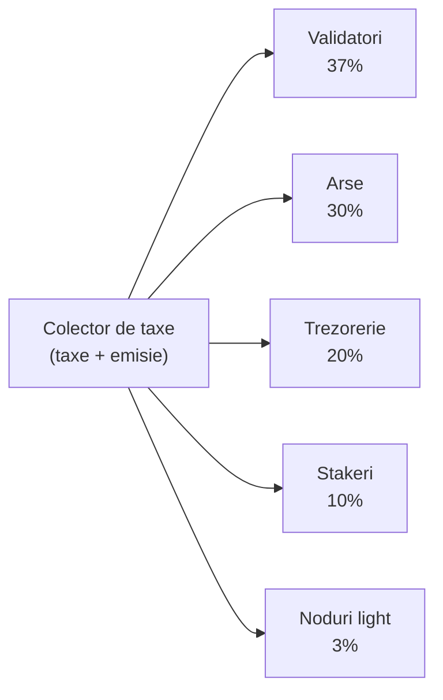

# Tokenomică

Modelul economic al QoreChain este centrat pe tokenul nativ **QOR** și are o **cale de ofertă finită, plafonată**: o ofertă fixă la genesis, o emisie de recompense de staking bătută sub un plafon cumulativ dur și un motor de ardere pe mai multe canale care elimină permanent tokenuri. Această pagină descrie cum funcționează oferta, emisia, arderile și împărțirea taxelor, folosind cifre citite din lanțul live.

---

## Noțiuni de bază despre token

| Proprietate              | Valoare                                                    |
| --------------------- | -------------------------------------------------------- |
| **Token afișat**     | QOR                                                      |
| **Denominație de bază** | uqor                                                     |
| **Precizie zecimală** | 10^6 (1 QOR = 1.000.000 uqor)                            |
| **Ofertă**      | Genesis 4.420.000.000 QOR; vezi [Modelul de ofertă și emisie](#supply-and-emission) |
| **Chain ID**          | `qorechain-vladi` (mainnet, EVM chain ID 9801)          |
| **Prefix Bech32**     | `qor` (conturi: `qor1...`, validatori: `qorvaloper...`) |

:::note
Cifrele de pe această pagină descriu **mainnet-ul** (`qorechain-vladi`, EVM chain ID **9801**), live din 7 iunie 2026, pe versiunea **v3.2.5** din 29 octombrie 2026 (înălțimea 3.906.833, propunerea de guvernanță 14; v3.2.4 a fost aplicată la înălțimea 3.742.566 pe 23 octombrie 2026). Testnet-ul **`qorechain-diana`** (EVM chain ID **9800**, versiunea **v3.2.6** din 27 octombrie 2026) are propriul istoric de emisie și ofertă (oferta testnet-ului este cu mult peste cea a mainnet-ului, iar emisia sa a depășit deja plafonul), așa că folosește cifrele mainnet-ului. Sumele care se schimbă cu fiecare bloc sunt marcate cu data la care au fost citite (23 octombrie 2026).
:::

---

## Modelul de ofertă și emisie {#supply-and-emission}

QoreChain are o **cale de ofertă finită, plafonată**. Oferta la genesis a fost de **4.420.000.000 QOR** (4.500.000.000 QOR planificați; 80.000.000 QOR, 1,78 %, au fost arși la Token Generation Event înainte de genesis). După genesis, protocolul modifică oferta prin două mecanisme:

* **Emisia** — modulul `x/inflation` emite o sumă fixă la fiecare epocă, sub un **plafon cumulativ dur de 590.000.000 QOR**. Tokenurile emise intră în colectorul de taxe și trec prin aceeași împărțire ca taxele de tranzacție (vezi [Distribuția taxelor](#fee-distribution)).
* **Arderile** — modulul `x/burn` elimină permanent cota de ardere din tot ce se află în colectorul de taxe.

### Emisia {#staking-reward-schedule}

| Parametru | Valoare |
| --- | --- |
| Modul de emisie | `fixed` (din v3.1.94, înălțimea 2.122.074 — 26 august 2026) |
| Emisie per epocă | **86.000 QOR** (16.239 QOR până la propunerea de guvernanță 10; prima epocă de 86.000 QOR începe la blocul 3.672.000) |
| Lungimea epocii | 43.200 de blocuri (aproximativ 37,7 ore la timpul de bloc actual de ≈3,1 s) |
| Plafon cumulativ (`max_total_emission`) | **590.000.000 QOR** (114.285.714 QOR până la propunerea 10) |
| Emis până acum (23 octombrie 2026, epoca 86) | 105.420.896,21 QOR (17,87 % din plafon) |
| Rămas sub plafon | 484.579.103,79 QOR (aproximativ 5.635 de epoci la 86.000 QOR pe epocă; ultima este parțială) |

Odată ce plafonul este atins, modulul încetează definitiv să mai emită; după aceea, recompensele provin doar din taxele de tranzacție. Cifrele de emisie au fost stabilite prin guvernanță: propunerea #4 (26 august 2026) a înlocuit programul descrescător original cu o sumă fixă sub un plafon dur, iar propunerea #10 (trecută pe 19 octombrie 2026 cu tot stake-ul bonded votând în favoare) a schimbat această sumă de la 16.239 QOR la 86.000 QOR pe epocă și a ridicat plafonul de la 114.285.714 QOR la 590.000.000 QOR. Lungimea epocii nu s-a schimbat. Valorile programului (17,5 %, 11 %, 7 %, 7 %, 2 % pentru anii 1–5) rămân stocate în parametrii modulului, dar nu sunt folosite în modul `fixed`.

Totalul emis, suma rămasă și înălțimea epocii următoare sunt disponibile live la `GET /qorechain/inflation/v1/epoch_info` (câmpul său `current_inflation_rate` raportează rata veche, pe ani, pe care modul `fixed` nu o folosește).

QoreChain nu expune o cifră live a randamentului de staking; tratează orice procent citat ca neverificat. Cifrele curente pot fi citite din starea lanțului: oferta se află la `GET /cosmos/bank/v1beta1/supply/by_denom?denom=uqor` (4.493.785.581,46 QOR la 23 octombrie 2026), iar totalurile de ardere la `GET /qorechain/burn/v1/stats`.

---

## x/burn — Motor de ardere pe mai multe canale

Modulul `x/burn` definește astăzi **12 surse de ardere** pe mainnet. Fiecare token ars este eliminat permanent din ofertă. Pe mainnet, doar `gas_fee` (31.626.314,61 QOR la 23 octombrie 2026) și, din v3.2.2, `failed_tx` (0,1355 QOR) au arderi înregistrate; celelalte sunt definite, dar nu au înregistrat nimic. Începând cu v3.2.4 există o a treisprezecea sursă, `staking_tier_penalty`, care înregistrează penalizarea arsă atunci când o delegare blocată în timp este deblocată anticipat (activă pe testnet din 19 octombrie 2026 și pe mainnet din 23 octombrie 2026; pe mainnet nu a fost înregistrată încă nicio deblocare anticipată; vezi [Staking și delegare](/user-guide/staking-and-delegation#time-locked-staking)).

### Canale de ardere

| #  | Canal            | Sursă                     | Descriere                                   |
| -- | ------------------ | -------------------------- | --------------------------------------------- |
| 1  | `gas_fee`          | Taxe de tranzacție           | 30% din toate taxele de gas sunt arse                |
| 2  | `contract_create`  | Implementare de smart contract  | Taxă fixă de 100 QOR arsă per creare de contract |
| 3  | `ai_service`       | Taxe de utilizare a modulului AI       | 50% din taxele serviciilor AI sunt arse                 |
| 4  | `bridge_fee`       | Taxe de bridge cross-chain    | 100% din taxele de bridge sunt arse                  |
| 5  | `treasury_buyback` | Operațiuni de trezorerie        | Răscumpărare-și-ardere periodică din trezorerie       |
| 6  | `failed_tx`        | Gas din tranzacții eșuate     | 10% din gasul tranzacțiilor eșuate este ars (aplicat de lanț din v3.2.2)    |
| 7  | `xqore_penalty`    | Penalități de ieșire timpurie xQORE | Sumele de penalitate dirijate prin ardere           |
| 8  | `auto_buyback`     | Program automat de răscumpărare  | Arderi automate la nivel de protocol               |
| 9  | `tge`              | Token generation event     | Arderea TGE de 80.000.000 QOR a avut loc înainte de genesis (oferta la genesis este de 4.420.000.000 QOR); acest canal este rezervat și înregistrează 0       |
| 10 | `rollup_create`    | Implementare de rollup          | 1% din stake-ul de creare a rollup-ului ars            |
| 11 | `milestone`        | Praguri de număr de tranzacții | Arderi programate la numere cumulative fixe de tranzacții (niciuna declanșată încă) |
| 12 | `amm`              | AMM                        | Rezervat pentru taxele de protocol AMM (nimic înregistrat) |

Canalele `contract_create`, `ai_service`, `bridge_fee` și `auto_buyback` sunt inactive astăzi: încărcarea QoreChain Native este închisă, iar taxele serviciilor AI și bridge-ul nu sunt live.

### Distribuția taxelor {#fee-distribution}

Tot ce se află în colectorul de taxe este împărțit între cinci destinații, după cum se arată mai jos. Colectorul de taxe conține atât taxele de tranzacție, cât și emisia epocii emisă de `x/inflation`. Cotele sunt impuse on-chain și însumează întotdeauna exact 100%.

Cotele sunt:

| Destinatar       | Cotă | Descriere                                                          |
| --------------- | ----- | -------------------------------------------------------------------- |
| **Validatori**  | 37%   | Distribuite setului de validatori activi proporțional cu stake-ul        |
| **Arse**      | 30%   | Eliminate permanent din ofertă prin canalul de ardere `gas_fee`       |
| **Trezorerie**    | 20%   | Alocate trezoreriei comunității pentru cheltuieli dirijate de guvernanță |
| **Stakeri**     | 10%   | Distribuite tuturor stakerilor QOR proporțional cu delegarea            |
| **Noduri light** | 3%    | Distribuite nodurilor light pentru servirea datelor rețelei                  |

Cotele sunt impuse on-chain și trebuie să însumeze întotdeauna exact 100%.

:::note Ce trece de fapt prin această împărțire
Împărțirea se aplică la tot ce se află în colectorul de taxe, care conține atât taxele de tranzacție, cât și emisia epocii emisă de `x/inflation`. În practică, aproape totul este astăzi emisie: din 105.420.896 QOR emiși, 31.626.315 QOR (30,0 %) au fost arși prin canalul gas-fee. Până la upgrade-ul v3.2.0 (25 septembrie 2026, înălțimea 2.981.742), cota de 10 % a stakerilor era mutată în soldul modulului de distribuție fără să sprijine vreo cerere de plată, astfel că stakerii și validatorii împreună primeau 37 %, nu 47 %; de la acea înălțime, cota stakerilor este plătită ca o recompensă obișnuită de staking. Suma care se blocase deja a fost înregistrată on-chain și a fost eliberată între timp prin voturi de guvernanță — vezi [Cota blocată a stakerilor și rezerva nodurilor light](#stranded-and-reserve).
:::

### Parametrii de ardere

| Parametru              | Implicit                    | Descriere                              |
| ---------------------- | -------------------------- | ---------------------------------------- |
| `gas_burn_rate`        | 0.30                       | Fracțiunea din taxele de gas arse (30%)        |
| `contract_create_fee`  | 100.000.000 uqor (100 QOR) | Taxă fixă de ardere pentru crearea de contracte      |
| `ai_service_burn_rate` | 0.50                       | Fracțiunea din taxele serviciilor AI arse (50%) |
| `bridge_burn_rate`     | 1.00                       | Fracțiunea din taxele de bridge arse (100%)    |
| `failed_tx_burn_rate`  | 0.10                       | Fracțiunea din gasul tranzacțiilor eșuate arsă (10%)   |
| `validator_share`      | 0.37                       | Cota din colectorul de taxe pentru validatori |
| `treasury_share`       | 0.20                       | Cota pentru trezorerie                    |
| `staker_share`         | 0.10                       | Cota pentru stakeri                    |
| `light_node_share`     | 0.03                       | Cota pentru nodurile light                |
| `enabled`              | true                       | Indicator de activare a modulului                 |

Fiecare eveniment de ardere este înregistrat on-chain împreună cu sursa sa, suma, înălțimea blocului și hash-ul tranzacției asociate. Statisticile agregate pot fi interogate per canal și în total.

---

## Cota blocată a stakerilor și rezerva nodurilor light {#stranded-and-reserve}

Două sume s-au acumulat pe mainnet înaintea upgrade-ului v3.2.0 (25 septembrie 2026, înălțimea 2.981.742). Upgrade-ul le-a înregistrat **on-chain, în afara oricărei distribuții**, și le-a făcut mutabile doar printr-un vot de guvernanță. Între timp, guvernanța a eliberat ambele sume către fundație, în octombrie 2026:

| Înregistrare | Eliberare | Sumă | Mesaj de guvernanță |
| --- | --- | --- | --- |
| **Cota blocată a stakerilor** — cota de 10 % a stakerilor care fusese depusă acolo unde nu sprijinea nicio cerere de recompensă de staking | Propunerea 9 (trecută pe 19 octombrie 2026) | 6.693.045,921330 QOR eliberați | `MsgReleaseStrandedRewards` (autoritate de guvernanță; destinație numită; nu poate depăși înregistrarea) |
| **Rezerva nodurilor light** — cota de 3 % a nodurilor light acumulată cât timp niciun nod light nu era eligibil | Propunerea 8 (trecută pe 19 octombrie 2026) | 3.156.983,796395 QOR eliberați | `MsgReleaseLightNodeReserve` (autoritate de guvernanță) |

**Restul corectat al cotei blocate.** La upgrade-ul v3.2.3 (înălțimea 3.662.051, 20 octombrie 2026) lanțul a recalculat înregistrarea cotei blocate, care a ajuns atunci la 3.807.496,785528 QOR (`reserved` în `GET /qorechain/burn/v1/stranded_rewards`, alături de `released`, 6.693.045,921330 QOR). Propunerea de guvernanță 12 a eliberat acest rest, 3.807.496,785528 QOR, către fundație: a trecut (votul s-a încheiat pe 21 octombrie 2026, la 20:01 UTC), cu toată miza angajată care a votat în favoare. Înregistrarea poate fi verificată la `GET /qorechain/burn/v1/stranded_rewards`, iar propunerea la `GET /cosmos/gov/v1/proposals/12`.

**Pool-ul nodurilor light acum.** Din upgrade-ul v3.2.0, recompensele nodurilor light sunt plătite doar din ceea ce s-a acumulat de la rularea anterioară a distribuției, cu un plafon per nod. Din v3.2.3 plafonul este de **2.000 QOR per nod la 30 de zile** (`max_reward_per_month_per_node`), proporțional cu timpul de bloc și uptime-ul nodului; valoarea per bloc (`max_reward_per_block_per_node`, 1.713 uqor) este în continuare raportată, dar nu mai este regula. Ce nu este câștigat rămâne în rezerva pool-ului, pe care o poate elibera doar un vot de guvernanță. După propunerea 8, rezerva se acumulează din nou: pe 27 octombrie 2026, `reserved` al pool-ului de mainnet (în `GET /qorechain/lightnode/v1/reward_pool`) era de aproximativ 13.380,9 QOR, cu 0,06 QOR restanți și nimic de plată; în acea zi s-a înregistrat câte un nod light pe fiecare rețea. Înregistrarea este deschisă și condiționată de licență (vezi [Light Node](/light-node/overview#reward-program-status)). O eliberare dinaintea snapshot-ului upgrade-ului, peste suma înregistrată sau către o destinație invalidă este refuzată.

## x/xqore — Staking blocat și amplificare a guvernanței {#x-xqore}

:::warning Încă nu este live
Contabilitatea modulului xQORE există și este activată la genesis, dar **nu poate fi folosită încă** nici pe mainnet (`qorechain-vladi`), nici pe testnet (`qorechain-diana`). Nodul nu are niciun punct de intrare de tranzacție, interogare, CLI sau RPC pentru el, așa că `tx xqore lock` / `unlock`, `query xqore ...`, rutele REST xQORE și `qor_getXQOREPosition` nu funcționează, iar nimeni nu deține xQORE. Este planificat pentru un viitor release al lanțului, care va schimba și modul în care sunt redistribuite penalitățile de ieșire, astfel încât deblocarea să rămână ieftină indiferent de numărul de deținători. Release-ul va fi menționat aici când va fi livrat.
:::

Modulul `x/xqore` introduce **xQORE**, un derivat de staking blocat netransferabil. Utilizatorii blochează QOR pentru a emite xQORE la un raport de 1:1. Deținătorii de xQORE primesc putere de guvernanță amplificată și o cotă din penalitățile de ieșire redistribuite.

### Mecanismul de blocare

* **Blocare**: Trimite QOR către modulul xQORE pentru a emite xQORE la un raport de 1:1.
* **Pondere de guvernanță**: Deținătorii de xQORE primesc **putere de vot de guvernanță 2x** comparativ cu stakerii QOR standard.
* **Netransferabil**: xQORE nu poate fi trimis între conturi. Este legat de adresa de blocare.

### Programul penalităților de ieșire

Retragerea timpurie din xQORE atrage o penalitate care scade cu durata de blocare:

| Durată de blocare  | Rată de penalitate | Descriere                                |
| -------------- | ------------ | ------------------------------------------ |
| &lt; 30 de zile   | **50%**      | Jumătate din QOR blocat este pierdut            |
| 30 -- 90 de zile  | **35%**      | Penalitate semnificativă pentru blocări pe termen scurt   |
| 90 -- 180 de zile | **15%**      | Penalitate redusă pentru angajament pe termen mediu |
| > 180 de zile     | **0%**       | Retragere completă fără penalitate            |

### Redistribuirea prin rebasare PvP

Penalitățile colectate din ieșirile timpurii nu sunt pur și simplu distruse. În schimb, ele urmează un model de rebasare PvP (player-versus-player):

1. În configurația de la genesis, **0%** din sumele de penalitate sunt arse (`penalty_burn_rate = 0`; canalul de ardere `xqore_penalty` există dacă guvernanța îl modifică).
2. **100%** sunt redistribuite pro-rata tuturor deținătorilor de xQORE rămași.

Acest lucru creează o dinamică cu sumă pozitivă pentru deținătorii pe termen lung: fiecare ieșire timpurie crește valoarea efectivă a pozițiilor xQORE rămase. Rebasările au loc la fiecare **100 de blocuri**.

### Parametrii xQORE

| Parametru               | Implicit                | Descriere                               |
| ----------------------- | ---------------------- | ----------------------------------------- |
| `governance_multiplier` | 2.0                    | Multiplicator de putere de vot pentru deținătorii de xQORE |
| `min_lock_amount`       | 1.000.000 uqor (1 QOR) | QOR minim necesar pentru blocare              |
| `penalty_burn_rate`     | 0.00                   | Fracțiunea din penalitățile de ieșire arsă (implicit la genesis: toate penalitățile sunt redistribuite) |
| `rebase_interval`       | 100 de blocuri             | Blocuri între evenimentele de rebasare PvP          |
| `enabled`               | true                   | Indicator de activare a modulului                    |

---

## x/inflation — Emisie plafonată

Modulul `x/inflation` emite emisia per epocă (86.000 QOR din propunerea 10, `emission_mode = fixed`) și o trimite către colectorul de taxe, până la atingerea plafonului cumulativ de 590.000.000 QOR. Modificările de parametri trec printr-o propunere obișnuită de guvernanță pentru parametri (`MsgUpdateParams`, adăugat în v3.1.94).

### Mecanica epocilor

* **Lungimea epocii**: 43.200 de blocuri (aproximativ 37,7 ore la ≈3,1 s per bloc).
* La fiecare limită de epocă, modulul emite emisia epocii (sau restul până la plafon), actualizează înregistrarea epocii și încetează să mai emită odată ce `total_minted` atinge plafonul.
* Din v3.2.3, anul de emisie este derivat din lungimea epocii, nu dintr-un număr fix de blocuri.

### Parametri

Citiți live pe 23 octombrie 2026 din `GET /qorechain/inflation/v1/params`:

| Parametru | Valoare (mainnet) | Descriere |
| --- | --- | --- |
| `emission_mode` | `fixed` | `schedule` (vechi, rate pe ani) sau `fixed`; v3.2.4 adaugă un al treilea mod, `target_apy` |
| `fixed_epoch_emission` | 86.000.000.000 uqor (86.000 QOR) | Emis per epocă în modul fixed |
| `max_total_emission` | 590.000.000.000.000 uqor (590.000.000 QOR) | Limită cumulativă dură |
| `epoch_length` | 43.200 de blocuri | Blocuri per epocă de emisie |
| `schedule` | 17,5 %, 11 %, 7 %, 7 %, 2 % (anii 1–5) | Program vechi, nefolosit în modul fixed |
| `enabled` | `true` | Indicator de activare a modulului |

Parametrii modulului și înregistrarea epocii sunt expuse prin REST pe mainnet din v3.2.3 (`/qorechain/inflation/v1/params` și `/qorechain/inflation/v1/epoch_info`); pot fi citite și din starea lanțului prin interfața raw store a RPC-ului `abci_query` (store `inflation`, cheile `inflation/params` și `inflation/epoch`).

:::note v3.2.4 și emisia testnet-ului
Testnet-ul `qorechain-diana` este reglat pentru testare și diferă de mainnet (citit la 27 octombrie 2026): este în modul `target_apy` cu `target_apy_bps` `1667`, `fixed_epoch_emission` este în continuare 16.239 QOR, iar `max_total_emission` este 3.950.390.341.362.112.750 uqor, egal cu suma deja emisă acolo (`remaining_emission` este `0` la `/qorechain/inflation/v1/epoch_info`), deci testnet-ul nu mai emite nimic. Mainnet-ul folosește valorile de mai sus. Versiunea v3.2.4 adaugă al treilea mod de emisie, `target_apy`, cu un parametru `target_apy_bps`: pe testnet din 19 octombrie 2026 și pe mainnet din 23 octombrie 2026 (propunerea de guvernanță 13). Pe mainnet parametrul este `0` și nu determină emisia. Trecerea mainnet-ului la acel mod este un vot separat de guvernanță și nu a fost propusă; până când unul este aprobat, mainnet-ul rămâne în modul `fixed`, la 86.000 QOR per epocă.
:::

---

## Ardere versus emisie

Emisia este plafonată (590.000.000 QOR în total), iar cota de ardere se aplică la tot ce intră în colectorul de taxe, inclusiv emisia. Până în prezent (23 octombrie 2026) au fost arși 31.626.315 QOR față de 105.420.896 QOR emiși, deci oferta (4.493.785.581 QOR) este în prezent peste nivelul ei de la genesis. După atingerea plafonului, oferta poate doar să scadă, cu suma arsă.

---

## Resurse conexe

* [Parametrii lanțului](/appendix/chain-parameters) — valorile implicite economice și de consens canonice.
* [Staking și delegare](/user-guide/staking-and-delegation) — deleagă QOR și câștigă recompense de staking.
* [Staking xQORE](/user-guide/xqore-staking) — mecanismul de staking cu rebasare PvP.
* [Recompense pentru noduri light](/light-node/rewards-and-monitoring) — cota de recompensă a nodurilor light.
