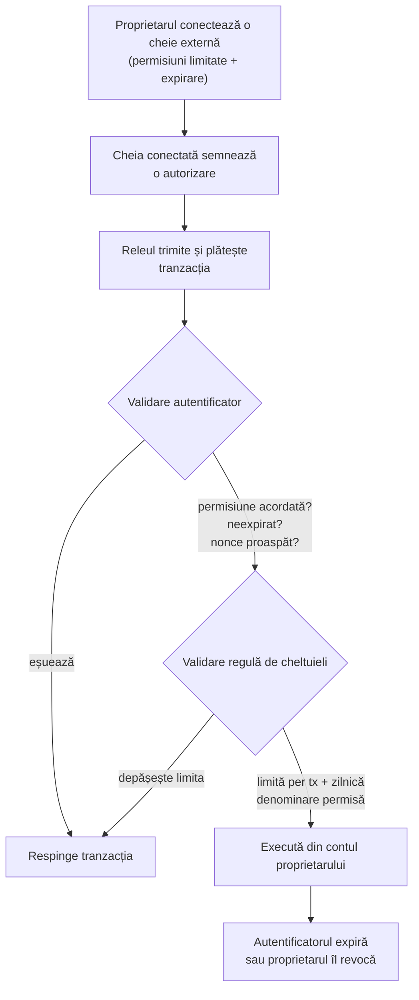

# Abstractizarea Contului

QoreChain oferă **abstractizare de cont la nivel de protocol** prin modulul `x/abstractaccount`. Modulul înregistrează conturi abstracte cu reguli de cheltuieli și permite proprietarului contului să conecteze chei externe (**autentificatori**) care pot cheltui din cont în limitele permisiunilor și ale plafoanelor de cheltuieli, fără infrastructură externă de contracte inteligente.

:::danger Neactivat pe mainnet; activat pe testnet
Modulul de conturi abstracte este **oprit pe mainnet-ul `qorechain-vladi`** la momentul redactării (verificat la 27 octombrie 2026): `qorechaind query abstractaccount config` (și `GET /qorechain/abstractaccount/v1/config`) raportează `enabled: false`. Pe **testnet-ul `qorechain-diana`** a fost pornit printr-o decizie de guvernanță (propunerea 18, adoptată pe 27 octombrie 2026) și raportează `enabled: true`. Începând cu chain v3.2.0, indicatorul este aplicat pe fiecare cale: acolo unde este `false`, chain-ul refuză crearea de conturi, înregistrarea autentificatorilor și ambele lane-uri de execuție (`MsgExecuteEVM`, `MsgExecuteCosmos`) cu mesajul `abstract accounts are disabled on this chain`. Nicio tranzacție obișnuită nu poate porni modulul; setarea se schimbă doar printr-o decizie de guvernanță. Nicio tranzacție de cont abstract nu a fost vreodată inclusă pe mainnet. Tot ce urmează descrie interfețele modulului; încercați-l pe testnet și nu construiți un flux de cheie conectată sau de cheltuieli delegate pentru mainnet până când modulul nu este activat acolo. Verificați întotdeauna mai întâi indicatorul.
:::

:::note
Comenzile de mai jos folosesc mainnet-ul **`qorechain-vladi`** (activ din 7 iunie 2026), care rulează versiunea de nod **v3.2.5** (aplicată la înălțimea 3,906,833 pe 29 octombrie 2026, propunerea de guvernanță 14; v3.2.4 a fost aplicată la înălțimea 3,742,566 pe 23 octombrie 2026). Înlocuiți cu `--chain-id qorechain-diana` pentru testnet, care rulează v3.2.6 (v3.2.4 din 19 octombrie 2026).
:::

:::caution Fiecare tranzacție pe lane-ul Cosmos necesită cosemnătura hibridă post-cuantică
Exemplele `qorechaind tx` de pe această pagină arată doar flag-urile de taxă. Pe rețelele live, fiecare tranzacție pe lane-ul Cosmos trebuie să poarte și cosemnătura hibridă ML-DSA-87, așa că construiți tranzacția cu `--generate-only` și semnați-o cu `qorechaind tx pqc cosign` (sau folosiți QoreX ori SDK-ul, care fac acest lucru pentru dvs.). Build-ul comunitar al `qorechaind` nu poate produce acea semnătură; folosiți binarul de release din [manifestul de descărcare](/developer-guide/running-a-node#fetch-the-manifest). Pragul minim al taxei este **0.1 uqor per unitate de gaz**, deci `--gas 400000` necesită cel puțin `--fees 40000uqor`. Consultați [Semnarea Post-Cuantică](/developer-guide/post-quantum-signing).
:::

## Prezentare Generală

Conturile blockchain tradiționale sunt controlate de o singură cheie privată. Abstractizarea contului decuplează conceptul de „cine poate autoriza o tranzacție” de o singură cheie criptografică. Modulul `x/abstractaccount` oferă:

* **Conturi abstracte** cu un tip de cont și un proprietar înregistrate
* **Reguli de cheltuieli** (limite per tranzacție și zilnice, denominări permise) care limitează cât pot cheltui cheile conectate
* **Autentificatori**: chei externe (o cheie Phantom ed25519 sau o adresă MetaMask secp256k1) pe care proprietarul le conectează cu permisiuni limitate și o expirare și pe care le poate revoca oricând

*Un flux cu cheie conectată (autentificator): cheia conectată semnează o autorizare, un releu o trimite, modulul verifică permisiunile, expirarea și regulile de cheltuieli, apoi execută din contul proprietarului.*



## Tipuri de Cont

`create` înregistrează unul dintre trei tipuri de cont. Tipul este stocat în cont și face parte din modul în care se derivă adresa acestuia; modulul nu are tranzacții proprii de multisig, chei de sesiune sau recuperare (serviciul de tranzacții este `create`, `update-rules`, `register-authenticator`, `revoke-authenticator`, `execute-cosmos`, `execute-evm`).

| Tip                | Utilizare prevăzută                |
| ------------------ | ---------------------------------- |
| `multisig`         | Trezorerii DAO, portofele partajate |
| `social_recovery`  | Portofele pentru consumatori, onboarding |
| `session_based`    | Sesiuni dApp, portofele mobile     |

## Crearea unui Cont Abstract

`create` primește tipul de cont ca argument pozițional (`multisig`, `social_recovery` sau `session_based`):

```bash
qorechaind tx abstractaccount create session_based \
  --from mykey \
  --gas 400000 --fees 40000uqor
```

Comanda nu are flag-uri pentru semnatari, praguri sau gardieni.

## Autentificatori (chei conectate)

Mecanismul de chei delegate al modulului este **autentificatorul**, descris mai jos în [Autentificatori de Portofel Conectat](#authenticators): proprietarul conectează o cheie externă (ed25519 sau secp256k1) cu un set de permisiuni și o expirare și o revocă oricând:

```bash
qorechaind tx abstractaccount register-authenticator <account-address> <scheme> <pubkey-base64> <permissions-csv> <expiry-unix> <label> \
  --from mykey --gas 400000 --fees 40000uqor
qorechaind tx abstractaccount revoke-authenticator <account-address> <scheme> <pubkey-base64> \
  --from mykey --gas 400000 --fees 40000uqor
```

`scheme` este `ed25519` (de exemplu Phantom) sau `secp256k1` (de exemplu MetaMask). Nu există comenzile `grant-session`, `revoke-session` sau `query abstractaccount sessions`.

## Reguli de Cheltuieli

Regulile de cheltuieli adaugă limite de siguranță financiară conturilor abstracte:

| Regulă            | Descriere                                                         |
| ------------------ | ------------------------------------------------------------------ |
| `daily_limit`      | Cheltuiala totală maximă pe zi calendaristică UTC                  |
| `per_tx_limit`     | Cheltuiala maximă per execuție individuală autorizată              |
| `allowed_denoms`   | Restricționează denominările de token care pot fi cheltuite (un ERC-20 este listat ca `erc20/<EIP-55 0x address>`, scrierea proprie a regulii de cheltuieli, cu bară oblică; lanțul compară adresa în forma ei EIP-55, deci majusculele pe care le tastați nu creează un alt token. Aceasta nu este denominația bank a unei perechi de tokenuri înregistrate, care se scrie `erc20:<EIP-55 0x address>` cu două puncte și este sensibilă la majuscule, vezi [Dezvoltare EVM](/developer-guide/evm-development#fest-tokens)) |
| `denom_limits`     | Limite per denominare ca șiruri zecimale (v3.2.2): `{"denom","per_tx_limit","daily_limit"}`; înlocuiesc `per_tx_limit` și `daily_limit` pentru denominările pe care le numesc, astfel încât un token cu 18 zecimale poate fi plafonat |
| `allowed_evm_calls` | Apeluri EVM pe care o cheie legată de regulă le poate face **cu date de apel** (v3.2.2), ca `0x<target>` (orice funcție a acelui contract) sau `0x<target>/0x<selector>` (doar acea funcție). Fără o intrare, o cheie legată de regulă poate doar să trimită valoare, să desfășoare contracte (cu permisiunea `deploy`) și să mute tokenii ERC-20 listați în `allowed_denoms`. Listarea unei ținte presupune încredere în fiecare argument al apelurilor făcute către ea, destinatarii incluși |

### Setarea Regulilor de Cheltuieli

`update-rules` înlocuiește regulile contului cu un array JSON de obiecte `SpendingRule` (JSON inline, nu un fișier și nu flag-uri):

```bash
qorechaind tx abstractaccount update-rules <account-address> \
  '[{"id":"daily","enabled":true,"daily_limit":1000000000,"per_tx_limit":100000000,"allowed_denoms":["uqor"]}]' \
  --from mykey --gas 400000 --fees 40000uqor
```

Limitele sunt exprimate în unitatea de bază (`uqor`) și se contorizează per execuție autorizată; limita zilnică plafonează totalul pe zi calendaristică UTC. Regulile înlocuiesc în bloc regulile stocate, deci un câmp omis este eliminat. Începând cu v3.2.2, lane-ul EVM măsoară ce mută efectiv un apel (valoarea nativă, scăderea soldului nativ al contului, monedele bancare cheltuite și modificarea soldului sau a alocației fiecărui ERC-20 listat) în loc de doar `msg.value`, iar crearea de contracte necesită permisiunea separată `deploy`. Un exemplu mai bogat (ERC-20 afișat este tokenul de test fUSD de pe testnet; folosiți adresa contractului propriului token și rețineți bara oblică din `erc20/<address>` într-o regulă față de cele două puncte din denominația bank `erc20:<address>`):

```bash
qorechaind tx abstractaccount update-rules <account-address> \
  '[{"id":"daily","enabled":true,"daily_limit":5000000,"allowed_denoms":["uqor","erc20/0x97143B771D34ddb9130b807b135Ae675A5a963CA"],"allowed_evm_calls":["0xROUTER/0x38ed1739"],"denom_limits":[{"denom":"erc20/0x97143B771D34ddb9130b807b135Ae675A5a963CA","per_tx_limit":"100000000000000000000","daily_limit":"500000000000000000000"}]}]' \
  --from mykey --gas 400000 --fees 40000uqor
```

### Interogarea Regulilor Curente

Înregistrarea contului include regulile sale și numărul de chei conectate:

```bash
qorechaind query abstractaccount account <account-address>
```

:::caution O regulă limitează o cheie doar dacă există una
Chain-ul determină limita în această ordine: regula proprie a autentificatorului, dacă este setată și `enabled`; altfel prima regulă `enabled` de pe cont; altfel **nu există nicio limită**. O regulă stocată cu `enabled: false` înseamnă lipsa limitei, nu o limită zero. `MsgRegisterAuthenticator` nu poartă nicio regulă, deci o cheie conectată doar prin acel mesaj este limitată numai de o regulă la nivel de cont. Setați o regulă în mod deliberat cu `update-rules` și înregistrați doar permisiunile de care cheia are nevoie. O limită restrânge paguba pe care o poate face o cheie conectată; nu înlocuiește revocarea cheii.
:::

## Autentificatori de Portofel Conectat — Cheltuieli Delegate {#authenticators}

Designul autentificatorilor a fost introdus în versiunea de chain **v3.1.85** (bazat pe modelul de permisiuni v3.1.84). **Nu poate fi folosit pe mainnet cât timp modulul este dezactivat acolo**, și este disponibil pe testnet, unde modulul este activat (vezi caseta de stare de la începutul acestei pagini). O **cheie de portofel extern conectată** — o cheie Phantom (ed25519) sau un cont MetaMask (secp256k1) — poate **cheltui din contul canonic post-cuantic** în condiții de privilegiu minim, cu limite de cheltuieli și revocabile. Cheia externă nu produce niciodată o semnătură ML-DSA; un **releu (relayer)** trimite și plătește plicul tranzacției (semnătura hibridă PQC proprie a releului satisface cerințele de semnare ale chain-ului), în timp ce semnătura autentificatorului asupra **octeților de semnare separați pe domeniu, legați de protecția anti-replay** reprezintă autorizarea.

### Înregistrarea unui autentificator {#register-authenticator}

Proprietarul contului înregistrează cheia externă cu `MsgRegisterAuthenticator` (o tranzacție obișnuită cu cheia rădăcină), acordându-i o schemă, permisiuni, o expirare și limite de cheltuieli opționale:

```js
import { registerEthAuthenticatorMsg } from "@qorechain/wallet-adapter";

// Link a MetaMask account by its 20-byte address (EIP-191 verification):
const msg = registerEthAuthenticatorMsg({
  owner: "qor1owner...",              // the canonical account (signs this message)
  ethAddress: "0xAbC...123",          // the MetaMask address to link
  permissions: ["evm"],               // least privilege — see the taxonomy below
  expiryUnix: Math.floor(Date.now() / 1000) + 30 * 24 * 3600, // absolute Unix seconds, ≤ 30 days recommended
  label: "metamask",
});
// Limits are a separate message (MsgUpdateSpendingRules), see "Spending Rules" above.
// Sign & broadcast this msg with the OWNER's normal hybrid-PQC signer.
```

O cheie Phantom este înregistrată în același mod, cu schema `ed25519` și cheia publică Phantom (`register-authenticator` în CLI). Revocarea este instantanee prin `MsgRevokeAuthenticator`.

### Taxonomia permisiunilor {#permission-taxonomy}

Unsprezece permisiuni canonice controlează ce poate face un autentificator înregistrat. Maparea este **fail-closed** (implicit blocată): un tip de mesaj fără mapare este refuzat.

| Permisiune | Acordă |
| --- | --- |
| `send` | Transferuri bancare pe lane-ul nativ |
| `delegate` / `withdraw` / `vote` | Staking, retragerea recompenselor, guvernanță |
| `evm` / `wasm` / `svm` | Execuție pe lane-ul VM respectiv |
| `amm` / `ibc` / `deploy` | Operațiuni AMM, transferuri IBC, desfășurare de contracte |
| `all` | Orice mesaj *delegabil* |

**Mesajele de gestionare a cheilor nu sunt niciodată delegabile** — `MsgRegisterAuthenticator`, `MsgRevokeAuthenticator`, înregistrarea/migrarea cheii PQC și `MsgRotatePQCKey` necesită întotdeauna cheia rădăcină, astfel încât o cheie conectată nu își poate escalada niciodată propriile privilegii. Schema (`schema_version` 2) listează și `lane_rules`: crearea unui contract de la adresa contului, un apel care avansează nonce-ul EVM al contului și un apel către contul însuși atunci când codul său este o delegare EIP-7702 necesită fiecare permisiunea `deploy` sau `all`. Începând cu v3.2.3, înregistrarea refuză șirurile de permisiuni necunoscute și cheile secp256k1 de 65 de octeți care nu s-ar putea verifica niciodată.

Citiți taxonomia live (cu `schema_version` pentru detectarea derivei) în loc să o codificați static:

```bash
curl -s https://api.qore.host/qorechain/abstractaccount/v1/permission_schema | jq
# or: qorechaind query abstractaccount permission-schema
```

### Cheltuirea printr-o cheie conectată {#execute-messages}

Două mesaje transportă acțiuni autorizate de autentificator. În ambele cazuri, releul este semnatarul/plătitorul de taxe al tranzacției; semnătura autentificatorului călătorește în interiorul mesajului.

**`MsgExecuteEVM`** — un apel sau transfer EVM **de la adresa `0x…` a contului canonic**. Autentificatorul semnează `sha256("qorechain-evm-auth-v1" ‖ chainId ‖ account ‖ pubkey ‖ to ‖ value ‖ data ‖ nonce)` (toate câmpurile prefixate cu lungime). Începând cu v3.2.3 (funcția `abstractaccount-hardening`), chain-ul cere **digest-ul v2**, `sha256("qorechain-evm-auth-v2" ‖ … ‖ nonce ‖ gasLimit)`, care leagă și limita de gaz a apelului (8 octeți big-endian), astfel încât un releu nu poate reda semnătura cu o altă limită; niciun bloc nu acceptă ambele forme. `qorechaind query abstractaccount auth-sign-evm` primește `--gas-limit` pentru aceasta, iar aceeași valoare o transmiteți și lui `execute-evm`. Protecția anti-replay este nonce-ul EVM propriu al contului.

**`MsgExecuteCosmos`** — un transfer bancar pe lane-ul nativ din contul canonic. Autentificatorul semnează `sha256("qorechain-cosmos-auth-v1" ‖ chainId ‖ account ‖ pubkey ‖ to ‖ amount ‖ nonce)`. Protecția anti-replay este o **secvență per-autentificator** păstrată de modul (un transfer bancar nu incrementează nonce-ul contului). Auto-trimiterile sunt respinse.

:::caution Reguli privind nonce-ul
* `MsgExecuteEVM.nonce` = nonce-ul EVM **curent** al contului (`eth_getTransactionCount(account0x, "latest")`). În producție releul este un cont *diferit*, deci **nu** adăugați +1. Semnarea unui nonce învechit returnează codul `11`.
* `MsgExecuteCosmos.nonce` = secvența per-autentificator (interogați starea autentificatorului contului), **nu** secvența Cosmos a contului. Începând cu v3.2.4 (testnet din 19 octombrie 2026, mainnet din 23 octombrie 2026), `GET /qorechain/abstractaccount/v1/auth_nonce/{address}/{pubkey_hex}` returnează direct această secvență (`nonce`, `linked`).
:::

**Exemplu Phantom** (browser: Phantom semnează, backend-ul dvs. transmite):

```js
import { buildPhantomExecuteCosmos } from "@qorechain/wallet-adapter";

// In the dApp: Phantom signs the digest with ed25519 signMessage.
const msg = await buildPhantomExecuteCosmos({
  wallet: window.solana,              // Phantom: { publicKey, signMessage }
  relayer: "qor1relayer...",          // submits the tx and pays the fee (a different account)
  chainId: "qorechain-vladi",
  account: "qor1owner...",            // canonical account being spent from
  to: "qor1recipient...",
  amount: "900000uqor",               // single-coin string
  nonce: authSequence,                // per-authenticator sequence
});
// Send `msg` to your relayer; the relayer wraps it in a tx it signs
// (hybrid PQC) and broadcasts. The transfer moves the OWNER's funds.
```

**Exemplu MetaMask** (EIP-191 `personal_sign` de la adresa de 20 de octeți conectată):

```js
import { buildMetaMaskExecuteEvm } from "@qorechain/wallet-adapter";

const msg = await buildMetaMaskExecuteEvm({
  provider: window.ethereum,          // MetaMask (EIP-1193)
  address: ethAddress,                // the linked 20-byte address
  relayer: "qor1relayer...",
  chainId: "qorechain-vladi",
  account: "qor1owner...",
  to: "0xRecipient...",
  value: (10n ** 16n).toString(),     // 0.01 QOR in wei (18-decimal EVM view), as a decimal string
  gasLimit: 100000,
  nonce: currentEvmNonce,             // eth_getTransactionCount(owner0x, "latest")
});
// Relay as above. The chain verifies the signature via EIP-191 + ecrecover
// against the registered 20-byte address.
```

Aceleași funcții constructor există în [SDK-ul QoreChain](/sdk/guides/authenticators) pentru toate cele cinci limbaje, plus echivalente CLI:

```bash
# Generate an ed25519 authenticator key: the seed goes to a new 0600 file, only the public key is printed
qorechaind query abstractaccount auth-keygen --out authenticator.seed

# Sign the exact bytes the chain verifies (seed from --seed-file, "-" for stdin, QORE_AUTH_SEED, or a prompt)
qorechaind query abstractaccount auth-sign-cosmos <chain-id> <account> <to> <amount> <nonce> --seed-file authenticator.seed
qorechaind query abstractaccount auth-sign-evm <chain-id> <account> <to-0xhex> <value-wei> <data-hex> <nonce> --seed-file authenticator.seed

# Relay a pre-signed authorization (the relayer's --from key pays; cosign the envelope with `tx pqc cosign`)
qorechaind tx abstractaccount execute-cosmos <account> <to> <amount> <scheme> <pubkey-base64> <signature-base64> <nonce> --from relayer --generate-only > tx.json
qorechaind tx abstractaccount execute-evm <account> <to-0xhex> <value-wei> <data-hex> <gas-limit> <scheme> <pubkey-base64> <signature-base64> <nonce> --from relayer --generate-only > tx.json
```

Cheile și semnăturile din aceste comenzi sunt în base64. Funcțiile ajutătoare `auth-sign-*` citesc seed-ul dintr-un fișier, de la stdin sau din mediu, nu dintr-un argument din linia de comandă (versiunea de nod v3.2.1 și ulterioare), astfel încât acesta nu apare în istoricul shell-ului. Flag-urile de gestionare a seed-ului (`--out`, `--seed-file`) există doar în binarele v3.2.1 și ulterioare.

### Coduri de eroare {#authenticator-errors}

Eșecurile de aplicare a regulilor returnează coduri distincte (codespace `abstractaccount`) astfel încât portofelele să poată afișa mesajul corect:

| Cod | Semnificație | UX Portofel |
| --- | --- | --- |
| `5` | Limită de cheltuieli depășită (per tranzacție sau zilnică) | Afișați alocarea rămasă |
| `6` | Autentificator expirat | „Expirat — reconectați portofelul” |
| `9` | Modul dezactivat (starea curentă pe mainnet) | „Portofelele conectate nu sunt încă disponibile” |
| `10` | Permisiune refuzată (domeniu sau mesaj nedelegabil) | Afișați permisiunea lipsă |
| `11` | Replay respins (nonce/secvență învechită) | Reinterogați nonce-ul și resemnați |

(Codespace `pqc` cod `21` = verificarea semnăturii hibride a eșuat — o problemă de semnare pe partea releului, nu una de autorizare.)

### Interogări REST {#abstractaccount-rest}

Interogările de citire ale modulului sunt servite prin REST (începând cu **v3.1.85**):

```
GET /qorechain/abstractaccount/v1/config      # {"config":{"enabled":false,...}} on mainnet today; enabled: true on the testnet
GET /qorechain/abstractaccount/v1/accounts
GET /qorechain/abstractaccount/v1/accounts/{address}
GET /qorechain/abstractaccount/v1/permission_schema
```

## Interogarea Conturilor Abstracte

### CLI

```bash
# Module configuration (enabled flag and limits)
qorechaind query abstractaccount config

# Get full account configuration
qorechaind query abstractaccount account <address>

# List all abstract accounts (paginated)
qorechaind query abstractaccount accounts --page-limit 10
```

Pe mainnet lista de conturi este goală. Testnet-ul listează câteva conturi (patru la 27 octombrie 2026), unele create înainte ca indicatorul de activare să fie aplicat pe fiecare cale.

### JSON-RPC

> **Încă nu este servit:** niciun build de nod lansat nu servește namespace-ul JSON-RPC `qor_`, deci `qor_getAbstractAccount` returnează `-32601` (metodă negăsită) pe fiecare endpoint public în prezent. Folosiți rutele REST de mai sus sau CLI-ul. Consultați [namespace-ul `qor_`](/api-reference/json-rpc-qor_-namespace).

### Exemplu de Răspuns pentru Cont

Structura unei înregistrări de cont abstract (valori ilustrative):

```json
{
  "address": "qor1myaccount...",
  "account_type": "session_based",
  "owner": "qor1owner...",
  "spending_rules": [
    {
      "id": "daily",
      "enabled": true,
      "daily_limit": "1000000000",
      "per_tx_limit": "100000000",
      "allowed_denoms": ["uqor"]
    }
  ]
}
```

## Recuperare Socială

`social_recovery` este un tip de cont, dar modulul nu are tranzacții de recuperare: nu există comenzile `initiate-recovery` sau `approve-recovery` și niciun mesaj de recuperare în serviciul de tranzacții al modulului. Recuperarea cheii unui cont QoreChain se face rederivând cheia post-cuantică a contului din mnemonic (`tx pqc recover-key`) și, dacă este nevoie, rotind-o (`tx pqc rotate-key`); consultați [Semnarea Post-Cuantică](/developer-guide/post-quantum-signing).

## Integrare cu dApp-uri

Când modulul este activat, autorizarea prin chei conectate este destinată unor fluxuri precum:

* Portofele mobile unde solicitările biometrice repetate sunt deranjante
* dApp-uri de gaming care necesită semnarea rapidă a tranzacțiilor în limitele unei alocări
* Utilizatori Phantom sau MetaMask care cheltuiesc din contul lor QoreChain printr-un releu

Backend-ul unui dApp acționează ca releu: primește autorizarea semnată a cheii conectate, o încapsulează într-o tranzacție pe care o semnează el însuși și o transmite. Cheia conectată poate fi revocată sau poate expira oricând. Până când modulul este activat pe rețeaua țintă, folosiți semnarea obișnuită prin [QoreX sau SDK](/sdk/overview).

## Pașii Următori

* [Rularea unui Validator](/developer-guide/running-a-validator) — Configurați și operați un nod validator
* [Dezvoltare EVM](/developer-guide/evm-development) — Instrumente EVM, conturi și fereastra de autorizare EVM
* [Interoperabilitate Cross-VM](/developer-guide/cross-vm-interoperability) — Mesagerie cross-VM
