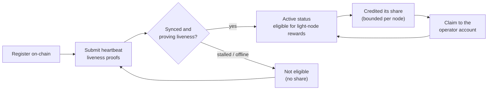

# Recompense și monitorizare

Un light node înregistrat primește o parte din alocarea pentru light nodes și **trebuie să rămână sănătos** pentru a continua să se califice pentru ea. Această pagină acoperă cota de 3% din recompensele pentru light nodes, modul în care recompensele sunt creditate și revendicate, ce face și ce nu face nodul cu delegările, precum și modul de monitorizare a nodului.

:::note Înregistrarea în programul de recompense nu este încă deschisă
Niciun light node nu este încă înregistrat pe vreuna dintre rețele, deoarece înregistrarea necesită o licență `lightnode_operator`, iar niciuna nu a fost acordată. Contabilitatea recompenselor descrisă aici este activă on-chain, dar astăzi nu se plătește nimic nodurilor, iar nimic de pe această pagină nu reprezintă o promisiune de câștiguri. Consultați [Starea programului de recompense](/light-node/overview#reward-program-status).
:::

## Cota de 3% din recompensa pe bloc

Distribuția comisioanelor din QoreChain rezervă o cotă fixă de **3% pentru light nodes** care furnizează date de rețea. Aceasta este una dintre cele cinci destinații din împărțirea recompenselor protocolului — validatori (37%), arse (30%), trezorerie (20%), stakeri (10%) și **light nodes (3%)** — impusă on-chain. Consultați [Tokenomics](/architecture/tokenomics) pentru detalierea completă.

Pentru a participa la această cotă, un nod are nevoie de următoarele, verificate on-chain, nu auto-declarate: o licență activă `lightnode_operator` (verificată la înregistrare), un minimum de **1,000 QOR bonded** — calculat ca total pe toți validatorii cărora le delegați, nu per validator, necesar la înregistrare și recitit din staking de fiecare dată când sunt creditate recompense — și o taxă de înregistrare de **1 QOR**, plătită o singură dată la înregistrare. Participarea este plafonată la nivel de rețea la **10,000 de light nodes**. Consultați [Registration and Licensing](/light-node/registration-and-licensing) pentru modul în care funcționează înregistrarea și [Starea programului de recompense](/light-node/overview#reward-program-status) pentru a afla dacă înscrierea este deschisă.

Cei 3% reprezintă suma care curge în modulul light-node, nu un drept per nod: fiecare nod eligibil este creditat cu partea sa ponderată după stake din ceea ce s-a acumulat, limitată per nod de `max_reward_per_block_per_node` (în prezent `1713` uqor pe bloc, scalat după uptime), iar tot ce nu este câștigat merge într-o rezervă pe care o poate elibera doar un vot de guvernanță. Consultați [cota de 3% din recompensele pentru light nodes](/light-node/overview#the-3-light-node-reward-share).

Odată înregistrat și cu stake delegat, menținerea eligibilității ține de a rămâne activ. Un nod are nevoie de cel puțin **80% uptime** și trebuie să continue să trimită dovezi de liveness prin heartbeat la un **interval de 1,000 de blocuri** (aproximativ 54 de minute pe mainnet la timpul mediu de bloc măsurat de circa 3.2 s; aproximativ 17 minute pe testnet, care produce blocuri aproximativ o dată pe secundă).

**Regulile de timp.** Lanțul respinge un heartbeat trimis la **mai puțin de 1,000 de blocuri după cel anterior** (`heartbeat submitted too early`); primul heartbeat după înregistrare nu are o asemenea limită inferioară. Dacă niciun heartbeat nu sosește în **1,000 + 100 de blocuri** (`heartbeat_interval` plus `heartbeat_grace_period`; pe mainnet aproximativ 54 de minute plus o perioadă de grație de circa 5 minute) de la ultimul — sau de la înregistrare, dacă nu ați trimis niciunul — nodul este marcat inactiv și nu mai este creditat. Un heartbeat trimis mai târziu este totuși acceptat și îl reactivează. Daemonul trimite următorul heartbeat de îndată ce au trecut 1,000 de blocuri de la `last_heartbeat`-ul propriu al lanțului pentru nodul dvs., verificând la fiecare 60 de secunde.

**Ratarea ferestrei costă uptime, nu înregistrarea.** Un nod care ratează fereastra este marcat inactiv și încetează să câștige, dar chiar următorul heartbeat reușit îl reactivează — nu este nevoie de re-înregistrare. **Uptime-ul** dvs. este raportul curent dintre heartbeat-urile primite și cele așteptate (unul la fiecare 1,000 de blocuri) de la blocul la care v-ați înregistrat, plafonat la 1. Sub pragul `min_uptime_for_rewards` (`0.80`) un nod nu câștigă nimic; la acest prag sau peste el, plafonul per nod este scalat după uptime-ul dvs. O pană lungă scade așadar raportul, iar acesta se recuperează doar pe măsură ce se acumulează heartbeat-uri la timp. Verificați `status` dacă un nod apare ca inactiv: raportează starea semnatarului, a licenței și a înregistrării.

:::note Ce dovedește de fapt un heartbeat
Un heartbeat reușit dovedește că cheia operatorului a semnat la timp — nu dovedește că un nod rulează continuu software-ul complet. Tratați-l ca pe o semnătură de liveness, nu ca pe o „verificare a unui nod activ”.
:::

:::note `last_heartbeat` este o înălțime de bloc, nu un timestamp
Dacă interogați direct înregistrarea on-chain a unui nod, `last_heartbeat` este o înălțime de bloc, iar o valoare de `0` înseamnă că încă nu a fost înregistrat niciun heartbeat — lanțul măsoară atunci termenul de inactivitate de la înălțimea `registered_at` a nodului. Citirea lui `0` ca un calcul naiv de timp scurs face ca un nod proaspăt înregistrat să pară cu milioane de blocuri întârziat.
:::

*Eligibilitate pentru recompense: dețineți o licență activă on-chain și stake-ul minim bonded, înregistrați-vă, apoi continuați să dovediți liveness prin heartbeat-uri pentru a rămâne peste pragurile de uptime și de interval al heartbeat-ului.*



## Cum funcționează recompensele {#how-rewards-work}

### Creditare

La fiecare 100 de blocuri lanțul creditează fiecare nod eligibil (activ, cu cel puțin stake-ul minim bonded și cel puțin uptime-ul minim) cu partea sa din ceea ce s-a acumulat, limitată per nod așa cum este descris în [cota de 3% din recompensele pentru light nodes](/light-node/overview#the-3-light-node-reward-share). Suma este adăugată la `accumulated_rewards` al nodului. Citiți-o cu:

```bash
curl -s https://api.qore.host/qorechain/lightnode/v1/rewards/<operator-address>
# or: qorechaind query lightnode rewards <operator-address>
```

(Folosiți `https://api-testnet.qore.host` pentru testnet.)

### Revendicare

Recompensele creditate rămân în înregistrarea nodului până când le revendicați. Revendicați cu aceeași pereche generate-then-cosign folosită pentru înregistrare:

```bash
qorechaind tx lightnode claim-rewards --from operator --chain-id <chain-id> --gas 300000 --fees 30000uqor --generate-only > claim.json
qorechaind tx pqc cosign claim.json --from operator --pqc-key <node-key-name> --chain-id <chain-id>
```

Alternativ, setați `auto_claim = true` sub `[delegation]`: daemonul revendică atunci recompensele light-node acumulate în contul operatorului prin intermediul semnatarului, odată ce depășesc `min_reward_claim` (implicit `1000000` uqor, 1 QOR), verificând la fiecare `compound_interval` (implicit `1h`). Auto-revendicarea este **dezactivată implicit** și doar revendică: nodul nu re-delegă și nu mută niciodată stake-ul. `qorechaind tx lightnode deregister` elimină înregistrarea și plătește tot ce a rămas creditat; taxa de înregistrare nu este rambursată.

### Urmărirea delegărilor și alertele de reputație

Nodul oglindește delegările contului operatorului din lanț la fiecare cinci minute. Când `rebalance_enabled` este activat (implicit), verifică și scorul de reputație al fiecărui validator căruia îi delegați și înregistrează un avertisment pentru oricare sub `min_reputation` (implicit `0.5`). Nu mută stake-ul: modificați delegările din propriul portofel. (Opțiunile `validators` și `split_weights` din `[delegation]` sunt acceptate, dar în prezent nu sunt utilizate.)

### Inspectarea recompenselor și a delegărilor

```bash
lightnode-sx validators   # the bonded validator set
```

:::caution Limitare cunoscută în v3.1.3 / v3.1.4
`lightnode-sx delegation`, `lightnode-sx rewards` și vizualizarea UX **Delegation** caută adresa derivată din cheia nodului. O cheie de nod post-cuantică nu are adresă, așa că în prezent acestea nu afișează nimic (`rewards` raportează `chain REST endpoint not available`). Folosiți în schimb interogările lanțului:

```bash
curl -s https://api.qore.host/cosmos/staking/v1beta1/delegations/<operator-address>
curl -s https://api.qore.host/cosmos/distribution/v1beta1/delegators/<operator-address>/rewards
curl -s https://api.qore.host/qorechain/lightnode/v1/rewards/<operator-address>
```
:::

## Monitorizare

Menținerea nodului sănătos este ceea ce îl păstrează eligibil pentru recompense. Există trei lucruri care merită urmărite.

### Telemetrie

Telemetria în timp real acoperă validatorii, consensul/rețeaua, bridge-ul și tokenomics, fiecare fiind reîmprospătat la propriul interval (configurat sub `[telemetry]` în `config.toml`). Din CLI:

```bash
lightnode-sx status    # node and light-client sync status
lightnode-sx network   # recent synced headers and latest height
```

Ediția UX afișează aceleași date live în vizualizările **Overview**, **Network**, **Bridge** și **Tokenomics** — consultați [UX Edition](/light-node/ux-edition).

### Starea de sincronizare și de heartbeat

Comanda `status` raportează ID-ul lanțului, înălțimea celui mai recent bloc, dacă lanțul este în curs de recuperare (catching up), înălțimea sincronizată și starea de sincronizare a light client-ului și — odată ce `operator_address` este setat — starea `Signer`, `Licence` și `Registration` (inclusiv statusul nodului și înălțimea ultimului heartbeat). Un nod care este înregistrat, sincronizat și în funcțiune continuă să trimită **dovezi de liveness prin heartbeat** și astfel rămâne eligibil pentru recompense. Aceste heartbeat-uri sunt produse printr-un **pipeline de tranzacții co-semnate PQC** (hibrid Dilithium-5 / ML-DSA-87), în concordanță cu setarea implicită a lanțului care impune PQC — consultați [Registration and Licensing](/light-node/registration-and-licensing#pqc-cosigned-heartbeat-pipeline) pentru modul în care funcționează pipeline-ul și cum se activează heartbeat-urile on-chain. Dacă `status` arată nodul blocat sau nesincronizat, este posibil să nu reușească să dovedească liveness — investigați înainte ca eligibilitatea să fie afectată.

### Starea autotestării

Dacă suspectați o problemă cu stiva criptografică, rulați oricând autotestul PQC:

```bash
lightnode-sx selftest
```

Acesta rulează keygen → sign → verify → tamper-detection (cinci verificări) și iese cu cod diferit de zero la orice eșec. Este cea mai rapidă modalitate de a exclude o problemă la stiva de semnare post-cuantică atunci când diagnosticați probleme ale nodului. Consultați [SX Edition](/light-node/sx-edition) pentru detalierea completă a autotestului.

### Interogări ale lanțului {#chain-queries}

URL-uri de bază: `https://api.qore.host` (mainnet) și `https://api-testnet.qore.host` (testnet).

| Interogare | Returnează |
| --- | --- |
| `GET /qorechain/lightnode/v1/params` | Taxa de înregistrare, intervalul și perioada de grație ale heartbeat-ului, stake-ul minim delegat, cota de recompensă, uptime-ul minim, plafonul de noduri. |
| `GET /qorechain/lightnode/v1/stats` | Numărul de noduri înregistrate și active, totalul recompenselor creditate. |
| `GET /qorechain/lightnode/v1/node/{address}` | Înregistrarea unui nod (`status`, `last_heartbeat`, `total_heartbeats`, `expected_heartbeats`, `accumulated_rewards`). |
| `GET /qorechain/lightnode/v1/rewards/{address}` | Recompensele creditate și încă nerevendicate. |
| `GET /qorechain/lightnode/v1/reward_pool` | Cum se împarte soldul modulului între rezervă, recompense creditate și următoarea plată; include limita per nod. |
| `GET /qorechain/license/v1/check/{address}/lightnode_operator` | Dacă o adresă deține o licență activă. |

## Unde continuați

- [Registration and Licensing](/light-node/registration-and-licensing) — înregistrați-vă și rămâneți activ.
- [Tokenomics](/architecture/tokenomics) — modelul complet de recompense și ardere.
