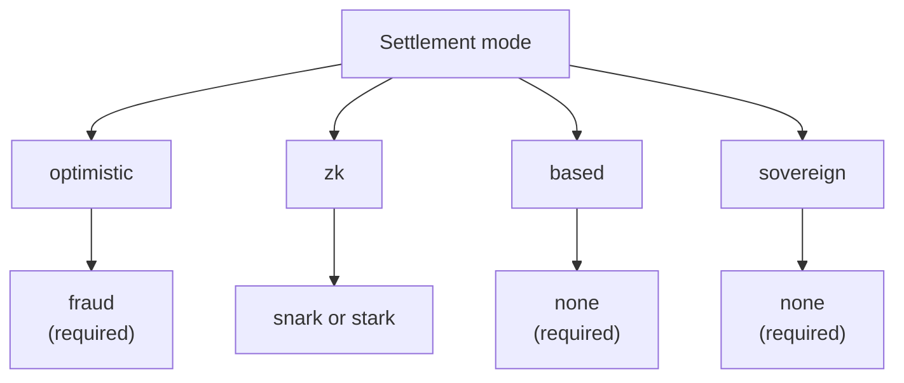

# Prezentare generală a rollup-urilor

**Rollup Development Kit (RDK)** de la QoreChain — modulul `x/rdk` — le permite dezvoltatorilor să lanseze rollup-uri specifice aplicațiilor, care se decontează pe QoreChain. Fiecare rollup este un mediu de execuție independent, cu propriul timp de bloc, propria mașină virtuală, propriul model de comisioane și propria secvențiere, moștenind în același timp garanțiile QoreChain privind securitatea, criptografia post-cuantică și disponibilitatea datelor.

:::caution Capabilitate în stadiu incipient
RDK este implementat pe ambele rețele, dar **niciun rollup nu a fost creat încă pe niciuna dintre ele** (verificat la 23 octombrie 2026), așa că fluxurile descrise în această secțiune nu au fost exersate de terți. Mainnetul (**`qorechain-vladi`**, EVM chain ID **9801**, activ din 7 iunie 2026) rulează versiunea lanțului **v3.2.4** (aplicată la înălțimea 3.742.566 pe 23 octombrie 2026, propunerea de guvernanță 13); testnetul (**`qorechain-diana`**, EVM chain ID **9800**) rulează **v3.2.4** din 19 octombrie 2026. Acolo unde comportamentul s-a schimbat între v3.2.3 și v3.2.4, această secțiune spune care versiune se aplică. Validați fiecare implementare mai întâi pe testnet și citiți notele de stare de pe fiecare pagină: mai multe capabilități (verificarea ZK, disponibilitatea datelor Celestia, QCAI Copilot, apelurile cross-VM, chitanțele de decontare) nu pot fi folosite astăzi cap-coadă, iar clienții RDK publicați au propriile limite (vezi [RDK 0.6.0: modificări și limite](/rollups/deploying-a-rollup#rdk-050-limits)).
:::

## Ce există astăzi {#what-exists-today}

| | Stare |
|---|---|
| Rollup-uri înregistrate (mainnet și testnet) | Niciunul |
| Modulul `x/rdk` și parametrii săi | Implementat pe ambele rețele; citiți-i cu `qorechaind query rdk config` |
| Interogări RDK | Disponibile pe ambele rețele prin CLI, gRPC și REST (`/qorechain/rdk/v1/…`), deci citirile bazate pe REST, precum `rdk.params()` din TypeScript, funcționează pe mainnet |
| Ancore de decontare scrise de RDK | Niciuna. Începând cu v3.2.2, un batch poate purta un `anchor_signature` și este atunci ancorat în `x/multilayer` în aceeași tranzacție; fără el, batch-ul se decontează neancorat. Nu există încă niciun rollup, strat sau ancoră. RDK TypeScript 0.6.0 trimite câmpul când clientul său semnează hibrid și este creatorul rollup-ului (netestat live); clienții Python, Go, Rust și Java nu îl trimit |
| Straturi de rollup înregistrate în `x/multilayer` | Niciunul |
| Retrageri | Plătite dintr-un registru de escrow per rollup începând cu v3.2.3 (vezi [ZK / STARK și retrageri](/rollups/zk-stark-withdrawals)); niciuna nu a fost făcută, deoarece nu există niciun rollup |

Pentru referința de nivel inferior a modulului — parametrii modulului, mecanismele interne ale ciclului de viață, integrarea burn și ancorarea multistrat — consultați pagina **[Rollup Development Kit](/architecture/rollup-development-kit)** din secțiunea Arhitectură. Această secțiune Rollups este ghidul practic orientat către dezvoltatori: ce este RDK, ce paradigmă să alegeți, cum să implementați, cum funcționează disponibilitatea datelor și cum se decontează retragerile de la L2 înapoi la L1.

---

## Ce vă oferă RDK

Un rollup creat prin RDK grupează patru aspecte configurabile:

| Aspect | Ce controlează | Opțiuni |
| ------- | ---------------- | ------- |
| **Modul de decontare** | Cum sunt verificate și finalizate pe QoreChain tranzițiile de stare ale rollup-ului | `optimistic`, `zk`, `based`, `sovereign` |
| **Sistemul de dovezi** | Mecanismul criptografic sau economic care susține decontarea | `fraud`, `snark`, `stark`, `none` |
| **Modul de secvențiere** | Cine ordonează tranzacțiile înainte de a fi decontate | `dedicated`, `shared`, `based` |
| **Disponibilitatea datelor** | Unde sunt publicate datele tranzacțiilor, astfel încât oricine să poată reconstrui starea | `native`, `celestia`, `both` |

Fiecare rollup este înregistrat cu un `rollup-id` unic, susținut de o garanție de miză (stake bond) în QOR și primește un statut de ciclu de viață (`pending`, `active`, `paused`, `stopped`). Consultați **[Deploying a Rollup](/rollups/deploying-a-rollup)** pentru fluxul complet de creare și ciclu de viață.

---

## Ce diferențiază QoreChain RDK

Dincolo de elementele standard ale oricărui kit de rollup, QoreChain RDK include trei capabilități specifice QoreChain, construite în jurul Layer 1-ului QoreChain — plus un auto-contestatar de tip watchtower. Starea lor diferă; tabelul spune ce funcționează astăzi. RDK este livrat în cinci limbaje (TypeScript, Python, Go, Rust, Java). **Versiunea 0.6.0 este publicată pe toate cele cinci registre** (verificat la 21 octombrie 2026: npm `@qorechain/rdk`, `@qorechain/rdk-cli` și `create-qorechain-rollup`; PyPI `qorechain-rdk`; crates.io `qorechain-rdk`; Maven Central `io.github.qorechain:qorechain-rdk`; modulul Go `v0.6.0`, pe care ar trebui să îl fixați, deoarece `@latest` al proxy-ului încă răspundea `v0.5.0`). Dintre cele cinci, doar clientul TypeScript semnează tranzacții hibride. Preseturile `mainnet` și `testnet` includ din fabrică endpoint-urile publice `qore.host`, astfel încât `createRdkClient({ network })` nu necesită nicio configurare manuală a endpoint-urilor, iar citirile sale REST funcționează pe ambele rețele.

| Diferențiator | Ce face |
| -------------- | ------------ |
| **[Quantum-safe settlement receipts](/rollups/settlement-receipts)** | Împachetează o ancoră de decontare ca o chitanță portabilă care poartă o semnătură post-cuantică (ML-DSA-87 / Dilithium-5). Stadiu incipient: nu există încă nicio ancoră, deci nimic nu a fost verificat față de o ancoră reală; o chitanță este o afirmație care trebuie verificată față de starea lanțului, ceea ce face verificatorul din 0.6.0. |
| **[QCAI Rollup Copilot](/rollups/qcai-copilot)** | Un ajutor consultativ read-only pentru un singur rollup (estimare de comisioane, recomandări, investigații de fraudă). Serviciile consultative pe care le citește nu sunt încă expuse pe endpoint-urile publice. |
| **[Multi-VM cross-VM calls](/rollups/multi-vm)** | Unelte pentru codificarea unui apel EVM → QoreChain Native prin precompilarea cross-VM (`0x…0901`). Precompilarea nu este activată pe rețelele live, deci un apel nu face nimic; encoderul din 0.6.0 corespunde structurii pe care o decodifică lanțul. |
| **[Watchtower](/rollups/watchtower)** | Un cadru de auto-contestare pentru rollup-uri optimiste, care semnalează batch-urile noi și termenele ferestrei de contestare și contestă batch-urile invalide pe baza predicatului vostru de validitate. Citește prin REST, pe care îl servesc ambele rețele; de la 0.6.0 judecă fereastra fiecărui batch la fel ca lanțul. |

Consultați **[Why QoreChain RDK](/rollups/why)** pentru argumentația completă și exemple de cod.

---

## Cele patru paradigme de decontare

QoreChain RDK acceptă patru moduri de decontare distincte, fiecare cu ipoteze de încredere, caracteristici de finalitate și cerințe de dovezi diferite. Combinația dintre modul de decontare și sistemul de dovezi este validată on-chain — o pereche incompatibilă este respinsă la creare. Diagrama de mai jos asociază fiecare mod de decontare cu sistemul de dovezi valid corespunzător.

### Optimistic

Rollup-urile optimiste presupun implicit că batch-urile trimise sunt valide și se bazează pe **dovezi de fraudă** pentru soluționarea disputelor.

* **Sistem de dovezi**: `fraud` — dovezi de fraudă interactive
* **Secvențiator**: `dedicated` sau `shared`
* **Finalitate**: Întârziată până când o fereastră de contestare configurabilă expiră fără nicio contestare reușită
* **Dispute**: Oricine poate contesta un batch trimis, în interiorul ferestrei, depunând o garanție (bond) și o dovadă de fraudă. O contestare îngheață batch-ul; creatorul rollup-ului o rezolvă apoi, iar lanțul verifică el însuși dovada — fraudă confirmată respinge batch-ul și îl plătește pe contestatar, o contestare respinsă readuce batch-ul la `submitted`. Consultați [Deploying a Rollup](/rollups/deploying-a-rollup#challenge-a-batch-optimistic-rollups).
* **Lungimea ferestrei**: fereastra implicită este de 604.800 de „secunde”. **Înainte de v3.2.4 (pe mainnet, înainte de înălțimea 3.742.566)** lanțul le convertește în blocuri la un raport fix de 6 secunde per bloc — **100.800 de blocuri** — deci timpul real scurs urmează timpul efectiv al blocurilor (aproximativ 3,7 zile la blocurile actuale de ≈3,2 s de pe mainnet); planificați în blocuri, nu în zile. **De la v3.2.4**, un batch trimis de la înălțimea upgrade-ului încolo primește o fereastră măsurată în secunde de timp de bloc (7 zile întregi); batch-urile anterioare păstrează regula numărului de blocuri. Înălțimea upgrade-ului este 8.337.253 pe testnet (din 19 octombrie 2026) și 3.742.566 pe mainnet (23 octombrie 2026), deci regula numărului de blocuri se aplică fiecărui batch trimis sub acea înălțime, iar regula timpului de bloc de la ea încolo.

### ZK (Zero-Knowledge)

Rollup-urile ZK atașează fiecărui batch o dovadă criptografică de validitate, demonstrând corectitudinea tranziției de stare fără re-execuție.

* **Sistem de dovezi**: `snark` (dovezi succinte) sau `stark` (dovezi transparente, fără trusted setup)
* **Secvențiator**: `dedicated` sau `shared`
* **Finalitate**: La verificarea unei dovezi valide — nu este necesară o fereastră de contestare
* **Maturitate**: Batch-urile SNARK sunt verificate on-chain (Groth16 peste BLS12-381) față de o cheie de verificare stocată împreună cu rollup-ul. Un rollup creat prin `create-rollup` nu poartă în prezent o cheie de verificare, deci batch-urile ZK nu pot fi încă finalizate cap-coadă. Verificarea STARK este experimentală: este opt-in și verifică un circuit demonstrativ, nu propria tranziție de stare a rollup-ului vostru. Tratați decontarea ZK ca nefiind pregătită pentru producție. Consultați **[ZK / STARK & Withdrawals](/rollups/zk-stark-withdrawals)**.

### Based

Rollup-urile de tip based deleagă secvențierea tranzacțiilor către proponenții QoreChain (L1), moștenind liveness-ul și rezistența la cenzură ale lanțului gazdă.

* **Sistem de dovezi**: `none` — proponenții L1 sunt sursa de adevăr pentru ordonare
* **Secvențiator**: `based` (obligatoriu — impus prin validare on-chain)
* **Finalitate**: Urmează confirmarea lanțului gazdă
* **Compromis**: Cel mai simplu model operațional, întrucât validatorii QoreChain se ocupă de secvențiere, cu prețul renunțării la controlul latenței oferit de un secvențiator dedicat
* **Starea de astăzi**: `based` este înregistrat în configurația rollup-ului, dar QoreChain nu admite încă proponenți L1 ca transmițători de batch-uri — transmite creatorul rollup-ului (consultați [Modurile de secvențiere](#sequencer-modes))

### Sovereign

Rollup-urile suverane rulează propriul consens și se auto-secvențiază. Ele își ancorează starea pe QoreChain pentru verificabilitate, dar nu depind de lanțul gazdă pentru finalitate.

* **Sistem de dovezi**: `none`
* **Secvențiator**: gestionat autonom de rollup
* **Finalitate**: Independentă — determinată de consensul propriu al rollup-ului
* **Ancorarea stării**: Rădăcinile de stare sunt publicate pe QoreChain pentru transparență, dar lanțul gazdă nu le impune

---

## Compatibilitatea sistemelor de dovezi

Modul de decontare restrânge sistemele de dovezi valide. Aceste perechi sunt impuse la crearea unui rollup.

| Mod de decontare | `fraud` | `snark` | `stark` | `none` |
| --------------- | :-----: | :-----: | :-----: | :----: |
| **optimistic**  | Obligatoriu | — | — | — |
| **zk**          | — | Acceptat | Acceptat | — |
| **based**       | — | — | — | Obligatoriu |
| **sovereign**   | — | — | — | Obligatoriu |

---

## Modurile de secvențiere {#sequencer-modes}

Secvențiatorul determină cine ordonează tranzacțiile în interiorul unui bloc de rollup înainte de decontare.

| Mod | Cine secvențiază | Observații |
| ---- | ------------- | ----- |
| **`dedicated`** | O singură adresă de operator desemnată | Latență minimă; necesită încredere în operator pentru liveness și ordonare corectă |
| **`shared`** | Un set de secvențiatori partajat | Ordonare distribuită în cadrul setului; supracost de coordonare ușor mai mare |
| **`based`** | Proponenții L1 QoreChain | Moștenește securitatea validatorilor lanțului gazdă și rezistența la cenzură; obligatoriu pentru decontarea `based` |

:::note Ce este impus astăzi
On-chain, un batch poate fi transmis doar de adresa de secvențiator configurată a rollup-ului sau, atunci când nu este setată niciuna (cazul tuturor preseturilor), de creatorul acestuia. Modurile `shared` și `based` sunt înregistrate în configurația rollup-ului, dar QoreChain nu admite încă o listă de secvențiatori partajați sau proponenți L1 ca transmițători de batch-uri; aceste moduri descriu designul intenționat.
:::

---

## Alegerea unei paradigme

| Dacă doriți... | Luați în considerare |
| -------------- | -------- |
| Cea mai simplă configurație operațională, cu validatorii QoreChain realizând secvențierea | **based** |
| Finalitate rapidă cu garanții criptografice (încă nepregătit pentru producție) | **zk** (`snark` / `stark`) |
| Un model bine înțeles, cu soluționare economică a disputelor | **optimistic** (`fraud`) |
| Independență totală cu propriul consens, ancorat pentru verificabilitate | **sovereign** |

Nu știți de unde să începeți? RDK include **profiluri preset** care grupează aceste alegeri pentru categorii de aplicații uzuale — consultați **[Preset Profiles](/rollups/preset-profiles)** — și, atunci când RPC-ul consultativ este disponibil, un ajutor `suggest-profile` (în prezent returnează un fallback fix `defi`, deci alegeți din tabelul de profiluri).

Pentru dezvoltatori, RDK este livrat și ca SDK public TypeScript **`@qorechain/rdk`**, împreună cu scaffolder-ul **`create-qorechain-rollup`**, care acționează același modul on-chain din cod — consultați **[Deploying a Rollup](/rollups/deploying-a-rollup#deploy-with-the-typescript-rdk-qorechainrdk)**.

## Pagini conexe

* [Deploying a Rollup](/rollups/deploying-a-rollup) — lansați un rollup din CLI sau din RDK-ul TypeScript.
* [Preset Profiles](/rollups/preset-profiles) — pachete gata configurate pentru categorii de aplicații uzuale.
* [Data Availability](/rollups/data-availability) — routerul nativ de DA și stocarea blob-urilor.
* [ZK / STARK Withdrawals](/rollups/zk-stark-withdrawals) — fluxuri de retragere susținute de dovezi.
