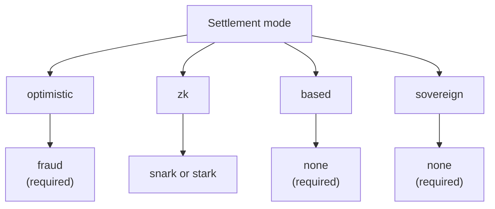

# Prezentare generală a rollup-urilor

**Rollup Development Kit (RDK)** de la QoreChain este un set de biblioteci client (TypeScript, Python, Go, Rust și Java), un instrument de linie de comandă pentru operatori și șabloane de pornire pentru construirea de rollup-uri specifice aplicațiilor, care se decontează pe QoreChain prin modulul on-chain `x/rdk`. Cu el configurați un rollup, construiți și semnați tranzacțiile acestuia, citiți starea lui, urmăriți ferestrele sale de contestare, emiteți și verificați chitanțe de decontare și asamblați apeluri cross-VM și dovezi de retragere. Fiecare rollup este un mediu de execuție independent, cu propriul timp de bloc, propria mașină virtuală, propriul model de comisioane și propria secvențiere, moștenind în același timp securitatea, criptografia post-cuantică și disponibilitatea datelor QoreChain. Această pagină este pentru dezvoltatorii care vor să lanseze sau să opereze un rollup și pentru oricine decide dacă RDK se potrivește aplicației sale.

:::caution Capabilitate în stadiu incipient
RDK este implementat pe ambele rețele, dar **niciun rollup nu a fost creat încă pe niciuna dintre ele** (verificat la 27 octombrie 2026), așa că fluxurile descrise în această secțiune nu au fost exersate de terți. **Decontarea ZK (profilul `defi`, șablonul `defi-rollup` și orice rollup `zk`) nu poate fi folosită încă pe niciuna dintre rețele:** lanțul nu are cum să înregistreze o cheie de verificare, așa că fiecare batch ZK este refuzat după ce comisionul a fost plătit. Înregistrarea cheilor este planificată pentru lanțul v3.2.7. Folosiți decontarea `optimistic` până atunci.

Mainnetul (**`qorechain-vladi`**, EVM chain ID **9801**, activ din 7 iunie 2026) rulează versiunea lanțului **v3.2.5** (propunerea de guvernanță 14 a aplicat-o la înălțimea 3.906.833 pe 29 octombrie 2026; v3.2.4 fusese aplicată la înălțimea 3.742.566 pe 23 octombrie 2026, propunerea 13); testnetul (**`qorechain-diana`**, EVM chain ID **9800**) rulează **v3.2.6** (v3.2.4 a ajuns pe el la 19 octombrie 2026, v3.2.5 la 26 octombrie și v3.2.6 la 27 octombrie). Ce schimbă v3.2.5 pentru rollup-uri este listat la [comportamentul lanțului v3.2.5](#v325); se aplică pe ambele rețele. Acolo unde comportamentul s-a schimbat între v3.2.3 și v3.2.4, această secțiune spune care versiune se aplică. Validați fiecare implementare mai întâi pe testnet și citiți notele de stare de pe fiecare pagină: mai multe capabilități (verificarea ZK, disponibilitatea datelor Celestia, QCAI Copilot, apelurile cross-VM, chitanțele de decontare) nu pot fi folosite astăzi cap-coadă.
:::

## Inovații {#innovations}

* **Chitanțe de decontare post-cuantice.** Ancora de stare a unui batch este semnată cu ML-DSA-87 de cheia înregistrată a creatorului rollup-ului. `verifySettlementReceipt` recitește din lanț fiecare câmp al chitanței (rollup, strat, rădăcina batch-ului și ancora: rădăcina de stare, înălțimea stratului, înălțimea Main Chain, timpul ancorei, hash-ul setului de validatori, numărul de tranzacții, dovada, semnătura). Cheia de verificare vine din lanț și niciodată din chitanță; chitanța trebuie să indice rețeaua pe care o interogați; o versiune necunoscută de chitanță sau un algoritm diferit de ML-DSA-87 este refuzat înainte de orice citire; iar o verificare doar a semnăturii nu este niciodată raportată ca validă. Mesajul ancorei are o primă formă sub înălțimea lanțului v3.2.2 și o a doua formă, care leagă și chain id-ul, de la ea încolo; versiunea este aleasă după înălțimea ancorei. Consultați [Settlement receipts](/rollups/settlement-receipts).
* **Semnare hibridă cu două derivări de chei.** Tranzacțiile sunt semnate cu secp256k1 plus ML-DSA-87. Cheia post-cuantică este derivată din mnemonic atât în maniera canonică (SHAKE-256 peste `qorechain:pqc:v1|`, adresa și mnemonicul), cât și în maniera veche (legacy), iar clientul folosește cheia pe care lanțul a înregistrat-o pentru cont. Astăzi doar clientul TypeScript semnează hibrid.
* **Dovezi de retragere construite așa cum le construiește lanțul.** `withdrawalsTree` (0.7.0, în toate cele cinci limbaje) construiește rădăcina retragerilor unui batch și fiecare dovadă exact ca lanțul: poziția frunzei este indexul retragerii, nodurile sunt hash-uite cu SHAKE-256, iar batch-urile de la lanțul v3.2.5 folosesc frunze de a doua formă, care numesc și chain id-ul. Este testat cu vectori produși de codul propriu al lanțului, iar fiecare dovadă din acei vectori este acceptată de verificatorul lanțului. `qorollup withdraw` refuză înainte de plata unui comision când rezultatul său nu este `withdrawals_root` on-chain al batch-ului.
* **Rădăcină canonică de tranziție.** `batchTransitionRoot` calculează exact rădăcina de stare după care lanțul judecă un batch optimist (forma pe care o aplică astăzi mainnet-ul este un angajament SHAKE-256 al rădăcinii de stare anterioare, al hash-ului de date și al numărului de tranzacții; `transitionRootVersionFor` alege forma pe care o aplică rețeaua conectată), iar `fraudProof` construiește din ea dovada de 64 de octeți. Ambele au fost testate cu vectori generați de codul propriu al lanțului.
* **Ferestre de contestare exacte ca în lanț.** `batchChallengeWindow` calculează fereastra unui batch așa cum o face lanțul (bazată pe timp: deschisă cât timp timpul blocului este sub timpul trimiterii plus fereastra; pentru batch-urile mai vechi, fereastra împărțită la șase, în blocuri, de la înălțimea trimiterii) și o judecă față de vârful lanțului citit din RPC `/status`, nu față de ceasul local. [Watchtower](/rollups/watchtower) și monitorul de stare o folosesc. De la 0.7.0, `getRollupHealth` raportează și `heldBackBy` când finalitatea în ordine a lanțului (v3.2.5, ambele rețele, consultați [comportamentul lanțului v3.2.5](#v325)) ține un batch în urmă, iar `qorollup watchtower --canonical` raportează batch-urile pe care o contestare le-ar câștiga.
* **Verificări înainte de plata oricărui comision.** Kitul refuză un id de rollup în afara `^[a-z0-9][a-z0-9._-]{2,63}$`; o retragere care nu este în `uqor`, are suma zero, poartă o dovadă mai adâncă de 64 de niveluri de câte 32 de octeți sau indică o adresă bech32 invalidă; o rădăcină a retragerilor care nu este goală sau de exact 32 de octeți; o oprire de rollup pe care lanțul o va refuza (v3.2.5 și ulterior); și, atunci când poate citi rollup-ul, un batch care indică un hash de date pe un rollup cu disponibilitatea datelor `native` sau `both`. Fiecare dintre acestea ar fi altfel refuzată de lanț după ce comisionul a fost cheltuit.
* **Calldata cross-VM și o verificare live.** `encodeCrossVmCalldata` construiește calldata pentru `executeCrossVMCall(uint8,string,bytes)` (selector `0x3c11078c`, precompilare `0x...0901`), iar `isCrossVmPrecompileActive` citește dacă precompilarea este activă pe rețea. De la 0.7.0, `getCrossVmParams`, `crossVmTargetReady`, `decodeCrossVmResult` și `decodeRevertReason` acoperă lista de permisiuni și formatele de răspuns din lanțul v3.2.5 (ambele rețele). Consultați [Multi-VM](/rollups/multi-vm).
* **Un singur set de vectori de test pentru cinci limbaje.** Pachetele TypeScript, Python, Go, Rust și Java sunt verificate față de același fixture de referință (pachetul Go are 100 de teste unitare, Rust 77 și Java 75).

## Cum se folosește {#how-to-use}

Citirile nu necesită nicio cheie și niciun fond. Fragmentele de mai jos citesc parametrii live ai modulului `rdk` și lista de rollup-uri de pe testnetul public (`qorechain-diana`) și au fost rulate la 27 octombrie 2026 din pachetele publicate (versiunea curentă este 0.7.0; fragmentul TypeScript și linia de comandă au fost rulate din nou cu 0.7.0 din npm, iar hub-ul pentru dezvoltatori consemnează fragmentele Python, Rust, Go și Java ca trecute față de aceeași versiune). Fiecare a afișat parametrii testnetului (maximum 200 de rollup-uri, miză minimă 10.000 QOR, rată de burn la creare 0,01, fereastră de contestare implicită 3.600 de secunde, dimensiune maximă a blob-ului DA 2.097.152 de octeți, retenția blob-urilor 432.000 de blocuri, maximum 10 batch-uri per bloc) și `0 rollups`.

### TypeScript (testat)

```bash
npm install @qorechain/rdk
```

```ts
import { createRdkClient } from "@qorechain/rdk";

// Public testnet (chain id qorechain-diana).
const rdk = createRdkClient({
  network: "testnet",
  endpoints: { rest: "https://api-testnet.qore.host" },
});

// Read the live rdk module parameters and the registered rollups.
const params = await rdk.params();
const rollups = await rdk.rest.listRollups();
console.log(rdk.network.chainId, params, `${rollups.length} rollups`);
```

Preseturile `mainnet` și `testnet` includ deja endpoint-urile publice `qore.host`, așa că `createRdkClient({ network: "testnet" })` funcționează fără câmpul `endpoints`; el este arătat mai sus pentru că fragmentul testat l-a transmis. Rulați cu Node 20 sau mai nou (testul a folosit Node 26).

### Python (testat)

```bash
pip install qorechain-rdk
```

```python
from qorrdk import create_rdk_client

# Public testnet (chain id qorechain-diana).
rdk = create_rdk_client(network="testnet", endpoints={"rest": "https://api-testnet.qore.host"})

# Read the live rdk module parameters and the registered rollups.
params = rdk.params()
rollups = rdk.rest.list_rollups()
print(rdk.network.chain_id, params, f"{len(rollups)} rollups")
```

Python 3.10 sau mai nou. `qorechain-rdk` depinde de `qorechain-pqc`, care aduce `liboqs-python` și are nevoie de biblioteca `liboqs`; pe o mașină fără ea, prima importare o construiește (sunt necesare git, CMake și un compilator C). Testat într-un mediu virtual nou, pe Python 3.12.

### Go (testat)

```bash
go get github.com/qorechain/qorechain-rdk/packages/go@v0.7.0
```

```go
package main

import (
	"context"
	"fmt"

	rdk "github.com/qorechain/qorechain-rdk/packages/go"
)

func main() {
	// Public testnet (chain id qorechain-diana).
	client := rdk.NewRdkClient(rdk.RdkClientOptions{
		Network:   "testnet",
		Endpoints: &rdk.Endpoints{Rest: "https://api-testnet.qore.host"},
	})
	ctx := context.Background()
	// Read the live rdk module parameters and the registered rollups.
	params, err := client.Params(ctx)
	if err != nil {
		panic(err)
	}
	rollups, _ := client.Rest.ListRollups(ctx)
	fmt.Printf("%s %+v %d rollups\n", client.Network.ChainID, params, len(rollups))
}
```

Testat cu Go 1.26, cu modulul preluat de pe proxy-ul Go.

### Rust (testat)

```bash
cargo add qorechain-rdk
```

```rust
use qorechain_rdk::client::{RdkClient, RdkClientOptions};

fn main() -> Result<(), Box<dyn std::error::Error>> {
    // Public testnet (chain id qorechain-diana).
    let rdk = RdkClient::new(RdkClientOptions {
        rest_url: Some("https://api-testnet.qore.host".into()),
        ..Default::default()
    });

    // Read the live rdk module parameters and the registered rollups.
    let params = rdk.params()?;
    let rollups = rdk.rest.list_rollups()?;
    println!("{} {:?} {} rollups", rdk.network.chain_id, params, rollups.len());
    Ok(())
}
```

Biblioteca este `qorechain_rdk`. Testat cu Rust 1.95, construit pe baza crates.io.

### Java (testat)

```kotlin
// build.gradle.kts
implementation("io.github.qorechain:qorechain-rdk:0.7.0")
```

```java
import io.github.qorechain.rdk.client.RdkClient;
import io.github.qorechain.rdk.client.Views.ParamsView;
import io.github.qorechain.rdk.config.Networks;

public class RdkQuickstart {
    public static void main(String[] args) {
        // Public testnet (chain id qorechain-diana).
        RdkClient.Options options = new RdkClient.Options();
        options.network = "testnet";
        options.endpoints = new Networks.Endpoints();
        options.endpoints.rest = "https://api-testnet.qore.host";
        RdkClient rdk = new RdkClient(options);

        // Read the live rdk module parameters and the registered rollups.
        ParamsView params = rdk.params();
        int rollups = rdk.rest.listRollups().size();
        System.out.println(rdk.network.chainId + " maxRollups=" + params.maxRollups
                + " minStakeForRollup=" + params.minStakeForRollup + " " + rollups + " rollups");
    }
}
```

JDK 17 sau mai nou; testat cu JDK 21 și Gradle 9.6, rezolvând dependențele din Maven Central. Fișierul trebuie să se numească `RdkQuickstart.java`. Maven Central servește 0.6.2 și 0.7.0 (verificat la 27 octombrie 2026).

### Linie de comandă (testat)

```bash
npm install -g @qorechain/rdk-cli
qorollup --version
qorollup params --network testnet
```

`qorollup --version` afișează `0.7.0`, iar `qorollup params --network testnet` afișează parametrii live ai modulului. **Aceasta funcționează de la 0.6.2.** Versiunile 0.6.1 și anterioare se încheiau cu codul 0 și nu afișau nimic când erau instalate din npm. Testul a instalat `@qorechain/rdk-cli@0.7.0` într-un proiect gol și l-a rulat prin `node_modules/.bin/qorollup`; o instalare globală și `npx` folosesc aceeași legătură bin. Este necesar Node 20 sau mai nou.

### Crearea scheletului unui proiect (testat)

```bash
npx create-qorechain-rollup my-rollup --template nft-rollup --network testnet --yes
cd my-rollup && npm run doctor
```

Șabloanele sunt `defi-rollup`, `gaming-rollup`, `nft-rollup`, `enterprise-rollup`, `custom-rollup` și `multivm-rollup`. Proiectul generat depinde de `@qorechain/rdk` `^0.7.0`. Generarea `nft-rollup` cu generatorul 0.6.1 a produs un proiect al cărui `npm run doctor` a trecut față de testnet (REST accesibil, parametri citibili, rețeaua `qorechain-diana`; avertizează despre disponibilitatea datelor Celestia și despre lipsa unui semnatar); generarea `defi-rollup` și rularea `npm run typecheck` au trecut din nou la 27 octombrie 2026 cu versiunea curentă. **Nu folosiți încă `defi-rollup` pentru a lansa un rollup** (consultați [Limite](#limits)). Pentru a crea un rollup și a trimite batch-uri, urmați [Deploying a Rollup](/rollups/deploying-a-rollup); tranzacțiile necesită o cheie post-cuantică înregistrată și, în RDK, clientul TypeScript căruia i se oferă un `pqcKeypair`.

## Cum se accesează {#how-to-access}

**Rețele și endpoint-uri.** RDK comunică cu endpoint-urile publice ale celor două rețele; preseturile `mainnet` și `testnet` le includ deja.

| Rețea | Chain id | EVM chain ID | Endpoint REST | Versiunea lanțului |
| ------- | -------- | ------------ | ------------- | ------------- |
| Mainnet | `qorechain-vladi` | 9801 | `https://api.qore.host` | v3.2.5 |
| Testnet | `qorechain-diana` | 9800 | `https://api-testnet.qore.host` | v3.2.6 |

Ambele rețele servesc interogările RDK (`/qorechain/rdk/v1/...`) prin REST, gRPC și CLI, deci citiri precum `rdk.params()` funcționează pe oricare dintre ele. Testnetul este o rețea de staging cu proprii parametri: fereastra de contestare implicită este de 3.600 de secunde pe testnet și 604.800 pe mainnet, pe testnet pot exista cel mult 200 de rollup-uri, iar pe mainnet 100, iar modulul multilayer permite 64 de straturi sidechain pe testnet și 10 pe mainnet (verificat la 27 octombrie 2026). Citiți `GET /qorechain/rdk/v1/params` pe rețeaua țintă.

**Cerințe pentru crearea unui rollup.**

| Cerință | Detalii |
| ----------- | ------- |
| **Cont alimentat** | Un cont cu suficient QOR pentru miză, miza stratului și comisioane. |
| **Miză în escrow** | Crearea unui rollup blochează în escrow `min_stake_for_rollup`, **10.000 QOR** pe ambele rețele. **1 % din miză (100 QOR) este ars (burn)** la creare; restul rămâne în escrow și este returnat când rollup-ul este oprit. |
| **Miza stratului** | Crearea înregistrează și stratul rollup-ului în modulul multilayer (miză minimă 1.000 QOR). Dacă stratul nu poate fi înregistrat, rollup-ul este totuși creat, dar nu are un strat real, deci batch-urile sale nu pot fi ancorate și nu se pot emite chitanțe. |
| **Cheie post-cuantică înregistrată** | O cheie ML-DSA-87 înregistrată pentru cont. Tranzacțiile pe lane-ul nativ semnate doar cu cheia clasică sunt refuzate. |
| **Comisioane** | Pragul minim al comisionului este 0,1 uqor per unitate de gaz; setați împreună limita de gaz și comisionul. |
| **Unelte** | Node 20 sau mai nou pentru CLI și scaffolder; Python 3.10 sau mai nou (cu `liboqs`, vezi mai sus) pentru clientul Python; JDK 17 sau mai nou pentru Java; modulul Go `github.com/qorechain/qorechain-rdk/packages/go`. |

Citirea stării nu are nevoie de niciuna dintre acestea. Puteți și să solicitați un rollup prin Dashboard (un formular de cerere, nu o tranzacție on-chain) sau să creați unul cu CLI-ul lanțului; consultați [Deploying a Rollup](/rollups/deploying-a-rollup) pentru fluxul complet, comenzile CLI și calea de semnare TypeScript.

### Comportamentul lanțului v3.2.5: activ pe ambele rețele {#v325}

Lanțul v3.2.5 este activ pe mainnet (aplicat la înălțimea 3.906.833 pe 29 octombrie 2026, propunerea de guvernanță 14) și pe testnet (din 26 octombrie 2026). Testnetul rulează v3.2.6, care o include. RDK 0.7.0 le acceptă pe ambele. Aceste reguli se aplică pe ambele rețele; niciun rollup nu a fost creat încă pe mainnet (`GET /qorechain/rdk/v1/rollups` returnează o listă goală, verificat la 30 octombrie 2026), deci regulile de mai jos sunt regulile versiunii și nu au fost încă exercitate de un rollup live de pe mainnet. Pentru un dezvoltator de rollup-uri:

| Comportament | Ambele rețele (v3.2.5 și ulterior) |
| --------- | -------------------------------- |
| Cine poate rezolva o contestare | Orice cont |
| După o fraudă confirmată | Batch-ul și fiecare batch nefinalizat ulterior sunt respinse; secvențiatorul retrimite de la ultima rădăcină bună, sub aceiași indecși |
| Ordinea finalității | Batch-urile se finalizează în ordinea indexului |
| Batch-uri optimiste în așteptare | Cel mult 4.096 per rollup |
| Oprirea unui rollup | Refuzată cât timp ultimul batch este `submitted` sau `challenged`; un rollup oprit își eliberează locul |
| `withdrawals_root` | Gol sau de exact 32 de octeți; frunzele retragerilor de a doua formă numesc chain id-ul |
| Puntea cross-VM | `GET /qorechain/crossvm/v1/params` servește lista de permisiuni (`bridge_allowed_targets`, goală pe ambele rețele, verificat la 30 octombrie 2026); precompilarea returnează `abi.encode(bytes)` și refuză cu `Error(string)` |
| Precompilarea cross-VM `0x...0901` | Încă inactivă |

Ceea ce rămâne doar pe testnet este v3.2.6 (de exemplu limita de rată IBC, retransmiterea pachetelor și mesajele 08-wasm); nimic din aceasta nu schimbă modul în care se decontează un rollup.

### Ce există astăzi {#what-exists-today}

| | Stare |
|---|---|
| Rollup-uri înregistrate (mainnet și testnet) | Niciunul |
| Modulul `x/rdk` și parametrii săi | Implementat pe ambele rețele; citiți-i cu `qorechaind query rdk config` |
| Interogări RDK | Disponibile pe ambele rețele prin CLI, gRPC și REST (`/qorechain/rdk/v1/...`), deci citirile bazate pe REST, precum `rdk.params()` din TypeScript, funcționează pe mainnet |
| Ancore de decontare scrise de RDK | Niciuna. Începând cu v3.2.2, un batch poate purta un `anchor_signature` și este atunci ancorat în `x/multilayer` în aceeași tranzacție; fără el, batch-ul se decontează neancorat. Nu există încă niciun rollup, strat sau ancoră. RDK TypeScript (0.6.0 până la 0.7.0) trimite câmpul când clientul său semnează hibrid și este creatorul rollup-ului (netestat live); clienții Python, Go, Rust și Java nu îl trimit |
| Straturi de rollup înregistrate în `x/multilayer` | Niciunul |
| Decontare ZK | Nu poate fi folosită încă pe niciuna dintre rețele (nu există cum să se înregistreze o cheie de verificare; planificat pentru lanțul v3.2.7) |
| Retrageri | Plătite dintr-un registru de escrow per rollup începând cu v3.2.3 (vezi [ZK / STARK și retrageri](/rollups/zk-stark-withdrawals)); niciuna nu a fost făcută, deoarece nu există niciun rollup |

Pentru referința de nivel inferior a modulului (parametrii modulului, mecanismele interne ale ciclului de viață, integrarea burn și ancorarea multistrat) consultați pagina **[Rollup Development Kit](/architecture/rollup-development-kit)** din secțiunea Arhitectură. Această secțiune Rollups este ghidul practic orientat către dezvoltatori.

## Unde este publicat {#where-published}

Versiuni verificate pe registre la 27 octombrie 2026. Toate pachetele sunt Apache-2.0.

| Registru | Pachet | Versiunea curentă | Link |
| -------- | ------- | --------------- | ---- |
| npm | `@qorechain/rdk` (client TypeScript) | 0.7.0 | [npmjs.com](https://www.npmjs.com/package/@qorechain/rdk) |
| npm | `@qorechain/rdk-cli` (`qorollup`) | 0.7.0 | [npmjs.com](https://www.npmjs.com/package/@qorechain/rdk-cli) |
| npm | `create-qorechain-rollup` (scaffolder) | 0.7.0 | [npmjs.com](https://www.npmjs.com/package/create-qorechain-rollup) |
| PyPI | `qorechain-rdk` (import `qorrdk`) | 0.7.0 | [pypi.org](https://pypi.org/project/qorechain-rdk/) |
| crates.io | `qorechain-rdk` (biblioteca `qorechain_rdk`) | 0.7.0 | [crates.io](https://crates.io/crates/qorechain-rdk) |
| Go module proxy | `github.com/qorechain/qorechain-rdk/packages/go` | v0.7.0 | [pkg.go.dev](https://pkg.go.dev/github.com/qorechain/qorechain-rdk/packages/go) |
| Maven Central | `io.github.qorechain:qorechain-rdk` | 0.7.0 | [central.sonatype.com](https://central.sonatype.com/artifact/io.github.qorechain/qorechain-rdk) |

Maven Central servește 0.6.2 și 0.7.0, precum și versiunile anterioare, iar `@latest` al proxy-ului Go poate rămâne în urma unui tag nou, așa că fixați versiunea Go. Sursa este publică la [github.com/qorechain/qorechain-rdk](https://github.com/qorechain/qorechain-rdk), notele de lansare sunt la [v0.7.0](https://github.com/qorechain/qorechain-rdk/releases/tag/v0.7.0), iar documentația proprie a kitului este la [qorechain.github.io/qorechain-rdk](https://qorechain.github.io/qorechain-rdk/). Pachetul TypeScript depinde de `@qorechain/sdk` `^0.10.0` (de la 0.7.0; 0.6.x folosea `^0.9.0`) și `@qorechain/evm` `^0.8.0`, iar pachetul Python de `qorechain-pqc` 0.2.x. Logica modulului `x/rdk` al lanțului nu face parte din kitul public.

## Limite și probleme cunoscute {#limits}

* **Decontarea ZK nu poate fi folosită încă pe niciuna dintre rețele.** Aceasta include profilul `defi`, șablonul `defi-rollup` și orice rollup creat cu decontare `zk`. Lanțul nu are cum să înregistreze o cheie de verificare pentru un rollup, așa că fiecare batch ZK este refuzat după ce comisionul a fost plătit. Înregistrarea cheilor este planificată pentru lanțul v3.2.7. Folosiți decontarea `optimistic` până atunci (consultați [ZK / STARK și retrageri](/rollups/zk-stark-withdrawals)).
* **Niciun rollup nu a fost creat pe niciuna dintre rețele.** Căile de creare, batch, contestare, chitanță și retragere sunt acoperite de teste unitare și de vectori comuni, dar nu au fost exersate on-chain.
* **Doar clientul TypeScript semnează tranzacții hibride.** Căile de tranzacții Python, Go, Rust și Java și comenzile de tranzacție `qorollup` (`create`, `pause`, `resume`, `stop`, `withdraw`) semnează doar clasic, ceea ce ambele rețele refuză. Citirile lor funcționează. Pentru tranzacții din acestea, construiți mesajul și cosemnați-l cu CLI-ul lanțului sau folosiți clientul TypeScript cu un `pqcKeypair`.
* **(a) CLI-ul `qorollup` nu afișa nimic când era instalat din npm în 0.6.1 și anterioare.** Aceasta este **remediată în 0.6.2**: după `npm i -g @qorechain/rdk-cli`, `qorollup ...` funcționează, iar `qorollup --version` afișează 0.6.2.
* **(b) Helperii Merkle pentru retrageri foloseau implicit SHA-256 în 0.6.2 și anterioare, în timp ce lanțul folosește SHAKE-256.** O dovadă construită cu acele valori implicite nu s-a verificat niciodată pe lanț. **Remediat în 0.7.0:** `withdrawalsTree` construiește arborele exact al lanțului și a fost verificat față de propriul verificator al lanțului (consultați [Leaf and node encoding](/rollups/zk-stark-withdrawals#leaf-and-node-encoding)). Faceți upgrade; codul care se baza pe valorile implicite SHA-256 trebuie acum să transmită explicit `hash`.
* **(c) `buildDaBlob` făcea hash cu SHA-256 în 0.6.2 și anterioare, în timp ce angajamentul blob-ului din lanț este SHAKE-256.** **Remediat în 0.7.0**, unde angajamentul său este cel al lanțului. Nu a avut niciodată un efect practic, deoarece nicio tranzacție nu publică un blob; lăsați `dataHash` gol la disponibilitatea datelor `native` și `both` (consultați [Data Availability](/rollups/data-availability)).
* **(d) Circuitul demonstrativ al șablonului `defi` nu poate verifica.** Este un multiplicator `snarkjs`, iar lanțul verifică Groth16 peste BLS12-381 cu rădăcina de stare anterioară, rădăcina de stare și hash-ul de date ca intrări publice, pe care acel circuit nu le expune. Chiar și după ce va fi livrată înregistrarea cheilor, aveți nevoie de propriul circuit.
* **Orice cont poate rezolva o contestare (v3.2.5 și ulterior, ambele rețele).** Lanțul verifică el însuși dovada de fraudă; înainte de v3.2.5, doar creatorul rollup-ului putea transmite rezoluția (consultați [comportamentul lanțului v3.2.5](#v325) și [Optimistic](#optimistic)).
* **Nu pot fi folosite pe rețelele live:** disponibilitatea datelor Celestia (neimplementată), [QCAI Rollup Copilot](/rollups/qcai-copilot) (serviciile sale consultative nu sunt pe endpoint-urile publice), apelurile cross-VM (precompilarea de la `0x...0901` nu este activă), secvențiatorii partajați și based (lanțul admite doar secvențiatorul configurat sau, când nu este setat niciunul, creatorul) și `suggest-profile` (returnează `defi` ca fallback fix).
* **Note de versiune.** Folosiți 0.7.0 pentru tot: 0.6.2 și anterioare construiesc dovezi de retragere care nu se verifică niciodată pe lanț, iar 0.6.1 și anterioare nu afișează nimic din `qorollup` când sunt instalate din npm. 0.5.0 și anterioare nu trebuie folosite pentru chitanțe, Watchtower sau calldata cross-VM. Lista completă a ceea ce a schimbat fiecare versiune este în [RDK 0.7.0: modificări și limite](/rollups/deploying-a-rollup#rdk-050-limits).

---

## Referință: din ce este alcătuit un rollup {#reference}

### Ce vă oferă RDK

Un rollup creat prin RDK grupează patru aspecte configurabile:

| Aspect | Ce controlează | Opțiuni |
| ------- | ---------------- | ------- |
| **Modul de decontare** | Cum sunt verificate și finalizate pe QoreChain tranzițiile de stare ale rollup-ului | `optimistic`, `zk`, `based`, `sovereign` |
| **Sistemul de dovezi** | Mecanismul criptografic sau economic care susține decontarea | `fraud`, `snark`, `stark`, `none` |
| **Modul de secvențiere** | Cine ordonează tranzacțiile înainte de a fi decontate | `dedicated`, `shared`, `based` |
| **Disponibilitatea datelor** | Unde sunt publicate datele tranzacțiilor, astfel încât oricine să poată reconstrui starea | `native`, `celestia`, `both` |

Fiecare rollup este înregistrat cu un `rollup-id` unic, susținut de o garanție de miză (stake bond) în QOR și primește un statut de ciclu de viață (`pending`, `active`, `paused`, `stopped`). Consultați **[Deploying a Rollup](/rollups/deploying-a-rollup)** pentru fluxul complet de creare și ciclu de viață.

### Capabilități specifice QoreChain și starea lor

Dincolo de elementele standard ale oricărui kit de rollup, RDK include trei capabilități construite în jurul Layer 1-ului QoreChain, plus un auto-contestatar de tip watchtower. Starea lor diferă; tabelul spune ce funcționează astăzi.

| Capabilitate | Ce face |
| ---------- | ------------ |
| **[Settlement receipts](/rollups/settlement-receipts)** | Împachetează o ancoră de decontare ca o chitanță portabilă care poartă o semnătură post-cuantică (ML-DSA-87 / Dilithium-5). Stadiu incipient: nu există încă nicio ancoră, deci nimic nu a fost verificat față de o ancoră reală; o chitanță este o afirmație care trebuie verificată față de starea lanțului, ceea ce face verificatorul din 0.7.0, câmp cu câmp. |
| **[QCAI Rollup Copilot](/rollups/qcai-copilot)** | Un ajutor consultativ read-only pentru un singur rollup (estimare de comisioane, recomandări, investigații de fraudă). Serviciile consultative pe care le citește nu sunt încă expuse pe endpoint-urile publice. |
| **[Multi-VM cross-VM calls](/rollups/multi-vm)** | Unelte pentru codificarea unui apel EVM către QoreChain Native prin precompilarea cross-VM (`0x...0901`). Precompilarea nu este activată pe rețelele live, deci un apel nu face nimic; encoderul începând cu 0.6.0 corespunde structurii pe care o decodifică lanțul. |
| **[Watchtower](/rollups/watchtower)** | Un cadru de auto-contestare pentru rollup-uri optimiste, care semnalează batch-urile noi și termenele ferestrei de contestare și contestă batch-urile invalide pe baza predicatului vostru de validitate. Citește prin REST, pe care îl servesc ambele rețele; de la 0.6.0 judecă fereastra fiecărui batch la fel ca lanțul (versiunile ulterioare păstrează acest comportament). |

Consultați **[Why QoreChain RDK](/rollups/why)** pentru argumentația completă și exemple de cod.

### Cele patru paradigme de decontare {#settlement-paradigms}

QoreChain RDK acceptă patru moduri de decontare distincte, fiecare cu ipoteze de încredere, caracteristici de finalitate și cerințe de dovezi diferite. Combinația dintre modul de decontare și sistemul de dovezi este validată on-chain, iar o pereche incompatibilă este respinsă la creare. Diagrama asociază fiecare mod de decontare cu sistemul de dovezi valid corespunzător.



#### Optimistic {#optimistic}

Rollup-urile optimiste presupun implicit că batch-urile trimise sunt valide și se bazează pe **dovezi de fraudă** pentru soluționarea disputelor.

* **Sistem de dovezi**: `fraud` (dovezi de fraudă interactive).
* **Secvențiator**: `dedicated` sau `shared`.
* **Finalitate**: Întârziată până când o fereastră de contestare configurabilă expiră fără nicio contestare reușită.
* **Dispute**: Oricine poate contesta un batch trimis, în interiorul ferestrei, depunând o garanție (bond) și o dovadă de fraudă. O contestare îngheață batch-ul; de la v3.2.5 (ambele rețele) o poate rezolva apoi orice cont, în timp ce înainte de v3.2.5 o putea rezolva doar creatorul rollup-ului. Lanțul verifică el însuși dovada: fraudă confirmată respinge batch-ul și îl plătește pe contestatar, o contestare respinsă readuce batch-ul la `submitted`. De la v3.2.5, o fraudă confirmată respinge și fiecare batch nefinalizat ulterior, pe care secvențiatorul îl retrimite de la ultima rădăcină bună, sub aceiași indecși (consultați [comportamentul lanțului v3.2.5](#v325)). Consultați [Deploying a Rollup](/rollups/deploying-a-rollup#challenge-a-batch-optimistic-rollups).
* **Lungimea ferestrei**: fereastra implicită este de 604.800 de „secunde” pe mainnet (`default_challenge_window` al modulului; implicitul testnet-ului este de 3.600 de secunde, citit la 27 octombrie 2026, iar un rollup își poate seta propria valoare). **Înainte de v3.2.4 (pe mainnet, înainte de înălțimea 3.742.566)** lanțul le convertește în blocuri la un raport fix de 6 secunde per bloc, adică **100.800 de blocuri**, deci timpul real scurs urmează timpul efectiv al blocurilor (aproximativ 3,7 zile la blocurile actuale de ≈3,1 s de pe mainnet); planificați în blocuri, nu în zile. **De la v3.2.4**, un batch trimis de la înălțimea upgrade-ului încolo primește o fereastră măsurată în secunde de timp de bloc (7 zile întregi); batch-urile anterioare păstrează regula numărului de blocuri. Înălțimea upgrade-ului este 8.337.253 pe testnet (din 19 octombrie 2026) și 3.742.566 pe mainnet (23 octombrie 2026).

#### ZK (Zero-Knowledge) {#zk}

Rollup-urile ZK atașează fiecărui batch o dovadă criptografică de validitate, demonstrând corectitudinea tranziției de stare fără re-execuție.

* **Sistem de dovezi**: `snark` (dovezi succinte) sau `stark` (dovezi transparente, fără trusted setup).
* **Secvențiator**: `dedicated` sau `shared`.
* **Finalitate**: La verificarea unei dovezi valide, fără fereastră de contestare.
* **Maturitate**: **Decontarea ZK nu poate fi folosită încă pe niciuna dintre rețele.** Batch-urile SNARK sunt menite să fie verificate on-chain (Groth16 peste BLS12-381) față de o cheie de verificare stocată împreună cu rollup-ul, iar lanțul nu are încă cum să înregistreze una, așa că fiecare batch ZK este refuzat după ce comisionul a fost plătit. Înregistrarea cheilor este planificată pentru lanțul v3.2.7. Verificarea STARK este experimentală: este opt-in și verifică un circuit demonstrativ, nu propria tranziție de stare a rollup-ului vostru. Consultați **[ZK / STARK & Withdrawals](/rollups/zk-stark-withdrawals)**.

#### Based {#based}

Rollup-urile de tip based deleagă secvențierea tranzacțiilor către proponenții QoreChain (L1), moștenind liveness-ul și rezistența la cenzură ale lanțului gazdă.

* **Sistem de dovezi**: `none` (proponenții L1 sunt sursa de adevăr pentru ordonare).
* **Secvențiator**: `based` (obligatoriu, impus prin validare on-chain).
* **Finalitate**: Urmează confirmarea lanțului gazdă.
* **Compromis**: Cel mai simplu model operațional, întrucât validatorii QoreChain se ocupă de secvențiere, cu prețul renunțării la controlul latenței oferit de un secvențiator dedicat.
* **Starea de astăzi**: `based` este înregistrat în configurația rollup-ului, dar QoreChain nu admite încă proponenți L1 ca transmițători de batch-uri; transmite creatorul rollup-ului (consultați [Modurile de secvențiere](#sequencer-modes)).

#### Sovereign {#sovereign}

Rollup-urile suverane rulează propriul consens și se auto-secvențiază. Ele își ancorează starea pe QoreChain pentru verificabilitate, dar nu depind de lanțul gazdă pentru finalitate.

* **Sistem de dovezi**: `none`.
* **Secvențiator**: gestionat autonom de rollup.
* **Finalitate**: Independentă, determinată de consensul propriu al rollup-ului.
* **Ancorarea stării**: Rădăcinile de stare sunt publicate pe QoreChain pentru transparență, dar lanțul gazdă nu le impune.

### Compatibilitatea sistemelor de dovezi

Modul de decontare restrânge sistemele de dovezi valide. Aceste perechi sunt impuse la crearea unui rollup.

| Mod de decontare | `fraud` | `snark` | `stark` | `none` |
| --------------- | :-----: | :-----: | :-----: | :----: |
| **optimistic**  | Obligatoriu | - | - | - |
| **zk**          | - | Acceptat | Acceptat | - |
| **based**       | - | - | - | Obligatoriu |
| **sovereign**   | - | - | - | Obligatoriu |

### Modurile de secvențiere {#sequencer-modes}

Secvențiatorul determină cine ordonează tranzacțiile în interiorul unui bloc de rollup înainte de decontare.

| Mod | Cine secvențiază | Observații |
| ---- | ------------- | ----- |
| **`dedicated`** | O singură adresă de operator desemnată | Latență minimă; necesită încredere în operator pentru liveness și ordonare corectă |
| **`shared`** | Un set de secvențiatori partajat | Ordonare distribuită în cadrul setului; supracost de coordonare ușor mai mare |
| **`based`** | Proponenții L1 QoreChain | Moștenește securitatea validatorilor lanțului gazdă și rezistența la cenzură; obligatoriu pentru decontarea `based` |

:::note Ce este impus astăzi
On-chain, un batch poate fi transmis doar de adresa de secvențiator configurată a rollup-ului sau, atunci când nu este setată niciuna (cazul tuturor preseturilor), de creatorul acestuia. Modurile `shared` și `based` sunt înregistrate în configurația rollup-ului, dar QoreChain nu admite încă o listă de secvențiatori partajați sau proponenți L1 ca transmițători de batch-uri; aceste moduri descriu designul intenționat.
:::

### Alegerea unei paradigme

| Dacă doriți... | Luați în considerare |
| -------------- | -------- |
| Cea mai simplă configurație operațională, cu validatorii QoreChain realizând secvențierea | **based** |
| Finalitate rapidă cu garanții criptografice (încă nu poate fi folosită) | **zk** (`snark` / `stark`) |
| Un model bine înțeles, cu soluționare economică a disputelor | **optimistic** (`fraud`) |
| Independență totală cu propriul consens, ancorat pentru verificabilitate | **sovereign** |

Nu știți de unde să începeți? RDK include **profiluri preset** care grupează aceste alegeri pentru categorii de aplicații uzuale; consultați **[Preset Profiles](/rollups/preset-profiles)**. Există un ajutor `suggest-profile`, dar în prezent returnează un fallback fix `defi` (iar `defi` nu poate fi folosit încă), deci alegeți din tabelul de profiluri.

## Pagini conexe

* [Deploying a Rollup](/rollups/deploying-a-rollup): lansați un rollup din CLI sau din RDK-ul TypeScript.
* [Preset Profiles](/rollups/preset-profiles): pachete gata configurate pentru categorii de aplicații uzuale.
* [Data Availability](/rollups/data-availability): routerul nativ de DA și stocarea blob-urilor.
* [ZK / STARK Withdrawals](/rollups/zk-stark-withdrawals): fluxuri de retragere susținute de dovezi.
* [Settlement receipts](/rollups/settlement-receipts), [Watchtower](/rollups/watchtower), [Multi-VM](/rollups/multi-vm) și [Why QoreChain RDK](/rollups/why).
