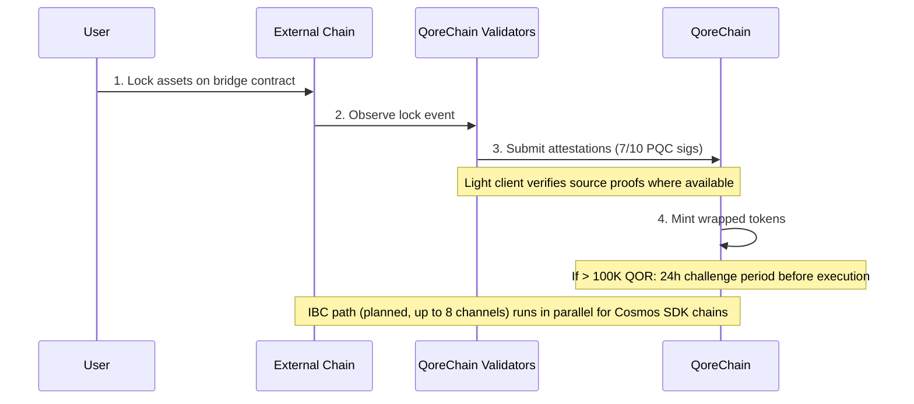

# Köprü Mimarisi

`x/bridge` modülü, QoreChain'i **37 zincir yapılandırması (36 harici zincir ile IBC üzerinden erişilen Injective) ve en fazla 8 IBC (Inter-Blockchain Communication) karşı tarafı** aracılığıyla daha geniş blok zinciri ekosistemine bağlamak için tasarlanmıştır. Her köprü işlemi, kuantum sonrası kriptografi ile güvence altına alınacak şekilde tasarlanmıştır.

:::caution Her iki ağda da canlı değil
Köprü modülü mainnet ve testnet üzerinde dağıtılmıştır, ancak **hiçbir köprü rotası etkin değildir**: 37 zincir yapılandırmasının tümü `pending` durumundadır ve köprü sözleşmesi ayarlanmamıştır, kayıtlı köprü doğrulayıcısı yoktur, bugüne kadar hiçbir köprü işlemi oluşturulmamıştır ve mainnet'te IBC kanalı yoktur (testnet'te, kimliği `provider` olan bir zincire giden tek bir ICS-20 test kanalı vardır; aşağıdaki karşı taraflardan hiçbirine kanal yoktur). Aşağıdaki her şey amaçlanan tasarımı anlatır. Köprülenmesini bekleyerek varlık göndermeyin.
:::

## Mevcut durum {#current-status}

| | Mainnet | Testnet |
|---|---|---|
| Köprü modülü | etkin | etkin |
| Zincir yapılandırmaları | 37, tümü `pending` | 37, tümü `pending` |
| Kayıtlı köprü doğrulayıcıları | 0 | 0 |
| Köprü işlemleri | 0 | 0 |
| IBC kanalları / istemcileri | 0 / 0 | 1 / 1 (Cosmos Hub testnet'ine bir test kanalı) |

(27 Ekim 2026'da mainnet (v3.2.4; 29 Ekim 2026'dan beri v3.2.5) ve testnet (v3.2.6) üzerinde kontrol edildi. Canlı değerleri `qorechaind query bridge chains` ve `qorechaind query bridge validators` ile ya da REST üzerinden `/qorechain/bridge/v1/chains` ve `/qorechain/bridge/v1/validators` adreslerinden okuyun.) Modül yapılandırması her iki ağda aynıdır: `min_validators` 10, `attestation_threshold` 7, `challenge_period_secs` 86,400 ve `large_transfer_threshold` 100.000 QOR (`100000000000` uqor). Modülün kullanacağı IBC yığını ibc-go v10.7'dir (v3.2.2'den beri), ancak mainnet'te henüz hiçbir istemci veya kanal oluşturulmamıştır (testnet'te bir test istemcisi ve kanalı vardır, yukarıya bakın).

## Bağlantıya Genel Bakış

QoreChain, paralel olarak çalışan iki köprü protokolünü desteklemek üzere tasarlanmıştır:

| Protokol | Bağlantılar          | Güvenlik Modeli                       | Kullanım Senaryosu                      |
| -------- | -------------------- | ------------------------------------ | --------------------------------------- |
| **IBC**  | en fazla 8 kanal (hiçbiri açık değil)  | Standart IBC (ICS-20) | Cosmos SDK uyumlu zincirler             |
| **QCB**  | 37 zincir yapılandırması (tümü pending) | 7/10 Dilithium-5 çoklu imza       | IBC olmayan zincirler (EVM, Solana, TON, vb.) |

**37 zincir yapılandırması**, aşağıda listelenen **36 harici zincir** ile IBC türünde yapılandırılmış **Injective**'dir. QoreChain için bir geri döngü (loopback) yapılandırması yoktur. Planlanan IBC kanalları, Cosmos SDK uyumlu zincirlere bağlanır.

## IBC Kanalları

QoreChain, bir IBC aktarıcısı (relayer) tarafından aktarılan aşağıdaki 8 zincire IBC bağlantıları sürdürmek üzere tasarlanmıştır. **Bu karşı tarafların hiçbiri henüz bağlı değildir** (mainnet'te IBC kanalı veya istemcisi yoktur; testnet'te kimliği `provider` olan bir zincire giden tek bir ICS-20 test kanalı vardır, 27 Ekim 2026'da kontrol edildi), bu nedenle bu tablo yalnızca planlanan karşı tarafları listeler:

| Zincir     | Açıklama                       |
| ---------- | ------------------------------ |
| Cosmos Hub | Birincil hub bağlantısı        |
| Osmosis    | DEX likidite yönlendirmesi     |
| Noble      | USDC yerel ihracı              |
| Celestia   | Veri kullanılabilirliği katmanı |
| Stride     | Likit staking                  |
| Akash      | Merkeziyetsiz hesaplama        |
| Babylon    | BTC restaking protokolü        |
| Injective  | DeFi / emir defteri birlikte çalışabilirliği |

### IBC Aktarıcı (Relayer) {#ibc-relayer}

IBC paketleri ve istemci güncellemeleri zincirler arasında bir aktarıcı (relayer) tarafından taşınır; aktarıcı, her iki zinciri izleyen ve paketleri, kanıtları ve istemci güncellemelerini gönderen ayrı bir programdır. Aktarıcı zincirin parçası değildir ve bu kılavuz QoreChain tarafından işletilen bir aktarıcı hizmeti vaat etmez. QoreChain, QORel adlı açık kaynaklı bir aktarıcı sürdürür (QoreChain'in her işlemde zorunlu kıldığı hibrit ML-DSA-87 imzasını ekleyen bir Hermes fork'u); 0.1.0 sürümü ön sürüm olarak yayımlanmıştır. Kurmak ve çalıştırmak için [QORel](/qorel/overview) sayfasına bakın.

* **İstemci güncellemeleri, kötü davranış izleme ve paket temizleme**, zincir parametreleri değil, bir operatörün çalıştırdığı aktarıcının ayarlarıdır. Örneğin bir aktarıcı hafif istemcileri otomatik olarak yenileyebilir, çift imzalamayı (equivocation) izleyebilir ve bekleyen paketleri düzenli aralıklarla temizleyebilir.
* **Kuantum sonrası imzalar.** QoreChain'in yerel şeritte kabul ettiği işlemler, bir aktarıcının ona gönderdiği işlemler dahil, hibrit bir secp256k1 + ML-DSA-87 imzası (FIPS 204) taşır; bkz. [Kuantum Sonrası Güvenlik](/architecture/post-quantum-security). IBC paket biçiminin kendisi standart olandır ve bu kılavuz, paketlerin diğer zincirlerin doğruladığı ek bir imza taşıdığını iddia etmez.

## QCB (QoreChain Bridge) Protokolü

QCB protokolü, kuantum sonrası kriptografi ile güvence altına alınmış bir hub-and-spoke (merkez ve uçlar) mimarisi kullanır. QoreChain hub görevi görür; her harici zincir için bir spoke (uç) yapılandırması bulunur.

### Harici Zincir Yapılandırmaları (36)

QCB protokolü, aşağıdaki 36 harici zinciri hedeflemek üzere tasarlanmıştır. IBC türünde bir yapılandırma olan Injective ile birlikte bu, **toplamda 37 zincir yapılandırması** verir; tümü şu anda `pending` durumundadır.

**Temel zincirler (10)**

Ethereum, Solana, TON, BSC, Avalanche, Polygon, Arbitrum, Optimism, Base, Sui.

**EVM ailesi zincirler (14)**

zkSync Era, Linea, Scroll, Blast, Mantle, Hyperliquid, Berachain, Sonic, Sei, Monad, Plasma, Filecoin FVM, Cronos, Kaia.

**EVM olmayan zincirler (5)**

Starknet, XRP Ledger, Stellar, Hedera, Algorand.

**Diğer zincirler (7)**

NEAR, Bitcoin, Cardano, Polkadot, Tezos, Tron, Aptos.

:::note
Sayı kontrolü: 10 temel + 14 EVM ailesi + 5 EVM olmayan + 7 diğer = **36 harici zincir**. Injective (IBC) eklendiğinde **37 zincir yapılandırması** elde edilir.
:::

### Adres Biçimleri

QCB protokolü, hedef adresleri doğrulamak için zincirleri türe göre sınıflandırır:

| Zincir Türü  | Örnek Zincirler                                                         | Adres Biçimi                                       |
| ------------ | ----------------------------------------------------------------------- | -------------------------------------------------- |
| `evm`        | Ethereum, BSC, Avalanche, Polygon, Arbitrum, Optimism, Base             | `0x` + 40 onaltılık karakter                       |
| `solana`     | Solana                                                                  | Base58, 32-44 karakter                             |
| `ton`        | TON                                                                     | `EQ` + base64 kodlu                                |
| `sui_move`   | Sui                                                                     | `0x` + 64 onaltılık karakter                       |
| `aptos_move` | Aptos                                                                   | `0x` + 64 onaltılık karakter                       |
| `bitcoin`    | Bitcoin                                                                 | Bech32 (`bc1`), P2SH (`3...`) veya eski (`1...`)   |
| `near`       | NEAR Protocol                                                           | `.near` soneki veya örtük                          |
| `cardano`    | Cardano                                                                 | `addr1` (ödeme) veya `stake1` (staking)            |
| `polkadot`   | Polkadot                                                                | SS58 kodlu                                         |
| `tezos`      | Tezos                                                                   | `tz1`/`tz2`/`tz3` (örtük) veya `KT1` (türetilmiş)  |
| `tron`       | TRON                                                                    | `T` + base58, 34 karakter                          |

## Hafif İstemciler

Harici zincir olaylarını güvene dayanmadan doğrulamak için köprü, her kaynak zincirin uzlaşma ve kanıt sistemine uyarlanmış zincir üstü hafif istemciler çalıştırmak üzere tasarlanmıştır. Bu hafif istemciler, QoreChain'in yalnızca doğrulayıcı tasdiklerine dayanmadan yatırma ve çekme işlemlerini doğrulamasını sağlar.

| Hafif İstemci           | Kaynak Zincir       | Doğrulama İlkelleri                                                  |
| ----------------------- | ------------------- | ------------------------------------------------------------------- |
| **Ethereum hafif istemcisi** | Ethereum / EVM L1 | BLS12-381 imza doğrulaması, SSZ serileştirme, MPT durum kanıtları |
| **Bitcoin SPV**         | Bitcoin             | Blok başlıklarına karşı Basitleştirilmiş Ödeme Doğrulaması          |
| **Starknet STARK**      | Starknet            | Starknet durum geçişlerinin STARK kanıt doğrulaması                 |
| **Sui BLS**             | Sui                 | Sui kontrol noktalarının BLS toplu imza doğrulaması                 |
| **Wormhole / Solana VAA** | Solana (Wormhole aracılığıyla) | Verified Action Approval (VAA) muhafız imzası doğrulaması |

## Yatırma Akışı (Harici Zincirden QoreChain'e)

Aşağıdaki dizi, tasarlanan QCB yatırma işlemini gösterir: varlıklar harici bir zincirde kilitlenir, QoreChain doğrulayıcıları PQC imzalı tasdikler gönderir (7/10 Dilithium-5) ve sarmalanmış (wrapped) tokenlar basılır. Cosmos SDK uyumlu zincirler bunun yerine paralel IBC yolunu kullanır (en fazla 8 kanal, bir IBC aktarıcısı tarafından taşınır). Her iki yol da etkin değildir; bugüne kadar hiçbir yatırma işlemi yapılmamıştır.



```
External Chain          QoreChain Validators           QoreChain
     |                         |                          |
     | 1. Lock assets on       |                          |
     |    bridge contract      |                          |
     |------------------------>|                          |
     |                         | 2. Observe & attest      |
     |                         |    (7/10 PQC sigs)       |
     |                         |------------------------->|
     |                         |                          | 3. Mint wrapped
     |                         |                          |    tokens
     |                         |                          |
     |                         |    [If > 100K QOR]       |
     |                         |    24h challenge period   |
     |                         |    before execution       |
```

1. **Kilitleme** — Kullanıcı, harici zincirdeki köprü sözleşmesinde varlıkları kilitler.
2. **Tasdik** — Köprü doğrulayıcıları kilitleme işlemini gözlemler ve Dilithium-5 imzalı tasdikler gönderir. En az **10 doğrulayıcıdan 7'sinin** tasdiki gereklidir. Kaynak zincir için bir hafif istemci mevcut olduğunda, kilitleme olayı ek olarak zincirin kendi kanıtlarına karşı doğrulanır.
3. **Basım** — Tasdik eşiği karşılandığında, QoreChain üzerinde sarmalanmış tokenlar basılır.
4. **İtiraz dönemi** — 100.000 QOR eşdeğerini aşan transferler için, yürütmeden önce **24 saatlik bir itiraz dönemi** uygulanır. Bu pencere boyunca doğrulayıcılar şüpheli etkinlikleri işaretleyebilir.

## Çekme Akışı (QoreChain'den Harici Zincire)

```
QoreChain               QoreChain Validators           External Chain
     |                         |                          |
     | 1. Burn wrapped tokens  |                          |
     |------------------------>|                          |
     |                         | 2. Attest burn           |
     |                         |    (7/10 PQC sigs)       |
     |                         |------------------------->|
     |                         |                          | 3. Unlock original
     |                         |                          |    assets
```

1. **Yakma** — Kullanıcı, QoreChain üzerinde sarmalanmış tokenları yakar.
2. **Tasdik** — Doğrulayıcılar, yakma olayını Dilithium-5 imzalarıyla tasdik eder (7/10 eşiği).
3. **Kilit açma** — Eşik karşılandığında, orijinal varlıkların kilidi harici zincirde açılır.

Çekme işlemleri sırasında toplanan tüm köprü ücretleri, `bridge_fee` yakma kanalı aracılığıyla `x/burn` modülüne yönlendirilir (köprü ücretlerinin %100'ü yakılır).

### L2 → L1 çekmeleri (rollup'lar)

Rollup çekmeleri köprüyü kullanmaz. Kesinleşmiş bir toplu işin (batch) çekme köküne karşı `execute-withdrawal` ile `x/rdk` modülü tarafından ödenir — bkz. [ZK / STARK ve Çekmeler](/rollups/zk-stark-withdrawals).

## Güvenlik Mimarisi

### PQC Çoklu İmza

Tüm QCB köprü işlemleri, kayıtlı köprü doğrulayıcılarından Dilithium-5 kuantum sonrası imzaların **7/10 eşiğini** gerektirir. Her köprü doğrulayıcısı şunlarla kaydolur:

* Bir QoreChain doğrulayıcı adresi
* Bir Dilithium-5 açık anahtarı (2.592 bayt)
* Desteklenen zincirlerin listesi
* Bir itibar puanı (`x/reputation` tarafından sürdürülür)

v3.2.2'den beri modül, sıfır tutarları ve kendi yapılandırmasını her yolda tutarlı biçimde doğrular. **v3.2.4'ten itibaren (mainnet'te 23 Ekim 2026'dan beri, test ağında 19 Ekim 2026'dan beri):** bir köprü doğrulayıcısını kaydetmek ayrıca Dilithium-5 anahtarının sahiplik kanıtını gerektirir (PQC anahtar kaydıyla aynı `proof_of_possession` biçimi; bkz. [Kuantum Sonrası Güvenlik](/architecture/post-quantum-security#proof-of-possession)) ve başka bir köprü doğrulayıcısının zaten kullandığı bir anahtarı reddeder. Önceki sürümlerde böyle bir kontrol yoktur ve hiçbir ağda kayıtlı köprü doğrulayıcısı bulunmamaktadır.

### Devre Kesiciler (Circuit Breakers)

Bağlı her zincirin bağımsız devre kesici korumaları vardır:

| Koruma                    | Açıklama                                                                              |
| ------------------------- | ------------------------------------------------------------------------------------ |
| **Tekil transfer limiti** | Zincir başına herhangi bir bireysel köprü işlemi için maksimum tutar                  |
| **Günlük toplam limit**   | 24 saatlik pencere başına zincir başına toplam hacim üst sınırı                       |
| **Manuel duraklatma**     | Zincir başına yönetişim veya doğrulayıcı tarafından tetiklenen acil durdurma          |
| **Anomali tespiti**       | Kısa bir pencerede >50 işlem olması veya hacmin günlük limitin 5 katını aşması durumunda otomatik duraklatma |

Devre kesici durumu zincir başına izlenir ve şunları içerir: maksimum tekil transfer, günlük limit, mevcut günlük kullanım, son sıfırlama yüksekliği ve sebebiyle birlikte duraklatma durumu.

### İtiraz Dönemi

Büyük transferler için (>100.000 QOR eşdeğeri, `large_transfer_threshold` aracılığıyla yapılandırılabilir):

* Tasdik eşiği karşılandıktan sonra **24 saatlik bir itiraz dönemi** (86.400 saniye) uygulanır.
* Bu pencere boyunca doğrulayıcıların işlemi işaretleyebilmesi amaçlanmıştır.
* İtiraz edilmezse, işlem dönem sona erdikten sonra otomatik olarak yürütülür.
* İtiraz edilen işlemler, yönetişim incelemesi için dondurulur.

### AI Yol Optimizasyonu

Köprü modülü, rota optimizasyonu için AI alt sistemiyle entegre olur (REST üzerinden sunulmaz). Birden fazla yol kat edebilen transferler için (örneğin, bir aracı aracılığıyla A zincirinden B zincirine), yol optimize edici şunları değerlendirir:

* Rotalar arasında tahmini ücretler
* Tahmini tamamlanma süresi
* Yol başına güvenlik puanı
* Tahminin güven düzeyi

## Köprü Yönetimi

### Dağıtım sonrası zincir etkinleştirme (yönetişim olmadan)

Zincir sürümü **v3.1.78** itibarıyla, bir köprü zinciri dağıtımdan sonra tek bir imzalı işlemle etkinleştirilebilir ve yeniden yapılandırılabilir — yönetişim önerisi ve zincir yükseltmesi olmadan. Bir `bridge_admin` anahtarı (genesis'te `BridgeConfig.BridgeAdmin` içinde ayarlanır) veya bir `qcb_bridge` lisansı sahibi şunları yapabilir:

* **`tx bridge update-chain-config`** — bir zincirin sözleşme adresini, onay sayısını, mimarisini ve durumunu ayarlar (`MsgUpdateChainConfig`).
* **`tx bridge set-verifier-bootstrap`** — bir zincir için etkin doğrulayıcıyı seçer ve güven kökünü kurar (`MsgSetVerifierBootstrap`).

Bu, bir operatörün bağlı bir zincirin köprüsünü doğrudan çevrimiçi getirmesine — veya doğrulayıcısını döndürmesine — olanak tanır; yetkilendirme köprü yönetici anahtarına karşı kontrol edilir. Zincir sürümü **v3.2.0** itibarıyla köprü modülünün kendi modül hesabı da vardır (önceki sürümlerde yoktu, bu nedenle etkinleştirilmiş bir rotadaki ilk yatırma işlemi başarısız olurdu).

`qcb_bridge` gibi lisanslar, lisans otoritesi hesabı tarafından verilir. v3.2.3'ten (mainnet) beri yönetişim, bu hesabı bir `MsgUpdateAuthority` önerisiyle değiştirebilir; modülün kendisi [Zincir Lisanslama](/architecture/chain-licensing) bölümünde anlatılmıştır.

### Bağlı ağları doğrulama

Zincir sürümü **v3.1.79** itibarıyla, eşleşen `validator_<chain>` (veya `qcb_bridge`) lisansını elinde bulunduran bir doğrulayıcı, harici ağın istemcisini aynı düğümde çalıştırabilir; bu istemci, lisans etkinleştirildikten sonra QoreChain'in orkestrasyonu altında otomatik olarak hazırlanır. Sürücüler 37 köprü ağının tümü için sunulur ve katılım modeline göre sınıflandırılır (izin gerektirmeyen doğrulayıcı, sınırlı/seçilmiş/kabul, L2 tam düğüm ve staking yapmayan/güven listesi). Harici ağın stake ve imzalama anahtarları, ağ başına operatör tarafından sağlanır. Operatör adımları için [Bir Doğrulayıcı Çalıştırma](/developer-guide/running-a-validator#connected-networks) bölümüne bakın. Her zincir yapılandırması `pending` durumunda olduğundan, bugün köprü üzerinden doğrulanan bağlı bir ağ yoktur.

## REST API Uç Noktaları {#rest-api-endpoints}

Köprü durumu, `/qorechain/bridge/v1/...` öneki altında grpc-gateway aracılığıyla **REST üzerinden salt okunur** olarak sorgulanabilir. Bunlar, gezginler ve hafif düğüm telemetrisi için HTTP üzerinden gerçek zincir üstü JSON sunar. Tam liste için [REST / gRPC Uç Noktaları](/api-reference/rest-grpc-endpoints#bridge-module) bölümüne bakın.

| Yöntem | Uç Nokta                                  | Açıklama                                                                                                            |
| ------ | ----------------------------------------- | ------------------------------------------------------------------------------------------------------------------- |
| GET    | `/qorechain/bridge/v1/config`             | Köprü modülü yapılandırması (`min_validators`, `attestation_threshold`, `challenge_period_secs`, `large_transfer_threshold`, `enabled`) |
| GET    | `/qorechain/bridge/v1/chains`             | Tüm zincir yapılandırmaları ve durumları                                                                            |
| GET    | `/qorechain/bridge/v1/chains/{chain_id}`  | Tek bir zincir yapılandırması                                                                                       |
| GET    | `/qorechain/bridge/v1/validators`         | Kayıtlı köprü doğrulayıcıları                                                                                       |
| GET    | `/qorechain/bridge/v1/validators/{address}` | Tek bir köprü doğrulayıcısı                                                                                       |
| GET    | `/qorechain/bridge/v1/operations`         | Köprü işlemleri                                                                                                     |
| GET    | `/qorechain/bridge/v1/operations/{id}`    | Tek bir köprü işlemi                                                                                                |

Kilitli tutarlar, devre kesici durumu ve rota tahminleri için bugün bir sorgu rotası yoktur.

## Köprü Olayları

Köprü modülü, aşağıdaki zincir üstü olayları yayar:

| Olay Türü                     | Açıklama                                         |
| ----------------------------- | ----------------------------------------------- |
| `bridge_deposit`              | Yeni yatırma işlemi oluşturuldu                  |
| `bridge_withdraw`             | Yeni çekme işlemi oluşturuldu                    |
| `bridge_attestation`          | Doğrulayıcı tasdiki gönderildi                   |
| `bridge_operation_executed`   | İşlem kesinleştirildi ve yürütüldü               |
| `bridge_circuit_breaker_trip` | Devre kesici etkinleştirildi veya devre dışı bırakıldı |
| `bridge_validator_registered` | Yeni köprü doğrulayıcısı kaydedildi              |
| `bridge_pqc_verification`     | PQC imza doğrulama sonucu (IBC paketleri)        |

## İlgili

* [Varlıkları Köprüleme](/user-guide/bridging-assets) — varlıkları zincirler arasında adım adım taşıyın.
* [Babylon ile BTC Restaking](/architecture/btc-restaking-babylon) — Bitcoin destekli güvenlik.
* [Kuantum Sonrası Güvenlik](/architecture/post-quantum-security) — IBC paketlerinde PQC doğrulaması.
