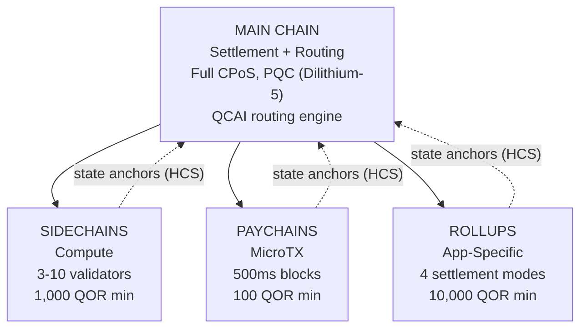

# Çok Katmanlı Mimari

QoreChain, `x/multilayer` modülü aracılığıyla **4 katmanlı hiyerarşik zincir mimarisi** uygular. Ana zincir, uzlaştırma ve güven kökü olarak hizmet ederken, alt katmanlar (yan zincirler, ödeme zincirleri ve rollup'lar) farklı performans ve güvenlik dengeleriyle özelleşmiş iş yüklerini ele alır.

:::caution Erken aşama yeteneği
Modül ana ağda (zincir sürümü 23 Ekim 2026'dan beri **v3.2.4**) ve test ağında (27 Ekim 2026'dan beri **v3.2.6**) dağıtılmıştır, ancak **her iki ağda da henüz hiçbir katman ve hiçbir bağlantı (anchor) yoktur** (27 Ekim 2026'da kontrol edildi: `GET /qorechain/multilayer/v1/layers` her ikisinde de boş bir liste döndürür). Aşağıdakilerin tamamı modülü inşa edildiği şekliyle anlatır; parametreler canlı değerlerdir. Ana ağda `MsgUpdateLayerStatus` mesajı şu anda devre kesici tarafından kapatılmıştır (bkz. [Zincir Parametreleri](/appendix/chain-parameters#circuit-breaker)); test ağında kapatılmamıştır.
:::

---

## Sistem Genel Bakışı

Aşağıdaki 4 katmanlı hiyerarşi, ana zinciri uzlaştırma ve güven kökü olarak gösterir; üç alt katman türü, durum köklerini Hiyerarşik Bağlılık Şemaları (HCS) aracılığıyla ana zincire bağlar.



```
                    +---------------------------+
                    |       MAIN CHAIN          |
                    |  (Settlement + Routing)   |
                    |  Full CPoS consensus      |
                    |  PQC-secured (Dilithium-5)|
                    |  QCAI routing engine       |
                    +------+------+------+------+
                           |      |      |
              +------------+      |      +------------+
              |                   |                    |
    +---------v--------+ +-------v--------+ +---------v---------+
    |   SIDECHAINS     | |   PAYCHAINS    | |     ROLLUPS       |
    |  (Compute)       | |  (MicroTX)     | |  (App-Specific)   |
    |  3-10 validators | |  500ms blocks  | |  4 settlement     |
    |  1,000 QOR min   | |  100 QOR min   | |    modes          |
    |  Max: 10         | |  Max: 50       | |  10,000 QOR min   |
    +------------------+ +----------------+ |  Max: 100 (x/rdk) |
                                            +-------------------+
```

---

## Katman Türleri

### Ana Zincir

Ana zincir, tüm QoreChain ekosisteminin güven köküdür.

| Özellik    | Değer                                                                          |
| ---------- | ------------------------------------------------------------------------------ |
| Uzlaşma    | QoreChain uzlaşması (bugün devrede olanlar için bkz. [Uzlaşma Mekanizması](/architecture/consensus-mechanism)) |
| Güvenlik   | Dilithium-5 imzalarıyla PQC güvenceli                                          |
| Rol        | Uzlaştırma katmanı, durum bağlantısı (anchor) depolama, QCAI yönlendirme motoru, güven kökü |
| Blok süresi | Ağa bağlıdır: ana ağda yaklaşık 3.1 saniye, test ağında yaklaşık 1.3 saniye (27 Ekim 2026'da ölçülmüştür) |

Tüm alt katmanlar, durum köklerini Hiyerarşik Bağlılık Şemaları (HCS) aracılığıyla periyodik olarak ana zincire bağlar.

### Yan Zincirler

Yan zincirler, DeFi protokolleri, oyun motorları ve IoT veri işleme gibi **yoğun hesaplama gerektiren işlemleri** ele alır.

| Parametre                  | Değer             |
| -------------------------- | ----------------- |
| Minimum doğrulayıcı sayısı | 3                 |
| Maksimum doğrulayıcı sayısı | 10               |
| Minimum oluşturucu teminatı | 1,000 QOR        |
| Maksimum aktif yan zincir  | 10                |
| Hedef alanlar              | DeFi, Gaming, IoT |

### Ödeme Zincirleri

Ödeme zincirleri, minimum gecikmeyle **yüksek frekanslı mikro işlemler** için optimize edilmiştir.

| Parametre                     | Değer                                   |
| ----------------------------- | --------------------------------------- |
| Hedef blok süresi             | 500 ms                                  |
| Maksimum aktif ödeme zinciri  | 50                                      |
| Minimum oluşturucu teminatı   | 100 QOR                                 |
| Hedef alanlar                 | Ödemeler, akış, mikro işlemler          |

### Rollup'lar

Rollup'lar, Rollup Geliştirme Kiti (`x/rdk`) aracılığıyla dağıtılan **uygulamaya özel zincirlerdir**. Bir rollup oluşturulduğunda RDK, onun için çok katmanlı modülde bir katman kaydeder (aşağıda açıklandığı gibi `sidechain` türünde bir katman olarak).

| Parametre                  | Değer                                       |
| -------------------------- | ------------------------------------------- |
| Uzlaştırma modları         | 4 (optimistic, zk, based, sovereign)        |
| Maksimum kayıtlı rollup    | 100 (`max_rollups`); ancak aynı anda yalnızca 10 yan zincir türünde katman bulunabilir (`max_sidechains`), dolayısıyla en fazla 10 rollup bağlanabilir (anchor alabilir) bir katmana sahip olabilir |
| Minimum oluşturucu teminatı | Rollup için 10,000 QOR, artı 1,000 QOR katman kayıt teminatı (`min_sidechain_stake`) |
| Katman türü                | RDK aracılığıyla kaydedilen rollup'lar `sidechain` katman türünü kullanır (`rollup` katman türü tanımlıdır ancak `x/rdk` tarafından henüz kullanılmamaktadır) |
| Hedef alanlar              | DeFi, Gaming, NFT, Enterprise               |

Rollup dağıtımı ve yapılandırması, [Rollup Geliştirme Kiti](/architecture/rollup-development-kit) bölümünde ayrıntılı olarak ele alınmıştır.

---

## QCAI İşlem Yönlendirme

QCAI yönlendiricisi, gelen her işlem için tüm aktif katmanları değerlendirir ve 4 faktörlü ağırlıklı puanlama modeli kullanarak en uygun hedefi seçer.

### Puanlama Formülü

Her aday katman bileşik bir puan alır (yüksek olan daha iyidir):

```
Score = w_congestion * (1 - Congestion) + w_capability * Capability + w_cost * (1 - Cost) + w_latency * (1 - Latency)
```

| Faktör     | Ağırlık | Açıklama                                                                     |
| ---------- | ------- | --------------------------------------------------------------------------- |
| Tıkanıklık | 0.30    | Mevcut yük seviyesi (ters çevrilmiş: daha düşük tıkanıklık = daha yüksek puan) |
| Yetenek    | 0.40    | Katmanın işlem gereksinimleriyle ne kadar uyumlu olduğu                      |
| Maliyet    | 0.20    | Ana zincire göre ücret çarpanı (ters çevrilmiş: daha düşük maliyet = daha yüksek puan) |
| Gecikme    | 0.10    | Kesinliğe ulaşma için beklenen süre (ters çevrilmiş: daha düşük gecikme = daha yüksek puan) |

### Güven Eşiği

Yönlendirici, bir işlemi bir alt katmana yönlendirmeden önce minimum **0.6** güven puanı gerektirir. Hiçbir katman bu eşiği karşılamazsa, işlem varsayılan olarak ana zincire gider.

İşlem göndereni tarafından tercih edilen bir katman ipucu sağlanabilir. Tercih edilen katman, güven eşiğinin en az %80'i kadar puan alırsa (yani 0.48), yönlendirme hedefi olarak kabul edilir.

### Yük Sezgileri (Heuristics)

Ayrıntılı işlem meta verileri mevcut olmadığında, yönlendirici sınıflandırma sinyali olarak yük boyutunu kullanır:

| Yük Boyutu        | Tercih Edilen Katman | Gerekçe                                       |
| ----------------- | -------------------- | --------------------------------------------- |
| &lt; 256 bayt     | Ödeme Zinciri        | Muhtemelen basit bir transfer veya mikro işlem |
| 256 - 1,024 bayt  | Ana Zincir           | Standart işlem karmaşıklığı                    |
| > 1,024 bayt      | Yan Zincir           | Muhtemelen karmaşık bir sözleşme etkileşimi    |

---

## Hiyerarşik Bağlılık Şemaları (HCS)

Alt katmanlar, durumlarını **durum bağlantıları (state anchors)** aracılığıyla periyodik olarak ana zincire taahhüt eder. Her bağlantı, alt zincirin belirli bir yükseklikteki durumunun kriptografik bir kanıtını içerir.

### Bağlantı İçerikleri

| Alan                      | Açıklama                                              |
| ------------------------- | ---------------------------------------------------- |
| `layer_id`                | Alt katmanın tanımlayıcısı                           |
| `layer_height`            | Alt zincirdeki blok yüksekliği                       |
| `state_root`              | Alt zincirin durum ağacının Merkle kökü             |
| `validator_set_hash`      | Taahhüdü imzalayan doğrulayıcı setinin karması       |
| `pqc_aggregate_signature` | Bağlantı verileri üzerindeki Dilithium-5 toplu imzası |
| `transaction_count`       | Son bağlantıdan bu yana işlem sayısı                 |
| `compressed_state_proof`  | Sıkıştırılmış durum geçiş kanıtı                     |

### Katman ve rollup kimlikleri {#id-grammar}

v3.2.2'den itibaren **yeni** bir katman kimliği (ve bir rollup'ın katmanıyla paylaştığı rollup kimliği) `^[a-z0-9][a-z0-9._-]{2,63}$` ifadesiyle eşleşmelidir: 3 ila 64 karakter; küçük harfler, rakamlar, `.`, `_` ve `-`; bir harf veya rakamla başlamalıdır. Keeper bunu katman oluşturulurken kontrol eder ve bu kontrolden geçemeyen bir işlem yine de ücretini öder, bu nedenle kimlikleri önce istemcide doğrulayın. v3.2.2'den önce oluşturulan kimlikler bundan etkilenmez.

### Bağlantı Gönderimi {#anchor-submission}

Bağlantılar, `MsgAnchorState` aracılığıyla ana zincire gönderilir. Keeper, bağlantıyı aşağıdaki adımlara göre doğrular:

1. **Katman mevcut ve aktif** — Keeper, katmanın durumda mevcut olduğunu ve şu anda `active` durumuna sahip olduğunu doğrular.
2. **Minimum bağlantı aralığı geçti** — Keeper, bu katman için son bağlantıdan bu yana en az `min_anchor_interval` blok (varsayılan: 100) geçtiğini kontrol eder.
3. **PQC toplu imzası** — Keeper, PQC toplu imzasının mevcut olduğundan ve bağlantı verileri için geçerli olduğundan emin olur. İmza, **katman oluşturucusunun** kayıtlı ML-DSA-87 anahtarına karşı kontrol edilir; oluşturucunun kayıtlı anahtarı yoksa bağlantı reddedilir.

`x/rdk` aracılığıyla yazılan bir **uzlaştırma bağlantısı** (v3.2.2'den beri bir `anchor_signature` ile gönderilen bir toplu iş) özel bir durumdur: toplu işler sırayla geldiği için minimum aralık kontrolünü atlar, hâlâ `proposed` durumunda olan bir katmanı bağlayabilir (zincir üstünde bir RDK rollup'ının kaydettiği bir katmanı yükselten hiçbir şey yoktur) ve yalnızca gönderen katmanın kendi oluşturucusuysa kabul edilir. İmza kontrolü aynıdır.

### İtiraz Süresi

Her bağlantı, **24 saatlik** (86,400 saniye, katman başına yapılandırılabilir) bir **itiraz süresine** girer. Bu süre boyunca herhangi bir taraf, `MsgChallengeAnchor` aracılığıyla bir dolandırıcılık kanıtı sunarak bağlantıya itiraz edebilir. Dolandırıcılık kanıtı geçerliyse, bağlantı geçersiz kılınır ve alt zincirin durumu önceki bağlantıya geri alınır.

İtiraz süresi başarılı bir itiraz olmadan sona erdikten sonra, bağlantı kesinleşmiş kabul edilir.

### Bağlantıları Okuma {#reading-anchors}

Bağlantılar, çok katmanlı sorgu hizmeti aracılığıyla **okunabilir**. İki sorgu, hem gRPC hem de REST üzerinden bağlantı durumunu sunar:

* **`Anchor`** (`/qorechain/multilayer/v1/anchor/{layer_id}`) — bir katman için en son durum bağlantısını döndürür.
* **`Anchors`** (`/qorechain/multilayer/v1/anchors/{layer_id}`) — bir katman için bağlantı geçmişini döndürür.

Her bağlantı, katman oluşturucusunun Dilithium-5 (ML-DSA-87) imzasını taşır. İmzalanan mesaj, bağlantının gönderildiği yüksekliğe bağlıdır:

* **v3.2.2'den itibaren (mainnet yüksekliği 3,556,788, testnet yüksekliği 6,905,034): v2.** Her değişken uzunluklu alan 8 baytlık big-endian bir uzunluk taşır, zincir kimliği mesajın bir parçasıdır ve işlem sayısı ile sıkıştırılmış durum kanıtı kapsanır:

```text
"qorechain-multilayer-anchor-v2"
‖ BE64(len(chain_id))            ‖ chain_id
‖ BE64(len(layer_id))            ‖ layer_id
‖ BE64(layer_height)
‖ BE64(len(state_root))          ‖ state_root
‖ BE64(len(validator_set_hash))  ‖ validator_set_hash
‖ BE64(transaction_count)
‖ BE64(len(compressed_state_proof)) ‖ compressed_state_proof
```

* **v3.2.2'den önce: v1** (`layer_id ‖ layer_height (8-byte big-endian) ‖ state_root ‖ validator_set_hash`; uzunluk öneki ve zincir kimliği yoktur, dolayısıyla bir v1 imzası her zincirde geçerlidir). Zincir, v3.2.2 yüksekliğinden itibaren v1 bağlantısını kabul etmez.

Mesaj sürümler arasında değişebileceğinden, bir istemci biçimi koda sabit yazmak yerine uygulanmış plan yüksekliğinden (`GET /cosmos/upgrade/v1beta1/applied_plan/v3.2.2`; `"height":"0"` uygulanmadığı anlamına gelir) seçmelidir. Bir RDK toplu işi için eşleme şöyledir: `layer_id` = rollup'ın katman kimliği, `layer_height` = toplu iş dizini, `state_root` = toplu işin durum kökü, `transaction_count` = toplu işin işlem sayısı ve boş bir `compressed_state_proof`. `qorechaind query rdk anchor-sign-bytes <layer-id> <batch-index> <state-root-hex> --chain-id <id>` bu baytları çevrimdışı yazdırır. Bir imza, kayıtlı oluşturucu anahtarının bu baytları imzaladığını kanıtlar; bağlantının var olup olmadığı ise zincire sorulması gereken bir sorudur, dolayısıyla bir doğrulayıcı bağlantıyı güvendiği bir düğümden okumalıdır. Şu anda her iki ağda da hiçbir katman veya bağlantı yoktur. Bu, Rollup Geliştirme Kiti'nin [uzlaştırma makbuzlarının](/rollups/settlement-receipts) arkasındaki zincir üstü ilkeldir.

---

## Katmanlar Arası Ücret Paketleme (CLFB)

CLFB, kaynak katmandaki tek bir ücret ödemesinin, katmanlar arası bir işlem yolundaki birden çok katmandaki yürütmeyi kapsamasına olanak tanır.

### Ücret Hesaplama

```
avgMultiplier = sum(layer_multiplier_i) / num_layers
bundledFee = (totalGas / 1000) * avgMultiplier
```

Burada:

* `layer_multiplier_i`, işlem yolundaki her katman için temel ücret çarpanıdır (ana zincir = 1.0).
* `totalGas`, tüm katmanlardaki tahmini toplam gaz tüketimidir.
* Sonuç, minimum 1 uqor ücretle **uqor** cinsinden ifade edilir.

### Örnek

Katmanlar arası bir işlem üç katmana dokunur: ana zincir (çarpan 1.0), bir yan zincir (çarpan 0.5) ve bir ödeme zinciri (çarpan 0.1).

```
avgMultiplier = (1.0 + 0.5 + 0.1) / 3 = 0.533
bundledFee = (150,000 / 1000) * 0.533 = 80 uqor
```

CLFB, `cross_layer_fee_bundling` parametresi aracılığıyla genel olarak etkinleştirilebilir veya devre dışı bırakılabilir ve bireysel katmanlar, kendi `cross_layer_fee_bundling_enabled` yapılandırma bayrağı aracılığıyla katılmamayı seçebilir.

---

## Katman Yaşam Döngüsü

Her alt katman, iyi tanımlanmış bir yaşam döngüsünden geçer:

```
Proposed --> Active --> Suspended --> Decommissioned
                  \                /
                   +-- Active <--+
```

| Durum              | Açıklama                                                                        | İzin Verilen Geçişler     |
| ------------------ | ------------------------------------------------------------------------------- | ------------------------- |
| **Proposed**       | Katman kaydedilmiş ancak henüz etkinleştirilmemiş                               | Active, Decommissioned    |
| **Active**         | Katman çalışır durumda ve işlemleri kabul ediyor                                | Suspended, Decommissioned |
| **Suspended**      | Katman geçici olarak duraklatılmış (örn. bakım için veya güvenlik endişeleri nedeniyle) | Active, Decommissioned |
| **Decommissioned** | Katman kalıcı olarak kapatılmış (terminal durum)                                | Yok                       |

Durum geçişleri keeper tarafından zorunlu kılınır. Geçersiz geçişler (örn. Decommissioned'dan Active'e) reddedilir.

---

## Parametreler

| Parametre                      | Tür    | Varsayılan      | Açıklama                                                |
| ------------------------------ | ------ | --------------- | ------------------------------------------------------- |
| `max_sidechains`               | uint64 | `10`            | Maksimum aktif yan zincir sayısı                        |
| `max_paychains`                | uint64 | `50`            | Maksimum aktif ödeme zinciri sayısı                     |
| `min_anchor_interval`          | uint64 | `100`           | Durum bağlantıları arasındaki minimum blok sayısı       |
| `max_anchor_interval`          | uint64 | `1,000`         | Durum bağlantıları arasındaki maksimum blok sayısı (zorunlu bağlantı) |
| `default_challenge_period`     | uint64 | `86,400`        | Saniye cinsinden varsayılan itiraz süresi (24 saat)     |
| `min_sidechain_stake`          | string | `1,000,000,000` | Bir yan zincir oluşturmak için minimum teminat (uqor cinsinden 1,000 QOR) |
| `min_paychain_stake`           | string | `100,000,000`   | Bir ödeme zinciri oluşturmak için minimum teminat (uqor cinsinden 100 QOR) |
| `routing_enabled`              | bool   | `true`          | QCAI tabanlı işlem yönlendirmeyi etkinleştir            |
| `routing_confidence_threshold` | string | `0.6`           | QCAI yönlendirme kararları için minimum güven           |
| `cross_layer_fee_bundling`     | bool   | `true`          | Genel Katmanlar Arası Ücret Paketlemeyi etkinleştir     |

Bunlar, 23 Ekim 2026'da mainnet ve testnet üzerinde `qorechaind query multilayer params` (REST: `/qorechain/multilayer/v1/params`) tarafından döndürülen değerlerdir. v3.2.2'den beri modülün `MsgUpdateParams` mesajı yönlendirilebilir, dolayısıyla bir yönetişim önerisi bunları değiştirebilir.
