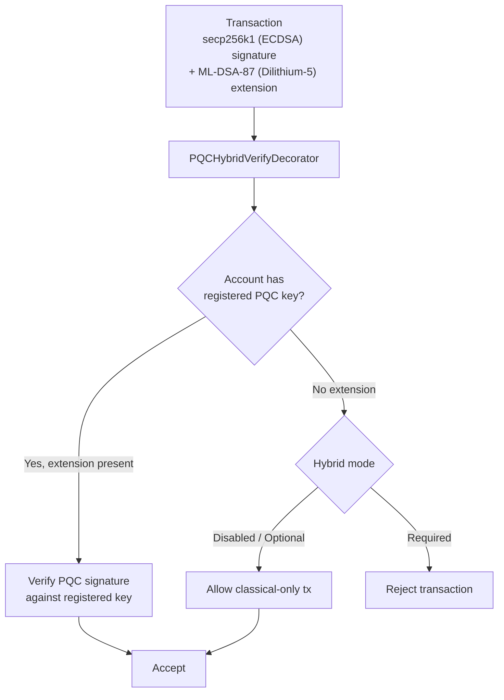

# Kuantum Sonrası Güvenlik

QoreChain, **kuantum sonrası kriptografi (post-quantum cryptography, PQC) ile genesis'te** inşa edilmiştir — sonradan bir yükseltme olarak eklenmemiştir. `x/pqc` modülü, uzun vadeli dayanıklılık için yönetişim kontrollü bir algoritma çevikliği çerçevesiyle birlikte birincil kriptografik ilkeller olarak kafes tabanlı dijital imzalar ve anahtar kapsülleme sağlar.

Tam PQC temeli — **Dilithium-5 (imzalar) + ML-KEM-1024 (KEM) + SHAKE-256 (hash)** — artık tamamlandı ve ağ varsayılanıdır. Canlı ağlarda (v3.2.x), hibrit imzalar cosmos işlem yolunda **varsayılan olarak gereklidir**: `hybrid_signature_mode = required` ve `allow_classical_fallback = false`. Her cosmos yolu işlemi, klasik secp256k1 imzasının yanında bir Dilithium-5 imzası taşımalıdır; bir PQC hesabından gelen yalnızca klasik işlemler reddedilir ve klasik geri dönüş (downgrade) yolu kapalıdır. Mainnet ve testnet ikisi de v3.2.4 çalıştırır; v3.2.2 ve v3.2.3 sürümlerinin kuantum sonrası kurallara eklediği şeyler (anahtar bütünlüğü, isteğe bağlı sahiplik kanıtı, kapsamlı EVM pencereleri, EIP-7702 onayı) [Anahtar bütünlüğü kuralları](#key-integrity), [Sahiplik kanıtı](#proof-of-possession) ve [EIP-7702 delegasyonları](#eip-7702) bölümlerinde açıklanmıştır.

## Tasarım İlkeleri

* **Varsayılan olarak PQC gerekli**: Cosmos yolunda kuantum sonrası imzalar zorunludur. Tek başına klasik secp256k1 imzaları artık yeterli değildir — `allow_classical_fallback = false`.
* **Varsayılan olarak hibrit**: Cosmos işlemleri aynı anda hem bir klasik secp256k1 imzası hem de bir Dilithium-5 PQC imzası taşır. Yalnızca klasik geri dönüş kapalıdır.
* **Algoritma çevikliği**: Kriptografik algoritma kayıt defteri yönetişim kontrollüdür ve ağın hard fork olmadan yeni algoritmalar benimsemesine veya ele geçirilmiş olanları kullanımdan kaldırmasına olanak tanır.
* **Deterministik doğrulama**: Tüm imza doğrulaması, doğrulayıcı düğümleri genelinde deterministik ve yeniden üretilebilirdir.

## Desteklenen Algoritmalar

| Algoritma       | Standart             | Kategori          | NIST Düzeyi | Genel Anahtar | Özel Anahtar | İmza / Şifreli Metin   | Paylaşılan Sır |
| --------------- | -------------------- | ----------------- | ----------- | ------------- | ------------ | ---------------------- | -------------- |
| **Dilithium-5** | ML-DSA-87 (FIPS 204) | İmza              | 5           | 2,592 bayt    | 4,896 bayt   | 4,627 bayt             | --             |
| **ML-KEM-1024** | FIPS 203             | Anahtar Kapsülleme | 5          | 1,568 bayt    | 3,168 bayt   | 1,568 bayt             | 32 bayt        |

Her iki algoritma da en yüksek standartlaştırılmış güvenlik kategorisi olan **NIST Güvenlik Düzeyi 5'te** çalışır ve hem klasik hem de kuantum rakiplere karşı AES-256'ya eşdeğer koruma sağlar.

## Kriptografik Arka Uç

PQC işlemleri, kafes tabanlı imzalama, doğrulama ve anahtar kapsüllemeyi QoreChain çalışma zamanına sunan yüksek performanslı, bellek güvenli bir kriptografik arka uçta uygulanır. Arka uç şunları sağlar:

Algoritmaya özel işlemler:

* Dilithium-5 anahtar üretimi, imzalama ve doğrulama
* ML-KEM-1024 anahtar üretimi, kapsülleme ve kapsül açma
* Deterministik rastgele işaret üretimi (`seed`, `epoch`)

Algoritmaya duyarlı işlemler:

* `Keygen(algorithmID)` — Kayıtlı herhangi bir algoritma için bir anahtar çifti üret
* `Sign(algorithmID, privkey, message)` — Bir imza oluştur
* `Verify(algorithmID, pubkey, message, signature)` — Bir imzayı doğrula
* `AlgorithmInfo(algorithmID)` — Anahtar/çıktı boyutlarını sorgula
* `ListAlgorithms()` — Desteklenen tüm algoritmaları listele

Tüm imzalama ve doğrulama işlemleri deterministiktir ve her doğrulayıcı düğümünde ve desteklenen platformda aynı sonuçları üretir.

Bu aynı ilkeller — ML-DSA (FIPS-204), ML-KEM (FIPS-203) ve SHAKE-256 (FIPS-202) — altı dilde (JavaScript/TypeScript, Rust, Go, C, Python, Java) tek tutarlı, bayt uyumlu bir API sağlayan açık kaynaklı [**qorechain-pqc**](https://github.com/qorechain/qorechain-pqc) kütüphanesi aracılığıyla cüzdanlar ve entegrasyon yapanlar için kullanılabilir. [Kuantum Sonrası İmzalama](/developer-guide/post-quantum-signing) sayfasına bakın.

## Anahtar Kaydı {#key-registration}

Hesaplar, PQC anahtarlarını `MsgRegisterPQCKey` (eski, varsayılan olarak Dilithium-5) veya `MsgRegisterPQCKeyV2` (algoritmaya duyarlı) aracılığıyla açıkça kaydeder; zincir hiçbir zaman kendi başına bir anahtar kaydetmez ve CLI akışı `qorechaind tx pqc gen-key <name>` ve ardından `qorechaind tx pqc register-key <public_key_hex> hybrid --from <key>` şeklindedir (bkz. [İlk İşlem](/getting-started/first-transaction#register-pqc-key)). Her mesaj şunları içerir:

* **Sender**: Anahtarı kaydeden hesap adresi.
* **PublicKey**: PQC genel anahtar baytları.
* **AlgorithmID**: PQC algoritma tanımlayıcısı (yalnızca v2).
* **ProofOfPossession**: Yeni anahtarın attığı isteğe bağlı imza (yalnızca v2, v3.2.3'ten itibaren); bkz. [Sahiplik kanıtı](#proof-of-possession).
* **KeyType**: `hybrid` veya `pqc_only` değerlerinden biri (üçüncü bir değer olan `classical_only` şemada hâlâ vardır ancak v3.2.3'ten beri reddedilir):

| Anahtar Türü     | Açıklama                                                                 |
| ---------------- | ------------------------------------------------------------------------ |
| `hybrid`         | Hem klasik (ECDSA) hem de PQC anahtarları. İşlemler çift imza taşır.     |
| `pqc_only`       | `hybrid` gibi kaydedilir: klasik secp256k1 imzası yine standart imza kontrolleriyle doğrulanır ve PQC imzası da ayrıca gereklidir. |
| `classical_only` | **v3.2.3'ten beri reddedilir.** Bu anahtar türüyle yapılan bir kayıt, kullanılabilir hiçbir kuantum sonrası anahtar kaydetmez ve hesabı imza atamaz durumda bırakır, bu yüzden zincir onu reddeder. |

### Anahtar bütünlüğü kuralları (v3.2.3) {#key-integrity}

v3.2.3 yükseltmesinden itibaren (mainnet yüksekliği 3,662,051, 20 Ekim 2026; testnet yüksekliği 8,003,746) zincir kuantum sonrası anahtarlara şu kuralları uygular. Bu yüksekliğin altında bunların hiçbiri uygulanmıyordu.

| Kural | Davranış |
| --- | --- |
| Zayıf anahtar yok | Anahtar türü `classical_only` ise, anahtar boşsa veya anahtar dejenere ise kayıt reddedilir: doğru uzunlukta olan ancak yapısı hiçbir kuantum sonrası koruma sağlamayan bir anahtar. Anahtarları `tx pqc gen-key` veya `qorechain-pqc` kütüphanesiyle üretin ve bunların yazdırdığını kaydedin |
| Anahtar yeniden kullanımı yok | Yeni anahtar hesabın daha önce kullandığı bir anahtarsa döndürme veya geçiş reddedilir. Zincir, bir hesabın döndürdüğü veya geçtiği her anahtarın bir hash'ini hatırlar |
| Anahtarlı hesaplar hibrit imza gerektirir | Kullanılabilir bir anahtarı zaten olan bir hesap, bir kayıt veya geçiş işleminde de hibrit imzasını taşımalıdır. Yalnızca klasik muafiyeti artık yalnızca kayıtlı anahtarı **olmayan** bir hesabı veya saklanan kaydında kullanılabilir anahtar bulunmayan bir hesabı kapsar (`MsgRegisterPQCKeyV2` bunu değiştirebilir) |
| Anahtarsız uzantı yok | `required` modunda, kayıtlı anahtarı olmayan bir hesap, hiçbir şeyin doğrulayamayacağı bir hibrit uzantı ekleyerek geçemez; yalnızca bir kayıt işlemi uzantısız geçebilir |
| Tek uzantı | Bir işlem en fazla bir hibrit imza uzantısı taşır |
| authz üzerinden anahtar mesajı yok | `MsgRegisterPQCKey`, `MsgRegisterPQCKeyV2`, `MsgRotatePQCKey` ve `MsgMigratePQCKey` bir hesap adına `x/authz` üzerinden yürütülemez; hesabın kendi imzası gerekir |
| Algoritma yönetişimi korumaları | Bir algoritmayı kullanımdan kaldırmak veya devre dışı bırakmak zinciri etkin bir imza algoritması olmadan bırakamaz ve yedek algoritma imza atabilir olmalıdır |

v3.2.2, ilgili bir kontrol ekledi: bir kayıt, taşıdığı klasik `ecdsa_pubkey` değerini doğrular ve imzalayan hesaba bağlar, böylece bir hesap kendisine ait olmayan bir klasik anahtar kaydedemez.

Düğümler bu durumları ayrıca mempool'da eler, bu nedenle yalnızca başarısız olabilecek bir işlem aktarılmaz ve ücrete mal olmaz.

### Sahiplik kanıtı (isteğe bağlı) {#proof-of-possession}

`MsgRegisterPQCKeyV2` mesajının isteğe bağlı bir `proof_of_possession` alanı vardır. Mevcut olduğunda zincir bunu doğrular; yoksa kayıt eskisi gibi ilerler (kanıt **gerekli değildir**). Kanıt, kaydedilen anahtarın şu veri üzerinde attığı bir imzadır

```text
qorechain-pqc-pop-v1|<chain-id>|<algorithm-id>|<account-address>|<hex(public-key)>
```

dolayısıyla bir hesap veya zincir için yapılmış bir kanıt, bir başkasında hiçbir şeyi kanıtlamaz. Yerel anahtar dosyasını belirttiğinizde CLI bunu sizin için oluşturur:

```bash
qorechaind tx pqc register-key-v2 dilithium5 <pubkey-hex> hybrid \
  --pqc-key mypqc --from mykey --chain-id qorechain-vladi --gas 600000 --fees 60000uqor
```

Kayıt, hibrit gereksiniminden yalnızca anahtarı olmayan bir hesap için muaftır, bu nedenle bu işlem yalnızca hesabın klasik anahtarıyla imzalanır. Hatalı biçimlendirilmiş bir kanıt `ErrInvalidProofOfPossession` ile (`pqc` modülünde kod 231) reddedilir.

**v3.2.4'ten itibaren (mainnet'te 23 Ekim 2026'dan beri, testnet'te 19 Ekim 2026'dan beri):** hesap kaydı, `GET /qorechain/pqc/v1/account/{address}` tarafından döndürülen bir boolean `possession_proven` alanı kazanır. Geçerli anahtar geçerli bir kanıtla kaydedildiyse veya bir döndürme ya da geçiş yoluyla geldiyse (her ikisi de yeni anahtarın zinciri, hesabı ve anahtarı adlandıran baytlar üzerindeki imzasını doğrular) `true` olur; kanıtsız bir kayıt `false` kaydeder ve kanıtsız değişen bir anahtar bayrağı temizler. Kanıt, v3.2.4 altında hesap anahtarları için isteğe bağlı kalır.

## Hibrit İmzalar {#hybrid-signatures}

Hibrit imza sistemi, cosmos yolu işlemlerinin aynı anda **hem** bir klasik imza **hem de** bir PQC imzası taşımasını gerektirir. Bu, derinlemesine savunma sağlar: bir şema kırılsa bile diğeri işlemi korur.

`hybrid_signature_mode = required` ağ varsayılanıyla, her cosmos yolu işlemi secp256k1 imzasının yanında Dilithium-5 uzantısını içermelidir. Tek istisnalar (önyükleme için) **genesis gentx'leri (yükseklik 0)**, hesabın ilk PQC anahtarını kaydedebilmesi için yalnızca klasik olmasına izin verilen, kayıtlı anahtarı olmayan (veya kaydı kullanılabilir anahtar içermeyen) bir hesaptan gelen **PQC anahtar kaydı** (`MsgRegisterPQCKey`, `MsgRegisterPQCKeyV2`) ve kayıtlı anahtarı olmayan bir operatör hesabından yapılan unjail işlemidir. v3.2.3'ten itibaren, kullanılabilir bir anahtarı zaten olan bir hesaptan gelen bir kayıt veya geçiş, diğer her işlem gibi hibrit imza gerektirir (bkz. [Anahtar bütünlüğü kuralları](#key-integrity)).

**EVM yolu bunun yerine bir yetkilendirme penceresiyle korunur.** Bir EVM işlemi ikinci bir (ML-DSA) imza taşıyamaz — standart cüzdanlar bir Ethereum işlemi üzerinde tek bir secp256k1 imzası atar ve bir başkasını eklemenin yolunu sunmaz. Bu yüzden kuantum sonrası yetkilendirme işlemin *önünde* ilerler: hesap, sıradan hibrit imzayı taşıyan bir Cosmos yolu mesajıyla (`MsgOpenEVMWindow`) sınırlı bir **EVM yetkilendirme penceresi** açar ve EVM yolu daha sonra yalnızca canlı bir pencerenin kapsadığı işlemleri kabul eder. v3.2.0'dan itibaren bir EVM işlemi, göndericisinin (1) kayıtlı bir kuantum sonrası anahtarı ve (2) blok, işlem ve değer hakkı kalan canlı bir penceresi yoksa reddedilir. Bir pencere içinde sıradan bir MetaMask/ethers/Hardhat işlemi değiştirilmeden çalışır, çünkü kontrol işlemi değil zincir durumunu okur. Bkz. [EVM yetkilendirme penceresi](/getting-started/first-transaction#evm-window).

v3.2.3'ten itibaren bir pencere açılırken ayrıca **kapsamlı** olabilir: `--native-only` onu yerel QOR'un düz transferleriyle sınırlar (calldata yok, sözleşme oluşturma yok, kod taşıyan alıcı yok, EIP-7702 yetkilendirmesi yok) ve `--allowed-targets 0x…,0x…` yalnızca listelenen alıcılara izin verir ve sözleşme oluşturmayı reddeder. Kapsam belirtilmeden açılan bir pencere her zaman kabul ettiğini kabul eder. Kapsam, `MsgOpenEVMWindow` mesajının bir parçasıdır (`native_only`, `allowed_targets`).

### EIP-7702 delegasyonları {#eip-7702}

Bir EIP-7702 yetkilendirme demeti, onu imzalayan hesaba kod yükler ve bu imza, herkesin tip-4 bir işlemde taşıyabileceği klasik bir secp256k1 imzasıdır. Bu nedenle v3.2.2'den itibaren (mainnet yüksekliği 3,556,788) EVM yolu, bir tip-4 işlemi yalnızca **demeti etkili olacak her yetki sahibinin** kayıtlı bir kuantum sonrası anahtarı varsa ve demetin yüklediği delegasyona tam olarak, hibrit imzalı bir Cosmos yolu mesajıyla **onay vermişse** kabul eder.

| Öğe | Ayrıntı |
| --- | --- |
| Onay verme | `qorechaind tx pqc authorize-evm-delegation <delegate-0x-address> <blocks>` (`MsgAuthorizeEVMDelegation`): demetin taşıması gereken delege adresini ve onayın ne kadar süre kullanılabilir kalacağını belirtir (en fazla 17,280 blok, bir pencereyle aynı sınır) |
| Delegasyonu temizleme | Delege olarak sıfır adres, temizlemeye onay verir. `tx pqc clear-evm-delegation` (`MsgClearEVMDelegation`) mevcut bir delegasyonu hiçbir EVM işlemi olmadan temizler |
| Tek kullanım | Bir onay, delegasyonu yükleyen işlem tarafından tüketilir, hesap için önceki herhangi bir onayın yerini alır ve `MsgCloseEVMWindow` ile iptal edilir |
| Okuma | `qorechaind query pqc evm-delegation-consent <address>` veya `GET /qorechain/pqc/v1/evm_delegation_consent/{address}` (alanlar: `live`, `delegate`, `granted_height`, `expiry_height`, `current_delegate`, `nonce`) |
| Sınırlar | Tip-4 işlem başına en fazla 8 yetkilendirme. Delege edilmiş bir hesaptan çıkan değer, kendi penceresine yazılır. Başarısız bir tip-4 işlem, uyguladığı yetkilendirmeleri korur |
| Sponsorlu delegasyon | Hâlâ çalışır: sponsor kendi penceresinden öder ve yetki sahibi yalnızca önceden onay verir |

### Eş İmzalama Akışı

Uyumlu bir cosmos işlemi üretmek için, klasik secp256k1 imzası standart imza baytları üzerinden hesaplanır (bunlar PQC uzantısını hariç tutar) ve bir Dilithium-5 imzası v2 imzalı baytlar üzerinden hesaplanarak (aşağıdaki [İmzalanan baytlar (v2)](#sign-bytes-v2) bölümüne bakın) `PQCHybridSignature` uzantısı olarak eklenir. Standart CosmJS / aktarıcı araçları, cosmos yolunda işlem yapmak için bu uzantıyı üretmelidir. Bugün bu şu şekilde yapılır:

* `qorechaind tx pqc gen-key <name>` — bir Dilithium-5 anahtarı üret.
* `qorechaind tx pqc cosign <unsigned_tx_file> --from <key> --pqc-key <name>` — `--generate-only` ile oluşturulmuş bir işleme Dilithium-5 eş imzasını ekle.
* QoreChain SDK'sının hibrit imzalaması — `buildHybridTx`. Hesabın anahtarı daha önce `MsgRegisterPQCKey` ile kaydedilmiş olmalıdır.
* Her ikisini de sizin için yapan [QoreX](/qorex/overview).

*secp256k1 (ECDSA) artı ML-DSA-87 (Dilithium-5) ile imzalanmış, zincir genelinde uygulama modu altında ante işleyici tarafından doğrulanan bir işlem.*



### İmzalanan baytlar (v2) {#sign-bytes-v2}

ML-DSA imzası, alan etiketli ve zincire bağlı baytları kapsar. v3.2.0'dan itibaren zincir **yalnızca** bu biçimi doğrular:

```text
"qorechain-pqc-hybrid-v2" ‖ BE64(len(chainID)) ‖ chainID ‖
BE32(len(B0)) ‖ B0 ‖ BE32(len(authInfo)) ‖ authInfo
```

Burada `B0`, PQC uzantısı **olmadan** serileştirilmiş işlem gövdesidir ve `authInfo` AuthInfo baytlarının olduğu gibi kendisidir (`‖` birleştirmedir, uzunluklar big-endian'dır). Alan etiketi, başka bir bağlamda (bir oturum açma sınaması, bir mesaj imzalama isteği) atılmış bir imzanın işlem imzası olarak geçerli olmasını engeller; zincir kimliğini bağlamak ise kuantum sonrası imzanın kendisini başka herhangi bir ağda geçersiz kılar. İlk biçim (`BE32(len(B0)) ‖ B0 ‖ BE32(len(authInfo)) ‖ authInfo`) yalnızca yükseltme yüksekliğinin altında doğrulanıyordu; hiçbir blok ikisini birden kabul etmez. Anahtar geçişi ve köprü kanıtlama yükleri de aynı alan etiketli, zincire bağlı şemaya taşındı.

**Ağım hangi biçimi doğruluyor?** Düğüme yükseltmenin uygulanıp uygulanmadığını sorun:

```bash
curl -s https://api.qore.host/cosmos/upgrade/v1beta1/applied_plan/v3.2.0         # height 2981742 on mainnet
curl -s https://api-testnet.qore.host/cosmos/upgrade/v1beta1/applied_plan/v3.2.0 # height 5920000 on testnet
```

(`"height":"0"` uygulanmadığı anlamına gelir.) Her iki ağ da değişikliği uzun zaman önce uyguladı, bu nedenle güncel bir istemci her yerde v2 biçimini imzalar; kontrol, eski blokları yeniden oynattığınızda veya doğruladığınızda önem taşır. CLI bunu `--sign-bytes auto` ile yapar; güncel SDK ve wallet-adapter sürümleri de aynısını yapar. Yanlış biçimdeki bir istemci zincirin reddettiği bir özet üretir — güvenli biçimde başarısız olur (fails closed).

### TX Uzantı Formatı

PQC imzaları, işlemlere `/qorechain.pqc.v1.PQCHybridSignature` tür URL'sine sahip bir **TX uzantısı** olarak eklenir:

```text
{
  "algorithm_id": 1,
  "pqc_signature": "<4627 bytes for Dilithium-5>",
  "pqc_public_key": "<2592 bytes, optional>"
}
```

`pqc_public_key` alanı isteğe bağlıdır ve bilgilendirme amaçlıdır; anahtarlar yalnızca açık bir kayıt mesajıyla kaydedilir (bkz. [Anahtar Kaydı](#key-registration)).

### PQCHybridVerifyDecorator

`PQCHybridVerifyDecorator` ante işleyicisi, hibrit imzaları üç yönlü doğrulama mantığıyla işler:

| Senaryo  | Hesabın PQC Anahtarı Var | Uzantı Mevcut | Uzantıda Genel Anahtar | Sonuç                                                |
| -------- | ------------------------ | ------------- | ---------------------- | --------------------------------------------------- |
| Yol 1    | Evet                     | Evet          | --                     | PQC imzasını kayıtlı anahtara karşı doğrula          |
| Yol 3a   | Hayır                    | Hayır         | --                     | **Optional modu**: Yalnızca klasik işleme izin ver  |
| Yol 3b   | Hayır                    | Hayır         | --                     | **Required modu**: İşlemi reddet                     |
| Yol 4    | Evet                     | Hayır         | --                     | Standart PQCVerifyDecorator tarafından işlenir       |

Hesap hibrit imzalı işlemler göndermeden önce bir anahtar `MsgRegisterPQCKey` / `MsgRegisterPQCKeyV2` ile kaydedilmelidir; uzantının `pqc_public_key` alanı hiçbir şey kaydetmez.

### Hibrit İmza Modları

Zincir genelindeki hibrit uygulama düzeyi yönetişimle yapılandırılabilir. **Mevcut ağ varsayılanı `required`'dır**:

| Mod          | ID | Varsayılan | Davranış                                                                                                          |
| ------------ | -- | ---------- | ----------------------------------------------------------------------------------------------------------------- |
| **Disabled** | 0  | Hayır      | Yalnızca klasik imzalar. PQC uzantıları yok sayılır.                                                              |
| **Optional** | 1  | Hayır      | PQC uzantıları mevcutsa doğrulanır. PQC anahtarı olmayan hesaplar yalnızca klasik imzalarla işlem yapabilir.     |
| **Required** | 2  | **Evet**   | Tüm cosmos yolu işlemleri hem klasik hem de PQC imzaları taşımalıdır. PQC uzantısı olmayan işlemler reddedilir.   |

Ağ geçişini tamamladı: **Optional** (genesis) → **Required** (v3.1.71'den bu yana mevcut varsayılan, `allow_classical_fallback = false` ile). Üç mod yönetişim kontrollü kalır ve öneriyle ayarlanabilir.

## Algoritma Çevikliği Çerçevesi

Algoritma çevikliği çerçevesi, PQC algoritmaları için yönetişim kontrollü bir kayıt defteri sağlar ve ağın yeni algoritmalar eklemesine, savunmasız olanları kullanımdan kaldırmasına ve hesapları geçirmesine olanak tanır — hepsi hard fork olmadan.

### Algoritma Yaşam Döngüsü

Kayıtlı her algoritmanın bir yaşam döngüsü statüsü vardır:

```
active --> migrating --> deprecated --> disabled
```

| Statü          | Açıklama                                                                                                                                    |
| -------------- | ------------------------------------------------------------------------------------------------------------------------------------------- |
| **Active**     | Tamamen işlevsel. Yeni anahtar kayıtları ve doğrulamaları kabul edilir.                                                                     |
| **Migrating**  | Çift imza süresi aktiftir. Hesaplar, yedek algoritmaya geçmeye teşvik edilir. Hem eski hem de yeni imzalar kabul edilir.                    |
| **Deprecated** | Mevcut imzalar hâlâ doğrulanabilir, ancak yeni anahtar kayıtları kabul edilmez.                                                             |
| **Disabled**   | Acil durum kapatma anahtarı. Algoritma hiçbir imzayı doğrulayamaz. Bir güvenlik açığı keşfedildiğinde kullanılır.                           |

### Çift İmza Geçişi

Bir algoritma kullanımdan kaldırıldığında, bir **geçiş süresi** başlar (varsayılan: 1,000,000 blok — mainnet'in mevcut ≈3.2 s blok süresinde yaklaşık 37 gün). Bu süre boyunca:

1. Kullanımdan kaldırılan algoritmayı kullanan anahtarlara sahip hesaplar, yedeğe geçmelidir.
2. Geçiş, çift imza gerektirir (`MsgMigratePQCKey`): biri eski anahtardan, biri yeni anahtardan, her ikisinin de sahipliğini kanıtlar.
3. Geçiş süresi boyunca her iki algoritma da doğrulama için kabul edilir.

### Mesajlar

| Mesaj                   | Açıklama                                                                                                                                                          |
| ----------------------- | ----------------------------------------------------------------------------------------------------------------------------------------------------------------- |
| `MsgRegisterPQCKey` / `MsgRegisterPQCKeyV2` | Bir hesabın PQC anahtarını kaydeder (bkz. [Anahtar Kaydı](#key-registration)). Yeni bir hesabın önyükleme yapabilmesi için klasik olarak imzalanabilir. |
| `MsgMigratePQCKey`      | Bir geçiş süresi boyunca bir algoritmanın anahtarından diğerine çift imzalı geçiş. Hesabın daha önce kullandığı bir anahtarı reddeder (v3.2.3).                    |
| `MsgRotatePQCKey`       | Hesabın ML-DSA-87 anahtarını aynı algoritma içinde döndürür (eski ve yeni anahtarlarca çift imzalı; `tx pqc rotate-key`). Hesabın daha önce kullandığı bir anahtarı reddeder (v3.2.3). |
| `MsgOpenEVMWindow` / `MsgCloseEVMWindow` | EVM yetkilendirme penceresini açar veya kapatır (v3.2.0; isteğe bağlı kapsam v3.2.3'ten itibaren); bkz. [EVM yetkilendirme penceresi](/getting-started/first-transaction#evm-window). |
| `MsgAuthorizeEVMDelegation` / `MsgClearEVMDelegation` | Göndericinin kendi hesabının bir EIP-7702 delegasyonuna onay verir veya onu temizler (v3.2.2); bkz. [EIP-7702 delegasyonları](#eip-7702). |
| `MsgDeprecateAlgorithm` | Yönetişim mesajı: bir algoritma için kullanımdan kaldırma sürecini başlatır. Yedek algoritmayı ve blok cinsinden geçiş süresini belirtir.                         |
| `MsgDisableAlgorithm`   | Yönetişim mesajı: bir algoritmayı hemen acil olarak devre dışı bırakır. Bir gerekçe dizesi gerektirir. Bir kriptografik güvenlik açığı keşfedildiğinde kullanılır. |

`MsgDeprecateAlgorithm` ve `MsgDisableAlgorithm` şu anda mainnet'te devre kesici (circuit breaker) tarafından kapatılmıştır (bkz. [Zincir Parametreleri](/appendix/chain-parameters#circuit-breaker)); testnet'te kapatılmamıştır. Her iki ağda da, v3.2.3'ten itibaren [Anahtar bütünlüğü kuralları](#key-integrity) bölümündeki algoritma yönetişimi korumaları geçerlidir.

### Genişletilebilirlik

Bir algoritma eklemek, onu birleşik imzalama ve doğrulama arayüzünün arkasında uygulayan bir yazılım sürümü gerektirir; kayıt defteri ile kullanımdan kaldırma/devre dışı bırakma yaşam döngüsü yönetişim kontrollüdür.

## SHAKE-256 Hash

v3.1.73 itibarıyla, **SHAKE-256** (SHA-3 genişletilebilir çıktı fonksiyonu), `qorehash` paketi tarafından sağlanan, QoreChain genelinde **varsayılan uygulama hash'idir** — Dilithium-5 imzaları ve ML-KEM-1024 anahtar kapsüllemenin yanında kuantuma dayanıklı kriptografik temeli tamamlar. `x/pqc` modülü saf Go SHAKE-256 yardımcı programları sağlar:

| Fonksiyon                          | Açıklama                          | Çıktı            |
| ---------------------------------- | --------------------------------- | ---------------- |
| `SHAKE256Hash(data, outputLen)`    | Değişken uzunlukta SHAKE-256 özeti | Rastgele uzunluk |
| `SHAKE256Hash32(data)`             | Standart 256 bitlik SHAKE-256 özeti | 32 bayt        |
| `SHAKE256ConcatHash(left, right)`  | Birleştirilmiş girdilerin hash'i  | 32 bayt          |
| `SHAKE256DomainHash(domain, data)` | Alan ayrımlı hash                 | 32 bayt          |

Bu yardımcı programlar, varsayılan uygulama hash'ini destekler ve şunlar için kullanılır:

* Merkle ağacı düğümü hash'leme
* Katmanlar arası kanıtlamalarda hash taahhütleri
* Farklı hash bağlamları için alan ayrımı (örneğin, `"leaf:"` ile `"node:"` karşılaştırması)

## Köprü PQC

Köprü kanıtlamalarının (attestation), köprü altyapısında klasik kriptografi kullanımıyla çapraz zincir güvenliğinin bozulmaması için **Dilithium-5** (ML-DSA-87) imzaları kullanması tasarlanmıştır. Bu bir tasarım niyetidir: köprü doğrulayıcılarının nasıl kanıtlama yapması amaçlandığını anlatır, bugün canlı bir ağda deneyebileceğiniz bir davranış değildir. Hiçbir köprü rotası canlı değildir (bkz. [Köprü Mimarisi](/architecture/bridge-architecture#current-status)); v3.2.4'ten itibaren (mainnet'te 23 Ekim 2026'dan beri, testnet'te 19 Ekim 2026'dan beri) bir köprü doğrulayıcısı kaydetmek, ayrıca PQC anahtarının sahiplik kanıtını da gerektirir.

## Modül Parametreleri

| Parametre                  | Tür                 | Varsayılan        | Açıklama                                              |
| -------------------------- | ------------------- | ----------------- | ----------------------------------------------------- |
| `pqc_primary`              | bool                | `true`            | PQC, birincil imza şemasıdır                          |
| `allow_classical_fallback` | bool                | `false`           | Yalnızca klasik geri dönüş kapalıdır; cosmos işlemleri hibrit olmalıdır |
| `min_security_level`       | int32               | `5`               | Kabul edilen algoritmalar için asgari NIST güvenlik düzeyi |
| `default_migration_blocks` | int64               | `1,000,000`       | Blok cinsinden varsayılan çift imza geçiş süresi      |
| `default_signature_algo`   | AlgorithmID         | `1` (Dilithium-5) | Yeni anahtar kayıtları için varsayılan imza algoritması |
| `hybrid_signature_mode`    | HybridSignatureMode | `2` (Required)    | Zincir genelinde hibrit imza uygulama düzeyi          |

Test ağı bu aynı değerleri döndürür (27 Ekim 2026'da kontrol edildi). v3.2.6'dan beri test ağı bunları REST üzerinden de `GET /qorechain/pqc/v1/params` ile sunar; ana ağda bu rota 501 (uygulanmadı) yanıtı verir ve parametreler `qorechaind query pqc params` ile okunur.

## İlgili

* [Kuantum Sonrası İmzalama](/developer-guide/post-quantum-signing) — bu ilkeller ve hibrit imzalama için açık kaynaklı `qorechain-pqc` kütüphanesi (altı dil).
* [Cüzdan Kurulumu](/getting-started/wallet-setup) — PQC destekli hesaplar oluşturun ve yönetin.
* [SDK Hesapları ve PQC imzalaması](/sdk/concepts/accounts-pqc) — koddan anahtarlar ve kuantum sonrası imzalama.
* [Zincir Parametreleri](/appendix/chain-parameters) — varsayılan algoritmalar ve geçiş ayarları.
* [Köprü Mimarisi](/architecture/bridge-architecture) — çapraz zincir paketlerinde PQC doğrulaması.
