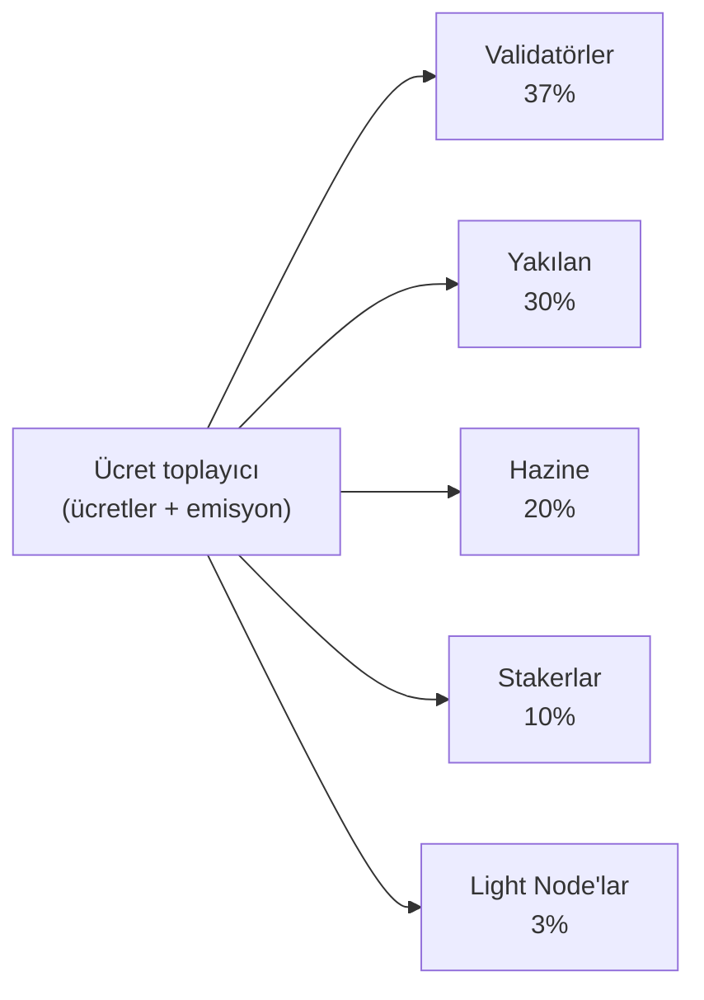

# Tokenomics

QoreChain'in ekonomik modeli yerel **QOR** token'ını merkeze alır ve **sonlu, üst sınırlı bir arz yoluna** sahiptir: sabit bir genesis arzı, sabit bir kümülatif üst sınır altında basılan staking ödülü emisyonu ve token'ları kalıcı olarak ortadan kaldıran çok kanallı bir yakma motoru. Bu sayfa, canlı zincirden okunan rakamları kullanarak arzın, emisyonun, yakmaların ve ücret bölüşümünün nasıl işlediğini açıklar.

---

## Token Temelleri

| Özellik                  | Değer                                                    |
| ------------------------- | -------------------------------------------------------- |
| **Görüntülenen token**   | QOR                                                      |
| **Temel birim**           | uqor                                                     |
| **Ondalık hassasiyet**    | 10^6 (1 QOR = 1.000.000 uqor)                            |
| **Arz**                   | Genesis 4.420.000.000 QOR; bkz. [Arz ve Emisyon Modeli](#supply-and-emission) |
| **Zincir ID**             | `qorechain-vladi` (mainnet, EVM zincir ID 9801)          |
| **Bech32 öneki**          | `qor` (hesaplar: `qor1...`, validatörler: `qorvaloper...`) |

:::note
Bu sayfadaki rakamlar, 7 Haziran 2026'dan bu yana **v3.2.4** sürümünde canlı olan (23 Ekim 2026'da 3.742.566 yüksekliğinde uygulandı) **mainnet**'i (`qorechain-vladi`, EVM zincir ID **9801**) tanımlar. **`qorechain-diana`** testnet'inin (EVM zincir ID **9800**, 27 Ekim 2026'dan beri sürüm **v3.2.6**) kendi emisyon ve arz geçmişi vardır (testnet arzı mainnet'inkinin çok üzerindedir ve emisyonu zaten üst sınırı aşmıştır), bu nedenle mainnet rakamlarını kullanın. Her blokla değişen tutarlar, okundukları tarihle işaretlenmiştir (23 Ekim 2026).
:::

---

## Arz ve Emisyon Modeli {#supply-and-emission}

QoreChain'in **sonlu, üst sınırlı bir arz yolu** vardır. Genesis arzı **4.420.000.000 QOR**'du (4.500.000.000 QOR planlanmıştı; 80.000.000 QOR, %1,78, genesis'ten önce Token Üretim Etkinliği'nde yakıldı). Genesis'ten sonra protokol arzı iki mekanizmayla değiştirir:

* **Emisyon** — `x/inflation` modülü, **590.000.000 QOR'luk sabit kümülatif üst sınır** altında her epoch'ta sabit bir miktar basar. Basılan token'lar ücret toplayıcıya girer ve işlem ücretleriyle aynı ücret bölüşümünden geçer (bkz. [Ücret Dağılımı](#fee-distribution)).
* **Yakmalar** — `x/burn` modülü, ücret toplayıcıdaki her şeyin yakma payını kalıcı olarak kaldırır.

### Emisyon {#staking-reward-schedule}

| Parametre | Değer |
| --- | --- |
| Emisyon modu | `fixed` (v3.1.94'ten beri, yükseklik 2.122.074 — 26 Ağustos 2026) |
| Epoch başına emisyon | **86.000 QOR** (yönetişim önerisi 10'a kadar 16.239 QOR; 86.000 QOR'luk ilk epoch 3.672.000 numaralı blokta başlar) |
| Epoch uzunluğu | 43.200 blok (şu anki ≈3,1 sn blok süresiyle yaklaşık 37,7 saat) |
| Kümülatif üst sınır (`max_total_emission`) | **590.000.000 QOR** (öneri 10'a kadar 114.285.714 QOR) |
| Şimdiye kadar basılan (23 Ekim 2026, epoch 86) | 105.420.896,21 QOR (üst sınırın %17,87'si) |
| Üst sınıra kalan | 484.579.103,79 QOR (epoch başına 86.000 QOR ile yaklaşık 5.635 epoch; sonuncusu kısmidir) |

Üst sınıra ulaşıldığında modül kalıcı olarak basmayı durdurur; bundan sonra ödüller yalnızca işlem ücretlerinden gelir. Emisyon rakamları yönetişim tarafından belirlendi: öneri #4 (26 Ağustos 2026) özgün azalan takvimin yerine sabit bir üst sınır altında sabit bir miktar koydu ve öneri #10 (tüm bağlı stake lehte oy kullanarak 19 Ekim 2026'da kabul edildi) bu miktarı epoch başına 16.239 QOR'dan 86.000 QOR'a değiştirdi ve üst sınırı 114.285.714 QOR'dan 590.000.000 QOR'a yükseltti. Epoch uzunluğu değişmedi. Takvim değerleri (1–5. yıllar için %17,5, %11, %7, %7, %2) modül parametrelerinde saklanmaya devam eder ancak `fixed` modunda kullanılmaz.

Basılan toplam, kalan miktar ve sonraki epoch yüksekliği `GET /qorechain/inflation/v1/epoch_info` adresinde canlıdır (`current_inflation_rate` alanı, `fixed` modunun kullanmadığı eski yıl bazlı oranı bildirir).

QoreChain canlı bir staking getirisi rakamı sunmaz; alıntılanan her yüzdeyi doğrulanmamış olarak değerlendirin. Güncel rakamlar zincir durumundan okunabilir: arz `GET /cosmos/bank/v1beta1/supply/by_denom?denom=uqor` adresinde (23 Ekim 2026'da 4.493.785.581,46 QOR), yakma toplamları ise `GET /qorechain/burn/v1/stats` adresindedir.

---

## x/burn — Çok Kanallı Yakma Motoru

`x/burn` modülü bugün mainnet'te **12 yakma kaynağı** tanımlar. Yakılan her token arzdan kalıcı olarak kaldırılır. Mainnet'te yalnızca `gas_fee` (23 Ekim 2026 itibarıyla 31.626.314,61 QOR) ve v3.2.2'den beri `failed_tx` (0,1355 QOR) için kayıtlı yakma vardır; diğerleri tanımlıdır ancak kayıtlı yakma yoktur. v3.2.4'ten itibaren on üçüncü bir kaynak olan `staking_tier_penalty` vardır; zaman kilitli bir delegasyon erken açıldığında yakılan cezayı kaydeder (testnet'te 19 Ekim 2026'dan beri ve mainnet'te 23 Ekim 2026'dan beri canlı; mainnet'te henüz erken açma kaydedilmedi; bkz. [Staking ve Delegasyon](/user-guide/staking-and-delegation#time-locked-staking)).

### Yakma Kanalları

| #  | Kanal               | Kaynak                       | Açıklama                                       |
| -- | ------------------- | ----------------------------- | ----------------------------------------------- |
| 1  | `gas_fee`           | İşlem ücretleri                | Tüm gas ücretlerinin %30'u yakılır              |
| 2  | `contract_create`   | Akıllı kontrat dağıtımı        | Kontrat oluşturma başına sabit 100 QOR ücret yakılır |
| 3  | `ai_service`        | AI modülü kullanım ücretleri   | AI hizmet ücretlerinin %50'si yakılır           |
| 4  | `bridge_fee`        | Zincirler arası köprü ücretleri | Köprü ücretlerinin %100'ü yakılır               |
| 5  | `treasury_buyback`  | Hazine işlemleri                | Hazineden periyodik geri alım ve yakma          |
| 6  | `failed_tx`         | Başarısız işlem gası            | Başarısız işlemlerden gelen gas'ın %10'u yakılır (zincir tarafından v3.2.2'den itibaren uygulanır) |
| 7  | `xqore_penalty`     | xQORE erken çıkış cezaları      | Ceza tutarları yakma sürecinden geçirilir       |
| 8  | `auto_buyback`      | Otomatik geri alım programı     | Protokol düzeyinde otomatik yakmalar            |
| 9  | `tge`               | Token üretim etkinliği          | 80.000.000 QOR'luk TGE yakması genesis'ten önce gerçekleşti (genesis arzı 4.420.000.000 QOR'dur); bu kanal ayrılmıştır ve 0 kaydeder |
| 10 | `rollup_create`     | Rollup dağıtımı                 | Rollup oluşturma stake'inin %1'i yakılır        |
| 11 | `milestone`         | İşlem sayısı kilometre taşları  | Sabit kümülatif işlem sayılarında planlanmış yakmalar (henüz tetiklenen yok) |
| 12 | `amm`               | AMM                             | AMM protokol ücretleri için ayrılmıştır (kayıt yok) |

`contract_create`, `ai_service`, `bridge_fee` ve `auto_buyback` kanalları bugün etkin değildir: QoreChain Native yüklemesi kapalıdır, AI hizmet ücretleri ve köprü canlı değildir.

### Ücret Dağılımı {#fee-distribution}

Ücret toplayıcıdaki her şey, aşağıda gösterildiği gibi beş hedefe bölünür. Ücret toplayıcı hem işlem ücretlerini hem de `x/inflation` tarafından basılan epoch emisyonunu tutar. Paylar zincir üzerinde uygulanır ve her zaman tam olarak %100'e ulaşır.

Paylar şunlardır:

| Alıcı              | Pay | Açıklama                                                                |
| ------------------- | ---- | ------------------------------------------------------------------------ |
| **Validatörler**    | %37  | Stake ile orantılı olarak aktif validatör setine dağıtılır               |
| **Yakılan**         | %30  | `gas_fee` yakma kanalı üzerinden arzdan kalıcı olarak kaldırılır         |
| **Hazine**          | %20  | Yönetişim tarafından yönlendirilen harcamalar için topluluk hazinesine tahsis edilir |
| **Stakerlar**       | %10  | Delegasyon ile orantılı olarak tüm QOR stakerlarına dağıtılır            |
| **Light Node'lar**  | %3   | Ağ verisi sunan light node'lara dağıtılır                                |

Paylar zincir üzerinde uygulanır ve her zaman tam olarak %100'e ulaşmalıdır.

:::note Bölüşümden fiilen ne geçiyor
Bölüşüm, hem işlem ücretlerini hem de `x/inflation` tarafından basılan epoch emisyonunu tutan ücret toplayıcıdaki her şeye uygulanır. Pratikte bugün neredeyse tamamı emisyondur: basılan 105.420.896 QOR'un 31.626.315 QOR'u (%30,0) gas ücreti kanalı üzerinden yakıldı. v3.2.0 yükseltmesine (25 Eylül 2026, yükseklik 2.981.742) kadar, %10'luk staker payı hiçbir talebi karşılamadan dağıtım modülünün bakiyesine taşınıyordu; bu yüzden stakerlar ve validatörler birlikte %47 değil %37 alıyordu; o yükseklikten itibaren staker payı normal bir staking ödülü olarak ödenir. Halihazırda sıkışmış tutar zincir üzerinde kayıt altına alındı ve o zamandan beri yönetişim oylamalarıyla serbest bırakıldı — bkz. [Sıkışmış Staker Payı ve Light Node Rezervi](#stranded-and-reserve).
:::

### Yakma Parametreleri

| Parametre               | Varsayılan                  | Açıklama                                      |
| ------------------------ | ---------------------------- | ------------------------------------------------ |
| `gas_burn_rate`          | 0.30                          | Yakılan gas ücretlerinin oranı (%30)             |
| `contract_create_fee`    | 100.000.000 uqor (100 QOR)    | Kontrat oluşturma için sabit yakma ücreti        |
| `ai_service_burn_rate`   | 0.50                          | Yakılan AI hizmet ücretlerinin oranı (%50)       |
| `bridge_burn_rate`       | 1.00                          | Yakılan köprü ücretlerinin oranı (%100)          |
| `failed_tx_burn_rate`    | 0.10                          | Yakılan başarısız işlem gas'ının oranı (%10)     |
| `validator_share`        | 0.37                          | Ücret toplayıcının validatörlere giden payı      |
| `treasury_share`         | 0.20                          | Hazineye giden pay                               |
| `staker_share`           | 0.10                          | Stakerlara giden pay                             |
| `light_node_share`       | 0.03                          | Light node'lara giden pay                        |
| `enabled`                | true                          | Modül etkinleştirme bayrağı                      |

Her yakma olayı; kaynağı, tutarı, blok yüksekliği ve ilişkili işlem hash'i ile birlikte zincir üzerinde kaydedilir. Toplu istatistikler kanal başına ve toplamda sorgulanabilir.

---

## Sıkışmış Staker Payı ve Light Node Rezervi {#stranded-and-reserve}

İki tutar, v3.2.0 yükseltmesinden (25 Eylül 2026, yükseklik 2.981.742) önce mainnet'te birikti. Yükseltme bunları **zincir üzerinde, herhangi bir dağıtımın dışında** kayıt altına aldı ve yalnızca bir yönetişim oylamasıyla hareket ettirilebilir kıldı. Yönetişim, Ekim 2026'da her ikisini de vakfa serbest bıraktı:

| Kayıt | Serbest bırakma | Tutar | Yönetişim mesajı |
| --- | --- | --- | --- |
| **Sıkışmış staker payı** — hiçbir staking ödülü talebini karşılamayan bir yere yatırılmış olan %10'luk staker payı | Öneri 9 (19 Ekim 2026'da kabul edildi) | 6.693.045,921330 QOR serbest bırakıldı | `MsgReleaseStrandedRewards` (yönetişim yetkilisi; adı belirtilmiş hedef; kaydı aşamaz) |
| **Light node rezervi** — hiçbir light node uygun değilken biriken %3'lük light node payı | Öneri 8 (19 Ekim 2026'da kabul edildi) | 3.156.983,796395 QOR serbest bırakıldı | `MsgReleaseLightNodeReserve` (yönetişim yetkilisi) |

**Sıkışmış payın düzeltilmiş kalanı.** v3.2.3 yükseltmesinde (yükseklik 3.662.051, 20 Ekim 2026) zincir, sıkışmış pay kaydını yeniden hesapladı; kayıt o zaman 3.807.496,785528 QOR olarak duruyordu (`GET /qorechain/burn/v1/stranded_rewards` içindeki `reserved`; yanında `released`, 6.693.045,921330 QOR). Yönetişim önerisi 12 bu kalanı, 3.807.496,785528 QOR'u, vakfa serbest bıraktı: oylayan tüm bonded stake lehte oy vererek kabul edildi (oylama 21 Ekim 2026'da 20:01 UTC'de sona erdi). Kayıt `GET /qorechain/burn/v1/stranded_rewards` adresinden, öneri ise `GET /cosmos/gov/v1/proposals/12` adresinden kontrol edilebilir.

**Light node havuzu şimdi.** v3.2.0 yükseltmesinden itibaren light node ödülleri yalnızca bir önceki dağıtım çalışmasından bu yana biriken tutardan, node başına bir tavanla ödenir. v3.2.3'ten beri tavan, **node başına 30 günde 2.000 QOR**'dur (`max_reward_per_month_per_node`); blok süresine ve node'un çalışma süresine göre orantılanır; blok başına değer (`max_reward_per_block_per_node`, 1.713 uqor) hâlâ bildirilir ancak artık kural değildir. Kazanılmayan her şey, yalnızca bir yönetişim oylamasının serbest bırakabileceği havuz rezervinde kalır. Öneri 8'den sonra rezerv yeniden birikir: 27 Ekim 2026'da mainnet havuzunun `reserved` değeri (`GET /qorechain/lightnode/v1/reward_pool` içinde) yaklaşık 13.380,9 QOR idi; 0,06 QOR ödenmemiş durumdaydı ve ödenebilir bir şey yoktu; o gün her ağda bir light node kayıtlıydı. Kayıt açıktır ve lisans kapılıdır (bkz. [Light Node](/light-node/overview#reward-program-status)). Yükseltme anlık görüntüsünden önceki, kayıtlı tutarı aşan veya geçersiz bir hedefe yönelik bir serbest bırakma reddedilir.

## x/xqore — Kilitli Staking ve Yönetişim Güçlendirmesi {#x-xqore}

:::warning Henüz canlı değil
xQORE modülünün muhasebesi mevcuttur ve genesis'te etkindir, ancak mainnet (`qorechain-vladi`) veya testnet (`qorechain-diana`) üzerinde **henüz kullanılamaz**. Düğümde bunun için bir işlem, sorgu, CLI veya RPC giriş noktası yoktur; bu nedenle `tx xqore lock` / `unlock`, `query xqore ...`, xQORE REST rotaları ve `qor_getXQOREPosition` çalışmaz ve kimse xQORE tutmaz. Gelecekteki bir zincir sürümü için planlanmıştır; bu sürüm, sahip sayısı ne olursa olsun kilit açmanın ucuz kalması için çıkış cezalarının yeniden dağıtılma biçimini de değiştirecektir. Sürüm yayımlandığında burada belirtilecektir.
:::

`x/xqore` modülü, devredilemez, kilitli-staking türevi olan **xQORE**'u tanıtır. Kullanıcılar, xQORE'u 1:1 oranında basmak için QOR kilitler. xQORE sahipleri, güçlendirilmiş yönetişim gücü ve yeniden dağıtılan çıkış cezalarından pay alır.

### Kilit Mekanizması

* **Kilitleme**: xQORE'u 1:1 oranında basmak için xQORE modülüne QOR gönderin.
* **Yönetişim ağırlığı**: xQORE sahipleri, standart QOR stakerlarına kıyasla **2 kat yönetişim oy gücü** alır.
* **Devredilemez**: xQORE hesaplar arasında gönderilemez. Kilitleyen adrese bağlıdır.

### Çıkış Ceza Takvimi

xQORE'dan erken çekim, kilit süresine göre azalan bir ceza gerektirir:

| Kilit Süresi    | Ceza Oranı | Açıklama                                       |
| ---------------- | ------------ | ------------------------------------------------ |
| &lt; 30 gün      | **%50**      | Kilitlenen QOR'un yarısı kaybedilir              |
| 30 -- 90 gün      | **%35**      | Kısa vadeli kilitler için önemli ceza            |
| 90 -- 180 gün     | **%15**      | Orta vadeli taahhüt için azaltılmış ceza         |
| > 180 gün        | **%0**       | Cezasız tam çekim                                |

### PvP Rebase Yeniden Dağıtımı

Erken çıkışlardan toplanan cezalar basitçe yok edilmez. Bunun yerine, bir PvP (oyuncuya karşı oyuncu) rebase modelini takip ederler:

1. Genesis yapılandırmasında ceza tutarlarının **%0'ı** yakılır (`penalty_burn_rate = 0`; yönetişim değiştirirse `xqore_penalty` yakma kanalı mevcuttur).
2. **%100'ü**, kalan tüm xQORE sahiplerine orantılı olarak yeniden dağıtılır.

Bu, uzun vadeli sahipler için pozitif toplamlı bir dinamik yaratır: her erken çıkış, kalan xQORE pozisyonlarının efektif değerini artırır. Rebase'ler her **100 blokta** bir gerçekleşir.

### xQORE Parametreleri

| Parametre                | Varsayılan               | Açıklama                                     |
| ------------------------- | -------------------------- | ----------------------------------------------- |
| `governance_multiplier`   | 2.0                         | xQORE sahipleri için oy gücü çarpanı             |
| `min_lock_amount`         | 1.000.000 uqor (1 QOR)      | Kilitlemek için gereken minimum QOR              |
| `penalty_burn_rate`       | 0.00                        | Yakılan çıkış cezalarının oranı (genesis varsayılanı: tüm cezalar yeniden dağıtılır) |
| `rebase_interval`         | 100 blok                    | PvP rebase olayları arasındaki blok sayısı       |
| `enabled`                 | true                        | Modül etkinleştirme bayrağı                      |

---

## x/inflation — Üst Sınırlı Emisyon

`x/inflation` modülü, 590.000.000 QOR'luk kümülatif üst sınıra ulaşılana kadar epoch başına emisyonu (öneri 10'dan beri 86.000 QOR, `emission_mode = fixed`) basar ve ücret toplayıcıya gönderir. Parametre değişiklikleri normal bir yönetişim parametre önerisi (`MsgUpdateParams`, v3.1.94'te eklendi) üzerinden yapılır.

### Epoch Mekaniği

* **Epoch uzunluğu**: 43.200 blok (blok başına ≈3,1 sn ile yaklaşık 37,7 saat).
* Her epoch sınırında modül epoch emisyonunu (veya üst sınıra kalan miktarı) basar, epoch kaydını günceller ve `total_minted` üst sınıra ulaştığında basmayı durdurur.
* v3.2.3'ten beri emisyon yılı, sabit bir blok sayısı yerine epoch uzunluğundan türetilir.

### Parametreler

23 Ekim 2026'da `GET /qorechain/inflation/v1/params` adresinden canlı okundu:

| Parametre | Değer (mainnet) | Açıklama |
| --- | --- | --- |
| `emission_mode` | `fixed` | `schedule` (eski, yıl bazlı oranlar) veya `fixed`; v3.2.4 üçüncü bir mod olan `target_apy`'yi ekler |
| `fixed_epoch_emission` | 86.000.000.000 uqor (86.000 QOR) | fixed modda epoch başına basılan |
| `max_total_emission` | 590.000.000.000.000 uqor (590.000.000 QOR) | Sabit kümülatif tavan |
| `epoch_length` | 43.200 blok | Emisyon epoch'u başına blok |
| `schedule` | %17,5, %11, %7, %7, %2 (1–5. yıllar) | Eski takvim, fixed modda kullanılmaz |
| `enabled` | `true` | Modül etkinleştirme bayrağı |

Modülün parametreleri ve epoch kaydı, v3.2.3'ten beri mainnet'te REST üzerinden sunulur (`/qorechain/inflation/v1/params` ve `/qorechain/inflation/v1/epoch_info`); ayrıca RPC `abci_query` ham depo arayüzüyle (depo `inflation`, anahtarlar `inflation/params` ve `inflation/epoch`) zincir durumundan da okunabilirler.

:::note v3.2.4 ve testnet'in emisyonu
`qorechain-diana` testnet'i test için ayarlanmıştır ve mainnet'ten farklıdır (27 Ekim 2026'da okundu): `target_apy` modundadır, `target_apy_bps` değeri `1667`'dir, `fixed_epoch_emission` hâlâ 16.239 QOR'dur ve `max_total_emission` 3.950.390.341.362.112.750 uqor'dur; bu, orada şimdiden basılmış miktara eşittir (`/qorechain/inflation/v1/epoch_info` içinde `remaining_emission` `0`'dır), dolayısıyla testnet artık daha fazla basmaz. Mainnet yukarıdaki değerleri kullanır. v3.2.4 sürümü, bir `target_apy_bps` parametresiyle üçüncü emisyon modu olan `target_apy`'yi ekler: testnet'te 19 Ekim 2026'dan beri ve mainnet'te 23 Ekim 2026'dan beri (yönetişim önerisi 13). Mainnet'te parametre `0`'dır ve emisyonu yönlendirmez. Mainnet'i bu moda geçirmek ayrı bir yönetişim oyudur ve önerilmemiştir; bir oy kabul edilene kadar mainnet, epoch başına 86.000 QOR ile `fixed` modunda kalır.
:::

---

## Yakma ve Emisyon Karşılaştırması

Emisyon üst sınırlıdır (toplamda 590.000.000 QOR) ve yakma payı, emisyon dahil ücret toplayıcıya giren her şeye uygulanır. Bugüne kadar (23 Ekim 2026) 105.420.896 QOR basılmasına karşılık 31.626.315 QOR yakıldı, dolayısıyla arz (4.493.785.581 QOR) şu anda genesis seviyesinin üzerindedir. Üst sınıra ulaşıldıktan sonra arz yalnızca yakılan miktar kadar azalabilir.

---

## İlgili

* [Zincir Parametreleri](/appendix/chain-parameters) — kanonik ekonomik ve konsensüs varsayılanları.
* [Staking ve Delegasyon](/user-guide/staking-and-delegation) — QOR delege edin ve staking ödülü kazanın.
* [xQORE Staking](/user-guide/xqore-staking) — PvP rebase staking mekanizması.
* [Light Node Ödülleri](/light-node/rewards-and-monitoring) — light node ödül payı.
