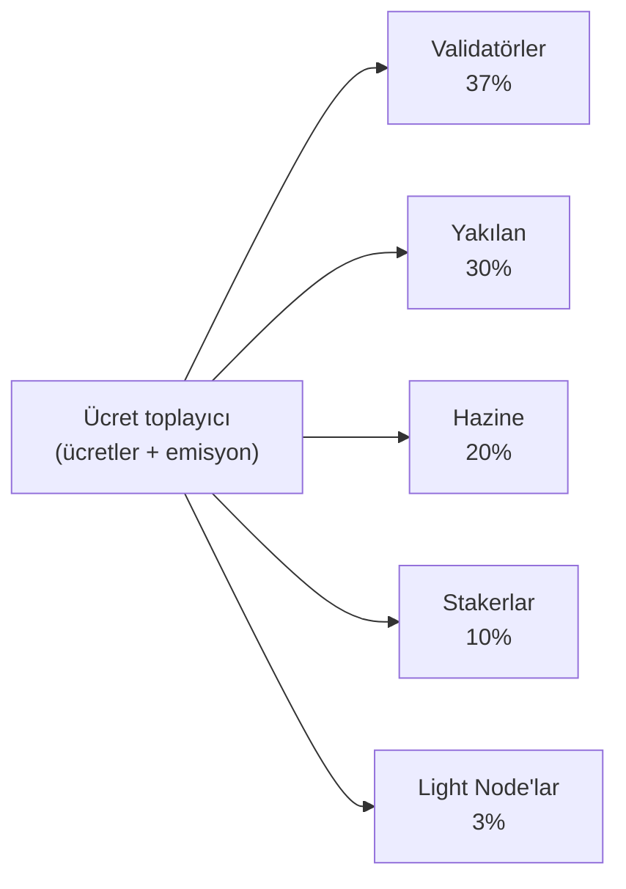

# Tokenomics

QoreChain'in ekonomik modeli yerel **QOR** token'ını merkeze alır ve **sonlu, üst sınırlı bir arz yoluna** sahiptir: sabit bir genesis arzı, sabit bir kümülatif üst sınır altında basılan staking ödülü emisyonu ve token'ları kalıcı olarak ortadan kaldıran çok kanallı bir yakma motoru. Bu sayfa, canlı zincirden okunan rakamları kullanarak arzın, emisyonun, yakmaların ve ücret bölüşümünün nasıl işlediğini açıklar.

---

## Token Temelleri

| Özellik                  | Değer                                                    |
| ------------------------- | -------------------------------------------------------- |
| **Görüntülenen token**   | QOR                                                      |
| **Temel birim**           | uqor                                                     |
| **Ondalık hassasiyet**    | 10^6 (1 QOR = 1.000.000 uqor)                            |
| **Arz**                   | Genesis 4.420.000.000 QOR; bkz. [Arz ve Emisyon Modeli](#supply-and-emission) |
| **Zincir ID**             | `qorechain-vladi` (mainnet, EVM zincir ID 9801)          |
| **Bech32 öneki**          | `qor` (hesaplar: `qor1...`, validatörler: `qorvaloper...`) |

:::note
Bu sayfadaki rakamlar, 29 Haziran 2026'dan bu yana **v3.2.1** sürümünde canlı olan **mainnet**'i (`qorechain-vladi`, EVM zincir ID **9801**) tanımlar. **`qorechain-diana`** testnet'i (EVM zincir ID **9800**) aynı modül parametrelerini paylaşır; arz ve emisyon geçmişi farklıdır (testnet arzı mainnet'inkinin çok üzerindedir ve emisyonu zaten üst sınırı aşmıştır), bu nedenle mainnet rakamlarını kullanın.
:::

---

## Arz ve Emisyon Modeli {#supply-and-emission}

QoreChain'in **sonlu, üst sınırlı bir arz yolu** vardır. Genesis arzı **4.420.000.000 QOR**'du (4.500.000.000 QOR planlanmıştı; 80.000.000 QOR, %1,78, genesis'ten önce Token Üretim Etkinliği'nde yakıldı). Genesis'ten sonra arzı yalnızca iki şey değiştirir:

* **Emisyon** — `x/inflation` modülü, **114.285.714 QOR'luk sabit kümülatif üst sınır** altında her epoch'ta sabit bir miktar basar. Basılan token'lar ücret toplayıcıya girer ve işlem ücretleriyle aynı ücret bölüşümünden geçer (bkz. [Ücret Dağılımı](#fee-distribution)).
* **Yakmalar** — `x/burn` modülü, ücret toplayıcıdaki her şeyin yakma payını kalıcı olarak kaldırır.

### Emisyon {#staking-reward-schedule}

| Parametre | Değer |
| --- | --- |
| Emisyon modu | `fixed` (v3.1.94'ten beri, yükseklik 2.122.074 — 26 Ağustos 2026) |
| Epoch başına emisyon | 16.239 QOR |
| Epoch uzunluğu | 43.200 blok (şu anki ≈3,2 sn blok süresiyle yaklaşık 38,6 saat) |
| Kümülatif üst sınır (`max_total_emission`) | 114.285.714 QOR |
| Şimdiye kadar basılan (14 Ekim 2026, epoch 81) | 105.200.179 QOR (üst sınırın %92,05'i) |
| Üst sınıra kalan | 9.085.535 QOR (epoch başına 16.239 QOR ile yaklaşık 559 epoch) |

Üst sınıra ulaşıldığında modül kalıcı olarak basmayı durdurur; bundan sonra ödüller yalnızca işlem ücretlerinden gelir. Üst sınır, yönetişim önerisi #4 ile belirlendi (tüm bağlı stake lehte oy kullanarak kabul edildi) ve olgun, tamamen bağlı bir ağ için kalibre edilmiş, fiilen bağlı stake'e kıyasla amaçlanandan çok daha hızlı ödeme yapan özgün azalan takvimin yerini aldı. Takvim değerleri (1–5. yıllar için %17,5, %11, %7, %7, %2) modül parametrelerinde saklanmaya devam eder ancak `fixed` modunda kullanılmaz.

QoreChain canlı bir staking getirisi rakamı sunmaz; alıntılanan her yüzdeyi doğrulanmamış olarak değerlendirin. Güncel rakamlar zincir durumundan okunabilir: arz `GET /cosmos/bank/v1beta1/supply/by_denom?denom=uqor` adresinde, yakma toplamları ise `GET /qorechain/burn/v1/stats` adresindedir.

---

## x/burn — Çok Kanallı Yakma Motoru

`x/burn` modülü **12 yakma kaynağı** tanımlar. Yakılan her token arzdan kalıcı olarak kaldırılır. Mainnet'te şimdiye kadar yalnızca `gas_fee` için kayıtlı yakma vardır (14 Ekim 2026 itibarıyla 31.560.093 QOR); diğerleri tanımlıdır ancak kayıtlı yakma yoktur.

### Yakma Kanalları

| #  | Kanal               | Kaynak                       | Açıklama                                       |
| -- | ------------------- | ----------------------------- | ----------------------------------------------- |
| 1  | `gas_fee`           | İşlem ücretleri                | Tüm gas ücretlerinin %30'u yakılır              |
| 2  | `contract_create`   | Akıllı kontrat dağıtımı        | Kontrat oluşturma başına sabit 100 QOR ücret yakılır |
| 3  | `ai_service`        | AI modülü kullanım ücretleri   | AI hizmet ücretlerinin %50'si yakılır           |
| 4  | `bridge_fee`        | Zincirler arası köprü ücretleri | Köprü ücretlerinin %100'ü yakılır               |
| 5  | `treasury_buyback`  | Hazine işlemleri                | Hazineden periyodik geri alım ve yakma          |
| 6  | `failed_tx`         | Başarısız işlem gası            | Başarısız işlemlerden gelen gas'ın %10'u yakılır (zincir tarafından v3.2.2'den itibaren uygulanır; şimdilik yalnızca testnet) |
| 7  | `xqore_penalty`     | xQORE erken çıkış cezaları      | Ceza tutarları yakma sürecinden geçirilir       |
| 8  | `auto_buyback`      | Otomatik geri alım programı     | Protokol düzeyinde otomatik yakmalar            |
| 9  | `tge`               | Token üretim etkinliği          | 80.000.000 QOR'luk TGE yakması genesis'ten önce gerçekleşti (genesis arzı 4.420.000.000 QOR'dur); bu kanal ayrılmıştır ve 0 kaydeder |
| 10 | `rollup_create`     | Rollup dağıtımı                 | Rollup oluşturma stake'inin %1'i yakılır        |
| 11 | `milestone`         | İşlem sayısı kilometre taşları  | Sabit kümülatif işlem sayılarında planlanmış yakmalar (henüz tetiklenen yok) |
| 12 | `amm`               | AMM                             | AMM protokol ücretleri için ayrılmıştır (kayıt yok) |

`contract_create`, `ai_service`, `bridge_fee` ve `auto_buyback` kanalları bugün etkin değildir: CosmWasm yüklemesi kapalıdır, AI hizmet ücretleri ve köprü canlı değildir.

### Ücret Dağılımı {#fee-distribution}

Ücret toplayıcıdaki her şey, aşağıda gösterildiği gibi beş hedefe bölünür. Ücret toplayıcı hem işlem ücretlerini hem de `x/inflation` tarafından basılan epoch emisyonunu tutar. Paylar zincir üzerinde uygulanır ve her zaman tam olarak %100'e ulaşır.

Paylar şunlardır:

| Alıcı              | Pay | Açıklama                                                                |
| ------------------- | ---- | ------------------------------------------------------------------------ |
| **Validatörler**    | %37  | Stake ile orantılı olarak aktif validatör setine dağıtılır               |
| **Yakılan**         | %30  | `gas_fee` yakma kanalı üzerinden arzdan kalıcı olarak kaldırılır         |
| **Hazine**          | %20  | Yönetişim tarafından yönlendirilen harcamalar için topluluk hazinesine tahsis edilir |
| **Stakerlar**       | %10  | Delegasyon ile orantılı olarak tüm QOR stakerlarına dağıtılır            |
| **Light Node'lar**  | %3   | Ağ verisi sunan light node'lara dağıtılır                                |

Paylar zincir üzerinde uygulanır ve her zaman tam olarak %100'e ulaşmalıdır.

:::note Bölüşümden fiilen ne geçiyor
Bölüşüm, hem işlem ücretlerini hem de `x/inflation` tarafından basılan epoch emisyonunu tutan ücret toplayıcıdaki her şeye uygulanır. Pratikte bugün neredeyse tamamı emisyondur: basılan 105.200.179 QOR'un 31.560.093 QOR'u (%30,0) yakıldı ve 3.156.009 QOR'u (%3,0) light node rezervinde duruyor. v3.2.0 yükseltmesine (25 Eylül 2026, yükseklik 2.981.742) kadar, %10'luk staker payı hiçbir talebi karşılamadan dağıtım modülünün bakiyesine taşınıyordu; bu yüzden stakerlar ve validatörler birlikte %47 değil %37 alıyordu; o yükseklikten itibaren staker payı normal bir staking ödülü olarak ödenir ve halihazırda sıkışmış tutar (6.693.045,92 QOR) kayıt altına alındı ve yalnızca bir yönetişim oylamasıyla hareket ettirilebilir — bkz. [Sıkışmış Staker Payı ve Light Node Rezervi](#stranded-and-reserve).
:::

### Yakma Parametreleri

| Parametre               | Varsayılan                  | Açıklama                                      |
| ------------------------ | ---------------------------- | ------------------------------------------------ |
| `gas_burn_rate`          | 0.30                          | Yakılan gas ücretlerinin oranı (%30)             |
| `contract_create_fee`    | 100.000.000 uqor (100 QOR)    | Kontrat oluşturma için sabit yakma ücreti        |
| `ai_service_burn_rate`   | 0.50                          | Yakılan AI hizmet ücretlerinin oranı (%50)       |
| `bridge_burn_rate`       | 1.00                          | Yakılan köprü ücretlerinin oranı (%100)          |
| `failed_tx_burn_rate`    | 0.10                          | Yakılan başarısız işlem gas'ının oranı (%10)     |
| `validator_share`        | 0.37                          | Ücret toplayıcının validatörlere giden payı      |
| `treasury_share`         | 0.20                          | Hazineye giden pay                               |
| `staker_share`           | 0.10                          | Stakerlara giden pay                             |
| `light_node_share`       | 0.03                          | Light node'lara giden pay                        |
| `enabled`                | true                          | Modül etkinleştirme bayrağı                      |

Her yakma olayı; kaynağı, tutarı, blok yüksekliği ve ilişkili işlem hash'i ile birlikte zincir üzerinde kaydedilir. Toplu istatistikler kanal başına ve toplamda sorgulanabilir.

---

## Sıkışmış Staker Payı ve Light Node Rezervi {#stranded-and-reserve}

İki tutar, v3.2.0 yükseltmesinden (25 Eylül 2026, yükseklik 2.981.742) önce mainnet'te birikti ve şimdi **kayıt altında, herhangi bir dağıtımın dışında** tutuluyor. İkisi de yalnızca bir yönetişim oylamasıyla hareket ettirilebilir.

| Kayıt | Mainnet'teki tutar | Sorgu | Yönetişim mesajı |
| --- | --- | --- | --- |
| **Sıkışmış staker payı** — hiçbir staking ödülü talebini karşılamayan bir yere yatırılmış olan %10'luk staker payı | 6.693.045,921330 QOR kayıtlı, 0 serbest bırakılmış | `GET /qorechain/burn/v1/stranded_rewards` | `MsgReleaseStrandedRewards` (yönetişim yetkilisi; adı belirtilmiş hedef; kaydı aşamaz) |
| **Light node rezervi** — hiçbir light node uygun değilken biriken %3'lük light node payı | 3.156.009,326407 QOR ayrılmış, 0 ödenmemiş | `GET /qorechain/lightnode/v1/reward_pool` | `MsgReleaseLightNodeReserve` (yönetişim yetkilisi) |

Yükseltme yüksekliğinden itibaren staker payı normal bir staking ödülü olarak ödenir ve light node ödülleri yalnızca bir önceki dağıtım çalışmasından bu yana biriken tutardan, node başına ve blok başına bir tavanla (`max_reward_per_block_per_node`, 14 Ekim 2026'da okunduğu üzere 1.713 uqor) ödenir. Light node kaydı şu anda kapalıdır, dolayısıyla uygun node yoktur ve %3'lük pay rezerve birikmeye devam eder. Yükseltme anlık görüntüsünden önceki, kayıtlı tutarı aşan veya geçersiz bir hedefe yönelik bir serbest bırakma reddedilir.

---

## x/xqore — Kilitli Staking ve Yönetişim Güçlendirmesi {#x-xqore}

:::warning Henüz canlı değil
xQORE modülünün muhasebesi mevcuttur ve genesis'te etkindir, ancak mainnet (`qorechain-vladi`) veya testnet (`qorechain-diana`) üzerinde **henüz kullanılamaz**. Düğümde bunun için bir işlem, sorgu, CLI veya RPC giriş noktası yoktur; bu nedenle `tx xqore lock` / `unlock`, `query xqore ...`, xQORE REST rotaları ve `qor_getXQOREPosition` çalışmaz ve kimse xQORE tutmaz. Gelecekteki bir zincir sürümü için planlanmıştır; bu sürüm, sahip sayısı ne olursa olsun kilit açmanın ucuz kalması için çıkış cezalarının yeniden dağıtılma biçimini de değiştirecektir. Sürüm yayımlandığında burada belirtilecektir.
:::

`x/xqore` modülü, devredilemez, kilitli-staking türevi olan **xQORE**'u tanıtır. Kullanıcılar, xQORE'u 1:1 oranında basmak için QOR kilitler. xQORE sahipleri, güçlendirilmiş yönetişim gücü ve yeniden dağıtılan çıkış cezalarından pay alır.

### Kilit Mekanizması

* **Kilitleme**: xQORE'u 1:1 oranında basmak için xQORE modülüne QOR gönderin.
* **Yönetişim ağırlığı**: xQORE sahipleri, standart QOR stakerlarına kıyasla **2 kat yönetişim oy gücü** alır.
* **Devredilemez**: xQORE hesaplar arasında gönderilemez. Kilitleyen adrese bağlıdır.

### Çıkış Ceza Takvimi

xQORE'dan erken çekim, kilit süresine göre azalan bir ceza gerektirir:

| Kilit Süresi    | Ceza Oranı | Açıklama                                       |
| ---------------- | ------------ | ------------------------------------------------ |
| &lt; 30 gün      | **%50**      | Kilitlenen QOR'un yarısı kaybedilir              |
| 30 -- 90 gün      | **%35**      | Kısa vadeli kilitler için önemli ceza            |
| 90 -- 180 gün     | **%15**      | Orta vadeli taahhüt için azaltılmış ceza         |
| > 180 gün        | **%0**       | Cezasız tam çekim                                |

### PvP Rebase Yeniden Dağıtımı

Erken çıkışlardan toplanan cezalar basitçe yok edilmez. Bunun yerine, bir PvP (oyuncuya karşı oyuncu) rebase modelini takip ederler:

1. Genesis yapılandırmasında ceza tutarlarının **%0'ı** yakılır (`penalty_burn_rate = 0`; yönetişim değiştirirse `xqore_penalty` yakma kanalı mevcuttur).
2. **%100'ü**, kalan tüm xQORE sahiplerine orantılı olarak yeniden dağıtılır.

Bu, uzun vadeli sahipler için pozitif toplamlı bir dinamik yaratır: her erken çıkış, kalan xQORE pozisyonlarının efektif değerini artırır. Rebase'ler her **100 blokta** bir gerçekleşir.

### xQORE Parametreleri

| Parametre                | Varsayılan               | Açıklama                                     |
| ------------------------- | -------------------------- | ----------------------------------------------- |
| `governance_multiplier`   | 2.0                         | xQORE sahipleri için oy gücü çarpanı             |
| `min_lock_amount`         | 1.000.000 uqor (1 QOR)      | Kilitlemek için gereken minimum QOR              |
| `penalty_burn_rate`       | 0.00                        | Yakılan çıkış cezalarının oranı (genesis varsayılanı: tüm cezalar yeniden dağıtılır) |
| `rebase_interval`         | 100 blok                    | PvP rebase olayları arasındaki blok sayısı       |
| `enabled`                 | true                        | Modül etkinleştirme bayrağı                      |

---

## x/inflation — Üst Sınırlı Emisyon

`x/inflation` modülü, 114.285.714 QOR'luk kümülatif üst sınıra ulaşılana kadar epoch başına emisyonu (16.239 QOR, `emission_mode = fixed`) basar ve ücret toplayıcıya gönderir. Parametre değişiklikleri normal bir yönetişim parametre önerisi (`MsgUpdateParams`, v3.1.94'te eklendi) üzerinden yapılır.

### Epoch Mekaniği

* **Epoch uzunluğu**: 43.200 blok (blok başına ≈3,2 sn ile yaklaşık 38,6 saat).
* Her epoch sınırında modül epoch emisyonunu (veya üst sınıra kalan miktarı) basar, epoch kaydını günceller ve `total_minted` üst sınıra ulaştığında basmayı durdurur.

### Parametreler

| Parametre | Değer (mainnet) | Açıklama |
| --- | --- | --- |
| `emission_mode` | `fixed` | `schedule` (eski, yıl bazlı oranlar) veya `fixed` |
| `fixed_epoch_emission` | 16.239.000.000 uqor | fixed modda epoch başına basılan |
| `max_total_emission` | 114.285.714.000.000 uqor | Sabit kümülatif tavan |
| `epoch_length` | 43.200 blok | Emisyon epoch'u başına blok |
| `schedule` | %17,5, %11, %7, %7, %2 (1–5. yıllar) | Eski takvim, fixed modda kullanılmaz |
| `enabled` | `true` | Modül etkinleştirme bayrağı |

Mainnet'te bu değerler bir REST rotası üzerinden sunulmaz; RPC `abci_query` ham depo arayüzüyle (depo `inflation`, anahtarlar `inflation/params` ve `inflation/epoch`) zincir durumundan okunabilir. Bunlar için özel bir sorgu hizmeti yalnızca testnet'te vardır (v3.2.2).

---

## Yakma ve Emisyon Karşılaştırması

Emisyon üst sınırlıdır (114.285.714 QOR) ve yakma payı, emisyon dahil ücret toplayıcıya giren her şeye uygulanır. Bugüne kadar 105.200.179 QOR basılmasına karşılık 31.560.093 QOR yakıldı, dolayısıyla arz şu anda genesis seviyesinin üzerindedir. Üst sınıra ulaşıldıktan sonra arz yalnızca yakılan miktar kadar azalabilir.

---

## İlgili

* [Zincir Parametreleri](/appendix/chain-parameters) — kanonik ekonomik ve konsensüs varsayılanları.
* [Staking ve Delegasyon](/user-guide/staking-and-delegation) — QOR delege edin ve staking ödülü kazanın.
* [xQORE Staking](/user-guide/xqore-staking) — PvP rebase staking mekanizması.
* [Light Node Ödülleri](/light-node/rewards-and-monitoring) — light node ödül payı.
