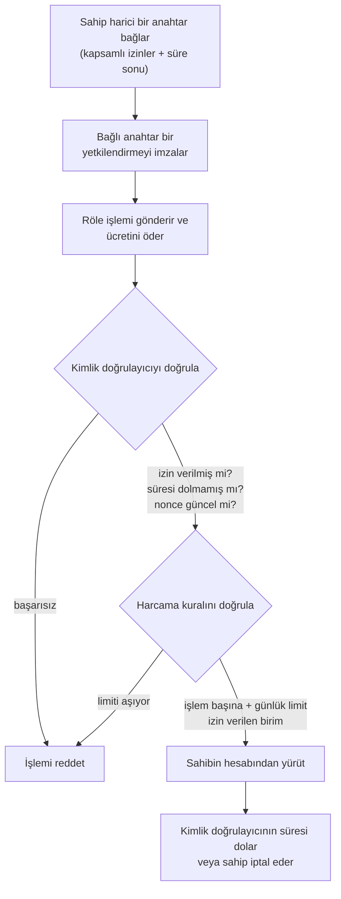

# Hesap Soyutlama

QoreChain, `x/abstractaccount` modülü aracılığıyla **protokol düzeyinde hesap soyutlama** sağlar. Modül, harcama kurallarına sahip soyut hesapları kaydeder ve hesap sahibinin, hesaptan izin ve harcama limiti sınırları içinde harcama yapabilen harici anahtarları (**kimlik doğrulayıcılar**) bağlamasına olanak tanır; harici akıllı sözleşme altyapısı gerekmez.

:::danger Ana ağda etkin değil; test ağında etkin
Soyut hesap modülü, yazım sırasında **`qorechain-vladi` ana ağında kapalıdır** (27 Ekim 2026'da kontrol edildi): `qorechaind query abstractaccount config` (ve `GET /qorechain/abstractaccount/v1/config`) `enabled: false` bildirir. **`qorechain-diana` test ağında** bir yönetişim kararıyla (öneri 18, 27 Ekim 2026'da kabul edildi) açılmıştır ve `enabled: true` bildirir. Zincir v3.2.0'dan itibaren bu bayrak her yolda uygulanır: `false` olduğu yerde zincir, hesap oluşturmayı, kimlik doğrulayıcı kaydını ve her iki yürütme hattını (`MsgExecuteEVM`, `MsgExecuteCosmos`) `abstract accounts are disabled on this chain` iletisiyle reddeder. Hiçbir sıradan işlem modülü açamaz; ayar yalnızca bir yönetişim kararıyla değişir. Ana ağa bugüne kadar hiçbir soyut hesap işlemi dahil edilmemiştir. Aşağıdaki her şey modülün arayüzlerini anlatır; modülü test ağında deneyin ve orada etkinleştirilene kadar ana ağ için bağlı anahtar veya devredilmiş harcama akışı oluşturmayın. Her zaman önce bayrağı kontrol edin.
:::

:::note
Aşağıdaki komutlar, 7 Haziran 2026'dan beri canlı olan ve düğüm sürümü **v3.2.7**'yi çalıştıran (12 Kasım 2026'da 4.164.600 yüksekliğinde uygulandı, yönetişim önerisi 16; v3.2.6, 4 Kasım 2026'da 4.020.000 yüksekliğinde uygulanmıştı, öneri 15; v3.2.5, 29 Ekim 2026'da 3.906.833 yüksekliğinde, öneri 14, ve v3.2.4, 23 Ekim 2026'da 3.742.566 yüksekliğinde uygulanmıştı) **`qorechain-vladi`** ana ağını kullanır. v3.2.8 çalıştıran (12 Kasım 2026'dan beri; v3.2.4 19 Ekim 2026'dan beri) test ağı için `--chain-id qorechain-diana` ile değiştirin.
:::

:::caution Her Cosmos hattı işlemi hibrit kuantum sonrası eş imza gerektirir
Bu sayfadaki `qorechaind tx` örnekleri yalnızca ücret bayraklarını gösterir. Canlı ağlarda her Cosmos hattı işlemi ayrıca ML-DSA-87 hibrit eş imzasını da taşımalıdır; bu nedenle işlemi `--generate-only` ile oluşturun ve `qorechaind tx pqc cosign` ile imzalayın (veya bunu sizin yerinize yapan QoreX'i ya da SDK'yı kullanın). `qorechaind`'in topluluk sürümü bu imzayı üretemez; [indirme manifestindeki](/developer-guide/running-a-node#fetch-the-manifest) sürüm ikili dosyasını kullanın. Ücret tabanı **gaz birimi başına 0.1 uqor**'dur, dolayısıyla `--gas 400000` için en az `--fees 40000uqor` gerekir. Bkz. [Kuantum Sonrası İmzalama](/developer-guide/post-quantum-signing).
:::

## Genel Bakış

Geleneksel blok zinciri hesapları tek bir özel anahtar tarafından kontrol edilir. Hesap soyutlama, "bir işlemi kimin yetkilendirebileceği" kavramını tek bir kriptografik anahtardan ayırır. `x/abstractaccount` modülü şunları sağlar:

* Kayıtlı bir hesap türüne ve sahibe sahip **soyut hesaplar**
* Bağlı anahtarların (kimlik doğrulayıcılar ve oturum anahtarları) harcayabileceği tutarı sınırlayan **harcama kuralları** (işlem başına ve günlük limitler, izin verilen birimler); sahibin kendi anahtarını sınırlamazlar
* **Kimlik doğrulayıcılar**: sahibin kapsamlı izinler ve bir süre sonu ile bağladığı ve istediği zaman iptal edebildiği harici anahtarlar (bir Phantom ed25519 anahtarı veya bir MetaMask secp256k1 adresi)

*Bağlı anahtar (kimlik doğrulayıcı) akışı: bağlı anahtar bir yetkilendirmeyi imzalar, bir röle bunu gönderir, modül izinleri, süre sonunu ve harcama kurallarını kontrol eder, ardından sahibin hesabından yürütür.*



## Hesap Türleri

`create`, üç hesap türünden birini kaydeder. Tür hesapta saklanır ve adresin nasıl türetildiğinin bir parçasıdır; modülün kendine ait çoklu imza, oturum anahtarı veya kurtarma işlemi yoktur (işlem hizmeti `create`, `update-rules`, `register-authenticator`, `revoke-authenticator`, `execute-cosmos`, `execute-evm`'dir).

| Tür               | Amaçlanan kullanım              |
| ----------------- | ------------------------------- |
| `multisig`        | DAO hazineleri, paylaşılan cüzdanlar |
| `social_recovery` | Tüketici cüzdanları, kayıt süreci |
| `session_based`   | dApp oturumları, mobil cüzdanlar |

## Soyut Hesap Oluşturma

`create`, hesap türünü konumsal argüman olarak alır (`multisig`, `social_recovery` veya `session_based`):

```bash
qorechaind tx abstractaccount create session_based \
  --from mykey \
  --gas 400000 --fees 40000uqor
```

Komutun imzalayanlar, eşikler veya vasiler için bayrakları yoktur.

## Kimlik Doğrulayıcılar (bağlı anahtarlar)

Modülün devredilmiş anahtar mekanizması, aşağıda [Bağlı Cüzdan Kimlik Doğrulayıcıları](#authenticators) bölümünde açıklanan **kimlik doğrulayıcı**dır: sahip, bir dizi izin ve bir süre sonu ile harici bir anahtar (ed25519 veya secp256k1) bağlar ve istediği zaman iptal eder:

```bash
qorechaind tx abstractaccount register-authenticator <account-address> <scheme> <pubkey-base64> <permissions-csv> <expiry-unix> <label> \
  --from mykey --gas 400000 --fees 40000uqor
qorechaind tx abstractaccount revoke-authenticator <account-address> <scheme> <pubkey-base64> \
  --from mykey --gas 400000 --fees 40000uqor
```

`scheme`, `ed25519` (örneğin Phantom) veya `secp256k1`'dir (örneğin MetaMask). `grant-session`, `revoke-session` veya `query abstractaccount sessions` komutu yoktur.

## Harcama Kuralları

Harcama kuralları, bir soyut hesaba bağlı kimlik doğrulayıcılar ve oturum anahtarları için finansal korumalar ekler. Harcama kuralları yalnızca kimlik doğrulayıcıları ve oturum anahtarlarını bağlar, sahibin kendi anahtarını değil; sahibin anahtarı, EVM şeridinde [EVM yetkilendirme penceresi](/getting-started/first-transaction#evm-window) ile sınırlanır.

Kural alanları:

| Kural             | Açıklama                                            |
| ------------------ | ------------------------------------------------------ |
| `daily_limit`      | UTC takvim günü başına maksimum toplam harcama          |
| `per_tx_limit`     | Yetkilendirilmiş tek bir yürütme başına maksimum harcama |
| `allowed_denoms`   | Harcanabilecek token birimlerini kısıtlar (bir ERC-20, `erc20/<EIP-55 0x address>` olarak listelenir; bu, harcama kuralının eğik çizgili kendi yazımıdır; zincir adresi EIP-55 biçiminde karşılaştırır, bu yüzden yazdığınız harf büyüklüğü farklı bir token oluşturmaz. Bu, kayıtlı bir token çiftinin bank birimi değildir; o `erc20:<EIP-55 0x address>` biçiminde iki nokta üst üste ile yazılır ve büyük/küçük harfe duyarlıdır, bkz. [EVM Geliştirme](/developer-guide/evm-development#fest-tokens)) |
| `denom_limits`     | Ondalık dizeler olarak birim başına limitler (v3.2.2): `{"denom","per_tx_limit","daily_limit"}`; adlandırdıkları birimler için `per_tx_limit` ve `daily_limit` yerine geçerler, böylece 18 ondalıklı bir token sınırlandırılabilir |
| `allowed_evm_calls` | Kurala bağlı bir anahtarın **çağrı verisiyle** yapabileceği EVM çağrıları (v3.2.2), `0x<target>` (o kontratın herhangi bir fonksiyonu) veya `0x<target>/0x<selector>` (yalnızca o fonksiyon) olarak. Bir girdi olmadan, kurala bağlı bir anahtar yalnızca değer gönderebilir, (`deploy` izniyle) dağıtım yapabilir ve `allowed_denoms` içinde listelenen ERC-20 token'larını taşıyabilir. Bir hedefi listelemek, ona yapılan çağrıların alıcılar dahil her argümanına güvenmek demektir |

### Harcama Kurallarını Ayarlama

`update-rules`, hesabın kurallarını `SpendingRule` nesnelerinden oluşan bir JSON dizisiyle değiştirir (satır içi JSON; dosya veya bayrak değil):

```bash
qorechaind tx abstractaccount update-rules <account-address> \
  '[{"id":"daily","enabled":true,"daily_limit":1000000000,"per_tx_limit":100000000,"allowed_denoms":["uqor"]}]' \
  --from mykey --gas 400000 --fees 40000uqor
```

Limitler temel birimle (`uqor`) belirtilir ve yetkilendirilmiş her yürütme için sayılır; günlük limit, UTC takvim günü başına toplamı sınırlar. Kurallar, saklanan kuralların tamamının yerine geçer; bu nedenle atladığınız bir alan kaldırılır. v3.2.2'den itibaren EVM hattı, yalnızca `msg.value` yerine bir çağrının gerçekte neyi hareket ettirdiğini ölçer (yerel değer, hesabın yerel bakiyesindeki azalma, harcanan bank coin'leri ve listelenen her ERC-20'nin bakiye veya izin (allowance) değişimi) ve kontrat oluşturma ayrı `deploy` iznini gerektirir. Daha zengin bir örnek (gösterilen ERC-20, test ağındaki fUSD test tokenidir; kendi tokenınızın sözleşme adresini kullanın ve kuraldaki `erc20/<address>` içindeki eğik çizgi ile `erc20:<address>` bank biriminin iki nokta üst üstesini unutmayın):

```bash
qorechaind tx abstractaccount update-rules <account-address> \
  '[{"id":"daily","enabled":true,"daily_limit":5000000,"allowed_denoms":["uqor","erc20/0x97143B771D34ddb9130b807b135Ae675A5a963CA"],"allowed_evm_calls":["0xROUTER/0x38ed1739"],"denom_limits":[{"denom":"erc20/0x97143B771D34ddb9130b807b135Ae675A5a963CA","per_tx_limit":"100000000000000000000","daily_limit":"500000000000000000000"}]}]' \
  --from mykey --gas 400000 --fees 40000uqor
```

### Mevcut Kuralları Sorgulama

Hesap kaydı, kurallarını ve bağlı anahtar sayısını içerir:

```bash
qorechaind query abstractaccount account <account-address>
```

v3.2.8'den itibaren (daha sonraki bir ana ağ yükseltmesine kadar yalnızca test ağında) değer izinleri taşıyan bir anahtar, bir kural onu sınırlamadıkça kayıtta da yürütmede de reddedilir; dolayısıyla "limit yok" durumu bu tür anahtarlar için artık geçerli değildir.

:::caution Bir kural, bir anahtarı yalnızca anahtar varsa sınırlar
Zincir limiti şu sırayla belirler: kimlik doğrulayıcının kendi kuralı ayarlıysa ve `enabled` ise o; değilse hesaptaki ilk `enabled` kural; değilse **limit yoktur**. `enabled: false` ile saklanan bir kural, sıfır limit değil, limitsizlik anlamına gelir. `MsgRegisterAuthenticator` herhangi bir kural taşımaz; bu nedenle yalnızca bu mesajla bağlanan bir anahtar, ancak hesap düzeyindeki bir kuralla sınırlanır. `update-rules` ile bir kuralı bilinçli olarak ayarlayın ve yalnızca anahtarın ihtiyaç duyduğu izinleri kaydedin. Bir limit, bağlı bir anahtarın verebileceği zararı sınırlar; anahtarı iptal etmenin yerini tutmaz.
:::

## Bağlı Cüzdan Kimlik Doğrulayıcıları — Devredilmiş Harcama {#authenticators}

Kimlik doğrulayıcı tasarımı **v3.1.85** zincir sürümünde tanıtıldı (v3.1.84 izin modeli üzerine inşa edilerek). Modül ana ağda devre dışıyken **ana ağda kullanılamaz**, modülün etkin olduğu test ağında ise kullanılabilir (bu sayfanın başındaki durum kutusuna bakın). **Bağlı bir harici cüzdan anahtarı** — bir Phantom (ed25519) anahtarı ya da bir MetaMask (secp256k1) hesabı — en az ayrıcalık, harcama limitli ve iptal edilebilir koşullar altında **kanonik kuantum sonrası hesaptan harcama yapabilir**. Harici anahtar hiçbir zaman bir ML-DSA imzası üretmez; bir **röle (relayer)** işlem zarfını gönderir ve ödemesini yapar (röle'nin kendi hibrit PQC imzası zincirin imzalama gereksinimlerini karşılar), kimlik doğrulayıcının **alan ayrımlı, tekrar oynatmaya karşı bağlanmış imza baytları** üzerindeki imzası ise yetkilendirmeyi oluşturur.

### Kimlik doğrulayıcı kaydetme {#register-authenticator}

Hesap sahibi, harici anahtarı `MsgRegisterAuthenticator` ile kaydeder (sıradan bir kök anahtar işlemi); bu işlemde bir şema, izinler, bir süre sonu ve isteğe bağlı harcama limitleri belirtilir:

```js
import { registerEthAuthenticatorMsg } from "@qorechain/wallet-adapter";

// Link a MetaMask account by its 20-byte address (EIP-191 verification):
const msg = registerEthAuthenticatorMsg({
  owner: "qor1owner...",              // the canonical account (signs this message)
  ethAddress: "0xAbC...123",          // the MetaMask address to link
  permissions: ["evm"],               // least privilege — see the taxonomy below
  expiryUnix: Math.floor(Date.now() / 1000) + 30 * 24 * 3600, // absolute Unix seconds, ≤ 30 days recommended
  label: "metamask",
});
// Limits are a separate message (MsgUpdateSpendingRules), see "Spending Rules" above.
// Sign & broadcast this msg with the OWNER's normal hybrid-PQC signer.
```

**v3.2.8 sürümünden itibaren (daha sonraki bir ana ağ yükseltmesine kadar yalnızca test ağında) kayıt için iki şey daha gerekir.**

1. **Bir sahiplik kanıtı.** `MsgRegisterAuthenticator` zorunlu bir `possession_proof` alanına (alan 8) sahiptir: bağlanan anahtarın attığı, bağlantıyı kabul ettiğini gösteren bir imza. Anahtar, bu düz metni kendi şemasıyla imzalar; böylece bir tarayıcı cüzdanı kullanıcıya neyi imzaladığını gösterir (Phantom `signMessage`, MetaMask `personal_sign`); 33 baytlık bir secp256k1 anahtarı metnin SHA-256 değerini imzalar:

   ```text
   QoreChain authenticator link v1
   chain: <chain-id>
   account: <bech32 account>
   scheme: <scheme>
   key: <lowercase hex of the public key, or of the 20-byte address>
   ```

   Metin zinciri, hesabı, şemayı ve anahtarı adlandırır; bu yüzden bir kanıt başka bir zincir, hesap veya anahtar için yeniden kullanılamaz. Geçerli kanıtı olmayan bir kayıt reddedilir.
2. **Değer anahtarları için bir harcama kuralı.** İzinleri değer taşıyabilen (`send`, `evm`, `svm`, `deploy`, `all`) bir anahtar, harcayabileceği her birimi (denom) sınırlayan bir harcama kuralına ihtiyaç duyar; kural `MsgUpdateSpendingRules` ile bağlantıdan önce veya onunla birlikte ayarlanır. Aynı kural, yükseltmeden önce bağlanan anahtarlar için de yürütmede uygulanır; onlar için de kural ekleyin.

Kod tarafında SDK 0.14.0'da ikisi için de yardımcılar vardır (TypeScript: kanıt için `signAuthenticatorLinkPhantom`, `signAuthenticatorLinkMetaMask`, `signAuthenticatorLinkEd25519`, `signAuthenticatorLinkSecp256k1`, `signAuthenticatorLinkEip191`; harcama kuralını ve bağlantıyı sahibin imzaladığı tek bir işlemde birleştiren `linkAuthenticatorMsgs`) ve `@qorechain/wallet-adapter` 0.6.0'da `phantomPossessionProof`, `metaMaskPossessionProof` ve `linkAuthenticatorMsgs` vardır. Bkz. [Zincir v3.2.8'den itibaren bağlama](/sdk/guides/authenticators#link-v328). Başarısız yürütme durumu için `assertAuthenticatorExecutionsSucceeded`, `success=false` görünce hata fırlatır. `linkAuthenticatorMsgs`, `metaMaskPossessionProof` ve `revokeAuthenticatorMsg` test ağında çalıştırıldı ([Nelerin kontrol edildiği](#link-example-checks) bölümüne bakın); Phantom ve ed25519 yardımcıları çalıştırılmadı.

Bir Phantom anahtarı, `ed25519` şeması ve Phantom ortak anahtarı ile aynı şekilde kaydedilir (CLI'da `register-authenticator`). İptal işlemi `MsgRevokeAuthenticator` ile anında gerçekleşir.

**Bir yürütme, başarılı bir işlemin içinde başarısız olabilir.** v3.2.8'den itibaren (daha sonraki bir ana ağ yükseltmesine kadar yalnızca test ağında) başarısız bir `MsgExecuteEVM` veya `MsgExecuteCosmos`, yanıtında işlem kodu 0 ile `success=false` döndürür, nedeniyle birlikte `abstractaccount_execution_failed` olayını yayar ve yine de kimlik doğrulayıcı nonce değerini tüketir. Yalnızca işlem koduna bakan bir istemci böyle bir çağrıyı başarılı sayar: yanıtı veya olayı okuyun.

### İzin taksonomisi {#permission-taxonomy}

Kaydedilmiş bir kimlik doğrulayıcının neler yapabileceğini on bir kurallı izin belirler. Eşleme **fail-closed**'dır: eşlemesi olmayan bir mesaj türü reddedilir.

| İzin | Sağladığı Yetki |
| --- | --- |
| `send` | Native-lane banka transferleri |
| `delegate` / `withdraw` / `vote` | Stake etme, ödül çekme, yönetişim |
| `evm` / `wasm` / `svm` | İlgili VM hattında yürütme |
| `amm` / `ibc` / `deploy` | AMM işlemleri, IBC transferleri, sözleşme dağıtımı |
| `all` | Devredilebilir herhangi bir mesaj |

**Anahtar yönetimi mesajları asla devredilemez** — `MsgRegisterAuthenticator`, `MsgRevokeAuthenticator`, PQC anahtar kaydı/geçişi ve `MsgRotatePQCKey` her zaman kök anahtarı gerektirir; böylece bağlı bir anahtar kendi ayrıcalıklarını asla yükseltemez. Şema (`schema_version` 2) ayrıca `lane_rules` listesini de verir: hesabın adresinden kontrat oluşturma, hesabın EVM nonce'unu ilerleten bir çağrı ve kodu bir EIP-7702 delegasyonu olduğunda hesabın kendisine yapılan bir çağrı, her biri `deploy` veya `all` iznini gerektirir. v3.2.3'ten itibaren kayıt, bilinmeyen izin dizelerini ve hiçbir zaman doğrulanamayacak 65 baytlık secp256k1 anahtarlarını reddeder.

Sabit kodlamak yerine (kayma tespiti için `schema_version` içeren) canlı taksonomiyi okuyun:

```bash
curl -s https://api.qore.host/qorechain/abstractaccount/v1/permission_schema | jq
# or: qorechaind query abstractaccount permission-schema
```

### Bağlı bir anahtarla harcama yapma {#execute-messages}

Kimlik doğrulayıcı tarafından yetkilendirilen eylemleri iki mesaj taşır. Her ikisinde de röle, işlemin imzalayıcısı/ücret ödeyicisidir; kimlik doğrulayıcının imzası mesajın içinde taşınır.

**`MsgExecuteEVM`** — **kanonik hesabın `0x…` adresinden** yapılan bir EVM çağrısı veya transferi. Kimlik doğrulayıcı `sha256("qorechain-evm-auth-v1" ‖ chainId ‖ account ‖ pubkey ‖ to ‖ value ‖ data ‖ nonce)` değerini imzalar (tüm alanlar uzunluk ön ekli). v3.2.3'ten itibaren (`abstractaccount-hardening` özelliği) zincir **v2 özetini** (digest) zorunlu kılar: `sha256("qorechain-evm-auth-v2" ‖ … ‖ nonce ‖ gasLimit)`; bu, çağrının gaz limitini (8 baytlık big-endian) de bağlar, böylece bir röle imzayı farklı bir limitle tekrar oynatamaz; hiçbir blok her iki biçimi birden kabul etmez. `qorechaind query abstractaccount auth-sign-evm` bunun için `--gas-limit` alır ve aynı değeri `execute-evm`'e verirsiniz. Tekrar oynatma koruması hesabın kendi EVM nonce'udur.

**`MsgExecuteCosmos`** — kanonik hesaptan yapılan bir Native-lane banka gönderimi. Kimlik doğrulayıcı `sha256("qorechain-cosmos-auth-v1" ‖ chainId ‖ account ‖ pubkey ‖ to ‖ amount ‖ nonce)` değerini imzalar. Tekrar oynatma koruması, modül tarafından tutulan **kimlik doğrulayıcı başına bir sıra numarasıdır** (bir banka gönderimi hesabın nonce'unu artırmaz). Kendine gönderimler reddedilir.

:::caution Nonce kuralları
* `MsgExecuteEVM.nonce` = hesabın **mevcut** EVM nonce'u (`eth_getTransactionCount(account0x, "latest")`). Üretimde röle *farklı* bir hesap olduğundan, +1 **eklemeyin**. Eski bir nonce'un imzalanması `11` kodunu döndürür.
* `MsgExecuteCosmos.nonce` = kimlik doğrulayıcı başına sıra numarası (hesabın kimlik doğrulayıcı durumunu sorgulayın), hesabın Cosmos sıra numarası **değil**. v3.2.4'ten itibaren (test ağında 19 Ekim 2026'dan beri, ana ağda 23 Ekim 2026'dan beri), `GET /qorechain/abstractaccount/v1/auth_nonce/{address}/{pubkey_hex}` bu sıra numarasını doğrudan döndürür (`nonce`, `linked`).
:::

**Phantom örneği** (tarayıcı: Phantom imzalar, arka ucunuz röleler):

```js
import { buildPhantomExecuteCosmos } from "@qorechain/wallet-adapter";

// In the dApp: Phantom signs the digest with ed25519 signMessage.
const msg = await buildPhantomExecuteCosmos({
  wallet: window.solana,              // Phantom: { publicKey, signMessage }
  relayer: "qor1relayer...",          // submits the tx and pays the fee (a different account)
  chainId: "qorechain-vladi",
  account: "qor1owner...",            // canonical account being spent from
  to: "qor1recipient...",
  amount: "900000uqor",               // single-coin string
  nonce: authSequence,                // per-authenticator sequence
});
// Send `msg` to your relayer; the relayer wraps it in a tx it signs
// (hybrid PQC) and broadcasts. The transfer moves the OWNER's funds.
```

**MetaMask örneği** (bağlı 20 baytlık adresten EIP-191 `personal_sign`):

```js
import { buildMetaMaskExecuteEvm } from "@qorechain/wallet-adapter";

const msg = await buildMetaMaskExecuteEvm({
  provider: window.ethereum,          // MetaMask (EIP-1193)
  address: ethAddress,                // the linked 20-byte address
  relayer: "qor1relayer...",
  chainId: "qorechain-vladi",
  account: "qor1owner...",
  to: "0xRecipient...",
  value: (10n ** 16n).toString(),     // 0.01 QOR in wei (18-decimal EVM view), as a decimal string
  gasLimit: 100000,
  nonce: currentEvmNonce,             // eth_getTransactionCount(owner0x, "latest")
});
// Relay as above. The chain verifies the signature via EIP-191 + ecrecover
// against the registered 20-byte address.
```

Aynı oluşturucular, beş dilin tümü için [QoreChain SDK](/sdk/guides/authenticators)'da ve buna karşılık gelen CLI komutlarında da mevcuttur:

```bash
# Generate an ed25519 authenticator key: the seed goes to a new 0600 file, only the public key is printed
qorechaind query abstractaccount auth-keygen --out authenticator.seed

# Sign the exact bytes the chain verifies (seed from --seed-file, "-" for stdin, QORE_AUTH_SEED, or a prompt)
qorechaind query abstractaccount auth-sign-cosmos <chain-id> <account> <to> <amount> <nonce> --seed-file authenticator.seed
qorechaind query abstractaccount auth-sign-evm <chain-id> <account> <to-0xhex> <value-wei> <data-hex> <nonce> --seed-file authenticator.seed

# Relay a pre-signed authorization (the relayer's --from key pays; cosign the envelope with `tx pqc cosign`)
qorechaind tx abstractaccount execute-cosmos <account> <to> <amount> <scheme> <pubkey-base64> <signature-base64> <nonce> --from relayer --generate-only > tx.json
qorechaind tx abstractaccount execute-evm <account> <to-0xhex> <value-wei> <data-hex> <gas-limit> <scheme> <pubkey-base64> <signature-base64> <nonce> --from relayer --generate-only > tx.json
```

Bu komutlardaki anahtarlar ve imzalar base64'tür. `auth-sign-*` yardımcıları tohumu (seed) komut satırı argümanı yerine bir dosyadan, stdin'den veya ortam değişkeninden okur (düğüm sürümü v3.2.1 ve sonrası); böylece tohum kabuk geçmişinde görünmez. Tohum işleme bayrakları (`--out`, `--seed-file`) yalnızca v3.2.1 ve sonrası ikili dosyalarda bulunur.

### Hata kodları {#authenticator-errors}

Uygulama hataları, cüzdanların doğru mesajı gösterebilmesi için ayrı kodlar döndürür (kod alanı `abstractaccount`):

| Kod | Anlamı | Cüzdan Arayüzü |
| --- | --- | --- |
| `5` | Harcama limiti aşıldı (işlem başına veya günlük) | Kalan izni gösterin |
| `6` | Kimlik doğrulayıcının süresi doldu | "Süresi doldu — cüzdanınızı yeniden bağlayın" |
| `9` | Modül devre dışı (ana ağdaki canlı durum) | "Bağlı cüzdanlar henüz kullanılabilir değil" |
| `10` | İzin reddedildi (kapsam veya devredilemeyen mesaj) | Eksik izni gösterin |
| `11` | Tekrar oynatma reddedildi (eski nonce/sıra numarası) | Nonce'u yeniden sorgulayın ve yeniden imzalayın |

(Kod alanı `pqc`, kod `21` = hibrit imza doğrulaması başarısız oldu — bir yetkilendirme sorunu değil, röle tarafında bir imzalama sorunu.)

### REST sorguları {#abstractaccount-rest}

Modülün okuma sorguları REST üzerinden sunulur (**v3.1.85**'ten itibaren):

```
GET /qorechain/abstractaccount/v1/config      # {"config":{"enabled":false,...}} on mainnet today; enabled: true on the testnet
GET /qorechain/abstractaccount/v1/accounts
GET /qorechain/abstractaccount/v1/accounts/{address}
GET /qorechain/abstractaccount/v1/permission_schema
```

## v3.2.8'de Bir Anahtarı Bağlama: Çalışan Örnek {#link-example-v328}

Bu bölüm, 12 Kasım 2026'dan beri v3.2.8 çalıştıran **`qorechain-diana` test ağında** tek bir eksiksiz bağlantıyı adım adım gösterir. Ana ağ henüz v3.2.8 çalıştırmıyor ve soyut hesap modülü orada kapalıdır; bu yüzden bunların hiçbiri bugün orada geçerli değildir. Kısacası: bağladığınız anahtarın bağlanmayı kabul ettiğini göstermek için kısa bir metni imzalaması gerekir, değer taşıyabilen bir anahtarın hesapta bir harcama kuralına ihtiyacı vardır ve bağlı bir anahtar daha sonra harcama yaptığında başarısız bir harcama başarılı bir işlemin içinde bildirilir.

Neden önemli: v3.2.8'den itibaren anahtarın sahibi bağlantıya katılır; böylece bir anahtar yalnızca onu gerçekten elinde tutan biri tarafından bağlanabilir ve değer taşıyabilen bir anahtar her zaman hesap üzerindeki bir limitle sınırlanır.

:::note Bugün neler çalıştırabilirsiniz
Aşağıdaki bağlantı metni ve üç imzalama şeması, gösterildiği gibi düz `node:crypto` ve `@noble` ile çalışır. Yayımlanmış paketler (SDK 0.13.0 ve wallet-adapter 0.5.0) kanıtı henüz `MsgRegisterAuthenticator` içine koyamaz: `registerAuthenticator` ve `registerEthAuthenticatorMsg` işlevleri mesajı kanıt alanı olmadan oluşturur ve v3.2.8 test ağı bunu reddeder. Daha sonraki bir SDK ve wallet-adapter sürümü, bağlantı metnini oluşturan, cüzdandan imzalamasını isteyen ve kanıtı ekleyen yardımcılar ekleyecek; o zamana kadar komut satırını (adım 3) veya ham mesajı kullanın. Burada `qorechaind`, Linux düğüm CLI'sı demektir; paketlenmiş bir macOS ikili dosyası yoktur.
:::

### 1. Bağlantı metni ve her şemanın onu nasıl imzaladığı {#link-text}

Metin beş satırdan oluşur, tek bir satır sonuyla birleştirilir ve sonunda satır sonu yoktur:

```text
QoreChain authenticator link v1
chain: qorechain-diana
account: qor1youraccount...
scheme: secp256k1
key: b31c9bca95fa18bc6bf5cbf748f73925e0e05913
```

`chain` zincir kimliğidir, `account` anahtarın bağlandığı bech32 hesaptır, `scheme` `register-authenticator` komutuna verdiğiniz şemadır ve `key`, ortak anahtarın (ed25519 için 32 bayt, sıkıştırılmış bir secp256k1 anahtarı için 33 bayt) veya bir MetaMask hesabı için 20 baytlık Ethereum adresinin küçük harfli onaltılık gösterimidir. Zincirin kontrol ettiği baytlar tam olarak bu karakterlerdir; bu yüzden farklı bir zincir kimliği, hesap veya anahtar doğrulanmayan bir kanıt üretir.

| Bağlanan anahtar | `scheme` | `key` neyi tutar | Neyin imzalandığı | Kanıt boyutu |
| --- | --- | --- | --- | --- |
| Phantom (ed25519) | `ed25519` | 32 baytlık ortak anahtar | metnin UTF-8 baytları (cüzdan `signMessage`) | 64 bayt |
| Sıkıştırılmış secp256k1 anahtarı | `secp256k1` | 33 baytlık ortak anahtar | metnin SHA-256 değeri, sıkıştırılmış `r` sonra `s` | 64 bayt |
| Ethereum adresi (MetaMask) | `secp256k1` | 20 baytlık adres | metnin EIP-191 `personal_sign` imzası | 65 bayt (`r`, `s`, `v` = 27 veya 28) |

Bu TypeScript, metni oluşturur ve üç tek kullanımlık anahtarla imzalar; `node:crypto`, `@noble/curves` 2.x ve `@noble/hashes` 1.8 kullanır (Node 20 veya üzerinde çalıştırın; bu anahtarları asla başka hiçbir şey için kullanmayın):

```ts
import { generateKeyPairSync, sign } from "node:crypto";
import { secp256k1 } from "@noble/curves/secp256k1.js";
import { sha256 } from "@noble/hashes/sha2.js";
import { keccak_256 } from "@noble/hashes/sha3.js";
import { bytesToHex, utf8ToBytes, concatBytes } from "@noble/hashes/utils.js";

const chainId = "qorechain-diana";
const account = "qor1youraccount..."; // the account the key is linked to

function linkText(scheme: string, key: Uint8Array): string {
  return [
    "QoreChain authenticator link v1",
    `chain: ${chainId}`,
    `account: ${account}`,
    `scheme: ${scheme}`,
    `key: ${bytesToHex(key)}`, // lowercase hex
  ].join("\n");
}

// ed25519 (what Phantom signMessage does): sign the text bytes.
const ed = generateKeyPairSync("ed25519");
const edPub = ed.publicKey.export({ format: "der", type: "spki" }).subarray(-32);
const edProof = sign(null, utf8ToBytes(linkText("ed25519", edPub)), ed.privateKey);

// 33-byte secp256k1 key: sign sha256(text), 64-byte r||s.
const sk = secp256k1.utils.randomSecretKey();
const pub33 = secp256k1.getPublicKey(sk, true);
const cosmosProof = secp256k1.sign(sha256(utf8ToBytes(linkText("secp256k1", pub33))), sk, { prehash: false });

// Ethereum address: EIP-191 personal_sign, key = the 20-byte address.
const ethSk = secp256k1.utils.randomSecretKey();
const addr = keccak_256(secp256k1.getPublicKey(ethSk, false).subarray(1)).subarray(-20);
const text = utf8ToBytes(linkText("secp256k1", addr));
const digest = keccak_256(concatBytes(utf8ToBytes(`\x19Ethereum Signed Message:\n${text.length}`), text));
const rec = secp256k1.sign(digest, ethSk, { prehash: false, format: "recovered" }); // recovery byte first
const ethProof = concatBytes(rec.subarray(1), Uint8Array.of(rec[0] + 27));          // r || s || v

// The CLI takes the proof as base64:
console.log(Buffer.from(edProof).toString("base64"));
```

Bir tarayıcı dApp'inde anahtarı siz tutmazsınız: aynı metni cüzdana verin (UTF-8 baytlarıyla Phantom `signMessage`, metinle MetaMask `personal_sign`) ve dönenin base64 halini kullanın. Cüzdan kullanıcıya beş satırı gösterir; düz metin kullanmanın amacı budur.

### 2. Harcama kuralı {#link-spending-rule}

İzinleri değer taşıyabilen (`send`, `evm`, `svm`, `deploy`, `all`) bir anahtar, hesapta anahtarın harcayabileceği her birimi sınırlayan etkin bir kural yoksa kayıt sırasında reddedilir. Önce kuralı veya bağlantıyla aynı işlemde ayarlayın. Zincir, kendi kuralı olmayan bir anahtara hesabın **ilk etkin kuralını** uygular. `update-rules` tüm kuralları değiştirir; bu yüzden hesabın korumasını istediği her kuralı ekleyin. Komut satırından:

```bash
qorechaind tx abstractaccount update-rules <account-address> \
  '[{"id":"linked","enabled":true,"daily_limit":5000000,"per_tx_limit":1000000,"allowed_denoms":["uqor"]}]' \
  --chain-id qorechain-diana --from mykey --generate-only --gas 400000 --fees 40000uqor > rules.json
# cosign with `qorechaind tx pqc cosign`, then broadcast (see the caution at the top of this page)
```

Yayımlanmış SDK 0.13.0 ile TypeScript'te oluşturucu `msg.abstractaccount.updateSpendingRules` işlevidir; kuralı yerelde de kontrol eder ve hiçbir şeyi sınırlamayan etkin bir kuralı reddeder:

```ts
import { msg } from "@qorechain/sdk";

const rules = msg.abstractaccount.updateSpendingRules({
  owner: "qor1owner...",
  accountAddress: "qor1youraccount...",
  rules: [
    { id: "linked", enabled: true, dailyLimit: "5000000", perTxLimit: "1000000", allowedDenoms: ["uqor"] },
  ],
});
// Sign with the owner's hybrid signer and broadcast (see the SDK guide on authenticators).
```

Yalnızca değer taşımayan izinleri (`vote`, `delegate`, `withdraw`, `amm`, `ibc`, `wasm`) olan bir anahtarın bağlanmak için bir kurala ihtiyacı yoktur. Yükseltmeden önce değer izinleriyle bağlanmış anahtarlar yürütürken aynı kurala tabi tutulur; onlar için de bir kural ekleyin.

### 3. Bağla, sonra iptal et {#link-revoke}

Bağladığınız anahtar için metni yazdırın (zincirden hiçbir şey okumaz; zincir kimliği `--chain-id` değerinden gelir), adım 1'deki gibi imzalayın, sonra kanıtla kaydedin:

```bash
# Print the exact text the key must sign. The key argument is base64 (for an Ethereum address: the 20 address bytes).
qorechaind tx abstractaccount link-message <account-address> ed25519 <pubkey-base64> --chain-id qorechain-diana

# Register the key with its proof (base64 of the signature):
qorechaind tx abstractaccount register-authenticator <account-address> ed25519 <pubkey-base64> send <expiry-unix> phantom \
  --possession-proof <proof-base64> \
  --chain-id qorechain-diana --from mykey --generate-only --gas 400000 --fees 40000uqor > link.json
# cosign with `qorechaind tx pqc cosign`, then broadcast

# Check the result:
curl -s https://api-testnet.qore.host/qorechain/abstractaccount/v1/accounts/<account-address>/authenticators

# Revoke the key (no proof is needed; only the owner can revoke):
qorechaind tx abstractaccount revoke-authenticator <account-address> ed25519 <pubkey-base64> \
  --chain-id qorechain-diana --from mykey --generate-only --gas 400000 --fees 40000uqor > revoke.json
```

Kanıt, `register-authenticator` komutunun `--possession-proof` bayrağıdır; dolayısıyla konumsal bağımsız değişkenler öncekiyle aynıdır. Kayıt ve iptal, sahibin kendi üst düzey, imzalı mesajları olmalıdır; bir authz yetkisine sarılamaz veya bağlı anahtar tarafından gönderilemez. İptal dahil edildiğinde authenticators rotası anahtarı `revoked: true` ile listeler.

### 4. Bir yürütmenin sonucunu okumak {#link-execution-result}

Bağlı bir anahtar `MsgExecuteEVM` veya `MsgExecuteCosmos` üzerinden harcama yaptığında, imza kabul edildikten sonra oluşan bir başarısızlık (örneğin aşılan bir limit veya geri alınan bir çağrı) artık tüm işlemi başarısız kılmaz. İşlem kod `0` ile dahil edilir, yanıt `success=false` taşır, anahtarın nonce değeri tüketilir ve işlem bir olay yayar:

| Olay | Öznitelik | Anlamı |
| --- | --- | --- |
| `abstractaccount_execution_failed` | `account` | anahtarın harcama yaptığı hesap |
| | `lane` | denenen şerit (kesin değerler düğüm belgelerinde listelenmemiştir) |
| | `nonce` | tüketilen nonce |
| | `reason` | yürütmenin neden başarısız olduğu |

REST üzerinden işlem özetiyle okuyun ve `tx_response` olaylarına bakın:

```bash
curl -s https://api-testnet.qore.host/cosmos/tx/v1beta1/txs/<txhash> \
  | jq '.tx_response | {code, events: [.events[] | select(.type=="abstractaccount_execution_failed")]}'
```

Özet olmadan başarısız yürütmeleri bulmak için olaya göre arayın (rota `200` yanıtı verir; boş bir sonuç `"total":"0"` olur):

```bash
curl -s -g "https://api-testnet.qore.host/cosmos/tx/v1beta1/txs?query=abstractaccount_execution_failed.account%3D%27<account-address>%27&limit=10"
```

Yalnızca `code === 0` değerini kontrol eden bir istemci böyle bir çağrıyı başarılı olarak bildirir. Bir kullanıcıya harcamanın gerçekleştiğini söylemeden önce olayı kontrol edin (veya mesaj yanıtındaki `success` değerini çözün). Nonce tüketildiği için, yeniden imzalamadan önce sonraki değeri `GET /qorechain/abstractaccount/v1/auth_nonce/{address}/{pubkey_hex}` rotasından okuyun.

### 5. Hatalar {#link-errors}

| Nerede | Ne görürsünüz | Anlamı ve ne yapmalı |
| --- | --- | --- |
| Kayıt | geçerli bir sahiplik kanıtı olmadan reddedildi | Kanıt eksik, boyutu yanlış veya bu zincir, hesap, şema ve anahtar için doğrulanmıyor. Metni tam beş satırdan yeniden oluşturun ve yeniden imzalayın. 12 Kasım 2026'da test ağında denendi (SDK 0.13.0, kural ayarlandıktan sonra kanıtsız bağlanan anahtar; `metaMaskPossessionProof` kanıtıyla SDK 0.14.0 anahtarı kod 0 ile bağladı): codespace `abstractaccount`, kod 10, `possession_proof is required: a signature by the linked key over the link message` |
| Kayıt | kuralı olmayan bir değer izni için reddedildi | Önce her birimi sınırlayan bir kural ayarlayın (adım 2). 12 Kasım 2026'da test ağında denendi: codespace `abstractaccount`, kod 8, `a linked key with the send, evm, deploy, svm or all permission needs a spending rule on the account that bounds every denom it admits (a per_tx_limit or daily_limit, or an allowed_denoms list whose every denom has a denom_limits amount)` |
| İptal (istemci) | `revokeAuthenticatorMsg` başarısız olur veya yanlış bir mesaj oluşturur | Ortak anahtarı bayt olarak alır. Bir Ethereum adresi için `0x` dizesi değil, `Uint8Array.from(Buffer.from(pubkey_hex, "hex"))` verin. 12 Kasım 2026'da test ağında çalıştırıldı: iptal başarılı oldu, 194.244 gaz kullanıldı |
| Kayıt | bilinmeyen bir izin dizesi veya 65 baytlık bir secp256k1 anahtarı için reddedildi | Yalnızca [taksonomideki](#permission-taxonomy) on bir izni ve 33 baytlık bir anahtarı veya 20 baytlık bir adresi kullanın |
| Kayıt veya güncelleme | codespace `abstractaccount` kod `8`, geçersiz harcama kuralı | Hiçbir şeyi sınırlamayan etkin bir kural, ayrıştırılamayan bir birim veya çok fazla girdi. Kural JSON'unu düzeltin ve yeniden gönderin |
| Kayıt, iptal, yürütme | kod `9`, modül kapalı | Modül bu ağda kapalıdır (ana ağda bugün kapalıdır) |
| Yürütme | kod `10`, izin reddedildi | Anahtarın bu mesaj için izni yok veya mesaj, bağlı bir anahtarın asla gönderemeyeceği bir anahtar yönetimi mesajıdır |
| Yürütme | kod `6`, kimlik doğrulayıcının süresi doldu | Anahtarı daha geç bir son kullanma tarihiyle yeniden bağlayın |
| Yürütme | kod `11`, tekrar reddedildi | Eski nonce: `auth_nonce` değerini (veya EVM şeridinde hesabın EVM nonce değerini) sorgulayın ve yeniden imzalayın |
| Yürütme | kod `5`, harcama limiti aşıldı | İşlem başına veya günlük limitin üzerinde; bir sonraki UTC gününü bekleyin veya kuralı yükseltin |
| Yürütme | kod `0`, `success=false` ve `abstractaccount_execution_failed` olayı | İmza kabul edildikten sonra başarısız oldu; nonce kullanıldı. `reason` değerini okuyun (bölüm 4) |
| Aktarıcı zarfı | codespace `pqc` kod `21` | Aktarıcının kendi hibrit imzası başarısız oldu; bağlı anahtarla ilgisi yoktur |

### Nelerin kontrol edildiği {#link-example-checks}

12 Kasım 2026'da test ağında (sürüm v3.2.8, SDK 0.13.0, hibrit imzalama): tek kurallı (günlük limit 1.000.000 uqor, işlem başına limit 100.000 uqor, yalnızca `uqor`) bir `MsgUpdateSpendingRules` kod 0 ile başarılı oldu ve 186.319 gaz kullanıldı. Kural yokken gönderilen `evm` izinli bir `MsgRegisterAuthenticator` kod 8 ile, kuraldan sonra ama sahiplik kanıtı olmadan gönderilen ise kod 10 ile reddedildi; mesajlar hatalar tablosundadır. SDK 0.13.0'ın kayıt oluşturucularında sahiplik kanıtı alanı yoktur; bu yüzden başarılı bağlantı, bir sonraki paragrafta anlatıldığı gibi daha yeni paketlerle sonradan çalıştırıldı.

**Dokümantasyon yazarı tarafından 12 Kasım 2026'da test ağında, SDK 0.14.0 ve wallet-adapter 0.6.0 ile çalıştırıldı (hepsi kod 0):**

* `linkAuthenticatorMsgs`, bir Ethereum adresi için harcama kuralını (`MsgUpdateSpendingRules`) ve `metaMaskPossessionProof` kaynaklı sahiplik kanıtıyla `MsgRegisterAuthenticator` mesajını oluşturdu (burada `personal_sign` yanıtlayan bir sağlayıcı üzerinden tek kullanımlık bir anahtarla imzalandı). İki mesaj TEK bir sahip imzalı işlemde gitti: 600.000 limit altında 220.973 gaz kullanıldı.
* `GET /qorechain/abstractaccount/v1/accounts/{address}` ardından `authenticators_count` 1 gösterdi ve `GET .../authenticators` anahtarı listeledi: şema `secp256k1`, `pubkey_hex` 20 baytlık adres, izinler `evm`, `revoked` false.
* `revokeAuthenticatorMsg` ardından 194.244 gaz kullanarak başarılı oldu ve liste `revoked` true gösterdi. `revokeAuthenticatorMsg` ortak anahtarı bayt olarak alır; bu yüzden bir Ethereum adresi için `0x` dizesi değil, `Uint8Array.from(Buffer.from(pubkey_hex, "hex"))` verin.

Phantom ve ed25519 yardımcıları ile Python, Go, Rust ve Java oluşturucuları çalıştırılmadı.

Adım 1'deki imzalama kodu tek kullanımlık anahtarlarla çalıştırıldı: ed25519 ve sıkıştırılmış secp256k1 kanıtları ortak anahtarlarına karşı doğrulanır ve EIP-191 kanıtı, için üretildiği 20 baytlık adresi geri kazandırır. `config`, `params`, `accounts`, `accounts/{address}`, `accounts/{address}/spending_rules`, `accounts/{address}/authenticators`, `permission_schema`, `auth_nonce/{address}/{pubkey_hex}` okuma rotalarının hepsi ve bir işlemi özetle sorgulama test ağında yanıt verdi (bilinmeyen bir özetin sorgusu `404` yanıtı verir). `link-message` ve `--possession-proof` komut biçimleri v3.2.8 düğüm kaynağından alınmıştır ve burada çalıştırılmamıştır. İmzalama kodu tek kullanımlık anahtarlarla çalıştırıldı; gerçek bir `abstractaccount_execution_failed` olayı gösterilmemiştir.

Ayrıca bakın: [Kuantum Sonrası İmzalama](/developer-guide/post-quantum-signing), [REST ve gRPC uç noktaları](/api-reference/rest-grpc-endpoints), [SDK'da kimlik doğrulayıcılar](/sdk/guides/authenticators), [EVM yetkilendirme penceresi](/developer-guide/evm-window-reference).

## Soyut Hesapları Sorgulama

### CLI

```bash
# Module configuration (enabled flag and limits)
qorechaind query abstractaccount config

# Get full account configuration
qorechaind query abstractaccount account <address>

# List all abstract accounts (paginated)
qorechaind query abstractaccount accounts --page-limit 10
```

Ana ağda hesap listesi boştur. Test ağı birkaç hesap listeler (27 Ekim 2026'da dört), bazıları etkin bayrağı her yolda uygulanmadan önce oluşturulmuştur.

### JSON-RPC

> **Henüz sunulmuyor:** yayımlanmış hiçbir düğüm sürümü `qor_` JSON-RPC ad alanını sunmaz; bu nedenle `qor_getAbstractAccount` bugün her genel uç noktada `-32601` (yöntem bulunamadı) döndürür. Yukarıdaki REST yollarını veya CLI'yı kullanın. Bkz. [`qor_` ad alanı](/api-reference/json-rpc-qor_-namespace).

### Örnek Hesap Yanıtı

Bir soyut hesap kaydının yapısı (örnek değerler):

```json
{
  "address": "qor1myaccount...",
  "account_type": "session_based",
  "owner": "qor1owner...",
  "spending_rules": [
    {
      "id": "daily",
      "enabled": true,
      "daily_limit": "1000000000",
      "per_tx_limit": "100000000",
      "allowed_denoms": ["uqor"]
    }
  ]
}
```

## Sosyal Kurtarma

`social_recovery` bir hesap türüdür, ancak modülün kurtarma işlemi yoktur: `initiate-recovery` veya `approve-recovery` komutu yoktur ve modülün işlem hizmetinde bir kurtarma mesajı bulunmaz. Bir QoreChain hesabının anahtar kurtarması, hesabın kuantum sonrası anahtarının anımsatıcı ifadeden (mnemonic) yeniden türetilmesiyle (`tx pqc recover-key`) ve gerekirse döndürülmesiyle (`tx pqc rotate-key`) yapılır; bkz. [Kuantum Sonrası İmzalama](/developer-guide/post-quantum-signing).

## dApp'lerle Entegrasyon

Modül etkinleştirildiğinde, bağlı anahtarla yetkilendirme şu tür akışlar için tasarlanmıştır:

* Tekrarlanan biyometrik istemlerin rahatsız edici olduğu mobil cüzdanlar
* Sınırlı bir izin dahilinde hızlı işlem imzalama gerektiren oyun dApp'leri
* QoreChain hesaplarından bir röle aracılığıyla harcama yapan Phantom veya MetaMask kullanıcıları

Bir dApp arka ucu röle görevi görür: bağlı anahtarın imzalı yetkilendirmesini alır, kendi imzaladığı bir işleme sarar ve yayınlar. Bağlı anahtar istenildiği zaman iptal edilebilir veya süresi dolabilir. Hedeflediğiniz ağda modül etkinleştirilene kadar [QoreX veya SDK](/sdk/overview) üzerinden olağan imzalamayı kullanın.

## Sonraki Adımlar

* [Validator Çalıştırma](/developer-guide/running-a-validator) — Bir validator düğümü kurma ve işletme
* [EVM Geliştirme](/developer-guide/evm-development) — EVM araçları, hesaplar ve EVM yetkilendirme penceresi
* [VM'ler Arası Birlikte Çalışabilirlik](/developer-guide/cross-vm-interoperability) — VM'ler arası mesajlaşma
