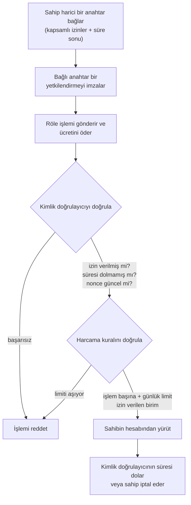

# Hesap Soyutlama

QoreChain, `x/abstractaccount` modülü aracılığıyla **protokol düzeyinde hesap soyutlama** sağlar. Modül, harcama kurallarına sahip soyut hesapları kaydeder ve hesap sahibinin, hesaptan izin ve harcama limiti sınırları içinde harcama yapabilen harici anahtarları (**kimlik doğrulayıcılar**) bağlamasına olanak tanır; harici akıllı sözleşme altyapısı gerekmez.

:::danger Ana ağda veya test ağında etkin değil
Soyut hesap modülü şu anda her iki ağda da **kapalıdır**: `qorechaind query abstractaccount config` (ve `GET /qorechain/abstractaccount/v1/config`), `qorechain-vladi` ve `qorechain-diana` üzerinde `enabled: false` bildirir. Zincir v3.2.0'dan itibaren bu bayrak her yolda uygulanır: zincir, hesap oluşturmayı, kimlik doğrulayıcı kaydını ve her iki yürütme hattını (`MsgExecuteEVM`, `MsgExecuteCosmos`) `abstract accounts are disabled on this chain` iletisiyle reddeder. Hiçbir işlem modülü açamaz ve ana ağa bugüne kadar hiçbir soyut hesap işlemi dahil edilmemiştir. Aşağıdaki her şey modülün arayüzlerini yalnızca başvuru amacıyla anlatır. Modül etkinleştirilene kadar canlı ağlarda bağlı anahtar veya devredilmiş harcama akışı oluşturmayın ve önce bayrağı kontrol edin.
:::

:::note
Aşağıdaki komutlar, 7 Haziran 2026'dan beri canlı olan ve 3.742.566 yüksekliğine kadar düğüm sürümü **v3.2.3**'ü, o bloktan itibaren **v3.2.4**'ü çalıştıran (yönetişim önerisi 13) **`qorechain-vladi`** ana ağını kullanır. 19 Ekim 2026'dan beri v3.2.4 çalıştıran test ağı için `--chain-id qorechain-diana` ile değiştirin.
:::

:::caution Her Cosmos hattı işlemi hibrit kuantum sonrası eş imza gerektirir
Bu sayfadaki `qorechaind tx` örnekleri yalnızca ücret bayraklarını gösterir. Canlı ağlarda her Cosmos hattı işlemi ayrıca ML-DSA-87 hibrit eş imzasını da taşımalıdır; bu nedenle işlemi `--generate-only` ile oluşturun ve `qorechaind tx pqc cosign` ile imzalayın (veya bunu sizin yerinize yapan QoreX'i ya da SDK'yı kullanın). `qorechaind`'in topluluk sürümü bu imzayı üretemez; [indirme manifestindeki](/developer-guide/running-a-node#fetch-the-manifest) sürüm ikili dosyasını kullanın. Ücret tabanı **gaz birimi başına 0.1 uqor**'dur, dolayısıyla `--gas 400000` için en az `--fees 40000uqor` gerekir. Bkz. [Kuantum Sonrası İmzalama](/developer-guide/post-quantum-signing).
:::

## Genel Bakış

Geleneksel blok zinciri hesapları tek bir özel anahtar tarafından kontrol edilir. Hesap soyutlama, "bir işlemi kimin yetkilendirebileceği" kavramını tek bir kriptografik anahtardan ayırır. `x/abstractaccount` modülü şunları sağlar:

* Kayıtlı bir hesap türüne ve sahibe sahip **soyut hesaplar**
* Bağlı anahtarların harcayabileceği tutarı sınırlayan **harcama kuralları** (işlem başına ve günlük limitler, izin verilen birimler)
* **Kimlik doğrulayıcılar**: sahibin kapsamlı izinler ve bir süre sonu ile bağladığı ve istediği zaman iptal edebildiği harici anahtarlar (bir Phantom ed25519 anahtarı veya bir MetaMask secp256k1 adresi)

*Bağlı anahtar (kimlik doğrulayıcı) akışı: bağlı anahtar bir yetkilendirmeyi imzalar, bir röle bunu gönderir, modül izinleri, süre sonunu ve harcama kurallarını kontrol eder, ardından sahibin hesabından yürütür.*



## Hesap Türleri

`create`, üç hesap türünden birini kaydeder. Tür hesapta saklanır ve adresin nasıl türetildiğinin bir parçasıdır; modülün kendine ait çoklu imza, oturum anahtarı veya kurtarma işlemi yoktur (işlem hizmeti `create`, `update-rules`, `register-authenticator`, `revoke-authenticator`, `execute-cosmos`, `execute-evm`'dir).

| Tür               | Amaçlanan kullanım              |
| ----------------- | ------------------------------- |
| `multisig`        | DAO hazineleri, paylaşılan cüzdanlar |
| `social_recovery` | Tüketici cüzdanları, kayıt süreci |
| `session_based`   | dApp oturumları, mobil cüzdanlar |

## Soyut Hesap Oluşturma

`create`, hesap türünü konumsal argüman olarak alır (`multisig`, `social_recovery` veya `session_based`):

```bash
qorechaind tx abstractaccount create session_based \
  --from mykey \
  --gas 400000 --fees 40000uqor
```

Komutun imzalayanlar, eşikler veya vasiler için bayrakları yoktur.

## Kimlik Doğrulayıcılar (bağlı anahtarlar)

Modülün devredilmiş anahtar mekanizması, aşağıda [Bağlı Cüzdan Kimlik Doğrulayıcıları](#authenticators) bölümünde açıklanan **kimlik doğrulayıcı**dır: sahip, bir dizi izin ve bir süre sonu ile harici bir anahtar (ed25519 veya secp256k1) bağlar ve istediği zaman iptal eder:

```bash
qorechaind tx abstractaccount register-authenticator <account-address> <scheme> <pubkey-base64> <permissions-csv> <expiry-unix> <label> \
  --from mykey --gas 400000 --fees 40000uqor
qorechaind tx abstractaccount revoke-authenticator <account-address> <scheme> <pubkey-base64> \
  --from mykey --gas 400000 --fees 40000uqor
```

`scheme`, `ed25519` (örneğin Phantom) veya `secp256k1`'dir (örneğin MetaMask). `grant-session`, `revoke-session` veya `query abstractaccount sessions` komutu yoktur.

## Harcama Kuralları

Harcama kuralları, soyut hesaplara finansal korumalar ekler:

| Kural             | Açıklama                                            |
| ------------------ | ------------------------------------------------------ |
| `daily_limit`      | UTC takvim günü başına maksimum toplam harcama          |
| `per_tx_limit`     | Yetkilendirilmiş tek bir yürütme başına maksimum harcama |
| `allowed_denoms`   | Harcanabilecek token birimlerini kısıtlar (bir ERC-20, `erc20/<contract>` olarak listelenir) |
| `denom_limits`     | Ondalık dizeler olarak birim başına limitler (v3.2.2): `{"denom","per_tx_limit","daily_limit"}`; adlandırdıkları birimler için `per_tx_limit` ve `daily_limit` yerine geçerler, böylece 18 ondalıklı bir token sınırlandırılabilir |
| `allowed_evm_calls` | Kurala bağlı bir anahtarın **çağrı verisiyle** yapabileceği EVM çağrıları (v3.2.2), `0x<target>` (o kontratın herhangi bir fonksiyonu) veya `0x<target>/0x<selector>` (yalnızca o fonksiyon) olarak. Bir girdi olmadan, kurala bağlı bir anahtar yalnızca değer gönderebilir, (`deploy` izniyle) dağıtım yapabilir ve `allowed_denoms` içinde listelenen ERC-20 token'larını taşıyabilir. Bir hedefi listelemek, ona yapılan çağrıların alıcılar dahil her argümanına güvenmek demektir |

### Harcama Kurallarını Ayarlama

`update-rules`, hesabın kurallarını `SpendingRule` nesnelerinden oluşan bir JSON dizisiyle değiştirir (satır içi JSON; dosya veya bayrak değil):

```bash
qorechaind tx abstractaccount update-rules <account-address> \
  '[{"id":"daily","enabled":true,"daily_limit":1000000000,"per_tx_limit":100000000,"allowed_denoms":["uqor"]}]' \
  --from mykey --gas 400000 --fees 40000uqor
```

Limitler temel birimle (`uqor`) belirtilir ve yetkilendirilmiş her yürütme için sayılır; günlük limit, UTC takvim günü başına toplamı sınırlar. Kurallar, saklanan kuralların tamamının yerine geçer; bu nedenle atladığınız bir alan kaldırılır. v3.2.2'den itibaren EVM hattı, yalnızca `msg.value` yerine bir çağrının gerçekte neyi hareket ettirdiğini ölçer (yerel değer, hesabın yerel bakiyesindeki azalma, harcanan bank coin'leri ve listelenen her ERC-20'nin bakiye veya izin (allowance) değişimi) ve kontrat oluşturma ayrı `deploy` iznini gerektirir. Daha zengin bir örnek:

```bash
qorechaind tx abstractaccount update-rules <account-address> \
  '[{"id":"daily","enabled":true,"daily_limit":5000000,"allowed_denoms":["uqor","erc20/0xTOKEN"],"allowed_evm_calls":["0xROUTER/0x38ed1739"],"denom_limits":[{"denom":"erc20/0xTOKEN","per_tx_limit":"100000000000000000000","daily_limit":"500000000000000000000"}]}]' \
  --from mykey --gas 400000 --fees 40000uqor
```

### Mevcut Kuralları Sorgulama

Hesap kaydı, kurallarını ve bağlı anahtar sayısını içerir:

```bash
qorechaind query abstractaccount account <account-address>
```

:::caution Bir kural, bir anahtarı yalnızca anahtar varsa sınırlar
Zincir limiti şu sırayla belirler: kimlik doğrulayıcının kendi kuralı ayarlıysa ve `enabled` ise o; değilse hesaptaki ilk `enabled` kural; değilse **limit yoktur**. `enabled: false` ile saklanan bir kural, sıfır limit değil, limitsizlik anlamına gelir. `MsgRegisterAuthenticator` herhangi bir kural taşımaz; bu nedenle yalnızca bu mesajla bağlanan bir anahtar, ancak hesap düzeyindeki bir kuralla sınırlanır. `update-rules` ile bir kuralı bilinçli olarak ayarlayın ve yalnızca anahtarın ihtiyaç duyduğu izinleri kaydedin. Bir limit, bağlı bir anahtarın verebileceği zararı sınırlar; anahtarı iptal etmenin yerini tutmaz.
:::

## Bağlı Cüzdan Kimlik Doğrulayıcıları — Devredilmiş Harcama {#authenticators}

Kimlik doğrulayıcı tasarımı **v3.1.85** zincir sürümünde tanıtıldı (v3.1.84 izin modeli üzerine inşa edilerek). Modül devre dışıyken **canlı ağlarda kullanılamaz** (bu sayfanın başındaki durum kutusuna bakın). **Bağlı bir harici cüzdan anahtarı** — bir Phantom (ed25519) anahtarı ya da bir MetaMask (secp256k1) hesabı — en az ayrıcalık, harcama limitli ve iptal edilebilir koşullar altında **kanonik kuantum sonrası hesaptan harcama yapabilir**. Harici anahtar hiçbir zaman bir ML-DSA imzası üretmez; bir **röle (relayer)** işlem zarfını gönderir ve ödemesini yapar (röle'nin kendi hibrit PQC imzası zincirin imzalama gereksinimlerini karşılar), kimlik doğrulayıcının **alan ayrımlı, tekrar oynatmaya karşı bağlanmış imza baytları** üzerindeki imzası ise yetkilendirmeyi oluşturur.

### Kimlik doğrulayıcı kaydetme {#register-authenticator}

Hesap sahibi, harici anahtarı `MsgRegisterAuthenticator` ile kaydeder (sıradan bir kök anahtar işlemi); bu işlemde bir şema, izinler, bir süre sonu ve isteğe bağlı harcama limitleri belirtilir:

```js
import { registerEthAuthenticatorMsg } from "@qorechain/wallet-adapter";

// Link a MetaMask account by its 20-byte address (EIP-191 verification):
const msg = registerEthAuthenticatorMsg({
  owner: "qor1owner...",              // the canonical account (signs this message)
  ethAddress: "0xAbC...123",          // the MetaMask address to link
  permissions: ["evm"],               // least privilege — see the taxonomy below
  expiryUnix: Math.floor(Date.now() / 1000) + 30 * 24 * 3600, // absolute Unix seconds, ≤ 30 days recommended
  label: "metamask",
});
// Limits are a separate message (MsgUpdateSpendingRules), see "Spending Rules" above.
// Sign & broadcast this msg with the OWNER's normal hybrid-PQC signer.
```

Bir Phantom anahtarı, `ed25519` şeması ve Phantom ortak anahtarı ile aynı şekilde kaydedilir (CLI'da `register-authenticator`). İptal işlemi `MsgRevokeAuthenticator` ile anında gerçekleşir.

### İzin taksonomisi {#permission-taxonomy}

Kaydedilmiş bir kimlik doğrulayıcının neler yapabileceğini on bir kurallı izin belirler. Eşleme **fail-closed**'dır: eşlemesi olmayan bir mesaj türü reddedilir.

| İzin | Sağladığı Yetki |
| --- | --- |
| `send` | Native-lane banka transferleri |
| `delegate` / `withdraw` / `vote` | Stake etme, ödül çekme, yönetişim |
| `evm` / `wasm` / `svm` | İlgili VM hattında yürütme |
| `amm` / `ibc` / `deploy` | AMM işlemleri, IBC transferleri, sözleşme dağıtımı |
| `all` | Devredilebilir herhangi bir mesaj |

**Anahtar yönetimi mesajları asla devredilemez** — `MsgRegisterAuthenticator`, `MsgRevokeAuthenticator`, PQC anahtar kaydı/geçişi ve `MsgRotatePQCKey` her zaman kök anahtarı gerektirir; böylece bağlı bir anahtar kendi ayrıcalıklarını asla yükseltemez. Şema (`schema_version` 2) ayrıca `lane_rules` listesini de verir: hesabın adresinden kontrat oluşturma, hesabın EVM nonce'unu ilerleten bir çağrı ve kodu bir EIP-7702 delegasyonu olduğunda hesabın kendisine yapılan bir çağrı, her biri `deploy` veya `all` iznini gerektirir. v3.2.3'ten itibaren kayıt, bilinmeyen izin dizelerini ve hiçbir zaman doğrulanamayacak 65 baytlık secp256k1 anahtarlarını reddeder.

Sabit kodlamak yerine (kayma tespiti için `schema_version` içeren) canlı taksonomiyi okuyun:

```bash
curl -s https://api.qore.host/qorechain/abstractaccount/v1/permission_schema | jq
# or: qorechaind query abstractaccount permission-schema
```

### Bağlı bir anahtarla harcama yapma {#execute-messages}

Kimlik doğrulayıcı tarafından yetkilendirilen eylemleri iki mesaj taşır. Her ikisinde de röle, işlemin imzalayıcısı/ücret ödeyicisidir; kimlik doğrulayıcının imzası mesajın içinde taşınır.

**`MsgExecuteEVM`** — **kanonik hesabın `0x…` adresinden** yapılan bir EVM çağrısı veya transferi. Kimlik doğrulayıcı `sha256("qorechain-evm-auth-v1" ‖ chainId ‖ account ‖ pubkey ‖ to ‖ value ‖ data ‖ nonce)` değerini imzalar (tüm alanlar uzunluk ön ekli). v3.2.3'ten itibaren (`abstractaccount-hardening` özelliği) zincir **v2 özetini** (digest) zorunlu kılar: `sha256("qorechain-evm-auth-v2" ‖ … ‖ nonce ‖ gasLimit)`; bu, çağrının gaz limitini (8 baytlık big-endian) de bağlar, böylece bir röle imzayı farklı bir limitle tekrar oynatamaz; hiçbir blok her iki biçimi birden kabul etmez. `qorechaind query abstractaccount auth-sign-evm` bunun için `--gas-limit` alır ve aynı değeri `execute-evm`'e verirsiniz. Tekrar oynatma koruması hesabın kendi EVM nonce'udur.

**`MsgExecuteCosmos`** — kanonik hesaptan yapılan bir Native-lane banka gönderimi. Kimlik doğrulayıcı `sha256("qorechain-cosmos-auth-v1" ‖ chainId ‖ account ‖ pubkey ‖ to ‖ amount ‖ nonce)` değerini imzalar. Tekrar oynatma koruması, modül tarafından tutulan **kimlik doğrulayıcı başına bir sıra numarasıdır** (bir banka gönderimi hesabın nonce'unu artırmaz). Kendine gönderimler reddedilir.

:::caution Nonce kuralları
* `MsgExecuteEVM.nonce` = hesabın **mevcut** EVM nonce'u (`eth_getTransactionCount(account0x, "latest")`). Üretimde röle *farklı* bir hesap olduğundan, +1 **eklemeyin**. Eski bir nonce'un imzalanması `11` kodunu döndürür.
* `MsgExecuteCosmos.nonce` = kimlik doğrulayıcı başına sıra numarası (hesabın kimlik doğrulayıcı durumunu sorgulayın), hesabın Cosmos sıra numarası **değil**. v3.2.4'ten itibaren (test ağında 19 Ekim 2026'dan beri; ana ağda 3.742.566 yüksekliğinden itibaren), `GET /qorechain/abstractaccount/v1/auth_nonce/{address}/{pubkey_hex}` bu sıra numarasını doğrudan döndürür (`nonce`, `linked`).
:::

**Phantom örneği** (tarayıcı: Phantom imzalar, arka ucunuz röleler):

```js
import { buildPhantomExecuteCosmos } from "@qorechain/wallet-adapter";

// In the dApp: Phantom signs the digest with ed25519 signMessage.
const msg = await buildPhantomExecuteCosmos({
  wallet: window.solana,              // Phantom: { publicKey, signMessage }
  relayer: "qor1relayer...",          // submits the tx and pays the fee (a different account)
  chainId: "qorechain-vladi",
  account: "qor1owner...",            // canonical account being spent from
  to: "qor1recipient...",
  amount: "900000uqor",               // single-coin string
  nonce: authSequence,                // per-authenticator sequence
});
// Send `msg` to your relayer; the relayer wraps it in a tx it signs
// (hybrid PQC) and broadcasts. The transfer moves the OWNER's funds.
```

**MetaMask örneği** (bağlı 20 baytlık adresten EIP-191 `personal_sign`):

```js
import { buildMetaMaskExecuteEvm } from "@qorechain/wallet-adapter";

const msg = await buildMetaMaskExecuteEvm({
  provider: window.ethereum,          // MetaMask (EIP-1193)
  address: ethAddress,                // the linked 20-byte address
  relayer: "qor1relayer...",
  chainId: "qorechain-vladi",
  account: "qor1owner...",
  to: "0xRecipient...",
  value: (10n ** 16n).toString(),     // 0.01 QOR in wei (18-decimal EVM view), as a decimal string
  gasLimit: 100000,
  nonce: currentEvmNonce,             // eth_getTransactionCount(owner0x, "latest")
});
// Relay as above. The chain verifies the signature via EIP-191 + ecrecover
// against the registered 20-byte address.
```

Aynı oluşturucular, beş dilin tümü için [QoreChain SDK](/sdk/guides/authenticators)'da ve buna karşılık gelen CLI komutlarında da mevcuttur:

```bash
# Generate an ed25519 authenticator key: the seed goes to a new 0600 file, only the public key is printed
qorechaind query abstractaccount auth-keygen --out authenticator.seed

# Sign the exact bytes the chain verifies (seed from --seed-file, "-" for stdin, QORE_AUTH_SEED, or a prompt)
qorechaind query abstractaccount auth-sign-cosmos <chain-id> <account> <to> <amount> <nonce> --seed-file authenticator.seed
qorechaind query abstractaccount auth-sign-evm <chain-id> <account> <to-0xhex> <value-wei> <data-hex> <nonce> --seed-file authenticator.seed

# Relay a pre-signed authorization (the relayer's --from key pays; cosign the envelope with `tx pqc cosign`)
qorechaind tx abstractaccount execute-cosmos <account> <to> <amount> <scheme> <pubkey-base64> <signature-base64> <nonce> --from relayer --generate-only > tx.json
qorechaind tx abstractaccount execute-evm <account> <to-0xhex> <value-wei> <data-hex> <gas-limit> <scheme> <pubkey-base64> <signature-base64> <nonce> --from relayer --generate-only > tx.json
```

Bu komutlardaki anahtarlar ve imzalar base64'tür. `auth-sign-*` yardımcıları tohumu (seed) komut satırı argümanı yerine bir dosyadan, stdin'den veya ortam değişkeninden okur (düğüm sürümü v3.2.1 ve sonrası); böylece tohum kabuk geçmişinde görünmez. Tohum işleme bayrakları (`--out`, `--seed-file`) yalnızca v3.2.1 ve sonrası ikili dosyalarda bulunur.

### Hata kodları {#authenticator-errors}

Uygulama hataları, cüzdanların doğru mesajı gösterebilmesi için ayrı kodlar döndürür (kod alanı `abstractaccount`):

| Kod | Anlamı | Cüzdan Arayüzü |
| --- | --- | --- |
| `5` | Harcama limiti aşıldı (işlem başına veya günlük) | Kalan izni gösterin |
| `6` | Kimlik doğrulayıcının süresi doldu | "Süresi doldu — cüzdanınızı yeniden bağlayın" |
| `9` | Modül devre dışı (her iki ağdaki canlı durum) | "Bağlı cüzdanlar henüz kullanılabilir değil" |
| `10` | İzin reddedildi (kapsam veya devredilemeyen mesaj) | Eksik izni gösterin |
| `11` | Tekrar oynatma reddedildi (eski nonce/sıra numarası) | Nonce'u yeniden sorgulayın ve yeniden imzalayın |

(Kod alanı `pqc`, kod `21` = hibrit imza doğrulaması başarısız oldu — bir yetkilendirme sorunu değil, röle tarafında bir imzalama sorunu.)

### REST sorguları {#abstractaccount-rest}

Modülün okuma sorguları REST üzerinden sunulur (**v3.1.85**'ten itibaren):

```
GET /qorechain/abstractaccount/v1/config      # {"config":{"enabled":false,...}} on both networks today
GET /qorechain/abstractaccount/v1/accounts
GET /qorechain/abstractaccount/v1/accounts/{address}
GET /qorechain/abstractaccount/v1/permission_schema
```

## Soyut Hesapları Sorgulama

### CLI

```bash
# Module configuration (enabled flag and limits)
qorechaind query abstractaccount config

# Get full account configuration
qorechaind query abstractaccount account <address>

# List all abstract accounts (paginated)
qorechaind query abstractaccount accounts --page-limit 10
```

Ana ağda hesap listesi boştur; test ağı, etkin bayrağı her yolda uygulanmadan önce oluşturulmuş birkaç hesabı listeler.

### JSON-RPC

> **Henüz sunulmuyor:** yayımlanmış hiçbir düğüm sürümü `qor_` JSON-RPC ad alanını sunmaz; bu nedenle `qor_getAbstractAccount` bugün her genel uç noktada `-32601` (yöntem bulunamadı) döndürür. Yukarıdaki REST yollarını veya CLI'yı kullanın. Bkz. [`qor_` ad alanı](/api-reference/json-rpc-qor_-namespace).

### Örnek Hesap Yanıtı

Bir soyut hesap kaydının yapısı (örnek değerler):

```json
{
  "address": "qor1myaccount...",
  "account_type": "session_based",
  "owner": "qor1owner...",
  "spending_rules": [
    {
      "id": "daily",
      "enabled": true,
      "daily_limit": "1000000000",
      "per_tx_limit": "100000000",
      "allowed_denoms": ["uqor"]
    }
  ]
}
```

## Sosyal Kurtarma

`social_recovery` bir hesap türüdür, ancak modülün kurtarma işlemi yoktur: `initiate-recovery` veya `approve-recovery` komutu yoktur ve modülün işlem hizmetinde bir kurtarma mesajı bulunmaz. Bir QoreChain hesabının anahtar kurtarması, hesabın kuantum sonrası anahtarının anımsatıcı ifadeden (mnemonic) yeniden türetilmesiyle (`tx pqc recover-key`) ve gerekirse döndürülmesiyle (`tx pqc rotate-key`) yapılır; bkz. [Kuantum Sonrası İmzalama](/developer-guide/post-quantum-signing).

## dApp'lerle Entegrasyon

Modül etkinleştirildiğinde, bağlı anahtarla yetkilendirme şu tür akışlar için tasarlanmıştır:

* Tekrarlanan biyometrik istemlerin rahatsız edici olduğu mobil cüzdanlar
* Sınırlı bir izin dahilinde hızlı işlem imzalama gerektiren oyun dApp'leri
* QoreChain hesaplarından bir röle aracılığıyla harcama yapan Phantom veya MetaMask kullanıcıları

Bir dApp arka ucu röle görevi görür: bağlı anahtarın imzalı yetkilendirmesini alır, kendi imzaladığı bir işleme sarar ve yayınlar. Bağlı anahtar istenildiği zaman iptal edilebilir veya süresi dolabilir. Hedeflediğiniz ağda modül etkinleştirilene kadar [QoreX veya SDK](/sdk/overview) üzerinden olağan imzalamayı kullanın.

## Sonraki Adımlar

* [Validator Çalıştırma](/developer-guide/running-a-validator) — Bir validator düğümü kurma ve işletme
* [EVM Geliştirme](/developer-guide/evm-development) — EVM araçları, hesaplar ve EVM yetkilendirme penceresi
* [VM'ler Arası Birlikte Çalışabilirlik](/developer-guide/cross-vm-interoperability) — VM'ler arası mesajlaşma
