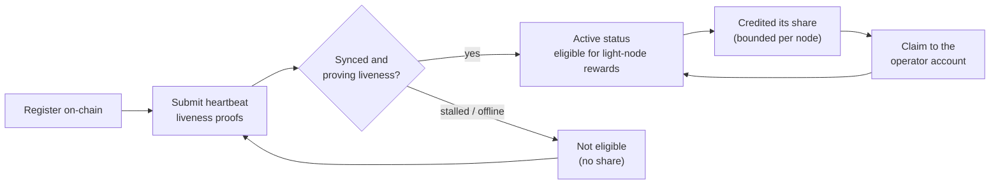

# Ödüller ve İzleme

Kayıtlı bir hafif node, hafif-node tahsisatından bir pay alır ve buna uygun olmaya devam edebilmek için **sağlıklı kalması gerekir**. Bu sayfa %3'lük hafif-node ödül payını, ödüllerin nasıl kredilendirildiğini ve talep edildiğini, node'un delegasyonlarla ne yapıp ne yapmadığını ve node'un nasıl izleneceğini ele alır.

:::note Buradaki hiçbir şey bir kazanç vaadi değildir
Kayıt her iki ağda da açıktır; güncel durum için bkz. [Ödül programının durumu](/light-node/overview#reward-program-status). Bir node'a ne kadar kredi verileceği; hafif-node tahsisatına, uygun node sayısına, bu node'ların stake'ine ve uptime'ına ve aşağıda açıklanan node başına sınıra bağlıdır.
:::

## %3 blok-ödülü payı

QoreChain'in ücret dağıtımı, ağ verisi sunan hafif node'lar için sabit bir **%3 pay** ayırır. Bu, protokolün ödül dağılımındaki beş hedeften biridir — validatörler (%37), yakılan (%30), hazine (%20), staker'lar (%10) ve **hafif node'lar (%3)** — ve zincir üzerinde uygulanır. Tam döküm için bkz. [Tokenomics](/architecture/tokenomics).

Bu paya katılmak için bir node'un, kendi beyanına değil zincir üzerindeki kontrole dayanan şunlara ihtiyacı vardır: aktif bir `lightnode_operator` lisansı (kayıt olurken kontrol edilir), bağlı (bonded) validatörlere **en az 1,000 QOR delege edilmiş** olması — delege ettiğiniz tüm validatörler genelindeki toplamınız olarak sayılır, validatör başına değil; hapsedilmiş (jailed) veya bağı çözülmüş (unbonded) validatörlere yapılan delegasyonlar sayılmaz; kayıt sırasında gereklidir ve ödüller kredilendirilirken her seferinde staking'den yeniden okunur — ve kayıt olurken bir kez ödenen **1 QOR**'luk bir kayıt ücreti. Katılım ayrıca ağ genelinde **10,000 hafif node** ile sınırlandırılmıştır. Kaydın nasıl işlediği için [Kayıt ve Lisanslama](/light-node/registration-and-licensing) sayfasına, güncel durum için ise [Ödül programının durumu](/light-node/overview#reward-program-status) bölümüne bakın.

%3, hafif-node modülüne akan tutardır; node başına bir hak değildir: uygun her node, biriken tutardan stake ağırlıklı payıyla kredilendirilir; node başına sınırlandırılır ve kazanılmayan her şey yalnızca bir yönetişim oylamasının serbest bırakabileceği bir rezerve gider. Zincir v3.2.3'ten beri node başına sınır **30 günde 2,000 QOR**'dur (`max_reward_per_month_per_node`); uzlaşmalar arasında geçen blok süresine orantılanır ve uptime'a göre ölçeklenir (`lightnode-monthly-cap` kuralı); bu, önceki blok başına sınırın (`max_reward_per_block_per_node`, blok başına `1713` uqor) yerini alır. Bkz. [%3 hafif-node ödül payı](/light-node/overview#the-3-light-node-reward-share).

Kayıt ve delegasyon tamamlandıktan sonra, uygun kalmak canlı kalmakla ilgili bir meseledir. Bir node'un en az **%80 çalışma süresine (uptime)** sahip olması ve **1,000 blokluk bir aralıkta** (ölçülen yaklaşık 3.2 sn'lik ortalama blok süresinde mainnet'te yaklaşık 54 dakika; yaklaşık saniyede bir blok üreten testnet'te yaklaşık 17 dakika) heartbeat canlılık kanıtları göndermeye devam etmesi gerekir.

**Zamanlama kuralları.** Zincir, **bir önceki heartbeat'inizden 1,000 bloktan daha kısa süre sonra** gönderilen bir heartbeat'i reddeder (`heartbeat submitted too early`); kayıttan sonraki ilk heartbeat'inizin böyle bir alt sınırı yoktur. Sonuncusundan — veya hiç göndermediyseniz kayıttan — itibaren **1,000 + 100 blok** (`heartbeat_interval` artı `heartbeat_grace_period`; mainnet'te yaklaşık 54 dakika artı yaklaşık 5 dakikalık bir ek süre) içinde hiçbir heartbeat gelmezse, node etkin değil olarak işaretlenir ve kredilendirilmesi durur. Daha sonra gönderilen bir heartbeat yine kabul edilir ve node'u yeniden etkinleştirir. Daemon, node'unuz için zincirin kendi `last_heartbeat` değerinden bu yana 1,000 blok geçer geçmez bir sonraki heartbeat'i gönderir ve her 60 saniyede bir kontrol eder.

**Pencereyi kaçırmak uptime'a mal olur, kaydınıza değil.** Pencereyi kaçıran bir node etkin değil olarak işaretlenir ve kazanmayı durdurur, ancak bir sonraki başarılı heartbeat node'u hemen yeniden etkinleştirir — yapılacak bir yeniden kayıt yoktur. **Uptime**'ınız, kayıt olduğunuz bloktan bu yana alınan heartbeat'lerin beklenen heartbeat'lere (her 1,000 blokta bir) oranıdır ve en fazla 1 ile sınırlıdır. `min_uptime_for_rewards` eşiğinin (`0.80`) altında bir node hiçbir şey kazanmaz; eşikte veya üzerinde, node başına tavan uptime'ınıza göre ölçeklenir. Uzun bir kesinti bu nedenle oranı düşürür ve oran yalnızca zamanında heartbeat'ler biriktikçe toparlanır. Bir node etkin değil görünüyorsa `status` komutunu kontrol edin: imzalayanı, lisansı ve kayıt durumunu bildirir.

:::note Bir heartbeat gerçekte neyi kanıtlar
Başarılı bir heartbeat, operatörün anahtarının zamanında imzaladığını kanıtlar — bir node'un yazılımın tamamını kesintisiz çalıştırdığını kanıtlamaz. Bunu "etkin bir node olarak doğrulandı" değil, bir canlılık imzası olarak değerlendirin.
:::

:::note `last_heartbeat` bir blok yüksekliğidir, zaman damgası değil
Bir node'un zincir üzerindeki kaydını doğrudan sorgularsanız, `last_heartbeat` bir blok yüksekliğidir ve `0` değeri, henüz hiç heartbeat kaydedilmediği anlamına gelir — bu durumda zincir, hareketsizlik son tarihini node'un `registered_at` yüksekliğinden itibaren ölçer. `0` değerini saf bir geçen-zaman hesaplaması olarak okumak, yeni kayıt olmuş bir node'un milyonlarca blok gecikmiş gibi görünmesine yol açar.
:::

*Ödül uygunluğu: aktif bir zincir üzerindeki lisansı ve minimum bonded stake'i elinde tutmak, kayıt olmak, ardından uptime ve heartbeat-aralığı eşiklerinin üzerinde kalmak için heartbeat'ler aracılığıyla canlılığı kanıtlamaya devam etmektir.*



## Ödüller nasıl işler {#how-rewards-work}

### Kredilendirme

Her 100 blokta bir zincir, uygun her node'u (aktif olan, en az minimum delege edilmiş stake'e ve en az minimum uptime'a sahip olan) biriken tutardan payıyla kredilendirir; bu pay (önceki uzlaşmadan bu yana geçen süreye orantılı olarak 30 günde en fazla 2,000 QOR), [%3 hafif-node ödül payı](/light-node/overview#the-3-light-node-reward-share) bölümünde açıklandığı gibi node başına sınırlandırılır. Tutar, node'un `accumulated_rewards` değerine eklenir. Şununla okuyun:

```bash
curl -s https://api.qore.host/qorechain/lightnode/v1/rewards/<operator-address>
# or: qorechaind query lightnode rewards <operator-address>
```

(Testnet için `https://api-testnet.qore.host` kullanın.)

### Talep etme

Kredilendirilen ödüller, siz talep edene kadar node kaydında kalır. Node bunları sizin için talep edebilir: `[delegation]` altında `auto_claim = true` ayarlayın; daemon, biriken hafif-node ödülleri `min_reward_claim` değerini (varsayılan `1000000` uqor, 1 QOR) aştığında bunları operatör hesabına talep eder ve her `compound_interval` (varsayılan `1h`) aralığında kontrol eder. Talebi heartbeat'lerle aynı şekilde imzalar (yerel olarak veya `qorechaind` alternatifi aracılığıyla). Otomatik talep **varsayılan olarak kapalıdır** ve yalnızca talep eder: node asla yeniden delege etmez veya stake'i taşımaz.

`qorechaind` ile elle talep etmek için (operatör anahtarı bir `qorechaind` keyring'inde ve post-kuantum anahtar `lightnode-sx keys export <key-name> --out ~/.qorechaind/pqc/<key-name>.dilithium` ile dışa aktarılmış olarak) bir generate-then-cosign çifti kullanın:

```bash
qorechaind tx lightnode claim-rewards --from operator --chain-id <chain-id> --node https://rpc.qore.host --gas 300000 --fees 30000uqor --generate-only > claim.json
qorechaind tx pqc cosign claim.json --from operator --pqc-key <key-name> --chain-id <chain-id> --node https://rpc.qore.host
```

`qorechaind tx lightnode deregister` kaydı kaldırır ve hâlâ kredilendirilmiş olan her şeyi öder; kayıt ücreti iade edilmez.

### Delegasyon takibi ve itibar uyarıları

Node, operatör hesabının delegasyonlarını zincirden başlangıçta ve ardından her beş dakikada bir yansıtır. `rebalance_enabled` açıkken (varsayılan), delege ettiğiniz her validatörün itibar puanını da kontrol eder ve `min_reputation` değerinin (varsayılan `0.5`) altındaki her biri için bir uyarı kaydeder. Stake'i taşımaz: delegasyonları kendi cüzdanınızdan değiştirin. (`[delegation]` içindeki `validators` ve `split_weights` seçenekleri kabul edilir ancak şu anda kullanılmamaktadır.)

### Ödülleri ve delegasyonları inceleme

```bash
lightnode-sx validators   # the bonded validator set
lightnode-sx delegation   # the operator account's delegations, as mirrored by the running daemon
lightnode-sx rewards      # the operator account's pending staking rewards
```

3.1.6'dan beri bu komutlar ve UX **Delegation** görünümü `operator_address` içindeki hesabı okur. `rewards`, hafif-node ödüllerini değil, delegasyonlarınızdan gelen **staking** ödüllerini gösterir. Her şeyi doğrudan zincirden okumak için:

```bash
curl -s https://api.qore.host/cosmos/staking/v1beta1/delegations/<operator-address>
curl -s https://api.qore.host/cosmos/distribution/v1beta1/delegators/<operator-address>/rewards
curl -s https://api.qore.host/qorechain/lightnode/v1/rewards/<operator-address>   # light-node rewards
```

## İzleme

Node'u sağlıklı tutmak, onu ödüllere uygun tutan şeydir. İzlenmeye değer üç şey vardır.

### Telemetri

Gerçek zamanlı telemetri; validatörleri, konsensüsü/ağı, köprüyü ve tokenomiği kapsar; her biri kendi aralığında yenilenir (`config.toml` içindeki `[telemetry]` altında yapılandırılır). CLI üzerinden:

```bash
lightnode-sx status    # node and light-client sync status
lightnode-sx network   # recent synced headers and latest height
```

UX sürümü aynı veriyi **Overview**, **Network**, **Bridge** ve **Tokenomics** görünümlerinde canlı olarak sunar — bkz. [UX Edition](/light-node/ux-edition).

### Senkronizasyon ve heartbeat sağlığı

`status` komutu zincir kimliğini, en son blok yüksekliğini, zincirin yetişip yetişmediğini, hafif istemcinin senkronize olduğu yüksekliği ile senkronizasyon durumunu, `Signer` bilgisini (yerel, `qorechaind` veya nedeniyle birlikte kullanılamıyor) ve — `operator_address` ayarlandıktan sonra — `Licence` ve `Registration` durumunu (node'un durumu ve son heartbeat yüksekliği dahil) bildirir. Kayıtlı, senkronize ve çalışan bir node, **heartbeat canlılık kanıtları** göndermeye devam eder ve böylece ödüllere uygun kalır. Bu heartbeat'ler, zincirin varsayılan olarak PQC gerektirmesiyle tutarlı biçimde bir **PQC-eş-imzalı (PQC-cosigned) işlem hattı** (hibrit Dilithium-5 / ML-DSA-87) aracılığıyla üretilir — hattın nasıl çalıştığı ve node'un imzalayıcısını nasıl seçtiği için bkz. [Kayıt ve Lisanslama](/light-node/registration-and-licensing#pqc-cosigned-heartbeat-pipeline). `status` node'un takıldığını veya senkronize olmadığını gösteriyorsa, canlılığını kanıtlamakta başarısız olabilir — uygunluk etkilenmeden önce araştırın.

### Öz-test sağlığı

Kriptografik yığında bir sorundan şüpheleniyorsanız, PQC öz-testini istediğiniz zaman çalıştırabilirsiniz:

```bash
lightnode-sx selftest
```

Bu, anahtar üretimi → imzalama → doğrulama → kurcalama tespiti (beş kontrol) sırasını çalıştırır ve herhangi bir başarısızlıkta sıfırdan farklı bir kodla çıkar. Bu, node sorunlarını teşhis ederken post-kuantum imzalama yığınındaki bir sorunu ekarte etmenin en hızlı yoludur. Tam öz-test dökümü için bkz. [SX Edition](/light-node/sx-edition).

### Zincir sorguları {#chain-queries}

Temel URL'ler: `https://api.qore.host` (mainnet) ve `https://api-testnet.qore.host` (testnet).

| Sorgu | Döndürür |
| --- | --- |
| `GET /qorechain/lightnode/v1/params` | Kayıt ücreti, heartbeat aralığı ve ek süresi, minimum delege edilmiş stake, ödül payı, minimum uptime, node sınırı. |
| `GET /qorechain/lightnode/v1/stats` | Kayıtlı ve aktif node sayıları, kredilendirilen toplam ödül. |
| `GET /qorechain/lightnode/v1/node/{address}` | Bir node'un kaydı (`status`, `last_heartbeat`, `total_heartbeats`, `expected_heartbeats`, `accumulated_rewards`). |
| `GET /qorechain/lightnode/v1/rewards/{address}` | Kredilendirilmiş ve henüz talep edilmemiş ödüller. |
| `GET /qorechain/lightnode/v1/reward_pool` | Modül bakiyesinin rezerv, kredilendirilmiş ödüller ve sonraki ödeme arasında nasıl bölündüğü; node başına sınırları içerir (`max_reward_per_month_per_node` ve önceki `max_reward_per_block_per_node`). |
| `GET /qorechain/license/v1/check/{address}/lightnode_operator` | Bir adresin aktif bir lisansa sahip olup olmadığı. |

## Sırada ne var

- [Kayıt ve Lisanslama](/light-node/registration-and-licensing) — kayıt olun ve canlı kalın.
- [Tokenomics](/architecture/tokenomics) — tam ödül ve yakma modeli.
