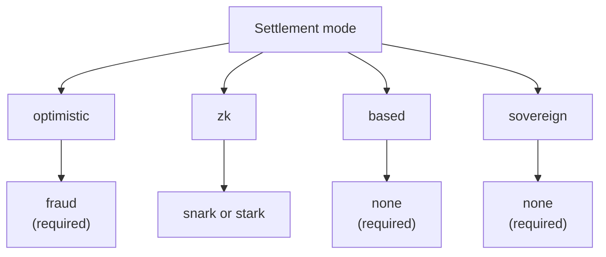

# Rollup'lara Genel Bakış

QoreChain **Rollup Development Kit (RDK)**; QoreChain üzerinde zincir üstü `x/rdk` modülü aracılığıyla mutabakata (settlement) ulaşan, uygulamaya özel rollup'lar oluşturmak için bir istemci kütüphaneleri kümesi (TypeScript, Python, Go, Rust ve Java), bir operatör komut satırı aracı ve başlangıç şablonlarıdır. Onunla bir rollup'ı yapılandırır, işlemlerini oluşturup imzalar, durumunu okur, itiraz pencerelerini (challenge window) takip eder, mutabakat makbuzları düzenleyip doğrular, çapraz-VM çağrıları ile para çekme ispatları hazırlarsınız. Her rollup; kendi blok süresi, sanal makinesi, ücret modeli ve sıralamasıyla (sequencing) bağımsız bir yürütme ortamıdır ve aynı zamanda QoreChain'in güvenliğini, post-kuantum kriptografisini ve veri erişilebilirliği (data availability) garantilerini devralır. Bu sayfa, bir rollup başlatmak veya işletmek isteyen geliştiriciler ve RDK'nın uygulamalarına uyup uymadığına karar veren herkes içindir.

:::caution Erken aşama bir yetenek
RDK her iki ağda da dağıtılmıştır, ancak **henüz hiçbirinde bir rollup oluşturulmamıştır** (27 Ekim 2026 itibarıyla kontrol edildi); dolayısıyla bu bölümde anlatılan akışlar üçüncü taraflarca denenmemiştir. **ZK mutabakatı (`defi` profili, `defi-rollup` şablonu ve her `zk` rollup'ı) henüz her iki ağda da kullanılamaz:** zincirde bir doğrulama anahtarını kaydetmenin yolu yoktur, bu yüzden her ZK batch'i ücreti ödendikten sonra reddedilir. Anahtar kaydı zincir v3.2.7 için planlanmıştır. O zamana kadar `optimistic` mutabakatı kullanın.

Ana ağ (**`qorechain-vladi`**, EVM zincir kimliği **9801**, 7 Haziran 2026'dan beri canlı) zincir sürümü **v3.2.4**'ü çalıştırır (3.742.566 yüksekliğinde, 23 Ekim 2026'da uygulandı, yönetişim önerisi 13); test ağı (**`qorechain-diana`**, EVM zincir kimliği **9800**) **v3.2.6** çalıştırır (v3.2.4 ona 19 Ekim 2026'da, v3.2.5 26 Ekim'de ve v3.2.6 27 Ekim'de ulaştı). Ana ağ yönetişim önerisi 14, v3.2.5'i 3.906.833 yüksekliğinde uygulayacaktır ve yazım sırasında oylama dönemindeydi; v3.2.5'in rollup'lar için neyi değiştirdiği, şimdilik test ağı ve yükseltmeden sonra ana ağ olarak etiketlenerek [zincir v3.2.5 davranışı](#v325) altında listelenir. Davranışın v3.2.3 ile v3.2.4 arasında değiştiği yerlerde bu bölüm hangi sürümün geçerli olduğunu belirtir. Her dağıtımı önce test ağında doğrulayın ve her sayfadaki durum notlarını okuyun: birçok yetenek (ZK doğrulaması, Celestia veri erişilebilirliği, QCAI Copilot, çapraz-VM çağrıları, mutabakat makbuzları) bugün uçtan uca kullanılamaz.
:::

## Yenilikler {#innovations}

* **Post-kuantum mutabakat makbuzları.** Bir batch'in durum çapası (state anchor), rollup oluşturucusunun kayıtlı anahtarıyla ML-DSA-87 kullanılarak imzalanır. `verifySettlementReceipt`, makbuzun her alanını zincirden yeniden okur (rollup, katman, batch kökü ve çapa: durum kökü, katman yüksekliği, Ana Zincir yüksekliği, çapa zamanı, doğrulayıcı kümesi özeti, işlem sayısı, ispat, imza). Doğrulama anahtarı zincirden gelir, asla makbuzdan gelmez; makbuz sorguladığınız ağı belirtmelidir; bilinmeyen bir makbuz sürümü veya ML-DSA-87 dışında bir algoritma herhangi bir okumadan önce reddedilir; ve yalnızca imzaya dayanan bir kontrol asla geçerli olarak bildirilmez. Çapa mesajının, zincir v3.2.2 yüksekliğinin altında geçerli bir ilk biçimi ve ondan itibaren geçerli, zincir kimliğini de bağlayan ikinci bir biçimi vardır; biçim çapanın yüksekliğine göre seçilir. Bkz. [Mutabakat makbuzları](/rollups/settlement-receipts).
* **İki anahtar türetimiyle hibrit imzalama.** İşlemler secp256k1 artı ML-DSA-87 ile imzalanır. Post-kuantum anahtar, anımsatıcı ifadeden (mnemonic) hem kanonik yolla (`qorechain:pqc:v1|`, adres ve anımsatıcı ifade üzerinde SHAKE-256) hem de eski yolla türetilir ve istemci, zincirin hesap için kaydettiği anahtarı kullanır. Bugün yalnızca TypeScript istemcisi hibrit imzalar.
* **Zincirin kurduğu gibi kurulan para çekme ispatları.** `withdrawalsTree` (0.7.0, beş dilin hepsinde), bir batch'in para çekme kökünü ve her ispatı tam olarak zincirin yaptığı gibi oluşturur: yaprak konumu para çekme dizinidir, düğümler SHAKE-256 ile özetlenir ve zincir v3.2.5'ten itibaren batch'ler zincir kimliğini de belirten ikinci biçim yaprakları kullanır. Zincirin kendi koduyla üretilen vektörlere karşı test edilmiştir ve bu vektörlerdeki her ispat zincirin doğrulayıcısı tarafından kabul edilir. `qorollup withdraw`, sonucu batch'in zincir üstündeki `withdrawals_root` değeri değilse ücret ödemeden önce reddeder.
* **Kanonik geçiş kökü.** `batchTransitionRoot`, zincirin bir optimistic batch'i yargılarken kullandığı tam durum kökünü hesaplar (ana ağın bugün uyguladığı biçim; önceki durum kökünün, veri özetinin ve işlem sayısının SHAKE-256 taahhüdüdür; `transitionRootVersionFor` bağlı ağın uyguladığı biçimi seçer) ve `fraudProof` ondan 64 baytlık ispatı oluşturur. İkisi de zincirin kendi koduyla üretilen vektörlere karşı test edilmiştir.
* **Zincirle birebir itiraz pencereleri.** `batchChallengeWindow`, bir batch'in penceresini zincirin yaptığı gibi hesaplar (zamana dayalı: blok zamanı gönderim zamanı artı pencerenin altında olduğu sürece açık; daha eski batch'ler için pencerenin gönderim yüksekliğinden itibaren altıya bölünmüş blok sayısı) ve yerel saate göre değil, RPC `/status`'tan okunan zincir ucuna göre değerlendirir. [Watchtower](/rollups/watchtower) ve sağlık izleyicisi bunu kullanır. 0.7.0'dan itibaren `getRollupHealth`, zincirin sıralı kesinliği (şimdilik test ağında, bkz. [zincir v3.2.5 davranışı](#v325)) bir batch'i geri tuttuğunda ayrıca `heldBackBy` bildirir ve `qorollup watchtower --canonical` bir itirazın kazanacağı batch'leri bildirir.
* **Herhangi bir ücret ödenmeden önce kontroller.** Kit, `^[a-z0-9][a-z0-9._-]{2,63}$` dışındaki bir rollup kimliğini; `uqor` cinsinden olmayan, tutarı sıfır olan, 32 baytlık 64 seviyeden daha derin bir ispat taşıyan veya geçersiz bir bech32 adresi belirten bir para çekmeyi; boş olmayan ve tam 32 bayt da olmayan bir para çekme kökünü; zincirin reddedeceği bir rollup durdurmayı (şimdilik test ağında); ve rollup'ı okuyabildiğinde, `native` veya `both` veri erişilebilirliğine sahip bir rollup'ta veri özeti belirten bir batch'i reddeder. Bunların her biri aksi halde ücret harcandıktan sonra zincir tarafından reddedilirdi.
* **Çapraz-VM calldata'sı ve canlı kontrol.** `encodeCrossVmCalldata`, `executeCrossVMCall(uint8,string,bytes)` için calldata oluşturur (seçici `0x3c11078c`, ön derleme `0x...0901`) ve `isCrossVmPrecompileActive` ön derlemenin ağda etkin olup olmadığını okur. 0.7.0'dan itibaren `getCrossVmParams`, `crossVmTargetReady`, `decodeCrossVmResult` ve `decodeRevertReason`, zincir v3.2.5 izin listesini ve yanıt biçimlerini kapsar (şimdilik test ağında). Bkz. [Çoklu-VM](/rollups/multi-vm).
* **Beş dil için tek bir test vektörü kümesi.** TypeScript, Python, Go, Rust ve Java paketleri aynı altın (golden) fikstüre karşı kontrol edilir (Go paketinde 100, Rust'ta 77 ve Java'da 75 birim testi vardır).

## Nasıl kullanılır {#how-to-use}

Okumalar için anahtar da fon da gerekmez. Aşağıdaki kod parçaları, herkese açık test ağındaki (`qorechain-diana`) canlı `rdk` modülü parametrelerini ve rollup listesini okur ve 27 Ekim 2026'da yayımlanmış paketlerden çalıştırılmıştır (güncel sürüm 0.7.0'dır; TypeScript kod parçası ve komut satırı npm'den 0.7.0 ile yeniden çalıştırıldı, geliştirici merkezi ise Python, Rust, Go ve Java kod parçalarının aynı sürüme karşı geçtiğini kaydeder). Her biri test ağı parametrelerini (en fazla rollup 200, asgari stake 10.000 QOR, oluşturma yakım oranı 0,01, varsayılan itiraz penceresi 3.600 saniye, en büyük DA blob boyutu 2.097.152 bayt, blob saklama süresi 432.000 blok, blok başına en fazla 10 batch) ve `0 rollups` çıktısını verdi.

### TypeScript (test edildi)

```bash
npm install @qorechain/rdk
```

```ts
import { createRdkClient } from "@qorechain/rdk";

// Public testnet (chain id qorechain-diana).
const rdk = createRdkClient({
  network: "testnet",
  endpoints: { rest: "https://api-testnet.qore.host" },
});

// Read the live rdk module parameters and the registered rollups.
const params = await rdk.params();
const rollups = await rdk.rest.listRollups();
console.log(rdk.network.chainId, params, `${rollups.length} rollups`);
```

`mainnet` ve `testnet` hazır profilleri herkese açık `qore.host` uç noktalarını zaten içerir; bu nedenle `createRdkClient({ network: "testnet" })` `endpoints` alanı olmadan çalışır; test edilen kod parçası onu verdiği için yukarıda gösterilmiştir. Node 20 veya üstüyle çalıştırın (test Node 26 kullandı).

### Python (test edildi)

```bash
pip install qorechain-rdk
```

```python
from qorrdk import create_rdk_client

# Public testnet (chain id qorechain-diana).
rdk = create_rdk_client(network="testnet", endpoints={"rest": "https://api-testnet.qore.host"})

# Read the live rdk module parameters and the registered rollups.
params = rdk.params()
rollups = rdk.rest.list_rollups()
print(rdk.network.chain_id, params, f"{len(rollups)} rollups")
```

Python 3.10 veya üstü. `qorechain-rdk`, `liboqs-python` getiren ve `liboqs` kütüphanesine ihtiyaç duyan `qorechain-pqc`'ye bağlıdır; o olmayan bir makinede ilk içe aktarma onu derler (git, CMake ve bir C derleyicisi gerekir). Python 3.12 ile yeni bir sanal ortamda test edildi.

### Go (test edildi)

```bash
go get github.com/qorechain/qorechain-rdk/packages/go@v0.7.0
```

```go
package main

import (
	"context"
	"fmt"

	rdk "github.com/qorechain/qorechain-rdk/packages/go"
)

func main() {
	// Public testnet (chain id qorechain-diana).
	client := rdk.NewRdkClient(rdk.RdkClientOptions{
		Network:   "testnet",
		Endpoints: &rdk.Endpoints{Rest: "https://api-testnet.qore.host"},
	})
	ctx := context.Background()
	// Read the live rdk module parameters and the registered rollups.
	params, err := client.Params(ctx)
	if err != nil {
		panic(err)
	}
	rollups, _ := client.Rest.ListRollups(ctx)
	fmt.Printf("%s %+v %d rollups\n", client.Network.ChainID, params, len(rollups))
}
```

Go 1.26 ile, modül Go proxy'sinden alınarak test edildi.

### Rust (test edildi)

```bash
cargo add qorechain-rdk
```

```rust
use qorechain_rdk::client::{RdkClient, RdkClientOptions};

fn main() -> Result<(), Box<dyn std::error::Error>> {
    // Public testnet (chain id qorechain-diana).
    let rdk = RdkClient::new(RdkClientOptions {
        rest_url: Some("https://api-testnet.qore.host".into()),
        ..Default::default()
    });

    // Read the live rdk module parameters and the registered rollups.
    let params = rdk.params()?;
    let rollups = rdk.rest.list_rollups()?;
    println!("{} {:?} {} rollups", rdk.network.chain_id, params, rollups.len());
    Ok(())
}
```

Kütüphane `qorechain_rdk`'dır. Rust 1.95 ile, crates.io'ya karşı derlenerek test edildi.

### Java (test edildi)

```kotlin
// build.gradle.kts
implementation("io.github.qorechain:qorechain-rdk:0.7.0")
```

```java
import io.github.qorechain.rdk.client.RdkClient;
import io.github.qorechain.rdk.client.Views.ParamsView;
import io.github.qorechain.rdk.config.Networks;

public class RdkQuickstart {
    public static void main(String[] args) {
        // Public testnet (chain id qorechain-diana).
        RdkClient.Options options = new RdkClient.Options();
        options.network = "testnet";
        options.endpoints = new Networks.Endpoints();
        options.endpoints.rest = "https://api-testnet.qore.host";
        RdkClient rdk = new RdkClient(options);

        // Read the live rdk module parameters and the registered rollups.
        ParamsView params = rdk.params();
        int rollups = rdk.rest.listRollups().size();
        System.out.println(rdk.network.chainId + " maxRollups=" + params.maxRollups
                + " minStakeForRollup=" + params.minStakeForRollup + " " + rollups + " rollups");
    }
}
```

JDK 17 veya üstü; Maven Central'dan çözümleyen JDK 21 ve Gradle 9.6 ile test edildi. Dosyanın adı `RdkQuickstart.java` olmalıdır. Maven Central 0.6.2 ve 0.7.0'ı sunar (27 Ekim 2026'da kontrol edildi).

### Komut satırı (test edildi)

```bash
npm install -g @qorechain/rdk-cli
qorollup --version
qorollup params --network testnet
```

`qorollup --version` `0.7.0` yazdırır ve `qorollup params --network testnet` canlı modül parametrelerini yazdırır. **Bu, 0.6.2'den itibaren çalışır.** 0.6.1 ve önceki sürümler npm'den kurulduğunda 0 koduyla çıkıyor ve hiçbir şey yazdırmıyordu. Test, `@qorechain/rdk-cli@0.7.0`'ı boş bir projeye kurdu ve `node_modules/.bin/qorollup` üzerinden çalıştırdı; global kurulum ve `npx` aynı bin bağlantısını kullanır. Node 20 veya üstü gereklidir.

### Bir proje iskeleti oluşturun (test edildi)

```bash
npx create-qorechain-rollup my-rollup --template nft-rollup --network testnet --yes
cd my-rollup && npm run doctor
```

Şablonlar `defi-rollup`, `gaming-rollup`, `nft-rollup`, `enterprise-rollup`, `custom-rollup` ve `multivm-rollup`'tır. İskeleti oluşturulan proje `@qorechain/rdk` `^0.7.0`'a bağlıdır. `nft-rollup` iskeletini 0.6.1 iskele oluşturucusuyla oluşturmak, `npm run doctor` komutu test ağına karşı geçen bir proje üretti (REST erişilebilir, parametreler okunabilir, ağ `qorechain-diana`; Celestia veri erişilebilirliği ve eksik bir imzalayıcı için uyarı verir); `defi-rollup` iskeletini oluşturup `npm run typecheck` çalıştırmak, güncel sürümle 27 Ekim 2026'da yeniden geçti. **Bir rollup başlatmak için henüz `defi-rollup` kullanmayın** (bkz. [Sınırlar](#limits)). Bir rollup oluşturmak ve batch göndermek için [Rollup Dağıtma](/rollups/deploying-a-rollup) sayfasını izleyin; işlemler kayıtlı bir post-kuantum anahtar gerektirir ve RDK'da TypeScript istemcisine bir `pqcKeypair` verilmelidir.

## Nasıl erişilir {#how-to-access}

**Ağlar ve uç noktalar.** RDK iki ağın herkese açık uç noktalarıyla konuşur; `mainnet` ve `testnet` hazır profilleri bunları zaten içerir.

| Ağ | Zincir kimliği | EVM zincir kimliği | REST uç noktası | Zincir sürümü |
| ------- | -------- | ------------ | ------------- | ------------- |
| Ana ağ | `qorechain-vladi` | 9801 | `https://api.qore.host` | v3.2.4 |
| Test ağı | `qorechain-diana` | 9800 | `https://api-testnet.qore.host` | v3.2.6 |

Her iki ağ da RDK sorgularını (`/qorechain/rdk/v1/...`) REST, gRPC ve CLI üzerinden sunar; bu nedenle `rdk.params()` gibi okumalar her ikisine karşı da çalışır. Test ağı, kendi parametreleri olan bir hazırlık (staging) ağıdır: varsayılan itiraz penceresi test ağında 3.600 saniye, ana ağda 604.800'dür, test ağında en fazla 200, ana ağda 100 rollup bulunabilir ve çok katmanlı modül test ağında 64, ana ağda 10 yan zincir katmanına izin verir (27 Ekim 2026'da kontrol edildi). Hedeflediğiniz ağda `GET /qorechain/rdk/v1/params` çağrısını okuyun.

**Bir rollup oluşturmanın önkoşulları.**

| Gereksinim | Ayrıntılar |
| ----------- | ------- |
| **Fonlanmış hesap** | Stake, katman stake'i ve ücretler için yeterli QOR'a sahip bir hesap. |
| **Emanete alınan stake** | Bir rollup oluşturmak `min_stake_for_rollup` tutarını, her iki ağda **10.000 QOR**, emanete alır. **Stake'in %1'i (100 QOR) oluşturma sırasında yakılır**; geri kalanı emanette kalır ve rollup durdurulduğunda iade edilir. |
| **Katman stake'i** | Oluşturma ayrıca rollup'ın katmanını çok katmanlı modülde kaydeder (asgari stake 1.000 QOR). Katman kaydedilemezse rollup yine de oluşturulur ancak gerçek bir katmanı olmaz; bu yüzden batch'leri çapalanamaz ve hiçbir makbuz düzenlenemez. |
| **Kayıtlı post-kuantum anahtar** | Hesap için kaydedilmiş bir ML-DSA-87 anahtarı. Yalnızca klasik anahtarla imzalanan yerel lane (native-lane) işlemleri reddedilir. |
| **Ücretler** | Ücret tabanı gas birimi başına 0,1 uqor'dur; gas limitini ve ücreti birlikte ayarlayın. |
| **Araçlar** | CLI ve iskele oluşturucu için Node 20 veya üstü; Python istemcisi için Python 3.10 veya üstü (`liboqs` ile, yukarıya bakın); Java için JDK 17 veya üstü; Go modülü `github.com/qorechain/qorechain-rdk/packages/go`. |

Durumu okumak bunların hiçbirini gerektirmez. Ayrıca Dashboard üzerinden bir rollup talep edebilir (zincir üstü bir işlem değil, bir talep formu) veya zincir CLI'sı ile bir tane oluşturabilirsiniz; tam akış, CLI komutları ve TypeScript imzalama yolu için [Rollup Dağıtma](/rollups/deploying-a-rollup) sayfasına bakın.

### Zincir v3.2.5 davranışı: şimdilik test ağı, yükseltmeden sonra ana ağ {#v325}

Test ağı, v3.2.5'i içeren zincir v3.2.6'yı çalıştırır. **Ana ağ, yönetişim önerisi 14 v3.2.5'i uygulayana kadar v3.2.4'ü çalıştırır** (29 Ekim 2026 civarında bekleniyor). RDK 0.7.0 her ikisini de destekler. Bir rollup geliştiricisinin karşılaştığı farklar:

| Davranış | Test ağı (v3.2.6) | Ana ağ (v3.2.4, yükseltmeye kadar) |
| --------- | ---------------- | ----------------------------------- |
| Bir itirazı kim çözebilir | Herhangi bir hesap | Yalnızca rollup'ı oluşturan taraf |
| Kanıtlanan bir sahtecilikten sonra | Batch ve sonraki tüm kesinleşmemiş batch'ler reddedilir; sıralayıcı, son iyi kökten itibaren aynı dizinler altında yeniden gönderir | İtiraz edilen batch reddedilir (v3.2.4 kuralı) |
| Kesinlik sırası | Batch'ler dizin sırasıyla kesinleşir | v3.2.4 kuralı değil |
| Bekleyen optimistic batch'ler | Rollup başına en fazla 4.096 | v3.2.4 kuralı değil |
| Bir rollup'ı durdurma | Son batch `submitted` veya `challenged` durumundayken reddedilir; durdurulan bir rollup yuvasını serbest bırakır | v3.2.4 kuralı değil |
| `withdrawals_root` | Boş veya tam 32 bayt; ikinci biçim para çekme yaprakları zincir kimliğini belirtir | v3.2.4 kuralı değil; ilk biçim yapraklar |
| Çapraz-VM köprüsü | `GET /qorechain/crossvm/v1/params` izin listesini sunar (boş); ön derleme `abi.encode(bytes)` döndürür ve `Error(string)` ile reddeder | Hedefin ham yanıtı, Çoklu-VM sayfasında anlatıldığı gibi |
| Çapraz-VM ön derlemesi `0x...0901` | Hâlâ etkin değil | Etkin değil |

### Bugün neler mevcut {#what-exists-today}

| | Durum |
|---|---|
| Kayıtlı rollup'lar (ana ağ ve test ağı) | Yok |
| `x/rdk` modülü ve parametreleri | Her iki ağda da dağıtılmıştır; `qorechaind query rdk config` ile okuyun |
| RDK sorguları | Her iki ağda da CLI, gRPC ve REST (`/qorechain/rdk/v1/...`) üzerinden sunulur; bu nedenle TypeScript `rdk.params()` gibi REST tabanlı okumalar ana ağa karşı çalışır |
| RDK tarafından yazılan mutabakat çapaları | Yok. v3.2.2'den itibaren bir batch bir `anchor_signature` taşıyabilir ve bu durumda aynı işlemde `x/multilayer`'a çapalanır; bu alan olmadan batch çapasız olarak mutabık kalır. Henüz hiçbir rollup, katman veya çapa mevcut değildir. TypeScript RDK (0.6.0 ile 0.7.0 arası), istemcisi hibrit imzaladığında ve rollup'ın oluşturucusu olduğunda bu alanı gönderir (canlıda denenmedi); Python, Go, Rust ve Java istemcileri göndermez |
| `x/multilayer`'da kayıtlı rollup katmanları | Yok |
| ZK mutabakatı | Henüz her iki ağda da kullanılamaz (doğrulama anahtarı kaydetmenin yolu yok; zincir v3.2.7 için planlanmıştır) |
| Para çekme işlemleri | v3.2.3'ten beri rollup başına bir emanet (escrow) defterinden ödenir (bkz. [ZK / STARK ve Para Çekme](/rollups/zk-stark-withdrawals)); hiçbir rollup bulunmadığı için hiç yapılmamıştır |

Daha alt seviyedeki modül referansı (modül parametreleri, yaşam döngüsü iç işleyişi, yakım (burn) entegrasyonu ve çok katmanlı çapalama) için Mimari bölümündeki **[Rollup Development Kit](/architecture/rollup-development-kit)** sayfasına bakın. Bu Rollup'lar bölümü ise geliştiriciye dönük uygulama kılavuzudur.

## Nerede yayımlanır {#where-published}

Sürümler 27 Ekim 2026'da kayıt defterlerinde kontrol edildi. Tüm paketler Apache-2.0 lisanslıdır.

| Kayıt defteri | Paket | Güncel sürüm | Bağlantı |
| -------- | ------- | --------------- | ---- |
| npm | `@qorechain/rdk` (TypeScript istemcisi) | 0.7.0 | [npmjs.com](https://www.npmjs.com/package/@qorechain/rdk) |
| npm | `@qorechain/rdk-cli` (`qorollup`) | 0.7.0 | [npmjs.com](https://www.npmjs.com/package/@qorechain/rdk-cli) |
| npm | `create-qorechain-rollup` (iskele oluşturucu) | 0.7.0 | [npmjs.com](https://www.npmjs.com/package/create-qorechain-rollup) |
| PyPI | `qorechain-rdk` (içe aktarma `qorrdk`) | 0.7.0 | [pypi.org](https://pypi.org/project/qorechain-rdk/) |
| crates.io | `qorechain-rdk` (kütüphane `qorechain_rdk`) | 0.7.0 | [crates.io](https://crates.io/crates/qorechain-rdk) |
| Go modül proxy'si | `github.com/qorechain/qorechain-rdk/packages/go` | v0.7.0 | [pkg.go.dev](https://pkg.go.dev/github.com/qorechain/qorechain-rdk/packages/go) |
| Maven Central | `io.github.qorechain:qorechain-rdk` | 0.7.0 | [central.sonatype.com](https://central.sonatype.com/artifact/io.github.qorechain/qorechain-rdk) |

Maven Central, önceki sürümlerin yanı sıra 0.6.2 ve 0.7.0'ı da sunar ve Go proxy'sinin `@latest` değeri yeni bir etiketin gerisinde kalabilir; bu yüzden Go sürümünü sabitleyin. Kaynak kod [github.com/qorechain/qorechain-rdk](https://github.com/qorechain/qorechain-rdk) adresinde herkese açıktır, sürüm notları [v0.7.0](https://github.com/qorechain/qorechain-rdk/releases/tag/v0.7.0) adresindedir ve kitin kendi belgeleri [qorechain.github.io/qorechain-rdk](https://qorechain.github.io/qorechain-rdk/) adresindedir. TypeScript paketi `@qorechain/sdk` `^0.10.0`'a (0.7.0'dan itibaren; 0.6.x `^0.9.0` kullanıyordu) ve `@qorechain/evm` `^0.8.0`'a, Python paketi ise `qorechain-pqc` 0.2.x'e bağlıdır. Zincirin `x/rdk` modül mantığının kendisi herkese açık kitin parçası değildir.

## Sınırlar ve bilinen sorunlar {#limits}

* **ZK mutabakatı henüz her iki ağda da kullanılamaz.** Bu, `defi` profilini, `defi-rollup` şablonunu ve `zk` mutabakatıyla oluşturulmuş her rollup'ı kapsar. Zincirde bir rollup için doğrulama anahtarı kaydetmenin yolu yoktur, bu yüzden her ZK batch'i ücreti ödendikten sonra reddedilir. Anahtar kaydı zincir v3.2.7 için planlanmıştır. O zamana kadar `optimistic` mutabakatı kullanın (bkz. [ZK / STARK ve Para Çekme](/rollups/zk-stark-withdrawals)).
* **Hiçbir ağda henüz bir rollup oluşturulmamıştır.** Oluşturma, batch, itiraz, makbuz ve para çekme yolları birim testleri ve ortak vektörlerle kapsanır, ancak zincir üzerinde denenmemiştir.
* **Yalnızca TypeScript istemcisi hibrit işlemleri imzalar.** Python, Go, Rust ve Java işlem yolları ile `qorollup` işlem komutları (`create`, `pause`, `resume`, `stop`, `withdraw`) yalnızca klasik imzalar; her iki ağ da bunu reddeder. Okumaları çalışır. Bunlardan işlem göndermek için mesajı oluşturup zincir CLI'sı ile birlikte imzalayın veya bir `pqcKeypair` ile TypeScript istemcisini kullanın.
* **(a) `qorollup` CLI'sı 0.6.1 ve önceki sürümlerde npm'den kurulduğunda hiçbir şey yazdırmıyordu.** Bu **0.6.2'de düzeltildi**: `npm i -g @qorechain/rdk-cli` sonrasında `qorollup ...` çalışır ve `qorollup --version` 0.6.2 yazdırır.
* **(b) Para çekme Merkle yardımcıları 0.6.2 ve öncesinde varsayılan olarak SHA-256 kullanıyordu, oysa zincir SHAKE-256 kullanır.** Bu varsayılanlarla oluşturulan bir ispat zincirde hiçbir zaman doğrulanmadı. **0.7.0'da düzeltildi:** `withdrawalsTree` zincirin birebir ağacını oluşturur ve zincirin kendi doğrulayıcısına karşı kontrol edilmiştir (bkz. [Yaprak ve düğüm kodlaması](/rollups/zk-stark-withdrawals#leaf-and-node-encoding)). Yükseltin; SHA-256 varsayılanlarına dayanan kodun artık `hash` değerini açıkça geçmesi gerekir.
* **(c) `buildDaBlob` 0.6.2 ve öncesinde SHA-256 ile özetliyordu, oysa zincirin blob taahhüdü SHAKE-256'dır.** **0.7.0'da düzeltildi**; taahhüdü artık zincirin taahhüdüdür. Hiçbir işlem blob yayımlamadığı için hiçbir zaman pratik bir etkisi olmadı; `native` ve `both` veri erişilebilirliğinde `dataHash` değerini boş bırakın (bkz. [Veri Erişilebilirliği](/rollups/data-availability)).
* **(d) `defi` şablonunun demo devresi doğrulanamaz.** Bu bir `snarkjs` çarpıcısıdır ve zincir, önceki durum kökünü, durum kökünü ve veri özetini genel girdi olarak alan BLS12-381 üzerinde Groth16'yı kontrol eder; o devre bunları sunmaz. Anahtar kaydı yayımlandıktan sonra bile kendi devrenize ihtiyacınız vardır.
* **Ana ağda (v3.2.4) bir itirazı yalnızca rollup'ın oluşturucusu çözebilir.** Zincir sahtecilik ispatını kendisi kontrol eder, ancak çözümü oluşturucu gönderir. Test ağı bugün herhangi bir hesabın çözmesine izin verir; ana ağ, öneri 14 v3.2.5'i uyguladığında buna kavuşur (bkz. [zincir v3.2.5 davranışı](#v325) ve [Optimistic](#optimistic)).
* **Canlı ağlarda kullanılamayanlar:** Celestia veri erişilebilirliği (uygulanmadı), [QCAI Rollup Copilot](/rollups/qcai-copilot) (danışmanlık servisleri herkese açık uç noktalarda yok), çapraz-VM çağrıları (`0x...0901` ön derlemesi etkin değil), paylaşımlı ve based sıralayıcılar (zincir yalnızca yapılandırılmış sıralayıcıyı veya hiçbiri ayarlanmamışsa oluşturucuyu kabul eder) ve `suggest-profile` (sabit bir yedek olarak `defi` döndürür).
* **Sürüm notları.** Her şey için 0.7.0'ı kullanın: 0.6.2 ve öncesi zincirde hiçbir zaman doğrulanmayan para çekme ispatları oluşturur ve 0.6.1 ve öncesi npm'den kurulduğunda `qorollup` hiçbir şey yazdırmaz. 0.5.0 ve öncesi makbuzlar, Watchtower veya çapraz-VM calldata'sı için kullanılmamalıdır. Her sürümün neyi değiştirdiğinin tam listesi [RDK 0.7.0: değişiklikler ve sınırlar](/rollups/deploying-a-rollup#rdk-050-limits) sayfasındadır.

---

## Referans: bir rollup neyden oluşur {#reference}

### RDK size ne sağlar

RDK ile oluşturulan bir rollup, dört yapılandırılabilir başlığı bir araya getirir:

| Başlık | Neyi kontrol eder | Seçenekler |
| ------- | ---------------- | ------- |
| **Mutabakat modu** | Rollup'ın durum geçişlerinin QoreChain üzerinde nasıl doğrulanıp kesinleştirileceğini | `optimistic`, `zk`, `based`, `sovereign` |
| **İspat sistemi** | Mutabakatı destekleyen kriptografik veya ekonomik mekanizmayı | `fraud`, `snark`, `stark`, `none` |
| **Sıralayıcı (sequencer) modu** | İşlemlerin mutabakattan önce kim tarafından sıralanacağını | `dedicated`, `shared`, `based` |
| **Veri erişilebilirliği** | Herkesin durumu yeniden oluşturabilmesi için işlem verilerinin nerede yayımlanacağını | `native`, `celestia`, `both` |

Her rollup benzersiz bir `rollup-id` ile kaydedilir, QOR cinsinden bir stake teminatıyla desteklenir ve bir yaşam döngüsü durumu (`pending`, `active`, `paused`, `stopped`) atanır. Oluşturma ve yaşam döngüsü akışının tamamı için **[Rollup Dağıtma](/rollups/deploying-a-rollup)** sayfasına bakın.

### QoreChain'e özgü yetenekler ve durumları

Herhangi bir rollup kitinin standart özelliklerinin ötesinde, RDK; QoreChain'in Katman 1'i etrafında inşa edilmiş üç yetenek ve bir watchtower otomatik itiraz (auto-challenger) çerçevesi içerir. Bunların durumu farklıdır; tablo bugün nelerin çalıştığını söyler.

| Yetenek | Ne yapar |
| ---------- | ------------ |
| **[Mutabakat makbuzları](/rollups/settlement-receipts)** | Bir mutabakat çapasını, post-kuantum (ML-DSA-87 / Dilithium-5) imza taşıyan taşınabilir bir makbuz olarak paketler. Erken aşama: henüz hiçbir çapa mevcut değildir, dolayısıyla gerçek bir çapaya karşı hiçbir şey doğrulanmamıştır; bir makbuz zincir durumuna karşı kontrol edilmesi gereken bir iddiadır ve 0.7.0 doğrulayıcısı bunu alan alan yapar. |
| **[QCAI Rollup Copilot](/rollups/qcai-copilot)** | Tek bir rollup için salt okunur bir danışmanlık yardımcısı (ücret tahmini, öneriler, dolandırıcılık soruşturmaları). Okuduğu danışmanlık servisleri henüz herkese açık uç noktalarda sunulmamaktadır. |
| **[Çoklu-VM çapraz-VM çağrıları](/rollups/multi-vm)** | Çapraz-VM ön derlemesi (`0x...0901`) aracılığıyla bir EVM'den QoreChain Native'e çağrıyı kodlamaya yarayan araçlar. Ön derleme canlı ağlarda etkinleştirilmemiştir, bu nedenle bir çağrı hiçbir şey yapmaz; 0.6.0'dan beri kodlayıcı zincirin çözdüğü düzenle eşleşir. |
| **[Watchtower](/rollups/watchtower)** | Optimistic rollup'lar için yeni batch'leri ve itiraz penceresi (challenge window) son tarihlerini ortaya çıkaran ve geçersiz batch'lere sizin geçerlilik yüklemenize (validity predicate) göre itiraz eden bir otomatik itiraz çerçevesi. REST üzerinden okur ve her iki ağ da bunu sunar; 0.6.0'dan itibaren her batch'in penceresini zincirin yaptığı gibi değerlendirir (sonraki sürümler bunu korur). |

Gerekçenin tamamı ve kod örnekleri için **[Neden QoreChain RDK](/rollups/why)** sayfasına bakın.

### Dört mutabakat paradigması {#settlement-paradigms}

QoreChain RDK, her biri farklı güven varsayımlarına, kesinlik (finality) özelliklerine ve ispat gereksinimlerine sahip dört ayrı mutabakat modunu destekler. Mutabakat modu ile ispat sistemi kombinasyonu zincir üzerinde doğrulanır ve uyumsuz bir eşleşme oluşturma sırasında reddedilir. Aşağıdaki diyagram, her mutabakat modunu geçerli ispat sistemiyle eşler.



#### Optimistic {#optimistic}

Optimistic rollup'lar, gönderilen batch'lerin varsayılan olarak geçerli olduğunu kabul eder ve uyuşmazlık çözümü için **sahtecilik ispatlarına (fraud proofs)** dayanır.

* **İspat sistemi**: `fraud` (etkileşimli sahtecilik ispatları).
* **Sıralayıcı**: `dedicated` veya `shared`.
* **Kesinlik**: Yapılandırılabilir itiraz penceresi başarılı bir itiraz olmadan sona erene kadar gecikmelidir.
* **Uyuşmazlıklar**: Pencere içinde herkes, bir teminat (bond) ve bir sahtecilik ispatı yayımlayarak gönderilmiş bir batch'e itiraz edebilir. İtiraz batch'i dondurur; ana ağda (v3.2.4) ardından rollup'ı oluşturan taraf bunu çözer, test ağında (v3.2.5 ve sonrası) ise herhangi bir hesap çözebilir ve ana ağ, öneri 14 v3.2.5'i uyguladığında bunu izler. Zincir ispatı kendisi kontrol eder: kanıtlanan sahtecilik batch'i reddeder ve itiraz edene ödeme yapar, reddedilen bir itiraz batch'i `submitted` durumuna geri döndürür. Test ağında kanıtlanan bir sahtecilik ayrıca sonraki tüm kesinleşmemiş batch'leri de reddeder; sıralayıcı bunları son iyi kökten itibaren aynı dizinler altında yeniden gönderir (bkz. [zincir v3.2.5 davranışı](#v325)). Bkz. [Rollup Dağıtma](/rollups/deploying-a-rollup#challenge-a-batch-optimistic-rollups).
* **Pencere uzunluğu**: varsayılan pencere ana ağda 604.800 "saniyedir" (modülün `default_challenge_window` değeri; test ağının varsayılanı 3.600 saniyedir, 27 Ekim 2026'da okundu ve bir rollup kendi değerini belirleyebilir). **v3.2.4'ten önce (ana ağda 3.742.566 yüksekliğinden önce)** zincir bunu blok başına sabit 6 saniye üzerinden bloğa çevirir, yani **100.800 blok**; dolayısıyla gerçek geçen süre fiili blok süresini izler (ana ağın mevcut ≈3,1 sn'lik blokları ile yaklaşık 3,7 gün); gün cinsinden değil, blok cinsinden planlama yapın. **v3.2.4'ten itibaren**, yükseltme yüksekliğinden itibaren gönderilen bir batch, blok süresinin saniyesi cinsinden ölçülen bir pencere alır (tam 7 gün); daha önceki batch'ler blok sayısı kuralını korur. Yükseltme yüksekliği test ağında 8.337.253 (19 Ekim 2026'dan beri) ve ana ağda 3.742.566'dır (23 Ekim 2026).

#### ZK (Sıfır Bilgi / Zero-Knowledge) {#zk}

ZK rollup'lar her batch'e, durum geçişinin doğruluğunu yeniden yürütme olmadan kanıtlayan kriptografik bir geçerlilik ispatı ekler.

* **İspat sistemi**: `snark` (özlü ispatlar) veya `stark` (şeffaf ispatlar, güvenilir kurulum gerektirmez).
* **Sıralayıcı**: `dedicated` veya `shared`.
* **Kesinlik**: Geçerli ispat doğrulandığında, itiraz penceresi olmadan.
* **Olgunluk**: **ZK mutabakatı henüz her iki ağda da kullanılamaz.** SNARK batch'lerinin, rollup ile birlikte saklanan bir doğrulama anahtarına karşı zincir üzerinde doğrulanması amaçlanır (BLS12-381 üzerinde Groth16) ve zincirde henüz birini kaydetmenin yolu yoktur, bu yüzden her ZK batch'i ücreti ödendikten sonra reddedilir. Anahtar kaydı zincir v3.2.7 için planlanmıştır. STARK doğrulaması deneyseldir: isteğe bağlıdır ve sizin rollup'ınızın kendi durum geçişini değil, bir gösterim devresini kontrol eder. Bkz. **[ZK / STARK ve Para Çekme](/rollups/zk-stark-withdrawals)**.

#### Based {#based}

Based rollup'lar, işlem sıralamasını QoreChain (L1) önericilerine (proposers) devrederek ana zincirin canlılığını (liveness) ve sansüre direncini devralır.

* **İspat sistemi**: `none` (sıralama gerçeğinin kaynağı L1 önericileridir).
* **Sıralayıcı**: `based` (zorunlu, zincir üstü doğrulamayla uygulanır).
* **Kesinlik**: Ana zincir onayını takip eder.
* **Ödünleşim**: QoreChain doğrulayıcıları sıralamayı üstlendiği için en basit operasyonel model; karşılığında özel sıralayıcının sağladığı gecikme kontrolünden vazgeçilir.
* **Bugünkü durum**: `based`, rollup yapılandırmasında kaydedilir, ancak QoreChain henüz L1 önericilerini batch gönderici olarak kabul etmez; batch'i rollup'ı oluşturan taraf gönderir (bkz. [Sıralayıcı modları](#sequencer-modes)).

#### Sovereign {#sovereign}

Sovereign rollup'lar kendi konsensüslerini çalıştırır ve kendi kendilerini sıralarlar. Doğrulanabilirlik için durumlarını QoreChain'e çapalar, ancak kesinlik için ana zincire bağımlı değildirler.

* **İspat sistemi**: `none`.
* **Sıralayıcı**: rollup tarafından kendi kendine yönetilir.
* **Kesinlik**: Bağımsız, rollup'ın kendi konsensüsü tarafından belirlenir.
* **Durum çapalama**: Durum kökleri (state roots) şeffaflık için QoreChain'e gönderilir, ancak ana zincir bunları zorunlu kılmaz.

### İspat sistemi uyumluluğu

Mutabakat modu, hangi ispat sistemlerinin geçerli olduğunu kısıtlar. Bu eşleşmeler, rollup oluşturulurken zorunlu tutulur.

| Mutabakat modu | `fraud` | `snark` | `stark` | `none` |
| --------------- | :-----: | :-----: | :-----: | :----: |
| **optimistic**  | Zorunlu | - | - | - |
| **zk**          | - | Desteklenir | Desteklenir | - |
| **based**       | - | - | - | Zorunlu |
| **sovereign**   | - | - | - | Zorunlu |

### Sıralayıcı modları {#sequencer-modes}

Sıralayıcı, mutabakattan önce işlemlerin bir rollup bloğu içinde kim tarafından sıralanacağını belirler.

| Mod | Kim sıralar | Notlar |
| ---- | ------------- | ----- |
| **`dedicated`** | Tek bir belirlenmiş operatör adresi | En düşük gecikme; canlılık ve adil sıralama için operatöre güven gerektirir |
| **`shared`** | Paylaşımlı bir sıralayıcı kümesi | Sıralama küme genelinde dağıtılır; koordinasyon yükü biraz daha yüksektir |
| **`based`** | QoreChain L1 önericileri | Ana zincir doğrulayıcı güvenliğini ve sansüre direnci devralır; `based` mutabakatı için zorunludur |

:::note Bugün neler uygulanıyor
Zincir üzerinde bir batch'i yalnızca rollup'ın yapılandırılmış sıralayıcı adresi veya hiçbiri ayarlanmamışsa (tüm hazır profillerde durum budur) onu oluşturan taraf gönderebilir. `shared` ve `based` modları rollup yapılandırmasında kaydedilir, ancak QoreChain henüz paylaşımlı bir sıralayıcı listesini veya L1 önericilerini batch gönderici olarak kabul etmez; bu modlar amaçlanan tasarımı anlatır.
:::

### Paradigma seçimi

| Şunu istiyorsanız... | Şunu değerlendirin |
| -------------- | -------- |
| QoreChain doğrulayıcılarının sıraladığı en basit operasyonel kurulum | **based** |
| Kriptografik garantilerle hızlı kesinlik (henüz kullanılamaz) | **zk** (`snark` / `stark`) |
| Ekonomik uyuşmazlık çözümüne sahip, iyi anlaşılmış bir model | **optimistic** (`fraud`) |
| Kendi konsensüsünüzle tam bağımsızlık, doğrulanabilirlik için çapalama | **sovereign** |

Nereden başlayacağınızdan emin değil misiniz? RDK, yaygın uygulama kategorileri için bu seçimleri paketleyen **hazır profiller** sunar; bkz. **[Hazır Profiller](/rollups/preset-profiles)**. Bir `suggest-profile` yardımcısı vardır, ancak şu anda sabit bir `defi` yedeği döndürür (ve `defi` henüz kullanılamaz), bu nedenle profil tablosundan seçim yapın.

## İlgili sayfalar

* [Rollup Dağıtma](/rollups/deploying-a-rollup): CLI'dan veya TypeScript RDK'dan bir rollup başlatın.
* [Hazır Profiller](/rollups/preset-profiles): yaygın uygulama kategorileri için paketler.
* [Veri Erişilebilirliği](/rollups/data-availability): yerleşik DA yönlendiricisi ve blob depolama.
* [ZK / STARK Para Çekme](/rollups/zk-stark-withdrawals): ispat destekli para çekme akışları.
* [Mutabakat makbuzları](/rollups/settlement-receipts), [Watchtower](/rollups/watchtower), [Çoklu-VM](/rollups/multi-vm) ve [Neden QoreChain RDK](/rollups/why).
