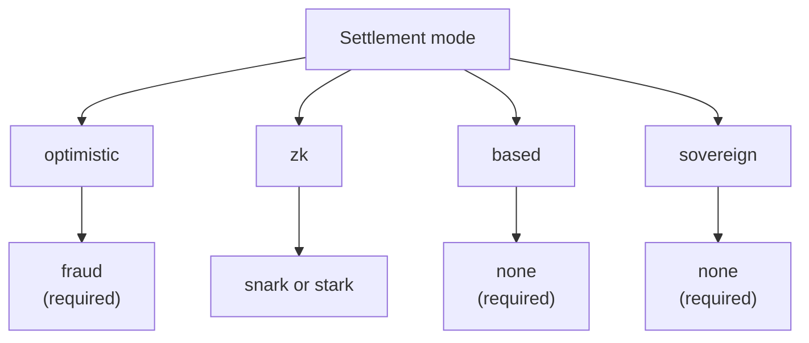

# Rollup'lara Genel Bakış

QoreChain **Rollup Development Kit (RDK)** — yani `x/rdk` modülü — geliştiricilerin QoreChain üzerinde mutabakata (settlement) ulaşan, uygulamaya özel rollup'lar başlatmasına olanak tanır. Her rollup; kendi blok süresi, sanal makinesi, ücret modeli ve sıralamasıyla (sequencing) bağımsız bir yürütme ortamıdır ve aynı zamanda QoreChain'in güvenliğini, post-kuantum kriptografisini ve veri erişilebilirliği (data availability) garantilerini devralır.

:::caution Erken aşama bir yetenek
RDK her iki ağda da dağıtılmıştır, ancak **henüz hiçbirinde bir rollup oluşturulmamıştır** (21 Ekim 2026 itibarıyla kontrol edildi); dolayısıyla bu bölümde anlatılan akışlar üçüncü taraflarca denenmemiştir. Ana ağ (**`qorechain-vladi`**, EVM zincir kimliği **9801**, 7 Haziran 2026'dan beri canlı) zincir sürümü **v3.2.3**'ü 3.742.566 yüksekliğine kadar, o bloktan itibaren ise **v3.2.4**'ü çalıştırır (yönetişim önerisi 13); test ağı (**`qorechain-diana`**, EVM zincir kimliği **9800**) 19 Ekim 2026'dan beri **v3.2.4** çalıştırır, bu nedenle ayrıntılar o yüksekliğe kadar ikisi arasında farklı olabilir. İki sürümün farklı olduğu yerlerde bu bölüm hangisinin ne zaman geçerli olduğunu belirtir. Her dağıtımı önce test ağında doğrulayın ve her sayfadaki durum notlarını okuyun: birçok yetenek (ZK doğrulaması, Celestia veri erişilebilirliği, QCAI Copilot, çapraz-VM çağrıları, mutabakat makbuzları) bugün uçtan uca kullanılamaz ve yayımlanan RDK istemcilerinin kendi sınırları da vardır (bkz. [RDK 0.6.0: değişiklikler ve sınırlar](/rollups/deploying-a-rollup#rdk-050-limits)).
:::

## Bugün neler mevcut {#what-exists-today}

| | Durum |
|---|---|
| Kayıtlı rollup'lar (ana ağ ve test ağı) | Yok |
| `x/rdk` modülü ve parametreleri | Her iki ağda da dağıtılmıştır; `qorechaind query rdk config` ile okuyun |
| RDK sorguları | Her iki ağda da CLI, gRPC ve REST (`/qorechain/rdk/v1/…`) üzerinden sunulur; bu nedenle TypeScript `rdk.params()` gibi REST tabanlı okumalar ana ağa karşı çalışır |
| RDK tarafından yazılan mutabakat çapaları | Yok. v3.2.2'den itibaren bir batch bir `anchor_signature` taşıyabilir ve bu durumda aynı işlemde `x/multilayer`'a çapalanır; bu alan olmadan batch çapasız olarak mutabık kalır. Henüz hiçbir rollup, katman veya çapa mevcut değildir. TypeScript RDK 0.6.0, istemcisi hibrit imzaladığında ve rollup'ın oluşturucusu olduğunda bu alanı gönderir (canlıda denenmedi); Python, Go, Rust ve Java istemcileri göndermez |
| `x/multilayer`'da kayıtlı rollup katmanları | Yok |
| Para çekme işlemleri | v3.2.3'ten beri rollup başına bir emanet (escrow) defterinden ödenir (bkz. [ZK / STARK ve Para Çekme](/rollups/zk-stark-withdrawals)); hiçbir rollup bulunmadığı için hiç yapılmamıştır |

Daha alt seviyedeki modül referansı — modül parametreleri, yaşam döngüsü iç işleyişi, yakım (burn) entegrasyonu ve çok katmanlı çapalama (multilayer anchoring) — için Mimari bölümündeki **[Rollup Development Kit](/architecture/rollup-development-kit)** sayfasına bakın. Bu Rollup'lar bölümü ise geliştiriciye dönük uygulama kılavuzudur: RDK nedir, hangi paradigma seçilmeli, dağıtım nasıl yapılır, veri erişilebilirliği nasıl çalışır ve para çekme işlemleri L2'den L1'e nasıl mutabık kılınır.

---

## RDK size ne sağlar

RDK ile oluşturulan bir rollup, dört yapılandırılabilir başlığı bir araya getirir:

| Başlık | Neyi kontrol eder | Seçenekler |
| ------- | ---------------- | ------- |
| **Mutabakat modu** | Rollup'ın durum geçişlerinin QoreChain üzerinde nasıl doğrulanıp kesinleştirileceğini | `optimistic`, `zk`, `based`, `sovereign` |
| **İspat sistemi** | Mutabakatı destekleyen kriptografik veya ekonomik mekanizmayı | `fraud`, `snark`, `stark`, `none` |
| **Sıralayıcı (sequencer) modu** | İşlemlerin mutabakattan önce kim tarafından sıralanacağını | `dedicated`, `shared`, `based` |
| **Veri erişilebilirliği** | Herkesin durumu yeniden oluşturabilmesi için işlem verilerinin nerede yayımlanacağını | `native`, `celestia`, `both` |

Her rollup benzersiz bir `rollup-id` ile kaydedilir, QOR cinsinden bir stake teminatıyla desteklenir ve bir yaşam döngüsü durumu (`pending`, `active`, `paused`, `stopped`) atanır. Oluşturma ve yaşam döngüsü akışının tamamı için **[Rollup Dağıtma](/rollups/deploying-a-rollup)** sayfasına bakın.

---

## QoreChain RDK'yı farklı kılan nedir

Herhangi bir rollup kitinin standart özelliklerinin ötesinde, QoreChain RDK; QoreChain'in Katman 1'i etrafında inşa edilmiş üç QoreChain'e özgü yetenek — artı bir watchtower otomatik itiraz (auto-challenger) çerçevesi — içerir. Bunların durumu farklıdır; tablo bugün nelerin çalıştığını söyler. RDK beş dilde (TypeScript, Python, Go, Rust, Java) yayımlanır. **0.6.0 sürümü beş kayıt defterinin tamamında yayımlanmıştır** (21 Ekim 2026'da kontrol edildi: npm `@qorechain/rdk`, `@qorechain/rdk-cli` ve `create-qorechain-rollup`; PyPI `qorechain-rdk`; crates.io `qorechain-rdk`; Maven Central `io.github.qorechain:qorechain-rdk`; Go modülü `v0.6.0`; proxy'nin `@latest` yanıtı hâlâ `v0.5.0` olduğundan bunu sabitlemelisiniz). Beşinden yalnızca TypeScript istemcisi hibrit işlemleri imzalar. `mainnet` ve `testnet` hazır profilleri, herkese açık `qore.host` uç noktalarını yerleşik olarak içerir; böylece `createRdkClient({ network })` hiçbir manuel uç nokta yapılandırması gerektirmez ve REST okumaları her iki ağa karşı çalışır.

| Farklılaştırıcı özellik | Ne yapar |
| -------------- | ------------ |
| **[Kuantuma dayanıklı mutabakat makbuzları](/rollups/settlement-receipts)** | Bir mutabakat çapasını, post-kuantum (ML-DSA-87 / Dilithium-5) imza taşıyan taşınabilir bir makbuz olarak paketler. Erken aşama: henüz hiçbir çapa mevcut değildir, dolayısıyla gerçek bir çapaya karşı hiçbir şey doğrulanmamıştır; bir makbuz zincir durumuna karşı kontrol edilmesi gereken bir iddiadır ve 0.6.0 doğrulayıcısı bunu yapar. |
| **[QCAI Rollup Copilot](/rollups/qcai-copilot)** | Tek bir rollup için salt okunur bir danışmanlık yardımcısı (ücret tahmini, öneriler, dolandırıcılık soruşturmaları). Okuduğu danışmanlık servisleri henüz herkese açık uç noktalarda sunulmamaktadır. |
| **[Çoklu-VM çapraz-VM çağrıları](/rollups/multi-vm)** | Çapraz-VM ön derlemesi (`0x…0901`) aracılığıyla bir EVM → QoreChain Native çağrısını kodlamaya yarayan araçlar. Ön derleme canlı ağlarda etkinleştirilmemiştir, bu nedenle bir çağrı hiçbir şey yapmaz; 0.6.0 kodlayıcısı zincirin çözdüğü düzenle eşleşir. |
| **[Watchtower](/rollups/watchtower)** | Optimistic rollup'lar için yeni batch'leri ve itiraz penceresi (challenge window) son tarihlerini ortaya çıkaran ve geçersiz batch'lere sizin geçerlilik yüklemenize (validity predicate) göre itiraz eden bir otomatik itiraz çerçevesi. REST üzerinden okur ve her iki ağ da bunu sunar; 0.6.0'dan itibaren her batch'in penceresini zincirin yaptığı gibi değerlendirir. |

Gerekçenin tamamı ve kod örnekleri için **[Neden QoreChain RDK](/rollups/why)** sayfasına bakın.

---

## Dört mutabakat paradigması

QoreChain RDK, her biri farklı güven varsayımlarına, kesinlik (finality) özelliklerine ve ispat gereksinimlerine sahip dört ayrı mutabakat modunu destekler. Mutabakat modu ile ispat sistemi kombinasyonu zincir üzerinde doğrulanır — uyumsuz bir eşleşme, oluşturma sırasında reddedilir. Aşağıdaki diyagram, her mutabakat modunu geçerli ispat sistemiyle eşler.

### Optimistic

Optimistic rollup'lar, gönderilen batch'lerin varsayılan olarak geçerli olduğunu kabul eder ve uyuşmazlık çözümü için **sahtecilik ispatlarına (fraud proofs)** dayanır.

* **İspat sistemi**: `fraud` — etkileşimli sahtecilik ispatları
* **Sıralayıcı**: `dedicated` veya `shared`
* **Kesinlik**: Yapılandırılabilir itiraz penceresi başarılı bir itiraz olmadan sona erene kadar gecikmelidir
* **Uyuşmazlıklar**: Pencere içinde herkes, bir teminat (bond) ve bir sahtecilik ispatı yayımlayarak gönderilmiş bir batch'e itiraz edebilir. İtiraz batch'i dondurur; ardından rollup'ı oluşturan taraf bunu çözer ve zincir ispatı kendisi kontrol eder — kanıtlanan sahtecilik batch'i reddeder ve itiraz edene ödeme yapar, reddedilen bir itiraz batch'i `submitted` durumuna geri döndürür. Bkz. [Rollup Dağıtma](/rollups/deploying-a-rollup#challenge-a-batch-optimistic-rollups).
* **Pencere uzunluğu**: varsayılan pencere 604.800 "saniyedir". **3.742.566 yüksekliğinden önce ana ağda (v3.2.3)** zincir bunu blok başına sabit 6 saniye üzerinden bloğa çevirir — **100.800 blok**; dolayısıyla gerçek geçen süre fiili blok süresini izler (ana ağın mevcut ≈3,2 sn'lik blokları ile yaklaşık 3,7 gün), bu nedenle gün cinsinden değil, blok cinsinden planlama yapın. **v3.2.4'ten itibaren**, yükseltme yüksekliğinden itibaren gönderilen bir batch, blok süresinin saniyesi cinsinden ölçülen bir pencere alır (tam 7 gün); daha önceki batch'ler blok sayısı kuralını korur. Yükseltme yüksekliği test ağında 8.337.253 (19 Ekim 2026'dan beri), mainnet'te 3.742.566'dır; dolayısıyla mainnet'te bu yüksekliğin altında gönderilen her batch için blok sayısı kuralı, bu yükseklikten itibaren ise blok süresi kuralı geçerlidir.

### ZK (Sıfır Bilgi / Zero-Knowledge)

ZK rollup'lar her batch'e, durum geçişinin doğruluğunu yeniden yürütme olmadan kanıtlayan kriptografik bir geçerlilik ispatı ekler.

* **İspat sistemi**: `snark` (özlü ispatlar) veya `stark` (şeffaf ispatlar, güvenilir kurulum gerektirmez)
* **Sıralayıcı**: `dedicated` veya `shared`
* **Kesinlik**: Geçerli ispat doğrulandığında — itiraz penceresi gerekmez
* **Olgunluk**: SNARK batch'leri, rollup ile birlikte saklanan bir doğrulama anahtarına karşı zincir üzerinde doğrulanır (BLS12-381 üzerinde Groth16). `create-rollup` ile oluşturulan bir rollup şu anda bir doğrulama anahtarı taşımaz, bu nedenle ZK batch'leri henüz uçtan uca kesinleştirilemez. STARK doğrulaması deneyseldir: isteğe bağlıdır ve sizin rollup'ınızın kendi durum geçişini değil, bir gösterim devresini kontrol eder. ZK mutabakatını üretime hazır değil kabul edin. Bkz. **[ZK / STARK ve Para Çekme](/rollups/zk-stark-withdrawals)**.

### Based

Based rollup'lar, işlem sıralamasını QoreChain (L1) önericilerine (proposers) devrederek ana zincirin canlılığını (liveness) ve sansüre direncini devralır.

* **İspat sistemi**: `none` — sıralama gerçeğinin kaynağı L1 önericileridir
* **Sıralayıcı**: `based` (zorunlu — zincir üstü doğrulamayla uygulanır)
* **Kesinlik**: Ana zincir onayını takip eder
* **Ödünleşim**: QoreChain doğrulayıcıları sıralamayı üstlendiği için en basit operasyonel model; karşılığında özel sıralayıcının sağladığı gecikme kontrolünden vazgeçilir
* **Bugünkü durum**: `based`, rollup yapılandırmasında kaydedilir, ancak QoreChain henüz L1 önericilerini batch gönderici olarak kabul etmez — batch'i rollup'ı oluşturan taraf gönderir (bkz. [Sıralayıcı modları](#sequencer-modes))

### Sovereign

Sovereign rollup'lar kendi konsensüslerini çalıştırır ve kendi kendilerini sıralarlar. Doğrulanabilirlik için durumlarını QoreChain'e çapalar, ancak kesinlik için ana zincire bağımlı değildirler.

* **İspat sistemi**: `none`
* **Sıralayıcı**: rollup tarafından kendi kendine yönetilir
* **Kesinlik**: Bağımsız — rollup'ın kendi konsensüsü tarafından belirlenir
* **Durum çapalama**: Durum kökleri (state roots) şeffaflık için QoreChain'e gönderilir, ancak ana zincir bunları zorunlu kılmaz

---

## İspat sistemi uyumluluğu

Mutabakat modu, hangi ispat sistemlerinin geçerli olduğunu kısıtlar. Bu eşleşmeler, rollup oluşturulurken zorunlu tutulur.

| Mutabakat modu | `fraud` | `snark` | `stark` | `none` |
| --------------- | :-----: | :-----: | :-----: | :----: |
| **optimistic**  | Zorunlu | — | — | — |
| **zk**          | — | Desteklenir | Desteklenir | — |
| **based**       | — | — | — | Zorunlu |
| **sovereign**   | — | — | — | Zorunlu |

---

## Sıralayıcı modları {#sequencer-modes}

Sıralayıcı, mutabakattan önce işlemlerin bir rollup bloğu içinde kim tarafından sıralanacağını belirler.

| Mod | Kim sıralar | Notlar |
| ---- | ------------- | ----- |
| **`dedicated`** | Tek bir belirlenmiş operatör adresi | En düşük gecikme; canlılık ve adil sıralama için operatöre güven gerektirir |
| **`shared`** | Paylaşımlı bir sıralayıcı kümesi | Sıralama küme genelinde dağıtılır; koordinasyon yükü biraz daha yüksektir |
| **`based`** | QoreChain L1 önericileri | Ana zincir doğrulayıcı güvenliğini ve sansüre direnci devralır; `based` mutabakatı için zorunludur |

:::note Bugün neler uygulanıyor
Zincir üzerinde bir batch'i yalnızca rollup'ın yapılandırılmış sıralayıcı adresi veya hiçbiri ayarlanmamışsa (tüm hazır profillerde durum budur) onu oluşturan taraf gönderebilir. `shared` ve `based` modları rollup yapılandırmasında kaydedilir, ancak QoreChain henüz paylaşımlı bir sıralayıcı listesini veya L1 önericilerini batch gönderici olarak kabul etmez; bu modlar amaçlanan tasarımı anlatır.
:::

---

## Paradigma seçimi

| Şunu istiyorsanız... | Şunu değerlendirin |
| -------------- | -------- |
| QoreChain doğrulayıcılarının sıraladığı en basit operasyonel kurulum | **based** |
| Kriptografik garantilerle hızlı kesinlik (henüz üretime hazır değil) | **zk** (`snark` / `stark`) |
| Ekonomik uyuşmazlık çözümüne sahip, iyi anlaşılmış bir model | **optimistic** (`fraud`) |
| Kendi konsensüsünüzle tam bağımsızlık, doğrulanabilirlik için çapalama | **sovereign** |

Nereden başlayacağınızdan emin değil misiniz? RDK, yaygın uygulama kategorileri için bu seçimleri paketleyen **hazır profiller** sunar — bkz. **[Hazır Profiller](/rollups/preset-profiles)** — ve danışmanlık RPC'si kullanılabilir olduğunda bir `suggest-profile` yardımcısı içerir (şu anda sabit bir `defi` yedeği döndürür, bu nedenle profil tablosundan seçim yapın).

Geliştiriciler için RDK ayrıca herkese açık TypeScript SDK'sı **`@qorechain/rdk`** ve aynı zincir üstü modülü koddan yöneten **`create-qorechain-rollup`** iskele oluşturucusu olarak da yayımlanır — bkz. **[Rollup Dağıtma](/rollups/deploying-a-rollup#deploy-with-the-typescript-rdk-qorechainrdk)**.

## İlgili sayfalar

* [Rollup Dağıtma](/rollups/deploying-a-rollup) — CLI'dan veya TypeScript RDK'dan bir rollup başlatın.
* [Hazır Profiller](/rollups/preset-profiles) — yaygın uygulama kategorileri için tek tıkla kullanılabilen paketler.
* [Veri Erişilebilirliği](/rollups/data-availability) — yerleşik DA yönlendiricisi ve blob depolama.
* [ZK / STARK Para Çekme](/rollups/zk-stark-withdrawals) — ispat destekli para çekme akışları.
