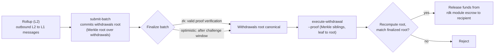

# ZK / STARK ve Para Çekme İşlemleri

Bu sayfa birbiriyle ilişkili iki konuyu kapsar: ZK ile çözümlenen (ZK-settled) rollup'lar tarafından kullanılan **ZK kanıt sistemleri** (`snark` ve `stark`) ve bir yığın (batch) sonuçlandırıldığında (finalized) fonları bir rollup'tan QoreChain'e geri taşıyan **L2 → L1 para çekme akışı**.

:::caution Erken aşama yeteneği
Henüz hiçbir ağda rollup oluşturulmadığından (27 Ekim 2026 itibarıyla kontrol edildi), burada açıklanan kanıt doğrulaması ve para çekme akışı canlı bir rollup üzerinde denenmemiştir. Para çekme işlemleri ana ağda yalnızca v3.2.3'ten itibaren (yükseklik 3,662,051, 20 Ekim 2026) başarılı olabilir; o tarihte rollup başına emanet defteri (escrow ledger) canlıya geçti ([Fonlar nereden gelir](#where-the-funds-come-from) bölümüne bakın); ondan önce her para çekme işlemi başarısız oluyordu. **ZK çözümü henüz her iki ağda da kullanılamaz** (`defi` profili ve her `zk` rollup'ı): zincirin bir doğrulama anahtarı kaydetmenin yolu yoktur, bu nedenle her ZK yığını ücreti ödendikten sonra reddedilir ve anahtar kaydı zincir v3.2.7 için planlanmıştır. STARK doğrulaması deneyseldir. **`qorechain-diana`** testnet'inde doğrulayın ve mainnet'te üretim düzeyinde sağlamlaştırılmış (production-hardened) garantiler varsaymayın.
:::

---

## ZK kanıt sistemleri

ZK ile çözümlenen bir rollup (`zk` çözüm modu), her çözüm yığınına bir geçerlilik kanıtı (validity proof) ekler ve rollup'ın işlemlerini yeniden çalıştırmadan durum geçişinin doğru olduğunu kanıtlar. ZK çözümü iki kanıt sistemini destekler:

| Kanıt sistemi | Özellikler |
| ------------ | --------------- |
| **`snark`** | Özlü (succinct) kanıtlar (BLS12-381 üzerinde Groth16), rollup'ın doğrulama anahtarına (verifying key) karşı zincir üstünde doğrulanır |
| **`stark`** | Şeffaf kanıtlar, güvenilir kurulum (trusted setup) yok — deneysel; isteğe bağlıdır (opt-in) ve bir gösterim devresine bağlıdır |

`zk` çözüm modu, `snark` veya `stark`'tan birini gerektirir; eşleşme, rollup oluşturulduğunda zincir üstünde uygulanır. Buna karşılık, `optimistic` çözümü `fraud` kanıt sistemini kullanır ve `based` ile `sovereign` çözümü `none` kullanır. Tam uyumluluk matrisi için bkz. **[Rollup'lara Genel Bakış](/rollups/overview)**.

### Sonuçlandırma (Finality)

Bir hile-kanıtı (fraud-proof) itiraz penceresini bekleyen optimistic rollup'ların aksine, bir ZK yığını **geçerli kanıt doğrulamasıyla**, bir anlaşmazlık penceresi olmadan sonuçlandırılabilir. Bu, ZK çözümünün temel ödünleşimidir (trade-off): kanıt üretmenin maliyeti ve karmaşıklığı karşılığında daha güçlü, daha hızlı sonuçlandırma.

### Olgunluk

**ZK çözümü henüz her iki ağda da kullanılamaz.** SNARK yığınlarının, rollup ile birlikte saklanan bir doğrulama anahtarına karşı zincir üstünde doğrulanması amaçlanır (BLS12-381 üzerinde Groth16; üç genel girdiyle: önceki durum kökü, yeni durum kökü ve veri hash'i). Zincirin bu anahtarı kaydetmenin yolu yoktur; bu nedenle `zk` çözümüyle oluşturulan bir rollup'ın, `defi` profilinden veya `defi-rollup` şablonundan gelen her rollup dahil, anahtarı yoktur ve gönderdiği her ZK yığını ücreti ödendikten sonra reddedilir. Anahtar kaydı zincir v3.2.7 için planlanmıştır; o yayına girene kadar bir ZK rollup'ı oluşturmayın ve fonlamayın. Yayına girdiğinde, `defi` şablonunun gösterim devresi (bir `snarkjs` çarpıcısı) yine de doğrulayamaz, çünkü zincirin kontrol ettiği genel girdilere sahip değildir; kendi devrenize ihtiyacınız olacak. RDK 0.7.0'dan itibaren `defi-rollup` şablonu bir yığın göndermeden önce durur; böylece zincirin her zaman reddedeceği bir yığın için artık ücret harcamaz. STARK doğrulaması deneyseldir: isteğe bağlıdır ve rollup'ınızın kendi durum geçişini değil, bir gösterim devresini kontrol eder. Bugün kullanabileceğiniz bir çözüm için `optimistic` seçin (`nft` ve `custom` profilleri).

---

## Yığınlar para çekme işlemlerini nasıl taşır

Bir rollup bir yığını çözümlediğinde, o yığın rollup'ın giden katmanlar arası mesajlarını — yani **L2 → L1 para çekme işlemlerini** — de işleyebilir (commit). Kavramsal olarak:

* Sonuçlandırılmış bir yığın, para çekme işlemleri kümesine ait bir bağlanmayı (commitment) (yığının para çekme mesajları üzerindeki bir Merkle kökü) taşıyabilir.
* Her bir para çekme işlemi, o kökün altında, yığın indeksiyle ve bir para çekme indeksiyle tanımlanan bir yapraktır (leaf).
* Yığın sonuçlandırıldığında, herhangi bir taraf belirli bir para çekme yaprağının işlenmiş kökün altında dahil edildiğini kanıtlayabilir ve ödemeyi tetikleyebilir.

Para çekme işlemlerinin çözüme bağlı olmasının nedeni budur: bir para çekme işlemi yalnızca **sonuçlandırılmış** bir yığına karşı yürütülebilir, çünkü işlenmiş para çekme kökünü kanonik yapan şey sonuçlandırmadır.

Yığınların nasıl gönderildiği ve sonuçlandırıldığı — optimistic rollup'lar için `submit-batch` ve `challenge-batch` anlaşmazlık yolu dahil — hakkında bilgi için bkz. **[Bir Rollup Dağıtma](/rollups/deploying-a-rollup)**.

---

## Bir para çekme işlemini yürütme: `execute-withdrawal`

`execute-withdrawal` komutu, sonuçlandırılmış bir yığının para çekme köküne karşı bir L2 → L1 para çekme işlemini sonuçlandırır. Bir para çekme yaprağının o kökte işlendiğini kanıtlar ve alıcıya rdk modül emanetinden (escrow) ödeme yapar. Bu eylem **izinsizdir (permissionless)** — herkes geçerli bir kanıt gönderebilir. Her yerel hat (native-lane) işlemi gibi hibrit kuantum sonrası ortak imzaya (co-signature) ihtiyaç duyar; bu yüzden `--generate-only` ile oluşturun ve cosign edin (bkz. [Bir Rollup Dağıtma](/rollups/deploying-a-rollup)). Para çekme işlemleri henüz canlı bir rollup üzerinde denenmemiştir; akışı test edilmemiş olarak değerlendirin. Bir ücret ödemeden önce şunları kontrol edin, çünkü aksi halde zincir işlemi reddeder: birim (denom) tam olarak `uqor` olmalı, miktar pozitif olmalı, kanıt en fazla 64 seviyeli olmalı ve her kardeş tam olarak 32 bayt olmalı, gönderen ve alıcı geçerli `qor1…` adresleri olmalı, yığın sonuçlandırılmış olmalı ve bir `withdrawals_root` işlemiş olmalı, rollup durdurulmamış olmalı ve o para çekme yaprağı daha önce ödenmemiş olmalıdır. TypeScript `@qorechain/rdk` (0.6.0 ve sonrası), bu kontrollerin ilk grubunu sizin için çalıştırır (`withdrawalErrors`: adresler, denom, miktar, kanıt derinliği ve kardeş uzunluğu) ve bunlardan herhangi biri başarısız olduğunda `executeWithdrawal` yayın yapmadan önce hata verir; 0.7.0'dan itibaren `qorollup withdraw --file withdrawal.json [--dry-run]` ayrıca kanıtı yığının para çekme işlemlerinden oluşturur ve sonuç yığının zincir üstündeki `withdrawals_root` değeri değilse ücret ödemeden önce reddeder; yığın, rollup ve defter koşulları zincir durumuna bağlıdır ve bu kontrol onu okumaz.

```bash
qorechaind tx rdk execute-withdrawal \
  [rollup-id] [batch-index] [withdrawal-index] [recipient] [denom] [amount] \
  --proof <sibling-hash-1>,<sibling-hash-2>,... \
  --from mykey \
  --chain-id qorechain-diana \
  --gas 400000 --fees 40000uqor \
  --generate-only > withdrawal.json
qorechaind tx pqc cosign withdrawal.json --from mykey --pqc-key mypqckey --chain-id qorechain-diana
```

**Konumsal argümanlar:**

| Argüman | Açıklama |
| -------- | ----------- |
| `rollup-id` | Para çekme işleminin ait olduğu rollup |
| `batch-index` | Para çekme kökü bu para çekme işlemini işleyen sonuçlandırılmış yığın |
| `withdrawal-index` | O yığın içindeki para çekme yaprağının indeksi |
| `recipient` | Ödeme yapılacak adres |
| `denom` | Ödenecek birim (denomination) |
| `amount` | Ödenecek miktar |

**Bayrak (Flag):**

| Bayrak | Açıklama |
| ---- | ----------- |
| `--proof` | Yapraktan köke doğru sıralanmış, para çekme yaprağının yığının para çekme kökünde işlendiğini kanıtlayan, virgülle ayrılmış onaltılık (hex) Merkle kardeş hash'leri |

`--proof` değeri dahil etme kanıtıdır (inclusion proof): para çekme yaprağından yığının işlenmiş para çekme köküne giden yol boyunca yer alan kardeş hash'ler. Modül, kökü yapraktan ve sağlanan kardeşlerden yeniden hesaplar ve ödeme yapmadan önce bunu sonuçlandırılmış yığının işlenmiş köküyle karşılaştırır.

### Yaprak ve düğüm kodlaması {#leaf-and-node-encoding}

* **Yaprak (ilk biçim, bugün ana ağda geçerli kural)** = `rollup_id`, bir `0x00` baytı, para çekme indeksi (8 bayt big-endian), `recipient` dizesi, `0x00`, `denom` dizesi, `0x00` ve `amount` (8 bayt big-endian) değerlerinin SHAKE-256'sı (32 bayt).
* **Yaprak (ikinci biçim, şimdilik testnet'te, v3.2.5 yükseltmesinden sonra ana ağda)**: zincir v3.2.5'ten gelen yığınlar için yaprak ayrıca zincir kimliğini belirtir. RDK her iki biçimi de oluşturur (`withdrawalLeafV1`, `withdrawalLeafV2`).
* **Ebeveyn** = `left || right` değerinin SHAKE-256'sı. Her seviyede para çekme indeksinin ilgili biti tarafı belirler: `0`, yaprağın (veya o ana kadarki hash'in) sol düğüm olduğu anlamına gelir; dolayısıyla yaprağın ağaçtaki konumu para çekme indeksidir.
* Her kardeş hash tam olarak 32 bayt olmalıdır.
* **Para çekme kökü (şimdilik testnet'te, yükseltmeden sonra ana ağda):** zincir v3.2.5'ten itibaren bir yığının `withdrawals_root` değeri ya boştur ya da tam olarak 32 bayttır; ana ağda (v3.2.4) bu uzunluk kuralı henüz uygulanmaz.

Bu ağacı elle kurmayın. `@qorechain/rdk` 0.7.0'daki `withdrawalsTree` (ve Python, Go, Rust ve Java karşılıkları) bir yığının para çekme kökünü ve her kanıtı tam olarak zincirin yaptığı gibi oluşturur ve zincirin kendi doğrulayıcısına karşı kontrol edilmiştir; `assembleWithdrawalProof` varsayılan olarak zincirin ağacını oluşturur ve genel Merkle yardımcıları artık varsayılan olarak SHAKE-256 kullanır.

:::caution 0.7.0 öncesi sürümler
`@qorechain/rdk` 0.6.2 ve öncesinde genel `binaryMerkleRoot` / `binaryMerkleProof` yardımcıları (ve Python, Go, Rust ve Java karşılıkları) varsayılan olarak tek düğümleri çoğaltan SHA-256 kullanıyor ve her yaprağı yeniden hash'liyordu; oysa zincir SHAKE-256 kullanır ve yapraklarını para çekme işleminden kurar, bu yüzden bu varsayılanlarla oluşturulan bir kanıt zincir üstünde hiçbir zaman doğrulanmadı. 0.7.0'a yükseltin veya hash'i ve yaprak kodlamasını yukarıdaki kurallara göre geçersiz kılın, aksi halde kanıt zincir üstünde doğrulanmaz.
:::

### Fonlar nereden gelir {#where-the-funds-come-from}

Bir para çekme işlemi, **rollup'ın kendi emanete alınmış stake'inden** (stake eksi %1'lik oluşturma yakması) ödenir. Tüm rollup'ların emaneti tek bir havuzlanmış modül bakiyesinde durur ve **v3.2.3**'ten beri rollup başına bir **emanet defteri (escrow ledger)**, her rollup'ın neyi elinde tuttuğunun hesabıdır: `create-rollup` onu rollup'ın tuttuğu emanetle alacaklandırır, bir para çekme işlemi veya hile-kanıtı ödülü ondan ödenir ve ona borç yazılır, ve rollup'ın hâlâ elinde tuttuğundan büyük bir para çekme işlemi emanet yetersiz hatasıyla reddedilir. `stop-rollup` yalnızca kalanı iade eder ve defteri sıfırlar; durdurulmuş bir rollup başka para çekme işlemi ödemez. Bu nedenle bir rollup için kanıtlanan bir para çekme işlemi başka bir rollup'ın stake'inden ödenemez. Rollup sorguları `escrow_balance` taşır (o rollup için hâlâ tutulan uqor). Modülde L1 → L2 para yatırma mesajı yoktur, bu nedenle bu, kullanıcı fonlarının bir köprüsü değildir.

---

## Uçtan uca para çekme akışı

*L2'den L1'e yol: bir çözüm yığını bir para çekme kökü işler, yığın sonuçlandırılır, ardından izinsiz bir dahil etme kanıtı QoreChain üzerindeki emanetteki fonları serbest bırakır.*



1. **Bir yığını çözümleyin.** Rollup operatörü, `submit-batch` ile bir çözüm yığını gönderir. Yığın, giden L2 → L1 mesajları üzerinde bir para çekme kökü işleyebilir.
2. **Sonuçlandırın.** Yığın, rollup'ın çözüm moduna göre sonuçlandırılır — `zk` için geçerli kanıt doğrulamasıyla veya `optimistic` için itiraz penceresinden sonra (bu sırada `challenge-batch` ona itiraz edebilir). Testnet'te zincir v3.2.5'ten beri (ana ağda yükseltmeden sonra) yığınlar ayrıca kesinlikle dizin sırasıyla sonuçlandırılır; bu yüzden bir yığın, hâlâ `submitted` veya `challenged` durumundaki daha önceki her yığını bekler. Optimistic pencere, v3.2.4 yükseltmesinden önce gönderilen bir yığın için varsayılan olarak 100,800 bloktur; v3.2.4'ten itibaren, yükseltme yüksekliğinden itibaren gönderilen yığınlar için blok zamanının saniyesi cinsinden ölçülür (testnet'te 19 Ekim 2026'da 8,337,253 yüksekliğinden, ana ağda 23 Ekim 2026'da 3,742,566 yüksekliğinden itibaren).
3. **Kanıtlayın ve yürütün.** Sonuçlandırıldığında, herkes belirli para çekme yaprağı için Merkle dahil etme kanıtıyla (`--proof`) `execute-withdrawal`'ı gönderir. Modül, dahil etmeyi sonuçlandırılmış yığının para çekme köküne karşı doğrular ve alıcıya emanetten ödeme yapar.

Adım 3 izinsiz ve kanıt tabanlı olduğundan, onu taşıyan yığın sonuçlandırıldıktan sonra bir para çekme işlemi rollup operatörünün işbirliğine bağlı değildir.

---

## İlgili

* **[Rollup'lara Genel Bakış](/rollups/overview)** — çözüm paradigmaları ve kanıt-sistemi uyumluluk matrisi.
* **[Bir Rollup Dağıtma](/rollups/deploying-a-rollup)** — `submit-batch` ve `challenge-batch` operatör komutları.
* **[Rollup Geliştirme Kiti](/architecture/rollup-development-kit)** — alt düzey modül referansı.
