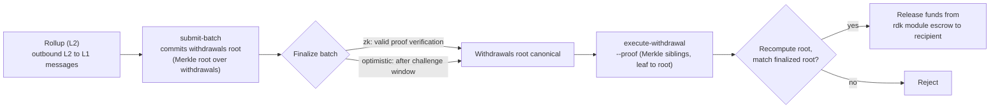

# ZK / STARK ve Para Çekme İşlemleri

Bu sayfa birbiriyle ilişkili iki konuyu kapsar: ZK ile çözümlenen (ZK-settled) rollup'lar tarafından kullanılan **ZK kanıt sistemleri** (`snark` ve `stark`) ve bir yığın (batch) sonuçlandırıldığında (finalized) fonları bir rollup'tan QoreChain'e geri taşıyan **L2 → L1 para çekme akışı**.

:::caution Erken aşama yeteneği
Henüz hiçbir ağda rollup oluşturulmadığından, burada açıklanan kanıt doğrulaması ve para çekme akışı canlı bir rollup üzerinde denenmemiştir. SNARK doğrulaması mevcuttur ancak `create-rollup` ile oluşturulan bir rollup henüz bir ZK yığınını sonuçlandıramaz ve STARK doğrulaması deneyseldir. **`qorechain-diana`** testnet'inde doğrulayın ve mainnet'te üretim düzeyinde sağlamlaştırılmış (production-hardened) garantiler varsaymayın.
:::

---

## ZK kanıt sistemleri

ZK ile çözümlenen bir rollup (`zk` çözüm modu), her çözüm yığınına bir geçerlilik kanıtı (validity proof) ekler ve rollup'ın işlemlerini yeniden çalıştırmadan durum geçişinin doğru olduğunu kanıtlar. ZK çözümü iki kanıt sistemini destekler:

| Kanıt sistemi | Özellikler |
| ------------ | --------------- |
| **`snark`** | Özlü (succinct) kanıtlar (BLS12-381 üzerinde Groth16), rollup'ın doğrulama anahtarına (verifying key) karşı zincir üstünde doğrulanır |
| **`stark`** | Şeffaf kanıtlar, güvenilir kurulum (trusted setup) yok — deneysel; isteğe bağlıdır (opt-in) ve bir gösterim devresine bağlıdır |

`zk` çözüm modu, `snark` veya `stark`'tan birini gerektirir; eşleşme, rollup oluşturulduğunda zincir üstünde uygulanır. Buna karşılık, `optimistic` çözümü `fraud` kanıt sistemini kullanır ve `based` ile `sovereign` çözümü `none` kullanır. Tam uyumluluk matrisi için bkz. **[Rollup'lara Genel Bakış](/rollups/overview)**.

### Sonuçlandırma (Finality)

Bir hile-kanıtı (fraud-proof) itiraz penceresini bekleyen optimistic rollup'ların aksine, bir ZK yığını **geçerli kanıt doğrulamasıyla**, bir anlaşmazlık penceresi olmadan sonuçlandırılabilir. Bu, ZK çözümünün temel ödünleşimidir (trade-off): kanıt üretmenin maliyeti ve karmaşıklığı karşılığında daha güçlü, daha hızlı sonuçlandırma.

### Olgunluk

SNARK yığınları, rollup ile birlikte saklanan bir doğrulama anahtarına karşı zincir üstünde doğrulanır (BLS12-381 üzerinde Groth16). `create-rollup` ile oluşturulan bir rollup şu anda bir doğrulama anahtarı taşımaz; bu nedenle ZK yığınları henüz uçtan uca sonuçlandırılamaz. STARK doğrulaması deneyseldir: isteğe bağlıdır ve rollup'ınızın kendi durum geçişini değil, bir gösterim devresini kontrol eder. ZK çözümünü üretime hazır değil olarak ele alın ve değer taşıyan mainnet rollup'ları için ona güvenmeden önce RDK'nın sürüm notlarını takip edin.

---

## Yığınlar para çekme işlemlerini nasıl taşır

Bir rollup bir yığını çözümlediğinde, o yığın rollup'ın giden katmanlar arası mesajlarını — yani **L2 → L1 para çekme işlemlerini** — de işleyebilir (commit). Kavramsal olarak:

* Sonuçlandırılmış bir yığın, para çekme işlemleri kümesine ait bir bağlanmayı (commitment) (yığının para çekme mesajları üzerindeki bir Merkle kökü) taşıyabilir.
* Her bir para çekme işlemi, o kökün altında, yığın indeksiyle ve bir para çekme indeksiyle tanımlanan bir yapraktır (leaf).
* Yığın sonuçlandırıldığında, herhangi bir taraf belirli bir para çekme yaprağının işlenmiş kökün altında dahil edildiğini kanıtlayabilir ve ödemeyi tetikleyebilir.

Para çekme işlemlerinin çözüme bağlı olmasının nedeni budur: bir para çekme işlemi yalnızca **sonuçlandırılmış** bir yığına karşı yürütülebilir, çünkü işlenmiş para çekme kökünü kanonik yapan şey sonuçlandırmadır.

Yığınların nasıl gönderildiği ve sonuçlandırıldığı — optimistic rollup'lar için `submit-batch` ve `challenge-batch` anlaşmazlık yolu dahil — hakkında bilgi için bkz. **[Bir Rollup Dağıtma](/rollups/deploying-a-rollup)**.

---

## Bir para çekme işlemini yürütme: `execute-withdrawal`

`execute-withdrawal` komutu, sonuçlandırılmış bir yığının para çekme köküne karşı bir L2 → L1 para çekme işlemini sonuçlandırır. Bir para çekme yaprağının o kökte işlendiğini kanıtlar ve alıcıya rdk modül emanetinden (escrow) ödeme yapar. Bu eylem **izinsizdir (permissionless)** — herkes geçerli bir kanıt gönderebilir. Her yerel hat (native-lane) işlemi gibi hibrit kuantum sonrası ortak imzaya (co-signature) ihtiyaç duyar; bu yüzden `--generate-only` ile oluşturun ve cosign edin (bkz. [Bir Rollup Dağıtma](/rollups/deploying-a-rollup)). Para çekme işlemleri henüz canlı bir rollup üzerinde denenmemiştir; akışı test edilmemiş olarak değerlendirin.

```bash
qorechaind tx rdk execute-withdrawal \
  [rollup-id] [batch-index] [withdrawal-index] [recipient] [denom] [amount] \
  --proof <sibling-hash-1>,<sibling-hash-2>,... \
  --from mykey \
  --chain-id qorechain-diana \
  --gas 400000 --fees 40000uqor \
  --generate-only > withdrawal.json
qorechaind tx pqc cosign withdrawal.json --from mykey --pqc-key mypqckey --chain-id qorechain-diana
```

**Konumsal argümanlar:**

| Argüman | Açıklama |
| -------- | ----------- |
| `rollup-id` | Para çekme işleminin ait olduğu rollup |
| `batch-index` | Para çekme kökü bu para çekme işlemini işleyen sonuçlandırılmış yığın |
| `withdrawal-index` | O yığın içindeki para çekme yaprağının indeksi |
| `recipient` | Ödeme yapılacak adres |
| `denom` | Ödenecek birim (denomination) |
| `amount` | Ödenecek miktar |

**Bayrak (Flag):**

| Bayrak | Açıklama |
| ---- | ----------- |
| `--proof` | Yapraktan köke doğru sıralanmış, para çekme yaprağının yığının para çekme kökünde işlendiğini kanıtlayan, virgülle ayrılmış onaltılık (hex) Merkle kardeş hash'leri |

`--proof` değeri dahil etme kanıtıdır (inclusion proof): para çekme yaprağından yığının işlenmiş para çekme köküne giden yol boyunca yer alan kardeş hash'ler. Modül, kökü yapraktan ve sağlanan kardeşlerden yeniden hesaplar ve ödeme yapmadan önce bunu sonuçlandırılmış yığının işlenmiş köküyle karşılaştırır.

### Yaprak ve düğüm kodlaması {#leaf-and-node-encoding}

* **Yaprak** = `rollup_id`, bir `0x00` baytı, para çekme indeksi (8 bayt big-endian), `recipient` dizesi, `0x00`, `denom` dizesi, `0x00` ve `amount` (8 bayt big-endian) değerlerinin SHAKE-256'sı (32 bayt).
* **Ebeveyn** = `left || right` değerinin SHAKE-256'sı. Her seviyede para çekme indeksinin ilgili biti tarafı belirler: `0`, yaprağın (veya o ana kadarki hash'in) sol düğüm olduğu anlamına gelir.
* Her kardeş hash tam olarak 32 bayt olmalıdır.

:::caution Genel Merkle yardımcıları eşleşmez
RDK'nın genel `binaryMerkleRoot` / `binaryMerkleProof` yardımcıları varsayılan olarak tek düğümleri çoğaltan SHA-256 kullanır. Hash'i ve yaprak kodlamasını yukarıdaki kurallara göre geçersiz kılın, aksi halde kanıt zincir üstünde doğrulanmaz.
:::

### Fonlar nereden gelir {#where-the-funds-come-from}

Bir para çekme işlemi, **rollup'ın kendi emanete alınmış stake'inden** (stake eksi oluşturma yakması) ödenir. Modül rollup başına bir defter tutar; böylece bir rollup için kanıtlanan bir para çekme işlemi başka bir rollup'ın stake'inden ödenemez. Modülde L1 → L2 para yatırma mesajı yoktur, bu nedenle bu, kullanıcı fonlarının bir köprüsü değildir.

---

## Uçtan uca para çekme akışı

*L2'den L1'e yol: bir çözüm yığını bir para çekme kökü işler, yığın sonuçlandırılır, ardından izinsiz bir dahil etme kanıtı QoreChain üzerindeki emanetteki fonları serbest bırakır.*



1. **Bir yığını çözümleyin.** Rollup operatörü, `submit-batch` ile bir çözüm yığını gönderir. Yığın, giden L2 → L1 mesajları üzerinde bir para çekme kökü işleyebilir.
2. **Sonuçlandırın.** Yığın, rollup'ın çözüm moduna göre sonuçlandırılır — `zk` için geçerli kanıt doğrulamasıyla veya `optimistic` için itiraz penceresinden sonra (bu sırada `challenge-batch` ona itiraz edebilir).
3. **Kanıtlayın ve yürütün.** Sonuçlandırıldığında, herkes belirli para çekme yaprağı için Merkle dahil etme kanıtıyla (`--proof`) `execute-withdrawal`'ı gönderir. Modül, dahil etmeyi sonuçlandırılmış yığının para çekme köküne karşı doğrular ve alıcıya emanetten ödeme yapar.

Adım 3 izinsiz ve kanıt tabanlı olduğundan, onu taşıyan yığın sonuçlandırıldıktan sonra bir para çekme işlemi rollup operatörünün işbirliğine bağlı değildir.

---

## İlgili

* **[Rollup'lara Genel Bakış](/rollups/overview)** — çözüm paradigmaları ve kanıt-sistemi uyumluluk matrisi.
* **[Bir Rollup Dağıtma](/rollups/deploying-a-rollup)** — `submit-batch` ve `challenge-batch` operatör komutları.
* **[Rollup Geliştirme Kiti](/architecture/rollup-development-kit)** — alt düzey modül referansı.
